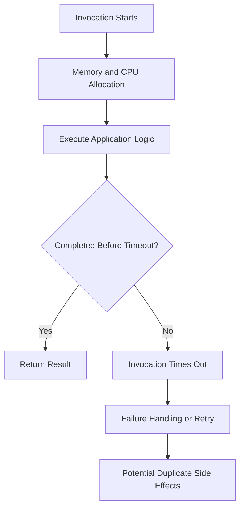

# 05- Timeout and Memory Configuration

## Overview

AWS Lambda timeout and memory configuration directly affect execution reliability, latency, concurrency capacity, and operating cost. Incorrect settings can cause intermittent failures, incomplete processing, downstream request accumulation, and unnecessary spending.

Memory and timeout must be configured together. Memory determines the resources allocated to the execution environment, including CPU allocation, while timeout establishes the maximum duration an invocation can run before Lambda terminates it.

For Python backend workloads, these settings affect database queries, HTTP requests, file processing, serialization, machine-learning inference, and event-driven consumers.

A production configuration should be based on measured workload behavior, dependency latency, throughput requirements, and failure-recovery expectations—not arbitrary defaults.

## Lambda Memory Configuration

### What memory controls

Lambda memory configuration determines the memory available to the function's execution environment. CPU allocation increases with configured memory, so increasing memory can improve performance even when the function is not close to exhausting RAM.

For example, a CPU-bound Python function may execute faster at a higher memory setting because it receives more CPU capacity.

### Memory range

Lambda memory can be configured from **128 MB to 10,240 MB**, in 1 MB increments.

The appropriate value depends on the workload's memory footprint and performance characteristics. Validate current service limits and configuration constraints against the AWS Lambda documentation before deploying changes.

### Memory versus performance

Consider a Python function that processes a large JSON document.

At a lower memory setting, the function may experience:

- Less CPU capacity.
- Longer JSON parsing and transformation times.
- Greater risk of memory exhaustion.
- Longer invocation duration.

Increasing memory may reduce execution time enough to offset the higher configured memory allocation. However, a memory increase does not guarantee a proportional speedup, especially when execution is dominated by network latency or external dependencies.

### Memory and CPU relationship

| Workload characteristic | Configuration consideration |
|---|---|
| CPU-intensive calculations | Benchmark higher memory allocations |
| Large in-memory datasets | Measure peak memory usage and leave sufficient headroom |
| Network-bound operations | Optimize connection reuse, concurrency, and dependency latency before assuming more memory is needed |
| Image or document processing | Measure memory peaks and processing duration using representative files |
| Lightweight event handlers | Start with a modest allocation and measure before increasing it |
| Native libraries or machine-learning inference | Benchmark memory and CPU together, including initialization overhead |

Do not select memory based only on the average size of input events. The runtime, imported modules, intermediate objects, caches, and native allocations also consume memory.

## Lambda Timeout Configuration

### What timeout controls

The timeout defines the maximum execution duration allowed for a single invocation. If the invocation exceeds the configured limit, Lambda terminates it.

The configurable function timeout ranges from **1 second to 900 seconds (15 minutes)**.

A timeout is a hard execution boundary, not a substitute for explicit dependency timeouts or application-level deadlines.

### Why timeouts occur

Common causes include:

- Slow or unavailable downstream services.
- Database connection establishment delays.
- Queries that lack appropriate indexes or query limits.
- HTTP clients without suitable connection and read timeouts.
- Excessive processing of large payloads.
- Deadlocks or blocked threads.
- Unexpected retries within application code.
- Memory or CPU pressure that increases execution duration.

A timeout may occur even when the function's business operation has already produced an external side effect. For example, a payment provider may complete a charge while the Lambda function waits for a response. A retry must account for that ambiguity.

### Timeout configuration principles

Set the timeout according to the expected processing duration and the maximum acceptable latency.

- Allow sufficient time for normal work and reasonable dependency variation.
- Set explicit connection and read timeouts on external calls.
- Reserve time for result persistence, error handling, and cleanup.
- Use a stable overall deadline for multi-step operations.
- Avoid allowing a function to wait indefinitely for a dependency.
- Keep the timeout within the event source's delivery and retry constraints.

A longer timeout does not automatically improve reliability. It can increase the time a failed invocation occupies resources, delay retries, and extend the time before an event becomes available for redelivery.

## Memory and Timeout Work Together

Memory and timeout should be evaluated as a pair because memory affects execution speed while timeout constrains how long execution can continue.



For a CPU-bound workload, increasing memory may reduce execution duration and improve the probability of finishing before the timeout.

For a network-bound workload, increasing memory may provide little improvement if most time is spent waiting on a slow database or API. In that case, connection management, query optimization, bounded concurrency, and dependency timeouts are often more effective.

### Example

Suppose a function takes 8 seconds at 512 MB and 4 seconds at 1,024 MB.

The second configuration uses more memory but completes in half the time. Whether it is cheaper depends on the configured memory, billed duration, applicable pricing, and other workload characteristics.

Do not assume that the lowest memory setting produces the lowest cost. Benchmark the actual workload.

## Configure Memory and Timeout with the AWS CLI

The following commands inspect and modify function configuration.

### Inspect current settings

This is a read-only command.

```bash
aws lambda get-function-configuration \
  --function-name process-orders \
  --query '{Function:FunctionName,Memory:MemorySize,Timeout:Timeout,State:State,LastUpdateStatus:LastUpdateStatus}' \
  --output table
```

It displays the configured memory and timeout along with function state and update status.

### Update memory

This command modifies the function configuration.

```bash
aws lambda update-function-configuration \
  --function-name process-orders \
  --memory-size 1024
```

### Update timeout

This command modifies the function configuration.

```bash
aws lambda update-function-configuration \
  --function-name process-orders \
  --timeout 30
```

Replace `process-orders` with the intended function name and verify the active AWS account and Region before making changes.

### Verify the update

```bash
aws lambda get-function-configuration \
  --function-name process-orders \
  --query '{Memory:MemorySize,Timeout:Timeout,LastUpdateStatus:LastUpdateStatus,LastUpdateStatusReason:LastUpdateStatusReason}' \
  --output json
```

Configuration updates are asynchronous. Wait until `LastUpdateStatus` reports `Successful` before relying on the new configuration for deployment verification or performance testing.

If the function is invoked through an alias, ensure the intended version and deployment workflow are being tested. Published versions are immutable snapshots of code and configuration; changing the unqualified function configuration does not rewrite an already published version.

## Set Appropriate Timeouts for Downstream Calls

The Lambda timeout should not be the only timeout in the application. Dependencies should have explicit limits so that the application can respond to failures before the invocation reaches its execution boundary.

### Python HTTP client example

```python
import requests


def fetch_customer(customer_id: str) -> dict:
    response = requests.get(
        f"https://customer-service.example.com/customers/{customer_id}",
        timeout=(2.0, 5.0),
    )
    response.raise_for_status()
    return response.json()
```

The timeout tuple specifies a connection timeout and a read timeout. The read timeout is not a universal total-operation deadline, so a request can take longer than the sum of those values under some conditions.

For a multi-step workflow, use the Lambda context's remaining execution time to establish an overall deadline and ensure each downstream operation fits within the remaining budget.

### Use the remaining execution time

```python
def handler(event, context):
    safety_margin_ms = 1_000
    remaining_ms = context.get_remaining_time_in_millis()

    if remaining_ms <= safety_margin_ms:
        raise TimeoutError("Insufficient time to start processing")

    operation_budget_ms = remaining_ms - safety_margin_ms

    return process_event(
        event,
        timeout_ms=operation_budget_ms,
    )
```

This example assumes `process_event` enforces the supplied deadline across its dependencies. Passing a timeout value to a function does not enforce it unless the underlying operations honor that value.

A safety margin should account for result persistence, logging, and failure handling. Choose the margin based on the workload rather than treating one second as universally sufficient.

## Memory Optimization and Benchmarking

### Use representative workloads

Benchmark memory settings with realistic input sizes, data distributions, concurrency, and dependency behavior.

Measure:

- Invocation duration.
- Peak memory utilization.
- Error and timeout rates.
- Initialization duration where relevant.
- Throughput under expected concurrency.
- Cost per successful business operation.

A benchmark that processes one small event may not reveal memory exhaustion under production payload sizes or contention.

### Compare configurations

Test several memory allocations while holding other relevant variables constant.

| Measurement | Why it matters |
|---|---|
| Duration | Indicates execution latency and performance |
| Maximum memory used | Identifies memory pressure and available headroom |
| Error rate | Reveals whether performance changes affect reliability |
| Throughput | Measures completed work per unit of time |
| Cost per successful operation | Connects performance improvements to business cost |
| Downstream latency | Helps distinguish application bottlenecks from dependency bottlenecks |

Use CloudWatch Lambda Insights where appropriate for additional runtime metrics, including memory-related observations. Instrument application-level metrics when you need business-level throughput or dependency latency.

### Avoid optimizing only for average duration

A function that averages 200 ms but occasionally takes 20 seconds may violate a latency objective even if its mean looks healthy.

Evaluate percentile latency, timeout frequency, and behavior during dependency degradation. Tail latency is particularly important for synchronous APIs and functions that process batches.

## Cost Considerations

Lambda compute pricing is influenced by configured memory and billed execution duration, subject to the applicable pricing model and additional charges.

A higher memory allocation can increase the cost per unit of execution time while reducing duration. Depending on the workload, the result can be a lower, similar, or higher cost per invocation.

### Practical cost optimization

- Benchmark multiple memory configurations.
- Compare cost per successful operation rather than cost per invocation alone.
- Remove unnecessary work and expensive imports.
- Reuse suitable SDK clients and network connections.
- Reduce repeated downstream requests.
- Use batching where it improves efficiency without violating latency or memory constraints.
- Monitor retries and timeouts, which consume resources without necessarily producing useful business outcomes.
- Account for logging, networking, storage, and downstream service costs in addition to Lambda compute.

Use the current AWS Lambda pricing documentation for the target Region and architecture when estimating cost. Pricing and billing details can change, so do not hardcode historical rates into long-lived engineering guidance.

## Event Source and Timeout Interactions

The correct timeout depends partly on how the function is invoked.

### SQS event source mappings

For SQS-triggered functions, the queue visibility timeout must be coordinated with the Lambda timeout and batching window.

AWS recommends configuring the visibility timeout to at least six times the function timeout for standard SQS event source mappings, with additional consideration for the batching window where applicable.

If visibility expires while a message is still being processed, another consumer may receive it. This can cause duplicate work unless the operation is idempotent.

### Stream event sources

For Kinesis and DynamoDB Streams, timeout behavior interacts with batch processing, retries, checkpoints, and shard progress. A slow or repeatedly failing record can delay progress according to the configured failure-handling behavior.

Use bounded processing times, appropriate batch sizes, and source-specific retry and checkpoint configuration.

### Synchronous APIs

For API Gateway or another synchronous caller, the caller's timeout and integration limits must also be considered. A Lambda function that continues processing after the caller has stopped waiting can create ambiguous outcomes and duplicate requests if the client retries.

Set timeouts across the request path deliberately, and use idempotency for operations that can be repeated.

## Monitoring and Troubleshooting

Timeout and memory settings should be monitored continuously because workload characteristics change as payload sizes, traffic patterns, dependencies, and application code evolve.

### Useful metrics

| Metric or signal | What it reveals |
|---|---|
| `Duration` | Execution time and proximity to timeout |
| `Errors` | Failed invocations, including timeout-related failures |
| `Throttles` | Invocation attempts constrained by concurrency or service limits |
| `Invocations` | Workload volume |
| `ConcurrentExecutions` | Current concurrent execution demand |
| `Max Memory Used` through Lambda Insights, where available | Memory pressure and sizing opportunities |
| Application dependency latency | Time spent waiting on external systems |
| SQS oldest-message age | Whether slow processing is delaying queue progress |

Check the exact metric names, dimensions, and availability for the relevant monitoring integration.

### Diagnostic workflow

**Symptom → Possible causes → Isolation strategy → Root cause verification → Corrective action → Prevention**

#### Function times out

1. Inspect CloudWatch logs for the last completed operation.
2. Compare execution duration with the configured timeout.
3. Identify slow database queries, network calls, or synchronous dependency chains.
4. Verify connection, read, and database statement timeouts.
5. Reproduce with representative payloads.
6. Optimize the bottleneck or adjust the timeout based on measured requirements.

#### Memory utilization approaches the configured limit

1. Inspect Lambda Insights or available memory metrics.
2. Reproduce with representative payload sizes.
3. Profile memory-intensive parsing, transformation, and library usage.
4. Check for retained global objects, unbounded caches, or accidental data duplication.
5. Increase memory if required, or reduce peak memory consumption.
6. Validate performance and cost after the change.

#### Higher memory does not improve performance

1. Measure CPU-intensive work separately from dependency wait time.
2. Inspect database and external API latency.
3. Check connection reuse and query efficiency.
4. Reduce unnecessary serialization and network round trips.
5. Benchmark again before selecting the final memory allocation.

## Common Mistakes

| Mistake | Consequence | Better approach |
|---|---|---|
| Choosing memory based only on the minimum needed to start | Slow CPU-bound execution and potentially higher total cost | Benchmark memory and duration together |
| Setting the timeout to the maximum by default | Slow failure detection and delayed recovery | Set a workload-appropriate deadline |
| Relying only on the Lambda timeout for HTTP calls | Work can remain blocked until the invocation expires | Set explicit connection and read timeouts |
| Ignoring peak memory usage | Production failures on large payloads | Test realistic worst-case inputs |
| Increasing memory to fix a network bottleneck | Higher configured allocation without meaningful speedup | Profile dependency latency first |
| Setting SQS visibility timeout too low | Premature message redelivery and duplicate processing | Align visibility timeout with function timeout and batching |
| Ignoring retries when calculating cost | Failed attempts consume compute without completing useful work | Measure cost per successful operation |
| Testing only average latency | Tail latency can cause timeouts despite healthy averages | Monitor percentiles and timeout frequency |
| Changing configuration without checking the deployed version | The tested alias may still point to an older configuration | Verify function versions and aliases |
| Updating production settings without measurement | Unexpected latency, cost, or reliability regressions | Use staged changes and post-deployment verification |

## Production Readiness Checklist

### Configuration

- [ ] Memory is selected using representative performance and memory measurements.
- [ ] Timeout reflects the business latency objective and processing requirements.
- [ ] Connection and read timeouts are configured for external dependencies.
- [ ] Application operations respect the remaining invocation time.
- [ ] Published versions and aliases point to the intended configuration.

### Reliability

- [ ] Timeout and memory failures have appropriate alerts.
- [ ] Retry behavior is compatible with the configured timeout.
- [ ] Idempotency protects business operations from duplicate attempts.
- [ ] SQS visibility timeout and batching settings are aligned where applicable.
- [ ] Long-running work is split into asynchronous steps or workflows when appropriate.

### Performance and cost

- [ ] Representative payload sizes and peak memory usage have been tested.
- [ ] Duration, error rate, and relevant percentile latency are monitored.
- [ ] Memory benchmarks compare cost per successful operation.
- [ ] Downstream bottlenecks are distinguished from Lambda resource constraints.
- [ ] Configuration changes are verified after deployment.

## Key Takeaways

- Lambda memory controls available memory and influences CPU allocation; higher memory can improve performance and sometimes reduce total compute cost.
- Function timeout establishes the maximum invocation duration, but explicit dependency timeouts and application-level deadlines are still necessary.
- Select memory and timeout together using representative workload measurements, peak memory usage, latency objectives, and cost per successful operation.
- Coordinate Lambda timeout with event-source behavior, particularly SQS visibility timeout, batching, retries, and idempotency.
- Monitor duration, errors, memory utilization, and downstream latency, then adjust configuration based on measured production behavior.