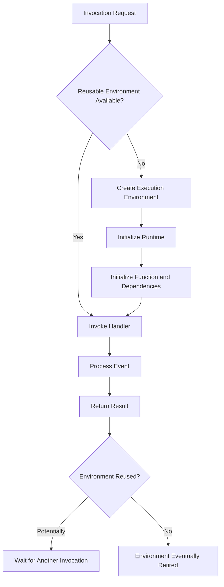
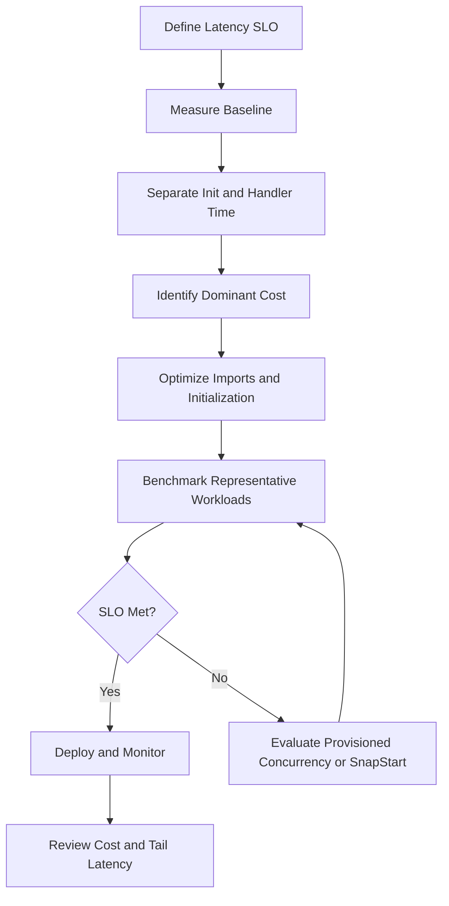

# 06- Cold Start and Startup Optimization

## Overview

A cold start occurs when AWS Lambda must prepare a new execution environment before it can invoke a function. This preparation can add latency to the first invocation handled by that environment, making cold-start behavior an important consideration for latency-sensitive backend systems.

For Python-based Lambda functions, startup latency can include runtime initialization, importing dependencies, initializing SDK clients, loading configuration, establishing connections, and running application initialization logic.

Cold starts are not inherently failures. They are part of Lambda's execution model. The engineering objective is to minimize unnecessary initialization work, reduce cold-start frequency when justified, and ensure that application latency remains within its service-level objectives (SLOs).

Startup optimization should begin with measurement. A lightweight function with a few imports may not benefit from expensive optimization mechanisms, while a latency-sensitive API with substantial initialization work may benefit from dependency reduction, provisioned concurrency, or a supported SnapStart configuration.

## Understanding the Lambda Execution Lifecycle

Lambda runs functions inside execution environments. An environment can handle multiple invocations over its lifetime, but Lambda may create additional environments when concurrency increases and may retire environments as needed.

A simplified lifecycle is:



The diagram is conceptual. Lambda manages environment creation, reuse, and retirement; applications cannot assume that a particular environment will remain available.

### Initialization phase

Initialization happens before the handler processes an invocation. It can include:

- Starting the runtime.
- Loading the function code.
- Importing Python modules.
- Executing module-level statements.
- Initializing reusable SDK clients.
- Loading configuration and initializing frameworks.
- Performing any other application setup required before the handler runs.

For Python, module-level code executes when the module is imported. Expensive operations at module scope can therefore increase initialization latency.

### Invocation phase

During invocation, Lambda passes the event and context to the handler. The function executes its business logic and produces a result or raises an exception.

If an execution environment is reused, Python modules and initialized global objects may remain available for subsequent invocations. Reuse is an optimization opportunity, not a correctness guarantee.

### Shutdown and environment retirement

Lambda can retire an execution environment when it is no longer needed. Applications should not depend on a guaranteed shutdown callback or assume that cleanup code will always run after the final invocation.

Use durable external systems for important state and explicit resource-management mechanisms for operations that require deterministic cleanup.

## What Causes Cold-Start Latency?

Cold-start latency depends on the runtime, deployment artifact, initialization behavior, configuration, and execution environment.

| Factor | Potential impact | Optimization approach |
|---|---|---|
| Runtime initialization | Time required to prepare the runtime | Use a supported runtime appropriate for the workload |
| Large dependency trees | Additional imports and initialization work | Remove unnecessary dependencies and imports |
| Framework initialization | Application setup may be expensive | Initialize only required components |
| Large deployment packages | More code and dependencies to load or inspect | Minimize deployment artifacts |
| Module-level network calls | Initialization waits for remote services | Defer nonessential remote work |
| Database connections | Connection establishment adds latency and may fail | Reuse connections carefully and avoid unnecessary initialization |
| VPC networking and dependency access | Network-dependent initialization can add latency | Optimize connectivity and remove unnecessary network dependencies |
| High concurrency | Additional execution environments may need initialization | Evaluate provisioned concurrency and scaling behavior |
| Native libraries | Loading shared libraries can increase startup time | Minimize unnecessary libraries and benchmark packaging alternatives |

A cold start does not have one universal duration. It varies across workloads and operating conditions. Avoid using a single benchmark result as a guarantee for production latency.

## Measure Cold Starts Before Optimizing

The first step is to distinguish initialization latency from handler execution time.

### CloudWatch logs

Lambda's standard Python logs can contain fields such as:

```text
START RequestId: ...
END RequestId: ...
REPORT RequestId: ... Duration: ... ms Billed Duration: ... ms
Init Duration: ... ms
```

`Init Duration` appears in applicable initialization-related reports. Its presence and interpretation depend on the invocation and execution lifecycle.

Compare initialization duration with total invocation duration. A function with a short handler duration but a large initialization duration may benefit from startup optimization. A function dominated by database or API latency may need a different solution.

### Use structured application logs

Log meaningful startup milestones without exposing secrets or sensitive configuration.

```python
import logging
import time

logger = logging.getLogger()
logger.setLevel(logging.INFO)

startup_started = time.perf_counter()

# Import and initialize required application components here.

logger.info(
    "Application initialization completed",
    extra={
        "initialization_elapsed_ms": round(
            (time.perf_counter() - startup_started) * 1000,
            2,
        )
    },
)
```

This measures the code executed between the timer and the log statement. It does not independently measure all Lambda platform initialization, and the log may not run in every lifecycle scenario. Use Lambda's platform-generated logs and metrics alongside application measurements.

### Metrics to monitor

| Metric or signal | Purpose |
|---|---|
| `Duration` | Measures handler execution duration |
| `Invocations` | Shows workload volume |
| `Errors` | Detects failed invocations |
| `Throttles` | Reveals rejected invocation attempts due to concurrency or limits |
| Initialization duration in logs | Helps identify startup overhead |
| API latency percentiles | Shows whether cold starts affect user-visible latency |
| Concurrent executions | Helps explain environment creation during traffic growth |
| Provisioned concurrency metrics | Helps determine whether configured capacity is being used effectively |

Use CloudWatch dashboards and alarms to identify changes after deployments, dependency upgrades, or traffic-pattern changes.

## Optimize Python Initialization

Python initialization is often a practical starting point because imports and module-level statements can contribute significantly to cold-start latency.

### Keep module-level initialization lightweight

Module-level initialization is useful for objects that are expensive to create and safe to reuse. However, it should not perform unnecessary network operations or large amounts of work.

Avoid this pattern when the remote request is not required to initialize the application:

```python
import requests

# Runs during module initialization.
CONFIG = requests.get(
    "https://configuration.example.com/settings",
    timeout=5,
).json()


def handler(event, context):
    return {"statusCode": 200, "body": "OK"}
```

This makes initialization dependent on network availability and remote-service latency. The function may fail before the handler can process an event.

A better approach is to initialize static configuration from the appropriate configuration mechanism and perform required remote operations within a controlled execution path.

```python
import json
import os


def handler(event, context):
    environment = os.environ["APP_ENV"]

    return {
        "statusCode": 200,
        "headers": {"content-type": "application/json"},
        "body": json.dumps({"environment": environment}),
    }
```

This example avoids unnecessary initialization work. Real applications should validate configuration and handle missing values according to their deployment requirements.

### Reduce unnecessary imports

Python imports can trigger substantial transitive initialization. Importing a framework or SDK component may load many additional modules.

Recommended practices:

- Remove dependencies that are not used by the function.
- Prefer focused imports where they materially reduce initialization.
- Avoid importing data-science or image-processing libraries into lightweight API handlers unless required.
- Split unrelated responsibilities into separate functions when doing so creates a meaningful deployment boundary.
- Benchmark dependency changes instead of assuming that fewer import statements always mean faster startup.

A separate function introduces additional deployment and operational complexity, so split functions based on responsibility and workload characteristics rather than cold-start optimization alone.

### Avoid unnecessary work at import time

Avoid performing these operations at module scope unless they are required and their trade-offs are understood:

- Loading large datasets into memory.
- Fetching remote configuration on every new environment.
- Running database queries.
- Performing expensive computations.
- Scanning directories or filesystems.
- Making repeated calls to third-party APIs.

Move nonessential work into the handler or a dedicated initialization strategy, while keeping latency and correctness requirements in mind.

## Reuse Execution Environments Safely

Lambda may reuse an execution environment for multiple invocations. Reusing suitable objects can reduce repeated initialization overhead.

### Reuse SDK clients

For example, create a Boto3 client outside the handler when it can be safely reused.

```python
import json

import boto3

dynamodb = boto3.resource("dynamodb")
orders_table = dynamodb.Table("orders")


def handler(event, context):
    order_id = event["order_id"]

    response = orders_table.get_item(
        Key={"order_id": order_id}
    )

    return {
        "statusCode": 200,
        "body": json.dumps(response.get("Item")),
    }
```

The table name is illustrative and should be supplied through validated configuration in a production implementation. The example also assumes that the returned item is JSON-serializable.

The client and table resource are initialized during module import and can be reused within the same execution environment.

### What is safe to reuse?

| Resource | Typical guidance |
|---|---|
| SDK clients | Usually suitable for reuse when the library supports it |
| Compiled regular expressions | Suitable for reuse |
| Immutable configuration | Suitable for reuse when refreshed according to requirements |
| Database connections | Can be reused with health checks and reconnect logic |
| Mutable request-specific state | Keep local to the invocation |
| User-specific authorization data | Do not retain across requests without strict isolation guarantees |
| Temporary computation results | Reuse only when stale data and memory growth are controlled |

### Avoid state leakage

A global variable can survive across invocations in the same environment. This is useful for reusable resources but dangerous for request-specific information.

```python
# Unsafe pattern: request-specific data is retained globally.
current_customer_id = None


def handler(event, context):
    global current_customer_id
    current_customer_id = event["customer_id"]
```

Prefer local variables for request-specific state. If multiple invocations can be processed concurrently within the chosen runtime or execution model, also consider thread safety and shared-resource behavior.

Execution-environment reuse must never be used as the only persistence mechanism for business state.

## Optimize Deployment Packages and Dependencies

The deployment artifact affects what Lambda must load and initialize. Reducing package size can help, but package size alone is not a reliable predictor of cold-start duration.

### ZIP deployment packages

For ZIP-based deployments:

- Package only runtime dependencies required by the function.
- Exclude tests, local virtual environments, caches, and development tooling.
- Avoid bundling duplicate libraries.
- Use compatible native dependencies for the Lambda operating environment and architecture.
- Use layers only when shared dependencies provide a real maintenance or packaging benefit.

A layer does not automatically make a function faster. It changes how dependencies are packaged and managed, while import behavior and initialization costs still matter.

### Container-image deployments

Container images are useful when the application needs custom system libraries, a specific filesystem layout, or a container-oriented build workflow.

However, a container image does not eliminate cold starts. Runtime initialization, dependency loading, and application startup still contribute to latency.

Choose ZIP packages or container images based on packaging, dependency, security, and operational requirements—not on the assumption that one format always starts faster.

## Provisioned Concurrency

Provisioned concurrency prepares execution environments in advance for a specified Lambda version or alias. It is designed to reduce initialization latency for invocations served by the provisioned capacity.

### When to use it

Provisioned concurrency is appropriate when:

- A synchronous API has a strict latency SLO.
- Predictable initialization latency is important during known traffic periods.
- Cold-start latency materially affects user experience.
- Workload patterns and expected capacity can be estimated.
- The cost of keeping environments initialized is justified.

It is not always necessary for asynchronous workloads where additional startup latency is acceptable.

### How it works

Provisioned concurrency initializes environments ahead of incoming requests. Requests served by the provisioned capacity can avoid the ordinary initialization work associated with a newly created environment.

If incoming concurrency exceeds the provisioned capacity, additional demand may use on-demand capacity, subject to Lambda's scaling behavior and applicable limits. Those additional invocations can experience ordinary initialization latency.

Provisioned concurrency should therefore be sized against expected concurrent demand, not merely average request volume.

### Configuration considerations

Provisioned concurrency applies to a published function version or an alias that points to a version. It cannot be configured against the mutable `$LATEST` version in the same way as an ordinary unqualified function invocation.

Plan capacity around deployment and traffic-shifting behavior. A deployment that changes the alias target must ensure that the intended version has the required provisioned capacity before sending latency-sensitive traffic.

### Trade-offs

| Advantage | Limitation |
|---|---|
| Reduces initialization latency for requests served by provisioned capacity | Incurs additional charges for configured capacity |
| Helps stabilize latency for predictable traffic | Requires capacity planning |
| Supports latency-sensitive synchronous applications | Does not remove handler execution latency |
| Can be aligned with scheduled traffic patterns | Under-provisioning can leave additional demand on on-demand capacity |

Use current regional pricing and concurrency metrics to determine whether the latency improvement justifies the additional cost.

## Lambda SnapStart

Lambda SnapStart can reduce startup latency by using a snapshot of an initialized execution environment for supported runtimes and configurations. It is not a universal replacement for provisioned concurrency, and its availability and constraints depend on the runtime and feature support.

### How it differs from ordinary initialization

Without snapshot-based startup optimization, a new execution environment performs its initialization before handling an invocation.

With SnapStart, Lambda can use a prepared snapshot to reduce the work required to start an environment. Runtime and application initialization behavior must be compatible with the snapshot lifecycle.

### Engineering considerations

- Verify runtime and Region support before adopting SnapStart.
- Review compatibility restrictions for extensions, runtime features, and other integrations.
- Avoid assuming that network connections, temporary credentials, or other time-sensitive resources remain valid after restoration.
- Initialize or refresh resources that require fresh state at the appropriate lifecycle stage.
- Test correctness as well as latency, especially when initialization generates identifiers, timestamps, or other values expected to be unique per environment or invocation.
- Measure the effect on actual startup latency before comparing it with provisioned concurrency.

### Snapshot safety

Snapshot-based startup requires particular care with state created during initialization.

For example, an initialization-time random seed, timestamp, or identifier should not be treated as guaranteed to be unique for every restored environment or invocation without understanding the feature's lifecycle semantics.

Use the supported runtime lifecycle mechanisms and AWS guidance to manage resources that must be refreshed after restoration.

### SnapStart versus provisioned concurrency

| Consideration | SnapStart | Provisioned concurrency |
|---|---|---|
| Primary mechanism | Uses initialized snapshots for supported configurations | Keeps execution environments initialized in advance |
| Runtime support | Restricted to supported runtimes and configurations | Available subject to Lambda's feature and configuration requirements |
| Capacity planning | Still requires scaling and latency evaluation | Requires explicit provisioned capacity planning |
| Cost model | Depends on the supported SnapStart pricing model and associated usage | Includes provisioned concurrency charges |
| Best fit | Supported applications that benefit from snapshot-based initialization | Workloads requiring pre-initialized capacity and predictable latency |

Validate current AWS documentation for the exact supported runtime, version, architecture, and feature constraints before choosing either approach.

## Framework Initialization

Frameworks such as Django and FastAPI can add startup overhead through imports, configuration loading, route registration, middleware setup, and application initialization.

### Use frameworks only when needed

For a simple event processor, a lightweight handler may be sufficient. For an API with complex routing, validation, middleware, and dependency management, a framework adapter may be appropriate.

Evaluate:

- Import time.
- Application initialization duration.
- Number of dependencies.
- Connection initialization.
- Middleware and routing overhead.
- Handler execution duration after initialization.

Do not remove a framework solely to reduce cold starts if doing so creates substantial maintainability or correctness costs. Benchmark the real workload.

### Lazy initialization

Lazy initialization delays creation of an object until it is needed. This can improve startup latency when the resource is not required by every invocation.

However, lazy initialization moves the cost to the first invocation that uses the resource. It does not eliminate the cost, and it may create unpredictable request latency.

Use lazy initialization when the deferred resource is optional or rarely used. Prefer explicit initialization when every request requires the resource and predictable latency is more important.

## VPC and Database Initialization

VPC connectivity and database access require careful treatment because initialization can depend on network resources and downstream availability.

Modern Lambda VPC networking uses managed networking infrastructure. Do not assume that every VPC-attached function necessarily incurs the same historical network-interface creation penalty associated with older Lambda networking behavior.

The actual startup impact depends on the configuration, dependency access patterns, and application initialization code.

### Database connection strategy

Opening a new database connection can add latency and consume database capacity. Reusing connections may reduce repeated connection overhead, but connections can become stale or be closed by the database or network.

Recommended practices:

- Avoid connecting to a database during initialization if the function does not always need it.
- Reuse connections where safe and supported.
- Handle stale connections and reconnection failures.
- Set database connection and query timeouts.
- Consider Amazon RDS Proxy for supported relational database workloads that require connection pooling.
- Account for Lambda concurrency when sizing database connections.
- Keep secrets and connection configuration outside source code.

### Connection exhaustion

If every concurrent Lambda execution environment establishes one or more database connections, a traffic increase can overwhelm the database.

Cold-start optimization alone does not solve this issue. Use appropriate concurrency limits, connection pooling, query optimization, and backpressure to protect downstream capacity.

## Optimize Cold Starts by Invocation Pattern

Different invocation patterns have different latency and reliability requirements.

| Invocation pattern | Startup strategy |
|---|---|
| Public synchronous API | Measure tail latency; consider provisioned concurrency or a supported SnapStart configuration when justified |
| SQS consumer | Prioritize throughput, batch processing, idempotency, and downstream protection; startup latency may be less visible to users |
| S3-triggered processing | Optimize initialization when event volume or processing latency warrants it |
| Scheduled function | Consider whether initialization latency affects the scheduled completion deadline |
| EventBridge consumer | Focus on event processing reliability, retries, and duplicate handling |
| Workflow task | Evaluate the task's latency budget and orchestration timeout requirements |
| Infrequently used administrative function | Prefer simplicity unless startup latency violates a real requirement |

Do not apply provisioned concurrency indiscriminately to functions that are invoked rarely and have no meaningful latency objective.

## Production Optimization Workflow

Use a repeatable process rather than tuning settings based on intuition.



### Recommended sequence

1. Define an acceptable latency target, including relevant percentile objectives.
2. Capture baseline initialization and handler execution measurements.
3. Identify expensive imports, module-level network calls, and initialization dependencies.
4. Remove unnecessary startup work.
5. Benchmark the modified function with representative events.
6. Evaluate provisioned concurrency or SnapStart only if supported and justified.
7. Test cold-start and warm-invocation behavior separately.
8. Verify correctness, error handling, concurrency behavior, and cost.
9. Deploy through a controlled rollout and monitor production metrics.

### Verify improvements

Compare before-and-after results using:

- Initialization duration.
- End-to-end latency percentiles.
- Handler duration.
- Error and timeout rates.
- Throughput and concurrency.
- Cost per successful operation.

Keep the deployment artifact, runtime, memory setting, architecture, test inputs, and workload conditions consistent where possible. Otherwise, a benchmark may attribute improvements to the wrong change.

## Common Mistakes

| Mistake | Why it is problematic | Better approach |
|---|---|---|
| Assuming every invocation is a cold start | Leads to incorrect performance estimates | Separate initialization-related latency from warm execution |
| Optimizing without measuring | May increase complexity without meaningful improvement | Capture baseline metrics first |
| Performing remote calls at module import time | Makes initialization depend on network and dependency availability | Defer nonessential remote work |
| Treating global variables as durable storage | Environment retirement can discard state | Persist important state in durable services |
| Storing request-specific data in globals | Can leak state between invocations | Keep request state local |
| Assuming larger deployment packages always mean slower startup | Package size is only one factor | Measure imports and initialization behavior |
| Using provisioned concurrency without capacity planning | Can increase cost while leaving excess demand on on-demand capacity | Size it using concurrency and latency data |
| Assuming SnapStart works with every runtime | Support and compatibility are constrained | Verify current runtime and feature requirements |
| Creating database connections without capacity analysis | Can exhaust database connection limits | Use connection reuse, pooling, and concurrency controls |
| Moving all initialization to lazy loading | Shifts latency into the first request that needs each resource | Defer only nonessential or rarely used work |
| Benchmarking only warm invocations | Hides initialization costs | Test startup and warm behavior separately |
| Ignoring post-deployment measurements | Dependencies and traffic can change over time | Monitor latency and cost continuously |

## Production Readiness Checklist

### Initialization

- [ ] Initialization duration has been measured.
- [ ] Unnecessary imports and dependencies have been removed.
- [ ] Module-level operations are lightweight and safe to reuse.
- [ ] Remote calls and database operations have explicit timeout and failure handling.
- [ ] Request-specific state is not retained globally.

### Performance

- [ ] Cold-start and warm-invocation behavior have been evaluated separately.
- [ ] Latency percentiles meet the application's SLO.
- [ ] Representative workload and concurrency tests have been completed.
- [ ] Memory and timeout settings are appropriate for the workload.
- [ ] Provisioned concurrency or SnapStart is used only when justified and supported.

### Reliability and operations

- [ ] Startup failures and elevated initialization latency can be diagnosed from logs and metrics.
- [ ] Database connection usage remains within downstream capacity.
- [ ] Deployment changes are benchmarked and monitored.
- [ ] Feature support and constraints are verified for the selected runtime and Region.
- [ ] Performance gains are evaluated against additional cost and operational complexity.

## Key Takeaways

- A cold start occurs when Lambda prepares an execution environment, and its latency depends on runtime initialization, imports, dependencies, configuration, and application startup work.
- Measure initialization latency separately from handler execution before optimizing.
- Keep Python initialization lightweight, reuse suitable clients safely, and avoid expensive module-level operations that depend on remote services.
- Provisioned concurrency and SnapStart can reduce startup latency under different mechanisms and constraints; verify current runtime support, capacity requirements, and pricing.
- Optimize for measured tail latency, reliability, and cost per successful operation rather than assuming that smaller packages or higher memory automatically produce better startup performance.