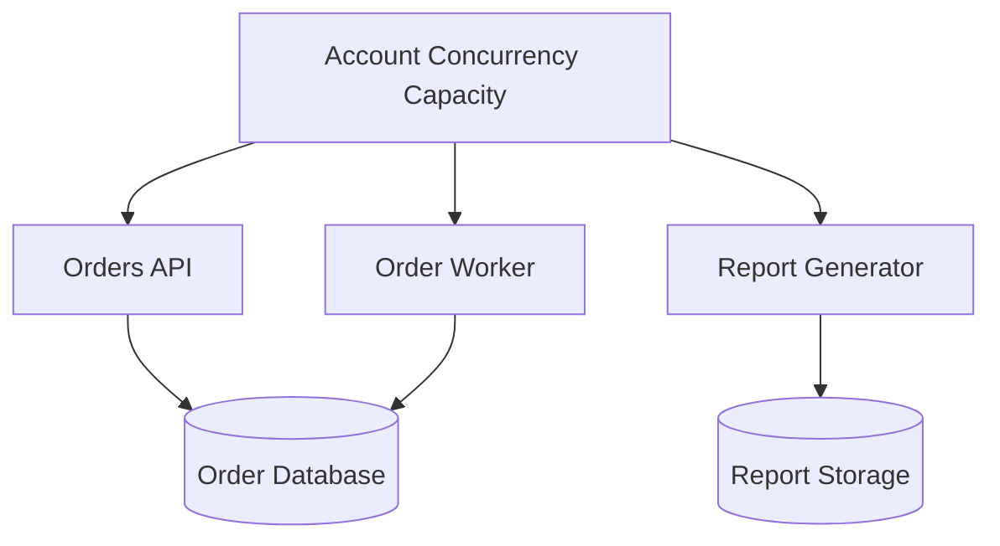
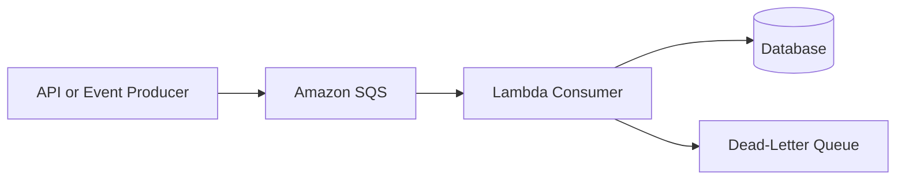

# 07- Concurrency and Throttling Management

## Overview

Concurrency and throttling are fundamental to operating AWS Lambda reliably under variable workloads. Lambda scales execution environments in response to incoming demand, but that scaling is constrained by account quotas, function-level concurrency settings, scaling rates, and the capacity of downstream systems.

For backend engineers, the primary challenge is not simply maximizing the number of concurrent invocations. It is controlling how much work enters the system at once while maintaining acceptable latency, protecting dependencies, and recovering safely from overload.

For example, a Lambda function processing orders might scale rapidly during a traffic spike. If every execution opens a PostgreSQL connection, the database can become overloaded before Lambda reaches its own concurrency limit. Concurrency management must therefore account for both Lambda capacity and downstream capacity.

This document covers Lambda concurrency models, throttling behavior, capacity planning, practical configuration, monitoring, and production safeguards.

## Understanding Lambda Concurrency

Concurrency represents the number of function invocations being processed simultaneously.

An invocation occupies execution capacity while it is running. When an invocation finishes, its capacity can become available for another invocation.

### Concurrency calculation

A useful approximation is Little's Law:

\[
\text{Concurrency} \approx \text{Request Rate} \times \text{Average Duration}
\]

For example, if a function processes 200 requests per second and each invocation takes 0.25 seconds on average:

\[
200 \times 0.25 = 50
\]

The function requires approximately 50 concurrent executions under those conditions.

This is a capacity-planning estimate, not a guarantee. Traffic bursts, duration variance, retries, and uneven request distribution can increase actual concurrency requirements.

### Factors that affect concurrency

- Incoming request rate.
- Invocation duration.
- Traffic burstiness.
- Retry behavior.
- Event source batching and polling.
- Provisioned concurrency configuration.
- Reserved concurrency configuration.
- Account-level and function-level quotas.
- Downstream service capacity.

Reducing invocation duration can reduce concurrency requirements without changing the incoming request rate. Conversely, slow dependencies can increase concurrency even when traffic remains constant.

## How Lambda Scales

Lambda manages execution environments and can add capacity as demand increases. The exact scaling behavior depends on the invocation model, event source, runtime configuration, account quotas, and current service limits.

### Synchronous invocations

For synchronous invocations, the caller waits for the function's response. Examples include API Gateway integrations and direct synchronous invocations.

When demand exceeds available execution capacity, callers may receive throttling errors or experience latency from their own retry behavior.

The caller must distinguish throttling from application failures and use bounded retries with backoff where retries are appropriate.

### Asynchronous invocations

For asynchronous invocation, Lambda accepts an event into its internal queue and processes it later. The producer does not wait for the function's business logic to finish.

If processing capacity is constrained, events can accumulate and wait longer before execution. Retry behavior and event expiration must be considered when designing the workload.

### Event source mappings

For services such as Amazon SQS, Kinesis, and DynamoDB Streams, Lambda polls or reads from the configured event source through an event source mapping.

Scaling is influenced by source-specific behavior, batch size, available records, shard or partition constraints, and mapping configuration. These integrations should not be assumed to scale identically to direct synchronous invocation.

## Concurrency Types

Lambda provides multiple concurrency controls. They solve different problems and should be selected according to the workload's latency and capacity requirements.

### Unreserved concurrency

Unreserved concurrency is the account-level concurrency capacity not allocated as reserved concurrency to individual functions. Functions without reserved concurrency generally share this pool, subject to Lambda's other limits and scaling behavior.

This provides flexibility because unused capacity can serve other functions. However, one function with unexpectedly high demand can consume shared capacity and affect unrelated workloads.

### Reserved concurrency

Reserved concurrency allocates a concurrency limit to a function and reserves that amount of the account's concurrency capacity for it.

It serves two purposes:

- Guarantees that the function has an allocated portion of account concurrency capacity, subject to applicable service constraints.
- Limits the function's maximum concurrent executions.

For example, an order-processing function can be assigned reserved concurrency to protect the database from excessive simultaneous work.

Reserved concurrency does not keep environments initialized in advance and does not eliminate cold starts.

A function configured with reserved concurrency of zero is intentionally prevented from processing invocations. This can be useful as an emergency control during an incident, but it also stops normal processing.

### Provisioned concurrency

Provisioned concurrency prepares execution environments in advance for a published function version or alias. It is primarily a latency optimization.

It can reduce initialization latency for requests served by the provisioned capacity, but it does not mean that the function can process only that many invocations. Additional on-demand capacity may be used when permitted and available.

Provisioned concurrency incurs additional charges and requires capacity planning.

### Comparison

| Feature | Main purpose | Capacity effect | Typical use case |
|---|---|---|---|
| Unreserved concurrency | Shared account capacity | Shared by functions without reserved allocations | General-purpose workloads |
| Reserved concurrency | Isolation and maximum concurrency control | Allocates account capacity and caps the function | Protecting downstream services or critical functions |
| Provisioned concurrency | Reducing initialization latency | Keeps configured environments initialized | Latency-sensitive APIs |
| Account concurrency quota | Account-level execution limit | Limits overall available concurrency | Account-wide capacity planning |

Reserved concurrency and provisioned concurrency are complementary but not interchangeable. Verify their configuration constraints before combining them for a particular function version or alias.

## Reserved Concurrency in Practice

Consider an application with three Lambda functions:

- `orders-api` handles synchronous requests.
- `order-worker` processes SQS messages.
- `report-generator` creates reports in the background.

If all three functions use the shared concurrency pool, a sudden increase in report generation could compete with the order-processing workload.

Reserved concurrency can establish explicit limits for each function.



The diagram represents logical capacity allocation, not a complete AWS resource topology.

### Choose limits based on downstream capacity

Suppose a database can safely support 120 application connections, and other services already consume 60. A Lambda function that can create one connection per concurrent execution should not automatically be allowed to consume the remaining 60 connections.

Leave capacity for administrative operations, other workloads, connection churn, and unexpected load. Use connection pooling or a database proxy where appropriate.

### Set reserved concurrency

The following command modifies function configuration:

```bash
aws lambda put-function-concurrency \
  --function-name order-worker \
  --reserved-concurrent-executions 40
```

This sets the function's reserved concurrency to 40.

Before executing it, verify the AWS account, Region, function name, and current concurrency allocation. The allocation consumes part of the account's concurrency capacity.

### Verify the setting

This is a read-only command:

```bash
aws lambda get-function-concurrency \
  --function-name order-worker
```

The response includes the configured reserved concurrency.

### Remove reserved concurrency

This command removes the function's reserved concurrency allocation:

```bash
aws lambda delete-function-concurrency \
  --function-name order-worker
```

The function then returns to the unreserved concurrency pool, subject to account quotas and other applicable limits.

Do not remove a production limit without understanding the potential effect on downstream services.

## Throttling

Throttling occurs when an invocation cannot be admitted for execution because a concurrency or other applicable service limit has been reached.

It is a capacity-control mechanism, not necessarily a sign that application code is defective.

### Common causes

- Reserved concurrency has been exhausted.
- Account concurrency capacity is exhausted.
- The function exceeds an applicable scaling or service limit.
- A provisioned-concurrency configuration is insufficient for the incoming workload and available on-demand capacity is constrained.
- A downstream service is overloaded, causing invocations to run longer and occupy concurrency for longer periods.

The last case is an indirect cause: downstream slowness increases the duration of active invocations, which increases concurrency demand and can eventually lead to throttling.

### What happens when a function is throttled?

The outcome depends on the invocation path.

| Invocation path | Potential behavior |
|---|---|
| Synchronous invocation | Caller receives a throttling error and may retry |
| Asynchronous invocation | Lambda can retry or queue events according to asynchronous invocation behavior and configuration |
| SQS event source mapping | Messages remain in the queue and can be received again according to visibility and polling behavior |
| Kinesis or DynamoDB Streams | Processing progress can be delayed according to source-specific checkpointing and retry behavior |
| Scheduled or event-driven service | Delivery and retry behavior depends on the invoking service and integration |

Do not assume that all throttled invocations are automatically retried in the same way. Determine which component owns the retry policy and what delivery guarantees apply.

## Backpressure and Downstream Protection

Lambda can scale quickly, but downstream systems may have lower capacity or scale more slowly.

Backpressure prevents the application from sending work downstream faster than the dependency can process it safely.

### Common strategies

- Apply reserved concurrency to protect constrained dependencies.
- Use SQS to buffer asynchronous workloads.
- Configure event source mappings to control polling and concurrency.
- Use connection pooling or RDS Proxy for supported database workloads.
- Set explicit connection and query timeouts.
- Use bounded retries with exponential backoff and jitter.
- Reject or defer nonessential work during overload.
- Monitor queue depth, oldest-message age, and dependency latency.

### Queue-based architecture



SQS decouples producers from consumers and provides a buffer for bursts. It does not remove the need for capacity limits, idempotency, retry configuration, or queue-age monitoring.

If producers generate work faster than consumers can process it for an extended period, the queue continues to grow. Monitor queue depth and age, then scale consumers or reduce incoming work according to the dependency's safe capacity.

## Event Source Mapping Concurrency

Event source mappings have their own scaling and concurrency considerations.

### Amazon SQS

SQS-triggered Lambda functions poll messages and invoke the function with batches. Concurrency depends on available messages, polling behavior, batch size, configured concurrency controls, and applicable scaling limits.

Where supported, maximum concurrency can be configured on an SQS event source mapping to limit how many concurrent function invocations that mapping uses.

For example, this can protect a database from a sudden backlog without applying the same restriction to unrelated invocations of the function.

Maximum concurrency and reserved concurrency must be configured coherently. If several mappings invoke the same function, the sum of their possible concurrent demand should fit within the function's reserved concurrency when such a reservation is used.

### Kinesis and DynamoDB Streams

Stream processing has additional constraints related to shards, partitions, ordering, and checkpoint progress.

Concurrency is not determined only by the number of incoming records. The number of shards, configured parallelization, batch size, and source-specific processing behavior also matter.

Increasing concurrency may improve throughput, but it can affect ordering assumptions and downstream load. Confirm the source's guarantees before increasing parallel processing.

### Event source mapping controls

| Control | Purpose | Consideration |
|---|---|---|
| Batch size | Controls records passed in an invocation | Larger batches can improve efficiency but increase processing time and memory usage |
| Maximum batching window | Allows records to accumulate before invocation | Improves batching but can increase latency |
| Maximum concurrency for supported mappings | Limits concurrent consumer invocations | Protects downstream capacity |
| Provisioned pollers for supported sources | Provides managed polling capacity | Adds configuration and cost considerations |
| Partial batch response | Reports failed records within a batch for supported integrations | Prevents successful records from being unnecessarily retried |
| Retry and failure destination settings | Controls handling of processing failures | Must match delivery and recovery requirements |

Feature availability and constraints vary by event source and configuration. Validate the supported controls for the exact integration.

## Calculate and Plan Concurrency

Use expected traffic and duration to estimate concurrency.

\[
C \approx \lambda \times W
\]

Where:

- \(C\) is average concurrency.
- \(\lambda\) is the arrival rate in requests per second.
- \(W\) is average invocation duration in seconds.

### Example

Suppose a function receives 300 invocations per second and has an average duration of 0.4 seconds.

\[
C \approx 300 \times 0.4 = 120
\]

The expected average concurrency is approximately 120.

If the workload experiences bursts or high duration variance, capacity planning should account for peak demand rather than relying on the average alone.

### Capacity-planning checklist

1. Measure arrival rate and invocation duration.
2. Calculate average concurrency.
3. Inspect peak and percentile duration.
4. Estimate burst demand and retry amplification.
5. Determine downstream safe concurrency.
6. Check account and function quotas.
7. Set reserved or event-source concurrency controls where appropriate.
8. Load-test the resulting configuration.
9. Monitor throttling, latency, queue age, and downstream health.
10. Revisit limits as traffic and dependencies change.

### Avoid assuming concurrency is equivalent to request rate

A function processing 100 requests per second at 100 ms per invocation has different concurrency needs from one processing the same rate at 2 seconds per invocation.

If database latency increases, the second workload may consume significantly more concurrency even though the arrival rate has not changed. This can create a feedback loop: slow dependencies cause higher concurrency, which increases dependency pressure, which makes the dependencies slower.

## Monitor Concurrency and Throttling

CloudWatch provides Lambda metrics that help identify capacity problems.

| Metric | Interpretation |
|---|---|
| `ConcurrentExecutions` | Current concurrent execution demand |
| `UnreservedConcurrentExecutions` | Account-level unreserved concurrency usage |
| `Throttles` | Invocation attempts throttled by Lambda |
| `Invocations` | Invocation volume |
| `Duration` | Execution time |
| `Errors` | Failed invocations |
| `ClaimedAccountConcurrency` | Account concurrency capacity unavailable for general unreserved use because it is allocated or otherwise claimed, subject to Lambda's metric semantics |
| SQS `ApproximateNumberOfMessagesVisible` | Messages waiting in the queue |
| SQS `ApproximateAgeOfOldestMessage` | Age of the oldest available message |

Metric availability and dimensions depend on the integration and configuration. Review the current CloudWatch metric documentation before building alarms.

### Suggested alarms

Consider alarms for:

- Sustained throttling.
- Concurrency approaching a configured limit.
- High error rates.
- Elevated invocation duration.
- SQS queue age exceeding the processing SLO.
- A rapidly growing queue backlog.
- Downstream database connection saturation.

Alarm thresholds should reflect the workload's SLOs and expected traffic patterns. A small number of throttles during a controlled load test may be acceptable; sustained throttling on a latency-sensitive API may require immediate action.

## Diagnose Throttling with the AWS CLI

### Inspect function concurrency

```bash
aws lambda get-function-concurrency \
  --function-name order-worker
```

This is a read-only command. It returns reserved concurrency if configured.

### Inspect account concurrency limits

```bash
aws lambda get-account-settings \
  --query 'AccountLimit.{ConcurrentExecutions:ConcurrentExecutions,UnreservedConcurrentExecutions:UnreservedConcurrentExecutions}' \
  --output table
```

This is a read-only command. Compare the account's limits with current utilization and reserved allocations.

### Inspect recent CloudWatch metrics

```bash
aws cloudwatch get-metric-statistics \
  --namespace AWS/Lambda \
  --metric-name Throttles \
  --dimensions Name=FunctionName,Value=order-worker \
  --start-time 2026-10-11T10:00:00Z \
  --end-time 2026-10-11T11:00:00Z \
  --period 60 \
  --statistics Sum
```

Replace the timestamps with the incident's actual time window. The command returns datapoints for the specified metric and dimensions when available.

### Diagnostic workflow

**Symptom → Possible causes → Isolation strategy → Diagnostic commands → Root cause verification → Corrective action → Prevention**

1. Identify the affected function and invocation path.
2. Check `Throttles`, `ConcurrentExecutions`, `Invocations`, and `Duration`.
3. Inspect reserved concurrency and account concurrency settings.
4. Check event source mapping configuration and queue backlog where applicable.
5. Determine whether increased dependency latency is extending invocation duration.
6. Verify the cause with logs, metrics, and controlled tests.
7. Adjust capacity, reduce duration, or apply backpressure.
8. Confirm that throttling and downstream errors return to acceptable levels.

## Retry Behavior and Throttling

Retries can amplify load if they are not coordinated with capacity.

For example, a client may retry a throttled API request immediately. If many clients do this simultaneously, they can create a retry storm that increases demand precisely when the system has insufficient capacity.

### Recommended retry strategy

- Use bounded retries.
- Apply exponential backoff with jitter.
- Respect the retry semantics of the invoking service.
- Avoid retries for permanent validation or authorization failures.
- Use idempotency for operations that may be processed more than once.
- Configure dead-letter handling or failure destinations where appropriate.
- Track retry volume and distinguish retries from new business requests.

A retry policy should not be implemented independently at every layer without coordination. Multiple retrying layers can multiply attempts and create unexpected load.

## Operational Response to Concurrency Exhaustion

During an incident, the priority is to restore stable service while protecting dependencies.

### Immediate actions

1. Identify whether the constraint is account concurrency, reserved concurrency, event-source configuration, or downstream capacity.
2. Determine whether the throttled function is critical or background work.
3. Check database connections, API latency, queue age, and error rates.
4. Avoid increasing concurrency blindly if a downstream dependency is already saturated.
5. Apply temporary limits or reduce noncritical work if necessary.
6. Increase capacity only after verifying the account quota and dependency headroom.
7. Monitor recovery and ensure retries do not produce a second overload.

If a function is consuming excessive shared capacity, reserved concurrency can limit its impact. However, setting the limit too low can delay processing or increase queue age.

A reserved concurrency value of zero can stop new execution of a function as an emergency measure. Use this only when the operational impact is understood, and establish a clear recovery procedure.

## Common Mistakes

| Mistake | Consequence | Better approach |
|---|---|---|
| Treating maximum concurrency as the primary goal | Can overload databases and downstream APIs | Set concurrency based on safe end-to-end capacity |
| Setting reserved concurrency without checking account capacity | Can reduce capacity available to other functions | Review account allocation and workload criticality |
| Confusing provisioned concurrency with a maximum concurrency limit | Leads to incorrect scaling assumptions | Use reserved concurrency for function-level capacity isolation and caps |
| Increasing concurrency during database saturation | Can worsen connection exhaustion and latency | Protect downstream capacity first |
| Retrying throttled requests immediately | Can create retry storms | Use bounded backoff with jitter |
| Ignoring invocation duration | Underestimates concurrency demand | Monitor duration and dependency latency |
| Assuming all event sources scale identically | Can cause incorrect capacity estimates | Apply source-specific scaling and ordering semantics |
| Setting SQS mapping concurrency higher than the function's safe capacity | Can create contention with other invocations | Coordinate mapping and function concurrency limits |
| Monitoring only Lambda throttles | Misses dependency overload and queue buildup | Monitor downstream latency, errors, and queue age |
| Removing reserved concurrency without evaluating impact | Can expose dependencies to sudden traffic | Review downstream capacity before changing limits |

## Production Readiness Checklist

### Capacity

- [ ] Average and peak concurrency have been estimated.
- [ ] Account concurrency limits and reserved allocations have been reviewed.
- [ ] Function concurrency is aligned with downstream safe capacity.
- [ ] Event source mapping concurrency and batch settings are appropriate.
- [ ] Load testing includes traffic bursts and dependency latency.

### Reliability

- [ ] Throttling and error rates have actionable alarms.
- [ ] Retry policies are bounded and use backoff where appropriate.
- [ ] Idempotency protects operations from duplicate processing.
- [ ] Queued workloads have backlog and oldest-message-age monitoring.
- [ ] Incident procedures define safe capacity changes and recovery steps.

### Operations and cost

- [ ] Concurrency changes are verified after deployment.
- [ ] Provisioned concurrency is justified by latency requirements.
- [ ] Downstream connection and request limits are understood.
- [ ] Cost and throughput are evaluated together.
- [ ] Capacity is reviewed as traffic patterns and dependencies change.

## Key Takeaways

- Lambda concurrency is driven by arrival rate and invocation duration; slower dependencies can increase concurrency even when traffic is unchanged.
- Reserved concurrency provides function-level capacity allocation and a concurrency cap, while provisioned concurrency prepares environments to reduce initialization latency.
- Throttling behavior and retry semantics depend on the invocation path and event source, so diagnose the actual integration before changing limits.
- Protect downstream services with deliberate concurrency limits, backpressure, bounded retries, and source-specific event processing configuration.
- Monitor concurrency, throttles, duration, queue age, and dependency health together to detect overload before it becomes a wider production incident.