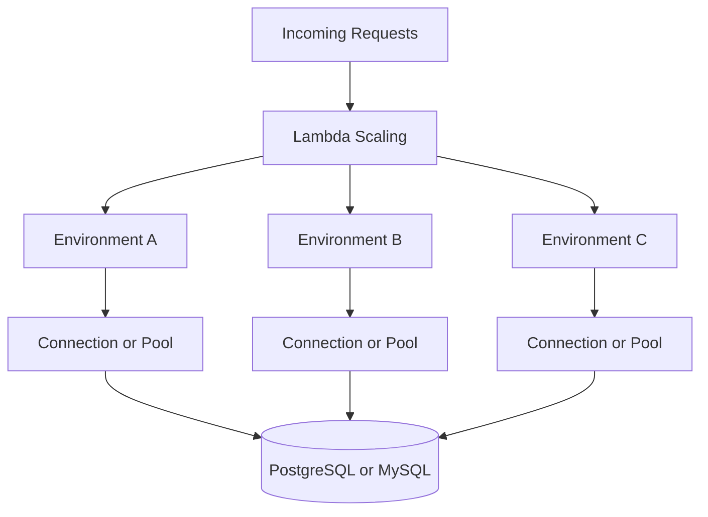
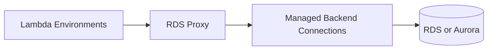

# 08- Database Connections and Connection Pooling

## Overview

Database connectivity is a critical consideration when running AWS Lambda functions that communicate with relational databases such as PostgreSQL and MySQL. Lambda can scale execution environments rapidly, but databases have finite connection capacity, and each connection consumes resources.

A conventional backend service often runs a relatively stable number of application processes with long-lived connection pools. Lambda behaves differently: its execution environments can scale with incoming demand, and each environment may create its own database connections. If connection creation is not controlled, a traffic spike can exhaust database connections, increase query latency, and cause cascading failures.

Production-ready database access requires deliberate connection reuse, connection lifecycle management, concurrency control, query timeouts, and an understanding of when a managed connection proxy is appropriate.

This document focuses on relational database connectivity from Python-based Lambda functions, including PostgreSQL, MySQL, SQLAlchemy, Django, and Amazon RDS Proxy.

## Understanding Lambda and Database Connections

### Why connection management matters

A database connection is a stateful network session between an application and a database server. Establishing a connection may involve:

- DNS resolution and network connection establishment.
- TCP and, where configured, TLS negotiation.
- Authentication.
- Database session initialization.
- Connection-specific settings and resource allocation.

Creating a new connection for every query introduces unnecessary latency and connection churn. At high request rates, the database can spend substantial resources establishing and closing sessions instead of executing useful queries.

### Lambda execution environments and connections

Each Lambda execution environment has its own process memory and can retain suitable resources between invocations. A database connection created in one environment is not automatically shared with other environments.

For example, if 100 execution environments each retain two database connections, they can collectively hold approximately 200 connections. This is independent of whether the application uses a connection pool inside each environment.



The diagram illustrates the potential connection multiplication. The actual number of connections depends on the application, driver, pool configuration, concurrency, and resource lifecycle.

## Connection Reuse

Connection reuse means retaining a valid database connection or connection-management object so that subsequent invocations can avoid repeatedly establishing new connections.

For Lambda, reusable clients and pools are commonly initialized at module scope. Lambda may reuse the execution environment, allowing the application to reuse those objects.

### Basic principles

- Initialize reusable database resources outside the handler when appropriate.
- Do not assume an execution environment will survive between invocations.
- Handle stale connections and database restarts.
- Use explicit connection and query timeouts.
- Avoid opening multiple unnecessary connections per invocation.
- Never treat a global connection as durable application state.
- Ensure request-specific transactions and state are properly isolated.

### Example using psycopg

The following example uses `psycopg` 3 with a small connection pool. It assumes the package is included in the Lambda deployment artifact and the required database settings are configured securely.

```python
import os

from psycopg.rows import dict_row
from psycopg_pool import ConnectionPool

pool = ConnectionPool(
    conninfo=os.environ["DATABASE_URL"],
    min_size=0,
    max_size=2,
    timeout=3,
    kwargs={
        "row_factory": dict_row,
        "connect_timeout": 3,
    },
    open=False,
)


def handler(event, context):
    with pool.connection(timeout=3) as connection:
        with connection.cursor() as cursor:
            cursor.execute(
                """
                SELECT order_id, status
                FROM orders
                WHERE order_id = %s
                """,
                (event["order_id"],),
            )
            order = cursor.fetchone()

    return {
        "order": order,
    }
```

The pool is initialized outside the handler, but `open=False` defers opening connections until needed. The pool can be reused within an execution environment.

This example illustrates connection management, not a complete HTTP API contract. In a production API, convert database records into the expected response format, validate inputs, and map database errors to appropriate application responses.

The pool's maximum size is per execution environment, not global across the Lambda function. A small pool multiplied across many environments can still create substantial aggregate connection demand.

Verify the psycopg and `psycopg_pool` versions, Lambda runtime compatibility, and packaging requirements before deployment.

## Connection Pooling

A connection pool manages a set of reusable database connections. Instead of establishing a new connection for every query, the application borrows a connection from the pool and returns it when the operation completes.

### How pooling works

1. The application requests a connection.
2. The pool returns an available connection or attempts to create one within its configured limits.
3. The application executes queries or a transaction.
4. The application returns the connection to the pool.
5. The pool may retain the connection for reuse.

If all pool connections are occupied, additional callers may wait, fail after a timeout, or trigger other behavior depending on the pool implementation.

### Benefits and limitations

| Benefit | Limitation |
|---|---|
| Reduces repeated connection establishment | Does not automatically impose a global limit across Lambda environments |
| Improves efficiency for repeated database operations | Idle connections may remain open |
| Provides a local maximum number of connections | Each environment can have its own pool |
| Can bound local connection acquisition wait time | Incorrect limits can cause contention or excessive connection creation |
| Can support predictable connection lifecycle management | Stale connections and database restarts still require handling |

### Pool sizing in Lambda

A pool configured for 10 connections does not mean the Lambda function can use only 10 connections. If 50 execution environments each create such a pool, the theoretical aggregate capacity can reach 500 connections.

For database-backed Lambda functions, start with the smallest pool that supports the workload. A pool size of one may be sufficient when each invocation performs only sequential database work.

Do not increase pool size simply to improve throughput. First measure connection acquisition time, query duration, concurrent database operations, and database saturation.

## Connection Capacity Planning

The maximum number of database connections should be planned across all application workloads, not just one Lambda function.

### Estimate aggregate connection demand

A useful upper-bound estimate is:

\[
\text{Potential Connections}
\approx
\text{Concurrent Environments}
\times
\text{Connections per Environment}
\]

For example, if a function can run 80 environments concurrently and each environment can retain two database connections:

\[
80 \times 2 = 160
\]

The function may use up to approximately 160 connections under those assumptions.

This estimate does not include other Lambda functions, traditional application servers, administrative clients, migrations, monitoring tools, or other consumers.

### Account for other database users

Before choosing pool limits, determine:

- The database's effective connection limit.
- Connections reserved for administrative or internal use.
- Connections consumed by other applications.
- Maximum Lambda concurrency.
- Maximum pool size per environment.
- Whether one invocation can use multiple connections.
- Whether background tasks or scheduled jobs share the database.
- Expected connection churn during scaling and recovery.

Leave headroom for unexpected traffic, maintenance, failover, and operational access.

### Use concurrency to protect the database

If the database can safely handle only a limited number of concurrent application connections, Lambda reserved concurrency can limit how many execution environments run simultaneously.

This is useful when a function is the primary source of database load. However, concurrency alone may not provide sufficient control if each invocation opens multiple connections or if several functions share the database.

Combine concurrency limits with pool sizing, query optimization, and connection pooling where appropriate.

## Amazon RDS Proxy

Amazon RDS Proxy is a managed database proxy designed to pool and share database connections for supported Amazon RDS and Aurora database configurations.

It can reduce the number of database connections required by applications that create many client connections, including Lambda workloads that scale rapidly.

### Architecture



Lambda environments establish client connections to the proxy. The proxy manages connections to the underlying database and can reuse backend connections across clients when transaction and session behavior permits.

RDS Proxy does not eliminate client connections, and it does not guarantee that every client connection can share a backend connection at all times.

### When to consider RDS Proxy

- Lambda functions connect to Amazon RDS or supported Aurora databases.
- Connection establishment is expensive or frequent.
- The database has a limited connection budget.
- Traffic spikes create connection pressure.
- The workload benefits from managed connection pooling and connection management.

### Benefits

- Reduces pressure from large numbers of application-side connections.
- Can improve resilience during connection surges and database failover.
- Supports IAM database authentication and Secrets Manager integration for supported configurations.
- Can simplify connection management for highly concurrent serverless workloads.

### Limitations

- It introduces another component and associated configuration.
- It has additional cost.
- It does not fix inefficient queries or excessive transaction duration.
- Session state, transaction behavior, and connection pinning can limit backend connection multiplexing.
- It does not replace application-level timeouts, concurrency control, or error handling.

Review the current RDS Proxy documentation for supported database engines, engine versions, authentication methods, networking requirements, and feature constraints.

## Connection Pinning and Session Behavior

Connection multiplexing is most effective when the proxy can safely reuse backend database connections across client sessions.

Some session state or operations can cause a client session to become associated with a particular backend connection for a period of time. This is commonly referred to as connection pinning.

Depending on the engine and configuration, operations involving session state, temporary tables, certain prepared statements, or other session-specific behavior may reduce multiplexing efficiency.

Production considerations include:

- Keep transactions as short as practical.
- Avoid unnecessary session-level state.
- Understand how the selected driver and ORM manage transactions.
- Monitor proxy connection metrics.
- Investigate high backend connection usage even when the proxy is enabled.

Do not assume that introducing RDS Proxy automatically makes connection usage independent of Lambda concurrency.

## SQLAlchemy Connection Pooling

SQLAlchemy provides connection pooling through its engine configuration. A common mistake is to use traditional server-oriented pool defaults without accounting for Lambda's execution-environment model.

### Example with SQLAlchemy

```python
import os

from sqlalchemy import create_engine, text
from sqlalchemy.pool import NullPool

engine = create_engine(
    os.environ["DATABASE_URL"],
    poolclass=NullPool,
    pool_pre_ping=True,
    connect_args={"connect_timeout": 3},
)


def handler(event, context):
    with engine.connect() as connection:
        result = connection.execute(
            text(
                """
                SELECT order_id, status
                FROM orders
                WHERE order_id = :order_id
                """
            ),
            {"order_id": event["order_id"]},
        )
        order = result.mappings().first()

    return {"order": dict(order) if order else None}
```

This example uses `NullPool`, which does not retain a pool of reusable connections between checkouts. It can be appropriate when another component such as RDS Proxy manages backend pooling, or when the application deliberately wants to avoid retaining client connections.

However, `NullPool` does not reuse the client-side database connection between operations. Each checkout typically establishes and closes a connection, so connection establishment overhead remains.

For workloads without RDS Proxy, a small `QueuePool` may be more efficient when execution environments are reused and connection capacity is controlled.

### Pool configuration considerations

| Setting or strategy | Purpose | Lambda consideration |
|---|---|---|
| `pool_size` | Number of persistent connections retained by a standard SQLAlchemy pool | Multiplied across execution environments |
| `max_overflow` | Additional connections allowed beyond the base pool size | Can cause unexpected connection spikes |
| `pool_timeout` | Maximum wait for a connection from the pool | Prevents indefinite local waiting |
| `pool_recycle` | Recycles connections after a configured age | Can help with infrastructure that closes older connections |
| `pool_pre_ping` | Checks a connection before use | Helps detect stale connections but adds a database round trip |
| `NullPool` | Disables connection pooling | Avoids retained pool connections but adds connection churn |
| RDS Proxy | Provides managed backend connection pooling for supported databases | May reduce aggregate database connection pressure |

Choose these settings based on driver behavior, connection lifetime, workload concurrency, and database limits.

`pool_pre_ping` and connection recycling do not guarantee that a connection cannot fail during a transaction. Application code must still handle connection errors and ambiguous transaction outcomes.

## Django and FastAPI Considerations

### Django

Django manages database connections through its database configuration and connection lifecycle. Traditional web servers often reuse connections across requests within long-lived worker processes.

Lambda execution environments differ because they may be short-lived, scaled horizontally, and invoked through adapters that translate API Gateway or another event into a Django request.

Consider:

- Whether the adapter and runtime preserve process state between requests.
- Django's connection age and health-check settings.
- Database connection limits across all concurrent environments.
- Whether RDS Proxy is appropriate.
- Transaction boundaries and cleanup behavior.
- Framework initialization cost and request latency.

For example, `CONN_MAX_AGE` controls persistent connection reuse in Django, but setting it does not create a global connection pool across Lambda environments. Validate the behavior of the chosen Django Lambda adapter and database driver before using persistent connections in production.

### FastAPI

FastAPI applications commonly use SQLAlchemy or another database library. When running under Lambda through an adapter, do not assume that ASGI server pooling behavior translates directly to Lambda's execution model.

Initialize reusable engine objects where appropriate, but manage sessions per request or unit of work.

For SQLAlchemy, a session should normally be scoped to the operation and closed reliably. Avoid sharing one ORM session across unrelated invocations or concurrent requests.

## Transactions and Error Handling

Connection reuse must not leak transaction state between invocations.

### Use explicit transaction boundaries

```python
from sqlalchemy import text


def update_order_status(engine, order_id: str, status: str) -> None:
    with engine.begin() as connection:
        connection.execute(
            text(
                """
                UPDATE orders
                SET status = :status
                WHERE order_id = :order_id
                """
            ),
            {
                "status": status,
                "order_id": order_id,
            },
        )
```

The `engine.begin()` context manager manages a transaction boundary and commits on successful completion or rolls back if an exception escapes the block.

In production, validate the order identifier and allowed status transitions, and verify that the update affects the expected number of rows.

### Handle ambiguous outcomes carefully

A network error can occur after the database has committed a transaction but before the application receives confirmation. Retrying the operation blindly can duplicate business effects.

Use idempotent business operations, unique constraints, transactional state transitions, or idempotency records where appropriate.

Connection pooling improves resource efficiency; it does not provide exactly-once business processing.

## Timeouts and Connection Lifecycle

A database-backed Lambda function should have explicit time limits at multiple layers.

| Timeout | Purpose |
|---|---|
| Connection timeout | Limits time spent establishing a connection |
| Pool acquisition timeout | Limits time waiting for an available pooled connection |
| Query or statement timeout | Limits database execution time |
| Transaction deadline | Prevents a unit of work from running longer than intended |
| Lambda timeout | Limits the total function invocation duration |

These limits should be coordinated. A query should not be allowed to block until the Lambda timeout if the application can fail earlier and recover more safely.

The overall invocation deadline should leave sufficient time for error handling, logging, and response construction.

### Reconnection strategy

When a database connection fails:

1. Determine whether the connection is stale or the database is unavailable.
2. Avoid retrying indefinitely within the same invocation.
3. Retry only operations that are safe to repeat.
4. Re-establish connections through the configured driver or pool.
5. Use bounded backoff when retrying transient failures.
6. Record failure metrics without exposing credentials or sensitive SQL parameters.

Do not assume that every connection error is transient or that retrying a failed transaction is always safe.

## Security Considerations

Database connectivity introduces credential, network, and authorization risks.

### Credential management

- Store database credentials in AWS Secrets Manager or another appropriate secret-management system.
- Avoid hardcoding credentials in source code or deployment artifacts.
- Restrict secret access to the function's execution role.
- Use IAM database authentication where supported and appropriate.
- Rotate credentials using a process compatible with connection reuse and proxy configuration.
- Never log connection strings containing passwords.

### Network access

For a database in a VPC, configure Lambda networking and security groups so that the function can reach the database or proxy through the intended network path.

Prefer narrow security-group rules that allow the required database port only from the appropriate application or proxy security group.

A Lambda function's VPC attachment does not automatically provide internet access. Confirm routing, DNS, security groups, network ACLs, and private endpoint requirements.

## Monitoring and Troubleshooting

Connection problems should be diagnosed using application metrics, Lambda metrics, and database or proxy metrics.

### Useful signals

| Signal | What it can reveal |
|---|---|
| Database connection count | Whether the database is approaching its connection limit |
| Connection acquisition latency | Whether the application is waiting for pool capacity |
| Connection establishment failures | Authentication, networking, or database availability problems |
| Query duration | Slow SQL, locking, or database saturation |
| Lambda concurrent executions | Potential connection multiplication during scaling |
| Lambda duration and timeout rate | Whether database delays are affecting invocations |
| RDS Proxy client and database connection metrics | Whether proxy pooling and backend capacity are behaving as expected |
| Database CPU, memory, and storage latency | Whether the database itself is saturated |

Use metric names and dimensions from the current monitoring documentation for the specific database engine and proxy configuration.

### Diagnostic workflow

**Symptom → Possible causes → Isolation strategy → Diagnostic commands → Root cause verification → Corrective action → Prevention**

#### Connection exhaustion

1. Inspect the database's current and maximum connection usage.
2. Compare connection count with Lambda concurrency and per-environment pool settings.
3. Check whether multiple functions share the database.
4. Inspect idle sessions and long-running transactions.
5. Reduce unnecessary connection creation or constrain concurrency.
6. Evaluate RDS Proxy or another supported pooling strategy.
7. Load-test the revised configuration.

#### Connection timeouts

1. Determine whether the failure occurs during DNS resolution, TCP establishment, TLS, authentication, or pool acquisition.
2. Verify VPC routes, security groups, DNS, and database endpoint configuration.
3. Inspect database health and available connection capacity.
4. Check secret rotation and authentication configuration.
5. Reproduce with a bounded connection timeout.
6. Fix the underlying network, capacity, or credential issue.

#### Stale connections

1. Identify whether the database or network closes idle connections.
2. Review connection lifetime and pool health-check settings.
3. Test behavior after database failover or a forced connection reset.
4. Ensure the application can recover safely.
5. Confirm that transaction failures are not retried blindly.

## Common Mistakes

| Mistake | Consequence | Better approach |
|---|---|---|
| Opening a new connection for every query | Higher latency and connection churn | Reuse connections or use a suitable pool |
| Assuming a local pool is global | Aggregate connection count grows with environments | Calculate pool capacity across maximum concurrency |
| Setting a large pool in every environment | Can overwhelm the database | Start with a small pool and measure |
| Assuming RDS Proxy removes all connection limits | Client and backend connections still consume resources | Monitor both sides of the proxy |
| Retaining a global ORM session | Can leak transaction or request state | Scope sessions to each operation or request |
| Using unlimited query execution time | Invocations can hang until the Lambda timeout | Configure query and invocation deadlines |
| Retrying every database exception | Can duplicate effects or increase overload | Classify failures and use idempotent retries |
| Using persistent connections without validating framework behavior | Connections may become stale or accumulate | Test the selected Lambda adapter and driver |
| Exposing connection strings in logs | Credentials can be compromised | Redact secrets and use secure configuration |
| Ignoring database connection capacity during load tests | Failures emerge only under production concurrency | Test realistic bursts and aggregate connection demand |

## Production Readiness Checklist

### Capacity and performance

- [ ] Maximum Lambda concurrency has been considered in connection calculations.
- [ ] Pool sizes and overflow settings are appropriate for the database budget.
- [ ] Connection acquisition, connection establishment, and query timeouts are configured.
- [ ] Slow queries and long-running transactions are monitored.
- [ ] RDS Proxy has been evaluated where supported and justified.

### Reliability

- [ ] Connections are reused only when safe.
- [ ] Stale connections and database failover are handled.
- [ ] Transaction boundaries are explicit.
- [ ] Retry behavior is bounded and respects idempotency.
- [ ] Database capacity is protected during traffic spikes.

### Security and operations

- [ ] Credentials are stored securely and are not logged.
- [ ] Lambda and database networking rules are narrowly scoped.
- [ ] Connection count and database health have actionable alarms.
- [ ] Load tests include bursts, slow queries, and connection failures.
- [ ] Driver, ORM, and Lambda adapter behavior has been validated.

## Key Takeaways

- Lambda execution environments can multiply database connections as concurrency grows, so connection capacity must be planned across all functions and consumers.
- Reusing connections and using small local pools can reduce connection overhead, but local pools are not global limits.
- RDS Proxy can reduce backend connection pressure for supported RDS and Aurora workloads, but it does not eliminate capacity limits or all session-pinning behavior.
- Configure connection, pool acquisition, query, and transaction timeouts; use explicit transaction boundaries and safe retry strategies.
- Monitor connection counts, query latency, Lambda concurrency, and database health together to prevent connection exhaustion and cascading failures.