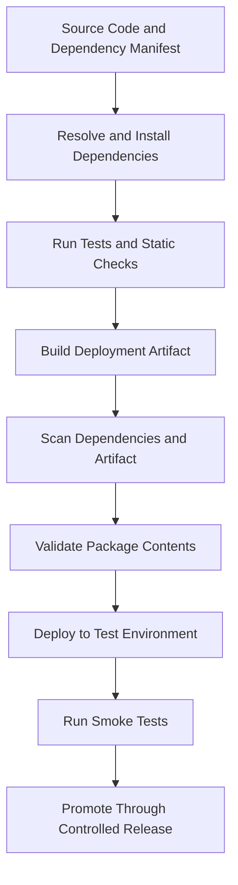

# 09- Dependency and Package Optimization

## Overview

AWS Lambda dependency and package optimization focuses on reducing initialization latency, deployment complexity, security exposure, and operational overhead while keeping application behavior reliable.

Python Lambda functions often depend on frameworks, SDKs, database drivers, validation libraries, and internal modules. Every dependency introduces some combination of packaging requirements, import-time work, maintenance obligations, and potential security vulnerabilities.

A production-ready deployment should contain only the dependencies required by the function, use compatible packages, minimize unnecessary initialization, and provide a repeatable build process.

Package optimization is not simply about achieving the smallest deployment artifact. A smaller package can still have expensive imports, while a larger package may perform well if its dependencies are loaded efficiently. Measure deployment size, cold-start behavior, memory consumption, runtime performance, and maintenance cost together.

## Understanding Lambda Deployment Packages

A Lambda deployment package contains the code and dependencies required to execute a function. Python functions can be deployed using ZIP archives or container images.

### ZIP deployment packages

A ZIP deployment package contains the function code and, when necessary, its third-party dependencies.

For Python, dependencies are commonly installed into the package directory so that Lambda can import them at runtime.

A typical package structure is:

```text
lambda-package/
    app.py
    services/
        orders.py
    psycopg/
    requests/
    urllib3/
```

The exact structure depends on the dependencies and packaging approach. The function handler must be importable using the configured handler name.

For example, a handler configured as `app.handler` expects a module named `app` containing a callable named `handler`.

### Container-image deployments

Lambda also supports container images stored in Amazon ECR. This approach is useful when the application needs custom operating-system libraries, a controlled filesystem layout, or a container-oriented build process.

A Lambda container image must comply with Lambda's container-image requirements, including its runtime interface requirements. A generic web-server container is not automatically a valid Lambda deployment.

Container images have a maximum uncompressed image size of 10 GB, including all layers. ZIP-based deployments have different package and extraction limits, so verify current service quotas before selecting a packaging strategy.

### ZIP versus container image

| Consideration | ZIP package | Container image |
|---|---|---|
| Packaging | Archive containing code and dependencies | OCI-compatible image stored in ECR |
| Build workflow | Python packaging tools and ZIP creation | Docker-compatible build workflow |
| Operating-system customization | More constrained by runtime and supported packaging mechanisms | Greater control over base image and system libraries |
| Dependency installation | Commonly installed into a package directory or layer | Installed into the image filesystem |
| Image or archive limits | Subject to Lambda ZIP package quotas | Subject to Lambda container-image quotas |
| Best fit | Most conventional Python functions | Complex native dependencies or container-based build requirements |
| Operational considerations | Archive size, layers, dependency compatibility | Image scanning, ECR permissions, image updates, and digest management |

Choose the packaging model based on dependency requirements, build reproducibility, security, and deployment operations—not on the assumption that one format is always faster.

## Python Dependency Management

Python dependencies must be compatible with the Lambda runtime, operating environment, architecture, and other installed packages.

### Keep dependencies explicit

Maintain a dependency manifest or lock file that defines the packages required by the application.

For example, a requirements file might contain:

```text
requests==2.32.5
pydantic==2.12.0
```

These versions are illustrative pins, not a recommendation to use them without checking current compatibility, security advisories, and the application's dependency constraints.

For production, prefer a reproducible dependency-resolution process that records compatible versions and transitive dependencies.

### Direct and transitive dependencies

A direct dependency is explicitly required by the application. A transitive dependency is installed because another package requires it.

For example:

```text
Application
    └── requests
        ├── urllib3
        ├── certifi
        ├── charset-normalizer
        └── idna
```

The actual dependency graph depends on the selected package versions.

Removing an apparently unused transitive dependency manually can break the package if another dependency expects it. Use dependency analysis and automated tests before removing packages.

### Separate runtime and development dependencies

Development dependencies include tools such as linters, test frameworks, coverage utilities, and local development helpers. These normally should not be included in the production Lambda artifact unless the function genuinely requires them at runtime.

A useful project structure is:

```text
order-service/
    app.py
    requirements.txt
    requirements-dev.txt
    tests/
    scripts/
```

The production build installs only runtime requirements. CI installs both runtime and development requirements when executing tests and quality checks.

## Build a Minimal Python ZIP Package

The following example demonstrates a basic packaging workflow for a Python Lambda function.

### Example source structure

```text
order-lambda/
    app.py
    requirements.txt
```

Example handler:

```python
import json

import requests


def handler(event, context):
    response = requests.get(
        "https://inventory.example.com/health",
        timeout=(2, 5),
    )
    response.raise_for_status()

    return {
        "statusCode": 200,
        "headers": {
            "content-type": "application/json",
        },
        "body": json.dumps(
            {"inventory_status": response.json()}
        ),
    }
```

This example illustrates dependency packaging and timeout configuration. A real implementation should validate downstream response contracts, handle expected errors, and avoid returning internal exception details to callers.

### Install dependencies into a build directory

Run the following commands in a compatible build environment:

```bash
python -m venv .venv
```

Activate the environment using the appropriate command for your operating system.

Install the runtime dependencies into the package directory:

```bash
python -m pip install \
  --requirement requirements.txt \
  --target package/
```

Copy the application code into the same directory:

```bash
cp app.py package/
```

Create the deployment archive:

```bash
cd package
zip -r ../function.zip .
cd ..
```

The resulting `function.zip` contains the handler and its dependencies.

The `cp` command shown is for Linux, macOS, or a compatible shell. On Windows, use an appropriate PowerShell copy command or run the packaging process inside a Linux-based build environment.

### Verify the package

Inspect the archive:

```bash
unzip -l function.zip
```

Confirm that:

- The handler module is at the expected archive location.
- Required third-party packages are included.
- Development tools and local virtual environments are excluded.
- No local secrets, `.env` files, or unrelated files are present.
- The package does not contain incompatible native binaries.

Test the artifact in an environment compatible with the intended Lambda runtime and architecture. Successful installation on a developer workstation does not guarantee that the package will run in Lambda.

## Native Dependencies and Runtime Compatibility

Some Python dependencies contain compiled extensions or require operating-system libraries. Examples include database drivers, image-processing libraries, and numerical packages.

These packages must be compatible with the Lambda execution environment and the selected architecture.

### Common compatibility requirements

- Python runtime version.
- Linux distribution and available shared libraries.
- CPU architecture, such as `x86_64` or `arm64`.
- Python ABI compatibility.
- Native shared-library dependencies.
- Runtime-specific packaging requirements.

Installing a package on Windows and copying its installed files into a Lambda ZIP package will not work reliably for packages that contain platform-specific native extensions.

### Build in a compatible environment

A practical approach is to build dependencies using a Lambda-compatible Linux environment, often through Docker.

For example, use a compatible Python Lambda base image or another controlled build image that matches the intended runtime and architecture.

The exact image tag must correspond to a supported runtime and architecture. Verify compatibility before building and deploying.

### Diagnose native-library errors

Typical errors include:

```text
ImportError: libpq.so: cannot open shared object file
```

```text
ImportError: cannot import name ...
```

```text
Runtime.ImportModuleError
```

These errors can indicate missing system libraries, incompatible compiled extensions, dependency conflicts, or an incorrect package layout.

Inspect the build environment, dependency versions, target architecture, and package contents. Do not assume every import error is caused by a missing Python package.

## Reduce Import-Time Overhead

Python executes module-level code when a module is imported. Large dependency trees, framework initialization, and expensive module-level operations can increase cold-start latency.

### Avoid unnecessary imports

Only import dependencies that the function needs. Removing unused libraries reduces maintenance and may reduce import overhead, although the actual performance improvement depends on the package and its initialization behavior.

### Use lazy imports selectively

A lazy import delays loading a module until the code path needs it.

```python
def generate_report(event):
    import pandas as pd

    records = event["records"]
    dataframe = pd.DataFrame(records)

    return dataframe.to_dict(orient="records")
```

If report generation is optional and infrequent, delaying the Pandas import may reduce startup work for invocations that do not use it.

However, the first invocation that calls `generate_report` pays the import cost. Lazy imports can move latency from initialization into request processing rather than eliminate it.

For frequently used dependencies, a normal module-level import may provide more predictable behavior.

### Keep initialization side effects minimal

Avoid performing unnecessary network calls, database queries, large file reads, or expensive calculations at import time.

These operations can make cold starts slower and can prevent the handler from running when a remote dependency is unavailable.

Use explicit initialization strategies and bounded timeouts for resources that must be initialized.

## Minimize Deployment Artifacts

A deployment artifact should contain only the code, dependencies, and resources required by the function.

### Exclude unnecessary files

Avoid packaging:

- Test directories and test data.
- Local virtual environments.
- Python bytecode caches.
- Development-only tools.
- Local database files.
- Editor configuration and temporary files.
- Build logs and unrelated documentation.
- Secrets and local environment files.

A controlled build directory is safer than zipping an entire repository.

### Use `.gitignore` and packaging rules appropriately

A `.gitignore` file controls which files Git tracks. It does not automatically exclude files from a ZIP archive created by a packaging script.

Use explicit build-directory selection, a packaging tool, or a dedicated script to determine what enters the deployment artifact.

### Measure artifact size

```bash
ls -lh function.zip
```

Inspect the uncompressed contents:

```bash
unzip -l function.zip
```

A small ZIP file can expand substantially after extraction. Validate both compressed and uncompressed package sizes against current Lambda limits.

## Lambda Layers

A Lambda layer is a separately managed archive containing dependencies or other files that can be made available to compatible functions.

Layers can help when multiple functions share a stable dependency set, but they are not automatically a performance optimization.

### When to use layers

- Several functions use the same internal library.
- A shared dependency set is versioned and maintained independently.
- A team wants to separate application code from common runtime dependencies.
- A deployment workflow benefits from independent dependency releases.

### Limitations

- Layer versions must remain compatible with the runtime and architecture.
- Updating a layer does not automatically update functions already configured with an older layer version.
- Shared dependencies can create version conflicts.
- Layers add deployment and dependency-management complexity.
- They do not eliminate the cost of importing dependencies.

### ZIP package and layer constraints

Lambda supports up to five layers per function. The function code and attached layers must satisfy the applicable combined uncompressed deployment-size limit, currently documented as 250 MB for ZIP-based deployments.

Always verify current limits and the constraints applicable to the deployment method.

### Layer directory structure

For Python dependencies, the archive commonly contains a `python/` directory:

```text
layer-package/
    python/
        requests/
        urllib3/
        certifi/
```

Build the layer using dependencies compatible with the function's runtime and architecture.

Use layers for deliberate dependency sharing, not as a way to avoid dependency ownership or compatibility testing.

## Container Image Optimization

Container images provide greater control over the application filesystem and system dependencies, but image contents must still be maintained carefully.

### Use a suitable base image

Choose an AWS-supported Lambda base image appropriate for the runtime and architecture, or another compatible image that implements the required Lambda runtime interface.

Use a specific, controlled base-image version rather than relying on an unreviewed moving tag.

### Multi-stage builds

Multi-stage Docker builds separate compilation and dependency-building work from the final runtime image.

This helps avoid including compilers, test tooling, and other build-only files in the production image.

```dockerfile
FROM public.ecr.aws/lambda/python:3.12 AS build

COPY requirements.txt ${LAMBDA_TASK_ROOT}/requirements.txt

RUN python -m pip install \
    --no-cache-dir \
    --requirement ${LAMBDA_TASK_ROOT}/requirements.txt \
    --target ${LAMBDA_TASK_ROOT}/python-deps

FROM public.ecr.aws/lambda/python:3.12

COPY --from=build ${LAMBDA_TASK_ROOT}/python-deps ${LAMBDA_TASK_ROOT}
COPY app.py ${LAMBDA_TASK_ROOT}/app.py

CMD ["app.handler"]
```

This example illustrates the multi-stage build pattern. The dependency stage and final stage must use compatible runtime environments and architectures. For native dependencies, verify that required shared libraries are available in the final image.

For larger projects, copy only the files needed at runtime. Avoid copying test data, source-control metadata, and development dependencies into the final image.

### Build and test

```bash
docker build -t order-lambda:local .
```

Run the image using the Lambda runtime interface exposed by the base image:

```bash
docker run --rm -p 9000:8080 order-lambda:local
```

Invoke the local runtime interface from another terminal:

```bash
curl -X POST \
  "http://localhost:9000/2015-03-31/functions/function/invocations" \
  -H "Content-Type: application/json" \
  -d '{"order_id":"order-123"}'
```

The payload must match the handler's expected event structure. The sample handler earlier in this document expects an external inventory endpoint and would need an appropriate test configuration or mock to run successfully.

Local container execution is useful for validating the runtime interface and application behavior, but it does not reproduce every aspect of the Lambda service, including its managed scaling and production networking.

## Dependency Security and Supply-Chain Integrity

Every dependency introduces a potential security and maintenance obligation. Package optimization should therefore include dependency security, not only package size.

### Recommended controls

- Pin or lock dependency versions through a controlled resolution process.
- Review vulnerability reports and security advisories.
- Remove unused dependencies.
- Keep runtime dependencies updated.
- Use trusted package sources.
- Scan dependencies and container images in CI/CD.
- Protect build credentials and deployment permissions.
- Avoid embedding credentials in artifacts.
- Verify artifacts before promotion to production.

Version pinning improves reproducibility but does not make a dependency secure. An old pinned version may contain known vulnerabilities.

### Avoid dependency confusion

Private package names can overlap with names available in public package indexes. Configure package sources carefully and control which repositories are trusted during builds.

Use approved internal registries where required, and avoid allowing untrusted package sources to override internal dependencies.

### Generate a software bill of materials

For environments with formal supply-chain requirements, generate a software bill of materials (SBOM) and retain dependency provenance alongside the build artifact.

An SBOM improves visibility into the components shipped with the function. It does not replace vulnerability scanning, dependency review, or remediation.

## Reproducible Builds and CI/CD

Dependency installation should be repeatable across developer workstations and CI/CD runners.

### Build pipeline



### Recommended pipeline controls

1. Install dependencies in a clean build environment.
2. Use the intended Python runtime and architecture.
3. Run unit tests and relevant integration tests.
4. Build the ZIP archive or container image.
5. Scan dependencies and the final artifact.
6. Inspect package contents and size.
7. Deploy to a non-production environment.
8. Run smoke tests against the deployed function.
9. Promote the same validated artifact where practical.
10. Retain build metadata and rollback information.

Building separately for each environment can introduce differences in resolved dependencies. Prefer a controlled artifact-promotion process where environment configuration can be separated from the artifact itself.

### Example GitHub Actions packaging job

```yaml
name: Lambda Package CI

on:
  pull_request:
  push:
    branches:
      - main

jobs:
  package:
    runs-on: ubuntu-latest

    steps:
      - name: Checkout repository
        uses: actions/checkout@v4

      - name: Set up Python
        uses: actions/setup-python@v5
        with:
          python-version: "3.12"

      - name: Install development dependencies
        run: |
          python -m pip install --upgrade pip
          python -m pip install -r requirements-dev.txt

      - name: Run tests
        run: |
          pytest

      - name: Build deployment package
        run: |
          rm -rf package function.zip
          mkdir package
          python -m pip install \
            --requirement requirements.txt \
            --target package/
          cp app.py package/
          cd package
          zip -r ../function.zip .
          cd ..

      - name: Verify deployment package
        run: |
          unzip -t function.zip
          unzip -l function.zip
          ls -lh function.zip
```

This workflow is an illustrative packaging pipeline. Production workflows should pin or otherwise control action versions, enforce dependency policies, validate native dependencies in a compatible build environment, and add artifact scanning and deployment verification.

The workflow does not deploy the function. Deployment should be handled by a separately permissioned job or workflow with appropriately scoped AWS credentials, preferably using GitHub Actions OIDC federation instead of long-lived AWS access keys.

## Troubleshooting Dependency and Packaging Problems

Use a consistent diagnostic process:

**Symptom → Possible causes → Isolation strategy → Diagnostic commands → Root cause verification → Corrective action → Prevention**

### Module not found

**Possible causes**

- The dependency was not installed into the deployment directory.
- The archive has an unexpected directory structure.
- The handler's module name is incorrect.
- A layer is missing or attached incorrectly.
- The dependency is available only in the developer environment.

**Diagnostic commands**

```bash
unzip -l function.zip
```

```bash
python -c "import requests; print(requests.__version__)"
```

Run the import check inside the intended build environment, not only on the developer workstation.

**Corrective action**

Rebuild the package from a clean directory and confirm that dependencies are installed into the expected location.

### Native import failure

**Possible causes**

- Wrong CPU architecture.
- Incompatible Python ABI.
- Missing shared library.
- Dependency compiled for another operating system.
- Incompatible package versions.

**Corrective action**

Rebuild the native dependency in a compatible environment and validate the final artifact using the same architecture and runtime as the Lambda function.

### Deployment package exceeds limits

**Possible causes**

- Development dependencies are included.
- A large library is unnecessary.
- Duplicate dependencies are bundled.
- Local caches or test files were copied into the package.
- Compressed size is being confused with uncompressed size.

**Corrective action**

Inspect the archive, remove unnecessary files, and reconsider whether ZIP packaging, layers, or a container image is appropriate.

### Unexpected cold-start latency

**Possible causes**

- Expensive module imports.
- Large dependency trees.
- Initialization-time network calls.
- Framework startup overhead.
- Native-library initialization.

**Corrective action**

Measure initialization duration, identify expensive imports and initialization operations, and benchmark a controlled dependency reduction. Do not assume that reducing compressed package size alone will solve the problem.

## Common Mistakes

| Mistake | Consequence | Better approach |
|---|---|---|
| Packaging the entire repository | Larger artifacts and unnecessary files | Build from an explicit staging directory |
| Installing dependencies on Windows and copying native packages | Runtime import failures in Lambda | Build in a compatible Linux environment |
| Including test and development dependencies | Larger artifacts and additional attack surface | Separate runtime and development manifests |
| Assuming layers automatically improve cold starts | Extra complexity without guaranteed performance improvement | Benchmark before introducing layers |
| Using unbounded dependency versions | Non-reproducible builds and unexpected changes | Use a controlled dependency-resolution process |
| Pinning dependencies but never updating them | Known vulnerabilities remain in production | Combine version control with vulnerability management |
| Using `--no-deps` without validating transitive dependencies | Missing runtime requirements | Resolve and test the complete dependency graph |
| Installing packages directly into the source directory | Build artifacts contaminate the repository | Use an isolated build directory |
| Assuming local imports guarantee Lambda compatibility | Runtime, architecture, or system-library differences cause failures | Validate the final artifact in a compatible environment |
| Using lazy imports indiscriminately | First-use latency becomes unpredictable | Defer only optional or infrequently used dependencies |
| Rebuilding different artifacts for each environment | Environment drift and inconsistent releases | Promote a validated artifact where practical |
| Treating package size as the only optimization metric | Initialization or runtime bottlenecks remain | Measure latency, memory, reliability, and cost together |

## Production Readiness Checklist

### Dependency management

- [ ] Runtime dependencies are explicitly declared.
- [ ] Dependency versions are controlled and reproducible.
- [ ] Development dependencies are excluded from the production artifact.
- [ ] Native dependencies match the target runtime and architecture.
- [ ] Unused dependencies have been removed where safe.

### Packaging

- [ ] The handler is located at the expected archive path.
- [ ] Package contents have been inspected.
- [ ] Compressed and uncompressed sizes satisfy applicable limits.
- [ ] No secrets, local databases, or unrelated files are included.
- [ ] The final artifact has been tested in a compatible environment.

### Security and deployment

- [ ] Dependencies and container images are scanned.
- [ ] Build and deployment permissions follow least privilege.
- [ ] CI/CD builds are reproducible and validated.
- [ ] Artifact promotion and rollback procedures are documented.
- [ ] Dependency updates are reviewed and tested.

### Performance and operations

- [ ] Initialization latency has been measured.
- [ ] Import-time work is justified and bounded.
- [ ] Memory and execution duration have been benchmarked.
- [ ] Dependency failures and initialization errors are observable.
- [ ] Packaging changes have been validated in a test environment.

## Key Takeaways

- Package only the code and dependencies required by the function, and validate the final artifact against the target Lambda runtime, architecture, and packaging limits.
- Build native Python dependencies in a compatible environment; a package that works on a developer workstation may fail in Lambda.
- Minimize unnecessary imports and initialization work, but measure cold-start and handler latency before adopting optimization techniques.
- Use Lambda layers and container images when they solve genuine packaging or operational problems, not because they automatically improve performance.
- Combine reproducible builds, vulnerability scanning, artifact verification, and controlled CI/CD promotion to maintain dependency security and deployment reliability.