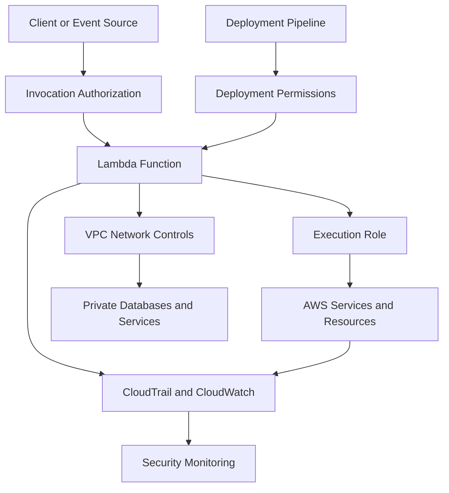

# 10- Security Best Practices

## Overview

AWS Lambda security requires protecting function execution, invocation permissions, application data, dependencies, network connectivity, and deployment workflows. A secure Lambda function is not defined solely by its IAM execution role; it depends on multiple security boundaries working together.

Lambda operates under the AWS shared responsibility model. AWS manages the underlying infrastructure and execution environment, while customers remain responsible for application code, permissions, data access, dependency security, configuration, and the security of integrated services.

A production Lambda security strategy should address these areas:

- **Identity and access management:** Restrict what a function can access and who can invoke it.
- **Data protection:** Protect secrets, environment variables, application data, and sensitive logs.
- **Network security:** Control connectivity to private resources and external services.
- **Software supply chain:** Validate dependencies, deployment artifacts, and container images.
- **Operational security:** Monitor activity, investigate authorization failures, and maintain secure deployment processes.

Security controls should follow least privilege, defense in depth, explicit trust boundaries, and continuous verification.

## Understand Lambda Security Boundaries

A Lambda-based application typically contains several distinct authorization boundaries.



These boundaries answer different questions:

| Security boundary | Main question | Primary controls |
|---|---|---|
| Invocation | Who can execute the function? | IAM identity policies, Lambda resource policies, service-specific authorization |
| Execution | What can the function do after invocation? | Execution role and resource permissions |
| Network | Which endpoints can the function reach? | VPC configuration, security groups, routes, network firewalls, VPC endpoints |
| Data | Who can read or modify application data? | IAM, database authorization, encryption, secret management |
| Deployment | Who can change code or configuration? | CI/CD permissions, release approvals, artifact integrity |
| Monitoring | Can suspicious activity be detected and investigated? | CloudTrail, CloudWatch, application logs, security alerts |

A function can be correctly protected at one boundary and still be vulnerable at another. For example, restricting invocation does not prevent an overly permissive execution role from accessing unrelated AWS resources after the function is invoked.

## Apply the Principle of Least Privilege

Least privilege means granting each identity only the permissions required to perform its responsibilities.

Lambda security involves at least two distinct permission models:

- **Execution-role permissions** determine what the running function can do.
- **Invocation permissions** determine who or what can call the function.

These permissions should be designed and reviewed independently.

### Use a dedicated execution role

Each function or closely related group of functions should have an execution role appropriate to its responsibilities.

For example, an order-processing function that reads orders from DynamoDB and publishes messages to an SQS queue should not receive unrestricted access to every DynamoDB table and SQS queue in the account.

An illustrative policy is:

```json
{
  "Version": "2012-10-17",
  "Statement": [
    {
      "Sid": "ReadOrders",
      "Effect": "Allow",
      "Action": [
        "dynamodb:GetItem",
        "dynamodb:UpdateItem"
      ],
      "Resource": "arn:aws:dynamodb:ap-south-1:123456789012:table/Orders"
    },
    {
      "Sid": "PublishOrderEvents",
      "Effect": "Allow",
      "Action": "sqs:SendMessage",
      "Resource": "arn:aws:sqs:ap-south-1:123456789012:order-events"
    }
  ]
}
```

Replace the example account, Region, table, and queue identifiers with the actual resources. The required DynamoDB actions depend on the application's access pattern.

This policy illustrates scoped permissions, not a complete deployment configuration. KMS-encrypted resources, cross-account access, resource policies, and other integrations can require additional permissions.

### Avoid wildcard permissions

The following policy is usually too broad for a production function:

```json
{
  "Version": "2012-10-17",
  "Statement": [
    {
      "Effect": "Allow",
      "Action": "*",
      "Resource": "*"
    }
  ]
}
```

If the function is compromised or contains an exploitable application vulnerability, unrestricted permissions can significantly increase the impact.

Prefer:

- Specific actions rather than `"Action": "*"`.
- Specific resource ARNs rather than `"Resource": "*"`.
- Separate roles for unrelated workloads.
- Conditions where they meaningfully restrict access.
- Regular reviews of permissions no longer required.

Some AWS operations do not support resource-level restrictions and require `"Resource": "*"`. In such cases, restrict the actions and apply supported conditions where possible.

### Distinguish execution permissions from deployment permissions

The identity that deploys a function should not automatically have every permission available to the function at runtime.

A deployment identity may need to update function code, configure versions, and manage associated deployment resources. The execution role should instead contain permissions needed by the application itself.

Separate these responsibilities to reduce the consequences of compromised CI credentials or application code.

## Secure Lambda Invocation

A function's invocation permissions determine which identities and services can execute it.

Lambda supports identity-based authorization and resource-based policies. The correct model depends on the invoking principal and integration.

### Identity-based permissions

An IAM identity policy can grant a user, role, or service-associated identity permission to invoke a function.

For example:

```json
{
  "Version": "2012-10-17",
  "Statement": [
    {
      "Effect": "Allow",
      "Action": "lambda:InvokeFunction",
      "Resource": "arn:aws:lambda:ap-south-1:123456789012:function:order-handler"
    }
  ]
}
```

Attach such a policy to the appropriate IAM identity when that identity needs direct invocation access.

### Resource-based permissions

A Lambda resource policy can authorize another AWS service or AWS account to invoke a function.

For example, an S3 bucket notification commonly requires a Lambda resource-policy statement that permits the S3 service principal to invoke the function, scoped to the intended bucket and account.

An illustrative statement is:

```json
{
  "Sid": "AllowSpecificS3Bucket",
  "Effect": "Allow",
  "Principal": {
    "Service": "s3.amazonaws.com"
  },
  "Action": "lambda:InvokeFunction",
  "Resource": "arn:aws:lambda:ap-south-1:123456789012:function:file-processor",
  "Condition": {
    "StringEquals": {
      "AWS:SourceAccount": "123456789012"
    },
    "ArnLike": {
      "AWS:SourceArn": "arn:aws:s3:::approved-upload-bucket"
    }
  }
}
```

Use the appropriate supported condition keys and exact resource identifiers for the integration. For services that support it, restrict both the source account and source resource to mitigate confused-deputy risks.

### Verify invocation permissions

Inspect a function's resource policy:

```bash
aws lambda get-policy \
  --function-name order-handler \
  --region ap-south-1
```

Inspect its configured resource permissions before granting new principals access.

For direct invocation, verify that the caller's identity policies and applicable resource policies authorize the operation. Cross-account access requires correctly configured authorization on both sides of the trust relationship.

### Protect function URLs

Lambda function URLs provide HTTPS endpoints for invoking functions. Their authentication configuration must match the intended access model.

- Use `AWS_IAM` when callers must authenticate through AWS IAM authorization.
- Use `NONE` only when public or otherwise unauthenticated endpoint access is deliberately intended and the endpoint is protected appropriately for its threat model.

A function URL configured with `NONE` can expose the application to unauthenticated requests. Application-level authentication is not automatically supplied merely because the endpoint is hosted by Lambda.

If a function URL is public, implement suitable application authentication, input validation, abuse controls, and data authorization. Where appropriate, use a gateway or another managed entry point that provides the required controls.

## Protect Secrets and Sensitive Configuration

Environment variables are useful for non-sensitive configuration such as feature flags, resource names, and endpoint settings. Credentials and other secrets require stronger lifecycle and access controls.

### Prefer Secrets Manager or Parameter Store

Use AWS Secrets Manager or AWS Systems Manager Parameter Store for sensitive values according to their rotation, lifecycle, and operational requirements.

The Lambda execution role should be granted access only to the specific secret or parameter it needs.

An example IAM statement for reading one secret is:

```json
{
  "Version": "2012-10-17",
  "Statement": [
    {
      "Effect": "Allow",
      "Action": "secretsmanager:GetSecretValue",
      "Resource": "arn:aws:secretsmanager:ap-south-1:123456789012:secret:production/order-db-AbCdEf"
    }
  ]
}
```

Replace the illustrative ARN with the actual secret ARN. Customer-managed KMS encryption can require additional permissions and key-policy authorization.

### Retrieve secrets safely

A Python example using the AWS SDK for Python (`boto3`) is:

```python
import json
import os

import boto3

secrets_client = boto3.client("secretsmanager")


def load_database_secret() -> dict:
    secret_id = os.environ["DATABASE_SECRET_ARN"]

    response = secrets_client.get_secret_value(
        SecretId=secret_id
    )

    return json.loads(response["SecretString"])
```

This example assumes the secret contains a JSON object in `SecretString`. Binary secrets and other formats require different handling.

For production workloads, consider:

- Caching retrieved secrets for an appropriate period.
- Handling rotation and credential expiration.
- Using bounded timeouts and retries for retrieval.
- Avoiding secret values in logs, exceptions, and metrics.
- Testing behavior when the secret is unavailable or malformed.

Caching reduces repeated API calls and latency but delays the visibility of rotations until the cache expires or is refreshed. Choose the cache lifetime according to the credential-rotation policy and risk tolerance.

### Avoid exposing secrets

Do not:

- Hardcode credentials in source code.
- Commit `.env` files or secret values.
- Print complete environment variables in logs.
- Include credentials in exception messages or request URLs.
- Store long-lived AWS access keys in the function configuration.
- Place secrets in deployment artifacts or container image layers.

Environment variables configured for Lambda are encrypted at rest by the service, but applications and authorized principals can still access their values. Encryption at rest does not replace access control or safe handling.

## Secure Environment Variables

Environment variables should contain configuration rather than unnecessary sensitive information.

Good examples include:

```text
LOG_LEVEL=INFO
ORDERS_TABLE=Orders
DATABASE_SECRET_ARN=arn:aws:secretsmanager:ap-south-1:123456789012:secret:production/order-db-AbCdEf
```

Avoid storing database passwords, private keys, or third-party API credentials directly in configuration when a suitable secret-management mechanism is available.

Security controls should include:

- Restricting who can read or update function configuration.
- Reviewing configuration changes through controlled deployment workflows.
- Protecting environment values during troubleshooting and support operations.
- Using KMS configuration appropriately where required.
- Avoiding configuration dumps in application logs.

Changes to Lambda configuration can affect the running application and its execution environments. Treat configuration updates as production changes with review, verification, and rollback procedures.

## Secure VPC Connectivity

A Lambda function configured for VPC access can communicate with resources reachable through its selected subnets and network configuration.

VPC attachment does not automatically make a function private in every respect, nor does it automatically provide internet access.

### Apply network segmentation

Use security groups and subnet routing to limit connectivity to the systems the function requires.

For example, a database-connected function should generally:

- Use private subnets with suitable routes.
- Use a dedicated or appropriately scoped security group.
- Connect only to the required database port and destination.
- Avoid unnecessary inbound access.
- Use database-level authentication and authorization.
- Validate DNS resolution and routing requirements.

Security groups are stateful, and their rules should be designed around actual application flows. Network ACLs, route tables, DNS configuration, and endpoint policies can also affect connectivity.

### Understand outbound connectivity

A Lambda function attached to a VPC does not gain public internet access merely by using a public subnet.

For outbound internet connectivity, a common design uses private subnets with a route through a NAT gateway. AWS service access can sometimes use VPC endpoints, reducing the need for NAT traffic.

Choose between NAT, VPC endpoints, and other connectivity patterns based on required destinations, security boundaries, availability, and cost.

### Protect private services

For a Lambda function connecting to PostgreSQL or MySQL:

- Permit inbound database traffic only from the Lambda security group or other required sources.
- Keep the database out of unnecessary public exposure.
- Use TLS where supported and required by the threat model.
- Retrieve credentials from a managed secret store.
- Use database-specific roles with restricted privileges.
- Monitor connection counts and authentication failures.

Network isolation does not replace database authorization. A function that can reach a database should still have only the permissions necessary for its workload.

## Secure Dependencies and Deployment Artifacts

Lambda functions inherit risks from their third-party dependencies, build process, and deployment artifacts.

A vulnerable package can introduce an exploitable code path even when IAM permissions are carefully restricted.

### Dependency security practices

- Keep runtime dependencies explicit and reproducible.
- Review vulnerability reports and security advisories.
- Update vulnerable packages through controlled changes.
- Remove unused dependencies.
- Build native dependencies for the correct runtime and architecture.
- Use trusted package registries.
- Scan dependencies and container images in CI/CD.
- Retain artifact metadata and, where appropriate, an SBOM.

Pinning a dependency version improves reproducibility but does not make the dependency secure. Regular review and remediation remain necessary.

### Protect ZIP packages and container images

For ZIP deployments:

- Exclude `.env` files, local credentials, test fixtures containing sensitive data, and development-only files.
- Inspect archive contents before deployment.
- Build artifacts from controlled staging directories.
- Restrict permissions to publish or update deployed code.

For container images:

- Use trusted base images.
- Keep operating-system and application packages updated.
- Scan images before release.
- Avoid embedding credentials in image layers.
- Restrict ECR push and image-promotion permissions.
- Deploy validated image versions rather than relying on uncontrolled changes.

A successful build does not prove that the artifact is safe. Combine build validation with security scanning, artifact review, and controlled deployment.

## Secure CI/CD and Deployment Credentials

The deployment pipeline is a privileged part of the Lambda security boundary. If an attacker can modify the workflow or obtain its credentials, they may be able to replace application code or weaken function configuration.

### Prefer GitHub Actions OIDC federation

For GitHub Actions deployments to AWS, prefer OpenID Connect (OIDC) federation over long-lived IAM access keys stored as repository secrets.

Configure an IAM role with a trust policy that restricts the expected OIDC audience and the appropriate GitHub repository, branch, or environment identity.

The deployment role should have only the permissions required for the deployment process. Runtime permissions should remain attached to the Lambda execution role.

### Deployment security controls

- Protect production branches and deployment environments.
- Require reviews for changes to workflows and infrastructure definitions.
- Restrict the repositories and branches allowed to assume the deployment role.
- Avoid broad permissions such as unrestricted IAM policy modification.
- Separate build, test, and production deployment responsibilities where appropriate.
- Scan and validate artifacts before promotion.
- Record deployments and retain rollback artifacts.
- Verify the deployed version and configuration after release.

A compromised source repository can undermine otherwise strong cloud permissions. Protect workflow definitions, dependency manifests, build actions, and artifact repositories as part of the deployment threat model.

## Logging, Auditing, and Security Monitoring

Logging and auditing should provide enough evidence to detect suspicious activity and investigate incidents without exposing sensitive information.

### CloudTrail

AWS CloudTrail records supported AWS API activity, including management operations that change Lambda configuration, permissions, and deployment state.

Use CloudTrail to investigate questions such as:

- Who changed a function's execution role?
- Who modified a resource-based policy?
- Who deployed new code?
- Who changed a function URL's authentication configuration?
- Which identity attempted a privileged operation?

CloudTrail coverage depends on the event type and trail or event data configuration. Verify that required events are being recorded and retained.

### CloudWatch Logs

Application logs can reveal operational failures and security-relevant behavior, but they can also expose sensitive data.

Use structured logging with carefully selected fields:

```python
import json
import logging

logger = logging.getLogger()
logger.setLevel(logging.INFO)


def handler(event, context):
    logger.info(
        json.dumps(
            {
                "event": "request_received",
                "request_id": context.aws_request_id,
                "function_name": context.function_name,
            }
        )
    )

    return {"statusCode": 200, "body": "OK"}
```

Avoid logging complete request payloads by default. Events may contain authorization headers, personal information, secrets, or business-sensitive fields.

### Security monitoring

Consider alerts for:

- Unexpected increases in invocation volume.
- Elevated function error rates or throttling.
- Unauthorized access attempts.
- Changes to execution roles or resource policies.
- Unexpected function configuration or code updates.
- Abnormal secret-access activity.
- Repeated database authentication failures.
- Unusual outbound network activity, where observable.

CloudWatch metrics, CloudTrail events, application logs, and AWS security services provide complementary evidence. No single source captures every application-level security event.

## Protect Data and Encryption Keys

Encryption should be combined with access control, key governance, and application-level safeguards.

### Encryption at rest

AWS services provide encryption capabilities for Lambda-related artifacts and integrated resources. Depending on the resource and configuration, customers can use AWS-managed or customer-managed KMS keys.

Customer-managed keys can support additional control over key policies, auditability, and key lifecycle management, but they also introduce configuration and availability dependencies.

### Encryption in transit

Use TLS for communication with databases, APIs, and other services when supported and appropriate. Validate certificates instead of disabling certificate verification to work around connectivity problems.

For private AWS service access, use appropriate service endpoints and policies when available.

### Data minimization

Security also depends on limiting the data a function handles and retains.

- Avoid collecting fields that the workload does not need.
- Restrict access to logs containing sensitive information.
- Apply retention policies.
- Avoid storing sensitive data in temporary files unless necessary.
- Delete temporary files when they are no longer needed.
- Review data passed between event sources, queues, and downstream functions.

Encryption does not make excessive data collection or unnecessary retention safe.

## Handle Security Failures Safely

A function should fail securely when authorization, configuration, or dependencies are incorrect.

### Do not expose internal errors

Returning complete stack traces, database errors, or internal AWS resource details to an external caller can reveal implementation details that assist an attacker.

Log diagnostic information securely and return a controlled error response to the caller.

```python
import json
import logging

logger = logging.getLogger()
logger.setLevel(logging.INFO)


def handler(event, context):
    try:
        result = process_request(event)
        return {
            "statusCode": 200,
            "body": json.dumps(result),
        }
    except ValueError:
        logger.warning(
            "Request validation failed",
            extra={"request_id": context.aws_request_id},
        )
        return {
            "statusCode": 400,
            "body": json.dumps({"error": "Invalid request"}),
        }
    except Exception:
        logger.exception(
            "Request processing failed",
            extra={"request_id": context.aws_request_id},
        )
        return {
            "statusCode": 500,
            "body": json.dumps({"error": "Internal server error"}),
        }


def process_request(event):
    raise NotImplementedError
```

The example illustrates controlled error responses. Replace `process_request` with application logic and add the appropriate validation and error mapping.

Do not catch every exception and report success. Unexpected failures should remain observable and should produce the appropriate failure behavior for the invocation model.

### Avoid retry amplification

Retries can amplify load on a failing dependency. Configure retry behavior and concurrency limits according to the event source and downstream capacity.

For asynchronous invocations and event source mappings, retry behavior differs. Use dead-letter queues or failure destinations where appropriate, and implement idempotent processing to handle duplicate events safely.

## Security Troubleshooting

Use a consistent diagnostic sequence:

**Symptom → Possible causes → Isolation strategy → Diagnostic commands → Root cause verification → Corrective action → Prevention**

### Access denied errors

**Possible causes**

- Missing execution-role permission.
- Incorrect resource ARN.
- Denial from a resource-based policy.
- KMS key-policy restrictions.
- An explicit deny in an applicable policy.
- Permission boundary, session policy, or service control policy restrictions.

**Isolation strategy**

Identify the principal making the request, the action being attempted, and the resource involved. Determine whether the failing action is performed by the function at runtime or by the service invoking it.

Inspect the role and function configuration:

```bash
aws lambda get-function-configuration \
  --function-name order-handler \
  --region ap-south-1
```

Inspect the function's resource policy:

```bash
aws lambda get-policy \
  --function-name order-handler \
  --region ap-south-1
```

Use IAM policy simulation where appropriate, while recognizing that simulation does not reproduce every aspect of live authorization, resource policies, organizational controls, or service-specific behavior.

**Corrective action**

Grant the missing permission at the narrowest supported scope, then verify the operation using the intended identity and resource.

### Unexpected public access

**Possible causes**

- An overly permissive Lambda resource policy.
- A function URL configured for unauthenticated access.
- A gateway or application-level authorization gap.
- A public endpoint exposing sensitive application functionality.

**Isolation strategy**

Inspect function URL configuration, resource policies, and the relevant API or gateway authorization settings.

```bash
aws lambda get-function-url-config \
  --function-name order-handler \
  --region ap-south-1
```

**Corrective action**

Restrict invocation to the intended principals or services. If public access is required, apply suitable application authentication, authorization, validation, and abuse protections.

### Secret exposure

**Possible causes**

- Secrets committed to source control.
- Credentials embedded in environment variables or image layers.
- Excessive application logging.
- Overly broad secret-read permissions.

**Corrective action**

Revoke or rotate exposed credentials, remove unnecessary access, and investigate the exposure path. Removing the value from the latest source revision is not sufficient if it remains in Git history, build artifacts, logs, or image layers.

### VPC connectivity failure

**Possible causes**

- Incorrect routes or security-group rules.
- Missing NAT connectivity for an external destination.
- Missing or misconfigured VPC endpoint.
- DNS resolution problems.
- Database-level authorization failure.

**Corrective action**

Check routing, DNS, security-group rules, endpoint policies, database access controls, and application timeouts independently. Do not respond to a connectivity issue by broadly opening inbound or outbound traffic without identifying the actual failure.

## Common Security Anti-Patterns

| Anti-pattern | Risk | Better approach |
|---|---|---|
| Using one administrator role for every function | A single compromise can affect unrelated resources | Use workload-specific execution roles |
| Granting `lambda:InvokeFunction` to broad principals | Unintended callers may execute the function | Restrict invocation to approved identities and services |
| Allowing every S3 bucket to invoke a function | Unintended event sources can trigger processing | Scope the resource policy to the required bucket and account |
| Storing database passwords in source code | Credentials can leak through source control and artifacts | Use managed secret storage and rotation |
| Logging full event payloads | Sensitive information may be exposed to log readers | Log selected, sanitized fields |
| Keeping long-lived AWS access keys in CI | Credential theft can enable persistent access | Use OIDC federation with a scoped deployment role |
| Disabling TLS certificate verification | Network interception becomes easier | Fix trust configuration and validate certificates |
| Assuming VPC attachment guarantees security | Reachable resources may still be overexposed | Combine network controls with IAM and application authorization |
| Never reviewing execution-role permissions | Old privileges accumulate over time | Review and remove unnecessary permissions |
| Deploying unscanned dependencies | Known vulnerabilities can reach production | Add dependency and artifact scanning to CI/CD |
| Returning stack traces to clients | Internal implementation details are disclosed | Return controlled errors and retain protected diagnostics |
| Treating encryption as a replacement for authorization | Authorized-but-unintended access can still occur | Apply least privilege and data-access controls |

## Production Security Checklist

### Identity and permissions

- [ ] Each function has an appropriate execution role.
- [ ] Runtime permissions are restricted to required actions and resources.
- [ ] Invocation permissions are reviewed independently.
- [ ] Cross-account access is explicitly scoped and verified.
- [ ] Deployment and runtime permissions are separated.
- [ ] Unnecessary permissions and broad resource policies are removed.

### Secrets and data

- [ ] Secrets are stored in an appropriate managed secret service.
- [ ] Secret access is restricted to required identities.
- [ ] Rotation and cache-refresh behavior are defined.
- [ ] Sensitive values are excluded from source control, artifacts, and logs.
- [ ] Data retention and log retention are appropriate.
- [ ] TLS and encryption-key controls match the threat model.

### Network and dependencies

- [ ] VPC routes and security groups are intentionally scoped.
- [ ] Database authorization is restricted independently of network access.
- [ ] Native dependencies match the runtime and architecture.
- [ ] Dependencies and container images are scanned.
- [ ] Build artifacts are reproducible and inspected.
- [ ] Public endpoints have an explicit authentication and authorization design.

### Deployment and operations

- [ ] CI/CD uses short-lived credentials where practical.
- [ ] Production deployment permissions are restricted.
- [ ] CloudTrail captures required management activity.
- [ ] CloudWatch logs avoid unnecessary sensitive data.
- [ ] Security-relevant events and configuration changes are monitored.
- [ ] Incident response includes credential rotation, investigation, and rollback procedures.

## Key Takeaways

- Lambda security depends on separate invocation, execution, network, data, deployment, and monitoring boundaries; each must be designed and verified independently.
- Use least-privilege execution roles and narrowly scoped invocation policies, including source restrictions for service integrations where supported.
- Store secrets in managed services, protect sensitive logs, and use appropriate encryption and authorization controls.
- Secure the software supply chain with controlled dependencies, artifact scanning, trusted builds, and short-lived CI/CD credentials.
- Use CloudTrail, CloudWatch, and application-level telemetry together to detect suspicious changes, diagnose authorization failures, and support incident response.