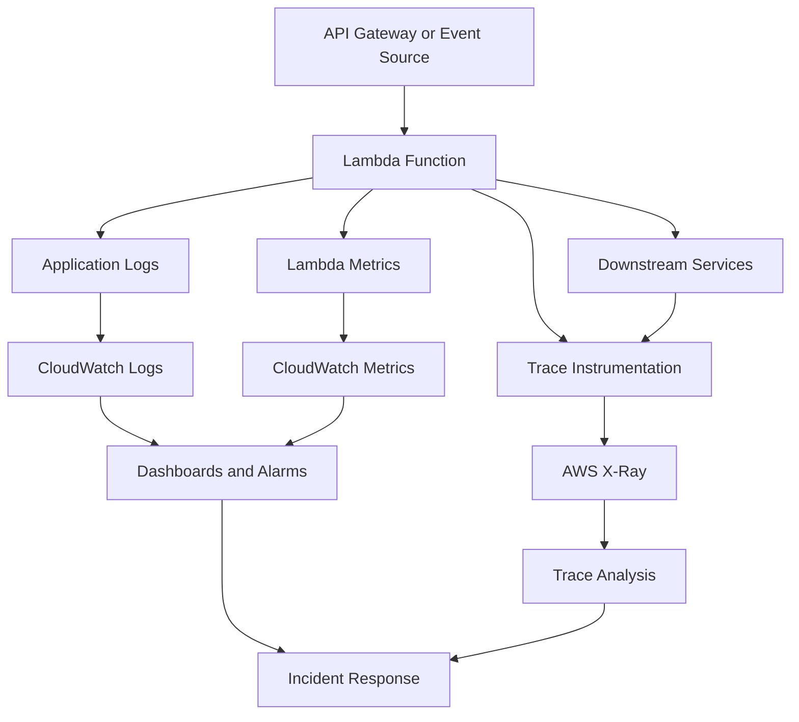
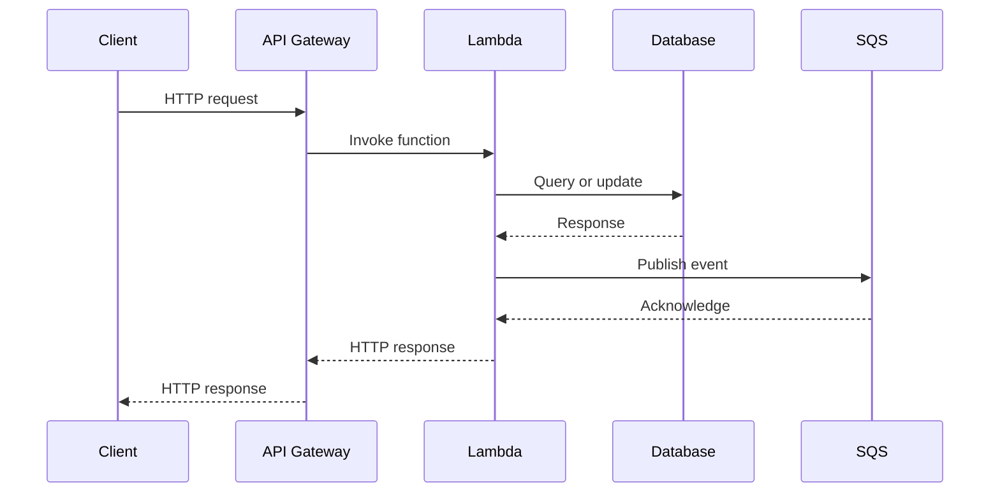

# 11- Logging, Metrics and Distributed Tracing

## Overview

Observability is essential for operating AWS Lambda functions reliably in production. It enables engineers to investigate failures, identify performance bottlenecks, detect abnormal workloads, understand distributed request flows, and verify whether a system meets its service-level objectives.

Lambda workloads frequently span managed execution environments, API gateways, queues, databases, and downstream services. A single business transaction may cross several functions and services, making traditional single-process debugging insufficient.

A production observability strategy combines three complementary capabilities:

- **Logging:** Records detailed events that explain what the application did and why an operation failed.
- **Metrics:** Quantifies system behavior, such as invocation volume, error rates, duration, throttling, and business outcomes.
- **Distributed tracing:** Connects operations across services to reveal request paths, latency distribution, and downstream dependencies.

Logs provide context, metrics reveal trends and threshold violations, and traces help explain where time is spent across a distributed request. These signals should work together rather than being treated as independent monitoring features.

## Observability Architecture

A typical Lambda observability architecture combines native AWS telemetry with application-level instrumentation.



### AWS observability components

| Component | Purpose | Typical use |
|---|---|---|
| Amazon CloudWatch Logs | Stores application and runtime logs | Investigate exceptions, validation failures, and execution details |
| Amazon CloudWatch Metrics | Collects numerical measurements | Monitor errors, duration, throttling, and concurrency |
| CloudWatch Alarms | Evaluates metrics against configured thresholds | Notify operators about availability or performance degradation |
| AWS X-Ray | Traces requests across participating services | Investigate latency and downstream dependency failures |
| CloudWatch Application Signals | Provides application-centric monitoring and service-level indicators where supported | Monitor service health and dependencies |
| AWS CloudTrail | Records supported AWS API activity | Audit configuration changes, deployments, and authorization-related operations |

CloudTrail complements application observability but is not a substitute for Lambda application logs or distributed traces.

## Structured Logging

Structured logging records events as machine-readable fields instead of relying exclusively on unstructured text.

For example, this message is difficult to query reliably:

```text
Order processing failed for order 123 because database timed out
```

A structured event separates the information into fields:

```json
{
  "level": "ERROR",
  "event": "order_processing_failed",
  "order_id": "order-123",
  "request_id": "abc-123",
  "error_type": "DatabaseTimeout"
}
```

Structured fields make logs easier to filter, aggregate, correlate, and consume through automated alerting.

### Recommended logging fields

Depending on the workload, useful fields include:

- `timestamp`
- `level`
- `event`
- `request_id`
- `trace_id`
- `function_name`
- `function_version`
- `operation`
- `duration_ms`
- `error_type`
- `correlation_id`

Do not include every field in every event. Choose fields that improve diagnosis without increasing cost or exposing sensitive information.

### Python structured logging

Python Lambda functions can use the standard logging library with JSON-formatted messages.

```python
import json
import logging

logger = logging.getLogger()
logger.setLevel(logging.INFO)


def handler(event, context):
    logger.info(
        json.dumps(
            {
                "event": "request_received",
                "aws_request_id": context.aws_request_id,
                "function_name": context.function_name,
                "function_version": context.function_version,
            }
        )
    )

    return {
        "statusCode": 200,
        "body": json.dumps({"status": "accepted"}),
    }
```

This example explicitly serializes the event as JSON. Production applications can use a structured logging library or Lambda's supported application logging configuration to produce consistent JSON output.

Avoid mixing incompatible JSON formats or embedding unstructured multiline text in fields intended for automated analysis.

### Lambda JSON logging configuration

Lambda supports configurable application log formats for supported runtimes. For Python, configure JSON application logs where appropriate so log records can be queried by fields.

Inspect the current configuration:

```bash
aws lambda get-function-configuration \
  --function-name order-handler \
  --query '{LoggingConfig:LoggingConfig,Role:Role,Runtime:Runtime}' \
  --output json \
  --region ap-south-1
```

A function's logging configuration can include the application log format, application log level, system log level, and log group where supported.

The exact behavior depends on the runtime and configuration. Verify that the application logging approach produces the expected fields and that the log group receives the intended records.

### Log levels

| Level | Appropriate use |
|---|---|
| `DEBUG` | Detailed diagnostic information, normally disabled or restricted in production |
| `INFO` | Important lifecycle events and successful business operations |
| `WARNING` | Recoverable anomalies, degraded behavior, or unexpected but handled conditions |
| `ERROR` | Failed operations requiring investigation |
| `CRITICAL` | Severe failures requiring immediate attention, when applicable |

Do not log every successful low-level operation at `INFO`. Excessive logging increases ingestion costs and can make important events harder to find.

## Correlation IDs and Request Context

Correlation IDs connect related operations across multiple services.

For example, an API request might invoke Lambda, write an order to DynamoDB, and publish an event to SQS. A correlation identifier can help operators follow the same business operation across logs generated by those components.

### Distinguish different identifiers

| Identifier | Purpose |
|---|---|
| Lambda request ID | Identifies an individual Lambda invocation |
| API request ID | Identifies a request handled by the API layer |
| Trace ID | Identifies a distributed trace |
| Correlation ID | Application-defined identifier used to relate operations |
| Business entity ID | Identifies a business object, such as an order |

These identifiers are not interchangeable. A business entity ID can appear in many independent requests, while a request ID normally identifies a specific invocation.

### Propagate correlation context

For HTTP APIs, propagate a validated correlation identifier through an agreed request header or application context.

For asynchronous systems, include the identifier in message attributes or event metadata where appropriate. Avoid blindly trusting arbitrary client-provided identifiers for authorization or security decisions.

```python
import json
import logging

logger = logging.getLogger()
logger.setLevel(logging.INFO)


def handler(event, context):
    headers = event.get("headers") or {}

    correlation_id = (
        headers.get("x-correlation-id")
        or context.aws_request_id
    )

    logger.info(
        json.dumps(
            {
                "event": "order_request_received",
                "correlation_id": correlation_id,
                "aws_request_id": context.aws_request_id,
            }
        )
    )

    return {
        "statusCode": 200,
        "headers": {
            "x-correlation-id": correlation_id,
        },
        "body": json.dumps({"status": "accepted"}),
    }
```

This example demonstrates context propagation. A production implementation should validate and normalize incoming identifiers, define consistent behavior across services, and avoid treating the identifier as an authentication credential.

## CloudWatch Logs

Lambda sends logs to CloudWatch Logs when the function's execution role and logging configuration permit it.

By default, Lambda commonly creates a log group named:

```text
/aws/lambda/<function-name>
```

A function can be configured to use a different log group where supported.

### Log groups and retention

Log groups contain log streams, which organize records from execution environments and related logging activity.

Configure retention deliberately. Keeping all logs indefinitely can increase storage costs and retain sensitive information longer than necessary.

Inspect the log group:

```bash
aws logs describe-log-groups \
  --log-group-name-prefix /aws/lambda/order-handler \
  --region ap-south-1
```

Inspect retention configuration:

```bash
aws logs describe-log-groups \
  --log-group-name-prefix /aws/lambda/order-handler \
  --query 'logGroups[].{Name:logGroupName,RetentionDays:retentionInDays}' \
  --output table \
  --region ap-south-1
```

A missing `retentionInDays` value means no explicit retention policy is configured for that log group.

Set retention according to operational requirements, security policies, and audit obligations.

### Query logs with CloudWatch Logs Insights

Logs Insights supports queries over selected log groups and time ranges.

For JSON application logs, a query might look like:

```sql
fields @timestamp, level, event, error_type, aws_request_id
| filter level = "ERROR"
| sort @timestamp desc
| limit 100
```

This assumes that the relevant fields are available as discovered or parsed fields. Adapt the query to the actual log format.

To inspect slow invocations using Lambda platform log records:

```sql
filter @type = "REPORT"
| fields @timestamp, @requestId, @duration, @billedDuration, @maxMemoryUsed
| sort @duration desc
| limit 50
```

Platform log formats can vary with runtime and logging configuration. Verify the field names available in the selected log group before relying on a query in dashboards or automated workflows.

### Search for exceptions

```sql
fields @timestamp, @message
| filter @message like /Traceback|Exception|Task timed out/
| sort @timestamp desc
| limit 100
```

This query is useful for initial investigation, but string matching is less reliable than structured application events for ongoing monitoring.

## CloudWatch Metrics

Metrics quantify function behavior over time. Lambda publishes platform metrics to CloudWatch automatically, while applications can publish custom metrics for business outcomes and application-specific measurements.

### Important Lambda metrics

| Metric | Meaning | Operational use |
|---|---|---|
| `Invocations` | Number of function invocations, excluding certain failed invocation attempts such as throttles | Understand workload volume |
| `Errors` | Number of invocations that result in function errors | Detect failed executions |
| `Duration` | Execution duration of function invocations | Monitor latency and performance |
| `Throttles` | Number of invocation attempts throttled by Lambda | Detect concurrency or capacity constraints |
| `ConcurrentExecutions` | Concurrent function executions | Understand concurrency demand |
| `UnreservedConcurrentExecutions` | Account-level unreserved concurrency usage | Monitor shared concurrency capacity |
| `DeadLetterErrors` | Failures delivering asynchronous invocation records to a configured dead-letter queue | Detect failure-delivery problems |
| `DestinationDeliveryFailures` | Failures delivering asynchronous invocation results to configured destinations | Detect failure-routing problems |
| `IteratorAge` | Age of the last record when Lambda processes supported stream-based event sources that publish this metric | Detect stream-processing lag |

Metric availability and dimensions depend on the function, invocation model, and event source. Check the current AWS metric reference before using a metric as an alerting dependency.

### Error rate

A useful application-level indicator is the invocation error rate.

\[
\text{Error Rate} =
\frac{\text{Errors}}{\text{Invocations}} \times 100
\]

Interpret the ratio carefully:

- A low-volume function can have a high error percentage from a single failure.
- A high-volume function can have an unacceptable number of failures despite a low percentage.
- Throttled requests may not be counted in `Invocations`, so invocation error rate alone does not describe every failed request.
- API Gateway, event source, and downstream failures may need separate metrics.

For production alerting, consider both absolute failures and a rate over a meaningful evaluation window.

### Duration percentiles

Average duration can hide long-running requests. Monitor percentiles such as p95 and p99 where the selected metric and reporting method support them.

For example, a function with a low average duration may still have a small number of invocations approaching its configured timeout.

Use duration measurements alongside timeout counts, errors, memory utilization, and downstream latency.

### Custom metrics

Custom metrics help measure business outcomes that Lambda platform metrics cannot represent directly.

Examples include:

- Orders successfully processed.
- Payment authorization failures.
- Queue messages permanently rejected.
- Records skipped due to validation.
- Business operations completed within a latency objective.

Custom metrics should use controlled dimensions. Avoid placing unique request IDs, customer IDs, or order IDs in metric dimensions, because high-cardinality dimensions can increase cost and make metrics difficult to aggregate.

## CloudWatch Alarms

CloudWatch alarms evaluate metrics over configured periods and can trigger notifications or automated actions.

Useful alarm candidates include:

- Sustained function errors.
- High throttling rates.
- Duration approaching the configured timeout.
- Excessive stream iterator age.
- Asynchronous failure delivery problems.
- Queue backlog or message age.
- Application-specific failure rates.
- A function producing no expected activity when regular activity is required.

### Design alarms around user impact

An alarm should represent a condition requiring investigation or action, rather than simply reacting to every nonzero metric.

For example, a function that normally receives no traffic overnight may have zero invocations without indicating a problem. Conversely, a scheduled processing function that normally runs hourly may require an alert when expected activity is absent.

Consider:

- Evaluation periods and datapoints to alarm.
- Missing-data behavior.
- Expected workload patterns.
- Alert severity and notification routing.
- Runbooks and ownership.
- Whether an alarm indicates a symptom or the underlying cause.

### Inspect alarms

```bash
aws cloudwatch describe-alarms \
  --alarm-name-prefix order-handler \
  --region ap-south-1
```

This is a read-only inspection command. It lists matching alarms and their current configuration and state.

Alarm configuration should be managed consistently with the rest of the infrastructure, preferably through infrastructure as code.

## Distributed Tracing with AWS X-Ray

Distributed tracing records the path of a request through participating services. It helps engineers identify where time is spent and which downstream operation contributes to a failure or latency spike.

A trace may include API Gateway, Lambda, and supported downstream AWS services, depending on instrumentation and tracing configuration.

### Tracing flow



Tracing can help distinguish time spent in the API layer, Lambda execution, database operations, and downstream calls. The actual trace contains only the services and operations that are instrumented or otherwise represented.

### Enable active tracing

Lambda supports active tracing with AWS X-Ray for compatible configurations.

Inspect the function's tracing configuration:

```bash
aws lambda get-function-configuration \
  --function-name order-handler \
  --query 'TracingConfig' \
  --output json \
  --region ap-south-1
```

A function configured for active tracing may require appropriate permissions for trace submission, depending on the tracing configuration and runtime integration.

The AWS-managed `AWSXRayDaemonWriteAccess` policy is one commonly used policy for X-Ray write permissions. Review its permissions and your organization's policy standards before attaching it. Avoid granting unrelated permissions just to enable tracing.

### Instrument downstream operations

Automatic instrumentation can capture supported service interactions, while application instrumentation can add spans for business operations and custom dependencies.

For example, tracing can reveal whether a slow order-processing request spends most of its time in a database call or in an external HTTP request.

Not every library or protocol is automatically instrumented. Custom HTTP clients, database drivers, gRPC calls, and internal application boundaries may require explicit instrumentation.

### AWS Distro for OpenTelemetry

AWS Distro for OpenTelemetry (ADOT) provides instrumentation and collection capabilities based on OpenTelemetry.

It can be useful when a team wants standardized instrumentation across Lambda, containers, and other application environments.

Choose the instrumentation approach according to the required trace backend, runtime support, library compatibility, deployment model, and operational overhead. Avoid enabling overlapping instrumentation mechanisms without verifying their interaction.

## Tracing and Sampling

Tracing every request can increase telemetry volume and cost. Sampling controls how many requests produce detailed traces.

Sampling decisions should account for workload volume, debugging requirements, security considerations, and the observability system in use.

### Practical guidance

- Use the supported tracing configuration for the integration.
- Retain sufficient samples to investigate latency and errors.
- Understand whether sampling decisions occur at the entry point or downstream.
- Avoid assuming that every failed request will have a retained trace.
- Use metrics and logs as complementary evidence.
- Validate trace propagation through asynchronous boundaries.

For high-volume systems, a sampling strategy should be deliberate rather than relying on defaults without understanding their effects.

## Observability for Asynchronous Workloads

Asynchronous processing introduces additional observability challenges because the producer and consumer often execute independently.

For example, an API may publish a message to SQS and return immediately. The Lambda function that processes the message might fail several minutes later.

The API's successful response does not prove that the asynchronous business operation completed successfully.

### Queue-based processing

For SQS-triggered Lambda functions, monitor both Lambda and SQS metrics.

Useful SQS metrics include:

- `ApproximateNumberOfMessagesVisible`
- `ApproximateNumberOfMessagesNotVisible`
- `ApproximateAgeOfOldestMessage`
- Dead-letter queue message counts

Combine these with Lambda errors, duration, throttling, and event-source behavior.

A growing queue backlog may indicate insufficient processing capacity, downstream failures, poison messages, or an intentional rate-limiting strategy.

### Stream processing

For DynamoDB Streams and other supported stream-based integrations, monitor processing lag and relevant source-specific metrics.

Iterator age is particularly useful for detecting whether processing is falling behind incoming records. Interpret it in the context of the source, batching, retries, and event source mapping configuration.

### Preserve context across asynchronous boundaries

Propagate a trace context or correlation identifier through message attributes or event metadata when appropriate and supported.

A consumer should create or continue the appropriate trace context according to the instrumentation model. Do not assume that an HTTP request's trace context automatically survives every queue or event-bus transition.

## Instrument Business Operations

Platform metrics explain how Lambda executes. Business metrics explain whether the application accomplishes its intended purpose.

For an order-processing system, useful business signals might include:

- Orders accepted.
- Orders successfully fulfilled.
- Orders rejected by validation.
- Payments declined.
- Processing failures requiring manual intervention.
- Time from order submission to completion.

Business metrics help distinguish a healthy Lambda runtime from an unhealthy application.

For example, the function may return successful invocations while silently skipping records because of an application-level validation issue. A business counter can reveal the discrepancy.

### Avoid high-cardinality metrics

Use dimensions such as environment, operation, or bounded outcome category when they provide useful aggregation.

Do not create a separate metric dimension for every order, user, request, or correlation ID. Put high-cardinality identifiers in logs or traces instead.

## Security and Privacy Considerations

Observability data can contain credentials, personal information, authorization headers, database details, and commercially sensitive payloads.

Apply security controls to logs, metrics, and traces just as you would to other production data.

- Do not log credentials, access tokens, secret values, or full authorization headers.
- Avoid recording complete event payloads unless there is a documented need.
- Sanitize untrusted values to prevent log injection and malformed structured records.
- Restrict log-group access through IAM.
- Apply retention policies and lifecycle controls.
- Protect tracing data from unauthorized access.
- Avoid placing sensitive values in trace annotations or metadata.
- Use encryption and organizational controls appropriate to the data classification.
- Audit changes to logging configuration and access permissions.

Trace metadata should be designed for diagnosis rather than used as a store for sensitive application data.

## Cost and Performance Considerations

Observability improves reliability but introduces costs and runtime overhead.

### Logging costs

Log costs can include ingestion, storage, querying, and associated data-processing operations. Excessive debug logs and large payloads can increase these costs significantly.

Control costs by:

- Using appropriate log levels.
- Emitting structured events rather than repeatedly dumping complete objects.
- Applying retention policies.
- Avoiding redundant log messages.
- Querying targeted log groups and time ranges.
- Reviewing ingestion volume and storage usage.

### Metrics costs

Standard Lambda service metrics and custom metrics have different pricing and usage considerations. Custom metrics with excessive dimensions can increase cost and complicate analysis.

Measure only what is operationally useful and review current AWS pricing for the specific services and features enabled.

### Tracing overhead

Tracing instrumentation can add execution overhead and telemetry costs. The impact depends on the runtime, instrumentation libraries, sampling strategy, and downstream calls.

Benchmark latency and resource consumption with tracing enabled under representative workloads.

Do not disable all tracing solely to minimize overhead. Choose a configuration that balances operational visibility, performance, and cost.

## Troubleshooting Observability Gaps

Use a consistent diagnostic sequence:

**Symptom → Possible causes → Isolation strategy → Diagnostic commands → Root cause verification → Corrective action → Prevention**

### Lambda logs are missing

**Possible causes**

- The execution role lacks required CloudWatch Logs permissions.
- The function is configured to use a different log group.
- The selected time range or Region is incorrect.
- The function has not executed.
- The application does not emit the expected log events.
- Log delivery or configuration has not been verified.

**Isolation strategy**

Inspect the function's logging configuration:

```bash
aws lambda get-function-configuration \
  --function-name order-handler \
  --region ap-south-1
```

Inspect matching log groups:

```bash
aws logs describe-log-groups \
  --log-group-name-prefix /aws/lambda/order-handler \
  --region ap-south-1
```

**Corrective action**

Verify the execution role, configured log group, application log level, Region, and actual invocation history. Ensure the function has the permissions required to write logs and that the log group exists or can be created according to the deployment configuration.

### Error rate increases unexpectedly

**Possible causes**

- Application exceptions.
- Downstream service failures.
- Malformed events.
- Permission changes.
- Runtime or dependency problems.
- Timeouts or resource exhaustion.

**Isolation strategy**

Compare `Errors`, `Invocations`, `Duration`, and `Throttles`. Query structured error events and correlate them with deployment or configuration changes.

**Corrective action**

Identify the dominant failure category before changing retry settings or increasing concurrency. Increasing retries can worsen downstream overload.

### Traces are missing

**Possible causes**

- Active tracing is not enabled where required.
- The runtime or integration is not instrumented.
- Required permissions are missing.
- Sampling excluded the request.
- Trace context was not propagated across a service boundary.
- The selected trace view or time range is incorrect.

**Isolation strategy**

Inspect tracing configuration, runtime instrumentation, and permissions. Test with a controlled request and verify whether the expected trace is emitted.

**Corrective action**

Enable the appropriate tracing configuration, correct missing permissions, and instrument unsupported dependencies where necessary. Confirm that sampling and context propagation behave as intended.

### High latency is difficult to explain

**Possible causes**

- Expensive initialization.
- Slow downstream requests.
- Database connection contention.
- Large payload processing.
- Retry delays.
- Queue backlog or throttling.

**Isolation strategy**

Compare duration percentiles with logs and traces. Inspect downstream spans and application timing around major operations.

**Corrective action**

Optimize the measured bottleneck rather than assuming Lambda itself is responsible. Recheck performance after each change.

## Production Observability Checklist

### Logging

- [ ] Application logs are structured and searchable.
- [ ] Log levels are appropriate for production.
- [ ] Request and correlation identifiers are available where needed.
- [ ] Sensitive data is excluded or sanitized.
- [ ] Log retention and access permissions are configured.
- [ ] Important failure paths produce actionable diagnostic events.

### Metrics and alarms

- [ ] Invocation volume, errors, duration, and throttling are monitored.
- [ ] Concurrency and event-source-specific metrics are considered.
- [ ] Relevant latency percentiles are reviewed.
- [ ] Business-level outcomes are measured where needed.
- [ ] Alarms have meaningful thresholds and clear ownership.
- [ ] Missing-data behavior matches the workload's expected schedule.

### Distributed tracing

- [ ] Tracing is configured for the relevant functions and integrations.
- [ ] Downstream dependencies are instrumented where necessary.
- [ ] Trace context is propagated across supported service boundaries.
- [ ] Sampling is appropriate for the traffic volume.
- [ ] Trace metadata does not expose sensitive information.
- [ ] Tracing overhead and costs have been evaluated.

### Operations

- [ ] Dashboards combine the signals required for incident diagnosis.
- [ ] Runbooks explain how to investigate common alarms.
- [ ] Deployment changes can be correlated with operational symptoms.
- [ ] Observability permissions follow least privilege.
- [ ] Logging, metrics, and tracing costs are reviewed periodically.

## Key Takeaways

- Use structured logs, CloudWatch metrics, and distributed tracing together because each provides a different view of application behavior.
- Monitor both Lambda platform health and business outcomes; successful invocations do not always mean successful business processing.
- Propagate request or correlation context across service boundaries while keeping identifiers distinct and avoiding sensitive data in telemetry.
- Design actionable alarms around user impact, workload expectations, and meaningful thresholds rather than alerting indiscriminately on every nonzero metric.
- Control observability cost and overhead through deliberate logging, retention, metric dimensions, sampling, and continuous verification.