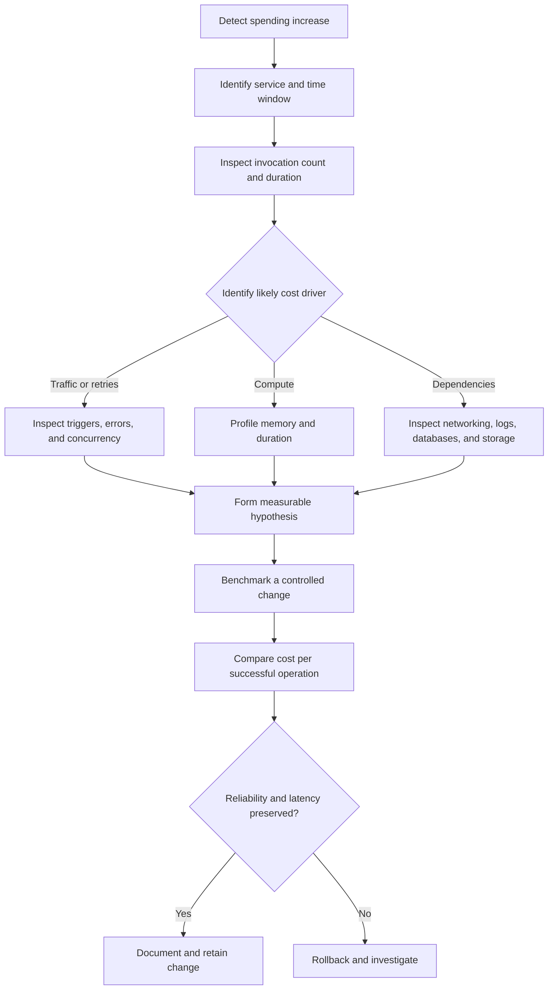

# 12- Cost Optimization Best Practices

## Overview

AWS Lambda cost optimization is the practice of minimizing the total cost of running serverless workloads while preserving performance, reliability, security, and maintainability. Although Lambda uses a pay-per-use execution model, poorly designed functions and inefficient event-driven architectures can create substantial costs through excessive invocations, long execution durations, retries, networking, logging, and downstream service consumption.

Effective optimization requires evaluating the complete workload rather than focusing exclusively on Lambda's compute charges.

For production backend systems, the objective is to achieve the required service-level objectives at the lowest sustainable cost.

### Core cost drivers

| Cost driver | Primary contributors | Optimization strategy |
|---|---|---|
| Requests | Invocation volume and unnecessary triggers | Eliminate redundant invocations and use event filtering |
| Compute | Memory configuration and execution duration | Benchmark memory settings and improve application efficiency |
| Concurrency features | Provisioned concurrency and utilization | Match provisioned capacity to actual latency requirements |
| Storage | Ephemeral storage configuration and associated usage | Allocate only the required capacity |
| Observability | Log ingestion, retention, metrics, and tracing | Control telemetry volume without losing diagnostic coverage |
| Networking | NAT gateways, VPC endpoints, data transfer, and cross-AZ traffic | Review network architecture and traffic paths |
| Event processing | Retries, duplicate events, and inefficient batching | Implement idempotency, appropriate batching, and failure handling |
| Downstream services | Database, queues, APIs, storage, and workflow transitions | Optimize end-to-end processing costs |

AWS pricing varies by Region, architecture, and feature. Validate estimates using the [AWS Lambda pricing page](https://aws.amazon.com/lambda/pricing/) and the pricing pages of dependent services.

## Establish a Cost Baseline

Cost optimization should begin with measurement. Changing memory, batching, or concurrency without a baseline can increase costs or degrade production behavior.

Capture the following for each significant function:

- Invocation count and successful business operations.
- Average duration and latency percentiles.
- Configured memory and maximum memory utilization.
- Error rate, throttling, and retry volume.
- Concurrent executions and downstream resource utilization.
- Initialization latency where available.
- Provisioned concurrency utilization and spillover.
- Log ingestion, storage, and retention costs.
- Networking and dependent service costs.

### Measure cost per successful operation

Raw Lambda spending is not sufficient for comparing implementations. Normalize cost against the useful work performed.

\[
\text{Cost per successful operation}
=
\frac{\text{Total attributable workload cost}}
{\text{Successful business operations}}
\]

For example, a file-processing function that becomes twice as fast but requires substantially more retries may not be cheaper overall. Include relevant S3, SQS, database, logging, and networking costs when comparing architectures.

Useful operational metrics include:

| Metric | What it reveals |
|---|---|
| Cost per successful request | Overall API processing efficiency |
| Cost per processed file | Efficiency of file-processing workloads |
| Cost per completed workflow | Combined orchestration and execution efficiency |
| Error rate | Potential waste caused by failed operations |
| Retry ratio | Repeated work and possible downstream instability |
| Queue age | Whether throughput is keeping up with incoming work |
| Cost growth versus traffic growth | Whether unit economics are deteriorating |

Use CloudWatch for operational metrics, Cost Explorer for cost analysis, and Cost and Usage Reports when more detailed allocation is necessary.

## Optimize Memory and Execution Duration

### Understand the relationship between memory and cost

Lambda memory configuration influences both available memory and CPU allocation. Increasing memory can reduce execution duration for CPU-intensive or initialization-heavy functions.

A simplified compute-cost model is:

\[
C_{\text{compute}}
\approx
N \times D_{\text{seconds}} \times M_{\text{GB}}
\times R_{\text{GB-second}}
\]

Where:

- \(N\) is the number of invocations.
- \(D_{\text{seconds}}\) is the average billable execution duration.
- \(M_{\text{GB}}\) is configured memory in GB.
- \(R_{\text{GB-second}}\) is the applicable regional price.

This model excludes request charges, special execution modes, free-tier allowances, and dependent services. Apply the actual billing rules when calculating production costs.

Consider this hypothetical comparison:

| Configuration | Memory | Average duration | GB-seconds per invocation |
|---|---:|---:|---:|
| A | 512 MB | 200 ms | 0.10 |
| B | 1024 MB | 80 ms | 0.08 |

Configuration B uses twice the memory but consumes 20% fewer GB-seconds per invocation in this example. Whether it is cheaper in practice depends on applicable pricing and the complete workload.

### Use workload-specific memory settings

| Workload | Recommended optimization |
|---|---|
| CPU-intensive transformations | Benchmark higher memory allocations |
| JSON serialization and validation | Profile CPU usage and object allocation |
| Network-heavy APIs | Reduce network calls and connection setup |
| Database operations | Optimize queries and connection management |
| Large file processing | Benchmark memory, streaming, and ephemeral storage |
| Lightweight event handlers | Minimize initialization and unnecessary allocations |

A practical tuning process is:

1. Select representative production-like inputs.
2. Establish baseline duration, memory consumption, and error rates.
3. Benchmark several memory configurations.
4. Compare latency and estimated compute cost.
5. Evaluate downstream effects and reliability.
6. Deploy the chosen configuration gradually.
7. Verify actual cost and performance after deployment.

AWS Lambda Power Tuning can help evaluate memory configurations. Review its permissions and execution methodology before using it in production.

### Optimize application execution

For Python functions, reduce unnecessary computation, expensive imports, repeated serialization, and avoidable network calls.

Initialize reusable SDK clients outside the handler when appropriate.

```python
import json

import boto3

s3 = boto3.client("s3")


def lambda_handler(event, context):
    bucket = event["bucket"]
    key = event["key"]

    response = s3.head_object(
        Bucket=bucket,
        Key=key,
    )

    return {
        "statusCode": 200,
        "body": json.dumps(
            {
                "bucket": bucket,
                "key": key,
                "content_length": response.get("ContentLength", 0),
            }
        ),
    }
```

The S3 client can be reused by subsequent invocations in the same execution environment. This avoids repeatedly constructing the client during handler execution.

Production implementations should validate event data, handle expected AWS service errors, and return responses appropriate to the integration.

Do not store request-specific mutable state in global variables. Execution environments can be reused across invocations, and shared state can produce incorrect results or data leakage.

## Reduce Initialization and Deployment Overhead

Cold starts can increase latency and contribute to execution cost, particularly when initialization is expensive or traffic frequently creates new execution environments.

Practical optimizations include:

- Remove unused dependencies.
- Avoid expensive initialization that is unnecessary for most invocations.
- Keep deployment packages appropriately sized.
- Reuse safe clients and immutable configuration.
- Benchmark initialization-heavy workloads separately from warm invocations.
- Avoid introducing additional functions solely to reduce package size when the resulting invocation and networking overhead outweighs the benefit.

Package size alone does not determine cold-start duration. Runtime, initialization code, dependency loading, networking configuration, and execution-environment behavior also matter.

### Choose the appropriate deployment format

| Deployment format | Suitable use cases | Cost considerations |
|---|---|---|
| ZIP package | Most conventional Python functions and dependency bundles | Keep packages manageable and remove unused dependencies |
| Lambda layers | Shared dependencies or common extensions across functions | Account for version management and initialization overhead |
| Container image | Complex dependencies, larger application artifacts, and container-based build workflows | Optimize image contents and build reproducibly |

For container-based deployments, use compatible base images and ensure the image architecture matches the function configuration.

Layers should be used when dependency sharing provides a meaningful operational benefit. They do not automatically improve performance or reduce total cost.

## Evaluate ARM64 Architecture

Lambda supports ARM64 and x86-64 for applicable runtimes and deployment configurations.

ARM64 can offer attractive price-performance characteristics for some workloads. However, compatibility, execution duration, and total cost must be measured rather than assumed.

Evaluate:

- Native Python extension compatibility.
- Dependency availability for the target architecture.
- Container image and build-platform compatibility.
- Initialization duration.
- Memory consumption and execution duration.
- Total cost at realistic traffic volumes.

For Python applications with compiled dependencies, build artifacts for the target architecture and compatible runtime environment.

Inspect the current architecture using a read-only command:

```bash
aws lambda get-function-configuration \
  --function-name orders-api \
  --query '{Architecture:Architectures,Memory:MemorySize,Timeout:Timeout}' \
  --output table
```

Benchmark an ARM64 build against the existing deployment before migrating production traffic.

## Optimize Concurrency and Provisioned Capacity

### Plan concurrency around workload demand

A useful steady-state approximation comes from Little's Law:

\[
\text{Concurrency}
\approx
\text{Arrival rate} \times \text{Average duration}
\]

For example, 100 requests per second with an average execution duration of 0.2 seconds implies approximately 20 concurrent executions under steady-state conditions.

This estimate does not account for bursts, tail latency, retries, or traffic variability. Production capacity planning should consider those factors and downstream service limits.

### Reserved concurrency

Reserved concurrency allocates concurrency capacity to a function and sets its maximum concurrent execution level.

Use it to:

- Protect critical functions from account-level concurrency contention.
- Prevent a noncritical workload from consuming excessive capacity.
- Limit pressure on databases and external APIs.
- Establish an explicit concurrency boundary for expensive workloads.

Reserved concurrency is not equivalent to paying for permanently running execution environments. It does not itself represent a provisioned-capacity charge.

An excessively low limit can cause throttling, retries, growing queue backlogs, and additional downstream costs.

### Provisioned concurrency

Provisioned concurrency prepares execution environments in advance to reduce initialization latency for supported invocation paths.

It introduces additional charges based on configured provisioned capacity and the applicable execution pricing model.

Use it when predictable latency is important and on-demand initialization does not satisfy the service-level objective.

Avoid configuring large provisioned pools around the clock for workloads with highly variable demand unless measurements justify the expense.

| Mechanism | Primary purpose | Cost consideration |
|---|---|---|
| On-demand concurrency | Scale with incoming workload | Pay according to the applicable request and execution model |
| Reserved concurrency | Reserve and limit function concurrency | Protects capacity and downstream systems |
| Provisioned concurrency | Reduce initialization latency | Adds charges for configured prepared capacity |
| Event-source maximum concurrency | Bound processing concurrency for supported mappings | Helps protect downstream capacity and control processing rate |

For provisioned concurrency, monitor utilization, spillover, traffic patterns, and latency. Configure capacity against measured demand rather than peak assumptions alone.

## Optimize Event-Driven Processing

Event-driven systems can eliminate polling and reduce unnecessary requests. However, inefficient batching and retry behavior can amplify costs.

### Batch queue messages appropriately

SQS event-source mappings allow Lambda to retrieve multiple messages and process them in one invocation.

Batching can reduce invocation overhead, especially for lightweight processing. Larger batches can also increase memory requirements, execution duration, and the number of messages affected by failures.

Choose batch size and batching window according to:

- Message size and processing complexity.
- Maximum acceptable processing latency.
- Function timeout and memory.
- Downstream rate limits.
- Retry behavior.
- Partial batch failure support.

For supported SQS mappings, partial batch responses allow a function to report failed messages rather than treating every message in a batch as failed.

An existing event-source mapping can be configured with:

```bash
aws lambda update-event-source-mapping \
  --uuid "$EVENT_SOURCE_MAPPING_UUID" \
  --function-response-types ReportBatchItemFailures
```

This command modifies an existing resource. Set the UUID to the actual mapping identifier and verify the configuration before changing production workloads.

The handler must return the expected partial-failure response. Enabling the setting alone does not implement partial batch processing.

### Prevent retry amplification

Retries can recover transient failures, but excessive retries consume execution capacity and can increase downstream costs.

A database outage, for example, can cause queue messages to be retried repeatedly while the database remains unavailable. The result is additional Lambda execution, repeated network activity, and potentially greater pressure on the failing dependency.

Use:

- Bounded retries where supported.
- Exponential backoff and jitter for application-managed retries.
- Dead-letter queues or supported failure destinations.
- Appropriate queue visibility timeouts and retention.
- Idempotency for business operations.
- Alarms for repeated failures and growing backlogs.

Retry semantics differ between synchronous invocation, asynchronous invocation, and event-source mappings. Configure each integration according to its delivery and failure-handling behavior.

### Implement idempotent processing

At-least-once delivery can result in duplicate events. Idempotency prevents duplicate deliveries from creating duplicate business effects.

For example, a payment-processing consumer should use a durable idempotency record or transactional mechanism to ensure that processing the same business operation twice does not charge a customer twice.

Do not depend exclusively on an in-memory set or global variable. Execution environments can be replaced, and concurrent invocations may run in separate environments.

## Optimize Database and Networking Costs

### Manage database connections

Lambda can scale out rapidly, which means that an apparently efficient per-invocation connection strategy can exhaust database connection limits under load.

Recommended practices:

- Reuse connections when supported by the driver and application lifecycle.
- Keep transactions short.
- Configure connection and statement timeouts.
- Avoid excessive per-environment connection pools.
- Limit concurrency according to database capacity.
- Monitor connection counts, query latency, and database saturation.
- Evaluate Amazon RDS Proxy for supported relational database workloads where connection pooling provides sufficient value.

RDS Proxy introduces its own pricing and operational considerations. Evaluate database compatibility, transaction behavior, and workload characteristics before adopting it.

### Review VPC networking costs

Attaching Lambda to a VPC does not automatically mean every function invocation incurs a direct VPC attachment charge. However, associated networking resources can introduce substantial costs.

Common cost drivers include:

- NAT gateway hourly and data-processing charges.
- Interface VPC endpoint charges.
- Cross-AZ data transfer.
- Data transfer to external services.
- Additional database and networking resources.

Review actual traffic paths before changing the architecture. VPC endpoints can reduce certain traffic paths through NAT gateways when supported and correctly configured, but they have their own costs.

Do not remove required private connectivity or security controls solely to reduce networking expenditure.

## Control Observability Costs

Logs, metrics, and traces are essential for production reliability, but uncontrolled telemetry can become a recurring cost driver.

### Optimize CloudWatch logging

Use structured logging and appropriate log levels.

Recommended practices:

- Keep high-volume diagnostic details at DEBUG level.
- Avoid logging complete request and response payloads by default.
- Exclude credentials, access tokens, and sensitive business data.
- Configure log-group retention explicitly.
- Investigate ingestion and storage costs separately.
- Use metric filters and Embedded Metric Format where their benefits justify the cost.
- Prefer actionable alarms over large numbers of low-value alerts.

Retention settings reduce stored log volume but do not eliminate ingestion charges.

### Avoid high-cardinality metrics

Use metrics for aggregate operational questions and logs or traces for request-level diagnosis.

Examples of useful metrics include invocation count, duration, error count, throttles, and queue backlog.

Avoid generating a unique metric dimension for every user, request, or correlation ID. Excessive cardinality can increase monitoring costs and reduce the usefulness of dashboards.

Keep correlation identifiers in structured logs and traces unless a bounded metric-dimension use case justifies otherwise.

### Sample traces appropriately

Tracing can help diagnose latency across API Gateway, Lambda, databases, and downstream services.

Where supported by the chosen tracing configuration, sampling can control volume while preserving useful diagnostic coverage. Maintain sufficient sampling for critical workloads and investigate errors through complementary logs and metrics.

## Optimize Common Serverless Architectures

| Architecture | Typical cost problem | Recommended optimization |
|---|---|---|
| API Gateway and Lambda | Slow handlers and unnecessary requests | Reduce initialization overhead and optimize request processing |
| SQS and Lambda | Repeated processing and inefficient batches | Tune batching, implement partial failures, and configure retry handling |
| S3 and Lambda | Broad triggers and duplicate processing | Filter events and implement idempotency |
| EventBridge and Lambda | Excessively frequent schedules | Align schedules with business requirements |
| DynamoDB and Lambda | Repeated reads or inefficient access patterns | Optimize keys, queries, batching, and writes |
| Step Functions and Lambda | Unnecessary workflow transitions | Simplify workflow states without compromising recovery |
| VPC-connected Lambda | NAT gateway and transfer costs | Review routing, endpoint requirements, and traffic paths |
| Latency-sensitive APIs | Underutilized provisioned concurrency | Measure utilization and right-size capacity |

Do not optimize one component at the expense of the complete workload. Replacing a durable workflow with a single long-running function might reduce orchestration costs but make recovery, retries, and operational visibility substantially worse.

## Cost Allocation, Budgets, and Governance

Use consistent tags on supported resources to identify ownership and allocate costs.

Useful dimensions include:

- Application or service.
- Environment.
- Team or owner.
- Business capability.
- Cost center.

Not every billable component can be attributed accurately using a Lambda function tag alone. Use Cost Explorer, Cost and Usage Reports, and service-specific billing data to understand related costs.

### Establish cost controls

Configure AWS Budgets and suitable notifications for material spending thresholds. Consider Cost Anomaly Detection where it provides useful visibility.

These mechanisms are detection and notification tools, not guaranteed real-time spending caps. Costs may already have accumulated before a notification is delivered.

A recurring cost review should investigate:

- Functions with the highest attributable costs.
- Spending growth relative to traffic growth.
- Changes in duration, memory, and invocation count.
- Retry and error amplification.
- Provisioned concurrency utilization.
- Log ingestion and networking costs.
- Development resources that are no longer needed.
- Increases in cost per successful business operation.

Avoid spending engineering time optimizing negligible costs while ignoring larger contributors such as NAT gateways, database consumption, or unnecessary workflow execution.

## Practical Cost Investigation Workflow

Use a repeatable process when costs rise unexpectedly.



### Inspect the current function configuration

```bash
aws lambda get-function-configuration \
  --function-name orders-api \
  --query '{
    Runtime:Runtime,
    Architecture:Architectures,
    MemoryMB:MemorySize,
    TimeoutSeconds:Timeout,
    ReservedConcurrency:ReservedConcurrentExecutions,
    LastModified:LastModified
  }' \
  --output json
```

This command is read-only. The reserved-concurrency field can be absent when no function-specific reserved concurrency is configured.

### Inspect invocation metrics

```bash
aws cloudwatch get-metric-statistics \
  --namespace AWS/Lambda \
  --metric-name Invocations \
  --dimensions Name=FunctionName,Value=orders-api \
  --start-time 2026-10-10T00:00:00Z \
  --end-time 2026-10-11T00:00:00Z \
  --period 3600 \
  --statistics Sum \
  --output json
```

Replace the function name and timestamps with the relevant investigation window.

Repeat the analysis for `Duration`, `Errors`, `Throttles`, and `ConcurrentExecutions`, selecting appropriate statistics for each metric. For latency investigations, percentile statistics can reveal tail behavior that averages conceal.

Missing metric data does not necessarily indicate zero cost. Validate the metric dimensions, time range, Region, and workload activity before drawing conclusions.

## Common Cost Optimization Mistakes

| Mistake | Why it is harmful | Better approach |
|---|---|---|
| Always selecting minimum memory | Can increase duration and total compute cost | Benchmark multiple configurations |
| Enabling provisioned concurrency everywhere | Pays for capacity that may remain unused | Justify capacity using latency objectives and utilization |
| Removing logs indiscriminately | Makes failures harder to diagnose | Reduce noise while preserving useful evidence |
| Increasing batch sizes without testing | Can increase timeouts and retry scope | Benchmark realistic batches and handle partial failures |
| Retrying every error immediately | Amplifies load and execution costs | Classify failures and bound retries |
| Removing VPC connectivity to save money | Can break private access and security boundaries | Optimize routing without weakening controls |
| Optimizing Lambda in isolation | Can shift costs to databases, networking, or queues | Measure total workload cost |
| Treating budgets as spending caps | Alerts can arrive after costs are incurred | Combine alerts with architectural controls |
| Assuming faster always means cheaper | Higher memory or provisioned capacity can outweigh duration savings | Compare actual pricing and end-to-end costs |
| Ignoring development resources | Unused infrastructure accumulates recurring charges | Establish ownership and lifecycle cleanup |

## Production Cost Optimization Checklist

- [ ] Establish a baseline for invocation volume, duration, errors, and total attributable cost.
- [ ] Measure cost per successful business operation.
- [ ] Benchmark memory configurations using representative workloads.
- [ ] Verify compatibility and performance before migrating to ARM64.
- [ ] Review duplicate events, retry policies, and event-source configuration.
- [ ] Set concurrency limits based on downstream capacity.
- [ ] Justify provisioned concurrency through measured latency requirements.
- [ ] Tune batching and implement partial batch failures where supported.
- [ ] Reuse connections safely and protect database capacity.
- [ ] Review NAT gateways, VPC endpoints, data transfer, and cross-AZ traffic.
- [ ] Configure log retention and remove unnecessary high-volume telemetry.
- [ ] Establish cost allocation, budgets, and anomaly monitoring.
- [ ] Test optimization changes against latency, reliability, and security objectives.
- [ ] Verify cost changes after deployment and maintain a rollback procedure.
- [ ] Remove unused resources only after checking ownership and dependencies.

## Key Takeaways

- Optimize Lambda using measured workload data, particularly invocation count, execution duration, memory, concurrency, and cost per successful operation.
- Benchmark memory and architecture choices rather than assuming the smallest memory allocation or a particular architecture is cheapest.
- Control retries, batching, and concurrency to prevent duplicate work and downstream cost amplification.
- Include databases, networking, logging, and orchestration in cost analysis instead of focusing exclusively on Lambda charges.
- Treat cost optimization as an ongoing production discipline that preserves reliability, security, and service-level objectives.