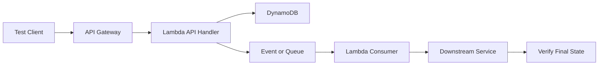
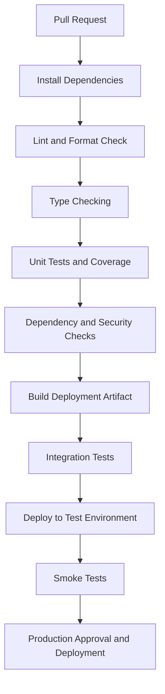

# 13- Testing and Code Quality

## Overview

Testing and code quality are essential to building reliable AWS Lambda applications. Lambda functions are often small, independently deployed components, but they operate within distributed systems involving event sources, IAM permissions, databases, queues, APIs, and other AWS services. A function can pass unit tests and still fail in production because of incorrect event schemas, retry behavior, duplicate deliveries, permission boundaries, or integration configuration.

A production-ready testing strategy validates both application logic and the behavior of the surrounding AWS architecture.

The primary objectives are to:

- Verify business logic independently of AWS infrastructure.
- Validate event payloads and integration contracts.
- Test failure handling, retries, idempotency, and timeout behavior.
- Detect permission and configuration errors before deployment.
- Maintain consistent formatting, typing, dependency management, and static analysis.
- Prevent regressions through automated CI/CD quality gates.

## Testing Strategy

Use multiple testing layers, each targeting a different failure domain.

| Testing layer | Primary purpose | Typical tools |
|---|---|---|
| Unit tests | Validate isolated business logic | `pytest`, `unittest`, mocks |
| Handler tests | Validate event parsing and response construction | `pytest`, fixtures |
| Contract tests | Verify event and API schemas | JSON Schema, Pydantic, API specifications |
| Integration tests | Validate interactions with AWS services | AWS SDK, LocalStack, deployed test resources |
| End-to-end tests | Validate complete application workflows | `pytest`, HTTP clients, AWS test environments |
| Failure-path tests | Validate retries, idempotency, and error handling | Mocks, controlled integration failures |
| Performance tests | Evaluate latency, throughput, and resource usage | Load-testing tools, CloudWatch |
| Static analysis | Detect defects before execution | Ruff, mypy, Bandit where appropriate |
| Infrastructure tests | Validate resource definitions and configuration | AWS SAM validation, CloudFormation Guard, IaC testing tools |

No single layer replaces the others. Unit tests are fast and should cover most business logic, while integration and end-to-end tests verify the behavior that mocks cannot reliably reproduce.

## Design Lambda Functions for Testability

A common testing problem occurs when business logic is tightly coupled to the Lambda handler, global AWS clients, environment variables, and external service calls.

Separate event parsing, business logic, and infrastructure interactions where practical.

For example:

```text
src/
    orders/
        __init__.py
        handler.py
        service.py
        repository.py
tests/
    unit/
        test_service.py
        test_handler.py
    integration/
        test_repository.py
```

The handler should primarily translate the incoming event into application inputs, invoke the appropriate service, and construct the response. Business rules should be independently testable.

### Example service implementation

```python
# src/orders/service.py

class InvalidOrderError(Exception):
    """Raised when an order request is invalid."""


def calculate_order_total(
    items: list[dict[str, int]],
) -> int:
    if not items:
        raise InvalidOrderError("An order must contain at least one item")

    total = 0

    for item in items:
        quantity = item.get("quantity")
        unit_price = item.get("unit_price")

        if not isinstance(quantity, int) or isinstance(quantity, bool):
            raise InvalidOrderError("Quantity must be an integer")

        if not isinstance(unit_price, int) or isinstance(unit_price, bool):
            raise InvalidOrderError("Unit price must be an integer")

        if quantity <= 0 or unit_price < 0:
            raise InvalidOrderError("Invalid quantity or unit price")

        total += quantity * unit_price

    return total
```

This example uses integer monetary units, such as paise, to avoid floating-point rounding errors. A production application should also enforce domain-specific limits, currency rules, and input-size constraints.

### Unit tests

```python
# tests/unit/test_service.py

import pytest

from src.orders.service import (
    InvalidOrderError,
    calculate_order_total,
)


def test_calculate_order_total():
    items = [
        {"quantity": 2, "unit_price": 1500},
        {"quantity": 1, "unit_price": 2500},
    ]

    assert calculate_order_total(items) == 5500


def test_empty_order_is_rejected():
    with pytest.raises(InvalidOrderError):
        calculate_order_total([])


@pytest.mark.parametrize(
    "item",
    [
        {"quantity": 0, "unit_price": 100},
        {"quantity": 1, "unit_price": -1},
        {"quantity": True, "unit_price": 100},
    ],
)
def test_invalid_items_are_rejected(item):
    with pytest.raises(InvalidOrderError):
        calculate_order_total([item])
```

Run the tests with:

```bash
python -m pytest tests/unit -v
```

These tests verify business behavior without creating AWS resources or making network calls.

## Test Lambda Handlers

A Lambda handler receives an event and a context object. Both should be represented explicitly in tests.

For a synchronous API integration, validate:

- Required event fields.
- Malformed JSON and invalid input.
- Expected success responses.
- Expected client and server error responses.
- Correlation and request identifiers.
- Behavior when dependencies fail.
- The response format expected by the integration.

### Example handler

```python
# src/orders/handler.py

import json

from src.orders.service import (
    InvalidOrderError,
    calculate_order_total,
)


def lambda_handler(event, context):
    try:
        body = event.get("body")

        if isinstance(body, str):
            payload = json.loads(body)
        elif isinstance(body, dict):
            payload = body
        else:
            raise InvalidOrderError("Invalid request body")

        total = calculate_order_total(payload.get("items", []))

        return {
            "statusCode": 200,
            "headers": {
                "content-type": "application/json",
            },
            "body": json.dumps({"total": total}),
        }

    except (InvalidOrderError, json.JSONDecodeError) as exc:
        return {
            "statusCode": 400,
            "headers": {
                "content-type": "application/json",
            },
            "body": json.dumps({"error": str(exc)}),
        }
```

This is a simplified API handler. A production implementation should distinguish malformed requests from domain validation failures, avoid exposing sensitive internal details, and follow the response contract of its API integration.

### Handler tests

```python
# tests/unit/test_handler.py

import json
from types import SimpleNamespace

from src.orders.handler import lambda_handler


def test_handler_returns_order_total():
    event = {
        "body": json.dumps(
            {
                "items": [
                    {"quantity": 2, "unit_price": 1500},
                ],
            }
        )
    }

    context = SimpleNamespace(
        aws_request_id="test-request-id",
        function_name="orders-api",
    )

    response = lambda_handler(event, context)

    assert response["statusCode"] == 200
    assert json.loads(response["body"]) == {"total": 3000}


def test_handler_rejects_invalid_json():
    event = {"body": "{invalid-json"}

    response = lambda_handler(event, object())

    assert response["statusCode"] == 400
    assert "error" in json.loads(response["body"])
```

These tests call the handler directly. They do not validate API Gateway's actual integration behavior, IAM permissions, or network configuration; those require separate tests.

## Mock AWS SDK Dependencies

AWS SDK clients are external dependencies. Mock them in unit tests when the purpose is to validate application logic rather than AWS service behavior.

For Python, `botocore.stub.Stubber` is useful when testing code that uses Boto3. It validates expected SDK operations and responses without contacting the real AWS service.

### Example repository

```python
# src/orders/repository.py

import boto3


def get_order(table_name: str, order_id: str) -> dict | None:
    dynamodb = boto3.resource("dynamodb")
    table = dynamodb.Table(table_name)

    response = table.get_item(
        Key={"order_id": order_id},
        ConsistentRead=True,
    )

    return response.get("Item")
```

### Test with a mocked client

```python
# tests/unit/test_repository.py

from unittest.mock import MagicMock, patch

from src.orders.repository import get_order


@patch("src.orders.repository.boto3.resource")
def test_get_order_returns_item(mock_resource):
    mock_table = MagicMock()
    mock_table.get_item.return_value = {
        "Item": {
            "order_id": "order-123",
            "status": "CONFIRMED",
        }
    }

    mock_resource.return_value.Table.return_value = mock_table

    result = get_order("orders-table", "order-123")

    assert result == {
        "order_id": "order-123",
        "status": "CONFIRMED",
    }

    mock_table.get_item.assert_called_once_with(
        Key={"order_id": "order-123"},
        ConsistentRead=True,
    )
```

This approach validates the expected application-level SDK call. It does not verify actual DynamoDB behavior, table configuration, IAM permissions, or service-side consistency semantics.

**Production recommendation:** Prefer dependency injection for substantial applications so tests can provide controlled clients or repositories without relying heavily on patching module internals.

## Test Event Source Contracts

Different Lambda integrations deliver different event schemas. Do not assume every event contains an HTTP body or follows the same response contract.

| Event source | Important test cases |
|---|---|
| API Gateway | HTTP method, path parameters, headers, body encoding, malformed requests, response structure |
| Application Load Balancer | Request context, multi-value headers where applicable, target response format |
| S3 | Bucket and object key, URL encoding, event records, duplicate notifications |
| SQS | Message body, message attributes, batch failures, duplicate delivery |
| SNS | Message envelope, subscription configuration, malformed messages |
| EventBridge | `detail`, `source`, `detail-type`, event version, optional fields |
| DynamoDB Streams | Record types, old and new images, sequence numbers, partial batch failures |
| EventBridge Scheduler | Input payload, schedule configuration, target permissions |

Use representative event fixtures derived from actual service documentation or captured test events. Keep fixtures minimal but realistic, and avoid placing production data or secrets in the test repository.

### Example SQS fixture

```python
import json


def test_sqs_event_parsing():
    event = {
        "Records": [
            {
                "messageId": "message-1",
                "body": json.dumps(
                    {
                        "order_id": "order-123",
                        "operation": "CONFIRM",
                    }
                ),
                "attributes": {
                    "ApproximateReceiveCount": "1",
                },
            }
        ]
    }

    record = event["Records"][0]
    payload = json.loads(record["body"])

    assert record["messageId"] == "message-1"
    assert payload["order_id"] == "order-123"
    assert payload["operation"] == "CONFIRM"
```

This validates event parsing only. A production SQS consumer should also test malformed messages, processing failures, duplicate delivery, and the configured batch-response contract.

## Test Retries, Idempotency, and Partial Failures

Lambda event-driven workloads can receive duplicate events. A handler that succeeds locally may still cause duplicate business effects when AWS or an upstream service retries delivery.

Test the following failure scenarios:

- A dependency fails temporarily and later recovers.
- The same event is delivered more than once.
- A message fails after another message in the batch succeeds.
- A database write succeeds but the handler fails before acknowledging completion.
- A downstream service times out after processing a request.
- A retry arrives while the original request is still running.

### Test idempotency

For a payment, order, or other business operation, repeated delivery should not repeat the underlying side effect.

A useful test pattern is:

```python
def test_duplicate_event_does_not_repeat_business_operation(
    processor,
    idempotency_store,
):
    event = {
        "event_id": "evt-123",
        "order_id": "order-123",
    }

    first_result = processor.handle(event)
    second_result = processor.handle(event)

    assert first_result["status"] == "processed"
    assert second_result["status"] in {"processed", "duplicate"}
    assert idempotency_store.operation_count("evt-123") == 1
```

This is illustrative: `processor` and `idempotency_store` represent test fixtures supplied by the application. The expected result depends on the application's contract for duplicate events.

For production idempotency, use durable state and atomic conditional operations or transactions where appropriate. An in-memory flag is insufficient because execution environments can be replaced or run concurrently.

### Test partial batch failures

For supported SQS and other applicable event-source mappings, test the exact response format required by the configured partial-failure mechanism.

Verify that:

- Successfully processed records are not unnecessarily repeated.
- Failed records are reported using the correct identifiers.
- A failure in one record does not silently discard another record.
- Retry behavior matches the event source's delivery semantics.
- Repeated failures eventually follow the configured failure-handling policy.

The configuration of partial batch responses and the handler implementation must agree.

## Integration Testing with AWS

Mocks cannot reproduce all AWS behavior. Integration tests should validate the interactions that depend on actual service configuration and runtime behavior.

Typical integration test targets include:

- DynamoDB reads, writes, conditional expressions, and transactions.
- SQS message delivery and event-source mappings.
- S3 notification configuration and object-key handling.
- IAM execution-role permissions.
- Secrets Manager access.
- API Gateway or function URL integration.
- VPC connectivity and database access.
- CloudWatch log delivery and alarms where relevant.

Use an isolated test account or environment where possible. Ensure test resources are uniquely named, permissions are restricted, and cleanup occurs even when a test fails.

### AWS SAM local testing

AWS SAM can run supported Lambda functions locally and emulate aspects of the invocation environment.

For example:

```bash
sam validate
sam build
sam local invoke OrdersFunction --event events/order-created.json
```

These commands respectively validate the SAM template, build the application, and invoke the specified function locally using the supplied event.

Local invocation is useful for rapid feedback, but it does not fully reproduce IAM authorization, managed execution environments, event-source retry behavior, or every AWS service integration. Validate these behaviors in an AWS test environment.

### LocalStack

LocalStack can provide local emulation for supported AWS APIs. It is useful for repeatable integration tests and reducing dependence on shared development environments.

Before relying on it, verify that the AWS service operations and behaviors used by the application are supported by the chosen LocalStack configuration. Emulation does not guarantee identical behavior to the managed AWS service.

## End-to-End Testing

End-to-end tests validate complete business workflows across the actual integration boundaries.

For an API-backed order workflow, a test might verify:

1. A client submits an order through API Gateway.
2. The handler validates the request.
3. The order is stored in DynamoDB.
4. A business event is published to SQS or EventBridge.
5. A consumer processes the event.
6. The resulting business state can be queried.
7. Failures are visible through logs or metrics.



End-to-end tests should focus on important business flows rather than duplicating every unit test. Keep the suite small enough to run consistently in CI/CD and isolate test data to prevent cross-test interference.

## Code Quality Standards for Python Lambda

Testing is more effective when supported by consistent static analysis and formatting.

A practical Python quality toolchain includes:

| Tool | Purpose |
|---|---|
| Ruff | Linting and formatting |
| mypy | Static type checking |
| pytest | Unit and integration test execution |
| pytest-cov | Test coverage reporting |
| Bandit | Identification of selected Python security issues |
| pip-audit | Dependency vulnerability auditing |
| pre-commit | Consistent local checks before commits |

Tool configuration should be committed to the repository so developers and CI/CD use the same rules.

### Example Ruff configuration

```toml
[tool.ruff]
line-length = 88
target-version = "py312"

[tool.ruff.lint]
select = ["E", "F", "I", "B", "UP"]

[tool.ruff.format]
quote-style = "double"
```

The selected rules enable common style, import, bugbear, and modernization checks. Adjust the rule set deliberately rather than enabling large collections of rules without reviewing their effect on the codebase.

### Example type annotations

Use type annotations to make handler contracts and business interfaces easier to understand and validate.

```python
from typing import Any


def lambda_handler(
    event: dict[str, Any],
    context: Any,
) -> dict[str, Any]:
    ...
```

For more complex event types, define TypedDict models or validated schemas. Remember that Python annotations are not runtime validation by themselves.

## Test Coverage and Quality Gates

Coverage helps identify untested code, but it is not a measure of correctness.

A test suite with high line coverage may still fail to test important conditions such as duplicate delivery, timeout behavior, partial batch failures, or authorization errors.

Measure and review:

- Line and branch coverage for important business logic.
- Coverage of error-handling paths.
- Contract validation for external event schemas.
- Idempotency and concurrency behavior.
- Integration test stability.
- Static analysis and dependency vulnerability findings.

Use coverage thresholds as a minimum quality gate, not as the primary definition of quality.

Example:

```bash
python -m pytest tests/unit \
  --cov=src \
  --cov-branch \
  --cov-report=term-missing \
  --cov-fail-under=85
```

The threshold is a project policy example, not a universal requirement. Set thresholds based on application risk, existing coverage, and the value of the code under test.

Avoid writing low-value tests solely to increase coverage numbers.

## CI/CD Quality Gates with GitHub Actions

Automate testing and static analysis so that defects are detected before deployment.

A typical workflow is:



A practical workflow can run lightweight checks on every pull request and reserve AWS-backed integration tests for a controlled test environment.

### Example GitHub Actions workflow

```yaml
name: Lambda Quality Checks

on:
  pull_request:
  push:
    branches:
      - main

permissions:
  contents: read

jobs:
  quality:
    runs-on: ubuntu-latest

    steps:
      - name: Check out repository
        uses: actions/checkout@v4

      - name: Set up Python
        uses: actions/setup-python@v5
        with:
          python-version: "3.12"
          cache: pip
          cache-dependency-path: requirements-dev.txt

      - name: Install dependencies
        run: |
          python -m pip install --upgrade pip
          python -m pip install -r requirements-dev.txt

      - name: Check formatting
        run: ruff format --check .

      - name: Lint
        run: ruff check .

      - name: Type check
        run: mypy src

      - name: Run unit tests
        run: |
          python -m pytest tests/unit \
            --cov=src \
            --cov-branch \
            --cov-report=term-missing \
            --cov-fail-under=85
```

This workflow assumes the repository contains `requirements-dev.txt`, the specified source and test directories, and compatible Ruff, mypy, pytest, and pytest-cov dependencies.

For production deployments, pin actions to reviewed versions or immutable commit SHAs according to your organization's supply-chain policy. Use short-lived AWS credentials through GitHub Actions OIDC where appropriate rather than storing long-lived access keys in repository secrets.

Do not grant deployment permissions to a quality-check job that only needs to run tests.

## Dependency and Security Quality

Lambda functions frequently depend on SDKs, validation libraries, HTTP clients, and application packages. Vulnerable or incompatible dependencies can create both security and operational problems.

Recommended practices:

- Pin or constrain dependencies according to the application's release policy.
- Audit direct and transitive dependencies.
- Review vulnerability severity and exploitability rather than blindly applying every update.
- Build deployment artifacts in a controlled environment.
- Test native dependencies against the target runtime and architecture.
- Scan container images when using image-based deployments.
- Avoid embedding credentials or secrets in source code, fixtures, or artifacts.
- Keep deployment permissions separate from runtime execution permissions.

Example dependency audit:

```bash
python -m pip install pip-audit
python -m pip_audit -r requirements.txt
```

The audit identifies known vulnerabilities in supported package metadata. It does not prove that the application is secure or detect every possible vulnerability.

## Performance and Load Testing

Performance tests should validate both Lambda behavior and downstream capacity.

Test representative workloads at different traffic levels, including:

- Normal expected traffic.
- Peak traffic.
- Sudden bursts.
- Slow downstream dependencies.
- Increased payload sizes.
- High error rates.
- Cold-start-sensitive workloads.

Measure latency percentiles, errors, throttling, concurrency, memory consumption, queue age, and downstream saturation.

A Lambda function can scale rapidly enough to overwhelm a database or external API. Load tests should therefore include realistic concurrency limits and dependency behavior rather than testing the function in isolation.

Use a dedicated test environment, define spending limits where possible, and clean up temporary resources after testing.

## Common Testing Mistakes

| Mistake | Why it fails | Better practice |
|---|---|---|
| Testing only the handler's success path | Leaves error and retry behavior unverified | Cover validation, dependency failures, and malformed events |
| Mocking every dependency in every test | Hides integration and configuration errors | Combine unit tests with AWS-backed integration tests |
| Assuming local tests reproduce Lambda completely | Managed runtime and service behavior differ | Validate critical integrations in AWS |
| Testing SQS batches as individual messages only | Misses partial failure and retry semantics | Test complete batches and mixed success/failure cases |
| Using in-memory idempotency state | State is not durable across execution environments | Use durable records and atomic operations |
| Treating coverage as correctness | Important behavior can remain untested | Review risk-based scenarios and branch coverage |
| Ignoring IAM in tests | Authorization failures may appear only after deployment | Test least-privilege roles in an isolated AWS environment |
| Running load tests against production without controls | Can cause outages and unexpected costs | Use isolated environments and controlled traffic |
| Storing secrets in fixtures | Exposes credentials through source control and logs | Use synthetic data and managed secret storage |
| Allowing CI jobs unrestricted AWS access | Increases the impact of compromised workflows | Use least privilege and short-lived credentials |

## Production Readiness Checklist

- [ ] Business logic is covered by deterministic unit tests.
- [ ] Handler contracts are validated against representative event fixtures.
- [ ] Malformed input and expected dependency failures are tested.
- [ ] Duplicate delivery and idempotency behavior are verified.
- [ ] Partial batch failures and retry semantics are tested where applicable.
- [ ] Integration tests validate critical AWS service interactions.
- [ ] IAM permissions are tested using appropriately restricted roles.
- [ ] Ruff, type checking, dependency audits, and coverage checks run in CI/CD.
- [ ] Build artifacts target the intended runtime and architecture.
- [ ] Integration and end-to-end tests use isolated test data.
- [ ] Performance tests include downstream limits and realistic traffic.
- [ ] Deployment jobs use least-privilege, short-lived credentials where possible.
- [ ] Post-deployment smoke tests verify the deployed version and critical workflows.
- [ ] Test resources are cleaned up and test failures are observable.

## Key Takeaways

- Separate business logic from Lambda handlers and infrastructure dependencies to make tests deterministic and maintainable.
- Combine unit, contract, integration, end-to-end, and failure-path tests because each detects different classes of defects.
- Explicitly test idempotency, retries, partial batch failures, and downstream failures in event-driven workloads.
- Enforce consistent formatting, linting, typing, dependency security, and automated tests through CI/CD quality gates.
- Treat production readiness as a combination of correctness, security, integration behavior, performance, and operational verification—not merely code coverage.