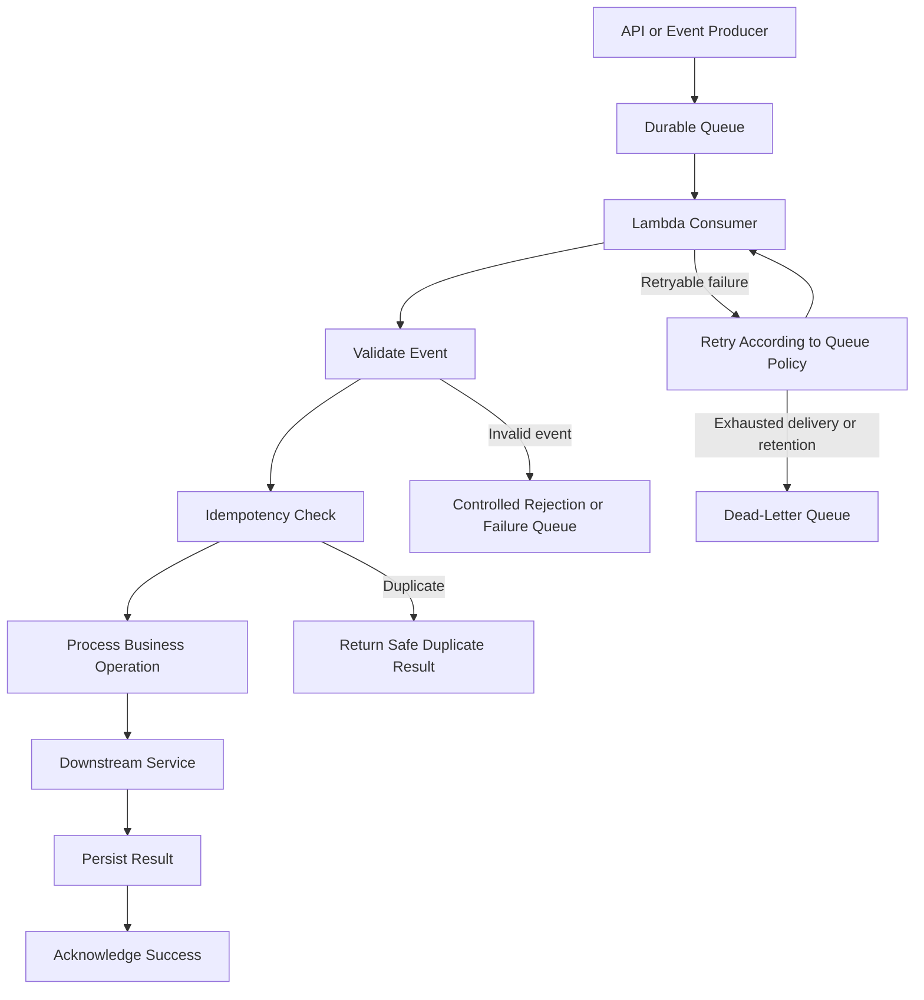
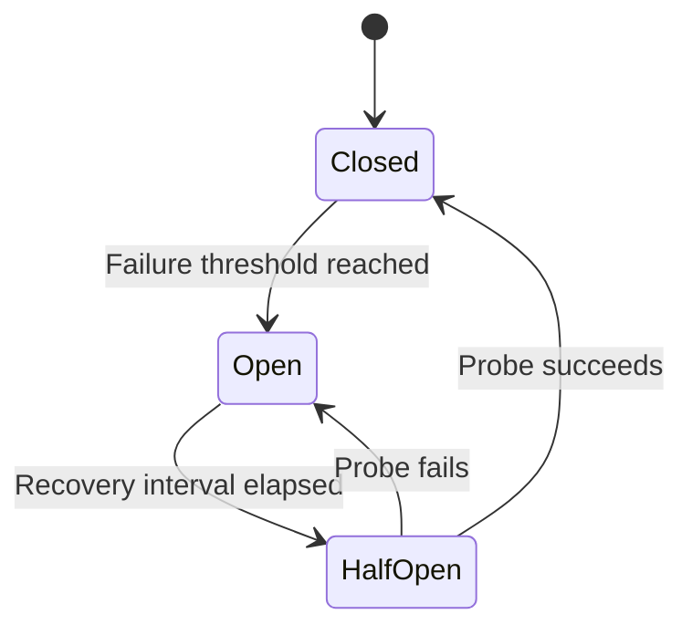

# 14- Resilience and Fault Tolerance

## Overview

AWS Lambda provides managed execution environments and automatic scaling, but it does not eliminate application failures or distributed-systems problems. Production workloads can still experience timeouts, throttling, duplicate events, unavailable dependencies, network failures, partial batch processing, and downstream service saturation.

Resilience is the ability of a system to continue delivering acceptable behavior when components fail. Fault tolerance focuses on maintaining required functionality despite specific failures, often through redundancy, isolation, retries, and recovery mechanisms.

For Lambda-based backend systems, resilience must be designed across the entire request or event-processing path rather than within an individual function alone.

Key objectives include:

- Preventing transient failures from becoming cascading failures.
- Recovering from temporary dependency outages.
- Handling duplicate events without repeating business side effects.
- Protecting downstream services from excessive concurrency.
- Preserving business correctness during retries and partial failures.
- Making failures observable and recovery procedures repeatable.

## Understand Failure Domains

A Lambda workload can fail at several independent layers.

| Failure domain | Example | Primary mitigation |
|---|---|---|
| Application | Unhandled exception or invalid input | Validation, exception handling, and testing |
| Runtime | Initialization failure or out-of-memory condition | Dependency validation and resource tuning |
| Invocation | Timeout, throttling, or synchronous invocation error | Appropriate timeouts, concurrency planning, and caller retry policies |
| Event source | Queue backlog or failed stream processing | Event-source configuration, backpressure, and failure handling |
| Network | DNS failure or unavailable endpoint | Network diagnostics, timeouts, and controlled retries |
| Dependency | Database or external API outage | Circuit breaking, isolation, and graceful degradation |
| Data | Duplicate event or partial transaction | Idempotency, conditional writes, and transaction design |
| Deployment | Incompatible artifact or incorrect configuration | Automated validation, staged rollout, and rollback |
| Operations | Missing alarms or excessive retry activity | Structured telemetry, actionable alarms, and runbooks |

A reliable architecture explicitly identifies which component detects each failure, who owns recovery, and what happens when recovery is unsuccessful.

## Lambda Resilience Architecture

A typical resilient event-processing architecture uses durable messaging, bounded concurrency, idempotent consumers, and explicit failure destinations.



This design separates ingestion from processing and provides a durable buffer during temporary downstream outages.

The exact retry and failure paths depend on the event source. SQS, asynchronous Lambda invocation, DynamoDB Streams, and direct synchronous invocation do not share identical delivery or retry semantics.

## Understand Lambda Invocation Failure Semantics

Choosing the correct recovery strategy requires understanding how the function is invoked.

| Invocation mechanism | Delivery or invocation behavior | Resilience considerations |
|---|---|---|
| Direct synchronous invocation | The caller receives the invocation result or error | Caller must implement suitable retry, timeout, and error-handling behavior |
| API Gateway to Lambda | The request follows the configured synchronous integration | Define HTTP error mapping, request deadlines, and client retry behavior |
| Asynchronous Lambda invocation | Lambda queues the event internally for processing | Configure retry behavior and failure destinations where supported |
| SQS event-source mapping | Lambda polls the queue and processes messages in batches | Configure visibility timeout, batch behavior, concurrency, and dead-letter handling |
| DynamoDB Streams event-source mapping | Lambda processes stream records in batches | Account for checkpoints, retries, record ordering, and shard-level processing behavior |
| EventBridge to Lambda | EventBridge delivers matching events to the target | Configure target retry policies and a dead-letter queue where supported |

### Distinguish retries from delivery guarantees

Retries are a recovery mechanism, not a guarantee of exactly-once business execution.

A message can be delivered more than once because a consumer might complete its side effect and then fail before the source records successful processing. The next delivery can repeat the same operation.

Therefore, production consumers should be designed around the actual delivery semantics of their event source.

Use the following principles:

- Assume duplicate delivery is possible unless the specific integration provides a stronger, documented guarantee.
- Make business operations idempotent.
- Configure retries according to the failure type and source behavior.
- Use durable storage for operations that must survive execution-environment replacement.
- Define a terminal failure path for events that cannot be processed successfully.

## Implement Idempotent Processing

Idempotency ensures that repeated processing of the same logical operation does not produce repeated business effects.

For example, a payment event may be delivered twice. The second delivery must not charge the customer again.

A robust idempotency design typically uses:

1. A stable business operation identifier.
2. Durable idempotency state.
3. Atomic conditional writes or transactions.
4. A defined policy for in-progress operations.
5. A retention period aligned with the source's possible replay window.
6. Recovery behavior for failures between recording and completing the operation.

### Example using DynamoDB conditional writes

The following simplified example claims an event identifier using a conditional write.

```python
import boto3
from botocore.exceptions import ClientError

dynamodb = boto3.resource("dynamodb")
idempotency_table = dynamodb.Table("IdempotencyRecords")


def claim_event(event_id: str) -> bool:
    try:
        idempotency_table.put_item(
            Item={
                "event_id": event_id,
                "status": "IN_PROGRESS",
            },
            ConditionExpression="attribute_not_exists(event_id)",
        )
        return True

    except ClientError as exc:
        error_code = exc.response.get("Error", {}).get("Code")

        if error_code == "ConditionalCheckFailedException":
            return False

        raise
```

The function returns `False` if a record already exists. Other errors are propagated rather than incorrectly treated as duplicate delivery.

This is only a claim mechanism, not a complete idempotency implementation. A production design must address stale `IN_PROGRESS` records, lease expiration, operation completion, concurrent execution, and recovery after a partial failure.

For operations involving DynamoDB and an external payment provider, a DynamoDB conditional write alone cannot make the external side effect atomic with the database update. Use the provider's idempotency mechanism where available and design explicit reconciliation for ambiguous outcomes.

### Avoid unsafe idempotency patterns

Do not:

- Use a global Python variable as the sole duplicate-event guard.
- Mark an operation complete before its business side effect is safely recorded.
- Assume a request timeout proves that the downstream operation did not happen.
- Delete idempotency records before the event source's replay or redelivery window has passed.
- Treat every conditional-write failure as proof of successful completion without checking operation state.

## Configure Timeouts Correctly

A timeout limits how long a function can execute. It does not automatically cancel or roll back work already accepted by a downstream service.

A function can time out after sending a database write or an HTTP request. The caller may observe failure even though the side effect succeeded.

Set timeouts according to the complete request budget.

For example, an API request might have the following illustrative budget:

| Operation | Budget |
|---|---:|
| Request validation | 50 ms |
| Database operation | 300 ms |
| External service call | 500 ms |
| Serialization and response handling | 100 ms |
| Safety margin | 250 ms |
| Total | 1,200 ms |

These are example values, not universal recommendations. The actual limits depend on the API integration, latency objective, dependency behavior, and Lambda's configured timeout.

### Use layered timeouts

Configure explicit timeouts for:

- The client or API request.
- Lambda execution.
- Database connection and query operations.
- HTTP connection establishment and response reads.
- Queue visibility and processing windows.
- Workflow tasks and overall orchestration.

A dependency timeout should generally be shorter than the remaining Lambda execution budget so that the function has time to handle the error safely.

Avoid retrying an operation when insufficient execution time remains for a meaningful attempt.

## Implement Bounded Retries and Backoff

Retries are useful for transient failures such as temporary network errors, throttling, and some service-unavailable responses. They are harmful when applied indiscriminately.

A robust retry policy considers:

- Whether the error is transient.
- Whether the operation is safe to repeat.
- The maximum number of attempts.
- The remaining execution deadline.
- Downstream capacity.
- The event source's own retry behavior.

### Exponential backoff with jitter

Application-managed retries should avoid synchronized retry storms.

A common full-jitter strategy is:

\[
d_n = U\left(0,\min(d_{\max},d_0 \times 2^n)\right)
\]

Where:

- \(d_n\) is the delay before retry attempt \(n\).
- \(d_0\) is the initial delay.
- \(d_{\max}\) is the maximum delay.
- \(U(a,b)\) is a uniformly distributed random value between \(a\) and \(b\).

Jitter spreads retries over time and reduces the chance that many concurrent invocations overload a recovering dependency simultaneously.

### Example retry helper

```python
import random
import time
from collections.abc import Callable
from typing import TypeVar

T = TypeVar("T")


def retry_transient(
    operation: Callable[[], T],
    *,
    max_attempts: int = 3,
    base_delay: float = 0.1,
    max_delay: float = 1.0,
) -> T:
    if max_attempts < 1:
        raise ValueError("max_attempts must be at least 1")

    for attempt in range(max_attempts):
        try:
            return operation()
        except TransientDependencyError:
            if attempt == max_attempts - 1:
                raise

            upper_bound = min(
                max_delay,
                base_delay * (2**attempt),
            )
            time.sleep(random.uniform(0, upper_bound))

    raise RuntimeError("Unreachable retry state")
```

`TransientDependencyError` is an application-defined exception that must be raised only for retryable failures. The example also assumes that the operation can safely be repeated.

In production, incorporate the remaining execution deadline and avoid sleeping when there is insufficient time for another useful attempt. Use the SDK's retry behavior where appropriate rather than layering redundant retry loops on top of it.

### Avoid retry multiplication

Suppose an HTTP client retries three times, the Lambda handler retries three times, and the event source also retries the failed invocation. A single business event can trigger many downstream attempts.

Define retry ownership at each layer and calculate the maximum possible attempts before deployment.

## Protect Dependencies with Concurrency Limits

Lambda can scale quickly, but downstream databases and APIs might not scale at the same rate.

Uncontrolled concurrency can create a cascading failure:

1. A dependency becomes slow.
2. Lambda invocations remain active longer.
3. Concurrency increases.
4. More requests reach the degraded dependency.
5. Timeouts and retries increase.
6. The dependency becomes even less responsive.

### Use concurrency controls

| Control | Purpose | Important limitation |
|---|---|---|
| Reserved concurrency | Limit a function's concurrency and reserve account capacity | An overly restrictive value can cause throttling |
| SQS event-source maximum concurrency | Bound queue-driven processing for supported mappings | Must be configured with the queue and function capacity in mind |
| Provisioned concurrency | Prepare execution environments to reduce initialization latency | Does not protect downstream systems by itself |
| API rate limiting | Limit incoming request rates | Must be implemented at an appropriate gateway or application boundary |
| Connection pool limits | Bound active database or service connections | Must account for per-environment pools and aggregate concurrency |

For a queue-driven consumer, limit Lambda processing concurrency to a level that the downstream database can sustain. Monitor queue age and backlog so that the limit does not silently violate processing deadlines.

Reserved concurrency can protect a dependency indirectly by limiting the number of concurrent invocations that reach it. However, the correct setting must account for all functions and clients sharing that dependency.

## Use Circuit Breakers for Unavailable Dependencies

A circuit breaker prevents repeated calls to a dependency that is consistently failing.

A typical circuit breaker has three states:

- **Closed:** Requests are allowed and failures are measured.
- **Open:** Requests fail fast or use a fallback without calling the dependency.
- **Half-open:** A limited number of requests test whether the dependency has recovered.



Circuit breakers are useful when repeated calls to an unavailable external service would waste execution time or worsen an outage.

They require careful state management in Lambda. Execution environments are ephemeral and can run independently, so a process-local circuit breaker is not a globally coordinated control. If cross-invocation coordination is required, use an appropriate shared mechanism or enforce protection at a gateway or dependency boundary.

For queue-driven workloads, failing fast without controlling retries can create rapid redelivery loops. Combine circuit breaking with backoff, queue visibility configuration, concurrency controls, and an explicit recovery strategy.

## Design Durable Event Processing

A durable queue separates event production from processing and provides buffering during temporary failures.

For many asynchronous backend workloads, SQS is appropriate when messages need to remain available while consumers recover.

### Queue configuration considerations

| Setting | Purpose | Failure risk if misconfigured |
|---|---|---|
| Visibility timeout | Hides a message while it is being processed | Too short can cause concurrent duplicate processing |
| Message retention | Defines how long a message remains available | Too short can discard work before recovery |
| Receive count and redrive policy | Controls movement to a dead-letter queue | Poor thresholds can cause premature or excessive retries |
| Batch size | Controls records delivered per invocation | Oversized batches can increase timeout and failure impact |
| Maximum batching window | Trades latency for batching efficiency | Excessive windows can violate processing deadlines |
| Event-source concurrency | Controls processing capacity | Excessive concurrency can overload dependencies |

Configure the queue visibility timeout according to Lambda's timeout and the documented requirements for the selected event-source mapping. AWS guidance for SQS-triggered Lambda commonly recommends a visibility timeout of at least six times the function timeout, plus any batching window, to allow for throttling and retries.

Validate the current AWS guidance for the exact configuration rather than applying this ratio blindly to other event sources.

## Dead-Letter Queues and Failure Destinations

A dead-letter queue (DLQ) stores messages that could not be processed successfully after the configured failure conditions are reached.

A failure destination can provide a record of a failed asynchronous Lambda invocation, including invocation details appropriate to the destination type.

These mechanisms serve related but different purposes.

| Mechanism | Typical role |
|---|---|
| SQS source queue redrive policy | Moves repeatedly unsuccessful queue messages to a configured DLQ |
| Lambda asynchronous invocation DLQ | Stores failed asynchronous invocation events in supported configurations |
| Lambda asynchronous failure destination | Delivers failure records to a supported destination with additional invocation context |
| Application-managed failure store | Preserves business-specific failure state when native mechanisms are insufficient |

Do not assume an SQS event-source mapping's DLQ is configured in the same way as Lambda's asynchronous invocation failure destination. Configure the mechanism appropriate to the source and invocation model.

### Operate a DLQ safely

A DLQ is not a complete recovery strategy unless someone or something can investigate and replay its messages.

Production procedures should include:

- Alarms when messages enter the DLQ.
- Inspection of representative failure payloads.
- Root-cause classification.
- Validation before replay.
- Idempotency protection during replay.
- Controlled replay rates.
- Retention and access controls.
- A documented owner and recovery procedure.

Do not automatically replay every failed message into a persistently unhealthy dependency. This can recreate the original outage.

## Handle Partial Batch Failures

For event sources that support partial batch responses, report only the records that failed processing.

This reduces unnecessary retries when a batch contains both successful and unsuccessful records.

For SQS, a handler using `ReportBatchItemFailures` returns a response such as:

```python
def lambda_handler(event, context):
    batch_item_failures = []

    for record in event["Records"]:
        try:
            process_message(record)
        except RetryableMessageError:
            batch_item_failures.append(
                {"itemIdentifier": record["messageId"]}
            )

    return {
        "batchItemFailures": batch_item_failures,
    }
```

`process_message` and `RetryableMessageError` are application-defined. This example deliberately treats only classified retryable failures as retry candidates. Invalid or permanently unprocessable messages need an explicit rejection or failure-handling policy.

Configure the event-source mapping's `FunctionResponseTypes` to include `ReportBatchItemFailures` where supported. Without the matching configuration, returning the response does not activate partial batch failure behavior.

Test batches containing:

- All successful records.
- One failed record.
- Multiple failed records.
- Duplicate records.
- A permanent validation failure.
- A dependency outage affecting the entire batch.

Partial batch response behavior differs by event source. Verify the relevant AWS documentation before reusing this pattern for streams or other integrations.

## Use Graceful Degradation

Graceful degradation allows a system to preserve essential functionality when a noncritical dependency becomes unavailable.

Examples include:

- Returning cached, sufficiently fresh data when a read-only dependency is temporarily unavailable.
- Accepting a request and placing durable work on a queue instead of waiting for a slow downstream operation.
- Disabling a nonessential enrichment step while preserving the core transaction.
- Returning a controlled service-unavailable response rather than allowing requests to time out unpredictably.

Graceful degradation must preserve business correctness. Do not return a successful payment or order response if the system has not durably accepted or committed the required operation.

For APIs, define which operations can safely be delayed, cached, rejected, or completed synchronously.

## Design for High Availability

Lambda's managed execution environment reduces the need to operate individual compute hosts, but the complete application can still have availability constraints.

Consider:

- The regional availability of required services.
- Data durability and recovery requirements.
- Cross-service dependencies.
- Database failover behavior.
- Queue retention and replay requirements.
- Regional disaster recovery.
- Deployment rollback procedures.
- Service quotas and concurrency limits.

### Regional architecture considerations

For workloads with strict recovery requirements, a multi-Region design may be appropriate. However, deploying the same function to multiple Regions does not automatically provide a complete disaster recovery solution.

A multi-Region architecture must address:

- Data replication and consistency.
- Routing or failover detection.
- Duplicate event processing across Regions.
- Secrets and configuration replication.
- IAM and deployment setup.
- Recovery time objective (RTO) and recovery point objective (RPO).
- Testing and operational ownership.

Active-active systems can improve availability but introduce coordination and data-consistency complexity. Active-passive systems can be simpler but may require more time to restore service.

Choose the design according to business recovery requirements rather than assuming multi-Region deployment is always necessary.

## Protect Long-Running Workflows

Lambda is designed for bounded executions. Long-running business processes often benefit from Step Functions or durable messaging rather than a single function attempting to manage every stage.

Use workflow orchestration when a process needs:

- Multiple steps with distinct retry policies.
- Durable progress tracking.
- Explicit branching and parallel execution.
- Time-based waits.
- Compensating actions.
- Operational visibility into failed steps.

A workflow can recover more effectively than a single large handler when individual steps have different failure and retry behavior.

For distributed transactions, consider the saga pattern. Each completed step may require a compensating action if a later step fails. Compensation is a business operation, not necessarily a perfect rollback of an external side effect.

## Observability for Resilient Lambda Workloads

Resilience depends on detecting degradation before it becomes a prolonged incident.

Use structured logs, CloudWatch metrics, distributed tracing where appropriate, and alarms tied to operational actions.

### Important metrics

| Metric or signal | Why it matters |
|---|---|
| Errors | Detects failed executions |
| Duration percentiles | Reveals slow requests and timeout risk |
| Throttles | Indicates concurrency or capacity constraints |
| Concurrent executions | Shows demand and possible saturation |
| Queue age and backlog | Reveals processing delays |
| DLQ message count | Identifies events requiring investigation |
| Retry volume | Detects transient failures and retry amplification |
| Downstream latency and error rate | Identifies dependency degradation |
| Business success rate | Confirms that technical success corresponds to useful work |

A function can have a low technical error rate while business processing is delayed in a growing queue. Monitor both execution health and business outcomes.

### Alarm design

Create actionable alarms for conditions such as:

- Sustained increases in errors or throttling.
- Queue age exceeding the processing objective.
- Messages entering a DLQ.
- Downstream dependency failures.
- Unexpected increases in concurrency.
- Business success rates falling below the required threshold.

Avoid relying on one alarm for every failure mode. Define the owner, severity, diagnostic steps, and recovery action for each critical alert.

## Failure Injection and Resilience Testing

Resilience must be tested under controlled failure conditions, not inferred from successful execution.

Useful scenarios include:

- Injecting a transient dependency error.
- Simulating slow database queries.
- Delivering duplicate events.
- Sending malformed messages.
- Forcing a handler timeout in a test environment.
- Reducing consumer concurrency.
- Interrupting a deployment.
- Testing a DLQ replay.
- Verifying that a dependency outage does not overwhelm other workloads.

For each test, record the expected behavior, observable signals, recovery action, and cleanup procedure.

Use isolated test environments and controlled traffic. Failure injection should not be performed against production systems without explicit authorization, safeguards, and a tested rollback plan.

## Production Troubleshooting Workflow

Use a consistent diagnostic sequence:

**Symptom → Possible causes → Isolation → Verification → Corrective action → Prevention**

| Symptom | Likely causes | Initial investigation |
|---|---|---|
| Repeated invocation failures | Dependency outage, invalid event, timeout | Inspect logs, error types, and event payloads |
| Growing SQS backlog | Consumer failures, insufficient concurrency, downstream saturation | Inspect queue age, visible messages, throttles, and dependency latency |
| Duplicate business operations | Missing idempotency, ambiguous timeout, retry behavior | Inspect operation identifiers and durable processing records |
| High throttling | Reserved concurrency limits, account-level contention | Inspect concurrency configuration and throttles |
| DLQ growth | Persistent validation or dependency failures | Inspect failure samples and retry counts |
| Increased duration | Slow queries, network delays, larger payloads | Compare duration percentiles and downstream latency |
| Recovery fails after deployment | Configuration mismatch, incompatible artifact, permissions | Verify deployed version, environment configuration, and execution role |

### Example read-only inspection commands

Inspect Lambda configuration:

```bash
aws lambda get-function-configuration \
  --function-name orders-consumer \
  --query '{
    State:State,
    LastUpdateStatus:LastUpdateStatus,
    Timeout:Timeout,
    MemorySize:MemorySize,
    ReservedConcurrency:ReservedConcurrentExecutions
  }' \
  --output json
```

Inspect an event-source mapping:

```bash
aws lambda list-event-source-mappings \
  --function-name orders-consumer \
  --output table
```

Inspect recent function logs:

```bash
aws logs tail /aws/lambda/orders-consumer \
  --since 30m
```

These are inspection commands. Replace function names and log-group names with the actual resources. Access requires suitable IAM permissions.

Use the findings to determine whether the failure originates in application code, Lambda configuration, the event source, IAM, networking, or a downstream service. Avoid repeatedly increasing timeouts or concurrency without verifying the underlying cause.

## Common Resilience Mistakes

| Mistake | Why it fails | Better practice |
|---|---|---|
| Assuming Lambda retries every failure identically | Invocation models and event sources have different semantics | Configure recovery per integration |
| Retrying every exception | Permanent failures and outages generate unnecessary work | Classify retryable and permanent failures |
| Assuming a timeout means no side effect occurred | A dependency may have completed before the timeout | Use idempotency and reconcile ambiguous outcomes |
| Using process-local idempotency | Execution environments are not durable shared state | Store operation state durably |
| Setting excessive concurrency | Downstream services can become overloaded | Bound concurrency according to dependency capacity |
| Adding a DLQ without monitoring it | Failed work accumulates without recovery | Alarm, investigate, and implement controlled replay |
| Returning partial batch failures incorrectly | Successful records may be retried unnecessarily | Match the handler response to the configured source |
| Combining too many retries across layers | Retry multiplication amplifies load | Define retry ownership and total attempt budgets |
| Relying exclusively on multi-Region deployment | Data, routing, and failover may remain single points of failure | Test the complete recovery architecture |
| Treating graceful degradation as success | Business operations may be acknowledged without durable completion | Preserve business invariants and define explicit fallback semantics |

## Production Resilience Checklist

- [ ] Document failure modes for each critical function and dependency.
- [ ] Configure explicit function and dependency timeouts.
- [ ] Classify transient and permanent failures.
- [ ] Bound retries and use backoff where appropriate.
- [ ] Prevent duplicate business effects through durable idempotency.
- [ ] Set concurrency limits according to downstream capacity.
- [ ] Configure queue visibility, retention, and redrive policies.
- [ ] Enable partial batch responses where supported and appropriate.
- [ ] Monitor queue age, retries, errors, throttles, and DLQ activity.
- [ ] Define controlled DLQ inspection and replay procedures.
- [ ] Test dependency outages and ambiguous operation outcomes.
- [ ] Validate IAM permissions and network connectivity.
- [ ] Define RTO and RPO for workloads with disaster recovery requirements.
- [ ] Test deployment rollback and recovery procedures.
- [ ] Assign operational ownership for critical alerts and failure destinations.

## Key Takeaways

- Lambda resilience depends on the complete distributed system, including event sources, dependencies, networking, and business-state management.
- Retries improve recovery only when bounded, correctly classified, and combined with idempotent processing.
- Durable queues, concurrency controls, partial batch responses, and failure destinations help isolate failures and prevent retry amplification.
- Timeouts and dependency outages can leave ambiguous outcomes; preserve business correctness through durable state and explicit recovery procedures.
- Test resilience under controlled failure conditions and monitor technical health alongside business outcomes.