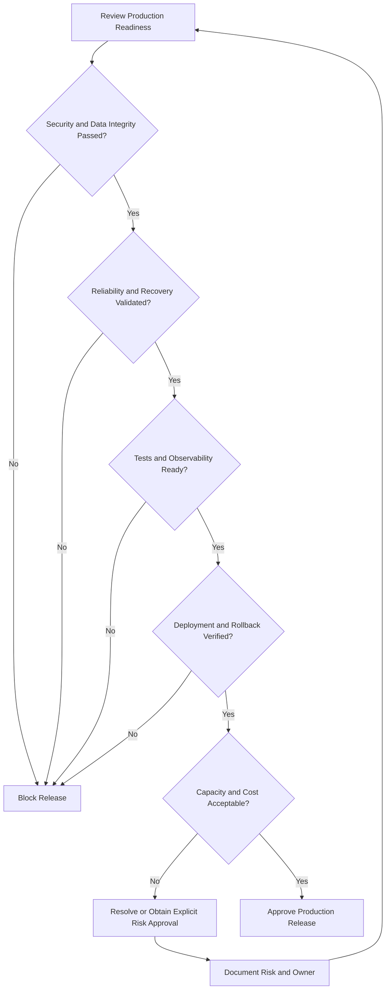

# 15- Production Readiness Checklist

## Overview

Production readiness for AWS Lambda means verifying that a function and its surrounding infrastructure can operate securely, reliably, and predictably under real workloads. A function that executes successfully in a local test or development environment is not necessarily ready for production.

Production readiness covers the complete lifecycle: application design, permissions, deployment, event processing, dependency management, observability, failure recovery, performance, and cost control.

Use this checklist before the initial production release, after significant architectural changes, and during periodic operational reviews.

The objective is not to enable every AWS feature. It is to demonstrate that the workload satisfies its requirements and that known failure modes have documented mitigations.

## Production Readiness Domains

| Domain | Primary objective | Required evidence |
|---|---|---|
| Application correctness | Business logic behaves as expected | Automated tests and reviewed error handling |
| Runtime and configuration | Function settings match workload requirements | Verified runtime, memory, timeout, and environment configuration |
| Security | Access follows least-privilege principles | Reviewed IAM policies, secrets handling, and network controls |
| Reliability | Failures can be detected and recovered from | Retry policies, idempotency, and failure-handling procedures |
| Scalability | Workloads remain within capacity constraints | Concurrency planning and load-test results |
| Observability | Operators can diagnose incidents | Structured logs, metrics, traces where appropriate, and alarms |
| Deployment | Releases are repeatable and reversible | Automated deployment pipeline and tested rollback procedure |
| Cost | Spending is understood and controlled | Cost baseline, allocation, and budget monitoring |
| Disaster recovery | Recovery objectives can be met | Documented RTO/RPO and tested recovery procedures where required |
| Operations | Ownership and incident response are clear | Runbooks, alerts, escalation paths, and operational responsibility |

## Application and Runtime Readiness

### Handler and business logic

- [ ] The handler validates required event fields and rejects malformed inputs safely.
- [ ] Business logic is separated from event parsing and infrastructure interactions where practical.
- [ ] Exceptions are classified into retryable and permanent failures.
- [ ] Error responses follow the integration contract.
- [ ] Sensitive data is not exposed through exceptions or response bodies.
- [ ] Duplicate event delivery does not repeat business side effects.
- [ ] Boundary conditions, concurrency behavior, and partial failures are tested.
- [ ] Dependencies are explicitly declared and compatible with the target runtime.

For Python functions, keep handlers focused and use reusable modules for business rules, data access, and external integrations. This improves testability and reduces the risk of changing infrastructure behavior when business logic changes.

### Runtime and execution configuration

- [ ] The selected runtime is supported and appropriate for the application.
- [ ] Runtime lifecycle and deprecation dates are monitored.
- [ ] Memory allocation has been benchmarked using representative workloads.
- [ ] The timeout reflects the business deadline and dependency latency.
- [ ] Ephemeral storage is sized for actual temporary-file requirements.
- [ ] Environment variables contain configuration rather than hard-coded deployment-specific values.
- [ ] Initialization work and dependency imports are reasonable.
- [ ] Global clients are reused safely without storing request-specific mutable state.
- [ ] The deployment package or container image matches the configured architecture.
- [ ] Function configuration is managed through infrastructure as code where practical.

Inspect the deployed configuration with AWS CLI:

```bash
aws lambda get-function-configuration \
  --function-name orders-api \
  --query '{
    Runtime:Runtime,
    Architectures:Architectures,
    MemorySize:MemorySize,
    Timeout:Timeout,
    EphemeralStorage:EphemeralStorage,
    State:State,
    LastUpdateStatus:LastUpdateStatus
  }' \
  --output json
```

This is a read-only command. Replace `orders-api` with the deployed function name. Verify the result against the intended infrastructure configuration rather than assuming the deployed settings match the source repository.

## Security Readiness

### IAM and access control

- [ ] The execution role grants only the permissions required by the function.
- [ ] Resource access is restricted to the necessary tables, buckets, queues, secrets, and other resources.
- [ ] Invocation permissions are configured for the intended callers.
- [ ] Resource-based policies are reviewed where applicable.
- [ ] Cross-account access and trust policies are explicitly validated.
- [ ] Deployment permissions are separated from runtime permissions.
- [ ] CI/CD uses short-lived credentials, such as GitHub Actions OIDC, where appropriate.
- [ ] Organization-level controls and permissions boundaries are respected.
- [ ] IAM changes are reviewed and tested before production deployment.

Avoid policies that grant unrestricted access to all resources when the application requires only a specific resource.

For example, a function that reads objects from one bucket should normally have a narrowly scoped S3 permission rather than unrestricted S3 access.

### Secrets and sensitive data

- [ ] Credentials and API tokens are not embedded in source code or deployment artifacts.
- [ ] Secrets are stored in AWS Secrets Manager or Systems Manager Parameter Store as appropriate.
- [ ] Secret access is restricted to the relevant execution role.
- [ ] Rotation requirements and application behavior during rotation are documented.
- [ ] Logs do not contain credentials, access tokens, or unnecessary personal data.
- [ ] Environment-variable encryption and key permissions are understood.
- [ ] Test fixtures contain synthetic data rather than production secrets.

Encryption does not replace access control. A principal that can retrieve a secret may still expose it through application logs or responses if the code handles it incorrectly.

### Networking

- [ ] VPC attachment is required and configured intentionally.
- [ ] Subnets, route tables, security groups, and DNS settings support the required traffic.
- [ ] Private dependencies are reachable from the configured network.
- [ ] Outbound internet access is explicitly designed where required.
- [ ] NAT gateway and VPC endpoint costs are understood.
- [ ] Security groups permit only the necessary traffic.
- [ ] Database and service endpoints are not exposed more broadly than necessary.

A Lambda function attached to a VPC does not automatically receive internet access. Validate the actual routing and connectivity requirements rather than relying on assumptions about subnet names or subnet types.

## Reliability and Fault Tolerance

### Invocation and event processing

- [ ] The invocation model is appropriate for the workload.
- [ ] Synchronous requests have clear timeout and error-response behavior.
- [ ] Asynchronous invocation retry behavior is explicitly understood.
- [ ] Event-source mappings use suitable batching and concurrency settings.
- [ ] Duplicate delivery is handled safely.
- [ ] Event ordering requirements are documented.
- [ ] Partial batch failure handling is enabled where supported and appropriate.
- [ ] Queue retention, visibility timeout, and redrive policies are configured correctly.
- [ ] Dead-letter queues or supported failure destinations are configured where needed.
- [ ] Invalid messages have a controlled rejection or quarantine path.

### Idempotency and recovery

- [ ] Business operations use durable idempotency controls when duplicate processing could cause harmful effects.
- [ ] Idempotency records have an appropriate lifecycle and recovery policy.
- [ ] Conditional writes or transactions protect critical state transitions.
- [ ] Ambiguous outcomes, such as a timeout after a downstream side effect, have a reconciliation strategy.
- [ ] Retry policies distinguish transient errors from permanent failures.
- [ ] Retries use appropriate backoff and do not amplify dependency outages.
- [ ] Failure destinations are monitored and have an operational owner.
- [ ] Replay procedures validate messages and control replay rates.

A DLQ alone does not make a workload resilient. Production readiness requires a way to inspect, diagnose, and safely replay or permanently resolve failed work.

### Downstream protection

- [ ] Reserved concurrency or other appropriate limits protect constrained dependencies.
- [ ] Database connection usage has been evaluated under expected Lambda scaling.
- [ ] Connection and request timeouts are configured.
- [ ] Retry behavior is coordinated across the application, SDK, event source, and caller.
- [ ] Slow or unavailable dependencies do not create unbounded waiting.
- [ ] Graceful degradation is defined where the business permits it.
- [ ] Circuit breakers or equivalent protections are used where their benefits justify the added complexity.

## Scalability and Performance

### Capacity planning

- [ ] Expected request volume and peak traffic are documented.
- [ ] Concurrency requirements have been estimated and load-tested.
- [ ] Account and function concurrency limits are understood.
- [ ] Relevant service quotas have been reviewed.
- [ ] Downstream throughput and connection limits can support the expected load.
- [ ] Queue consumers can process incoming work within the required latency objective.
- [ ] Backlog growth and recovery time have been evaluated.
- [ ] Throttling behavior is acceptable and observable.

A useful steady-state estimate is:

\[
\text{Concurrency} \approx
\text{Requests per second} \times
\text{Average duration in seconds}
\]

For example, 80 requests per second with an average duration of 0.25 seconds implies approximately 20 concurrent executions under steady-state conditions.

This is a planning estimate, not a guarantee. Bursts, retries, tail latency, and downstream bottlenecks can increase actual concurrency requirements.

### Performance validation

- [ ] Representative inputs and payload sizes have been tested.
- [ ] Average and percentile durations have been measured.
- [ ] Cold-start behavior has been evaluated when relevant to latency objectives.
- [ ] Memory settings have been benchmarked.
- [ ] Initialization work has been measured where necessary.
- [ ] Database queries and external API calls have been profiled.
- [ ] Large payloads and temporary-file workloads have been tested.
- [ ] Load tests include slow dependencies and realistic failure rates.
- [ ] Provisioned concurrency or other startup optimizations are justified by measured requirements.

Do not treat average duration as the sole performance indicator. Tail latency often determines whether synchronous APIs meet their service-level objectives.

## Observability and Alerting

### Logging

- [ ] Logs use a consistent, structured format where appropriate.
- [ ] Lambda request IDs and business correlation IDs are available for diagnosis.
- [ ] Logs include enough context to identify failures without exposing sensitive data.
- [ ] Log levels are appropriate for production traffic.
- [ ] Log-group retention is configured.
- [ ] Ingestion and storage costs have been considered.
- [ ] Log access is restricted according to operational and security requirements.

### Metrics and alarms

- [ ] Invocation volume and error rates are monitored.
- [ ] Duration percentiles are monitored where latency matters.
- [ ] Throttles and concurrent executions are monitored.
- [ ] Queue age and backlog are monitored for asynchronous workloads.
- [ ] DLQ activity and repeated processing failures trigger actionable alerts.
- [ ] Downstream dependency errors and latency are observable.
- [ ] Business-level success metrics are available for critical workflows.
- [ ] Alarm thresholds have been validated against expected workload behavior.
- [ ] Alert ownership and response procedures are documented.

Useful Lambda CloudWatch metrics include `Invocations`, `Errors`, `Duration`, `Throttles`, and `ConcurrentExecutions`. Metric availability and dimensions vary by metric and integration; validate the relevant monitoring configuration.

### Distributed tracing

- [ ] Trace propagation is configured where it materially helps diagnosis.
- [ ] Correlation IDs are propagated across asynchronous boundaries when appropriate.
- [ ] Sampling settings preserve sufficient diagnostic visibility.
- [ ] Tracing overhead and cost are understood.
- [ ] Trace identifiers can be correlated with application logs.

Tracing is especially valuable when a request crosses API Gateway, Lambda, queues, databases, and other services. It complements rather than replaces logs and metrics.

## Deployment and Release Readiness

### Build and release process

- [ ] Deployment artifacts are reproducible.
- [ ] Dependencies are installed and packaged for the target runtime and architecture.
- [ ] Automated tests and static analysis run before deployment.
- [ ] Dependency and container-image security checks are included where applicable.
- [ ] Infrastructure changes are reviewed.
- [ ] Runtime and configuration changes are tested in a nonproduction environment.
- [ ] Environment-specific settings and secrets are managed safely.
- [ ] Deployment permissions follow least privilege.
- [ ] Production deployments have appropriate approval controls.

### Versions, aliases, and rollback

- [ ] Production traffic is directed through an appropriate deployment strategy.
- [ ] Published versions and aliases are used where they improve release control.
- [ ] Canary or linear traffic shifting is considered for higher-risk changes.
- [ ] Deployment health checks and smoke tests are defined.
- [ ] Rollback steps are documented and tested.
- [ ] Database and event-schema changes are compatible with rollback requirements.
- [ ] Asynchronous events produced by a new version remain compatible with consumers.
- [ ] The team understands that rolling back code does not automatically reverse completed business side effects.

Use gradual rollout strategies when the risk and architecture justify them. A successful deployment command proves that AWS accepted the deployment; it does not prove that the application is functioning correctly.

### Post-deployment verification

- [ ] The deployed version and configuration match the intended release.
- [ ] Smoke tests verify critical application behavior.
- [ ] Error rates, duration, throttling, and business outcomes are checked.
- [ ] Event sources and permissions are working as expected.
- [ ] No unexpected queue backlog or DLQ growth is occurring.
- [ ] Logs and alarms are receiving expected signals.
- [ ] Rollback remains available until the release is considered stable.

## Testing and Quality Gates

- [ ] Unit tests cover core business logic.
- [ ] Handler tests cover event parsing and response contracts.
- [ ] Integration tests validate critical AWS service interactions.
- [ ] Contract tests validate important external event schemas.
- [ ] Failure-path tests cover timeouts, dependency failures, and invalid inputs.
- [ ] Idempotency and duplicate-event scenarios are tested.
- [ ] Partial batch failure behavior is tested where applicable.
- [ ] Static analysis, formatting, and type checks run in CI/CD.
- [ ] Dependency vulnerabilities are reviewed.
- [ ] Test coverage thresholds are meaningful for the application risk.
- [ ] Test environments use isolated resources and data.
- [ ] Automated tests do not depend on uncontrolled production resources.

Coverage is a useful signal, but high line coverage does not guarantee correct retry semantics, safe concurrent processing, or reliable recovery.

## Cost and Resource Governance

- [ ] Invocation volume and compute costs have been estimated.
- [ ] Cost per successful business operation is understood.
- [ ] Memory configuration has been benchmarked rather than arbitrarily minimized.
- [ ] Provisioned concurrency is justified by latency requirements and utilization.
- [ ] Logging, metrics, and tracing volume are controlled.
- [ ] Networking, NAT gateways, VPC endpoints, and data transfer costs are understood.
- [ ] Downstream service costs are included in workload analysis.
- [ ] Resource ownership and cost allocation are established.
- [ ] Budgets or appropriate cost alerts are configured.
- [ ] Unused test resources are removed.
- [ ] Quota limits and expected traffic growth have been reviewed.

AWS Budgets and cost anomaly detection provide visibility and alerts; they are not guaranteed real-time spending caps.

## Disaster Recovery and Business Continuity

Disaster recovery requirements depend on the business impact of an outage and the acceptable loss of data.

Define:

- **Recovery Time Objective (RTO):** The maximum acceptable time to restore service.
- **Recovery Point Objective (RPO):** The maximum acceptable data-loss window.

### Readiness checks

- [ ] RTO and RPO are documented for critical workloads.
- [ ] Required data stores have appropriate backup and recovery controls.
- [ ] Event retention and replay requirements are documented.
- [ ] Recovery procedures include Lambda configuration, IAM, networking, secrets, and dependencies.
- [ ] Infrastructure can be recreated through reviewed infrastructure-as-code definitions.
- [ ] Required artifacts and configuration are available during recovery.
- [ ] Cross-Region recovery is implemented only where required by the recovery objectives.
- [ ] Failover and recovery procedures have been tested.
- [ ] Duplicate processing during replay or failover is handled safely.
- [ ] Recovery ownership and escalation procedures are documented.

Deploying a function in multiple Regions does not automatically provide disaster recovery. Routing, data replication, secrets, IAM, event sources, and recovery orchestration must also be addressed.

## Operational Ownership and Incident Response

- [ ] Every critical function has an identified owning team.
- [ ] Alerts identify the affected service and operational severity.
- [ ] Runbooks include diagnostic commands and recovery steps.
- [ ] On-call escalation paths are defined.
- [ ] Incident communication and stakeholder responsibilities are documented.
- [ ] Failure destinations and DLQs have clear owners.
- [ ] Capacity, quota, and cost reviews occur periodically.
- [ ] Runtime lifecycle and dependency updates are tracked.
- [ ] Significant incidents result in documented corrective actions.
- [ ] Production changes are auditable.

A production service is not operationally ready if it can fail but nobody knows who should investigate or how to recover it.

## Production Readiness Decision

Use the checklist to record evidence rather than treating every item as a simple yes/no exercise.

| Status | Meaning | Required action |
|---|---|---|
| Ready | Requirement is satisfied and evidence is available | Proceed according to release policy |
| Conditional | A known gap exists with an accepted mitigation | Document owner, mitigation, and deadline |
| Blocked | A critical requirement is not satisfied | Resolve before production release |
| Not applicable | Requirement does not apply to the workload | Record the justification |

Critical security, data-integrity, and recovery requirements should not be waived merely to meet a release date. Conditional approval should have an explicit owner and an expiration or review date.

### Suggested release gate



This gate is a practical review framework, not an AWS-enforced release policy. Adapt approval requirements to the workload's criticality and organizational controls.

## Common Production Readiness Mistakes

| Mistake | Why it matters | Recommended action |
|---|---|---|
| Treating a successful local invocation as production validation | Does not prove IAM, networking, or event-source configuration is correct | Test critical integrations in AWS |
| Using broad execution-role permissions | Increases the impact of a compromised function | Apply least privilege and review policies |
| Ignoring duplicate event delivery | Can repeat payments, notifications, or database changes | Implement durable idempotency |
| Configuring retries without a failure destination | Failed events may remain difficult to recover | Establish monitoring and a recovery path |
| Increasing concurrency without dependency testing | Can overwhelm databases and external APIs | Load-test and set appropriate limits |
| Skipping rollback tests | A failed release can become a prolonged incident | Verify rollback and data compatibility |
| Monitoring only technical errors | Business processing may be delayed without function errors | Monitor queue age and business success |
| Ignoring downstream costs | Lambda may be inexpensive while dependencies dominate spend | Measure total workload cost |
| Deploying without operational ownership | Alerts may go unanswered | Assign owners and maintain runbooks |
| Treating all checklist items equally | Critical security or data-integrity gaps can be overlooked | Prioritize by business risk and explicit release criteria |

## Key Takeaways

- Production readiness requires evidence across application correctness, security, reliability, observability, deployment, scalability, and cost—not merely a successful Lambda invocation.
- Design for duplicate delivery, bounded retries, downstream failures, and durable recovery before exposing critical workloads to production traffic.
- Verify IAM, networking, runtime configuration, event-source behavior, and deployment settings in the actual AWS environment.
- Establish actionable monitoring, operational ownership, tested rollback procedures, and recovery objectives appropriate to the workload.
- Treat production approval as a risk-based engineering decision supported by documented evidence, explicit ownership, and repeatable operational procedures.