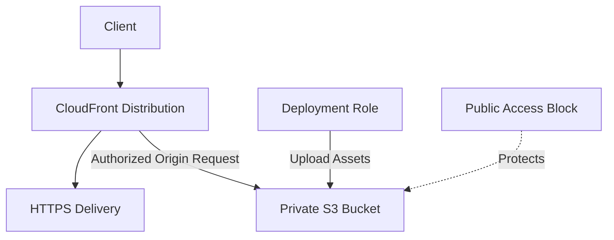

# 03- Public Access Prevention Best Practices

## Overview

Amazon S3 public exposure can result from overly permissive bucket policies, access control lists (ACLs), incorrect CloudFront origin configuration, or deployment changes that weaken previously established controls.

Preventing public access requires multiple layers of protection. A production design should enable S3 Block Public Access, disable ACLs when they are unnecessary, restrict resource policies, use private origins for content delivery, and continuously verify the effective configuration.

This document defines practical public-access prevention standards for application buckets, document storage, static websites, analytics datasets, and automated infrastructure deployments.

## Understand the S3 Public Access Model

### Identify the sources of public exposure

S3 access can be affected by identity-based policies, resource-based policies, ACLs where enabled, and applicable organizational or network restrictions.

Common sources of unintended public exposure include:

| Exposure source | Example | Preventive control |
|---|---|---|
| Bucket policy | A policy grants anonymous `s3:GetObject` access | Block Public Access and policy review |
| Object ACL | An object grants read access to everyone | Block Public Access and Bucket owner enforced |
| Bucket ACL | A bucket grants public access through an ACL | Disable ACLs where possible |
| Access point policy | An access point permits unintended public access | Access-point policy review and Block Public Access |
| Infrastructure deployment | A template disables public-access protections | IaC validation and deployment guardrails |
| Application design | An API issues a download URL without authorization | Application authorization and secure URL generation |
| Content delivery | A public origin bypasses the intended CloudFront access path | Private S3 origin and Origin Access Control |

Not every accessible object is publicly exposed. For example, a private bucket can grant access to a specific application role or CloudFront distribution without granting anonymous access.

**Best practice:** Define the intended access paths explicitly and prevent every other path rather than relying on a bucket name or URL being difficult to discover.

## Enable S3 Block Public Access

### Understand the four protection settings

S3 Block Public Access provides controls that restrict public access through applicable policies and ACLs.

| Setting | Protection |
|---|---|
| `BlockPublicAcls` | Blocks new public ACLs and certain requests that attempt to apply public ACL permissions |
| `IgnorePublicAcls` | Prevents existing public ACL grants from being used to authorize access |
| `BlockPublicPolicy` | Blocks attempts to create or update bucket and applicable access point policies that grant public access |
| `RestrictPublicBuckets` | Restricts access to buckets with public policies, subject to the service's documented behavior |

For private application buckets, configure all four settings to `true` at both the account and bucket levels where appropriate.

These settings address different exposure paths. Enabling only one does not provide the same protection as enabling all four.

### Apply account-level protection

Account-level Block Public Access is an important preventive guardrail because it applies across the account's applicable S3 resources.

Inspect the account-level configuration:

```bash
aws s3control get-public-access-block \
  --account-id "$AWS_ACCOUNT_ID"
```

Configure the account-level settings using an authorized administrative workflow:

```bash
aws s3control put-public-access-block \
  --account-id "$AWS_ACCOUNT_ID" \
  --public-access-block-configuration \
  '{
    "BlockPublicAcls": true,
    "IgnorePublicAcls": true,
    "BlockPublicPolicy": true,
    "RestrictPublicBuckets": true
  }'
```

Use the account ID of the intended AWS account. Account-level changes can affect existing workloads, so review legitimate public-access dependencies before enforcing the configuration.

Where supported by the organization's governance model, use AWS Organizations service control policies or other preventive controls to restrict who can weaken the required safeguards.

### Apply bucket-level protection

For each private bucket, define Block Public Access explicitly rather than relying only on inherited organizational assumptions.

```bash
aws s3api put-public-access-block \
  --bucket "$BUCKET" \
  --public-access-block-configuration \
  '{
    "BlockPublicAcls": true,
    "IgnorePublicAcls": true,
    "BlockPublicPolicy": true,
    "RestrictPublicBuckets": true
  }'
```

Inspect the effective bucket configuration:

```bash
aws s3api get-public-access-block \
  --bucket "$BUCKET"
```

A bucket-level configuration cannot override a more restrictive applicable account-level setting. Effective settings are evaluated across the relevant configuration hierarchy, including organization-level settings where applicable.

A successful command confirms that the configuration operation completed. It does not prove that every access path is correctly authorized or that all related resources are private.

Reference: [Blocking public access to Amazon S3](https://docs.aws.amazon.com/AmazonS3/latest/userguide/access-control-block-public-access.html).

## Disable ACLs for Private Application Buckets

### Prefer Bucket owner enforced Object Ownership

For most new private application buckets, use S3 Object Ownership with `BucketOwnerEnforced`.

This setting disables ACLs and makes the bucket owner the owner of uploaded objects. Policies become the primary mechanism for access management.

Configure Object Ownership:

```bash
aws s3api put-bucket-ownership-controls \
  --bucket "$BUCKET" \
  --ownership-controls \
  '{
    "Rules": [
      {
        "ObjectOwnership": "BucketOwnerEnforced"
      }
    ]
  }'
```

Verify the setting:

```bash
aws s3api get-bucket-ownership-controls \
  --bucket "$BUCKET"
```

Advantages include:

- Fewer overlapping access-control mechanisms.
- More predictable ownership of uploaded objects.
- Reduced risk from object-level public ACLs.
- Simpler policy review and access auditing.
- More consistent cross-account upload ownership behavior.

### Review legacy ACL dependencies before migration

Disabling ACLs can affect integrations that attempt to set ACLs during uploads, such as older applications that send `public-read`.

Before changing an existing bucket:

1. Identify applications and external partners that set ACLs.
2. Inspect current bucket and object ACL usage.
3. Update the upload code and integrations to use policy-based access.
4. Test existing upload and download workflows.
5. Enable Bucket owner enforced through a reviewed deployment.
6. Verify object ownership and intended access afterward.

Do not preserve ACLs simply because an older code sample uses them. Keep them only when there is a documented requirement and the supported ownership model is appropriate.

Reference: [Controlling ownership of objects and disabling ACLs](https://docs.aws.amazon.com/AmazonS3/latest/userguide/about-object-ownership.html).

## Prevent Public Bucket Policies

### Avoid anonymous access statements

A bucket policy that grants `s3:GetObject` to every principal can make objects publicly readable when the applicable public-access controls permit it.

For example, avoid the following policy pattern for private storage:

```json
{
  "Version": "2012-10-17",
  "Statement": [
    {
      "Sid": "PublicRead",
      "Effect": "Allow",
      "Principal": "*",
      "Action": "s3:GetObject",
      "Resource": "arn:aws:s3:::acme-prod-documents/*"
    }
  ]
}
```

The `Principal: "*"` pattern is not inherently wrong in every S3 policy. It is appropriate in some explicitly approved designs, such as granting a CloudFront service principal access under a narrowly scoped distribution condition. The risk depends on the complete statement and its conditions.

For ordinary private document storage, grant access to specific workload identities or approved resource principals instead.

### Understand why public-access blocking matters

Block Public Access is a preventive safeguard, not a replacement for policy design.

It helps reject or restrict applicable configurations that would expose data publicly. It does not mean every identity-based or cross-account permission is automatically removed.

Review the effective policy configuration and the identities that retain legitimate access. A private bucket can still be accessible to an unintended role if its IAM permissions are too broad.

### Require HTTPS for S3 requests

For private buckets, deny insecure transport through a reviewed bucket policy. This protects the data transfer path without making objects public.

```json
{
  "Sid": "DenyInsecureTransport",
  "Effect": "Deny",
  "Principal": "*",
  "Action": "s3:*",
  "Resource": [
    "arn:aws:s3:::acme-prod-documents",
    "arn:aws:s3:::acme-prod-documents/*"
  ],
  "Condition": {
    "Bool": {
      "aws:SecureTransport": "false",
      "aws:PrincipalIsAWSService": "false"
    }
  }
}
```

This example excludes direct AWS service principals from this particular deny condition. Review service integrations and their documented security requirements before deploying the statement.

An explicit deny can override otherwise applicable allows. Test the policy against the real application, administrative, and service-integration request paths before rolling it out broadly.

## Serve Content Without Making the S3 Bucket Public

### Prefer a private S3 origin behind CloudFront

For static websites, downloads, images, and other content that requires global delivery, prefer CloudFront with Origin Access Control (OAC) and a private S3 REST origin when the architecture supports it.



In this design:

- S3 stores the original objects privately.
- CloudFront delivers cached or origin-fetched content.
- OAC authorizes the intended CloudFront distribution to access the S3 origin.
- The bucket policy grants the required access to that distribution.
- Block Public Access remains enabled.

Do not grant anonymous `s3:GetObject` access merely to make CloudFront work.

### Restrict the bucket policy to the intended distribution

A private S3 REST origin can use a bucket policy that permits the CloudFront service principal to read objects only for the intended distribution.

Illustrative policy statement:

```json
{
  "Sid": "AllowCloudFrontDistributionRead",
  "Effect": "Allow",
  "Principal": {
    "Service": "cloudfront.amazonaws.com"
  },
  "Action": "s3:GetObject",
  "Resource": "arn:aws:s3:::acme-prod-site/*",
  "Condition": {
    "StringEquals": {
      "AWS:SourceArn": "arn:aws:cloudfront::123456789012:distribution/E123EXAMPLE456"
    }
  }
}
```

Replace the example account ID, distribution ID, bucket name, and other identifiers with the actual deployed resources.

This policy statement is only the S3 authorization component. The CloudFront distribution must also be configured with OAC and the correct S3 origin. Use a reviewed distribution configuration and verify the origin access behavior after deployment.

For a production static website:

- Keep the S3 origin private.
- Use HTTPS through CloudFront.
- Configure suitable cache policies.
- Use controlled invalidation or versioned asset keys.
- Restrict deployment roles to the intended bucket and operations.
- Verify that direct anonymous S3 requests fail while valid CloudFront requests succeed.

Reference: [Restricting access to an Amazon S3 origin](https://docs.aws.amazon.com/AmazonCloudFront/latest/DeveloperGuide/private-content-restricting-access-to-s3.html).

### Understand the static website hosting exception

S3 static website hosting uses a website endpoint and has different access and HTTPS characteristics from a private S3 REST origin.

If a website uses the S3 website endpoint directly, publicly readable objects may be required. This can conflict with a strict public-access prevention standard.

For production delivery, prefer CloudFront with a private S3 REST origin and OAC when compatible with the website's requirements.

Do not enable public access for a bucket simply because the application serves HTML, JavaScript, CSS, or images. Choose the delivery architecture first, then apply the appropriate access controls.

If public access is explicitly required, treat it as a documented exception with a defined scope, owner, review process, and monitoring controls.

## Secure Backend Upload and Download Workflows

### Keep uploads private by default

A FastAPI or Django application should upload objects without attaching public ACLs.

A typical workflow is:

1. Authenticate the requester.
2. Authorize access to the intended tenant or resource.
3. Generate a server-controlled object key.
4. Upload through the backend or issue a presigned URL for a narrowly scoped operation.
5. Validate the completed object.
6. Record object metadata and processing state.
7. Permit downloads only after application authorization.

For a Boto3 upload, avoid setting an ACL such as `public-read`:

```python
import boto3


def upload_private_document(
    bucket: str,
    key: str,
    file_path: str,
) -> None:
    s3 = boto3.client("s3")

    s3.upload_file(
        file_path,
        bucket,
        key,
        ExtraArgs={
            "ContentType": "application/pdf",
        },
    )
```

This example relies on bucket-level security settings and the caller's IAM identity. It does not grant public access.

The `ContentType` value must be set from validated application data; it should not be blindly trusted if the file originated from an untrusted client.

### Authorize downloads before generating URLs

A private object should not become public merely because it is easy to share a download link.

Before issuing a presigned URL:

- Authenticate the requester.
- Confirm the requester is authorized for the object.
- Generate the URL for the exact bucket, key, and intended operation.
- Set an appropriate expiration.
- Avoid logging or disclosing the complete signed URL.
- Consider the implications of an authorized URL being forwarded to another person.

A presigned URL is a bearer capability. Anyone possessing a still-valid URL may use it within its effective restrictions. Revoking application access does not necessarily invalidate an already issued URL immediately.

For workflows requiring tighter revocation or centralized content-delivery controls, evaluate an appropriate CloudFront signed access design.

## Enforce Prevention Through Infrastructure as Code

### Make private defaults reusable

Define public-access protections centrally in Terraform, CloudFormation, or CDK modules so that new buckets inherit the intended security posture.

A Terraform example for an existing bucket resource:

```hcl
resource "aws_s3_bucket_public_access_block" "documents" {
  bucket = aws_s3_bucket.documents.id

  block_public_acls       = true
  ignore_public_acls      = true
  block_public_policy     = true
  restrict_public_buckets = true
}

resource "aws_s3_bucket_ownership_controls" "documents" {
  bucket = aws_s3_bucket.documents.id

  rule {
    object_ownership = "BucketOwnerEnforced"
  }
}
```

This snippet configures two security resources, but it is not a complete bucket module. The bucket resource and any required policy must also be configured, and the deployment identity must have permission to create or update these settings.

In a reusable module:

- Make private access the default.
- Avoid variables that casually disable public-access protections.
- If an exception is necessary, require explicit configuration and review.
- Validate resource policies in CI.
- Inspect plans for changes that weaken access controls.
- Keep runtime roles separate from deployment roles.

A guardrail in a shared module is more reliable than asking every application team to remember four settings independently.

### Detect dangerous infrastructure changes before deployment

Add automated checks for:

- Block Public Access being disabled.
- Object Ownership being changed to an ACL-enabled mode without approval.
- New policies that grant public access.
- Unintended public website configurations.
- Bucket policy changes that broadly expand access.
- CloudFront origins that no longer use the intended access model.
- Deployment roles receiving unnecessary security-administration permissions.

A passing static policy check does not prove that a resource is private. Review the deployed configuration and test actual access paths as well.

## Continuous Public Exposure Detection

### Use IAM Access Analyzer for S3

IAM Access Analyzer for S3 can identify buckets whose policies or ACLs permit public or shared access.

Use its findings to discover exposure paths that may not be obvious from bucket names or application code.

A finding does not automatically mean that the configuration is malicious. Some architectures intentionally share content with a specific external principal. Review the principal, resources, actions, conditions, and business justification before approving or remediating a finding.

Reference: [IAM Access Analyzer for S3](https://docs.aws.amazon.com/AmazonS3/latest/userguide/access-analyzer.html).

### Inspect the bucket's public policy status

Use the following command to inspect whether S3 classifies a bucket policy as public:

```bash
aws s3api get-bucket-policy-status \
  --bucket "$BUCKET"
```

Review the bucket policy itself:

```bash
aws s3api get-bucket-policy \
  --bucket "$BUCKET"
```

Inspect bucket ACLs where applicable:

```bash
aws s3api get-bucket-acl \
  --bucket "$BUCKET"
```

Inspect the public-access settings:

```bash
aws s3api get-public-access-block \
  --bucket "$BUCKET"
```

Also review relevant account-level Block Public Access settings.

These commands provide configuration evidence, not a complete authorization proof. Evaluate the applicable access path, identity permissions, access point configuration, and any other relevant policy layers.

### Establish alerting and response ownership

A public-access finding should lead to an actionable security workflow.

Define:

- Who owns the bucket and its data.
- Which public access patterns are approved.
- Who can approve an exception.
- How findings are triaged and prioritized.
- How unintended access is removed safely.
- How access changes are verified after remediation.
- How configuration changes and incidents are recorded.

For sensitive data, investigate whether exposure may have occurred before remediation. Removing public access prevents future access through that path but does not recall data that has already been downloaded.

## Handle Public-Access Exceptions Deliberately

### Separate approved public content from private data

Some applications legitimately serve public assets, published datasets, or explicitly public documents.

Use an exception process that documents:

- Business purpose and accountable owner.
- Exact bucket, prefix, or resource scope.
- Intended principals and permitted actions.
- Why a private delivery architecture is insufficient.
- Data classification and retention requirements.
- Required monitoring and periodic review.
- Conditions under which the exception will be removed.

Prefer using CloudFront with a private S3 origin when it meets the delivery requirements. If direct public S3 access is necessary, isolate that purpose from sensitive application storage rather than weakening a shared production bucket.

Do not assume a bucket is safe to expose merely because the current objects are intended to be public. Future uploads may contain private data, and broad policies can expose newly created objects automatically.

## Common Public-Access Prevention Mistakes

| Mistake | Risk | Recommended response |
|---|---|---|
| Enabling only one Block Public Access setting | Other exposure paths may remain | Configure and verify all four settings |
| Keeping ACLs enabled without a requirement | Creates another access-control mechanism to audit | Prefer Bucket owner enforced |
| Making the origin public for CloudFront | Allows clients to bypass the intended delivery path | Use a private S3 REST origin with OAC |
| Assuming an encrypted bucket is private | Encryption does not restrict who can request objects | Enforce authorization and private-access controls |
| Relying on CORS to prevent public access | CORS is not an authorization boundary | Review IAM and resource policies |
| Assuming a `403` proves the bucket is private | A single request result is insufficient to establish every access path | Inspect policies and effective settings |
| Allowing runtime roles to modify bucket policies | Compromise of an application role could weaken security | Separate application and administrative permissions |
| Blindly adding an explicit deny | Legitimate service integrations can break | Test all required request paths before rollout |
| Treating a public-access finding as automatically malicious | Legitimate sharing may also be detected | Validate business intent and actual policy scope |
| Ignoring access after remediation | Previously exposed data may already have been retrieved | Review available audit evidence and assess impact |

## Production Readiness Checklist

- [ ] Account-level and bucket-level Block Public Access settings are enabled as required.
- [ ] Bucket policies do not grant unintended anonymous access.
- [ ] ACLs are disabled through Bucket owner enforced unless there is a documented requirement.
- [ ] Private document and application buckets have no unnecessary public-read paths.
- [ ] Static website delivery uses a private origin behind CloudFront where appropriate.
- [ ] CloudFront OAC and the bucket policy are restricted to the intended distribution.
- [ ] Presigned URLs are issued only after authorization and have suitable expiration.
- [ ] Runtime roles cannot modify public-access protections without a justified requirement.
- [ ] Terraform, CloudFormation, or CDK templates enforce secure defaults.
- [ ] CI/CD checks flag public-access changes and policy broadening.
- [ ] IAM Access Analyzer and applicable security findings are reviewed.
- [ ] Both intended access and denied access paths are tested.
- [ ] Public-access exceptions have a named owner and periodic review.
- [ ] Incident procedures cover exposure assessment, remediation, and post-remediation verification.

## Authoritative References

- [Blocking public access to Amazon S3](https://docs.aws.amazon.com/AmazonS3/latest/userguide/access-control-block-public-access.html)
- [S3 Object Ownership and ACLs](https://docs.aws.amazon.com/AmazonS3/latest/userguide/about-object-ownership.html)
- [S3 bucket policies](https://docs.aws.amazon.com/AmazonS3/latest/userguide/bucket-policies.html)
- [IAM Access Analyzer for S3](https://docs.aws.amazon.com/AmazonS3/latest/userguide/access-analyzer.html)
- [Restricting access to an S3 origin with CloudFront](https://docs.aws.amazon.com/AmazonCloudFront/latest/DeveloperGuide/private-content-restricting-access-to-s3.html)
- [S3 presigned URLs](https://docs.aws.amazon.com/AmazonS3/latest/userguide/using-presigned-url.html)
- [Amazon S3 security best practices](https://docs.aws.amazon.com/AmazonS3/latest/userguide/security-best-practices.html)

## Key Takeaways

- Enable all four S3 Block Public Access settings at appropriate account and bucket levels, and verify the effective configuration.
- Prefer Bucket owner enforced Object Ownership and policy-based access for private application storage.
- Keep S3 origins private behind CloudFront OAC when building compatible content-delivery architectures.
- Enforce access through IAM, resource policies, and application authorization rather than relying on names, encryption, or CORS.
- Combine infrastructure guardrails, continuous exposure detection, positive and negative access tests, and a controlled exception process.