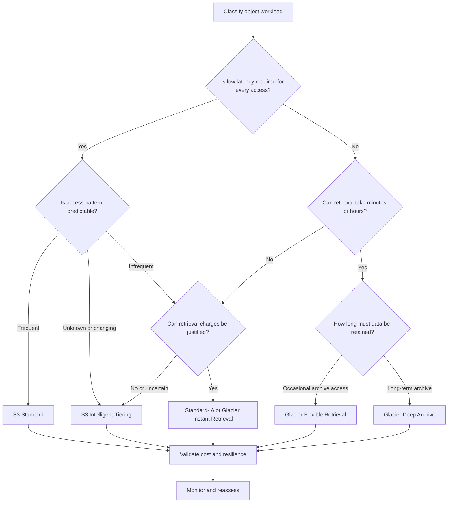
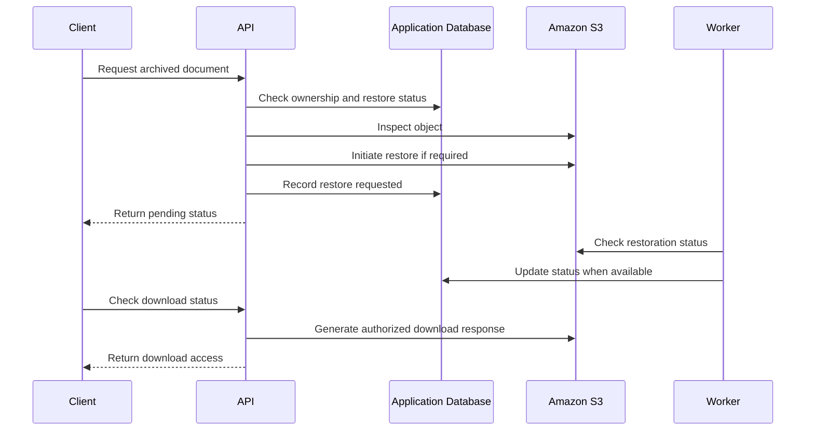

# Storage Class Selection Best Practices

## Overview

Amazon S3 storage classes determine how object data is stored, how quickly it can be accessed, its availability characteristics, and the costs associated with storage, requests, retrieval, and lifecycle transitions.

Selecting the cheapest storage class is not necessarily the most cost-effective decision. A class with a low storage rate can become more expensive when objects are frequently retrieved, stored for shorter than the minimum duration, or transitioned in large numbers.

For production backend systems, storage class selection should be based on measurable access patterns, object size, retention requirements, recovery objectives, and application latency requirements.

The primary objectives are to:

- Match storage classes to actual workload behavior.
- Reduce storage costs without introducing unacceptable retrieval delays.
- Preserve availability and recovery requirements.
- Automate transitions using appropriate S3 Lifecycle rules.
- Measure the financial and operational impact of storage-class decisions.

## Understand the Storage Classes

### Storage class comparison

| Storage class | Appropriate workload | Access characteristics | Minimum storage duration | Important considerations |
|---|---|---|---|---|
| S3 Standard (`STANDARD`) | Frequently accessed application data | Millisecond access | None | General-purpose default; data is stored across multiple Availability Zones (AZs) |
| S3 Intelligent-Tiering (`INTELLIGENT_TIERING`) | Unknown, changing, or unpredictable access patterns | Millisecond access in the standard access tiers | No minimum duration listed in the comparison table | Per-object monitoring and automation charges apply; no retrieval charges |
| S3 Standard-IA (`STANDARD_IA`) | Long-lived, infrequently accessed data | Millisecond access | 30 days | Retrieval charges apply; minimum billable object size is 128 KB |
| S3 One Zone-IA (`ONEZONE_IA`) | Infrequently accessed, reproducible data | Millisecond access | 30 days | Stored in one AZ; retrieval charges apply; minimum billable object size is 128 KB |
| S3 Glacier Instant Retrieval (`GLACIER_IR`) | Long-lived archive data accessed approximately quarterly | Millisecond access | 90 days | Retrieval charges apply; minimum billable object size is 128 KB |
| S3 Glacier Flexible Retrieval (`GLACIER`) | Infrequently accessed archives requiring asynchronous retrieval | Minutes to hours, depending on retrieval tier | 90 days | Objects must be restored before access; retrieval and archive metadata charges apply |
| S3 Glacier Deep Archive (`DEEP_ARCHIVE`) | Long-term archival and compliance retention | Hours, depending on retrieval tier | 180 days | Objects must be restored before access; retrieval and archive metadata charges apply |
| S3 Express One Zone (`EXPRESS_ONEZONE`) | Latency-sensitive, high-request-rate workloads | Consistent single-digit millisecond access | None | Stored in one AZ and uses directory buckets |

The minimum durations and access characteristics above are AWS's documented storage-class properties, not guarantees of a particular application's end-to-end response time. Consult the [official S3 storage class comparison](https://docs.aws.amazon.com/AmazonS3/latest/userguide/storage-class-intro.html) and current regional pricing before deployment.

### Understand Availability Zone resilience

Storage classes differ in their resilience to the physical loss of an Availability Zone.

- S3 Standard, Standard-IA, Intelligent-Tiering, and the Glacier storage classes are designed to be resilient to the physical loss of an AZ.
- One Zone-IA and Express One Zone store data in a single AZ and are not resilient to the physical loss of that AZ in the same way.

One Zone-IA and Express One Zone still provide high durability within their design boundaries. However, high durability must not be interpreted as multi-AZ disaster resilience.

**Best practice:** Do not select a single-AZ class for the primary or only copy of irreplaceable business data unless the overall architecture explicitly addresses the associated failure scenario.

## Establish Storage Class Selection Criteria

### Start with access patterns

Classify object populations according to their observed and expected behavior.

| Data classification | Example | Recommended starting point | Reason |
|---|---|---|---|
| Active application data | Profile images, active documents, API downloads | S3 Standard | Consistent low-latency access without retrieval fees |
| Unpredictable access | New product uploads, data lake objects | S3 Intelligent-Tiering | Automatically adapts storage tiers to access patterns |
| Infrequent but immediately accessible | Historical reports, older media | Standard-IA | Lower storage rates when retrievals are infrequent |
| Reproducible intermediate data | Rebuildable processing output, temporary derived artifacts | One Zone-IA when appropriate | Lower storage cost when a single-AZ design is acceptable |
| Rarely accessed online archives | Historical files that may need immediate retrieval | Glacier Instant Retrieval | Millisecond access with lower storage rates than frequently accessed classes |
| Occasional historical archive retrieval | Older audit exports and datasets | Glacier Flexible Retrieval | Lower storage cost when asynchronous restoration is acceptable |
| Long-term retention | Long-lived compliance archives and historical backups | Glacier Deep Archive | Designed for infrequently accessed, long-term data |

These are starting points rather than universal rules. Validate them against actual request rates, retrieval volumes, retention periods, and application requirements.

### Use a decision workflow



The workflow is a starting point. Security, durability, data residency, recovery objectives, and feature compatibility remain independent selection criteria.

## Prefer S3 Intelligent-Tiering for Unpredictable Access

### Avoid guessing when access patterns are unknown

S3 Intelligent-Tiering automatically moves eligible objects between access tiers according to observed access patterns.

Its automatic access tiers include:

- **Frequent Access:** Objects are initially stored in this tier.
- **Infrequent Access:** Objects move here after 30 consecutive days without access.
- **Archive Instant Access:** Objects move here after 90 consecutive days without access.

Two optional asynchronous archive tiers are available:

- **Archive Access:** Objects can be archived after at least 90 consecutive days without access when the tier is enabled.
- **Deep Archive Access:** Objects can be archived after at least 180 consecutive days without access when the tier is enabled.

Objects in the optional asynchronous archive tiers must be restored before they can be accessed. Objects smaller than 128 KB are not monitored for auto-tiering and remain in the Frequent Access tier.

Reference: [Managing S3 Intelligent-Tiering](https://docs.aws.amazon.com/AmazonS3/latest/userguide/intelligent-tiering.html).

### Evaluate the monitoring fee

Intelligent-Tiering incurs a per-object monitoring and automation charge for eligible objects. It avoids retrieval fees and automated transitions between its internal tiers do not incur tiering charges, but ordinary request, storage, and data-transfer costs still apply.

Prefer it when the expected savings from adapting to changing access patterns justify the monitoring fee.

Consider other classes when:
- Access patterns are stable and well understood.
- A lifecycle policy can reliably predict the transition date.
- The dataset contains many small objects that do not benefit from automatic tiering.
- Strictly controlled archive restoration behavior is preferable.

### Configure Intelligent-Tiering deliberately

New objects can use Intelligent-Tiering as their initial storage class.

For example, upload a document using the AWS CLI:

```bash
aws s3 cp ./report.parquet \
  "s3://${BUCKET}/analytics/report.parquet" \
  --storage-class INTELLIGENT_TIERING
```

Replace the example bucket and object path with the intended values.

Before enabling optional archive tiers, verify that application workflows can tolerate restoration delays and handle restore-in-progress responses. Do not activate asynchronous archival for objects that must be served immediately by an API.

## Optimize Infrequently Accessed Data

### Select Standard-IA for data that must remain immediately accessible

Standard-IA is suitable for long-lived data that is accessed infrequently but still requires millisecond access when requested.

Typical use cases include:
- Older documents that customers occasionally download.
- Historical reports used by support teams.
- Backups that require rapid access during recovery.
- Infrequently accessed media that must remain online.

Retrieval charges and minimum duration requirements can offset the storage savings.

The class is most suitable when the expected reduction in storage cost exceeds retrieval charges and the costs associated with transitioning and storing the objects.

### Use One Zone-IA only when its failure characteristics are acceptable

One Zone-IA is appropriate for reproducible data, selected replicas, and other datasets that can tolerate the loss of an AZ.

Examples include:
- Rebuildable analytics artifacts.
- Regeneratable thumbnails.
- Derived intermediate datasets.
- Certain replica copies where another recoverable copy exists.

Do not place the only copy of critical documents or irreplaceable application uploads in One Zone-IA merely to reduce storage cost.

### Account for minimum object size

For Standard-IA and One Zone-IA, objects smaller than 128 KB are billed for 128 KB of storage. Each object must also satisfy the 30-day minimum storage duration to avoid prorated early-deletion charges.

This matters when applications create many small objects, such as individual log events, JSON fragments, thumbnails, or metadata records.

For such workloads, consider:
- Retaining active objects in Standard.
- Using Intelligent-Tiering where its economics are justified.
- Aggregating small records into larger objects when the processing model supports it.
- Evaluating the full transition cost before using lifecycle rules.

Do not aggregate files when doing so would make access, retention, deletion, or recovery unnecessarily complex.

## Apply Glacier Classes According to Recovery Requirements

### Use Glacier Instant Retrieval for immediate access to rare data

Glacier Instant Retrieval is designed for long-lived archive data that is accessed infrequently but must be available in milliseconds.

Use it when a workload needs online access but has a sufficiently low retrieval frequency to justify the storage and retrieval pricing trade-off.

Objects have a 90-day minimum storage duration and a 128 KB minimum billable object size.

### Use Glacier Flexible Retrieval for asynchronous archives

Glacier Flexible Retrieval is designed for long-lived archives where access can be delayed. Depending on the selected restoration tier, retrieval can take minutes to hours.

Use it for:
- Historical datasets.
- Older audit exports.
- Backup copies with an acceptable restoration window.
- Records that are rarely accessed but might be needed for investigations.

Objects have a 90-day minimum storage duration. Each object also incurs an additional 40 KB of archive-related metadata: 32 KB billed at the Glacier Flexible Retrieval rate and 8 KB billed at the S3 Standard rate.

### Use Glacier Deep Archive for long-term retention

Glacier Deep Archive is designed for data retained for years and retrieved very rarely.

Potential workloads include:
- Long-term compliance archives.
- Historical records with infrequent retrieval requirements.
- Long-term backup copies.
- Datasets that can be restored using a documented recovery process.

Objects have a 180-day minimum storage duration and incur an additional 40 KB of archive-related metadata, billed across Glacier Deep Archive and S3 Standard rates.

Do not use Deep Archive as a direct substitute for online application storage. Access requires restoration, with retrieval typically taking hours.

Reference: [Understanding S3 Glacier storage classes](https://docs.aws.amazon.com/AmazonS3/latest/userguide/glacier-storage-classes.html).

### Design archive retrieval into the application

An API must not assume that every S3 object can be retrieved immediately.

For archived data, the workflow should:
1. Authorize the user to access the requested object.
2. Check whether restoration is required or already in progress.
3. Initiate an appropriate restore request if necessary.
4. Track restoration status.
5. Notify the user or make the document available when restoration completes.
6. Apply an appropriate expiration policy to temporary restored copies, where relevant.

A typical architecture may use a database to track restore state and a worker to poll or process completion signals.



Use asynchronous processing rather than keeping an HTTP request open while a restore may take hours.

## Automate Transitions with S3 Lifecycle

### Prefer lifecycle rules for predictable access patterns

S3 Lifecycle lets you transition objects between supported storage classes based on object age and rule filters.

Use lifecycle policies for predictable workloads, such as:
- Moving historical logs into archive storage.
- Transitioning older reports after a defined period.
- Deleting temporary data after retention expires.
- Managing noncurrent object versions in versioned buckets.

For changing access patterns, consider Intelligent-Tiering instead of relying entirely on fixed object-age thresholds.

### Configure lifecycle policies conservatively

The following example transitions eligible application logs to Glacier Flexible Retrieval after 90 days and expires them after approximately seven years.

The retention period is illustrative, not a default recommendation. Validate legal, contractual, and operational retention requirements before deploying an expiration rule.

`lifecycle.json`:

```json
{
  "Rules": [
    {
      "ID": "ArchiveHistoricalApplicationLogs",
      "Status": "Enabled",
      "Filter": {
        "And": {
          "Prefix": "application-logs/",
          "ObjectSizeGreaterThan": 131071
        }
      },
      "Transitions": [
        {
          "Days": 90,
          "StorageClass": "GLACIER"
        }
      ],
      "Expiration": {
        "Days": 2555
      }
    }
  ]
}
```

The exclusive size filter value selects objects of at least 128 KiB. Objects below this size are excluded, reducing the risk that per-object transition costs outweigh storage savings.

Apply the configuration only after inspecting the existing lifecycle rules:

```bash
aws s3api get-bucket-lifecycle-configuration \
  --bucket "$BUCKET"
```

After reviewing and merging the intended changes with the existing rules:

```bash
aws s3api put-bucket-lifecycle-configuration \
  --bucket "$BUCKET" \
  --lifecycle-configuration file://lifecycle.json
```

**Important:** `put-bucket-lifecycle-configuration` replaces the bucket's existing lifecycle configuration. Do not deploy a partial configuration without preserving rules already used by other workloads.

Verify the resulting configuration:

```bash
aws s3api get-bucket-lifecycle-configuration \
  --bucket "$BUCKET"
```

Lifecycle transitions incur request charges. The default behavior prevents objects smaller than 128 KB from transitioning to any storage class, unless an applicable rule explicitly allows smaller objects. Configurations created before the September 2024 change can retain previous behavior until modified.

Reference: [Lifecycle transition considerations](https://docs.aws.amazon.com/AmazonS3/latest/userguide/lifecycle-transition-general-considerations.html).

### Respect transition and retention constraints

Before deploying a lifecycle policy, verify:
- The minimum storage duration for each destination class.
- That subsequent transitions respect the minimum duration of the preceding class.
- Whether small-object filters exclude the intended population.
- Whether the rule affects current versions, noncurrent versions, or both.
- Whether object expiration is permitted by retention and legal-hold requirements.
- Whether replication or other object-processing workflows are still pending.

In a versioned bucket, deleting an object through an expiration rule can create a delete marker rather than permanently remove all stored versions. Noncurrent versions need appropriate lifecycle management when their retention permits deletion.

Do not assume a lifecycle rule permanently deletes every version of every object.

## Evaluate Storage Class Cost Before Deployment

### Calculate total cost, not just storage price

A useful cost model includes:

| Cost component | What to evaluate |
|---|---|
| Storage | Stored GB-months and the applicable regional rate |
| Requests | PUT, COPY, GET, LIST, restore, and other applicable requests |
| Retrieval | Data retrieved from classes with retrieval charges |
| Transitions | Request costs for moving objects between classes |
| Minimum duration | Prorated remaining charges for early deletion, overwrite, or transition |
| Archive metadata | Additional metadata storage where applicable |
| Monitoring | Intelligent-Tiering per-object monitoring and automation fees |
| Temporary restored copies | Storage during the restoration availability period |
| Data transfer | Applicable transfer charges between services, Regions, or destinations |
| Operational cost | Restore workflows, monitoring, recovery validation, and administration |

For a storage class, estimate the monthly cost as:

\[
\begin{aligned}
C_{\text{total}} ={}&
C_{\text{storage}} + C_{\text{requests}} \\
&+ C_{\text{retrieval}} + C_{\text{transitions}} \\
&+ C_{\text{minimum duration}} + C_{\text{metadata}} \\
&+ C_{\text{monitoring}} + C_{\text{transfer}}
\end{aligned}
\]

Not every component applies to every class. Use current AWS regional prices and your expected workload volumes to determine the relevant values.

### Compare the break-even point

Before moving a dataset to a lower-priced storage class, estimate:

- The monthly savings from storage-rate differences.
- The expected retrieval volume and associated charges.
- The number of objects and transition requests.
- How long objects will remain in the target class.
- The impact of object-size minimums and archive metadata.
- The cost and business impact of slower recovery.

For example, moving millions of small log files to an archive class can introduce substantial per-object transition and metadata overhead. Consolidating records before archival may be worthwhile when individual records do not require independent lifecycle or access management.

Do not execute a bulk transition solely because the destination class has a lower per-GB storage price.

## Use Storage Analytics to Validate Decisions

### Establish a baseline

Before changing the default storage class or introducing lifecycle rules, collect evidence about current usage.

Useful sources include:
- S3 Storage Class Analysis for supported storage-class optimization decisions.
- S3 Inventory for object metadata and storage class auditing.
- S3 Storage Lens for storage usage and activity visibility.
- AWS Cost and Usage Reports for cost allocation and analysis.
- CloudWatch metrics and relevant request data for operational monitoring.

Not every data source provides the same granularity or historical coverage. Select reporting mechanisms according to the question being investigated.

### Measure outcomes after a transition

Track:
- Total storage volume by storage class.
- Object counts and size distributions.
- Retrieval request volume and transferred bytes.
- Transition request counts and costs.
- Restore latency and restoration failures.
- Estimated storage savings compared with the baseline.
- Recovery performance against required recovery objectives.

Review the results before extending the same rule to additional prefixes or datasets.

An effective optimization process is iterative: observe usage, test a representative sample, compare total costs, and then roll out the validated policy.

## Handle Existing Objects Safely

Changing a bucket's default storage class affects new uploads, not the storage class of historical objects.

For existing objects, use a suitable lifecycle transition or a controlled object-copy workflow.

Inspect an object:

```bash
aws s3api head-object \
  --bucket "$BUCKET" \
  --key "$OBJECT_KEY"
```

Review the returned `StorageClass` field where present.

For large-scale storage-class changes:
1. Inventory the affected object population.
2. Estimate transition and retrieval costs.
3. Verify supported source-to-destination transitions.
4. Test on a representative sample.
5. Use S3 Lifecycle or S3 Batch Operations as appropriate.
6. Monitor failures and validate the final storage classes.

Changing the storage class through copying can incur request and data-transfer costs, and may need explicit handling of metadata, tags, versions, and encryption. Avoid running uncontrolled recursive copy operations against production data.

## Common Storage Class Selection Mistakes

| Mistake | Consequence | Better practice |
|---|---|---|
| Selecting classes by storage rate alone | Retrieval, request, transition, and early-deletion costs can exceed savings | Compare total expected cost |
| Using Standard-IA for frequently retrieved data | Retrieval charges can make the workload expensive | Measure access frequency and data volume |
| Using One Zone-IA for irreplaceable data | Physical loss of the AZ can make the stored copy unavailable or lost | Keep a suitable resilient copy |
| Using Glacier Deep Archive for online API downloads | Application requests cannot be served until restoration completes | Build an asynchronous restore workflow |
| Archiving objects too soon | Transition costs and minimum-duration charges can offset savings | Match policy timing to expected retention |
| Ignoring small objects | Transition charges and billable-size rules can outweigh savings | Analyze object sizes and consider aggregation |
| Enabling Intelligent-Tiering without evaluating monitoring fees | Per-object overhead can reduce expected savings | Compare monitoring cost with expected benefit |
| Assuming default class changes migrate historical data | Existing objects remain in their prior classes | Use lifecycle rules or a controlled migration |
| Ignoring noncurrent versions | Old object versions continue to consume storage | Audit versioned data and apply appropriate retention rules |
| Treating durability as equivalent to AZ resilience | Single-AZ limitations may violate recovery objectives | Evaluate the failure domain explicitly |

## Production Readiness Checklist

- [ ] Storage classes are selected according to observed or explicitly defined access patterns.
- [ ] Latency, availability, durability, and AZ resilience meet application requirements.
- [ ] Retrieval and restoration behavior is compatible with the user-facing workflow.
- [ ] Minimum storage durations and minimum billable object sizes have been evaluated.
- [ ] Transition request and archive metadata costs are included in estimates.
- [ ] Intelligent-Tiering monitoring fees are justified by the expected savings.
- [ ] Lifecycle rules have been reviewed alongside existing retention and expiration rules.
- [ ] Noncurrent versions and delete markers are handled appropriately for versioned buckets.
- [ ] Existing objects have been inventoried before a storage-class migration.
- [ ] Restore workflows support pending states, retries, and failure recovery.
- [ ] Cost and storage-usage metrics are reviewed after deployment.
- [ ] Lifecycle configuration changes preserve unrelated existing rules.
- [ ] Production transitions have been tested on representative data.
- [ ] Recovery requirements remain satisfied after every storage optimization.

## Authoritative References

- [Understanding and managing S3 storage classes](https://docs.aws.amazon.com/AmazonS3/latest/userguide/storage-class-intro.html)
- [S3 Intelligent-Tiering](https://docs.aws.amazon.com/AmazonS3/latest/userguide/intelligent-tiering.html)
- [S3 Glacier storage classes](https://docs.aws.amazon.com/AmazonS3/latest/userguide/glacier-storage-classes.html)
- [Restoring archived S3 objects](https://docs.aws.amazon.com/AmazonS3/latest/userguide/restoring-objects.html)
- [S3 Lifecycle management](https://docs.aws.amazon.com/AmazonS3/latest/userguide/object-lifecycle-mgmt.html)
- [Lifecycle transition constraints](https://docs.aws.amazon.com/AmazonS3/latest/userguide/lifecycle-transition-general-considerations.html)
- [S3 Lifecycle configuration elements](https://docs.aws.amazon.com/AmazonS3/latest/userguide/intro-lifecycle-rules.html)
- [S3 Storage Class Analysis](https://docs.aws.amazon.com/AmazonS3/latest/userguide/analytics-storage-class.html)
- [Amazon S3 pricing](https://aws.amazon.com/s3/pricing/)

## Key Takeaways

- Select storage classes using access frequency, latency, retention, recovery objectives, and total cost rather than storage price alone.
- Use S3 Intelligent-Tiering for unpredictable access patterns when its monitoring costs are justified, and lifecycle policies for predictable workloads.
- Evaluate retrieval charges, minimum storage durations, small-object billing, archive metadata, and transition request costs before migrating data.
- Treat Glacier restoration as an asynchronous workflow and preserve recovery requirements when choosing archive classes.
- Validate storage-class changes through inventory, controlled rollout, cost monitoring, and production recovery tests.