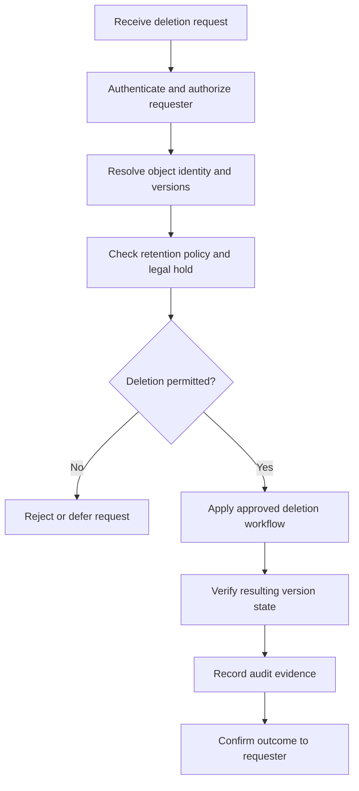

# 06- Lifecycle and Data Retention Best Practices

## Overview

Amazon S3 Lifecycle automates the transition of objects between storage classes and the expiration of data that has reached the end of its intended lifetime. A production retention strategy combines lifecycle rules with versioning, Object Lock, application-level retention requirements, and recovery controls.

Lifecycle management is not simply a cost-optimization mechanism. It determines how long application data remains available, when older versions are removed, whether incomplete uploads are cleaned up, and whether storage behavior remains consistent with business and regulatory requirements.

A reliable implementation must distinguish between four separate concerns:

- **Lifecycle management:** Automatically transition or expire eligible objects.
- **Retention enforcement:** Prevent deletion or modification before an authorized retention period expires.
- **Recovery:** Preserve data that must remain recoverable after accidental deletion, application failures, or security incidents.
- **Permanent deletion:** Remove all applicable object versions when the data is no longer required and deletion is authorized.

The central principle is to automate routine data management without allowing cost-optimization rules to violate retention, privacy, or recovery requirements.

## Define a Data Retention Policy Before Configuring S3

### Classify objects by business purpose

Do not apply the same lifecycle policy to every object in a bucket simply because the objects share a storage location.

Define retention requirements for each data category.

| Data category | Typical retention requirement | Lifecycle approach | Important considerations |
|---|---|---|---|
| Temporary exports | Hours to days | Expiration rule | Ensure downloads and downstream processing have completed |
| Application logs | Weeks to years | Tiered transitions followed by expiration | Preserve sufficient history for investigations and audit requirements |
| User-uploaded documents | Business-defined | Retain according to ownership, contractual obligations, and deletion policy | Account for legal holds and user-initiated deletion |
| Generated thumbnails | Until the source or business record is removed | Expiration or regeneration-based cleanup | Confirm that the derived data can be recreated |
| Database backup exports | Defined recovery and retention period | Lifecycle transitions with recovery validation | Do not expire backups before the recovery window closes |
| Audit records | Policy- or regulation-defined | Retention controls, potentially including Object Lock | Validate immutability and evidence requirements |
| Data lake datasets | Based on analytical value | Transition, expiration, and version management | Preserve datasets required for reproducible reports |
| Multipart upload fragments | Until upload completion or abandonment | Abort incomplete multipart uploads | Prevent abandoned parts from accumulating storage charges |

The periods above are illustrative. The actual retention period must come from documented business, security, legal, privacy, and operational requirements.

### Maintain a retention policy matrix

For each object category, document the following attributes:

| Attribute | Purpose |
|---|---|
| Data owner | Identifies the team accountable for the data |
| Data classification | Identifies confidentiality and handling requirements |
| Retention start event | Defines when the retention clock begins |
| Minimum retention | Defines the minimum period before authorized deletion |
| Maximum retention | Defines when the data should no longer be kept, where applicable |
| Legal hold requirements | Identifies whether deletion must be suspended |
| Recovery requirement | Defines the expected recovery point and recovery time |
| Storage class strategy | Defines online access and archival behavior |
| Deletion authority | Identifies who or what may authorize removal |
| Verification method | Defines how compliance with the policy is demonstrated |

Do not assume that object creation time is the correct retention start event. A document may need to be retained for a specified period after account closure, a transaction settlement, contract termination, or another business event.

S3 Lifecycle rules operate on object age and supported object attributes. If retention depends on a business event, track that event in the application or another suitable system and translate the requirement into an explicit, validated lifecycle or deletion workflow.

## Understand S3 Lifecycle Actions

### Transition objects between storage classes

A transition action changes an object's storage class according to a lifecycle rule.

For example, historical application logs may remain in S3 Standard initially, move to S3 Glacier Flexible Retrieval after a specified age, and eventually expire when the retention period ends.

Transitions can reduce storage expenses, but the target class may introduce retrieval charges, minimum storage duration requirements, or slower access.

Before adding a transition:
- Confirm that the destination class satisfies access and recovery requirements.
- Account for minimum storage durations and transition request charges.
- Evaluate object size and the distribution of object ages.
- Verify that downstream applications support the destination class.
- Preserve existing lifecycle rules when updating the bucket configuration.

See [S3 Lifecycle transition considerations](https://docs.aws.amazon.com/AmazonS3/latest/userguide/lifecycle-transition-general-considerations.html).

### Expire objects when they are no longer required

An expiration action requests automatic removal of objects eligible for expiration.

Expiration is appropriate for temporary exports, processing artifacts, expired logs, and other data categories with a clearly defined retention period.

However, expiration behavior depends on the bucket's versioning state.

| Bucket state | Effect of lifecycle expiration |
|---|---|
| Versioning disabled | S3 queues the current object for permanent removal |
| Versioning enabled | S3 generally adds a delete marker, making the previous current version noncurrent |
| Versioning suspended | Expiration follows suspended-versioning behavior, including special handling of the null version |

In a versioning-enabled bucket, expiration of the current version does not automatically remove all historical versions. Those versions continue to consume storage unless a separate lifecycle rule or authorized deletion process removes them.

Reference: [S3 object expiration behavior](https://docs.aws.amazon.com/AmazonS3/latest/userguide/lifecycle-expire-general-considerations.html).

### Abort incomplete multipart uploads

Multipart uploads can leave uploaded parts behind when an application crashes, loses its connection, or never completes the upload.

Those incomplete parts consume storage even though they do not form a completed object.

An `AbortIncompleteMultipartUpload` lifecycle action cleans up uploads that remain incomplete beyond a configured number of days.

Use this action for buckets receiving large files, media, backups, or data exports. Select a cleanup window that allows legitimate retries and long-running uploads to complete.

Aborting an incomplete multipart upload does not delete completed objects.

### Treat lifecycle execution as asynchronous

Lifecycle rules are not precise-time schedulers. S3 evaluates eligible objects and performs the specified actions asynchronously.

The configured age is not a guarantee that an object will be transitioned or removed at an exact wall-clock time.

Consequently:
- Do not use lifecycle expiration as the only mechanism for enforcing immediate access revocation.
- Do not promise users that a document will disappear at a precise timestamp.
- Do not assume an expired object has already been physically removed merely because its configured expiration time has passed.
- Verify lifecycle behavior using object inspection, inventory, and operational monitoring.

Use application authorization and explicit deletion workflows when business behavior depends on an immediate, confirmed change.

## Design Lifecycle Rules Carefully

### Filter by prefix, tags, and object size

A lifecycle rule can target the appropriate object population instead of applying to an entire bucket.

Common filters include:
- Prefix, such as `application-logs/`.
- Object tags, such as `data-category=temporary`.
- Object-size boundaries.
- Combinations of supported filters using logical `AND`.

Use a dedicated prefix or a well-governed tagging convention to separate objects with different retention requirements.

For example:

```text
s3://company-data/
    application-logs/
    temporary-exports/
    customer-documents/
    analytics-archives/
    compliance-records/
```

The prefix does not provide access isolation by itself. Bucket policies, IAM permissions, and any required application authorization must independently enforce access boundaries.

If tags drive lifecycle behavior, control who can assign, modify, and remove those tags. An unintended tag change can alter the lifecycle behavior of the affected objects.

### Use an explicit lifecycle configuration

The following example configures two rules:

- Move eligible application logs to S3 Glacier Flexible Retrieval after 90 days.
- Expire temporary exports after 30 days and abort incomplete multipart uploads after seven days.

The periods are examples and must be reviewed against the application's retention and recovery requirements.

`lifecycle.json`:

```json
{
  "Rules": [
    {
      "ID": "ArchiveApplicationLogs",
      "Status": "Enabled",
      "Filter": {
        "And": {
          "Prefix": "application-logs/",
          "ObjectSizeGreaterThan": 131071
        }
      },
      "Transitions": [
        {
          "Days": 90,
          "StorageClass": "GLACIER"
        }
      ]
    },
    {
      "ID": "ExpireTemporaryExports",
      "Status": "Enabled",
      "Filter": {
        "Prefix": "temporary-exports/"
      },
      "Expiration": {
        "Days": 30
      },
      "AbortIncompleteMultipartUpload": {
        "DaysAfterInitiation": 7
      }
    }
  ]
}
```

`ObjectSizeGreaterThan` uses an exclusive boundary. The value `131071` therefore selects objects at least 131,072 bytes in size.

The minimum-size filter reduces the risk of transition charges outweighing the storage savings for small objects. S3's default lifecycle transition behavior generally prevents objects smaller than 128 KB from transitioning unless the configuration explicitly allows them.

For transition rules, use the current service documentation to validate applicable size filters, minimum storage durations, and target-class constraints.

### Deploy lifecycle configurations safely

Inspect the current configuration before making changes:

```bash
aws s3api get-bucket-lifecycle-configuration \
  --bucket "$BUCKET"
```

Review the existing rules and merge the intended changes into the complete desired configuration. Then apply it:

```bash
aws s3api put-bucket-lifecycle-configuration \
  --bucket "$BUCKET" \
  --lifecycle-configuration file://lifecycle.json
```

Verify the deployed result:

```bash
aws s3api get-bucket-lifecycle-configuration \
  --bucket "$BUCKET"
```

**Important:** `put-bucket-lifecycle-configuration` replaces the bucket's lifecycle configuration rather than appending an isolated rule. Accidentally omitting existing rules can change retention or storage-class behavior for unrelated workloads.

Use infrastructure as code to maintain the complete intended configuration, review changes through version control, and validate lifecycle changes in a representative environment before production deployment.

## Manage Versioned Objects and Noncurrent Versions

### Understand current and noncurrent versions

When S3 Versioning is enabled, multiple versions of an object can exist under the same key.

A delete request without a version ID usually creates a delete marker rather than permanently deleting the existing versions.

For example:

```text
Key: customer-documents/contract.pdf

Before deletion:
    Version A: contract.pdf
    Version B: contract.pdf  <- current version

After a normal delete:
    Delete marker             <- current version
    Version B: contract.pdf   <- noncurrent
    Version A: contract.pdf   <- noncurrent
```

The object appears deleted to ordinary requests that do not specify a version ID, but the historical versions remain stored and may still be retrievable by principals with the required permissions.

This behavior is valuable for recovery, but it also means retention and storage costs depend on the handling of noncurrent versions.

### Expire noncurrent versions deliberately

If historical versions do not need to remain available indefinitely, configure a separate noncurrent-version expiration rule.

The following configuration retains noncurrent versions of objects under `customer-documents/` for 90 days:

```json
{
  "Rules": [
    {
      "ID": "ExpireOldCustomerDocumentVersions",
      "Status": "Enabled",
      "Filter": {
        "Prefix": "customer-documents/"
      },
      "NoncurrentVersionExpiration": {
        "NoncurrentDays": 90
      }
    }
  ]
}
```

This rule permanently removes eligible noncurrent versions after they meet the specified age requirement. Permanent removal is not equivalent to creating a delete marker and may eliminate the ability to recover the affected versions.

Before deploying such a rule, evaluate:
- Required rollback and recovery windows.
- Regulatory and contractual retention requirements.
- Replication status and recovery dependencies.
- Application behavior that depends on older versions.
- Any applicable Object Lock retention or legal holds.

### Remove expired delete markers where appropriate

A versioned bucket can accumulate delete markers after the underlying object versions have been removed.

When an object has no remaining object versions and only an expired delete marker remains, a lifecycle rule can remove the marker.

For example:

```json
{
  "Rules": [
    {
      "ID": "RemoveExpiredDeleteMarkers",
      "Status": "Enabled",
      "Filter": {
        "Prefix": "customer-documents/"
      },
      "Expiration": {
        "ExpiredObjectDeleteMarker": true
      }
    }
  ]
}
```

This action removes eligible expired delete markers. It does not delete historical object versions that still exist.

A complete versioned-data retention design may therefore require separate rules for:
- Current-version expiration.
- Noncurrent-version expiration.
- Expired delete-marker removal.
- Incomplete multipart upload cleanup.

See [Deleting object versions](https://docs.aws.amazon.com/AmazonS3/latest/userguide/DeletingObjectVersions.html) and [Managing delete markers](https://docs.aws.amazon.com/AmazonS3/latest/userguide/ManagingDelMarkers.html).

## Enforce Retention with S3 Object Lock

### Understand the difference between expiration and retention

Lifecycle expiration defines when S3 should remove eligible objects. Object Lock protects individual object versions from being deleted or overwritten during a retention period or while a legal hold remains in effect.

These mechanisms serve different purposes.

| Mechanism | Primary purpose | Key limitation |
|---|---|---|
| Lifecycle expiration | Automate the removal of eligible data | Does not override applicable retention protections |
| S3 Versioning | Preserve multiple object versions | Does not prevent authorized permanent deletion of versions |
| Object Lock retention | Protect specific versions for a defined period | Requires versioning and appropriate permissions |
| Object Lock legal hold | Protect a version without a predefined expiration date | Must be explicitly released by an authorized principal |
| Application retention metadata | Track business-defined retention and deletion eligibility | Does not independently prevent S3 deletion |

Use Object Lock when the requirement calls for WORM (write once, read many) behavior, immutable records, or an additional safeguard against premature deletion.

### Compare governance and compliance modes

Object Lock supports governance mode and compliance mode.

| Mode | Protection behavior | Appropriate use |
|---|---|---|
| Governance | Authorized principals with the appropriate bypass permission can bypass retention protections | Retention controls that permit tightly governed exceptions |
| Compliance | Protected versions cannot be overwritten or permanently deleted before the retention period expires, including by the AWS account root user | Strict immutability requirements |

Compliance mode should be adopted only after verifying the retention period and operational consequences. A mistaken retention policy can prevent deletion of data even when the business would otherwise prefer to remove it.

Object Lock requires S3 Versioning. Once Object Lock is enabled on a bucket, it cannot be disabled, and versioning cannot be suspended for that bucket.

Object Lock protects the specific object version to which the retention or legal hold applies. It does not prevent a new version or delete marker from being created over the same key.

Reference: [Locking objects with S3 Object Lock](https://docs.aws.amazon.com/AmazonS3/latest/userguide/object-lock.html).

### Configure retention with the intended safeguards

For a regulated archive, the design should establish:
- The required retention mode.
- The default retention period, where appropriate.
- Who can change retention configuration.
- Who may apply or remove legal holds.
- Which principals can bypass governance retention.
- How retention is verified and audited.
- How the system responds to retention conflicts during deletion.

Never treat an application database field such as `retention_until` as an enforcement boundary by itself. The application field can guide business logic, while S3 Object Lock supplies a storage-level protection mechanism when that protection is required.

### Handle deletion requests safely

A secure deletion workflow should separate request validation from the actual S3 deletion operation.



For a versioned bucket, verification must establish whether the request created a delete marker, removed a specific version, or permanently removed all intended versions.

For Object Lock-protected data, a deletion failure may be the correct enforcement behavior rather than an infrastructure defect.

Reference: [Configuring S3 Object Lock](https://docs.aws.amazon.com/AmazonS3/latest/userguide/object-lock-configure.html).

## Preserve Recovery and Backup Requirements

### Do not confuse retention with backup

Keeping an object for a long time does not automatically make it a suitable backup.

A recovery design may require:
- Independent copies or replication.
- Protection against accidental deletion and destructive lifecycle changes.
- Encryption-key availability.
- Separate administrative controls.
- Verified restoration procedures.
- Recovery point and recovery time objectives.

Lifecycle rules can reduce the available recovery window if historical versions are permanently deleted too early. Replication can also reproduce unwanted changes or deletes, depending on the configuration and operation.

Define backup retention separately from operational object retention when the business requires an independent recovery path.

### Coordinate retention with replication

Before deleting historical data, evaluate the replication design and the recovery copy's requirements.

Check:
- Whether required objects have replicated successfully.
- Whether delete markers or object versions are replicated under the configured rules.
- Whether the destination has its own lifecycle configuration.
- Whether source and destination retention policies are compatible.
- Whether destination data can be accessed and decrypted during recovery.

A source lifecycle rule should not be assumed to guarantee an appropriate destination retention policy. Configure and verify the intended behavior for each bucket.

## Control Lifecycle Costs and Small-Object Behavior

### Evaluate the actual transition economics

Lifecycle transitions can reduce storage rates but introduce transition request charges and class-specific billing behavior.

Estimate the total cost using:
- Object count and size distribution.
- Expected storage duration.
- Transition frequency.
- Retrieval volume.
- Early-deletion charges.
- Archive metadata.
- Noncurrent-version storage.
- Incomplete multipart upload storage.

For buckets containing millions of small objects, transition and metadata overhead can outweigh the expected storage savings.

Avoid using a universal lifecycle schedule for all datasets. Different prefixes or tags may need separate retention and transition strategies.

### Use object-size filters intentionally

Since September 2024, the default transition behavior for lifecycle configurations prevents objects smaller than 128 KB from transitioning to any storage class. Older configurations may retain legacy behavior until the lifecycle configuration is modified.

A custom object-size filter can allow smaller objects to transition, but doing so should be supported by an explicit cost assessment.

Reference: [Examples of S3 Lifecycle configurations](https://docs.aws.amazon.com/AmazonS3/latest/userguide/lifecycle-configuration-examples.html).

### Clean up incomplete multipart uploads

Add `AbortIncompleteMultipartUpload` when appropriate for buckets receiving multipart uploads.

For example, a rule can abort uploads that remain incomplete for seven days:

```json
{
  "Rules": [
    {
      "ID": "AbortIncompleteMultipartUploads",
      "Status": "Enabled",
      "Filter": {
        "Prefix": ""
      },
      "AbortIncompleteMultipartUpload": {
        "DaysAfterInitiation": 7
      }
    }
  ]
}
```

An empty prefix filter applies the rule to the bucket's eligible objects and incomplete uploads. Preserve any existing lifecycle rules when incorporating this example into a production configuration.

Choose the cleanup period according to maximum expected upload duration, client retry behavior, and operational recovery needs.

## Integrate Retention with Backend Applications

### Track business retention outside the storage lifecycle

Backend systems commonly maintain records in PostgreSQL or another database that reference S3 object keys.

A document record might contain:

```python
from dataclasses import dataclass
from datetime import datetime


@dataclass(frozen=True)
class StoredDocument:
    document_id: str
    object_key: str
    retention_until: datetime
    deletion_requested_at: datetime | None
```

This is an illustrative domain model, not a complete retention enforcement implementation.

The application should use trusted business events and an authoritative retention policy to determine whether deletion is allowed. Avoid relying exclusively on user-supplied timestamps or mutable object metadata.

A production deletion process should:
1. Validate the business request and authorization.
2. Check the retention policy and any legal hold.
3. Mark the request as pending in durable application state.
4. Perform the authorized storage operation.
5. Retry transient failures safely.
6. Verify the resulting S3 object and version state.
7. Record the final result and audit information.

Use a durable worker such as Celery for asynchronous processing when deletion involves many objects, retries, external approvals, or slow downstream systems.

### Make cleanup jobs idempotent

Lifecycle configuration changes and application cleanup workers can overlap. Design the application so repeated processing does not create inconsistent business state.

Use stable document identifiers, explicit deletion states, and durable audit records. If the storage operation succeeds but updating the database fails, the worker must be able to reconcile the actual S3 state rather than assuming the entire operation failed.

Consider a transactional outbox or another reliable handoff mechanism when database state changes and storage operations must be coordinated.

S3 and the application database do not share a single atomic transaction. The workflow therefore needs reconciliation for partial failures.

### Test retention behavior before production

Test cases should cover:
- Objects that are eligible and ineligible for deletion.
- Objects that have active legal holds.
- Object Lock retention in governance and compliance modes.
- Versioned objects with delete markers.
- Historical versions that must remain available.
- Retries after partial deletion.
- Lifecycle rules that overlap with application cleanup.
- Replicated data and destination retention.
- Incomplete multipart uploads.
- Small objects excluded from lifecycle transitions.

Use integration tests in a controlled AWS environment for behavior that cannot be adequately validated through unit tests alone. Do not claim retention protection has been verified solely because a JSON policy passed syntax validation.

## Monitor Retention and Lifecycle Behavior

### Audit retention configuration

Treat lifecycle and retention changes as security-relevant infrastructure changes.

Use infrastructure as code, access controls, and review processes to control modifications to:
- Lifecycle configurations.
- Versioning settings.
- Object Lock defaults.
- Retention periods and legal holds.
- Replication rules.
- Permissions that allow permanent deletion or retention bypass.

Use CloudTrail and other applicable audit mechanisms to record and investigate changes to the relevant resources. Configure the necessary event coverage and retention for your audit requirements.

### Inspect objects and lifecycle rules

Inspect a lifecycle configuration:

```bash
aws s3api get-bucket-lifecycle-configuration \
  --bucket "$BUCKET"
```

Inspect an object's current metadata and version:

```bash
aws s3api head-object \
  --bucket "$BUCKET" \
  --key "$OBJECT_KEY"
```

List object versions and delete markers:

```bash
aws s3api list-object-versions \
  --bucket "$BUCKET" \
  --prefix "customer-documents/"
```

For objects protected by Object Lock, inspect the relevant version's retention configuration and legal-hold status using the appropriate S3 API operations.

These commands require the relevant IAM permissions and should be scoped carefully in production.

### Use inventory and operational metrics

For large datasets, use S3 Inventory and appropriate monitoring to examine:
- Object counts and storage classes.
- Object sizes and last-modified timestamps.
- Version counts and accumulated historical storage.
- Expired objects or versions that remain due to configuration or protection constraints.
- Incomplete multipart uploads.
- Replication state for objects required for recovery.
- Lifecycle-related cost changes.

Inventory reports are useful for auditing large object populations but are not a real-time record of every object change. Combine them with current object inspection and application telemetry where immediate verification matters.

Establish operational alerts for unexpected lifecycle configuration changes, abnormal storage growth, missing recovery copies, and sustained deletion or replication failures.

## Common Lifecycle and Retention Mistakes

| Mistake | Consequence | Better practice |
|---|---|---|
| Applying expiration rules without a retention matrix | Important data may be removed too early | Define retention ownership, duration, and legal requirements first |
| Assuming lifecycle expiration permanently removes all versions | Historical versions may continue consuming storage | Manage current versions, noncurrent versions, and delete markers separately |
| Treating lifecycle as an exact-time scheduler | Data may remain available beyond the configured age threshold | Use an appropriate explicit workflow when precise business timing matters |
| Treating versioning as immutable retention | Authorized users may still permanently delete versions | Use Object Lock where storage-level immutability is required |
| Enabling compliance-mode retention without validating the period | Protected data may be impossible to delete early | Test the retention design and require explicit approval |
| Allowing unrestricted governance bypass | Authorized principals may bypass intended protections | Restrict bypass permissions and audit their use |
| Replacing lifecycle configuration with a partial JSON file | Unrelated retention or transition rules can disappear | Retrieve, merge, review, and deploy the complete configuration |
| Transitioning millions of small objects without cost analysis | Request charges may outweigh storage savings | Analyze object sizes and use appropriate filters |
| Ignoring incomplete multipart uploads | Abandoned uploaded parts continue incurring storage costs | Configure and verify multipart cleanup |
| Assuming a replica automatically satisfies backup requirements | Recovery copies may be deleted or inaccessible when needed | Test recovery independently and configure destination retention |
| Trusting an application retention timestamp as the only protection | Storage can still be deleted through another authorized path | Enforce required controls at S3 and application layers |
| Deleting data before verifying downstream processing | Consumers or recovery processes may lose required input | Coordinate deletion with processing completion and recovery dependencies |

## Production Readiness Checklist

- [ ] Each object category has a documented retention policy and accountable owner.
- [ ] Retention start events match business and regulatory requirements.
- [ ] Lifecycle rules target the intended prefixes, tags, or object-size ranges.
- [ ] Existing lifecycle configurations are preserved when applying changes.
- [ ] Transition costs, minimum storage durations, and small-object behavior are understood.
- [ ] Current versions, noncurrent versions, and delete markers have appropriate policies.
- [ ] Object Lock is enabled where storage-level retention protection is required.
- [ ] Governance bypass permissions are tightly controlled and compliance-mode retention is approved.
- [ ] Legal holds and retention conflicts are handled explicitly in application workflows.
- [ ] Incomplete multipart uploads are cleaned up using an appropriate retention window.
- [ ] Backup, replication, and recovery requirements are independent of routine lifecycle cleanup.
- [ ] Application deletion workers handle retries and partial failures safely.
- [ ] CloudTrail and relevant audit mechanisms capture lifecycle and retention changes.
- [ ] S3 Inventory and operational telemetry provide visibility into object populations and lifecycle outcomes.
- [ ] Retention behavior has been tested with representative versioning, deletion, and recovery scenarios.
- [ ] Production changes are reviewed, version-controlled, and verifiable.

## Authoritative References

- [Managing the lifecycle of S3 objects](https://docs.aws.amazon.com/AmazonS3/latest/userguide/object-lifecycle-mgmt.html)
- [S3 Lifecycle configuration elements](https://docs.aws.amazon.com/AmazonS3/latest/userguide/intro-lifecycle-rules.html)
- [Lifecycle transition constraints](https://docs.aws.amazon.com/AmazonS3/latest/userguide/lifecycle-transition-general-considerations.html)
- [Examples of S3 Lifecycle configurations](https://docs.aws.amazon.com/AmazonS3/latest/userguide/lifecycle-configuration-examples.html)
- [S3 object expiration behavior](https://docs.aws.amazon.com/AmazonS3/latest/userguide/lifecycle-expire-general-considerations.html)
- [Deleting object versions](https://docs.aws.amazon.com/AmazonS3/latest/userguide/DeletingObjectVersions.html)
- [Managing delete markers](https://docs.aws.amazon.com/AmazonS3/latest/userguide/ManagingDelMarkers.html)
- [Locking objects with S3 Object Lock](https://docs.aws.amazon.com/AmazonS3/latest/userguide/object-lock.html)
- [Configuring S3 Object Lock](https://docs.aws.amazon.com/AmazonS3/latest/userguide/object-lock-configure.html)
- [Amazon S3 Inventory](https://docs.aws.amazon.com/AmazonS3/latest/userguide/storage-inventory.html)

## Key Takeaways

- Define retention requirements by business purpose before creating lifecycle rules, and distinguish routine expiration from legally enforced retention.
- Manage current versions, noncurrent versions, and delete markers explicitly in versioned buckets.
- Use S3 Object Lock when immutable retention is required, and control governance bypass and legal-hold operations carefully.
- Evaluate transition costs, minimum storage durations, object-size constraints, and incomplete multipart uploads as part of lifecycle design.
- Validate lifecycle changes through configuration review, audit evidence, inventory, integration testing, and recovery verification.
You've reached the maximum length for this conversation, but you can keep talking by starting a new chat.
Start new chat