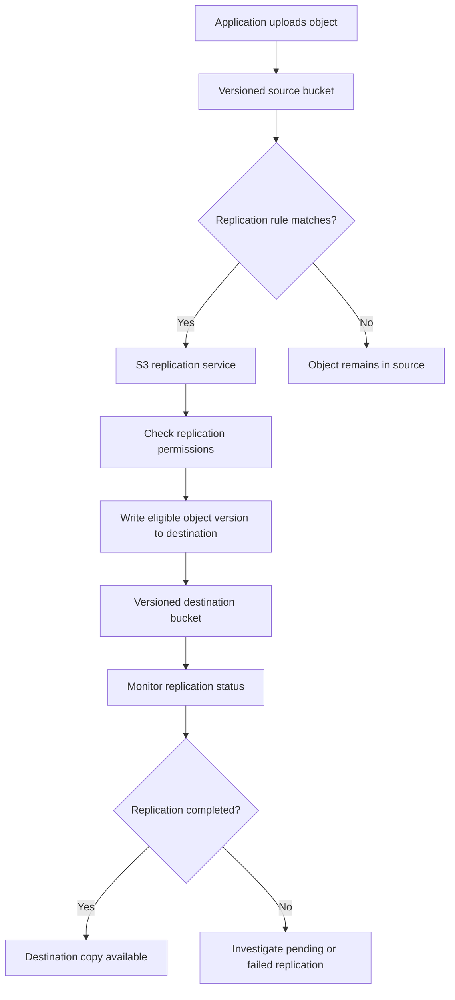
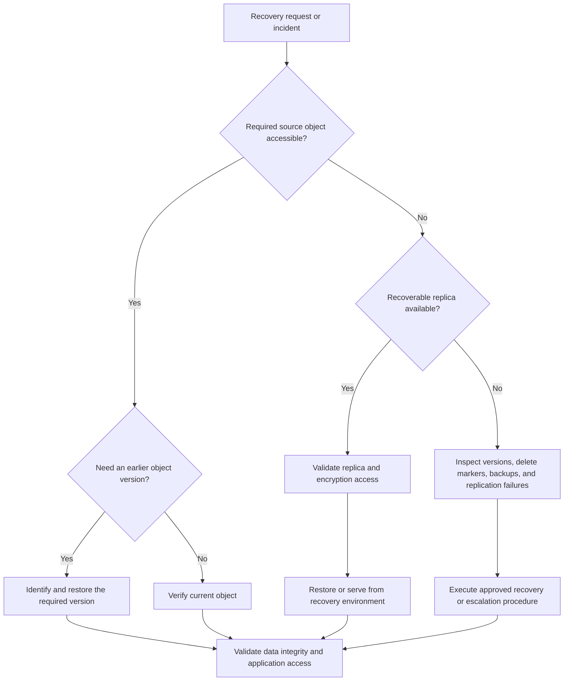

# 07- Versioning and Replication Best Practices

## Overview

Amazon S3 Versioning and S3 Replication are important components of a production data-protection strategy. Versioning preserves multiple versions of an object, while replication asynchronously copies eligible objects to another S3 bucket in the same or a different AWS Region.

These capabilities solve different problems:

- **Versioning** helps recover from accidental overwrites and ordinary delete operations.
- **Same-Region Replication (SRR)** copies eligible objects to another bucket in the same Region.
- **Cross-Region Replication (CRR)** copies eligible objects to a bucket in another Region.
- **S3 Replication Time Control (S3 RTC)** provides a defined replication-time service-level agreement for supported replication configurations.
- **S3 Batch Replication** replicates existing objects or retries eligible objects that previously failed replication.
- **S3 Object Lock** provides additional protection against deleting or overwriting protected object versions during configured retention periods.

None of these features independently guarantees complete disaster recovery. A production design must also consider identity compromise, deletion propagation, encryption-key availability, retention requirements, replication lag, recovery objectives, and restoration testing.

## Understand S3 Versioning

### How versioning works

S3 Versioning maintains multiple versions of an object under the same object key. When versioning is enabled, overwriting an existing object creates a new version rather than replacing the previous version permanently.

Each version has a version ID. Applications and operational tooling can use that ID to retrieve, inspect, or delete a specific version.

Consider the following object history:

```text
Bucket: company-documents

Key: reports/annual-report.pdf

Version history:
    Version ID: v001    Original report
    Version ID: v002    Corrected report
    Version ID: v003    Latest report
```

A normal GET request retrieves the current version. Specifying a version ID allows authorized callers to retrieve a particular historical version.

Versioning is useful for recovering from mistakes, but every stored version consumes storage. S3 generally charges for the full size of each stored version rather than charging only for the difference between versions.

### Understand the three versioning states

| State | Behavior | Production implications |
|---|---|---|
| Unversioned | Objects do not have normal version-history protection | Overwrites replace objects; deletes permanently remove the current object according to unversioned semantics |
| Enabled | New writes create distinct version IDs | Previous versions can be recovered until permanently deleted |
| Suspended | Versioning is no longer active for newly created versions; existing version history is retained | New writes and deletes involving null versions have special behavior |

Once a bucket has versioning enabled, suspending versioning does not erase its existing versions.

**Best practice:** Enable versioning for buckets that contain important, mutable application data. Do not suspend it merely to reduce storage costs; use a deliberate noncurrent-version retention policy instead.

## Enable and Verify Versioning

### Enable versioning with the AWS CLI

```bash
aws s3api put-bucket-versioning \
  --bucket "$BUCKET" \
  --versioning-configuration Status=Enabled
```

Verify the resulting configuration:

```bash
aws s3api get-bucket-versioning \
  --bucket "$BUCKET"
```

The expected configuration includes:

```json
{
  "Status": "Enabled"
}
```

Treat versioning as an infrastructure requirement rather than a manual console setting. Configure it through Terraform, CloudFormation, CDK, or another controlled deployment mechanism for production buckets.

After initially enabling versioning, verify that the configuration has propagated before relying on it for critical writes.

### Verify versioning across environments

Versioning should be checked during:
- Infrastructure deployment.
- Production-readiness reviews.
- Disaster recovery exercises.
- Backup and replication validation.
- Periodic configuration audits.

A deployment pipeline can verify versioning with the AWS CLI:

```bash
STATUS=$(
  aws s3api get-bucket-versioning \
    --bucket "$BUCKET" \
    --query 'Status' \
    --output text
)

if [ "$STATUS" != "Enabled" ]; then
  echo "Bucket versioning is not enabled"
  exit 1
fi
```

This check validates the bucket's current versioning status. It does not confirm that historical versions exist, that version deletion is restricted, or that replication is healthy.

## Understand Delete Markers and Object Recovery

### A normal delete does not usually permanently remove a versioned object

In a versioning-enabled bucket, a DELETE request without a version ID typically creates a delete marker.

A delete marker becomes the current version and makes the object appear deleted to normal object retrieval operations. Older versions remain available until they are permanently deleted.

```text
Before deletion:

    v001  Original file
    v002  Updated file  <-- Current version

After a normal DELETE:

    v001  Original file
    v002  Updated file
    d003  Delete marker <-- Current version
```

The delete marker is not the original file's data. It changes the result of normal key-based access without immediately removing the underlying object versions.

### Recover an object by removing the delete marker

First, inspect the versions and delete markers:

```bash
aws s3api list-object-versions \
  --bucket "$BUCKET" \
  --prefix "reports/annual-report.pdf"
```

The response contains separate collections for object versions and delete markers.

To recover the prior object, identify the delete marker's version ID and remove that marker:

```bash
aws s3api delete-object \
  --bucket "$BUCKET" \
  --key "reports/annual-report.pdf" \
  --version-id "$DELETE_MARKER_VERSION_ID"
```

The previous object version then becomes current if no other newer version or delete marker remains.

Before deleting a marker, confirm that the operation is intended. Removing a delete marker makes the prior object visible again, which can restore access to data that was intentionally deleted.

### Permanently delete a specific version only through a controlled workflow

To permanently remove one object version, supply its version ID:

```bash
aws s3api delete-object \
  --bucket "$BUCKET" \
  --key "$OBJECT_KEY" \
  --version-id "$VERSION_ID"
```

This operation is fundamentally different from creating a delete marker. It removes the specified version, subject to applicable permissions and retention controls.

Restrict permanent version deletion to dedicated administrative roles. Application identities should not receive unrestricted permissions to erase historical versions unless their business function explicitly requires them.

## Control Version Growth and Storage Costs

### Apply noncurrent-version lifecycle policies

Repeated updates can produce large numbers of versions, especially when applications overwrite the same object frequently.

Examples include:
- Replacing a generated report after every processing attempt.
- Uploading the same export every few minutes.
- Using a fixed object key for frequently changing application state.
- Repeatedly overwriting log or data-processing output.

Use S3 Lifecycle rules to transition or expire noncurrent versions according to the required recovery window.

For example, the following lifecycle configuration transitions noncurrent versions to Glacier Flexible Retrieval after 30 days and permanently expires them after 365 days.

These durations are illustrative. Confirm the required retention period, minimum storage duration, recovery requirements, and legal obligations before applying such a policy.

```json
{
  "Rules": [
    {
      "ID": "ManageNoncurrentVersions",
      "Status": "Enabled",
      "Filter": {
        "Prefix": ""
      },
      "NoncurrentVersionTransitions": [
        {
          "NoncurrentDays": 30,
          "StorageClass": "GLACIER"
        }
      ],
      "NoncurrentVersionExpiration": {
        "NoncurrentDays": 365
      }
    }
  ]
}
```

**Important considerations:**

- The rule applies to noncurrent versions, not just current objects.
- A transition or expiration may incur charges and affect recovery time.
- The example does not configure current-version expiration.
- Retention rules and legal holds must take precedence over convenience.
- Review existing lifecycle rules before updating the bucket's configuration.

### Clean up expired delete markers

An expired object delete marker is a marker for which no other object versions remain.

A lifecycle rule can remove expired delete markers:

```json
{
  "Rules": [
    {
      "ID": "RemoveExpiredDeleteMarkers",
      "Status": "Enabled",
      "Filter": {
        "Prefix": ""
      },
      "Expiration": {
        "ExpiredObjectDeleteMarker": true
      }
    }
  ]
}
```

When deploying this rule, merge it with the existing lifecycle configuration rather than replacing unrelated rules.

Monitor delete-marker counts and noncurrent-version counts through S3 Storage Lens or S3 Inventory. Large numbers of obsolete versions and delete markers can increase costs and complicate operational investigations.

### Do not treat versioning as immutable backup

Versioning does not inherently prevent an authorized principal from permanently deleting versions, changing bucket configuration, or weakening security controls.

For stronger recovery guarantees:
- Restrict version deletion and lifecycle changes.
- Separate normal application identities from backup administration.
- Use cross-account backups where justified.
- Evaluate S3 Object Lock for immutable retention requirements.
- Test recovery using identities different from those used by the normal application.

## Understand S3 Replication

### Same-Region Replication versus Cross-Region Replication

| Consideration | Same-Region Replication | Cross-Region Replication |
|---|---|---|
| Destination | Another bucket in the same Region | A bucket in a different Region |
| Typical purpose | Separate-copy workflows, data sharing, compliance, and account isolation | Regional disaster recovery, geographic distribution, and regional access requirements |
| Region-level failure protection | Does not protect against loss of the source Region | Can preserve copies in another Region |
| Cross-account support | Supported | Supported |
| Data-transfer costs | Depends on the workflow and applicable charges | Inter-Region transfer charges may apply |
| Latency | Asynchronous; not an immediate consistency guarantee between buckets | Asynchronous; destination availability follows replication completion |
| Destination administration | Can be separated by account and role | Can be separated by account and Region |

Replication is useful when the destination must hold an independent copy of eligible source objects. However, replication is asynchronous, and a destination bucket does not necessarily contain every source object at any given instant.

A replicated copy should not automatically be considered an independent backup. If administrators, compromised credentials, or automated workflows can delete both copies, the recovery boundary is weak.

### Understand the replication data flow



The replication service uses an IAM role and the relevant source and destination configuration to replicate eligible objects. Bucket policies, encryption-key permissions, Region availability, and rule filters can all affect the result.

### Meet replication prerequisites

A production replication design must ensure:
- Versioning is enabled on both source and destination buckets.
- The replication role has the required source and destination permissions.
- Destination bucket policies permit the replication role when applicable.
- Both accounts are allowed to use the required Regions.
- Object ownership behavior is configured appropriately.
- Encryption configuration supports the intended replication workload.
- Lifecycle rules do not prematurely remove data needed for recovery.
- Monitoring is configured for the intended recovery objectives.

Verify versioning on both buckets:

```bash
aws s3api get-bucket-versioning \
  --bucket "$SOURCE_BUCKET"

aws s3api get-bucket-versioning \
  --bucket "$DESTINATION_BUCKET"
```

Both buckets must report `Enabled` for normal live replication.

## Configure Replication Through Infrastructure as Code

### Define a replication rule

The following AWS CLI example illustrates an unencrypted or SSE-S3 object replication configuration. It assumes that both buckets are versioned and that the replication IAM role and destination permissions have already been configured.

Create a `replication.json` file:

```json
{
  "Role": "arn:aws:iam::123456789012:role/s3-replication-role",
  "Rules": [
    {
      "ID": "ReplicateApplicationObjects",
      "Priority": 1,
      "Status": "Enabled",
      "Filter": {
        "Prefix": ""
      },
      "DeleteMarkerReplication": {
        "Status": "Disabled"
      },
      "Destination": {
        "Bucket": "arn:aws:s3:::company-documents-replica"
      }
    }
  ]
}
```

Replace the sample role ARN and destination bucket with actual resource identifiers.

Apply the configuration:

```bash
aws s3api put-bucket-replication \
  --bucket "$SOURCE_BUCKET" \
  --replication-configuration file://replication.json
```

Inspect the applied configuration:

```bash
aws s3api get-bucket-replication \
  --bucket "$SOURCE_BUCKET"
```

**Configuration warning:** `put-bucket-replication` replaces the bucket's replication configuration. When adding or modifying rules, preserve any existing rules that must remain active.

For production deployments, define versioning, replication, destination security, lifecycle, and relevant IAM resources together in the selected infrastructure-as-code tool. Add deployment validation to ensure that both buckets are versioned before the rule is activated.

## Handle Existing Objects and Failed Replication

### Live replication does not automatically backfill every historical object

Live replication applies to eligible objects written after the replication configuration becomes active. Existing objects are not automatically replicated merely because a new rule is added.

Use S3 Batch Replication when the destination needs:
- Objects that existed before replication was configured.
- Previously replicated objects that need another replication run.
- Eligible objects whose earlier replication failed.

A safe migration workflow is:

1. Enable versioning on both buckets.
2. Configure and validate the replication rule.
3. Verify that newly uploaded test objects replicate successfully.
4. Create an inventory or manifest for the historical dataset.
5. Estimate request, transfer, and storage costs.
6. Run S3 Batch Replication.
7. Review the completion report and failed objects.
8. Verify object counts, versions, metadata, encryption, and access.
9. Confirm that recovery procedures can retrieve the destination copies.

Do not assume a successful batch-job submission means every object has been replicated successfully. Review the completed job status and per-object results.

### Use the correct recovery mechanism for each failure

| Situation | Recommended response |
|---|---|
| Newly uploaded object is still pending | Inspect replication status, object size, and expected replication time |
| Object has failed replication | Check the rule, IAM permissions, destination configuration, and KMS permissions; retry eligible objects with Batch Replication |
| Object predates the rule | Include it in a Batch Replication workflow |
| Replication destination changed | Determine whether previously replicated data requires explicit re-replication |
| Replica was permanently deleted at its destination | Investigate source availability and the appropriate Batch Operations recovery workflow |
| Destination lacks the expected object version | Verify rule filters, source version, status, and batch job results |

Replication is not a substitute for verifying the recovery dataset. For important workloads, perform periodic object-level reconciliation.

## Configure Encrypted Replication Correctly

### Understand SSE-KMS replication requirements

By default, S3 does not replicate objects encrypted with SSE-KMS or DSSE-KMS unless the replication configuration explicitly opts in to the supported encrypted-object replication behavior.

The replication role must have the required permissions for:
- Reading and decrypting encrypted source objects.
- Encrypting destination replicas with the intended destination key.
- Writing replicas to the destination bucket.
- Accessing the relevant keys under the applicable key policies.

The source and destination KMS keys may be different. For cross-account replication, use an appropriate destination-account customer managed KMS key when required by the design.

Review the official encryption-specific replication guidance before deploying encrypted replication because key ownership, Region boundaries, and encryption-context conditions can change the required permissions.

Reference: [Replicating objects encrypted with KMS keys](https://docs.aws.amazon.com/AmazonS3/latest/userguide/replication-config-for-kms-objects.html).

### Extend the replication rule for SSE-KMS

The relevant configuration elements include explicit KMS-encrypted object selection and the destination KMS key ARN:

```json
{
  "SourceSelectionCriteria": {
    "SseKmsEncryptedObjects": {
      "Status": "Enabled"
    }
  },
  "Destination": {
    "Bucket": "arn:aws:s3:::company-documents-replica",
    "EncryptionConfiguration": {
      "ReplicaKmsKeyID": "arn:aws:kms:us-east-1:123456789012:key/DESTINATION-KEY-ID"
    }
  }
}
```

This is a configuration fragment, not a complete replication rule. Integrate it with the complete replication configuration and include the IAM and KMS permissions required by the selected workflow.

Before production rollout, test encrypted objects using the actual replication role and verify that destination principals can decrypt the resulting replicas.

## Decide How Deletes Should Behave Across Replicas

### Understand delete-marker replication

Delete-marker replication is a separate replication behavior and is disabled by default for common replication-rule configurations.

When delete-marker replication is enabled and supported by the rule, a normal source delete that creates a delete marker can propagate that marker to the destination.

However, this does not mean that every source deletion permanently deletes the destination's historical versions. Permanent deletion of a specific source version by version ID does not replicate as a normal delete-marker event.

Lifecycle-generated delete markers are also not replicated as ordinary delete-marker replication events.

### Choose a deliberate deletion model

| Requirement | Recommended approach |
|---|---|
| Destination must retain data despite ordinary source deletes | Keep delete-marker replication disabled where supported and test the exact behavior |
| Destination should reflect application-level deletions | Enable delete-marker replication after evaluating the recovery consequences |
| Destination must resist deletion from the source account | Use separate-account controls, tightly scoped destination permissions, and appropriate retention protection |
| Data must be immutable for a defined retention period | Evaluate S3 Object Lock and its governance or compliance requirements |
| Source and destination should behave as independent data stores | Define ownership, deletion workflows, and reconciliation explicitly |

For disaster recovery, copying delete markers blindly can propagate an accidental deletion into the recovery environment. Conversely, retaining deleted source data indefinitely can conflict with data-retention and privacy requirements.

Document the expected behavior for deletion, restoration, and retention before enabling replication.

## Protect Backup Copies from Common Failure Domains

### Separate administrative control where possible

For important recovery copies, use controls that make it difficult for a single compromised identity to damage both the source and destination.

Consider:
- Separate AWS accounts for production and recovery storage.
- Narrow IAM roles for replication, recovery, and permanent deletion.
- Destination bucket policies that restrict ordinary application identities.
- Separate key-administration permissions.
- S3 Object Lock for applicable immutability requirements.
- Auditing of bucket policy, versioning, lifecycle, replication, and KMS configuration changes.
- Tested procedures for recovering access if normal production credentials are compromised.

Cross-account replication alone is not a complete isolation strategy. Destination policies and identities must be designed so that source-account compromise does not automatically grant unrestricted deletion privileges in the destination account.

### Understand Object Lock's role

S3 Object Lock uses a write-once-read-many model to protect specific object versions against deletion or modification for a defined period or indefinitely, depending on the configured retention and legal-hold settings.

It is useful for:
- Records subject to retention obligations.
- Protected audit data.
- Selected backup copies requiring stronger deletion resistance.
- Recovery designs that must withstand accidental or malicious deletion.

Object Lock does not prevent every change to a key's visible state. A new version or delete marker can still be created above a protected version, while the protected version itself remains governed by its retention configuration.

Validate replication compatibility, destination retention configuration, and permission requirements before applying Object Lock to replicated datasets.

Reference: [Locking objects with S3 Object Lock](https://docs.aws.amazon.com/AmazonS3/latest/userguide/object-lock.html).

## Design for Measurable Recovery Objectives

### Distinguish replication from failover

Replication makes eligible copies available in another bucket. It does not automatically:
- Switch application traffic to the destination.
- Update DNS records.
- Reconfigure all application dependencies.
- Guarantee that the latest source writes have replicated.
- Ensure that destination KMS keys and IAM policies are usable.
- Validate that every required object is present.

A complete recovery design must combine replication with application routing, configuration management, dependency recovery, and a controlled failover procedure.

### Define RPO and RTO

The Recovery Point Objective (RPO) identifies how much data loss, measured in time, the business can tolerate.

The Recovery Time Objective (RTO) identifies how long the business can tolerate before service is restored.

For S3 replication:

- Standard SRR or CRR is asynchronous, so the destination can lag behind the source.
- S3 Replication Time Control provides a defined 15-minute service-level agreement for eligible new objects under supported configurations.
- S3 Batch Replication addresses on-demand replication of existing objects; S3 RTC does not apply to Batch Replication.
- Application recovery time also depends on permissions, DNS, credentials, dependent services, and operational procedures.

Use the [official S3 replication guidance](https://docs.aws.amazon.com/AmazonS3/latest/userguide/replication.html) to confirm the service behavior and current contractual details required for a specific design.

### Monitor replication status

Inspect an individual source object:

```bash
aws s3api head-object \
  --bucket "$SOURCE_BUCKET" \
  --key "$OBJECT_KEY"
```

For a source object with a replication rule, the response can expose replication status such as `PENDING`, `COMPLETED`, or `FAILED`.

For a replica, the reported replication status can be `REPLICA`.

Use S3 Replication metrics and CloudWatch to monitor:
- Bytes pending replication.
- Operations pending replication.
- Replication latency.
- Failed replication operations.

S3 Replication metrics incur applicable CloudWatch custom metric charges. Evaluate these costs against the workload's recovery requirements.

Where appropriate, configure S3 Event Notifications for replication failures and threshold events. Route alerts to an operational workflow that can identify the affected object, replication rule, and required corrective action.

Reference: [Monitoring replication with metrics, events, and status](https://docs.aws.amazon.com/AmazonS3/latest/userguide/replication-metrics.html).

## Implement a Versioned Recovery Workflow

A production recovery process should distinguish between an accidental object deletion, a bad overwrite, a replication delay, and a regional outage.



For application-managed documents, maintain references to object keys and relevant version IDs where appropriate. Use database transactions and state transitions to prevent the application from marking recovery complete before the object has been verified.

After recovery:
- Verify the selected object version.
- Confirm checksum or equivalent integrity evidence where available.
- Check encryption and authorized access.
- Confirm dependent workflows can use the restored object.
- Record the recovery action and relevant object identifiers.
- Reconcile source and destination state where required.

Do not rely only on ETags as universal cryptographic checksums; multipart uploads and encryption behavior can make ETag interpretation unsuitable for integrity verification in some workflows.

## Common Versioning and Replication Mistakes

| Mistake | Consequence | Better practice |
|---|---|---|
| Treating versioning as a complete backup | Authorized users can permanently delete versions | Add access isolation and suitable recovery protection |
| Assuming normal DELETE permanently removes an object | Delete markers may hide data that remains stored | Inspect object versions and delete markers |
| Ignoring noncurrent-version storage | Version history can increase storage costs substantially | Configure lifecycle rules that match recovery requirements |
| Assuming replication backfills historical data | Objects created before the rule may be missing at the destination | Use S3 Batch Replication and validate job results |
| Assuming replication is synchronous | Destination reads may not reflect the latest source writes | Design for replication lag and monitor status |
| Enabling deletion propagation without reviewing its impact | Accidental source deletes can affect destination visibility | Document and test delete-marker behavior |
| Omitting KMS permissions | Encrypted objects may fail to replicate or be unreadable at the destination | Validate source and destination key policies |
| Using the same unrestricted administrative access for both copies | A compromised identity may damage both datasets | Establish separate account and permission boundaries |
| Treating an S3 replica as a complete disaster recovery environment | Application dependencies or routing may still be unavailable | Test the entire recovery process |
| Ignoring Object Lock and retention interactions | Expected deletion or recovery operations may be denied | Validate retention, legal hold, and lifecycle requirements |
| Assuming a successful replication job submission proves recovery | Some objects can fail or remain unavailable | Review completion reports and test retrieval |

## Production Readiness Checklist

### Versioning

- [ ] Versioning is enabled on critical source buckets.
- [ ] Versioning status is verified through deployment validation.
- [ ] Application identities cannot permanently delete historical versions without an explicit requirement.
- [ ] Delete-marker creation and recovery behavior are understood.
- [ ] Lifecycle policies manage noncurrent versions and expired delete markers appropriately.
- [ ] Retention requirements and Object Lock requirements have been evaluated.
- [ ] Storage growth and version counts are monitored.

### Replication

- [ ] Source and destination buckets have versioning enabled.
- [ ] Replication IAM roles and destination policies follow least privilege.
- [ ] Rule filters, priorities, and status are reviewed.
- [ ] Encrypted-object replication has the required KMS configuration and permissions.
- [ ] Existing objects are included in a Batch Replication workflow where required.
- [ ] Delete-marker behavior matches the documented deletion model.
- [ ] Replication status, latency, pending operations, and failures are monitored.
- [ ] Destination ownership and recovery access are verified.
- [ ] Replication and recovery costs have been evaluated.

### Disaster recovery

- [ ] RPO and RTO are explicitly defined.
- [ ] The destination has the required encryption keys and access controls.
- [ ] Recovery procedures do not depend exclusively on compromised production credentials.
- [ ] Source and destination deletion risks have been assessed.
- [ ] Integrity checks and application-level recovery validation are documented.
- [ ] Disaster recovery exercises are performed and recorded.
- [ ] The team understands that replication alone does not perform complete application failover.

## Authoritative References

- [Retaining multiple versions of S3 objects](https://docs.aws.amazon.com/AmazonS3/latest/userguide/Versioning.html)
- [Working with objects in versioning-enabled buckets](https://docs.aws.amazon.com/AmazonS3/latest/userguide/DeletingObjects.html)
- [Managing S3 delete markers](https://docs.aws.amazon.com/AmazonS3/latest/userguide/ManagingDelMarkers.html)
- [Troubleshooting S3 Versioning](https://docs.aws.amazon.com/AmazonS3/latest/userguide/troubleshooting-versioning.html)
- [Replicating objects within and across Regions](https://docs.aws.amazon.com/AmazonS3/latest/userguide/replication.html)
- [Replication requirements and considerations](https://docs.aws.amazon.com/AmazonS3/latest/userguide/replication-requirements.html)
- [What S3 Replication does and does not replicate](https://docs.aws.amazon.com/AmazonS3/latest/userguide/replication-what-is-isnot-replicated.html)
- [Replicating existing objects with Batch Replication](https://docs.aws.amazon.com/AmazonS3/latest/userguide/s3-batch-replication-batch.html)
- [Replicating encrypted objects](https://docs.aws.amazon.com/AmazonS3/latest/userguide/replication-config-for-kms-objects.html)
- [Monitoring S3 Replication](https://docs.aws.amazon.com/AmazonS3/latest/userguide/replication-metrics.html)
- [S3 Replication Time Control](https://docs.aws.amazon.com/AmazonS3/latest/userguide/replication-time-control.html)
- [Amazon S3 Object Lock](https://docs.aws.amazon.com/AmazonS3/latest/userguide/object-lock.html)

## Key Takeaways

- Enable versioning on critical buckets and manage historical versions through controlled permissions and lifecycle policies.
- Treat delete markers, permanent version deletion, and noncurrent-version expiration as distinct operations with different recovery consequences.
- Configure replication with versioned source and destination buckets, least-privilege permissions, correct encryption settings, and explicit deletion behavior.
- Use S3 Batch Replication for eligible historical objects and failed replication, and validate the actual results rather than assuming all objects were copied.
- Design disaster recovery around measurable RPO and RTO targets, independent security boundaries, replication monitoring, and tested restoration procedures.
You've reached the maximum length for this conversation, but you can keep talking by starting a new chat.
Start new chat