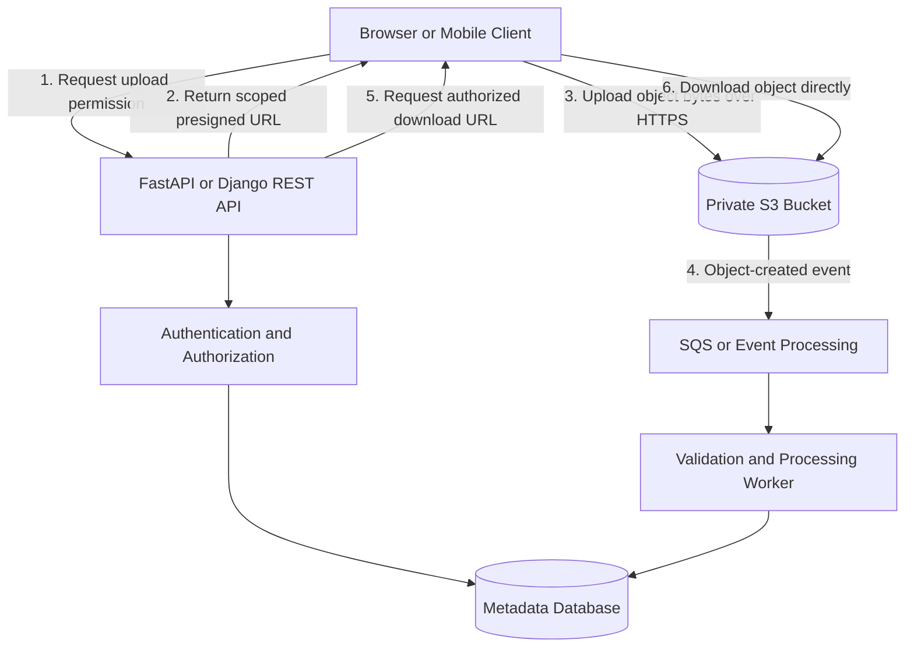

# 08- Upload and Download Performance Best Practices

## Overview

Amazon S3 supports highly scalable object storage, but application throughput and latency depend on how clients transfer data, manage network connections, handle concurrency, and process uploaded or downloaded objects.

A high-performance S3 integration should optimize the complete transfer path rather than focusing exclusively on the S3 API. Important factors include object size, network bandwidth, client CPU and memory, TLS connection reuse, concurrency, retry behavior, application architecture, and geographical distance from the bucket's Region.

For backend applications built with Python, Django REST Framework, FastAPI, Celery, or microservices, the objective is to maximize transfer throughput while maintaining predictable latency, bounded resource consumption, data integrity, and safe failure recovery.

This document establishes practical guidelines for designing and operating efficient S3 upload and download workflows.

## Choose the Appropriate Transfer Architecture

### Compare common transfer patterns

| Pattern | Best suited for | Advantages | Limitations |
|---|---|---|---|
| Backend-mediated upload | Small files requiring synchronous validation or transformation | Centralized authorization and validation | Consumes application bandwidth, memory, connections, and worker capacity |
| Direct upload using a presigned URL | Browser and mobile uploads | Reduces backend bandwidth and processing overhead | Requires secure URL issuance and a controlled upload-completion workflow |
| Multipart upload | Large files and unreliable networks | Parallel transfers, part-level retries, and resumability | Requires multipart state management and cleanup |
| Backend-mediated download | Downloads requiring transformation or application-controlled streaming | Centralized processing and access decisions | Adds network hops and application resource consumption |
| Presigned download URL | Private objects downloaded directly by clients | Reduces backend load and improves scalability | URL access must be protected and expiration managed |
| CloudFront distribution | Frequently accessed content and geographically distributed users | Edge caching reduces repeated origin requests and latency | Requires cache, invalidation, and access-control configuration |
| S3 Transfer Acceleration | Large uploads from geographically distant clients | Uses AWS edge locations and an optimized network path | Additional charges may apply; performance improvements depend on the transfer path |

The preferred design depends on the operation's security and processing requirements.

For a typical document-management application, keep authorization and metadata operations in FastAPI or Django REST Framework, but transfer file bytes directly between the client and S3 whenever server-side processing is unnecessary.

### Recommended architecture for direct uploads



The architecture separates metadata operations from bulk data transfer. The backend remains responsible for access decisions, object-key generation, upload state, validation, and business rules.

An S3 upload event should not automatically make an uploaded object trusted. Validate the completed object before allowing other users or downstream services to consume it.

## Configure AWS SDK Clients for Efficient Transfers

### Reuse clients and HTTP connections

AWS SDKs manage HTTP requests, retries, signing, and other details needed to communicate with S3.

For Python applications, create reusable Boto3 clients instead of constructing a new client for every upload or download. Reuse allows connection pools and underlying resources to be used more efficiently.

Configure the SDK for realistic network timeouts, retry behavior, and expected concurrency.

```python
import boto3
from botocore.config import Config


def create_s3_client(region: str | None = None):
    config = Config(
        connect_timeout=5,
        read_timeout=120,
        max_pool_connections=50,
        retries={
            "mode": "standard",
            "max_attempts": 6,
        },
    )

    return boto3.client(
        "s3",
        region_name=region,
        config=config,
    )
```

The configuration values are illustrative starting points, not universal production defaults. Benchmark representative objects and tune the timeouts, connection-pool size, and retries according to application latency objectives.

Use the AWS SDK credential provider chain, including workload IAM roles or other approved temporary credentials. Do not embed long-lived access keys in source code.

**Production considerations**

- Keep clients reusable for the lifetime appropriate to the application's process and framework.
- Size the connection pool according to expected simultaneous operations.
- Ensure socket read timeouts are compatible with large transfers and slow networks.
- Separate connection-establishment timeouts from operation deadlines.
- Avoid creating excessive concurrent requests that exhaust CPU, memory, file descriptors, or available network bandwidth.
- Use current, supported SDK versions to benefit from maintained transfer and retry implementations.

## Use Multipart Upload for Large Objects

### Understand why multipart upload matters

Multipart upload divides an object into independent parts. The client uploads the parts separately, and S3 combines them when the upload is completed.

Multipart upload is useful when:
- Files are large enough that a single request is inefficient.
- Network interruptions are possible.
- Parallel transfer can improve throughput.
- A failed part should be retried without restarting the entire upload.
- The application requires resumable transfer behavior.

Amazon S3 recommends considering multipart upload when an object reaches approximately 100 MB.

General-purpose S3 buckets support multipart uploads with a maximum of 10,000 parts. Part sizes must generally be between 5 MiB and 5 GiB, except that the last part can be smaller than 5 MiB. The maximum object size is 48.8 TiB.

Reference: [Multipart upload limits](https://docs.aws.amazon.com/AmazonS3/latest/userguide/qfacts.html).

### Choose part size deliberately

Part size determines how many requests are needed and how much data must be retransmitted when a part fails.

| Part size | Advantages | Trade-offs |
|---|---|---|
| Smaller parts | Smaller retry units and finer-grained progress | More requests, bookkeeping, and potential scheduling overhead |
| Larger parts | Fewer requests and potentially more efficient large transfers | More memory per concurrent transfer and more data retransmitted after a failure |
| Adaptive sizing | Can accommodate different object sizes and network conditions | Requires additional configuration and benchmarking |

For an object of size \(S\) and part size \(P\), the approximate number of parts is:

\[
N = \left\lceil \frac{S}{P} \right\rceil
\]

Choose a part size that keeps the number of parts below 10,000 while balancing retry cost, memory consumption, and request overhead.

### Configure multipart transfers with Boto3

Boto3's managed transfer methods can automatically select multipart uploads and execute transfer operations concurrently.

```python
from pathlib import Path

import boto3
from boto3.s3.transfer import TransferConfig
from botocore.config import Config


def create_transfer_client():
    return boto3.client(
        "s3",
        region_name="ap-south-1",
        config=Config(
            connect_timeout=5,
            read_timeout=120,
            max_pool_connections=32,
            retries={
                "mode": "standard",
                "max_attempts": 6,
            },
        ),
    )


TRANSFER_CONFIG = TransferConfig(
    multipart_threshold=64 * 1024 * 1024,
    multipart_chunksize=16 * 1024 * 1024,
    max_concurrency=8,
    use_threads=True,
)


def upload_file(
    local_path: str,
    bucket: str,
    object_key: str,
) -> None:
    path = Path(local_path)

    if not path.is_file():
        raise FileNotFoundError(path)

    client = create_transfer_client()

    client.upload_file(
        str(path),
        bucket,
        object_key,
        Config=TRANSFER_CONFIG,
    )
```

The example uploads an existing local file. It does not include application authorization, key generation, file-content validation, or a database transaction.

The `multipart_threshold` setting determines when the managed transfer switches to multipart upload. `multipart_chunksize` defines the part size, and `max_concurrency` controls the managed transfer's concurrent transfer operations.

In a production application, create and reuse the client instead of creating it for each function invocation. The example creates a client to keep the configuration self-contained.

For compatible client and transfer configurations, download using the corresponding managed transfer method:

```python
def download_file(
    client,
    bucket: str,
    object_key: str,
    destination_path: str,
) -> None:
    client.download_file(
        bucket,
        object_key,
        destination_path,
        Config=TRANSFER_CONFIG,
    )
```

Tune the configuration independently for upload and download workloads when their object sizes, bottlenecks, or concurrency patterns differ.

### Bound total concurrency across the application

A concurrency setting applies to an individual managed transfer, not to the entire application.

For example, if 10 application workers each perform 8 concurrent transfer operations, they could collectively run approximately 80 part-transfer operations, before accounting for other requests and framework-level concurrency.

Consider the following when tuning concurrency:

- Number of application replicas.
- Number of simultaneous transfers per process.
- Per-transfer part size.
- Available memory and CPU.
- HTTP connection-pool limits.
- Network bandwidth and latency.
- KMS request throughput when using SSE-KMS.
- Retry rates and request quotas.

Do not increase concurrency blindly. If the network interface is already saturated, additional threads are unlikely to improve throughput.

## Prefer Direct Client-to-S3 Uploads

### Keep bulk data outside the application request path

In a backend-mediated upload, the client sends the file to the application, which then uploads it to S3. This introduces an extra network hop and requires application workers to handle the transfer.

Direct uploads using presigned URLs allow clients to send object bytes directly to S3 after the backend authorizes the operation.

Example FastAPI-oriented service function:

```python
import boto3


def create_upload_url(
    client,
    bucket: str,
    object_key: str,
    content_type: str,
    expires_in: int = 300,
) -> str:
    return client.generate_presigned_url(
        ClientMethod="put_object",
        Params={
            "Bucket": bucket,
            "Key": object_key,
            "ContentType": content_type,
        },
        ExpiresIn=expires_in,
    )
```

The API should authenticate the caller, authorize the requested operation, generate a server-controlled object key, and record the intended upload state before returning the URL.

The client must use the matching HTTP method and signed headers when using the URL. For example, it must send the expected `Content-Type` header if that header was included in the signed request.

Presigned URLs are bearer capabilities. Anyone possessing a usable URL may perform the permitted operation until the URL expires or the signing credentials become invalid.

### Validate uploads before marking them complete

A successful HTTP upload alone does not prove that a file satisfies business requirements.

A secure completion workflow should:
1. Issue a scoped upload URL for an expected bucket and object key.
2. Allow the client to upload the object.
3. Verify that the object exists and inspect its size and required metadata.
4. Validate the actual content where necessary.
5. Record the object as ready only after successful verification.
6. Reject or quarantine invalid content and clean up abandoned upload state.

For multipart uploads, the backend should manage the upload ID, issue presigned URLs for authorized parts, and perform or authorize multipart completion. Apply the same validation principles after completion.

Do not trust a client-provided filename or content type as proof of the uploaded content's identity or safety.

## Optimize Downloads and Content Delivery

### Avoid buffering large objects in application memory

A typical inefficient implementation loads an entire S3 object into memory before returning it to the client.

```python
# Avoid for large objects.
response = s3_client.get_object(
    Bucket=bucket,
    Key=object_key,
)
content = response["Body"].read()
```

The memory requirement grows with object size and concurrency. Several simultaneous downloads can exhaust worker memory and trigger process termination.

Use direct downloads through presigned URLs when no server-side transformation is required. If the application must stream the response, stream the S3 body in bounded chunks and close the response body reliably.

For example:

```python
from collections.abc import Iterator


def iter_s3_object(
    client,
    bucket: str,
    object_key: str,
    chunk_size: int = 1024 * 1024,
) -> Iterator[bytes]:
    response = client.get_object(
        Bucket=bucket,
        Key=object_key,
    )

    body = response["Body"]

    try:
        while True:
            chunk = body.read(chunk_size)
            if not chunk:
                break
            yield chunk
    finally:
        body.close()
```

This function illustrates bounded-memory iteration. Framework-specific response handling, client-disconnect behavior, backpressure, authorization, and cancellation must also be implemented correctly.

### Use CloudFront for frequently accessed content

CloudFront can cache S3 content at edge locations and reduce repeated requests to the origin.

Consider CloudFront for:
- Public static assets.
- Frequently requested media.
- Large downloads served to geographically distributed users.
- Versioned assets that can be cached for long periods.
- Private content delivered through a supported signed-access design.

Choose cache policies deliberately. A poorly configured cache key, incorrect TTL, or missing authorization boundary can produce stale or unintended responses.

For private S3 origins, prefer a private bucket with CloudFront Origin Access Control where appropriate rather than making the bucket public solely to enable delivery.

CloudFront is especially valuable when a working set of objects is requested repeatedly. It does not eliminate the need to optimize origin transfers for uncached content.

### Use byte-range GET requests for large objects

The HTTP `Range` header allows clients to request only a portion of an object. Concurrent byte-range requests can improve aggregate download throughput and make retries more efficient for large files.

Example:

```python
def download_range(
    client,
    bucket: str,
    object_key: str,
    start: int,
    end: int,
) -> bytes:
    if start < 0 or end < start:
        raise ValueError("Invalid byte range")

    response = client.get_object(
        Bucket=bucket,
        Key=object_key,
        Range=f"bytes={start}-{end}",
    )

    body = response["Body"]

    try:
        return body.read()
    finally:
        body.close()
```

This function returns one range in memory, so use bounded range sizes for large objects.

When downloading multiple ranges concurrently:
- Use a bounded worker pool.
- Validate the returned range and object identity.
- Write ranges to their correct positions in a controlled destination.
- Coordinate retries for individual failed ranges.
- Ensure every range refers to the same object version if the object can change during the download.

If the object was uploaded using multipart upload, aligning range requests with original part boundaries can improve performance.

Reference: [Amazon S3 performance guidelines](https://docs.aws.amazon.com/AmazonS3/latest/userguide/optimizing-performance-guidelines.html).

## Handle Retries, Timeouts, and Partial Failures

### Use exponential backoff for retryable failures

S3 automatically scales to handle changing request rates. When a workload introduces a substantial increase in traffic, temporary HTTP `503 Slow Down` responses can occur while S3 adapts.

AWS SDKs provide retry mechanisms. Use those mechanisms as the baseline instead of implementing a second uncoordinated retry loop around every SDK call.

When custom retries are necessary, use bounded exponential backoff with jitter.

An illustrative delay model is:

\[
d_n = \min(d_{\max}, d_0 \times 2^n)
\]

Apply random jitter to avoid synchronized retries across workers.

Retry only errors that are appropriate for retry. Authorization failures, invalid parameters, and missing objects generally require a different response from transient network or service failures.

### Make retry behavior compatible with transfer semantics

A request may fail after S3 receives some or all of the data. The application should determine the outcome before assuming that the transfer never happened.

For multipart upload:
- Retry a failed part without restarting all successfully uploaded parts.
- Track upload IDs and part identifiers.
- Complete the upload only after all required parts succeed.
- Abort abandoned multipart uploads.
- Use idempotent state transitions in the application database.

For downloads:
- Retry failed ranges or restart a managed transfer when safe.
- Write to a temporary destination when partial output must not be exposed as a completed file.
- Verify file size and integrity before promoting the destination into the final path.

Use request identifiers and structured logs to correlate application failures with AWS service responses.

### Avoid uncontrolled nested retries

A retry policy in the AWS SDK can interact with retries in the application, HTTP client, task queue, and reverse proxy.

Uncoordinated retries can multiply the number of attempts and create load precisely when the service or network is degraded.

Define an end-to-end deadline and a bounded retry budget. Let task queues handle durable asynchronous retries, and reserve immediate SDK retries for short-lived transient failures.

## Use S3 Transfer Acceleration Selectively

S3 Transfer Acceleration routes eligible transfers through AWS edge locations and an optimized network path to the destination bucket.

It is worth evaluating when:
- Clients upload large files from other continents.
- Many users upload to one centralized bucket.
- The public internet path is limiting throughput.
- The workload transfers gigabytes or terabytes across long distances regularly.

Enable acceleration:

```bash
aws s3api put-bucket-accelerate-configuration \
  --bucket "$BUCKET" \
  --accelerate-configuration Status=Enabled
```

Inspect its status:

```bash
aws s3api get-bucket-accelerate-configuration \
  --bucket "$BUCKET"
```

For a Boto3 client, enable the acceleration endpoint after the bucket has been configured appropriately:

```python
import boto3
from botocore.config import Config

s3_accelerated = boto3.client(
    "s3",
    region_name="ap-south-1",
    config=Config(
        s3={
            "use_accelerate_endpoint": True,
        }
    ),
)
```

Transfer Acceleration requires a compatible general-purpose bucket name and virtual-hosted-style requests. Bucket names containing periods are not supported for this feature. It can take time for the configuration to become effective.

Test from the actual client locations and compare throughput and end-to-end completion times against the standard endpoint. Additional transfer charges may apply, so evaluate cost per successful transfer rather than speed alone.

Reference: [S3 Transfer Acceleration](https://docs.aws.amazon.com/AmazonS3/latest/userguide/transfer-acceleration.html).

## Keep Compute Close to S3

Where possible, run S3-consuming workloads in the same AWS Region as the bucket.

This can reduce network latency and help avoid unnecessary cross-Region transfer charges. It is particularly relevant for:
- EC2-based processing workers.
- Lambda functions reading and writing large objects.
- Celery workers running on AWS compute.
- ETL and analytics jobs.
- Internal services that repeatedly transfer data.

For distributed applications, distinguish the location of the API service, the client, and the compute worker. If end users are geographically distant from S3, direct upload and acceleration may be beneficial; moving the application's compute to another Region is not automatically the right solution.

Evaluate all relevant data flows, including cross-Region replication, downstream processing, and client downloads.

## Optimize High-Request-Rate Workloads

### Measure before changing object-key prefixes

S3 automatically scales to accommodate high request rates. When introducing a major increase in traffic, scale-up may not be immediate.

For high-request-rate applications:
- Monitor request latency and 5xx responses.
- Ramp up traffic gradually when possible.
- Use bounded parallel requests over multiple HTTP connections.
- Implement appropriate retry and backoff behavior.
- Identify whether a small number of keys, prefixes, or objects are producing concentrated traffic.

Do not add randomized prefixes to every bucket as a default rule. Modern S3 can support high request rates without traditional manual prefix sharding. Distributing workload across prefixes should be based on observed bottlenecks and a specific access pattern.

For extremely latency-sensitive workloads, evaluate whether S3 Express One Zone fits the use case. It uses directory buckets and has distinct endpoint, authorization, and operational characteristics, so it is not a drop-in replacement for every general-purpose S3 bucket.

Reference: [S3 performance design patterns](https://docs.aws.amazon.com/AmazonS3/latest/userguide/optimizing-performance-design-patterns.html).

## Protect Data Integrity During Transfers

### Use checksums instead of assuming ETags are MD5 hashes

Object integrity should be verified independently of whether a transfer completed without a client-side exception.

S3 supports checksums such as CRC-64/NVME, CRC32, CRC32C, SHA-1, SHA-256, and other supported algorithms.

AWS SDKs calculate and submit checksums for uploads according to their behavior and configuration. S3 validates supported checksums and can store checksum values for later verification.

An ETag is not always an MD5 digest of the complete object. For multipart uploads, the ETag generally does not represent the MD5 digest of the entire file. Encryption and other upload paths can also affect ETag semantics.

Best practices:
- Use supported S3 checksum mechanisms for upload integrity.
- Retain an application-level checksum when business workflows require independent end-to-end verification.
- Do not use an ETag as a universal content hash.
- Verify downloaded file size and the required checksum before marking the transfer complete.
- Make checksum verification compatible with the upload path, including multipart uploads and managed transfers.

Reference: [Checking object integrity in Amazon S3](https://docs.aws.amazon.com/AmazonS3/latest/userguide/checking-object-integrity.html).

## Monitor and Benchmark Transfer Performance

### Establish a performance baseline

Measure the complete transfer workflow with representative data and production-like conditions.

| Metric | Why it matters |
|---|---|
| End-to-end transfer duration | Captures client, network, S3, and application overhead |
| Throughput in bytes per second | Identifies whether bandwidth is being effectively used |
| Time to first byte | Helps distinguish request latency from total transfer time |
| Request and part retry count | Reveals network instability or service scaling effects |
| HTTP 5xx rate | Helps identify transient service failures and overload patterns |
| Active transfers and connection count | Shows effective concurrency and resource pressure |
| CPU and memory usage | Detects application-side bottlenecks |
| Failed or abandoned multipart uploads | Reveals cleanup and reliability issues |
| Checksum failures | Detects data-integrity problems |
| Cost per gigabyte transferred | Helps quantify the value of performance changes |

S3 request metrics can provide request counts and error rates when configured. Application-level instrumentation is still necessary to measure end-to-end duration and throughput across the full client workflow.

### Benchmark systematically

For each representative workload:
1. Select realistic file sizes, including small objects and large files.
2. Measure a single transfer to establish a baseline.
3. Increase concurrency gradually.
4. Compare part sizes and managed transfer settings.
5. Measure network, CPU, memory, latency, and error rates.
6. Test from relevant Regions and client locations.
7. Compare standard endpoints with Transfer Acceleration when appropriate.
8. Repeat tests to separate stable improvements from network variability.

Avoid optimizing solely for aggregate throughput. The configuration should also meet latency objectives and remain stable under peak concurrency.

## Common Performance Mistakes

| Mistake | Consequence | Better practice |
|---|---|---|
| Streaming all files through API workers unnecessarily | Extra network hop and application resource pressure | Use direct uploads and downloads when appropriate |
| Reading entire objects into memory | High memory usage and possible worker termination | Stream or use managed downloads |
| Using a single request for every large object | Lower throughput and expensive full-transfer retries | Evaluate managed multipart upload |
| Setting very high concurrency globally | Connection exhaustion, memory pressure, and retries | Bound concurrency per process and across replicas |
| Creating a new SDK client for every operation | Reduced connection reuse and additional overhead | Reuse clients |
| Ignoring request timeouts | Workers may remain occupied by stalled transfers | Define suitable network timeouts and operation deadlines |
| Retrying every error indefinitely | More load and prolonged failure | Use bounded retries with backoff and jitter |
| Treating HTTP success as content validation | Invalid or incomplete application data may be accepted | Validate object metadata and integrity |
| Using ETags as universal MD5 hashes | Incorrect integrity verification | Use supported checksum mechanisms |
| Enabling Transfer Acceleration without benchmarking | Additional cost without measurable benefit | Compare real-world transfer performance |
| Adding arbitrary object-key sharding | More complex key design without demonstrated benefit | Measure high-request-rate bottlenecks first |
| Ignoring abandoned multipart uploads | Incomplete parts continue to incur storage charges | Abort failed uploads and configure lifecycle cleanup |
| Using CloudFront without a suitable cache policy | Cache misses, stale content, or unintended access | Design and validate cache keys, TTLs, and access controls |

## Production Readiness Checklist

- [ ] The architecture minimizes unnecessary transfer through backend application servers.
- [ ] Boto3 clients are reused and configured for suitable timeouts, retries, and connections.
- [ ] Managed multipart upload and download are used where they benefit the workload.
- [ ] Part size and concurrency have been benchmarked against realistic object sizes.
- [ ] Aggregate concurrency is bounded across processes and application replicas.
- [ ] Presigned URLs are scoped to authorized operations, object keys, and appropriate expiration periods.
- [ ] Upload completion includes object verification and application-state updates.
- [ ] Downloads use streaming, managed transfers, or range requests as appropriate.
- [ ] CloudFront caching is evaluated for repeated or geographically distributed downloads.
- [ ] Transfer Acceleration is enabled only after testing representative client locations.
- [ ] Retry behavior uses bounded retries, backoff, and a coordinated end-to-end deadline.
- [ ] Multipart upload failures are recoverable and abandoned uploads are cleaned up.
- [ ] Checksum verification is used where integrity requirements justify it.
- [ ] S3 request failures, transfer duration, throughput, memory usage, and cost are monitored.
- [ ] Changes are benchmarked before being deployed broadly to production.

## Authoritative References

- [Performance guidelines for Amazon S3](https://docs.aws.amazon.com/AmazonS3/latest/userguide/optimizing-performance-guidelines.html)
- [S3 performance design patterns](https://docs.aws.amazon.com/AmazonS3/latest/userguide/optimizing-performance-design-patterns.html)
- [Multipart upload limits](https://docs.aws.amazon.com/AmazonS3/latest/userguide/qfacts.html)
- [Uploading and copying objects using multipart upload](https://docs.aws.amazon.com/AmazonS3/latest/userguide/mpuoverview.html)
- [Boto3 S3 transfer configuration](https://boto3.amazonaws.com/v1/documentation/api/latest/guide/s3.html)
- [S3 Transfer Acceleration](https://docs.aws.amazon.com/AmazonS3/latest/userguide/transfer-acceleration.html)
- [Using presigned URLs](https://docs.aws.amazon.com/AmazonS3/latest/userguide/using-presigned-url.html)
- [Downloading objects and byte ranges](https://docs.aws.amazon.com/AmazonS3/latest/userguide/download-objects.html)
- [Checking object integrity](https://docs.aws.amazon.com/AmazonS3/latest/userguide/checking-object-integrity.html)

## Key Takeaways

- Use direct client-to-S3 transfers when possible to reduce backend bandwidth consumption and application resource pressure.
- Use managed multipart transfers, appropriately sized parts, reusable SDK clients, and bounded concurrency to improve throughput safely.
- Optimize downloads with streaming, byte-range requests, and CloudFront caching according to the workload.
- Combine bounded retries, checksums, and explicit transfer-state management to maintain reliability under transient failures.
- Benchmark realistic workloads and monitor latency, throughput, errors, resources, and costs before applying performance changes broadly.
You've reached the maximum length for this conversation, but you can keep talking by starting a new chat.
Start new chat