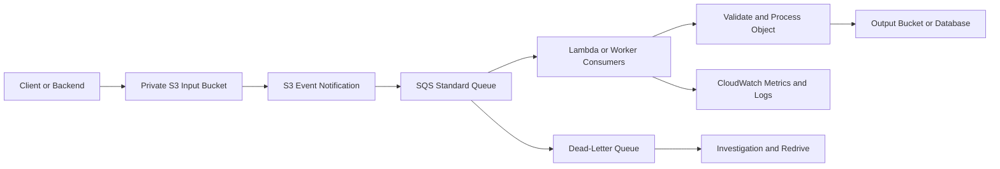
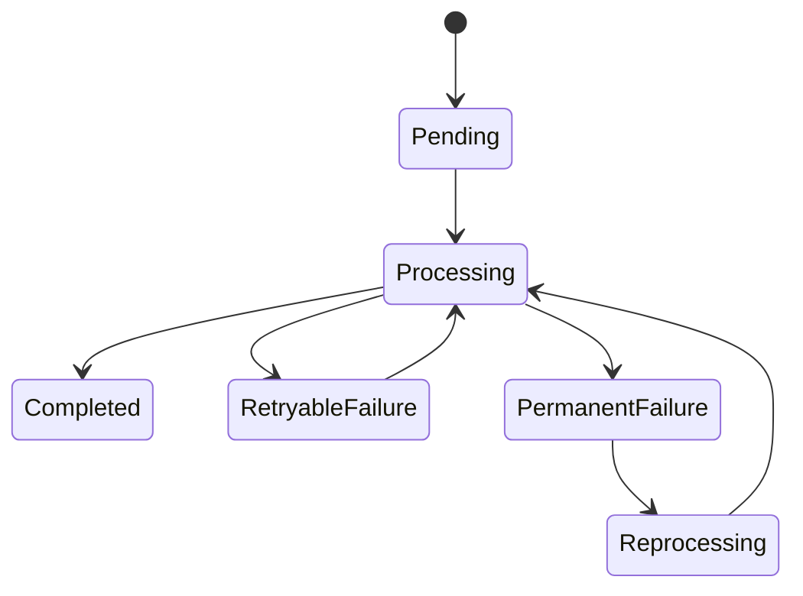

# 09- Event-Driven Integration Best Practices

## Overview

Amazon S3 event-driven integrations allow backend systems to react to object creation, deletion, restoration, replication, and other supported events without continuously polling buckets.

These integrations are useful for document processing, image transformation, asynchronous file validation, data ingestion, analytics pipelines, backup workflows, and distributed backend systems.

A production-grade event-driven architecture must account for duplicate delivery, out-of-order events, transient failures, retries, partial processing, and operational recovery. An event notification indicates that something happened; it does not guarantee that the downstream business operation completed successfully.

The main objectives are to:

- Select the appropriate event destination for the workload.
- Make processing idempotent and safe under retries.
- Separate event delivery reliability from application processing reliability.
- Control concurrency, backpressure, and failure recovery.
- Enforce least-privilege access across S3, messaging services, and consumers.
- Monitor event flow, processing outcomes, latency, and accumulated failures.

## Choose the Appropriate Event Integration

### Understand the available integration patterns

| Integration | Best suited for | Primary advantage | Important consideration |
|---|---|---|---|
| S3 → Lambda | Lightweight object processing and event-driven automation | Low operational overhead | Duplicate invocations, execution limits, and processing retries |
| S3 → SQS → Lambda | Workloads requiring buffering, controlled concurrency, and retry isolation | Durable queue-based decoupling | Queue backlog, visibility timeout, and duplicate processing |
| S3 → SNS → subscribers | Fan-out to multiple independent consumers | One event can reach multiple subscribers | Each subscriber needs independent failure handling |
| S3 → EventBridge → targets | Complex event filtering, routing, and integrations | Flexible rules and centralized event routing | Target retries, permissions, and dead-letter handling must be configured |
| S3 → SQS → ECS or worker service | Long-running or resource-intensive processing | Worker capacity and execution model are independently controlled | Worker scaling, visibility extension, and graceful shutdown |
| S3 → Glue or analytics workflow | Data ingestion and data lake processing | Integrates object arrivals with analytics workflows | Batch scheduling, catalog updates, and data completeness |

Direct S3 event notifications support Lambda, SNS, and standard SQS queues. S3 event notifications do not directly support SQS FIFO queues. Use EventBridge when FIFO delivery or ordering is required downstream, together with an appropriate design for ordering and deduplication; routing through EventBridge alone does not guarantee global event order.

Choose the simplest architecture that satisfies the required reliability, throughput, latency, and operational constraints.

### Prefer direct Lambda invocation for simple workloads

Use direct S3-to-Lambda notifications when each event can be processed independently and the workload has manageable execution time, resource requirements, and concurrency.

Examples include:
- Generating a thumbnail from an uploaded image.
- Extracting metadata from a small document.
- Performing lightweight file validation.
- Recording an object creation event for downstream processing.

Avoid direct invocation when processing must be heavily buffered, consumers require independent scaling, or prolonged downstream outages need durable queue-based recovery.

### Insert SQS when buffering and backpressure matter

SQS decouples event production from processing. S3 can publish events to the queue while workers consume them at a controlled rate.

Use this pattern when:
- Upload traffic has unpredictable peaks.
- Processing depends on slower services or databases.
- Worker concurrency must be restricted.
- Messages need to remain available during temporary processing failures.
- Operators need to inspect, redrive, or replay failed messages.



The queue should buffer work, not replace application-level correctness. A consumer may receive the same message more than once and must tolerate reprocessing safely.

### Use EventBridge for flexible routing

EventBridge is useful when different event types need different consumers or when event routing spans multiple AWS services.

For example, an object arrival may initiate document extraction, while a replication event triggers a recovery-verification workflow.

Use event-pattern filtering to route only relevant events. Configure a retry policy and dead-letter queue for targets where supported, and monitor delivery failures.

Reference: [Using Amazon S3 Event Notifications](https://docs.aws.amazon.com/AmazonS3/latest/userguide/EventNotifications.html).

## Design for Duplicate and Out-of-Order Events

### Assume at-least-once delivery

S3 event notifications are designed for at-least-once delivery. Duplicate events can occur, and events are not guaranteed to arrive in the same order as the underlying operations.

A processing system must not assume that one upload corresponds to exactly one invocation.

For example, a consumer may receive two notifications for the same object creation. If both start the same expensive processing job, the application may produce duplicate records, trigger repeated external API calls, or overwrite a previously generated result.

**Best practice:** Make every consumer idempotent so that processing the same logical event repeatedly does not create unintended additional effects.

### Use an appropriate idempotency key

For versioned objects, an event identity can be derived from the bucket, decoded object key, event type, and object version ID where applicable.

For non-versioned objects, use an event-specific identifier or a carefully designed business identity that distinguishes relevant object generations.

Do not use the object key alone when separate uploads to the same key must be processed independently.

Example database table:

```sql
CREATE TABLE s3_processing_events (
    event_id TEXT PRIMARY KEY,
    bucket_name TEXT NOT NULL,
    object_key TEXT NOT NULL,
    version_id TEXT,
    status TEXT NOT NULL,
    attempts INTEGER NOT NULL DEFAULT 0,
    created_at TIMESTAMPTZ NOT NULL DEFAULT NOW(),
    updated_at TIMESTAMPTZ NOT NULL DEFAULT NOW()
);
```

A consumer can attempt to create the event record using a unique constraint. If the record already exists in a completed state, it can skip the duplicate delivery. If processing is incomplete, the consumer must follow a documented retry or recovery policy.

For high-throughput systems, use a transactional state transition or lease mechanism so concurrent duplicate deliveries cannot both perform the same business operation.

### Distinguish event identity from object identity

An object key identifies a name within a bucket, not an immutable snapshot of the object.

When the same key is overwritten, a later consumer that fetches the key may read newer data than the event originally described.

Prefer version-aware processing when historical object contents must be processed exactly as uploaded. Enable versioning where appropriate and retrieve the specific `versionId` from the event. For non-versioned buckets, use a design that prevents overwrites or accepts that processing observes the current object state.

### Handle event ordering explicitly

S3 event notifications can include a `sequencer` value for relevant object operations. When comparing sequencers, compare only events for the same object key, and normalize their hexadecimal values before comparison.

Never compare sequencers across unrelated object keys or treat them as a bucket-wide ordering mechanism.

When processing must respect object-generation order, use a version-aware state model, conditional updates, or a per-object serialization strategy. Reject stale state transitions when the application can establish that an older event has already been superseded.

Reference: [Managing event ordering and duplicate events with S3 Event Notifications](https://aws.amazon.com/blogs/storage/manage-event-ordering-and-duplicate-events-with-amazon-s3-event-notifications/).

## Build Reliable Object Processing Workflows

### Separate event intake from business processing

An event consumer should validate the message, derive a stable event identity, claim the work safely, process the object, and record the outcome.

Keep the consumer's responsibilities explicit:

1. Validate that the event type is supported.
2. Parse and validate the bucket, object key, and object version.
3. Establish an idempotency boundary.
4. Fetch the intended object version when required.
5. Perform the business operation.
6. Persist the output and processing status.
7. Return success only after the required work has completed.

If the consumer writes output to S3 and updates PostgreSQL, these operations are not automatically part of one transaction. Design for partial completion, such as an output object being created before the database update fails.

One approach is to use deterministic output keys, conditional database transitions, and a reconciliation worker that detects and repairs incomplete processing states.

### Prevent recursive invocation loops

A Lambda function triggered by an S3 upload can accidentally trigger itself if it writes its results back into a location covered by the same notification rule.

For example, uploading `images/photo.jpg` may invoke a processor that writes `images/photo-thumbnail.jpg`, which can trigger the processor again.

Prefer separate input and output buckets. When a separate bucket is unnecessary, scope the notification to an input prefix and write generated objects to a different prefix.

```text
media/
    incoming/
        photo.jpg
    processed/
        photo-thumbnail.jpg
```

Configure notifications only for `incoming/` and ensure generated output is written under `processed/`.

Do not rely exclusively on application code to prevent loops. Notification filters should enforce the intended trigger boundary as well.

Reference: [Using Lambda with Amazon S3](https://docs.aws.amazon.com/lambda/latest/dg/with-s3.html).

### Process the exact object described by the event

S3 event messages contain object metadata, not the full object contents. Retrieve the object using the bucket and key from the event.

S3 object keys in notification messages are URL encoded. Decode them before passing them to an SDK operation, including handling `+` as a space where required by the event format.

Example Python Lambda handler:

```python
import logging
from urllib.parse import unquote_plus

import boto3

logger = logging.getLogger()
logger.setLevel(logging.INFO)

s3 = boto3.client("s3")


def lambda_handler(event, context):
    processed = 0

    for record in event.get("Records", []):
        if record.get("eventSource") != "aws:s3":
            continue

        event_name = record.get("eventName", "")
        if not event_name.startswith("ObjectCreated:"):
            continue

        bucket = record["s3"]["bucket"]["name"]
        obj = record["s3"]["object"]
        key = unquote_plus(obj["key"])
        version_id = obj.get("versionId")

        request_args = {
            "Bucket": bucket,
            "Key": key,
        }

        if version_id:
            request_args["VersionId"] = version_id

        logger.info(
            "Processing S3 object",
            extra={
                "bucket": bucket,
                "key": key,
                "version_id": version_id,
                "event_name": event_name,
            },
        )

        response = s3.get_object(**request_args)

        try:
            body = response["Body"]
            try:
                process_object_stream(body, key)
            finally:
                body.close()
        except Exception:
            logger.exception(
                "S3 object processing failed",
                extra={
                    "bucket": bucket,
                    "key": key,
                    "version_id": version_id,
                },
            )
            raise

        processed += 1

    return {"processed": processed}


def process_object_stream(body, key):
    """Replace with bounded-memory, application-specific processing."""
    total_bytes = 0

    for chunk in iter(lambda: body.read(1024 * 1024), b""):
        total_bytes += len(chunk)

    logger.info(
        "Object stream consumed",
        extra={"key": key, "bytes_processed": total_bytes},
    )
```

This example demonstrates event parsing and streaming access. It is not, by itself, a complete production processor: `process_object_stream` must be replaced with real business logic, and an idempotency mechanism must be implemented if duplicate processing would be harmful.

For large objects, prefer streaming or multipart-aware workflows rather than loading the complete object into memory. For version-aware processing, grant the consumer the required object-version permissions.

## Use SQS for Retry Isolation and Backpressure

### Configure visibility timeouts correctly

When an SQS consumer receives a message, the queue hides it from other consumers for the visibility timeout. If processing fails and the message is not deleted, it becomes available again after the timeout.

Set the visibility timeout to accommodate the consumer's processing duration, including realistic retry and operational overhead. For Lambda event source mappings, follow AWS guidance for relating the visibility timeout to the function timeout and batching configuration.

For processing that may exceed the configured timeout, use an appropriate heartbeat or visibility-extension mechanism when supported by the consumer design.

A visibility timeout that is too short can cause concurrent duplicate processing. A timeout that is unnecessarily long can delay recovery after a consumer failure.

### Use a dead-letter queue

Configure an SQS dead-letter queue (DLQ) for messages that repeatedly fail processing. Select a redrive policy that reflects the expected transient-failure rate and the consequences of delayed processing.

Monitor:
- Main queue depth and message age.
- DLQ message count.
- Consumer error rate.
- Processing latency.
- Retry frequency and repeated failures.

DLQ messages should have a documented investigation and redrive workflow. Before redriving, ensure that the underlying issue is resolved and that the consumer is safe to run again.

### Control concurrency

Scale consumers according to queue backlog, processing time, downstream rate limits, and available capacity.

Do not scale Lambda concurrency or ECS workers without considering database connection limits, API quotas, KMS request quotas, and memory or CPU consumption.

Useful controls include:
- Lambda reserved concurrency.
- SQS event source mapping concurrency and batch size.
- ECS service scaling limits.
- Application-level concurrency limits.
- Bounded connection pools.
- Rate limiting for downstream dependencies.

Choose settings from load tests and service limits rather than assuming maximum concurrency is always desirable.

## Configure Permissions and Trust Boundaries

### Separate producer, consumer, and operator permissions

Each component should receive only the permissions required for its role.

| Component | Typical permissions |
|---|---|
| S3 notification configuration identity | Configure the bucket notification resource |
| S3 service principal | Publish to the authorized destination or invoke the authorized Lambda function |
| Lambda execution role | Read the intended source objects and write only authorized outputs |
| SQS consumer role | Receive, delete, and inspect messages from the intended queue |
| EventBridge rule | Invoke or publish to the configured target through supported target permissions |
| Operator role | Inspect metrics, review failed messages, and perform approved redrive actions |

The service principal that publishes notifications and the application role that processes messages are different security identities. Configure the relevant resource policies and identity policies independently.

### Restrict S3 permissions to expected objects

Avoid granting a processing role broad access to every bucket in the account.

For example, a function processing uploads from a dedicated incoming prefix may require `s3:GetObject` for that prefix and `s3:PutObject` for a designated output prefix.

Use the actual bucket and prefix ARNs in IAM policies. Include additional permissions such as `s3:GetObjectVersion` or KMS actions only when required by the workflow.

For SSE-KMS objects, validate both S3 permissions and KMS authorization. A successful object-level permission check does not guarantee that decryption is authorized.

### Validate notification destination policies

For direct S3 notifications to Lambda, ensure the function's resource-based policy permits invocation by S3 and restricts the source bucket and account as appropriate.

For SQS and SNS destinations, the destination resource policy must permit S3 to publish messages.

Use the AWS console, infrastructure-as-code, or the relevant AWS APIs to configure and validate these dependencies. Keep all required destination permissions in the infrastructure deployment rather than relying on undocumented manual changes.

Reference: [Granting permissions for S3 event notification destinations](https://docs.aws.amazon.com/AmazonS3/latest/userguide/grant-destinations-permissions-to-s3.html).

## Configure Event Notifications Safely

### Use narrow event filters

Configure only the events that the consumer needs. For example, an image-processing workflow normally needs object creation notifications rather than all event types.

Use prefix and suffix filters to reduce irrelevant invocations. Ensure that filters do not unintentionally exclude supported upload paths or include generated outputs.

Test paths with spaces, special characters, uppercase extensions, and multipart uploads where applicable.

### Preserve the complete notification configuration

S3 stores event notification settings as a bucket-level configuration. Infrastructure changes must account for every intended notification destination on that bucket.

Before modifying notifications:
- Inspect the existing configuration.
- Confirm every target exists.
- Verify target permissions.
- Preserve notifications owned by other workloads.
- Test the complete configuration during deployment.

Replacing the notification configuration with a partial set can remove previously configured destinations.

Allow for configuration propagation and test the resulting behavior with a controlled upload. Notification changes typically take several minutes to take effect.

### Avoid notification loops and deployment dependencies

A notification destination must exist and have the required permissions before the bucket can use it successfully. Infrastructure-as-code should create dependencies in the correct order.

A typical deployment sequence is:

1. Create the queue, topic, or function.
2. Configure the destination resource policy.
3. Create the processing role and its permissions.
4. Configure the S3 notification destination.
5. Verify the deployed configuration.
6. Run a controlled end-to-end test.

If a notification destination is removed or its policy becomes invalid, later notification configuration changes can fail validation. Manage destinations and their permissions as related infrastructure.

## Handle Failures and Recovery Explicitly

### Classify failure types

| Failure category | Example | Recommended response |
|---|---|---|
| Invalid event | Unsupported event type or malformed application data | Reject safely and alert if the event should have been supported |
| Missing object | Object was deleted before a consumer retrieved it | Use version-aware access or handle the deletion as a valid race |
| Transient dependency failure | Database timeout or throttling | Retry with bounded backoff |
| Permanent validation failure | Unsupported or corrupted file | Record a terminal failure and make the failure discoverable |
| Permission failure | `AccessDenied` or KMS authorization failure | Alert and correct the policy or configuration |
| Processing timeout | Large file or slow downstream dependency | Reassess resource limits, streaming, and workflow decomposition |
| Duplicate delivery | The same event is received more than once | Use idempotency and transactional state changes |
| Out-of-order processing | An older event finishes after a newer event | Use version-aware or conditional state transitions |
| Destination delivery failure | Messaging target is unavailable or misconfigured | Monitor delivery metrics and configure supported retry or DLQ behavior |

Retry transient failures, not every failure indiscriminately. Repeatedly retrying invalid input or a permanent permission denial increases cost without improving the result.

### Define the processing state model

For workflows that need durable tracking, maintain a state machine.



Use conditional state transitions to prevent concurrent workers from claiming the same job incorrectly. Track attempt count, failure category, timestamps, and an identifier for the object generation being processed.

A recovery process should identify jobs that remain in `Processing` beyond an expected threshold, determine whether their previous worker is still active, and safely retry or mark them failed.

### Make side effects recoverable

An idempotent S3 read does not guarantee that the entire workflow is idempotent.

If processing sends an email, charges an account, updates a relational database, and writes an S3 output, failures can occur between any of these operations.

Use stable business operation IDs, unique constraints, transactional outbox patterns where appropriate, and downstream idempotency keys for external APIs. Avoid assuming that one successful S3 read implies every subsequent side effect completed exactly once.

## Implement Event Consumers with Operational Visibility

### Log correlation fields

Structured logs should include useful identifiers such as:
- Bucket name and object key.
- Object version ID when available.
- Event name and event time.
- SQS message ID or EventBridge event ID.
- Processing attempt number.
- Processing status and duration.
- Correlation or business operation ID.

Avoid logging presigned URLs, credentials, or sensitive object contents.

### Monitor end-to-end outcomes

CloudWatch monitoring should cover both event delivery and the downstream workflow.

Track:
- Lambda invocations, errors, throttles, duration, and concurrency.
- SQS queue depth, message age, receive counts, and DLQ messages.
- EventBridge target invocation failures and failed-delivery metrics.
- Processing throughput and end-to-end latency.
- Number of completed, skipped, retried, and permanently failed jobs.
- Downstream database and API errors.

Use alarms based on operational impact, such as a growing oldest-message age, a sustained failure rate, or a DLQ receiving unexpected messages.

Do not rely exclusively on successful Lambda invocation metrics. A function can return successfully while the business workflow has produced an incorrect result if its validation and state handling are incomplete.

### Reconcile when event delivery is not sufficient

Event-driven processing should have a recovery mechanism for work that was never completed.

Depending on the workflow, reconciliation may compare an S3 Inventory report, application database state, processing records, and expected object populations.

A periodic reconciliation worker can find objects missing processing results, retry incomplete jobs, and report persistent discrepancies.

Do not use a full bucket scan for every event. Use reconciliation as a bounded recovery process and select an inventory or database strategy that scales with the dataset.

## Test Event-Driven Integrations Before Production

### Validate individual processing components

Unit tests should cover:
- Event parsing and URL-encoded object keys.
- Unsupported event types.
- Missing or malformed event fields.
- Duplicate-event handling.
- Object version selection.
- Transient and permanent failures.
- Output-key generation.
- Conditional database state changes.

Use mocked AWS clients for fast unit tests, but do not treat mocks as evidence that real IAM policies, notification destinations, event payloads, and network configuration are correct.

### Run integration tests

In a test AWS environment, validate the full workflow:

1. Upload an object to the designated input prefix.
2. Confirm the configured destination receives the event.
3. Verify that the consumer retrieves the correct object.
4. Confirm the expected output and application state.
5. Replay a duplicate event and verify idempotency.
6. Exercise an unsupported or invalid input.
7. Simulate an appropriate transient failure.
8. Verify retry and DLQ behavior.
9. Confirm that generated output does not recursively trigger processing.
10. Verify logs, metrics, and alarms.

Include multipart uploads if they are part of the production upload path, because the relevant completed-upload event differs from individual part uploads.

### Deploy changes through infrastructure-as-code

Manage notification definitions, destinations, resource policies, queues, dead-letter queues, Lambda configuration, IAM roles, and monitoring as version-controlled infrastructure.

Deployment validation should include:
- Static configuration checks.
- IAM policy review.
- Event filter review.
- Infrastructure plan or change-set review.
- Integration tests in a non-production environment.
- Post-deployment smoke tests.
- Rollback and recovery procedures.

Avoid manual console changes that leave deployed infrastructure inconsistent with its source configuration.

## Common Event-Driven Integration Mistakes

| Mistake | Consequence | Better practice |
|---|---|---|
| Assuming every event is delivered exactly once | Duplicate business effects | Implement idempotent consumers |
| Assuming events arrive in object modification order | Stale processing can overwrite newer results | Use version-aware processing or conditional updates |
| Using the object key as the only job identifier | Separate generations may be incorrectly deduplicated | Include event or object-generation identity |
| Reading the latest object for every historical event | Processing may use data different from the event's object generation | Use version IDs where required |
| Writing output into the triggering prefix | Recursive invocation and runaway cost | Separate input and output locations |
| Omitting a DLQ for persistent consumer failures | Failed work becomes difficult to recover | Configure bounded retries and explicit recovery |
| Scaling consumers without limits | Database exhaustion, throttling, and increased cost | Load-test and control concurrency |
| Treating invocation success as business completion | Partial failures remain hidden | Record durable processing state and validate outputs |
| Replacing all bucket notification rules with one rule | Unrelated event consumers stop receiving events | Preserve the full notification configuration |
| Granting broad S3 and KMS permissions | Increased impact of compromised consumers | Apply least-privilege policies |
| Testing only with mocks | Real event configuration or permissions can still fail | Run end-to-end AWS integration tests |

## Production Readiness Checklist

- [ ] The event destination matches throughput, latency, and reliability requirements.
- [ ] Duplicate delivery is expected, and consumers are idempotent.
- [ ] Out-of-order events cannot corrupt current business state.
- [ ] Object keys are decoded correctly, and object versions are handled appropriately.
- [ ] Input and output trigger boundaries prevent recursive processing.
- [ ] Required S3, messaging, Lambda, and KMS permissions are explicitly configured.
- [ ] Queue visibility timeouts, retries, batch sizes, and concurrency limits are appropriate.
- [ ] Dead-letter queues or equivalent failure-recovery mechanisms are configured where required.
- [ ] Processing state and partial side effects are recoverable.
- [ ] Logs contain correlation identifiers without exposing sensitive data.
- [ ] Alarms cover failed processing, queue backlogs, and delivery failures.
- [ ] Notification configuration changes preserve unrelated destinations.
- [ ] Tests cover duplicates, ordering, failures, retry behavior, and real event payloads.
- [ ] Deployment and rollback procedures are version-controlled.
- [ ] A reconciliation process exists when missed or incomplete business work must be detected.

## Authoritative References

- [Amazon S3 Event Notifications](https://docs.aws.amazon.com/AmazonS3/latest/userguide/EventNotifications.html)
- [Supported S3 event types and destinations](https://docs.aws.amazon.com/AmazonS3/latest/userguide/notification-how-to-event-types-and-destinations.html)
- [Using Amazon S3 with AWS Lambda](https://docs.aws.amazon.com/lambda/latest/dg/with-s3.html)
- [Permissions for S3 notification destinations](https://docs.aws.amazon.com/AmazonS3/latest/userguide/grant-destinations-permissions-to-s3.html)
- [Managing duplicate and out-of-order S3 events](https://aws.amazon.com/blogs/storage/manage-event-ordering-and-duplicate-events-with-amazon-s3-event-notifications/)
- [Amazon SQS visibility timeout](https://docs.aws.amazon.com/AWSSimpleQueueService/latest/SQSDeveloperGuide/sqs-visibility-timeout.html)
- [Using dead-letter queues with Amazon SQS](https://docs.aws.amazon.com/AWSSimpleQueueService/latest/SQSDeveloperGuide/sqs-dead-letter-queues.html)
- [EventBridge retry policies and dead-letter queues](https://docs.aws.amazon.com/eventbridge/latest/userguide/eb-rule-dlq.html)
- [Lambda recursive invocation detection](https://docs.aws.amazon.com/lambda/latest/dg/invocation-recursion.html)

## Key Takeaways

- Design S3 event consumers for duplicate delivery, out-of-order events, and partial failure instead of assuming exactly-once processing.
- Use SQS when buffering, controlled concurrency, and durable retry isolation are important; use EventBridge when flexible event routing is required.
- Apply idempotency, version-aware object access, and conditional state transitions to prevent duplicate or stale business effects.
- Configure least-privilege permissions, appropriate retry and DLQ policies, and explicit monitoring for event delivery and processing outcomes.
- Validate complete workflows with integration tests, operational alerts, and a documented reconciliation and recovery process.
You've reached the maximum length for this conversation, but you can keep talking by starting a new chat.
Start new chat