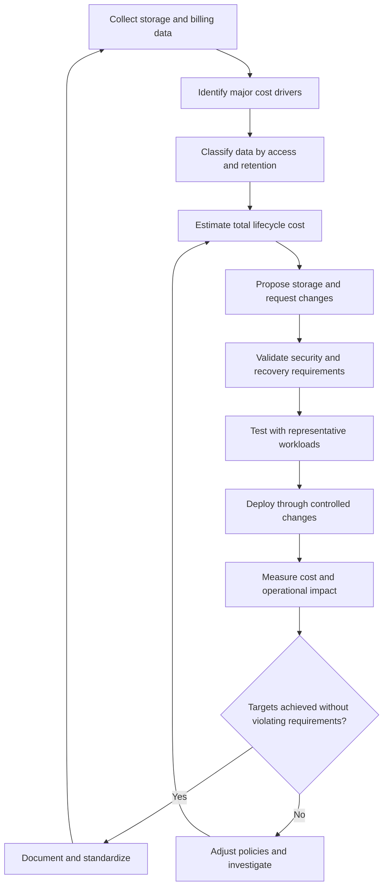

# 10- Cost Optimization Best Practices

## Overview

Amazon S3 cost optimization is the process of minimizing storage, request, retrieval, transfer, and data-management expenses while preserving application performance, security, availability, and recovery requirements.

S3 pricing is usage-based, but storage capacity is only one component of the total cost. A bucket with inexpensive archival storage can become expensive because of frequent retrievals, lifecycle transition requests, retained object versions, incomplete multipart uploads, or data transfer.

Production cost optimization should therefore combine workload analysis, storage-class selection, lifecycle management, request efficiency, transfer optimization, cost attribution, and continuous monitoring.

The primary objectives are to:

- Reduce the cost per stored and processed gigabyte.
- Eliminate unnecessary storage and requests.
- Select storage classes based on actual access patterns.
- Prevent unexpected charges from retention, retrieval, and transfer.
- Measure savings without compromising production requirements.

## Understand the S3 Cost Model

### Identify the main cost components

| Cost component | Typical contributors | Optimization approach |
|---|---|---|
| Storage | Objects, noncurrent versions, archive metadata, incomplete multipart parts | Lifecycle policies, storage-class selection, retention management |
| Requests | PUT, COPY, POST, LIST, GET, HEAD, and other API operations | Reduce unnecessary calls, batch suitable workflows, use caching |
| Data retrieval | Accessing objects in storage classes with retrieval charges | Match the storage class to retrieval frequency |
| Lifecycle transitions | Moving objects between storage classes | Avoid unnecessary transitions and filter uneconomical objects |
| Data transfer | Internet egress, inter-Region transfers, certain cross-service paths | Use CloudFront, keep processing close to data, avoid repeated downloads |
| Replication | Additional destination storage, requests, transfer, and applicable encryption operations | Replicate only the data required by recovery and compliance policies |
| Intelligent-Tiering | Per-object monitoring and automation charges for eligible objects | Evaluate monitoring costs against expected savings |
| Analytics and inventory | Selected Storage Lens features, Inventory, Storage Class Analysis, reporting destinations | Enable the reporting capabilities that support actual decisions |
| Encryption | Applicable AWS KMS API request charges | Evaluate S3 Bucket Keys for eligible SSE-KMS workloads |
| Data recovery | Archive restoration, temporary restored copies, and data transfer | Model restoration frequency and recovery requirements |

The exact charges depend on the Region, storage class, object size, request type, configuration, and applicable pricing agreements. Consult the [official Amazon S3 pricing page](https://aws.amazon.com/s3/pricing/) before making cost projections.

### Calculate total cost of ownership

Estimate total cost across the complete object lifecycle rather than comparing storage prices in isolation.

A practical model is:

\[
\begin{aligned}
C_{\text{total}} ={}&
C_{\text{storage}} + C_{\text{requests}} \\
&+ C_{\text{retrieval}} + C_{\text{transitions}} \\
&+ C_{\text{transfer}} + C_{\text{replication}} \\
&+ C_{\text{encryption}} + C_{\text{management}}
\end{aligned}
\]

Include only the applicable components, and account for how charges change over time.

For example, a reporting service storing 10 TB of historical documents should evaluate monthly storage cost alongside document retrieval volume, minimum storage durations, retrieval latency, and the likelihood of a large recovery event.

A useful optimization is one that lowers the total expected cost while remaining inside the application's operational and recovery constraints.

## Establish a Cost-Optimization Baseline

### Inventory storage usage

Before modifying a bucket, determine what it stores, how quickly it is growing, and which workloads consume the most resources.

Review:
- Total storage by bucket, Region, and storage class.
- Object counts and size distributions.
- Growth in current and noncurrent object versions.
- Access frequency and transferred bytes.
- Incomplete multipart upload storage.
- Lifecycle configuration and expiration coverage.
- Replication destinations and retained replicas.
- Request patterns and applicable transfer charges.

Use several complementary AWS data sources rather than relying on a single dashboard.

| Tool | Best use |
|---|---|
| Amazon S3 Storage Lens | Organization-wide storage trends, bucket comparisons, and cost-optimization opportunities |
| S3 Inventory | Object-level metadata, storage class, version information, and audit datasets |
| S3 Storage Class Analysis | Understanding access patterns when evaluating supported storage-class transitions |
| AWS Cost Explorer | Reviewing service cost trends and investigating cost increases |
| AWS Cost and Usage Reports | Detailed usage and billing analysis |
| CloudWatch | Monitoring supported operational metrics and request activity |
| CloudTrail | Investigating relevant API activity and configuration changes |

S3 Storage Lens offers a free default metrics tier and additional advanced capabilities with separate pricing considerations. Check the current feature and pricing details before enabling optional reports.

References: [S3 Storage Lens](https://docs.aws.amazon.com/AmazonS3/latest/userguide/storage_lens.html), [S3 cost optimization](https://docs.aws.amazon.com/AmazonS3/latest/userguide/cost-optimization.html).

### Establish measurable indicators

Record a baseline before introducing optimization changes.

| Indicator | Purpose |
|---|---|
| Monthly S3 cost | Measure overall financial impact |
| Storage cost per workload | Identify expensive applications and datasets |
| Bytes stored by storage class | Find opportunities for transitions |
| Noncurrent version bytes | Identify accumulated historical storage |
| Incomplete multipart upload bytes | Detect abandoned uploads consuming storage |
| GET requests and retrieved bytes | Evaluate access costs |
| Transition request volume | Detect excessive lifecycle activity |
| Data transferred out | Investigate download and egress costs |
| Replication storage growth | Quantify the cost of additional copies |
| Cost per successful upload or download | Connect infrastructure spending to business activity |

Use consistent reporting periods. S3 Inventory and some analytics reports are periodic, so their results may not reflect changes immediately.

## Select Storage Classes Based on Economics

### Match storage classes to access patterns

| Storage class | Typical workload | Cost considerations |
|---|---|---|
| S3 Standard | Active application objects and frequently accessed files | Higher storage rate than many colder classes, but no retrieval fee |
| S3 Intelligent-Tiering | Unpredictable or changing access patterns | Monitoring and automation charges apply to eligible objects |
| S3 Standard-IA | Infrequently accessed data requiring millisecond access | Retrieval charges, a 30-day minimum storage duration, and a 128 KB minimum billable object size |
| S3 One Zone-IA | Infrequent, reproducible data where single-AZ storage is acceptable | Retrieval charges, a 30-day minimum duration, and single-AZ resilience |
| S3 Glacier Instant Retrieval | Rarely accessed data requiring millisecond access | Retrieval charges, a 90-day minimum duration, and a 128 KB minimum billable object size |
| S3 Glacier Flexible Retrieval | Long-term archives with asynchronous retrieval | Restoration charges and a 90-day minimum duration |
| S3 Glacier Deep Archive | Long-term archives with very rare access | Restoration charges and a 180-day minimum duration |

These characteristics are general selection criteria. Check current regional rates, transition eligibility, and feature restrictions before deployment.

### Prefer Intelligent-Tiering when access is unpredictable

Intelligent-Tiering automatically moves eligible objects between access tiers as access patterns change.

It is useful for datasets where a fixed lifecycle rule would frequently guess incorrectly, such as changing customer document access or mixed data lake workloads.

However, Intelligent-Tiering does not eliminate every cost. Evaluate:
- Monitoring and automation charges.
- The number of eligible objects.
- Object-size distribution.
- Expected access patterns.
- Whether automatic archival tiers are enabled and suitable.

Do not migrate every bucket to Intelligent-Tiering without a cost comparison.

### Model retrieval and minimum-duration charges

An archive class may offer substantial storage savings but become uneconomical when the workload retrieves large amounts of data or deletes objects soon after a transition.

Before adopting a colder class, estimate:
- Expected retrieval frequency and volume.
- Retrieval and restoration charges.
- Minimum-duration commitments.
- Transition request charges.
- Temporary storage during restoration.
- The business cost of delayed access.

For high-retrieval workloads, compare the total cost with Standard or Intelligent-Tiering before moving large datasets.

Reference: [S3 storage classes](https://docs.aws.amazon.com/AmazonS3/latest/userguide/storage-class-intro.html).

## Automate Storage Lifecycle Management

### Use lifecycle policies for predictable retention

S3 Lifecycle can transition objects to other supported storage classes and expire objects according to policy rules.

Use lifecycle policies for data with defined retention and access schedules, such as application logs, historical reports, exported datasets, and temporary processing output.

A practical lifecycle design separates data into groups with distinct retention requirements. Prefixes and object tags can help target the intended data population.

Example lifecycle configuration:

```json
{
  "Rules": [
    {
      "ID": "ArchiveHistoricalLogs",
      "Status": "Enabled",
      "Filter": {
        "Prefix": "application-logs/"
      },
      "Transitions": [
        {
          "Days": 90,
          "StorageClass": "GLACIER"
        }
      ],
      "Expiration": {
        "Days": 2555
      },
      "AbortIncompleteMultipartUpload": {
        "DaysAfterInitiation": 7
      }
    }
  ]
}
```

This example transitions logs after 90 days, schedules their expiration after 2,555 days, and aborts incomplete multipart uploads after seven days.

Before deployment, confirm that the retention period satisfies legal and business requirements. The example is not suitable for every workload, and transition economics depend on object size, object count, and expected lifetime.

### Avoid uneconomical transitions

Transitioning millions of very small objects can cost more than expected because transitions incur per-object request charges and some storage classes impose minimum billable sizes or additional metadata overhead.

Analyze the object population before selecting a transition policy.

Possible improvements include:
- Excluding small objects from certain transitions.
- Aggregating records into larger objects when independent access is unnecessary.
- Using Intelligent-Tiering for eligible workloads with uncertain access patterns.
- Leaving short-lived data in Standard when transition costs exceed the savings.

S3 has changed default lifecycle behavior for small objects over time. Review the current transition constraints and any legacy configuration when modifying existing buckets.

Reference: [Lifecycle transition considerations](https://docs.aws.amazon.com/AmazonS3/latest/userguide/lifecycle-transition-general-considerations.html).

### Preserve existing lifecycle rules

Updating a bucket's lifecycle configuration using the AWS CLI replaces the complete existing configuration.

Inspect the current rules before applying changes:

```bash
aws s3api get-bucket-lifecycle-configuration \
  --bucket "$BUCKET"
```

After reviewing the existing rules and merging the intended changes:

```bash
aws s3api put-bucket-lifecycle-configuration \
  --bucket "$BUCKET" \
  --lifecycle-configuration file://lifecycle.json
```

Verify the result:

```bash
aws s3api get-bucket-lifecycle-configuration \
  --bucket "$BUCKET"
```

Avoid overwriting rules used by other applications or infrastructure teams. Manage lifecycle configuration through a single authoritative infrastructure-as-code definition where practical.

## Reduce Costs from Object Versions

### Review noncurrent versions

S3 Versioning preserves historical object versions when an object is overwritten or deleted. These versions can increase storage costs if the application frequently replaces objects or does not expire old versions.

For example, an application that updates generated reports every day may retain many historical copies even though users only need a limited number of revisions.

Inspect versioning:

```bash
aws s3api get-bucket-versioning \
  --bucket "$BUCKET"
```

Use S3 Inventory or other suitable reporting to quantify noncurrent-version storage before changing retention policies.

### Define a noncurrent-version lifecycle policy

For buckets where historical versions are not required indefinitely, a lifecycle rule can expire noncurrent versions after a defined period.

Example:

```json
{
  "Rules": [
    {
      "ID": "ExpireOldNoncurrentVersions",
      "Status": "Enabled",
      "Filter": {
        "Prefix": "generated-reports/"
      },
      "NoncurrentVersionExpiration": {
        "NoncurrentDays": 90,
        "NewerNoncurrentVersions": 3
      }
    }
  ]
}
```

This rule applies to the specified prefix and retains the three most recent noncurrent versions subject to the configured age threshold. Validate the interaction of the age and newer-version filters against the intended retention policy before deployment.

Do not apply aggressive version expiration to datasets that require forensic investigation, rollback, legal retention, or recovery from delayed detection of corruption.

### Understand delete markers and permanent deletion

In versioned buckets, an ordinary delete operation usually creates a delete marker rather than permanently deleting all prior versions.

Lifecycle expiration of current objects therefore does not automatically guarantee that every historical version is removed.

Review:
- Current versions.
- Noncurrent versions.
- Delete markers.
- Replicated versions.
- Retention and legal-hold constraints.

Use lifecycle rules to manage eligible noncurrent versions and expired delete markers. Do not permanently delete retained data solely to reduce storage costs.

Reference: [S3 Lifecycle management](https://docs.aws.amazon.com/AmazonS3/latest/userguide/object-lifecycle-mgmt.html).

## Clean Up Incomplete Multipart Uploads

### Understand the cost of abandoned uploads

Multipart upload enables efficient transfer of large objects through separate parts. If a client crashes, loses connectivity, or fails to complete the upload, the uploaded parts may remain stored and incur charges.

These parts are not a completed object, but they still consume billable storage until the multipart upload is completed or aborted.

Configure an explicit lifecycle cleanup rule:

```json
{
  "Rules": [
    {
      "ID": "AbortIncompleteMultipartUploads",
      "Status": "Enabled",
      "Filter": {
        "Prefix": ""
      },
      "AbortIncompleteMultipartUpload": {
        "DaysAfterInitiation": 7
      }
    }
  ]
}
```

Review the complete bucket lifecycle configuration before applying this rule. Seven days is a common starting point, not a universal requirement. Choose a period that accommodates legitimate long-running uploads while preventing indefinite storage of abandoned parts.

### Monitor cleanup effectiveness

Use S3 Storage Lens to identify buckets with accumulated incomplete multipart upload bytes and missing cleanup rules.

Inspect active multipart uploads when investigating an unexpected increase:

```bash
aws s3api list-multipart-uploads \
  --bucket "$BUCKET"
```

For an identified abandoned upload, an authorized operator can abort it:

```bash
aws s3api abort-multipart-upload \
  --bucket "$BUCKET" \
  --key "$OBJECT_KEY" \
  --upload-id "$UPLOAD_ID"
```

Use the exact key and upload ID from the inspection results. Avoid blindly aborting uploads that are still actively used by a production client.

Lifecycle cleanup runs asynchronously, so the physical removal of all eligible parts may not be immediate.

Reference: [Optimizing costs with S3 Storage Lens](https://docs.aws.amazon.com/AmazonS3/latest/userguide/storage-lens-optimize-storage.html).

## Optimize Request Costs

### Eliminate unnecessary API requests

Request charges depend on the API operation and applicable storage class. High request volume can make a workload expensive even when the total stored data is small.

Review whether the application is performing unnecessary:
- Repeated HEAD or GET requests for unchanged objects.
- LIST operations for every user request.
- Small, frequent object uploads.
- Copy operations that repeatedly rewrite identical data.
- Excessive polling for asynchronous processing.
- Duplicate retries after an operation already succeeded.

Use application metadata, a database, or a cache where appropriate to avoid redundant requests, but ensure that the design handles staleness and failure correctly.

### Cache frequently requested content

For frequently downloaded images, documents, and static assets, use CloudFront where the security and caching model supports it.

A cache reduces repeated origin fetches when requests can be served from the edge. Benefits depend on cache hit ratio, object popularity, TTL, invalidation behavior, and the proportion of requests that require unique authorization or personalized responses.

Avoid caching private content under a shared cache key when user identity or authorization affects the response.

### Reduce repeated object copies

Copying objects can incur request, storage, and transfer charges. Repeatedly rewriting objects with identical content is often unnecessary.

Prefer:
- Idempotent processing workflows.
- Deterministic output keys where overwrite semantics are safe.
- Change detection before reprocessing.
- Incremental processing for large datasets.
- Appropriate metadata and version-management policies.

Do not skip a copy merely because two objects have similar names. Establish content identity and preserve required metadata, tags, encryption settings, and retention controls.

## Optimize Data Transfer and Content Delivery

### Use CloudFront for suitable download workloads

For internet-facing applications serving static assets or downloadable files, CloudFront can improve delivery performance and reduce repeated origin requests through caching.

When using S3 as an AWS origin for CloudFront, transfer from the AWS origin to CloudFront is free under the documented CloudFront origin-transfer pricing model. CloudFront still has its own request and viewer data-transfer pricing, and additional charges may apply based on the configuration and workload.

Evaluate:
- Cache hit ratio.
- Object popularity and size.
- Viewer locations.
- TTL and invalidation frequency.
- Cache policy and query-string behavior.
- Signed URLs or cookies for private delivery.
- CloudFront request and data-transfer costs.

Do not assume CloudFront always reduces costs. Measure the cache hit rate and compare the complete delivery cost against the original architecture.

Reference: [CloudFront pricing and technical overview](https://docs.aws.amazon.com/AmazonCloudFront/latest/DeveloperGuide/Introduction.html).

### Keep processing close to S3 data

A data-processing architecture may repeatedly transfer objects across Regions or download them to application servers before processing.

Prefer architectures that minimize unnecessary data movement:
- Run processing workloads near the source bucket when feasible.
- Let authorized workers process objects directly from S3.
- Avoid downloading and re-uploading large files for trivial transformations.
- Keep regional data flows intentional.
- Evaluate cross-Region replication and backup costs independently from application transfers.

The cheapest compute location is not necessarily the cheapest overall architecture. Include compute pricing, network transfer, latency, and operational complexity in the evaluation.

### Use presigned URLs to offload bulk transfers

When users upload or download large files, direct-to-S3 presigned URL flows can reduce the load on application servers.

A backend can authorize the operation and generate a short-lived URL, allowing the client to transfer data directly to S3.

This can reduce application compute usage and avoid unnecessary data movement through the backend. However, it does not make S3 requests, storage, or applicable internet transfer charges free.

Ensure that presigned URLs have appropriate expirations and cannot be used to access objects outside the authorized scope.

## Optimize Replication and Backup Costs

### Replicate only what the recovery strategy requires

Replication can provide disaster recovery, regional access, or compliance capabilities, but it creates additional storage and operational costs.

Before configuring replication, define:
- Required recovery point objective (RPO).
- Required recovery time objective (RTO).
- Source and destination Regions.
- Data and version populations that need replication.
- Destination retention and storage-class policies.
- KMS permissions and encryption requirements.
- Monitoring and recovery validation procedures.

Use scoped replication rules where appropriate. Avoid replicating temporary output, cache objects, or redundant derived data unless the recovery requirements justify it.

### Avoid treating replication as free backup

Replicated objects may incur destination storage, replication requests, applicable transfer, and encryption-related charges. Source and destination lifecycle rules can also affect retained data and total expenditure.

Confirm that the replication design preserves the versions and metadata required for recovery.

A replicated copy does not by itself establish that the application can fail over or recover successfully. Verify object availability, decryption access, dependencies, and restoration procedures.

### Balance backup cost with recoverability

Cold storage can reduce the cost of long-term recovery copies, but the resulting retrieval delays may conflict with RTO requirements.

Use a tiered strategy when appropriate:
- Keep operational data in a suitable online storage class.
- Retain recent recovery copies in a class aligned with rapid restoration requirements.
- Use colder archive classes for older copies with relaxed recovery timelines.
- Regularly verify the ability to restore representative objects.

Avoid optimizing backup storage cost by making required recovery data inaccessible within the required recovery window.

## Optimize Encryption and Management Overhead

### Evaluate S3 Bucket Keys for SSE-KMS

S3 Bucket Keys can reduce the number of requests from S3 to AWS KMS for eligible SSE-KMS workloads, potentially reducing KMS request costs.

Evaluate the feature for buckets with many encrypted objects and significant request activity. Review the relevant KMS encryption-context conditions and ensure they remain compatible with the configuration.

Bucket Keys are not supported with DSSE-KMS.

Reference: [Using SSE-KMS encryption with S3 Bucket Keys](https://docs.aws.amazon.com/AmazonS3/latest/userguide/UsingKMSEncryption.html#s3-ekm-bucket-keys).

### Avoid unnecessary analytics and logging expenses

Analytics and logging support cost visibility, compliance, and troubleshooting, but some configurations create additional storage and processing expenses.

Review:
- Inventory report frequency and destination retention.
- Storage Lens advanced metrics and optional recommendations.
- Access log retention.
- CloudTrail data-event selection.
- Log duplication across destinations.
- Lifecycle policies for generated reports and logs.

Do not disable necessary security auditing to lower costs. Instead, make reporting scope, destination storage class, and retention periods match the operational and compliance requirements.

## Apply Cost Allocation and Governance

### Use tags for meaningful attribution

Use a consistent tagging strategy to associate buckets and workloads with their responsible teams, environments, services, and cost centers.

Example:

```text
Environment=production
Application=document-service
Team=backend-platform
CostCenter=engineering
DataClassification=confidential
```

Tags support resource organization and can contribute to cost allocation when used with supported billing and reporting features. Not every S3 cost is directly attributable to an individual object through tags.

Where tag-based allocation is insufficient, combine tags with bucket-level reports, workload metadata, and usage analysis.

### Use budgets and anomaly detection

Establish cost controls for production accounts and important workloads.

Examples include:
- Monthly budgets for S3 and related services.
- Notifications when spending approaches a defined threshold.
- AWS Cost Anomaly Detection for unexpected cost changes.
- Periodic review of fast-growing buckets.
- Approval for large lifecycle, replication, or retention changes.

Budget notifications are not instantaneous hard spending limits. Use them as detection and governance controls, not as a guarantee that costs cannot exceed a threshold.

### Make cost changes through controlled deployment

Infrastructure-as-code should define the intended bucket configuration, lifecycle rules, replication, and related controls where supported.

Before deploying a cost-affecting change:
1. Review the current configuration.
2. Estimate its cost and operational effects.
3. Test it on representative data.
4. Validate retention and recovery requirements.
5. Deploy through the normal change process.
6. Confirm the intended configuration.
7. Compare actual costs and behavior with the baseline.

For destructive retention or expiration changes, require additional review and a clear rollback or recovery plan.

## A Practical Cost-Optimization Workflow



This process prevents cost savings from being measured solely by a reduction in stored bytes. It also verifies that the change does not create unacceptable transfer, retrieval, security, or recovery costs.

## Common Cost-Optimization Mistakes

| Mistake | Consequence | Better practice |
|---|---|---|
| Optimizing storage price alone | Request, retrieval, and transfer expenses can exceed savings | Estimate total lifecycle cost |
| Moving data to archive classes without access analysis | Retrieval charges and delays disrupt applications | Measure access frequency and recovery requirements |
| Ignoring noncurrent versions | Historical versions continue accumulating storage costs | Define safe version-retention policies |
| Retaining incomplete multipart uploads indefinitely | Unused parts consume billable storage | Configure lifecycle cleanup and monitor its effectiveness |
| Transitioning millions of tiny objects without cost modeling | Per-object transition and metadata overhead reduce savings | Analyze object sizes and filter uneconomical transitions |
| Replicating every object by default | Unnecessary destination storage and request charges | Scope replication to actual recovery requirements |
| Repeatedly copying unchanged objects | Unnecessary API requests and processing costs | Use idempotency and change detection |
| Routing all downloads through application servers | Increased compute load and possibly unnecessary data movement | Evaluate direct S3 downloads or CloudFront |
| Assuming CloudFront is always cheaper | Viewer requests, invalidations, and transfer still have costs | Measure cache hit ratio and total delivery spend |
| Disabling observability to reduce costs | Important security and operational failures may go undetected | Optimize reporting scope and retention instead |
| Applying a lifecycle configuration without reviewing existing rules | Unrelated lifecycle rules may be removed | Merge and deploy the complete desired configuration |
| Deleting data solely to save money | Compliance violations or unrecoverable data loss | Enforce documented retention and recovery policies |

## Production Readiness Checklist

- [ ] Storage usage and S3-related costs are reviewed regularly.
- [ ] Major buckets and workloads have meaningful cost attribution.
- [ ] Storage classes are selected according to access patterns and recovery requirements.
- [ ] Lifecycle transitions include an assessment of request, minimum-duration, retrieval, and metadata costs.
- [ ] Noncurrent versions and expired data follow approved retention policies.
- [ ] Incomplete multipart uploads are cleaned up automatically.
- [ ] Request-heavy applications avoid unnecessary API calls and repeated object copies.
- [ ] CloudFront or direct S3 delivery has been evaluated for suitable download workloads.
- [ ] Cross-Region transfers and replication charges are included in the cost model.
- [ ] SSE-KMS costs have been evaluated, including the suitability of S3 Bucket Keys.
- [ ] Storage Lens and other reporting features are configured according to operational needs.
- [ ] Cost budgets and anomaly-detection controls are in place.
- [ ] Lifecycle and expiration changes are tested before broad deployment.
- [ ] Backup and recovery objectives remain satisfied after cost optimization.
- [ ] Actual post-deployment spending is compared with the baseline.

## Authoritative References

- [Amazon S3 cost optimization](https://docs.aws.amazon.com/AmazonS3/latest/userguide/cost-optimization.html)
- [Amazon S3 pricing](https://aws.amazon.com/s3/pricing/)
- [S3 Storage Lens](https://docs.aws.amazon.com/AmazonS3/latest/userguide/storage_lens.html)
- [Using Storage Lens to optimize storage costs](https://docs.aws.amazon.com/AmazonS3/latest/userguide/storage-lens-optimize-storage.html)
- [S3 storage classes](https://docs.aws.amazon.com/AmazonS3/latest/userguide/storage-class-intro.html)
- [S3 Lifecycle management](https://docs.aws.amazon.com/AmazonS3/latest/userguide/object-lifecycle-mgmt.html)
- [Lifecycle transition considerations](https://docs.aws.amazon.com/AmazonS3/latest/userguide/lifecycle-transition-general-considerations.html)
- [S3 Intelligent-Tiering](https://docs.aws.amazon.com/AmazonS3/latest/userguide/intelligent-tiering.html)
- [SSE-KMS encryption and Bucket Keys](https://docs.aws.amazon.com/AmazonS3/latest/userguide/UsingKMSEncryption.html)
- [CloudFront introduction and pricing](https://docs.aws.amazon.com/AmazonCloudFront/latest/DeveloperGuide/Introduction.html)

## Key Takeaways

- Optimize total lifecycle cost, including storage, requests, retrieval, transitions, transfer, replication, and applicable management charges.
- Use storage classes and lifecycle policies based on measured access patterns, object sizes, retention requirements, and recovery objectives.
- Reduce unnecessary costs from noncurrent versions, incomplete multipart uploads, redundant requests, and repeated data movement.
- Use Storage Lens, billing reports, cost allocation, and anomaly detection to identify opportunities and validate savings.
- Apply cost changes through controlled deployments, and never trade away required security, compliance, availability, or recoverability for lower storage bills.
You've reached the maximum length for this conversation, but you can keep talking by starting a new chat.
Start new chat