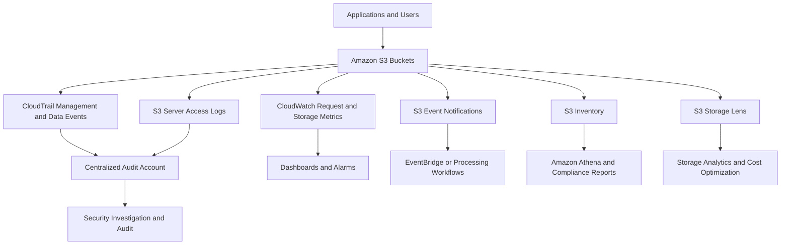

# 11- Monitoring and Auditability Best Practices

## Overview

Amazon S3 monitoring and auditability provide visibility into storage consumption, request performance, access activity, configuration changes, replication health, and security-related events.

A production monitoring strategy must distinguish between operational metrics and audit records. Metrics help identify trends and detect failures. Audit logs provide evidence of who performed an operation, which resource was affected, when the operation occurred, and whether it succeeded.

Amazon S3 integrates with several AWS services to provide these capabilities:

- **Amazon CloudWatch:** Request metrics, storage metrics, replication metrics, dashboards, and alarms.
- **AWS CloudTrail:** Management events and configurable object-level data events.
- **S3 server access logging:** Detailed request records delivered on a best-effort basis.
- **S3 Storage Lens:** Organization-wide visibility into storage usage, activity, and optimization opportunities.
- **S3 Inventory:** Scheduled object-level reports for auditing and reconciliation.
- **Amazon EventBridge and S3 Event Notifications:** Event-driven responses to selected object and replication activities.
- **AWS Config:** Configuration recording and compliance evaluation for supported resources and rules.

These services address different monitoring requirements. No individual service provides complete operational observability, a comprehensive object inventory, and a tamper-resistant audit trail by itself.

## Build a Layered Monitoring Architecture

### Separate operational monitoring from audit collection

Use an observability architecture that combines near-real-time metrics, audit events, scheduled inventory, and centralized log retention.



Each component has a distinct responsibility.

| Component | Primary purpose | Typical processing frequency | Main limitation |
|---|---|---|---|
| CloudWatch request metrics | Request volume, latency, error rates, traffic | One-minute intervals after processing latency | Metrics are not a complete record of every request |
| CloudWatch storage metrics | Stored bytes and object counts | Daily | Not suitable for detecting immediate request failures |
| CloudWatch replication metrics | Replication backlog, latency, and failed operations | Minute-level monitoring when enabled | Requires replication metrics configuration |
| CloudTrail | Identity, API activity, and resource changes | Delivery is delayed; not an immediate alerting guarantee | S3 object-level data events require explicit configuration and incur charges |
| S3 server access logging | Detailed request records | Best-effort delivery, generally within hours | Completeness and delivery time are not guaranteed |
| S3 Inventory | Object-level metadata and configuration audits | Daily or weekly | Represents a scheduled report, not a real-time view |
| S3 Storage Lens | Account, organization, bucket, and storage-class trends | Daily metrics | Not a substitute for request-level monitoring |
| S3 event notifications | Trigger downstream processing or responses | Event-driven | Consumers must handle retries, duplicate events, and failures |
| AWS Config | Supported resource configuration and compliance checks | Depends on recording and evaluation configuration | Does not replace object-level request auditing |

Design the architecture around the required detection time, audit coverage, retention period, investigation workflow, and acceptable operating cost.

## Monitor S3 with Amazon CloudWatch

### Understand the available metrics

Amazon S3 provides daily storage metrics and optional request metrics. Replication metrics are also available for supported replication configurations.

| Metric category | Examples | Recommended use |
|---|---|---|
| Storage metrics | `BucketSizeBytes`, `NumberOfObjects` | Storage growth, capacity trends, and unexpected usage |
| Request metrics | `AllRequests`, `GetRequests`, `PutRequests` | Traffic changes, request volumes, and workload baselines |
| Error metrics | `4xxErrors`, `5xxErrors` | Client request failures and service-side errors |
| Latency metrics | `FirstByteLatency`, `TotalRequestLatency` | Request performance and regression detection |
| Traffic metrics | `BytesDownloaded`, `BytesUploaded` | Data movement and changes in transfer patterns |
| Replication metrics | `BytesPendingReplication`, `OperationsPendingReplication`, `ReplicationLatency`, `OperationsFailedReplication` | Replication lag and recovery readiness |

Metric availability depends on the applicable configuration, operation, and reporting behavior. CloudWatch metrics are delivered on a best-effort basis; do not use them as the sole record of requests for billing reconciliation or forensic evidence.

Reference: [Monitoring metrics with Amazon CloudWatch](https://docs.aws.amazon.com/AmazonS3/latest/userguide/cloudwatch-monitoring.html).

### Enable request metrics deliberately

S3 request metrics are not enabled for every bucket by default. Create a metrics configuration for the workload that requires near-real-time request visibility.

Example configuration for an entire bucket:

`metrics.json`

```json
{
  "Id": "EntireBucket",
  "Filter": {}
}
```

Apply the configuration:

```bash
aws s3api put-bucket-metrics-configuration \
  --bucket "$BUCKET" \
  --id EntireBucket \
  --metrics-configuration file://metrics.json
```

Verify it:

```bash
aws s3api get-bucket-metrics-configuration \
  --bucket "$BUCKET" \
  --id EntireBucket
```

Request metrics can also be scoped using supported filters such as object prefixes, tags, and access points. Use filters to associate monitoring with specific applications, processing pipelines, or business workloads.

Request metrics incur CloudWatch charges. Estimate metric, dashboard, alarm, and API costs before enabling many overlapping configurations.

### Define actionable alarms

Alarms should identify meaningful operational risk rather than simply detect any change in traffic.

Recommended signals include:

| Signal | Example alarm condition | Operational response |
|---|---|---|
| Elevated 5xx errors | Error rate exceeds the workload's baseline for a sustained interval | Check service health, request patterns, and application retries |
| Elevated 4xx errors | Unexpected increase in authorization or client errors | Investigate IAM changes, credentials, signed requests, and client behavior |
| Increased latency | Request latency exceeds the agreed service objective | Inspect network paths, request sizes, concurrency, and downstream bottlenecks |
| Unexpected storage growth | Stored bytes grow beyond the forecast | Identify the responsible bucket, storage class, prefix, or ingestion pipeline |
| Replication backlog | Pending bytes or operations continue increasing | Investigate destination access, KMS permissions, service constraints, and destination health |
| Replication failures | Failed replication operations exceed the accepted threshold | Inspect failure events and object-level replication status |

Prefer percentage-based error rates or normalized thresholds when request volume varies significantly. An absolute count of 100 errors has a different meaning for a system handling 1,000 requests and one handling 100 million requests.

For critical workloads, define an operational response for every alarm. An alarm that does not lead to a documented investigation or remediation process is unlikely to improve reliability.

### Distinguish daily storage metrics from request metrics

Storage metrics are reported daily and are available at no additional S3 storage-metrics charge. Request metrics provide one-minute monitoring after processing latency but incur applicable CloudWatch charges.

Do not build a real-time incident alert around `BucketSizeBytes` or `NumberOfObjects`. Use request metrics and application-level telemetry for immediate operational signals.

Reference: [Creating CloudWatch metrics configurations](https://docs.aws.amazon.com/AmazonS3/latest/userguide/metrics-configurations.html).

## Configure AWS CloudTrail for Auditability

### Capture management events

CloudTrail records API activity for supported AWS service operations. Management events include control-plane operations such as changes to bucket configuration, policies, versioning, encryption, lifecycle rules, and logging configuration.

For production auditability:
- Use an appropriately configured multi-Region trail or an organizational trail.
- Centralize the resulting logs in an account designated for security and audit evidence.
- Restrict who can modify trails and their destination configuration.
- Define log retention according to audit, security, and regulatory requirements.
- Monitor changes to logging configuration itself.
- Use CloudTrail log file integrity validation where required by the audit model.

CloudTrail management events provide evidence of administrative changes but do not automatically record every object read or write.

### Enable object-level data events

S3 object-level operations such as `GetObject`, `PutObject`, and `DeleteObject` are data events. CloudTrail does not log these events by default for a trail unless the relevant data-event coverage is configured.

Enable data events for buckets and object populations where the investigation, compliance, or security requirements justify the cost.

Example advanced event selector for write operations on a selected bucket:

`selectors.json`

```json
[
  {
    "Name": "AuditS3ObjectWrites",
    "FieldSelectors": [
      {
        "Field": "eventCategory",
        "Equals": ["Data"]
      },
      {
        "Field": "resources.type",
        "Equals": ["AWS::S3::Object"]
      },
      {
        "Field": "resources.ARN",
        "StartsWith": [
          "arn:aws:s3:::YOUR-BUCKET-NAME/"
        ]
      },
      {
        "Field": "readOnly",
        "Equals": ["false"]
      }
    ]
  }
]
```

Apply these selectors to an existing trail only after inspecting its current configuration:

```bash
aws cloudtrail get-event-selectors \
  --trail-name "$TRAIL_NAME"
```

Then configure the advanced selectors:

```bash
aws cloudtrail put-event-selectors \
  --trail-name "$TRAIL_NAME" \
  --advanced-event-selectors file://selectors.json
```

**Important:** `put-event-selectors` replaces the trail's existing event-selector configuration. Advanced event selectors and basic event selectors cannot be used together on the same trail. Preserve required management-event and other data-event coverage when updating selectors. The example selector is intended to add object-write audit coverage; a complete trail configuration must retain any other required selectors.

The `readOnly` filter set to `false` selects write events, not only deletes. It can include writes and other state-changing object operations. Use the `eventName` field if the audit requirement specifies particular operations, such as `PutObject`, `DeleteObject`, or `CompleteMultipartUpload`.

CloudTrail data events incur additional charges. Use advanced event selectors to restrict coverage to relevant buckets, prefixes, operations, and resource types.

References:

- [Logging S3 data events](https://docs.aws.amazon.com/AmazonS3/latest/userguide/enable-cloudtrail-logging-for-s3.html)
- [Filtering CloudTrail data events](https://docs.aws.amazon.com/awscloudtrail/latest/userguide/filtering-data-events.html)

### Understand the audit record

CloudTrail events can help answer:

- Which identity performed an operation?
- Which API operation was invoked?
- Which bucket or object was affected?
- When did the event occur?
- Which source address or user-agent information was recorded?
- Did the event report an error?
- Which session, role, or account was associated with the request?

Interpret the event in context. An assumed role may be acting on behalf of an application, scheduled job, deployment pipeline, or human operator. Correlate the event with application logs, deployment records, session details, and other evidence before attributing intent.

Do not assume CloudTrail records every failed request. AWS documents that CloudTrail does not deliver records for requests that fail authentication because the credentials are invalid or for requests rejected through redirection. Use complementary logging and application telemetry when complete request diagnostics are required.

## Use S3 Server Access Logging for Request-Level Evidence

### Understand when server access logs are useful

S3 server access logging records detailed information about requests made to a bucket. It can help with access investigations, workload analysis, operational troubleshooting, and understanding usage patterns.

Server access logging is disabled by default.

For a general purpose bucket using an S3 bucket destination:
- Configure a dedicated destination bucket in the same AWS account and Region as the source bucket.
- Grant the S3 logging delivery service the required destination permissions.
- Use a separate destination bucket to simplify retention and analysis.
- Do not enable server access logging on the destination bucket.
- Avoid a destination that has S3 Object Lock enabled or a default retention period, because such a bucket cannot be used for this server-access-log destination configuration.
- Account for ongoing storage charges for the delivered log objects.

Server access logging is delivered on a best-effort basis. Records are generally delivered within a few hours, but completeness and delivery times are not guaranteed.

Reference: [Enabling S3 server access logging](https://docs.aws.amazon.com/AmazonS3/latest/userguide/enable-server-access-logging.html).

### Configure a dedicated logging destination

Use a dedicated bucket for operational access logs and keep its configuration separate from the application bucket.

Example `logging.json`:

```json
{
  "LoggingEnabled": {
    "TargetBucket": "YOUR-S3-ACCESS-LOG-BUCKET",
    "TargetPrefix": "application-bucket/"
  }
}
```

Apply the logging configuration:

```bash
aws s3api put-bucket-logging \
  --bucket "$BUCKET" \
  --bucket-logging-status file://logging.json
```

Verify the configuration:

```bash
aws s3api get-bucket-logging \
  --bucket "$BUCKET"
```

Configuring the source bucket alone does not prove that log delivery is working. Validate the destination permissions and confirm that log objects actually arrive.

If centralized cross-account or cross-Region log aggregation is required, evaluate AWS's supported server access log delivery options, including delivery to CloudWatch Logs, rather than assuming the traditional S3 destination configuration supports arbitrary destination accounts and Regions.

### Use server access logs and CloudTrail together

The services complement each other.

| Requirement | CloudTrail | Server access logging |
|---|---|---|
| Administrative changes | Appropriate for supported management events | Not the primary source |
| Explicit object-level API audit | Requires configured data events | Provides detailed request records |
| Failed authentication diagnosis | Does not record all invalid-credential failures | Can capture request-level evidence for failures |
| Security investigations | Identity and API event context | Detailed bucket request information |
| Delivery latency | Depends on event type and delivery pipeline | Best-effort, commonly within hours |
| Delivery completeness | Subject to event coverage and service behavior | Best-effort, with no completeness guarantee |
| Cost control | Data-event selection is essential | Log storage and processing costs remain relevant |

Neither source should be treated as a guaranteed, complete record of every attempted request. For important workflows, combine AWS audit evidence with structured application logging and business-level correlation identifiers.

Reference: [Amazon S3 logging options](https://docs.aws.amazon.com/AmazonS3/latest/userguide/logging-with-S3.html).

## Audit Object Populations with S3 Inventory

### Use scheduled inventory reports

S3 Inventory produces scheduled reports containing objects and selected metadata. Reports can include current versions only or all versions, depending on the inventory configuration.

Inventory is appropriate for:
- Auditing encryption and storage classes.
- Finding objects that have not transitioned as expected.
- Reviewing version and object metadata.
- Checking replication status.
- Reconciling large object populations.
- Supporting compliance reporting.
- Identifying stale or unexpectedly large objects.

Reports can be delivered in CSV, ORC, or Parquet formats, depending on the configured output format.

Inventory avoids relying on repeated synchronous `List` operations for large-scale audits and does not affect the request rate of the source bucket through those list operations.

Reference: [Cataloging data with S3 Inventory](https://docs.aws.amazon.com/AmazonS3/latest/userguide/storage-inventory.html).

### Choose the required metadata fields

Select only the fields required for the audit or analytical workflow.

| Field | Example use |
|---|---|
| Object key and version ID | Identify a specific object version |
| Object size | Find unusually large objects and support storage analysis |
| Last modified date | Locate stale objects or validate ingestion activity |
| Storage class | Verify lifecycle and storage-class policies |
| Encryption status | Audit the encryption method |
| Replication status | Find objects that are pending, failed, or replicated |
| Multipart upload indicator | Support analysis of upload behavior |
| Object tags, when configured and supported | Audit application classification and governance metadata |

For versioned buckets, consider whether an audit must include noncurrent versions and delete markers. A current-version-only report may not reveal retained historical data that still consumes storage or matters for recovery.

### Query inventory with Athena

Use Parquet inventory reports when repeated analytical queries justify a columnar format. Register the inventory dataset in an appropriate AWS Glue Data Catalog database and table, then use Athena to query the reports.

For example, a conceptual query can identify objects using a specific storage class:

```sql
SELECT
    storage_class,
    COUNT(*) AS object_count,
    SUM(size) AS total_bytes
FROM s3_inventory
WHERE storage_class IS NOT NULL
GROUP BY storage_class
ORDER BY total_bytes DESC;
```

Adapt the table name and column names to the actual schema generated by the selected inventory configuration. The query assumes that the inventory dataset is registered and that `size` contains object sizes in bytes.

For large datasets, constrain queries to the relevant report partitions or dates. Athena charges for data scanned, so avoid repeatedly scanning historical inventory data when the question requires only the latest report.

## Monitor Storage Trends with S3 Storage Lens

### Use Storage Lens for organization-wide visibility

S3 Storage Lens provides visibility into storage usage and activity across accounts, Regions, buckets, storage classes, and supported organizational groupings.

Use it to identify:
- Unexpected storage growth.
- Buckets with unusually large object counts.
- Storage concentrated in expensive classes.
- Opportunities for lifecycle optimization.
- Incomplete or inefficient storage management patterns.
- Account-level trends that are difficult to see from individual bucket dashboards.

Daily metrics are useful for trends and optimization, but they are not suitable for immediate request-failure detection.

Storage Lens can export metrics for analysis, and supported advanced metrics can be published to CloudWatch. CloudWatch publishing can be used with dashboards, alarms, anomaly detection, and metric analysis. Note that Storage Lens metrics published to CloudWatch are daily, and initial publication can take time after enabling the feature.

References:

- [Understanding S3 Storage Lens](https://docs.aws.amazon.com/AmazonS3/latest/userguide/storage-lens.html)
- [Monitoring Storage Lens metrics with CloudWatch](https://docs.aws.amazon.com/AmazonS3/latest/userguide/storage-lens-view-metrics-cloudwatch.html)
- [Exporting Storage Lens metrics](https://docs.aws.amazon.com/AmazonS3/latest/userguide/storage_lens_view_metrics_export.html)

## Monitor Replication and Recovery Readiness

### Track the replication backlog

When using Same-Region Replication (SRR) or Cross-Region Replication (CRR), monitor both aggregate replication health and individual object outcomes.

Enable replication metrics for important rules. Monitor:
- `BytesPendingReplication`
- `OperationsPendingReplication`
- `ReplicationLatency`
- `OperationsFailedReplication`

These metrics help determine whether replication is keeping up with writes and whether a destination is falling behind.

A sustained increase in pending bytes or operations can indicate insufficient progress. Investigate whether the backlog is temporary or growing continuously before changing the replication configuration.

Replication metrics incur CloudWatch charges. They are enabled automatically when using S3 Replication Time Control, and can also be enabled independently where supported.

### Capture replication failure events

Use S3 replication event notifications to receive relevant failure signals, such as `s3:Replication:OperationFailedReplication`.

A typical response workflow should:
1. Receive the replication event.
2. Record the affected bucket, object, version, and event details where available.
3. Send the event to an investigation or alerting workflow.
4. Inspect object-level replication status and failure evidence.
5. Remediate the underlying issue.
6. Verify replication or perform an approved recovery process.

Do not treat the existence of a destination object as proof that the required replication policy, version, encryption configuration, or recovery permissions are correct.

References:

- [Monitoring replication with metrics and events](https://docs.aws.amazon.com/AmazonS3/latest/userguide/replication-metrics.html)
- [Using S3 replication metrics](https://docs.aws.amazon.com/AmazonS3/latest/userguide/repl-metrics.html)
- [Receiving replication failure events](https://docs.aws.amazon.com/AmazonS3/latest/userguide/replication-metrics-events.html)

## Respond to S3 Events Safely

### Use events for targeted responses

S3 Event Notifications and CloudTrail event delivery through EventBridge can trigger automation in response to selected events.

Examples include:
- Sending an alert after a replication failure.
- Initiating document processing after an upload.
- Recording selected security-relevant object operations.
- Triggering a workflow when an object is removed.
- Sending a notification when a compliance-relevant event occurs.

Choose the event source according to the requirement. S3 object notifications are useful for supported object activity, while CloudTrail events can expose API activity covered by the relevant CloudTrail configuration.

### Make event processing idempotent

Do not assume event delivery happens exactly once or in the order required by the application.

A consumer should:
- Tolerate duplicate events.
- Handle retries and failed downstream calls.
- Use an idempotency key based on the event and object identity.
- Account for object version IDs where versioning is enabled.
- Distinguish a delete marker from permanent removal of all versions.
- Send persistent failures to a failure-handling path.
- Emit structured logs and processing metrics.
- Avoid triggering an unbounded event loop by writing to the same event-producing location without suitable filtering.

For business-critical processing, record the event outcome in a durable database or processing store. Use a dead-letter or recovery strategy where supported by the selected event delivery architecture.

## Centralize and Protect Audit Evidence

### Use a dedicated audit account

For production and multi-account environments, centralize logs in a security or log-archive account where practical.

A centralized design should:
- Separate log storage from the accounts running application workloads.
- Restrict write and administrative permissions independently.
- Limit who can change retention and destination settings.
- Use encryption appropriate to the audit requirements.
- Protect critical audit data against unauthorized deletion and modification.
- Retain enough context for forensic investigations.
- Record changes to monitoring and audit infrastructure.
- Test that events and logs arrive from every required account and Region.

An account boundary reduces the chance that a compromised workload role can also erase the evidence needed to investigate the incident. It does not remove the need for restrictive IAM policies and service-specific resource policies.

### Define retention and integrity requirements

Audit retention must reflect legal, security, operational, and business requirements.

Before choosing a retention period, identify:
- The minimum required retention.
- Whether immutability is required.
- Who can read the evidence.
- Who can delete or change the evidence.
- Whether data must be retained across account or Region boundaries.
- Whether log access must itself be audited.
- The process for preserving evidence during an incident.

CloudTrail log file integrity validation can help detect modification or deletion of delivered log files after delivery. For high-assurance retention, evaluate suitable S3 Object Lock configurations and recovery controls against the applicable service requirements.

Do not assume encryption alone makes audit logs immutable. Encryption protects confidentiality under its key-management model; it does not automatically prevent an authorized principal from deleting or replacing log objects.

### Avoid monitoring blind spots

Common gaps include:
- CloudTrail configured only for management events when object-level evidence is required.
- Data-event selectors that cover only some buckets or prefixes.
- Request metrics disabled for critical workloads.
- Server access log delivery configured but never verified.
- Log retention too short for investigation requirements.
- Excessive permissions to edit or delete logging configurations.
- Replication monitoring that covers aggregate metrics but not object failures.
- Daily inventory reports mistaken for a real-time view.
- Event consumers that process duplicates without idempotency.
- Alerts that have no owner or documented response.

Review audit coverage after bucket creation, account onboarding, workload migration, and infrastructure changes. Treat logging coverage as an explicitly managed production configuration.

## Troubleshoot Monitoring and Audit Gaps

### Follow a repeatable diagnostic process

| Symptom | Likely causes | Verification approach |
|---|---|---|
| No S3 request metrics appear | Request metrics not enabled, filter mismatch, or reporting delay | Inspect the bucket metrics configuration and wait for metric publication |
| No object-level CloudTrail events | Data-event selectors missing or incorrect, wrong trail, or wrong resource scope | Inspect the trail's event selectors and confirm the bucket ARN is covered |
| CloudTrail logs configuration changes but not object reads | Management events configured without the required data events | Review data-event coverage and cost constraints |
| Server access logs do not arrive | Destination policy, Region, account, or configuration issue | Inspect `get-bucket-logging`, destination permissions, and delivered objects |
| Inventory report is missing or incomplete | Destination permission, disabled configuration, or report generation delay | Inspect the inventory configuration and report destination |
| Inventory reports show unexpected encryption or replication state | Existing objects differ from expected policy or replication has not completed | Review the exact object version, encryption metadata, replication status, and policy |
| Replication latency is rising | Destination errors, permissions problems, KMS failures, or sustained backlog | Inspect replication metrics, failure events, and object-level status |
| CloudWatch alarms never trigger | Wrong metric dimensions, threshold, evaluation periods, or missing metrics | Inspect alarm configuration and confirm the metric exists with the expected dimensions |
| Storage Lens values appear stale | Daily publication delay or unsupported granularity | Check the report period, configuration, and publication status |
| Audit trail contains unexpected gaps | Selector exclusions, delivery issues, short retention, or incorrect assumptions about event coverage | Compare requirements against selectors, destinations, retention, and source-specific coverage |

A disciplined diagnosis distinguishes a configuration failure from an expected reporting delay or a monitoring feature that never covered the event in question.

## Operational Verification Commands

Use these commands during deployment validation and recurring audits.

Inspect bucket logging:

```bash
aws s3api get-bucket-logging \
  --bucket "$BUCKET"
```

Inspect bucket metrics configuration:

```bash
aws s3api get-bucket-metrics-configuration \
  --bucket "$BUCKET" \
  --id EntireBucket
```

Inspect bucket inventory configuration:

```bash
aws s3api list-bucket-inventory-configurations \
  --bucket "$BUCKET"
```

Inspect replication configuration:

```bash
aws s3api get-bucket-replication \
  --bucket "$BUCKET"
```

Inspect an object's metadata and replication status where available:

```bash
aws s3api head-object \
  --bucket "$BUCKET" \
  --key "$OBJECT_KEY"
```

Inspect CloudTrail event selectors:

```bash
aws cloudtrail get-event-selectors \
  --trail-name "$TRAIL_NAME"
```

Inspect the state of a CloudTrail trail:

```bash
aws cloudtrail get-trail-status \
  --name "$TRAIL_NAME"
```

These commands confirm configuration or provide current object metadata; they do not independently prove that all relevant events are being captured, delivered, retained, and queried correctly.

Include test events and destination checks in deployment validation.

## Production Monitoring Checklist

- [ ] Critical buckets have documented monitoring and audit requirements.
- [ ] Request metrics are enabled for workloads requiring near-real-time request visibility.
- [ ] CloudWatch alarms use meaningful thresholds and have named owners or response procedures.
- [ ] Storage and request metrics are treated as operational signals, not complete audit records.
- [ ] CloudTrail management events cover the required administrative changes.
- [ ] CloudTrail data events cover the required buckets, prefixes, and object operations.
- [ ] Existing CloudTrail selectors are preserved and reviewed before changes.
- [ ] Server access log destinations have the appropriate permissions and are monitored for delivery.
- [ ] Audit logs are centralized and protected from unauthorized modification or deletion.
- [ ] Inventory reports include the object versions and metadata needed for audits.
- [ ] Storage Lens supports account-level and bucket-level trend analysis where appropriate.
- [ ] Replication metrics and failure events cover critical replication rules.
- [ ] Event-driven processing is idempotent and handles retries and persistent failures.
- [ ] Audit retention and integrity controls meet documented requirements.
- [ ] Monitoring configuration is tested after infrastructure changes.
- [ ] Operational runbooks explain how to investigate missing logs, metric anomalies, and replication failures.
- [ ] Monitoring and audit costs are included in the operating budget.

## Authoritative References

- [Logging and monitoring in Amazon S3](https://docs.aws.amazon.com/AmazonS3/latest/userguide/monitoring-overview.html)
- [Amazon S3 CloudWatch metrics](https://docs.aws.amazon.com/AmazonS3/latest/userguide/cloudwatch-monitoring.html)
- [CloudWatch metrics configurations](https://docs.aws.amazon.com/AmazonS3/latest/userguide/metrics-configurations.html)
- [Logging S3 data events with CloudTrail](https://docs.aws.amazon.com/AmazonS3/latest/userguide/enable-cloudtrail-logging-for-s3.html)
- [CloudTrail data-event selectors](https://docs.aws.amazon.com/awscloudtrail/latest/userguide/filtering-data-events.html)
- [Amazon S3 logging options](https://docs.aws.amazon.com/AmazonS3/latest/userguide/logging-with-S3.html)
- [S3 server access logging](https://docs.aws.amazon.com/AmazonS3/latest/userguide/enable-server-access-logging.html)
- [S3 Inventory](https://docs.aws.amazon.com/AmazonS3/latest/userguide/storage-inventory.html)
- [S3 Storage Lens](https://docs.aws.amazon.com/AmazonS3/latest/userguide/storage-lens.html)
- [Monitoring replication metrics and events](https://docs.aws.amazon.com/AmazonS3/latest/userguide/replication-metrics.html)
- [CloudTrail pricing and cost management](https://docs.aws.amazon.com/awscloudtrail/latest/userguide/cloudtrail-trail-manage-costs.html)

## Key Takeaways

- Combine CloudWatch metrics, CloudTrail, server access logging, S3 Inventory, and Storage Lens because each covers a different observability or audit requirement.
- Enable CloudTrail data events explicitly for the object-level API activity that must be audited, and use advanced selectors to control coverage and cost.
- Centralize and protect audit records, verify log delivery, and document retention, integrity, and access-control requirements.
- Monitor replication backlogs and failures independently of aggregate storage metrics, and verify object-level status during recovery investigations.
- Treat monitoring configuration as production infrastructure: validate coverage, test alerts and destinations, and maintain actionable runbooks for detecting and resolving gaps.
You've reached the maximum length for this conversation, but you can keep talking by starting a new chat.
Start new chat