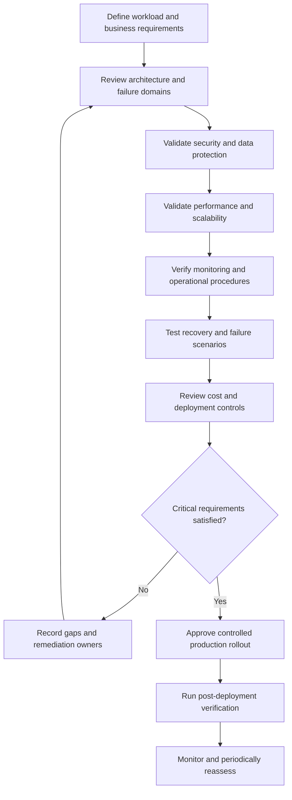

# 12- Production Readiness Checklist

## Overview

Amazon S3 production readiness requires more than creating a bucket and uploading objects. A production-grade implementation must address access control, data protection, reliability, application integration, observability, operational recovery, performance, cost management, and infrastructure change control.

This checklist provides a practical review framework for backend applications, data platforms, event-driven processing systems, static websites, and document-storage services built on Amazon S3.

Use it during architecture reviews, pre-production validation, release approvals, periodic security assessments, and disaster recovery exercises.

The checklist follows a defense-in-depth approach:

- **Security:** Only authorized identities and applications can access data.
- **Reliability:** Failures, retries, and partial operations have defined recovery paths.
- **Data protection:** Encryption, versioning, retention, and recovery meet business requirements.
- **Performance:** Uploads, downloads, and object-processing workflows meet latency and throughput objectives.
- **Observability:** Operators can detect, investigate, and resolve failures.
- **Cost efficiency:** Storage, requests, retrievals, and data transfer remain within approved budgets.
- **Operational control:** Infrastructure changes are reviewed, tested, reversible where practical, and auditable.

A checklist item should be marked complete only when its configuration or behavior has been verified. An intended configuration, an untested recovery procedure, or a successful Terraform plan is not evidence that the production system works as expected.

## Production Readiness Review Workflow

Use the following workflow before approving an S3-backed workload for production.



Classify each item as one of the following:

| Status | Meaning |
|---|---|
| Complete | Implemented and supported by verification evidence |
| In progress | Implementation or verification is incomplete |
| Not applicable | The control does not apply; record the rationale |
| Blocked | A dependency or unresolved issue prevents completion |

Security-critical gaps, unrecoverable data risks, and unmet mandatory business requirements must not be waived merely because the application passes functional tests.

## Architecture and Requirements

### Workload and data design

- [ ] Business requirements define the types of objects stored, their sensitivity, expected volume, and access patterns.
- [ ] Data classification identifies public, internal, confidential, and regulated information where applicable.
- [ ] Expected object counts, size distributions, daily upload volumes, and retrieval rates are documented.
- [ ] Bucket and prefix conventions support ownership, environment separation, retention, and operational discovery.
- [ ] Object keys are generated by trusted application logic rather than accepting unrestricted user-controlled paths.
- [ ] Metadata and tags are used consistently without unnecessarily exposing sensitive information.
- [ ] The system defines ownership of buckets, objects, encryption keys, and associated AWS resources.
- [ ] Regional requirements, data residency obligations, and account boundaries are documented.
- [ ] Storage class selection reflects actual access patterns, retrieval requirements, and retention periods.
- [ ] The architecture distinguishes required application availability from S3 service availability.

### End-to-end architecture

- [ ] The role of S3 in the application architecture is documented.
- [ ] Direct uploads, backend-proxied uploads, downloads, and presigned URL workflows are explicitly designed.
- [ ] API endpoints enforce application authentication and object-level authorization before granting access.
- [ ] Application metadata and S3 object state have a defined consistency and reconciliation strategy.
- [ ] The design specifies how orphaned uploads, missing objects, duplicate requests, and abandoned processing jobs are handled.
- [ ] Dependencies on CloudFront, Lambda, SQS, SNS, EventBridge, KMS, databases, and other services are documented where applicable.
- [ ] Public website delivery uses an appropriate distribution architecture instead of exposing a private data bucket unnecessarily.
- [ ] Multi-tenant storage boundaries prevent one tenant from accessing another tenant's objects.
- [ ] The architecture identifies component failure domains and avoids relying on undocumented assumptions about dependencies.
- [ ] Design decisions include alternatives and relevant cost, security, performance, and operational trade-offs.

## Security and Access Control

### Bucket security

- [ ] S3 Block Public Access settings are enabled at the appropriate account and bucket levels unless a reviewed exception is justified.
- [ ] Bucket policies follow least privilege and restrict access to approved principals and operations.
- [ ] S3 Object Ownership is configured appropriately, typically using Bucket owner enforced to disable ACLs.
- [ ] Object ACLs are not used as a substitute for a reviewed authorization model.
- [ ] Unintended cross-account access has been eliminated.
- [ ] Access points and VPC endpoints are used where they materially improve access isolation or network controls.
- [ ] The policy review considers explicit denies, permissions boundaries, session policies, service control policies, and other applicable authorization controls.
- [ ] Administrative access is separated from ordinary application access.
- [ ] Production changes to bucket policies and public-access settings require appropriate review.

### IAM and credentials

- [ ] Workloads use IAM roles and temporary credentials wherever appropriate.
- [ ] Long-lived AWS access keys are not embedded in source code, container images, environment files committed to Git, or CI/CD workflows.
- [ ] Application roles receive only the required S3 actions on the intended resources.
- [ ] Object listing permissions are granted only where required.
- [ ] Read, write, delete, tagging, multipart, and replication permissions have been evaluated separately.
- [ ] Cross-account access explicitly accounts for both the caller's permissions and the target resource's authorization rules.
- [ ] AWS SDK credential resolution uses the intended execution role, workload identity, or approved credential source.
- [ ] Production credentials are not shared between unrelated workloads.
- [ ] Permission changes are tested with the actual runtime identity.

### Presigned URL security

- [ ] The API authorizes the requesting user before issuing a presigned URL.
- [ ] The URL permits only the intended operation and object.
- [ ] Expiration is as short as the business workflow permits.
- [ ] Object keys are generated securely, and users cannot select arbitrary protected objects.
- [ ] The application validates file size, expected content type, file format, and other relevant upload restrictions.
- [ ] Successful upload completion is verified before the object is treated as trusted application data.
- [ ] Signed URLs are excluded or redacted from logs, analytics, and error reports.
- [ ] Upload URLs and download URLs are treated as bearer capabilities.
- [ ] The application accounts for URL expiry, credential expiry, credential revocation, and policy changes.
- [ ] Overwrite behavior and duplicate upload attempts have been considered.

Presigned URLs do not replace application authorization or object validation. Uploading directly to S3 avoids routing the entire file through the backend, but it transfers responsibility for upload verification and related failure handling to the application workflow.

### Security verification

- [ ] Security testing covers unauthorized reads, writes, listing, deletion, and cross-tenant access.
- [ ] Attempts to access another tenant's known object key are rejected.
- [ ] Bucket policies and public-access settings are inspected after deployment.
- [ ] Relevant S3 API activity and configuration changes are covered by the required audit controls.
- [ ] Security findings have assigned owners and remediation deadlines.
- [ ] Public exposure and overly permissive policy checks are included in recurring reviews.

For detailed access-control and encryption requirements, maintain dedicated S3 security and encryption documentation rather than duplicating every policy definition here.

## Encryption and Data Protection

### Encryption at rest

- [ ] Bucket default encryption is configured or verified against organizational requirements.
- [ ] The choice between SSE-S3, SSE-KMS, DSSE-KMS, and other supported methods is documented.
- [ ] Customer managed KMS keys are used when key-level permissions, governance, or auditing requirements justify them.
- [ ] KMS key policies and application IAM policies authorize only the required cryptographic operations.
- [ ] KMS authorization failures are distinguished from S3 authorization failures.
- [ ] Key rotation and key lifecycle procedures are documented where applicable.
- [ ] Key administrators and ordinary application identities have appropriately separated responsibilities.
- [ ] Key disablement and deletion procedures account for production dependencies and recoverability.
- [ ] Existing objects are audited when encryption requirements change.
- [ ] Encryption requirements are validated for replication, copying, multipart uploads, and other applicable workflows.

### Data integrity and retention

- [ ] The system defines how object integrity is verified for uploads, copies, migrations, and recovery.
- [ ] Checksums are used where appropriate instead of treating ETags as universal content hashes.
- [ ] Object versioning is enabled when accidental overwrite recovery or version history is required.
- [ ] Versioning behavior is understood, including delete markers and noncurrent versions.
- [ ] Lifecycle transitions and expiration rules match the approved retention policy.
- [ ] Legal holds, retention obligations, and S3 Object Lock requirements are addressed where applicable.
- [ ] Recovery procedures distinguish logical deletion, version recovery, and permanent deletion.
- [ ] Historical objects are included in retention and storage-cost assessments.
- [ ] The system documents how records are removed when deletion is legally and operationally permitted.

Encryption, versioning, replication, and backup solve different problems. None should be treated as a complete substitute for the others.

## Reliability, Versioning, and Replication

### Reliability requirements

- [ ] Availability requirements are defined for object upload, download, metadata lookup, and background processing.
- [ ] The design uses appropriate timeouts, retries, and backoff for transient failures.
- [ ] Retry policies distinguish transient failures from authorization, validation, and other permanent failures.
- [ ] Retries use bounded attempts and exponential backoff with jitter where appropriate.
- [ ] Upload and processing workflows tolerate duplicate requests and partial completion.
- [ ] The system does not assume that successful object storage automatically means successful downstream processing.
- [ ] Application state can be reconciled when database updates, S3 operations, and event processing complete at different times.
- [ ] Failure scenarios have documented operational responses and escalation paths.

### Versioning and deletion recovery

- [ ] Bucket versioning configuration matches the data-protection requirements.
- [ ] Applications understand how version IDs affect reading, updating, and deleting objects.
- [ ] Delete-marker behavior is tested for versioned buckets.
- [ ] Lifecycle policies explicitly manage noncurrent versions where appropriate.
- [ ] Retention and deletion rules do not remove recoverable versions prematurely.
- [ ] Recovery from accidental overwrite or deletion has been tested.
- [ ] Version accumulation and its associated storage costs are monitored.
- [ ] Permanent deletion is restricted to authorized, controlled workflows.

### Replication and regional recovery

- [ ] Same-Region Replication or Cross-Region Replication is configured when the recovery design requires it.
- [ ] Source and destination buckets have the required versioning configuration.
- [ ] Replication roles and resource policies follow least privilege.
- [ ] Encrypted-object replication includes the required source and destination KMS permissions.
- [ ] Replication rules cover the intended prefixes, tags, and object populations.
- [ ] Existing objects requiring migration are handled through a suitable migration process rather than assumed to replicate automatically.
- [ ] Replication status and relevant failure metrics are monitored.
- [ ] The design accounts for replication lag and failures.
- [ ] Destination ownership, encryption, access control, and retention have been verified.
- [ ] The disaster recovery runbook identifies which resources and dependencies must be restored in the recovery Region.
- [ ] Recovery time objective (RTO) and recovery point objective (RPO) requirements are explicit.
- [ ] Recovery exercises demonstrate that the destination data can actually be accessed and decrypted.

Replication is not synonymous with backup. A replicated deletion, overwrite, or unwanted change may propagate according to the configured behavior. Recovery plans must account for both logical errors and infrastructure or regional failures.

## Upload and Download Performance

### Upload behavior

- [ ] Upload methods are appropriate for file size, expected concurrency, and network constraints.
- [ ] Multipart upload is used when it improves reliability or performance for large objects.
- [ ] Multipart thresholds, part sizes, and concurrency are tested against representative workloads.
- [ ] Incomplete multipart uploads are monitored and cleaned up through an appropriate lifecycle policy.
- [ ] Large file uploads do not unnecessarily consume backend worker memory or hold HTTP connections for extended periods.
- [ ] Direct-to-S3 uploads are evaluated for large client uploads.
- [ ] Upload completion is verified before application records are finalized.
- [ ] Checksum and content-validation requirements are documented.
- [ ] Retry behavior does not create unbounded duplicate work or uncontrolled resource consumption.

### Download behavior

- [ ] Frequently requested content uses an appropriate delivery path, such as CloudFront where beneficial.
- [ ] Download authorization is checked before generating signed URLs or returning object data.
- [ ] Large downloads use streaming or direct delivery instead of loading entire files into application memory.
- [ ] Connection and read timeouts are configured appropriately.
- [ ] Range requests are supported where the application needs partial downloads or resumability.
- [ ] Cache-control metadata and CDN cache policies match the sensitivity and freshness requirements.
- [ ] Archived objects have explicit restoration handling instead of being assumed immediately available.
- [ ] Network egress, data-transfer costs, and expected client concurrency have been evaluated.

### Scalability validation

- [ ] Representative workloads have been load-tested.
- [ ] The application has been tested under expected peak concurrency.
- [ ] SDK connection reuse and retry configuration have been reviewed.
- [ ] Request volume, object sizes, latency, and error rates are measured.
- [ ] Performance tests account for application bottlenecks as well as S3 behavior.
- [ ] CloudFront, multipart uploads, Transfer Acceleration, or other performance features are enabled only when the measured workload justifies them.

## Backend Application Integration

### Application design

- [ ] S3 operations are implemented in a reusable service layer rather than duplicated across route handlers.
- [ ] SDK clients use the intended Region and workload credentials.
- [ ] Bucket names, prefixes, KMS key identifiers, and other settings are supplied through controlled configuration.
- [ ] API handlers return consistent errors without exposing internal infrastructure details.
- [ ] Upload and download operations are bounded by file-size, timeout, and concurrency limits appropriate to the workload.
- [ ] User-supplied filenames are sanitized for display and are not trusted as storage identifiers.
- [ ] Object metadata records the required ownership, content type, size, status, and application identifiers.
- [ ] S3 object keys are not treated as proof of user authorization.
- [ ] Database transactions and S3 operations have a documented consistency strategy.
- [ ] Background jobs use idempotent processing and safe retry behavior.

### Event-driven workflows

- [ ] S3 notifications are configured for the intended prefixes, suffixes, and event types.
- [ ] Event filtering prevents accidental recursive processing of output objects.
- [ ] Consumers tolerate duplicate events and out-of-order delivery where applicable.
- [ ] The workflow identifies an object version or another stable processing identifier when necessary.
- [ ] Failed processing attempts are visible and can be retried safely.
- [ ] Dead-letter queues or equivalent recovery mechanisms are configured when justified.
- [ ] Queue visibility timeouts, Lambda timeouts, and retry policies are consistent with processing duration.
- [ ] The workflow records processing state and can identify stuck jobs.
- [ ] Event-driven operations are monitored independently of successful uploads.

S3 event notifications can be delivered more than once and are not guaranteed to arrive in the order in which the events occurred. Design consumers around idempotency rather than assuming exactly-once processing.

## Observability and Auditing

### Metrics and logs

- [ ] Application logs include actionable request and correlation identifiers without logging sensitive data.
- [ ] Upload and download failures are measured separately.
- [ ] Access-denied errors, unexpected object-not-found errors, and throttling or transient failures are observable.
- [ ] Object processing failures and retry counts are monitored.
- [ ] Replication status and restore activity are visible where applicable.
- [ ] Storage volume, object counts, and storage classes are periodically reviewed.
- [ ] KMS errors and relevant key-administration activity are audited where applicable.
- [ ] S3 CloudWatch request metrics are enabled when their added granularity is needed.
- [ ] CloudTrail logging covers the required management and S3 data events.
- [ ] S3 Inventory, Storage Lens, or other reporting mechanisms are used when object-level or fleet-wide visibility is needed.
- [ ] Relevant logs and reports have defined retention and access-control policies.

### Alerts and incident response

- [ ] Alerts are based on actionable failure conditions and defined service-level objectives.
- [ ] Repeated upload failures trigger an appropriate investigation.
- [ ] Sustained increases in download latency or error rates are detectable.
- [ ] Processing backlogs and prolonged job failures can be identified.
- [ ] Critical encryption-key or access-policy changes generate the intended audit or alert signals.
- [ ] Replication failures and recovery risks have clear response procedures.
- [ ] Alert ownership and escalation paths are documented.
- [ ] Operators can distinguish application errors, IAM denials, KMS failures, and missing objects.
- [ ] Runbooks include diagnostic commands and safe corrective actions.
- [ ] Incident exercises verify that the required logs and evidence are available.

## Cost Management

### Storage and request economics

- [ ] Expected monthly storage volume is estimated by bucket and storage class.
- [ ] PUT, GET, LIST, COPY, multipart, transition, restore, and applicable other request costs are considered.
- [ ] Retrieval charges and minimum storage durations are included for applicable classes.
- [ ] Small-object billing and archive metadata overhead are evaluated.
- [ ] Incomplete multipart uploads have a cleanup strategy.
- [ ] Intelligent-Tiering monitoring costs are included where relevant.
- [ ] Bucket Key benefits and KMS request costs are reviewed for SSE-KMS workloads.
- [ ] Data transfer and CloudFront costs have been estimated.
- [ ] Storage growth and version accumulation are monitored.
- [ ] Cost allocation tags and account-level cost reporting support ownership and chargeback where required.

### Guardrails

- [ ] Budgets or anomaly detection are configured where appropriate.
- [ ] Lifecycle changes are reviewed for both cost and data-retention impact.
- [ ] Storage-class migrations are validated against representative object populations.
- [ ] Destructive or expensive bulk operations require controlled execution.
- [ ] Nonproduction buckets use suitable retention and cleanup policies.
- [ ] Unexpected growth in object count, stored bytes, retrieval volume, or transfer is investigated.

Cost optimization must not compromise required access latency, retention, availability, or recovery behavior.

## Infrastructure as Code and Deployment

### Infrastructure definitions

- [ ] Buckets and related resources are managed through reviewed infrastructure as code where practical.
- [ ] Bucket names, Regions, encryption keys, lifecycle policies, versioning, and access controls are explicitly configured.
- [ ] Public-access protections are defined explicitly.
- [ ] IAM roles and bucket policies are reviewed alongside the infrastructure configuration.
- [ ] Dependencies among buckets, notification targets, Lambda functions, KMS keys, and IAM policies are explicit.
- [ ] Environment-specific configuration is separated from reusable infrastructure modules.
- [ ] Terraform state or equivalent deployment state is protected and access-controlled.
- [ ] Provider and module versions are controlled.
- [ ] Production resource deletion is protected by suitable approvals or safeguards.
- [ ] Drift detection and configuration reconciliation procedures are documented.

### CI/CD pipeline

- [ ] Pull requests run applicable formatting, validation, testing, and security checks.
- [ ] Infrastructure plans or equivalent change previews are reviewed before production deployment.
- [ ] CI/CD uses short-lived credentials through an approved identity mechanism, such as AWS IAM OIDC federation where appropriate.
- [ ] Deployment identities have narrowly scoped permissions.
- [ ] Secrets are not hardcoded in repositories, build artifacts, or workflow definitions.
- [ ] Production promotion includes required approval gates.
- [ ] Application and infrastructure changes have an appropriate rollback or forward-fix plan.
- [ ] Deployment records identify the release, change set, environment, and responsible workflow.
- [ ] Post-deployment checks validate the effective AWS resource configuration.
- [ ] Failed or partially completed deployments have documented recovery procedures.

### Release and rollback

- [ ] Deployment has been tested in a representative lower environment.
- [ ] Bucket policy, encryption, versioning, and lifecycle changes have been reviewed for compatibility.
- [ ] Changes that could interrupt existing SDK operations or presigned URLs have been considered.
- [ ] Rollback does not accidentally delete production objects or remove required encryption keys.
- [ ] Lifecycle configuration changes preserve unrelated existing rules.
- [ ] Destructive migrations have a recovery plan and verified prerequisites.
- [ ] A smoke test confirms the deployed system can execute its principal read and write operations.
- [ ] Release evidence is retained for audit and troubleshooting.

## Testing and Failure Validation

### Automated tests

- [ ] Unit tests cover key generation, authorization decisions, validation, and service-layer behavior.
- [ ] AWS SDK calls are mocked or isolated for deterministic unit tests.
- [ ] Integration tests validate real S3 behavior in a controlled environment where appropriate.
- [ ] Tests verify upload, metadata inspection, download, and deletion.
- [ ] Tests cover content-type and file-size validation.
- [ ] Tests cover presigned URL generation and relevant access restrictions.
- [ ] Tests verify expected encryption settings and authorization behavior.
- [ ] Tests cover versioning and lifecycle configuration when those features are required.
- [ ] Event consumers are tested against duplicate delivery and retry scenarios.
- [ ] Destructive integration tests use dedicated resources and never target production data unintentionally.

### Failure scenarios

- [ ] Invalid or expired credentials produce controlled errors.
- [ ] S3 `AccessDenied` and KMS authorization failures can be diagnosed independently.
- [ ] Missing buckets and objects produce appropriate application responses.
- [ ] Network timeouts and transient AWS errors trigger bounded retries where appropriate.
- [ ] Partial or abandoned multipart uploads are handled safely.
- [ ] Duplicate upload or processing requests do not create inconsistent application state.
- [ ] Failed event processing can be retried or recovered without unsafe side effects.
- [ ] Lifecycle changes do not violate required retention periods.
- [ ] Replication failures produce visible operational signals.
- [ ] Recovery from accidental deletion or overwrite has been demonstrated where required.
- [ ] Failure tests establish whether the application remains functional or degrades safely.

## Backup and Disaster Recovery

### Recovery planning

- [ ] Business owners have approved the RTO and RPO.
- [ ] Required recovery data and dependencies are identified.
- [ ] The recovery design accounts for data, KMS keys, IAM permissions, bucket policies, and application configuration.
- [ ] The team distinguishes version-based recovery, replication, and independent backup.
- [ ] Cross-Region recovery is implemented when justified by regional recovery requirements.
- [ ] Destination buckets have compatible access-control and encryption arrangements.
- [ ] Required application configuration and infrastructure definitions are recoverable independently of the primary Region.
- [ ] Restore procedures address the volumes and object counts expected in a real incident.
- [ ] Recovery procedures document verification before recovered data is served to users.
- [ ] Backup retention and recovery access are reviewed for the applicable compliance requirements.

### Recovery exercise

- [ ] A sample object or dataset has been recovered using the documented procedure.
- [ ] Recovered objects can be accessed by the intended application identity.
- [ ] Encrypted objects can be decrypted with the recovery configuration.
- [ ] Object integrity and expected metadata have been verified.
- [ ] Database records, object references, and processing state can be reconciled.
- [ ] Recovery duration has been measured against the RTO.
- [ ] Recovered data freshness has been evaluated against the RPO.
- [ ] Failed steps, access gaps, and manual dependencies are recorded.
- [ ] Recovery gaps have remediation owners and deadlines.

Do not declare disaster recovery ready merely because replication is enabled or backups exist. Readiness requires demonstrating that the data and all necessary dependencies can be recovered within the required business objectives.

## Operational Readiness

### Day-to-day operations

- [ ] Bucket ownership and operational responsibility are documented.
- [ ] Runbooks exist for access failures, missing objects, transfer failures, replication problems, and recovery.
- [ ] Routine reviews cover storage growth, request activity, costs, and significant configuration changes.
- [ ] Critical infrastructure changes are auditable.
- [ ] Object retention and lifecycle configuration are reviewed periodically.
- [ ] Multipart upload cleanup is verified.
- [ ] Application error rates and processing backlogs have assigned owners.
- [ ] Operational procedures account for partial failures and repeated execution.
- [ ] AWS service quotas and any relevant account or workload limits are reviewed before material growth.
- [ ] Personnel with incident responsibilities know how to locate logs, inspect configuration, and execute recovery procedures safely.

### Change management

- [ ] Bucket policy, IAM, KMS, replication, lifecycle, and public-access changes are reviewed according to risk.
- [ ] Changes have an identified owner, deployment plan, and verification method.
- [ ] High-impact changes use staged rollout or representative testing where appropriate.
- [ ] Changes are evaluated for backward compatibility with existing integrations.
- [ ] Manual configuration changes are captured in infrastructure code or reconciled appropriately.
- [ ] Emergency changes are recorded and reviewed afterward.
- [ ] Destructive workflows include explicit confirmation, scoped targets, and recovery considerations.

## Verification Commands

The following AWS CLI commands provide basic evidence for key S3 production controls. Run them using an identity authorized to inspect the target resources.

Set the bucket name for the examples:

```bash
export BUCKET="your-production-bucket"
```

### Check bucket encryption

```bash
aws s3api get-bucket-encryption \
  --bucket "$BUCKET"
```

Verify that the effective default encryption method meets the workload requirements.

### Check public-access configuration

```bash
aws s3api get-public-access-block \
  --bucket "$BUCKET"
```

Review bucket-level Block Public Access settings. Also evaluate account-level settings, bucket policies, and other applicable resource policies.

### Check versioning

```bash
aws s3api get-bucket-versioning \
  --bucket "$BUCKET"
```

Verify whether versioning is enabled, suspended, or not configured, according to the required design.

### Check lifecycle rules

```bash
aws s3api get-bucket-lifecycle-configuration \
  --bucket "$BUCKET"
```

Confirm that transition, expiration, and noncurrent-version rules match the retention requirements.

### Check object metadata

```bash
aws s3api head-object \
  --bucket "$BUCKET" \
  --key "path/to/object"
```

Inspect object size, content type, encryption information, version ID where applicable, and storage class where returned.

### Check replication configuration

```bash
aws s3api get-bucket-replication \
  --bucket "$BUCKET"
```

Verify the configured replication rules. Configuration inspection alone does not prove that objects are replicating successfully.

### Inspect object versions

```bash
aws s3api list-object-versions \
  --bucket "$BUCKET" \
  --prefix "path/to/object"
```

Use the output to investigate versions and delete markers for the specified prefix.

### Check account identity and Region context

```bash
aws sts get-caller-identity
aws configure get region
aws s3api get-bucket-location --bucket "$BUCKET"
```

Use these checks when validating deployment identity and bucket Region assumptions. An empty location constraint in the final command can represent the `us-east-1` Region.

**Operational caution:** Inspection commands require the relevant permissions and can reveal resource information. Do not put sensitive outputs into unrestricted logs or shared build artifacts. Commands that replace policies or lifecycle configuration, delete objects, or modify key state require separate change review.

## Go-Live Approval Checklist

Before production release, verify that the following critical requirements are satisfied.

- [ ] The approved architecture and data flows match the deployed configuration.
- [ ] No unresolved critical security findings remain.
- [ ] Bucket access, IAM permissions, public-access controls, and encryption have been verified.
- [ ] Data integrity, retention, and deletion behavior satisfy the business requirements.
- [ ] Uploads, downloads, and primary application workflows pass smoke tests.
- [ ] Expected load and concurrency have been tested sufficiently for the release risk.
- [ ] Monitoring, alerting, audit coverage, and operational ownership are established.
- [ ] Backup or recovery procedures satisfy the required RTO and RPO where applicable.
- [ ] Estimated costs and relevant cost guardrails have been reviewed.
- [ ] Deployment, rollback, and incident-response procedures are documented.
- [ ] Outstanding noncritical gaps have owners, target dates, and explicit acceptance.
- [ ] The release has the required engineering, security, and business approvals.

## Authoritative References

- [Amazon S3 security best practices](https://docs.aws.amazon.com/AmazonS3/latest/userguide/security-best-practices.html)
- [Amazon S3 storage classes](https://docs.aws.amazon.com/AmazonS3/latest/userguide/storage-class-intro.html)
- [Default bucket encryption](https://docs.aws.amazon.com/AmazonS3/latest/userguide/default-bucket-encryption.html)
- [S3 Versioning](https://docs.aws.amazon.com/AmazonS3/latest/userguide/Versioning.html)
- [S3 Replication](https://docs.aws.amazon.com/AmazonS3/latest/userguide/replication.html)
- [S3 Lifecycle management](https://docs.aws.amazon.com/AmazonS3/latest/userguide/object-lifecycle-mgmt.html)
- [S3 presigned URLs](https://docs.aws.amazon.com/AmazonS3/latest/userguide/using-presigned-url.html)
- [S3 performance guidelines](https://docs.aws.amazon.com/AmazonS3/latest/userguide/optimizing-performance.html)
- [Monitoring Amazon S3](https://docs.aws.amazon.com/AmazonS3/latest/userguide/monitoring-overview.html)
- [AWS Well-Architected Framework](https://docs.aws.amazon.com/wellarchitected/latest/framework/welcome.html)

## Key Takeaways

- Production readiness requires verified controls across security, reliability, performance, observability, cost, and operational recovery.
- Encryption, versioning, replication, and backups address different risks; validate each according to the workload's data-protection requirements.
- Design upload, download, and event-driven workflows for authorization, bounded retries, idempotency, partial failure, and realistic concurrency.
- Treat infrastructure changes, retention policies, encryption keys, and destructive operations as controlled production changes.
- Approve a release only when critical requirements have supporting verification evidence and recovery procedures have been tested where required.
You've reached the maximum length for this conversation, but you can keep talking by starting a new chat.
Start new chat