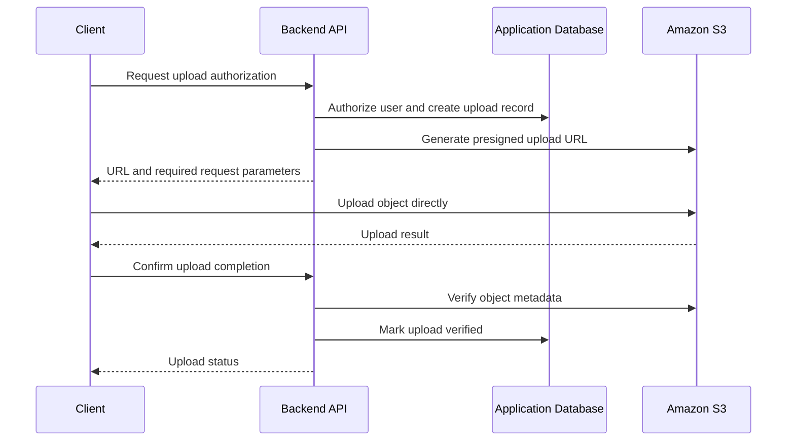
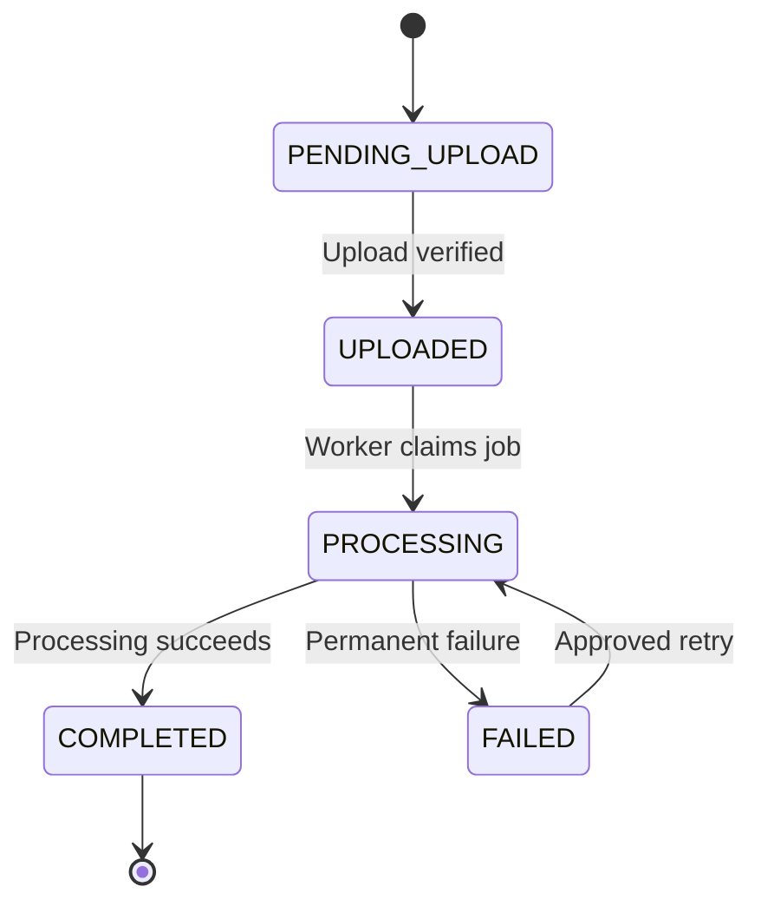

# 13- Common Amazon S3 Anti-Patterns

## Overview

Amazon S3 is designed for highly durable, scalable object storage. However, poor application architecture, incorrect security configuration, inefficient data access, and unmanaged lifecycle policies can introduce security vulnerabilities, unnecessary costs, and operational failures.

Most S3 problems do not result from the storage service itself. They arise when an application treats object storage like a local filesystem, assumes that encryption provides authorization, processes events without idempotency, or optimizes storage costs without measuring actual access patterns.

This document identifies common Amazon S3 anti-patterns and their production-ready alternatives. It focuses on practical backend engineering decisions across API development, data processing, security, reliability, and cloud operations.

## Security Anti-Patterns

### Making Buckets Public to Simplify Access

**Anti-pattern:** Disabling S3 Block Public Access or adding a public bucket policy so that applications, browsers, or external services can download objects without authentication.

This exposes data to unauthorized users and makes it difficult to enforce tenant isolation, access expiration, and audit requirements.

**Better approach:**

- Keep S3 Block Public Access enabled unless public access is explicitly required and approved.
- Use private buckets for user uploads, reports, backups, and sensitive documents.
- Use presigned URLs for temporary, object-specific access.
- Use CloudFront with Origin Access Control (OAC) for private content delivery.
- Review bucket policies and access-point policies as part of infrastructure changes.

Inspect the public-access configuration:

```bash
aws s3api get-public-access-block \
  --bucket "$BUCKET"
```

Inspect the bucket policy:

```bash
aws s3api get-bucket-policy \
  --bucket "$BUCKET"
```

A missing bucket-level Block Public Access configuration does not by itself prove the bucket is public. Account-level and organization-level controls also affect the effective result.

Reference: [Blocking public access to Amazon S3](https://docs.aws.amazon.com/AmazonS3/latest/userguide/access-control-block-public-access.html).

### Using ACLs Instead of Modern Policy-Based Access Control

**Anti-pattern:** Using object ACLs to manage access for every uploaded file when bucket and IAM policies can express the intended access model.

This creates fragmented permission management and can introduce object-ownership problems when different AWS accounts upload data into the same bucket.

**Better approach:**

- Prefer S3 Object Ownership with `BucketOwnerEnforced`, which disables ACLs.
- Use IAM identity policies, bucket policies, and access-point policies for authorization.
- Use ACLs only when a documented integration requires them.
- Validate legacy integrations before disabling ACLs on an existing bucket.

Reference: [S3 Object Ownership](https://docs.aws.amazon.com/AmazonS3/latest/userguide/about-object-ownership.html).

### Granting Excessive IAM Permissions

**Anti-pattern:** Giving every application role `s3:*`, access to every bucket, or permission to delete arbitrary objects.

A file-upload service rarely needs unrestricted access to all S3 resources in an AWS account.

**Better approach:** Grant the minimum actions on the smallest applicable resource scope.

For example, an application that uploads and downloads objects under a specific prefix might use:

```json
{
  "Version": "2012-10-17",
  "Statement": [
    {
      "Sid": "ReadWriteApplicationDocuments",
      "Effect": "Allow",
      "Action": [
        "s3:GetObject",
        "s3:PutObject"
      ],
      "Resource": "arn:aws:s3:::example-private-documents/tenant-data/*"
    },
    {
      "Sid": "ListApplicationPrefix",
      "Effect": "Allow",
      "Action": "s3:ListBucket",
      "Resource": "arn:aws:s3:::example-private-documents",
      "Condition": {
        "StringLike": {
          "s3:prefix": [
            "tenant-data/",
            "tenant-data/*"
          ]
        }
      }
    }
  ]
}
```

This is an illustrative identity policy. The application must enforce tenant-level authorization, and any applicable bucket policies, explicit denies, permissions boundaries, organization policies, and KMS permissions must also be considered.

Do not treat a key prefix as a tenant security boundary unless the IAM and resource-policy design actually enforces that boundary.

Use IAM roles and temporary credentials instead of embedding long-lived access keys in application code.

### Confusing Encryption with Authorization

**Anti-pattern:** Assuming that an encrypted bucket is secure even when access policies grant unintended principals permission to read its objects.

Encryption protects data under the applicable encryption model. It does not independently decide which users should access the data.

**Better approach:**

- Configure appropriate default encryption.
- Enforce least-privilege S3 permissions.
- Use SSE-KMS when customer-managed key controls are required.
- Audit KMS permissions separately from S3 permissions.
- Require HTTPS for application requests.
- Test access with both authorized and unauthorized principals.

For SSE-KMS objects, successful S3 authorization does not necessarily mean that the requester can decrypt the object. KMS authorization and key-policy requirements must also be satisfied.

Reference: [Amazon S3 security best practices](https://docs.aws.amazon.com/AmazonS3/latest/userguide/security-best-practices.html).

### Storing Credentials or Sensitive Data in Object Keys

**Anti-pattern:** Embedding passwords, API tokens, personal information, or confidential business data directly in object keys or URLs.

Object keys can appear in logs, monitoring systems, audit events, error messages, and application traces. Presigned URLs can also expose object identifiers and temporary access capabilities.

**Better approach:**

- Generate opaque object identifiers.
- Keep sensitive metadata in an appropriately protected database.
- Avoid secrets and unnecessary personal information in object names.
- Redact presigned URLs and sensitive request details from logs.
- Apply data classification, encryption, retention, and access-control requirements.

Example:

```python
from uuid import uuid4


def build_object_key(tenant_id: str, extension: str) -> str:
    if not tenant_id or "/" in tenant_id:
        raise ValueError("Invalid tenant identifier")

    allowed_extensions = {"pdf", "jpg", "png"}

    if extension not in allowed_extensions:
        raise ValueError("Unsupported file extension")

    return f"tenant-data/{tenant_id}/{uuid4().hex}.{extension}"
```

The tenant identifier must come from authenticated application context, not directly from untrusted client input. The extension is only a naming convention; file content must still be validated independently.

## Object and Data Modeling Anti-Patterns

### Treating S3 Like a Traditional Filesystem

**Anti-pattern:** Assuming S3 has real directories, supports atomic folder renames, or behaves like a mounted local filesystem.

S3 stores objects identified by keys. Separators such as `/` create logical prefixes that clients can display as directories, but they do not create a conventional filesystem hierarchy.

Renaming an object generally requires copying it to the destination key and deleting the source. A large prefix migration can therefore involve many separate operations.

**Better approach:**

- Design stable, predictable key conventions.
- Store mutable business metadata in a database.
- Use object identifiers instead of renaming keys to represent every business-state change.
- Treat bulk key migrations as distributed operations that need retries and verification.

For example, prefer:

```text
documents/{tenant_id}/{document_id}/original.pdf
```

over a key that changes whenever the document is renamed or its workflow status changes.

### Building Database Queries on Unbounded Object Listings

**Anti-pattern:** Calling `ListObjectsV2` across an entire bucket on every API request to search for a customer's files, calculate object counts, or determine application state.

Listing can involve many paginated requests and return large amounts of metadata. Repeated scans increase latency and request costs.

**Better approach:**

Maintain application metadata in PostgreSQL or another appropriate database.

Store information such as:

| Field | Purpose |
|---|---|
| `document_id` | Stable application-level identifier |
| `tenant_id` | Authorization and tenant filtering |
| `object_key` | S3 object location |
| `version_id` | Specific object version, when required |
| `content_type` | Validated content type |
| `size_bytes` | File size |
| `checksum` | Integrity verification |
| `status` | Upload or processing state |
| `created_at` | Application timestamp |

Use S3 listing for storage discovery, maintenance, inventory, and controlled bulk operations rather than as a substitute for routine database queries.

### Storing Mutable Application State Only in S3

**Anti-pattern:** Using object existence, object metadata, or prefixes as the sole source of truth for workflow state.

A document-processing pipeline may require states such as `UPLOADED`, `PROCESSING`, `COMPLETED`, and `FAILED`. Encoding all this state through key changes makes transitions, concurrency, and recovery difficult to manage.

**Better approach:**

- Keep authoritative workflow state in a database or suitable state store.
- Store file contents in S3.
- Use object metadata and tags for supplementary storage-related information.
- Use version IDs, conditional operations, or application locking where concurrency matters.
- Reconcile database state with S3 when operations partially fail.

The application must define behavior for cases where an object upload succeeds but the database transaction fails, or a database record is created but the upload never completes.

### Assuming Object Keys Can Be Renamed Atomically

**Anti-pattern:** Treating an S3 copy-and-delete sequence as a single atomic rename.

A copy may succeed while the delete fails. A long-running migration may also stop halfway through, leaving both source and destination objects.

**Better approach:**

1. Record the intended migration in application state.
2. Copy the object to the destination key.
3. Verify the copied object and relevant metadata.
4. Update application references.
5. Delete the source only when permitted.
6. Retry incomplete operations safely.

For versioned buckets, preserve required version information and understand how delete markers affect the operation.

## Upload and Download Performance Anti-Patterns

### Uploading Large Files Through the API Application

**Anti-pattern:** Routing every large file through Django, FastAPI, or another backend process, which reads the request body and then uploads the entire file to S3.

This consumes application bandwidth, memory, connection capacity, and worker time. Under concurrent uploads, it can reduce API availability even when S3 is operating normally.

**Better approach:** Use presigned URLs for direct client-to-S3 uploads when the client and security model support them.



The backend should authorize the upload, generate a server-controlled object key, constrain the expected content type and request parameters, and verify the completed object.

A presigned URL does not replace authentication or authorization in the application. Anyone possessing a valid URL can generally exercise the signed operation within its restrictions.

### Ignoring Multipart Uploads for Large Objects

**Anti-pattern:** Using a simplistic single-request upload strategy for large objects without evaluating transfer reliability and retry costs.

A failed transfer can require retransmitting substantial amounts of data.

**Better approach:**

- Use multipart upload for large objects.
- Select part sizes and concurrency based on object size, network throughput, memory limits, and transfer behavior.
- Retry failed parts instead of restarting the entire transfer.
- Abort incomplete multipart uploads when they are no longer needed.
- Use SDK transfer managers where appropriate.

The single-request `PutObject` API supports object sizes up to 5 GB. Multipart upload supports objects up to 50 TB, subject to the current multipart-upload limits and part-count constraints.

Check the current [S3 multipart upload limits](https://docs.aws.amazon.com/AmazonS3/latest/userguide/qfacts.html) before designing large-object transfers.

### Downloading Entire Objects Into Memory

**Anti-pattern:** Loading large files into application memory before sending them to the client.

For example, calling `response["Body"].read()` without considering object size can exhaust memory when multiple requests execute concurrently.

**Better approach:**

- Stream data when the application must proxy the download.
- Use presigned GET URLs when the client can safely download directly from S3.
- Set explicit request and application timeouts.
- Clean up temporary files and incomplete transfers.
- Avoid buffering the same object multiple times.

For high-volume media delivery, consider CloudFront rather than repeatedly routing traffic through backend API workers.

### Using Synchronous Request Handlers for Long-Running Transfers

**Anti-pattern:** Keeping an HTTP request open while a multi-gigabyte transfer, archive restoration, or large document-processing job completes.

This increases connection occupancy and couples user-facing API availability to long-running storage operations.

**Better approach:**

- Return an upload or processing job identifier when asynchronous work is appropriate.
- Use Celery, SQS, or another suitable asynchronous execution mechanism.
- Store progress and failure state.
- Make operations resumable where possible.
- Set explicit retry and timeout policies.
- Provide a status endpoint.

Do not move every upload into a queue by default. Direct presigned transfers are often simpler when application mediation is not required.

## Retry and Distributed-System Anti-Patterns

### Retrying Without Idempotency

**Anti-pattern:** Retrying failed upload, copy, delete, or processing operations without defining what should happen when the original request actually succeeded.

Network timeouts do not always mean that the remote operation failed. The application might lose the response after S3 successfully completed the operation.

**Better approach:**

- Use stable application-level operation identifiers.
- Design retries to tolerate repeated requests.
- Persist processing state where appropriate.
- Use the same intended object key when retry semantics require replacing the same logical object.
- Verify object state before repeating destructive operations.
- Distinguish transient errors from permanent authorization or validation failures.

Idempotency must be designed around the intended business operation, not assumed merely because S3 uses an HTTP API.

### Treating S3 Events as Exactly-Once Notifications

**Anti-pattern:** Assuming that every object-created event is delivered once, in order, and only after the application has finished every related database operation.

S3 Event Notifications are delivered at least once, and duplicate or out-of-order notifications can occur.

A consumer that blindly processes every notification can generate duplicate thumbnails, send multiple emails, or trigger repeated billing and downstream processing.

**Better approach:**

- Make consumers idempotent.
- Deduplicate using suitable event and object identifiers.
- Record processing state durably.
- Expect retries and out-of-order events.
- Use SQS where buffering, retry handling, and failure isolation are needed.
- Configure an appropriate dead-letter or redrive strategy for the chosen event-processing architecture.

For versioned buckets, use the object version ID when the processing logic must identify a particular version. The S3 event `sequencer` can help compare events for the same object key, but it is not a globally ordered sequence across different keys.

Reference: [S3 event notifications](https://docs.aws.amazon.com/AmazonS3/latest/userguide/EventNotifications.html).

### Creating Recursive S3 Event Processing

**Anti-pattern:** Configuring a Lambda function to process newly created objects in a bucket and then writing its output back to a location covered by the same event notification.

This can cause repeated invocations and unnecessary processing costs.

**Better approach:**

Separate input and output prefixes or buckets, and configure notification filters deliberately.

For example:

```text
incoming-images/
processed-images/
```

Configure events for `incoming-images/` only, and write results under `processed-images/`.

The handler should also be idempotent and reject objects that are not eligible for processing.

### Assuming a Successful Upload Means Processing Is Complete

**Anti-pattern:** Marking a document as fully available immediately after receiving an upload request, even though content inspection, malware scanning, metadata extraction, or downstream processing has not finished.

**Better approach:** Model the upload and processing lifecycle explicitly.



A file can be stored successfully while still being unsuitable for download or business use. Use application state to decide when it becomes available to consumers.

## Versioning, Replication, and Recovery Anti-Patterns

### Treating Versioning as a Complete Backup Strategy

**Anti-pattern:** Enabling S3 Versioning and assuming that all data loss, corruption, deletion, and security incidents are covered.

Versioning preserves multiple object versions, but those versions can still be permanently deleted by authorized operations. Versioning does not by itself provide isolation from compromised credentials, account-level risks, or every disaster-recovery scenario.

**Better approach:**

- Enable versioning when historical recovery is required.
- Restrict permissions that can permanently delete object versions.
- Define retention and noncurrent-version lifecycle policies.
- Consider replication, AWS Backup where supported and suitable, or another separate recovery mechanism.
- Test recovery procedures against the actual business recovery objectives.

Treat versioning, replication, and backup as distinct controls with different failure and recovery properties.

### Assuming Replication Copies All Historical Objects Automatically

**Anti-pattern:** Enabling replication and assuming it automatically copies every pre-existing object and every historical version already stored in the source bucket.

Normal live replication applies to eligible objects according to the configured rules. Existing objects require a suitable operation, such as S3 Batch Replication, when historical replication is needed.

**Better approach:**

- Enable versioning on the source and destination general purpose buckets.
- Configure the replication role and required object-access permissions.
- Configure destination encryption and KMS permissions where applicable.
- Explicitly plan historical replication.
- Verify replication status and destination availability.
- Test recovery using the intended recovery principal.

A destination object does not prove that every expected version or historical object was replicated successfully.

### Treating Replication as Automatic Regional Failover

**Anti-pattern:** Assuming that a replicated bucket automatically redirects API traffic to another Region during an outage.

Replication copies eligible objects, but it does not automatically implement application failover, traffic routing, database recovery, or a complete application recovery plan.

**Better approach:**

- Define recovery point and recovery time objectives (RPO and RTO).
- Plan application and data-plane failover separately.
- Verify destination bucket permissions, encryption, and application configuration.
- Consider replication lag and pending operations.
- Use appropriate routing and failover mechanisms.
- Test regional recovery, including the ability to read and decrypt destination objects.

Cross-Region Replication (CRR) improves geographic resilience, but it is not equivalent to an end-to-end disaster recovery architecture.

## Storage Class and Lifecycle Anti-Patterns

### Choosing Storage Classes by Storage Price Alone

**Anti-pattern:** Moving all historical objects into the lowest-cost archive class without considering access patterns, restoration latency, object size, retrieval fees, and minimum storage duration.

A lower storage rate can be offset by request charges, transition charges, archive metadata, and restoration costs.

**Better approach:**

- Analyze actual access patterns.
- Match the class to required retrieval latency.
- Use Intelligent-Tiering when unpredictable access justifies its monitoring costs.
- Use lifecycle transitions for predictable retention and access patterns.
- Estimate total costs before changing large object populations.

Reference: [S3 storage classes](https://docs.aws.amazon.com/AmazonS3/latest/userguide/storage-class-intro.html).

### Applying Lifecycle Rules Without Reviewing Existing Configuration

**Anti-pattern:** Replacing a bucket's complete lifecycle configuration with a small JSON file that contains only a newly requested rule.

The S3 API operation `PutBucketLifecycleConfiguration` replaces the current lifecycle configuration. Existing rules can be lost if they are not included in the submitted configuration.

**Better approach:**

1. Retrieve the existing lifecycle configuration.
2. Review applicable filters, transitions, expiration rules, and noncurrent-version rules.
3. Merge the intended change with existing rules.
4. Validate the final configuration.
5. Deploy it through infrastructure as code.
6. Verify the resulting configuration after deployment.

Also account for the default behavior that prevents objects smaller than 128 KB from transitioning to storage classes under lifecycle rules. Explicit size filters can alter that behavior, so review their financial impact.

### Ignoring Incomplete Multipart Uploads

**Anti-pattern:** Allowing incomplete multipart uploads to accumulate indefinitely.

Incomplete uploads can continue to incur storage charges for the uploaded parts even though no completed object exists.

**Better approach:**

Configure an S3 Lifecycle rule to abort incomplete multipart uploads after a suitable period. Choose the period according to legitimate upload duration and retry requirements.

Inspect incomplete multipart uploads when diagnosing unexpected storage costs:

```bash
aws s3api list-multipart-uploads \
  --bucket "$BUCKET"
```

Before aborting an upload manually, confirm that it is no longer owned by an active upload workflow.

### Deleting Objects Without Understanding Versioning

**Anti-pattern:** Assuming that a normal object deletion permanently removes the data from a versioned bucket, or deleting all versions without verifying retention requirements.

In a versioned general purpose bucket, a normal delete generally creates a delete marker. Historical versions can remain stored and billable.

**Better approach:**

- Inspect versioning status.
- Review current versions, noncurrent versions, and delete markers.
- Define lifecycle rules that match the retention policy.
- Require suitable permissions for permanent version deletion.
- Verify recovery before removing retained versions.

Never use recursive deletion or bulk version deletion as an unreviewed cost-cleanup shortcut.

## Cost and Operational Anti-Patterns

### Creating Excessively Small Objects

**Anti-pattern:** Storing every small log record, telemetry event, or analytics row as an independent S3 object without evaluating the request and metadata overhead.

Millions of small objects can increase request costs, listing effort, lifecycle transition costs, and per-object management overhead.

**Better approach:**

- Aggregate suitable events into larger objects.
- Use partitioned data layouts for analytics workloads.
- Prefer formats such as Parquet where the workload benefits from columnar storage and compression.
- Keep independent objects when per-record access, retention, or deletion genuinely requires them.
- Evaluate the effect on parallelism and operational complexity.

For example, a data lake may aggregate events into hourly or daily objects by dataset and partition rather than creating one object per event.

### Introducing Artificial Prefix Sharding Without Evidence

**Anti-pattern:** Generating random prefixes solely to avoid supposed S3 request limits, based on outdated assumptions that every bucket has a small fixed request capacity.

S3 automatically scales to high request rates, and random prefixes are not automatically required for performance.

**Better approach:**

- Start with a key layout that supports the workload's access, lifecycle, and analytics requirements.
- Use parallel requests for suitable concurrent workloads.
- Measure actual throughput and latency.
- Introduce more distributed key layouts only when the workload or measured bottleneck justifies them.

A logical prefix such as `tenant-data/` or `year=2026/month=10/` is often valuable for operational organization, filtering, and lifecycle policies.

Reference: [Optimizing Amazon S3 performance](https://docs.aws.amazon.com/AmazonS3/latest/userguide/optimizing-performance.html).

### Ignoring Request Costs, Retrieval Fees, and Data Transfer

**Anti-pattern:** Tracking only stored gigabytes when estimating S3 costs.

High request volumes, repeated downloads, lifecycle transitions, incomplete multipart uploads, and transfer between Regions or services can materially affect the bill.

**Better approach:**

- Use AWS Cost and Usage Reports for detailed cost analysis.
- Use S3 Storage Lens and Inventory for storage visibility.
- Track request patterns and data transfer where applicable.
- Apply tags and cost-allocation practices where supported.
- Configure budget alerts and investigate unexpected increases.
- Estimate the total cost before large migrations or architectural changes.

Do not treat a reduction in stored bytes as proof that the workload became cheaper.

### Managing Production Buckets Through Unreviewed Manual Changes

**Anti-pattern:** Making repeated console changes to bucket policies, encryption, lifecycle rules, and replication without updating the authoritative infrastructure configuration.

Manual changes create drift and make environments difficult to reproduce.

**Better approach:**

- Manage supported bucket configuration through Terraform, CloudFormation, CDK, or another controlled deployment mechanism.
- Review infrastructure plans or diffs.
- Validate policy changes before rollout.
- Separate development, staging, and production configuration.
- Detect drift and reconcile it deliberately.
- Protect destructive changes with review and approval controls.

Infrastructure as code should remain the source of truth, while operational exceptions should be recorded and brought back into the managed configuration.

## Backend Application Anti-Patterns

### Placing All S3 Logic Inside API Handlers

**Anti-pattern:** Duplicating Boto3 client setup, object-key construction, error handling, retry configuration, and presigned URL generation in multiple Django views or FastAPI routes.

This couples application endpoints to storage implementation details and makes testing difficult.

**Better approach:** Centralize storage behavior in a reusable service layer.

```python
from typing import BinaryIO

import boto3
from botocore.config import Config
from botocore.exceptions import BotoCoreError, ClientError


class S3StorageService:
    def __init__(self, bucket: str, region: str) -> None:
        if not bucket:
            raise ValueError("Bucket name is required")

        self.bucket = bucket
        self.client = boto3.client(
            "s3",
            region_name=region,
            config=Config(
                retries={
                    "mode": "standard",
                    "max_attempts": 4,
                },
                connect_timeout=5,
                read_timeout=60,
                max_pool_connections=50,
            ),
        )

    def upload_file(
        self,
        file_obj: BinaryIO,
        object_key: str,
        content_type: str,
    ) -> None:
        try:
            self.client.upload_fileobj(
                file_obj,
                self.bucket,
                object_key,
                ExtraArgs={
                    "ContentType": content_type,
                },
            )
        except (BotoCoreError, ClientError) as exc:
            raise RuntimeError("S3 upload failed") from exc
```

The example delegates credentials to Boto3's credential provider chain and uses the SDK's managed transfer functionality.

A production implementation should add application-specific exception mapping, observability, content validation, and appropriate object metadata and encryption controls. Do not expose raw AWS exception messages to end users.

### Trusting Client-Supplied Object Keys

**Anti-pattern:** Allowing a client to choose any bucket or arbitrary object key to upload, download, or delete.

This can create cross-tenant access vulnerabilities when one user's request resolves to another user's object.

**Better approach:**

- Derive tenant identity from authenticated server-side context.
- Generate keys or validate them against a server-defined namespace.
- Check resource ownership for every relevant operation.
- Restrict IAM permissions where practical.
- Avoid treating possession of an object identifier as authorization.

An unguessable key is helpful for reducing accidental discovery, but it does not replace authorization.

### Trusting File Extensions and Content-Type Headers

**Anti-pattern:** Assuming an uploaded file is safe because it has a `.pdf` extension or the client declares `application/pdf`.

Both the extension and request header can be controlled by an untrusted client.

**Better approach:**

- Validate permitted file sizes.
- Validate file signatures and parseability where appropriate.
- Use malware scanning when required by the threat model.
- Store untrusted uploads in a private quarantine location until verification finishes.
- Prevent active content from being served unsafely.
- Keep upload status separate from verification status.

A successful S3 upload means the object was stored, not that its contents are safe or valid for the application's intended use.

### Treating S3 ETags as Universal Content Checksums

**Anti-pattern:** Assuming every object's ETag is an MD5 hash of its full content.

ETag behavior varies with upload method and encryption configuration. Multipart-upload ETags are not generally the MD5 digest of the entire object.

**Better approach:**

- Use supported S3 checksum features for integrity verification.
- Record trusted checksums when needed by the application.
- Verify uploaded content against the intended checksum algorithm.
- Distinguish transport integrity from application-level file validation.

Do not build cross-system integrity checks on an assumption that every ETag represents the same checksum semantics.

## Configuration and Testing Anti-Patterns

### Hardcoding Bucket Names, Regions, or Credentials

**Anti-pattern:** Embedding environment-specific resource names and access keys throughout the application.

This complicates deployment, increases the risk of credential exposure, and makes the code difficult to test across environments.

**Better approach:**

- Use environment-specific configuration for bucket names and Regions.
- Use IAM roles or supported workload identity mechanisms.
- Use temporary credentials through the standard AWS credential provider chain.
- Keep secrets out of source code and container images.
- Validate required settings during application startup.

### Testing Only Against a Live AWS Account

**Anti-pattern:** Requiring real AWS resources for every unit test or relying entirely on manual end-to-end testing.

This can increase test cost, slow feedback, and make failures harder to isolate.

**Better approach:**

- Unit-test service behavior with mocked S3 clients.
- Test IAM and bucket configuration through policy validation.
- Use an appropriate local emulator for supported functionality.
- Run integration tests against AWS in a controlled environment where actual service behavior matters.
- Test failure scenarios such as access denial, expired credentials, incomplete uploads, and retry exhaustion.
- Avoid claiming complete AWS compatibility based solely on emulator tests.

Local testing can validate application logic, but it cannot prove that production IAM policies, KMS permissions, bucket policies, or cross-account configuration are correct.

## Anti-Pattern Detection Matrix

| Symptom | Likely anti-pattern | Recommended investigation |
|---|---|---|
| Unexpected public access | Overly permissive bucket policy or ACLs | Inspect Block Public Access and effective access policies |
| API workers run out of memory during downloads | Entire objects buffered in memory | Review streaming behavior and object size |
| Repeated Lambda invocations | Recursive event-triggered writes | Inspect event filters and output prefixes |
| Duplicate documents or notifications | Non-idempotent event processing | Examine event identifiers, job state, and retry behavior |
| Unexpected archive charges | Poor lifecycle timing or excessive small objects | Review object sizes, transitions, retrievals, and minimum durations |
| S3 bill increases despite lower storage usage | Request, retrieval, or data-transfer costs | Analyze Cost and Usage Reports |
| Historical objects are not present in the replica | Existing objects were not included in the migration or replication plan | Inspect replication rules, object status, and historical replication |
| A deleted object still incurs storage charges | Retained object versions or incomplete multipart uploads | Inspect object versions and multipart uploads |
| Cross-tenant file access | Authorization relies on client-controlled keys | Audit server-side ownership checks and IAM restrictions |
| S3 upload succeeds but the document is unavailable | Processing state is conflated with upload completion | Inspect workflow state transitions and asynchronous workers |
| Object migration leaves duplicate files | Copy and delete operations were treated as atomic | Review migration state and reconciliation logic |
| Policy deployment breaks production uploads | Changes were applied without testing existing integrations | Compare infrastructure changes and inspect S3/KMS authorization failures |

## Production Review Checklist

Before deploying or reviewing an S3-backed system, verify the following:

- [ ] Buckets remain private unless a specific public-access requirement has been approved.
- [ ] Block Public Access and Object Ownership use appropriate settings.
- [ ] IAM permissions follow least privilege and separate tenant data where required.
- [ ] Encryption and authorization are handled as separate security controls.
- [ ] Object keys use a stable, server-controlled naming convention.
- [ ] Database state is authoritative for application metadata and workflow status where required.
- [ ] Large uploads use appropriate multipart or direct-to-S3 transfer strategies.
- [ ] Downloads do not unnecessarily buffer large objects in application memory.
- [ ] Retries tolerate uncertain outcomes and repeated events.
- [ ] Event consumers handle duplicate and out-of-order notifications.
- [ ] Input and output locations prevent recursive event processing.
- [ ] Versioning, replication, and backup are designed around explicit recovery requirements.
- [ ] Lifecycle rules are reviewed together with retention requirements and existing configuration.
- [ ] Storage class decisions include retrieval, transition, minimum-duration, and request costs.
- [ ] Incomplete multipart uploads and retained object versions are managed appropriately.
- [ ] Infrastructure changes are reviewed, tested, and tracked through infrastructure as code.
- [ ] Unit tests, integration tests, authorization tests, and failure-recovery tests cover the critical storage workflows.
- [ ] Monitoring and cost controls provide enough visibility to detect regressions and unexpected charges.

## Authoritative References

- [Amazon S3 security best practices](https://docs.aws.amazon.com/AmazonS3/latest/userguide/security-best-practices.html)
- [S3 Block Public Access](https://docs.aws.amazon.com/AmazonS3/latest/userguide/access-control-block-public-access.html)
- [S3 Object Ownership](https://docs.aws.amazon.com/AmazonS3/latest/userguide/about-object-ownership.html)
- [Optimizing S3 performance](https://docs.aws.amazon.com/AmazonS3/latest/userguide/optimizing-performance.html)
- [S3 event notifications](https://docs.aws.amazon.com/AmazonS3/latest/userguide/EventNotifications.html)
- [S3 storage classes](https://docs.aws.amazon.com/AmazonS3/latest/userguide/storage-class-intro.html)
- [S3 Lifecycle transition considerations](https://docs.aws.amazon.com/AmazonS3/latest/userguide/lifecycle-transition-general-considerations.html)
- [S3 multipart uploads](https://docs.aws.amazon.com/AmazonS3/latest/userguide/mpuoverview.html)
- [S3 Versioning](https://docs.aws.amazon.com/AmazonS3/latest/userguide/Versioning.html)
- [S3 replication](https://docs.aws.amazon.com/AmazonS3/latest/userguide/replication.html)
- [Using S3 presigned URLs](https://docs.aws.amazon.com/AmazonS3/latest/userguide/using-presigned-url.html)
- [Amazon S3 pricing](https://aws.amazon.com/s3/pricing/)

## Key Takeaways

- Treat S3 as object storage, not a filesystem, database, or automatic workflow engine; use an appropriate database and explicit application state where required.
- Protect private data with least-privilege authorization, appropriate encryption, secure object-key design, and carefully controlled presigned URLs.
- Design uploads, event consumers, retries, migrations, and processing workflows to tolerate partial failures, duplicate requests, and repeated notifications.
- Evaluate storage classes, lifecycle policies, versioning, replication, and backup as separate decisions that must satisfy both cost and recovery requirements.
- Validate production S3 architecture through automated tests, infrastructure review, monitoring, and practical recovery exercises rather than relying on configuration assumptions.
You've reached the maximum length for this conversation, but you can keep talking by starting a new chat.
Start new chat