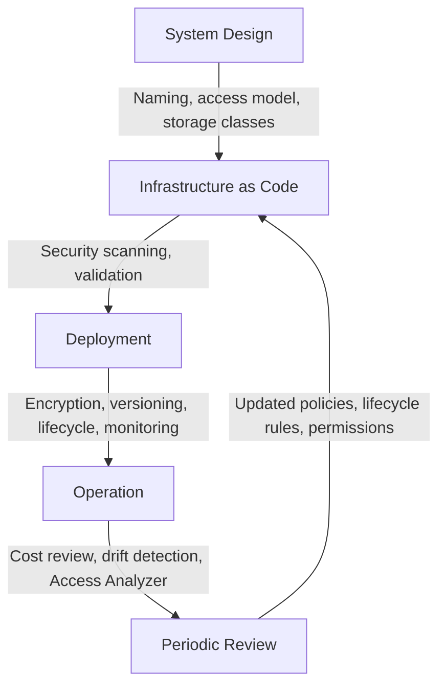

# README

## Overview

Amazon S3 best practices cover the cross-cutting recommendations, design patterns, and operational standards that apply across all S3-backed systems in production. They address naming conventions, access control, public exposure prevention, encryption, storage class selection, lifecycle and retention, versioning, replication, upload and download performance, event-driven integration, cost optimization, monitoring, auditability, production readiness, and common anti-patterns.

This section of the Backend Engineering Playbook provides a structured reference for backend engineers and platform teams who want to apply consistent, proven engineering standards when designing, implementing, and operating Amazon S3 infrastructure across development, staging, and production environments.

The focus is on practical recommendations that reflect production experience: patterns that reduce operational risk, improve security posture, control costs predictably, and make systems easier to reason about, operate, and recover from failure.

## Navigation

| # | File | Description |
|---|---|---|
| 01 | [01- Bucket and Object Naming Best Practices](./01-%20Bucket%20and%20Object%20Naming%20Best%20Practices.md) | Naming conventions for buckets and object keys used consistently across code, IaC, policies, and operations |
| 02 | [02- Access Control and Least Privilege Best Practices](./02-%20Access%20Control%20and%20Least%20Privilege%20Best%20Practices.md) | IAM policy design, bucket policy patterns, and scoping permissions to the minimum required for each workload |
| 03 | [03- Public Access Prevention Best Practices](./03-%20Public%20Access%20Prevention%20Best%20Practices.md) | Block Public Access configuration, ACL disablement, policy-as-code checks, and protecting against accidental exposure |
| 04 | [04- Encryption and Key Management Best Practices](./04-%20Encryption%20and%20Key%20Management%20Best%20Practices.md) | Encryption mechanism selection, KMS key policy design, Bucket Keys, and encryption validation |
| 05 | [05- Storage Class Selection Best Practices](./05-%20Storage%20Class%20Selection%20Best%20Practices.md) | Matching storage classes to access patterns, cost trade-offs, retrieval latency, and minimum duration requirements |
| 06 | [06- Lifecycle and Data Retention Best Practices](./06-%20Lifecycle%20and%20Data%20Retention%20Best%20Practices.md) | Lifecycle rule design, storage class transitions, expiration, incomplete multipart upload abort, and retention policies |
| 07 | [07- Versioning and Replication Best Practices](./07-%20Versioning%20and%20Replication%20Best%20Practices.md) | Enabling and managing versioning, cross-region and same-region replication, and replication monitoring |
| 08 | [08- Upload and Download Performance Best Practices](./08-%20Upload%20and%20Download%20Performance%20Best%20Practices.md) | Multipart upload thresholds, connection reuse, concurrency, Transfer Acceleration, and retry strategies |
| 09 | [09- Event-Driven Integration Best Practices](./09-%20Event-Driven%20Integration%20Best%20Practices.md) | S3 event notifications, SQS, SNS, and EventBridge patterns, idempotent processing, and dead-letter queue design |
| 10 | [10- Cost Optimization Best Practices](./10-%20Cost%20Optimization%20Best%20Practices.md) | Controlling storage, request, egress, and management feature costs through architecture and lifecycle design |
| 11 | [11- Monitoring and Auditability Best Practices](./11-%20Monitoring%20and%20Auditability%20Best%20Practices.md) | CloudWatch metrics and alarms, CloudTrail data events, Storage Lens, server access logging, and audit evidence |
| 12 | [12- Production Readiness Checklist](./12-%20Production%20Readiness%20Checklist.md) | End-to-end checklist covering access control, encryption, versioning, lifecycle, observability, and recovery readiness |
| 13 | [13- Common Amazon S3 Anti-Patterns](./13-%20Common%20Amazon%20S3%20Anti-Patterns.md) | Architectural, security, performance, and operational anti-patterns to avoid in production S3 deployments |

## Why S3 Best Practices Matter

Amazon S3 is straightforward to start using and easy to misconfigure at scale. Default configurations are permissive by design to reduce initial friction, which means the gap between a working S3 integration and a production-ready one must be closed deliberately through correct configuration, consistent standards, and ongoing operational discipline.

Common outcomes of not applying best practices include:

- Buckets that become publicly accessible through misconfigured policies or ACLs, often without the team's awareness.
- Objects stored at the wrong storage class, generating ongoing unnecessary cost for data that has not been accessed in months.
- No lifecycle rules, causing object accumulation that grows unbounded and generates perpetual storage charges.
- Missing versioning and replication, meaning a single accidental deletion or regional disruption results in permanent data loss.
- Encryption deployed without understanding KMS key permission requirements, leading to AccessDenied errors at runtime.
- Event-driven pipelines without dead-letter queues, silently discarding failed processing events in production.
- No CloudTrail data events on sensitive buckets, making security investigations incomplete or impossible.

Best practices consolidate the lessons from operating S3 in production: they are not theoretical guidelines but concrete recommendations that prevent specific, well-understood failure modes.

## Documentation Structure

This section is organized into focused documents covering every major best practice area, followed by a production readiness checklist and anti-patterns reference.

| Area | Primary focus |
|---|---|
| Naming | Bucket and object key naming conventions across all system touchpoints |
| Access control | IAM and bucket policy design, least privilege, and authorization boundaries |
| Public exposure | Block Public Access, ACL disablement, and policy enforcement |
| Encryption | Encryption selection, KMS design, key permissions, and validation |
| Storage classes | Matching cost to access pattern and managing storage class lifecycle |
| Lifecycle and retention | Transition rules, expiration, multipart cleanup, and retention requirements |
| Versioning and replication | Data protection through versioning and geographic redundancy |
| Performance | Upload and download optimization, concurrency, and transfer strategies |
| Event-driven integration | Notification design, processing reliability, and failure handling |
| Cost optimization | Controlling all S3 cost dimensions through architecture and automation |
| Monitoring and auditability | Observability, alerting, audit coverage, and investigation capability |
| Production readiness | End-to-end checklist before a workload goes to production |
| Anti-patterns | Patterns to identify and avoid in existing and new implementations |

## Core Best Practice Principles

### Apply Secure Defaults from the Start

Security controls applied retroactively to existing buckets and objects are operationally complex and leave risk in place during the transition. Enable Block Public Access, default encryption, versioning, and lifecycle policies at bucket creation. Define IAM roles with scoped permissions before the first object is uploaded.

### Design Naming Conventions Before Creating Resources

Bucket names are globally unique and permanent. Object key naming conventions affect IAM policy design, lifecycle rule scoping, and prefix-based access control. Define naming conventions for both before creating any resources. Changing them later requires migrating all existing objects and updating all downstream references.

### Match Every Object Category to a Storage Class and Lifecycle Rule

Every object category stored in S3 should have a documented storage class assignment and a corresponding lifecycle rule that transitions and expires it appropriately. Objects without lifecycle rules remain in their initial storage class indefinitely and generate ongoing charges. Review and update assignments as access patterns change.

### Build Recovery into the Architecture

Durability does not replace the need for versioning, replication, and tested recovery procedures. Enable versioning on buckets where accidental deletion or overwrite recovery is required. Configure cross-region replication for workloads with disaster recovery or geographic redundancy requirements. Test recovery procedures before relying on them in production.

### Treat Security as Non-Negotiable at Every Layer

S3 security requires coordination across IAM identity policies, bucket policies, Block Public Access, Object Ownership, encryption, and application-level authorization. Each layer addresses a different class of risk. Omitting any layer creates a gap that is not covered by the others. Validate security configuration with automated tools and Access Analyzer findings review after every deployment.

## How Best Practices Apply Across the System Lifecycle

Best practices apply at every stage. Design decisions about naming and access models constrain what can be configured later. Deployment validation catches security gaps before they reach production. Operational reviews identify cost waste, permission drift, and monitoring gaps that accumulate over time.

## Recommended Application Workflow

Use the following process when building a new S3-backed system or reviewing an existing one against best practices.

1. **Define naming conventions.** Establish bucket naming and object key naming patterns before creating resources. Document them in the IaC definition.
2. **Design the access model.** Identify every principal that needs access to each bucket and object category. Define the minimum required permissions for each.
3. **Configure security controls.** Enable Block Public Access, default encryption, and Object Ownership at bucket creation. Define bucket policies for cross-account and service integrations.
4. **Assign storage classes and lifecycle rules.** Map each object category to the appropriate storage class. Write lifecycle rules for transition, expiration, and incomplete multipart upload abort.
5. **Enable versioning and replication.** Enable versioning on buckets where recovery is required. Configure replication for disaster recovery and geographic redundancy requirements.
6. **Set up monitoring and auditing.** Enable CloudWatch request metrics, CloudTrail data events where required, and server access logging. Configure alarms and Storage Lens dashboards.
7. **Run security validation.** Use Access Analyzer, IaC security scanning, and manual policy review to validate that the configuration meets security requirements.
8. **Complete the production readiness checklist.** Work through the production readiness checklist before promoting to production.
9. **Review regularly.** Schedule periodic reviews of permissions, storage class assignments, lifecycle rules, cost trends, and security findings.

## Operational Standards

- **Naming:** Define and document bucket and key naming conventions in IaC before creating any resources.
- **Access control:** Use IAM roles, not long-lived keys. Scope every policy to specific bucket and prefix ARNs.
- **Public access:** Enable Block Public Access at the account level. Disable ACLs using Bucket Owner Enforced mode.
- **Encryption:** Enable default encryption on every bucket. Use SSE-KMS for sensitive data. Enable S3 Bucket Keys for high-throughput SSE-KMS buckets.
- **Storage classes:** Document the intended storage class per object category. Assign lifecycle rules for every category at bucket creation.
- **Versioning:** Enable on every production bucket where deletion or overwrite recovery is required.
- **Replication:** Configure CRR for workloads with DR requirements. Monitor replication health with CloudWatch metrics.
- **Lifecycle:** Include an incomplete multipart upload abort rule on every bucket. Review and update lifecycle rules when access patterns change.
- **Performance:** Use multipart upload for objects over 100 MB. Reuse connections. Design key prefixes to avoid partition hot spots.
- **Event-driven:** Configure dead-letter queues for every Lambda function that processes S3 events. Design processing logic to be idempotent.
- **Cost:** Review S3 costs in Cost Explorer monthly. Apply cost allocation tags to every bucket.
- **Monitoring:** Enable request metrics on production buckets. Enable CloudTrail data events for security-sensitive buckets.
- **Production readiness:** Complete the production readiness checklist before every production deployment.

## Key Takeaways

- S3 best practices close the gap between a working integration and a production-ready one — that gap must be closed deliberately because S3 defaults are permissive, not restrictive.
- Security controls, naming conventions, storage class assignments, and lifecycle rules must be defined at bucket creation; applying them retroactively is operationally complex and leaves risk in place during the transition.
- Durability does not replace versioning, replication, and tested recovery procedures; each addresses a different failure mode.
- Cost optimization requires lifecycle rules for every object category, correct storage class assignments, and regular cost review; without them, cost grows unbounded with object accumulation.
- Best practices compound: applying them consistently from the start makes systems easier to secure, cheaper to operate, faster to recover, and simpler to audit.
