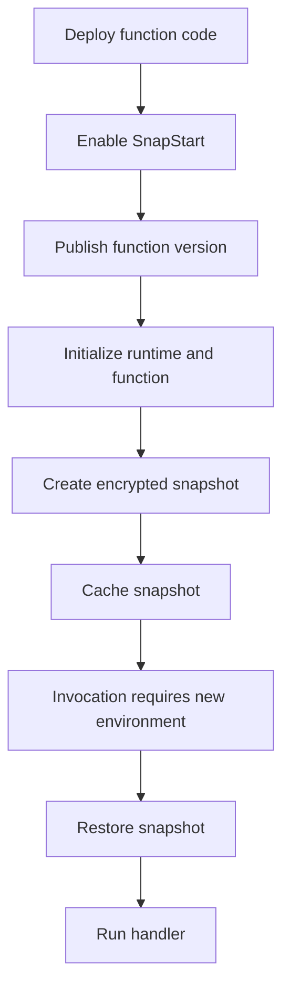
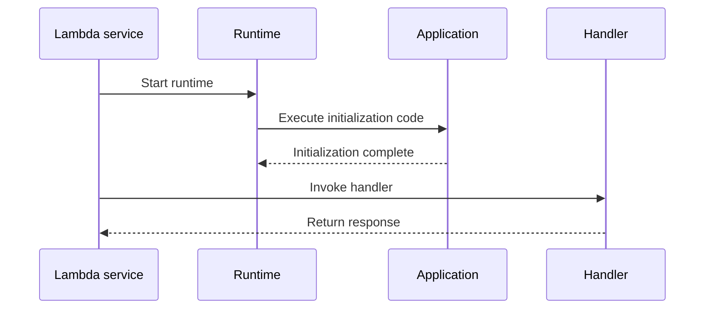
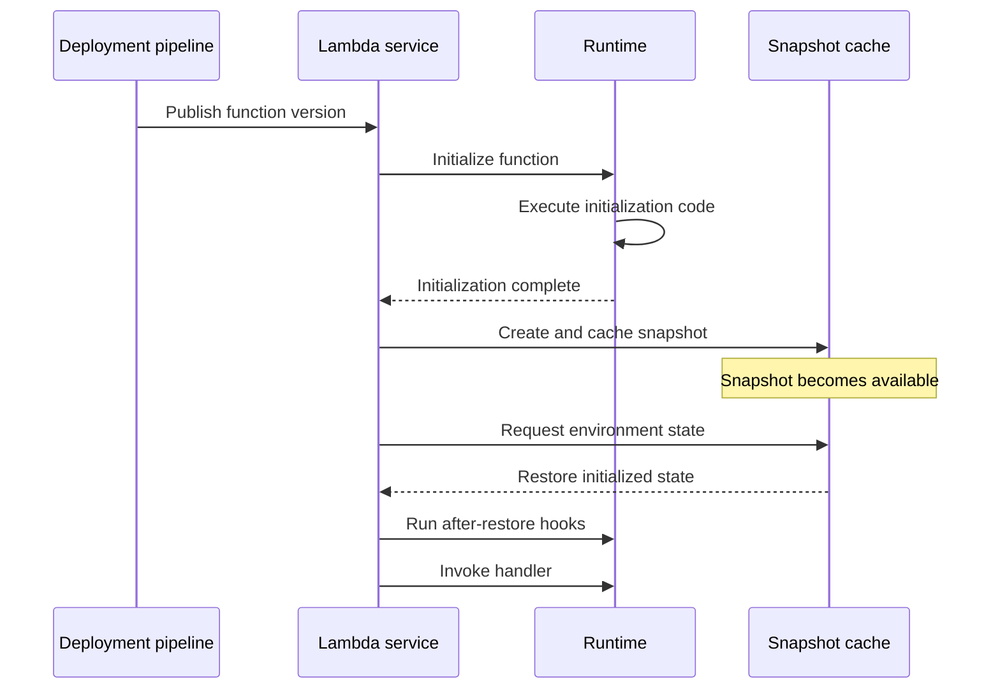
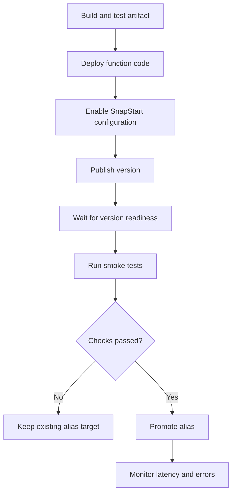

# 01- Lambda SnapStart Deep Dive

## Overview

AWS Lambda SnapStart is an initialization optimization that reduces cold-start latency by taking a snapshot of an initialized execution environment when a function version is published. Lambda subsequently restores new execution environments from that snapshot instead of repeating the entire initialization process.

SnapStart is particularly useful for functions that perform expensive initialization, such as loading large dependency graphs, starting application frameworks, preparing reusable objects, or initializing runtime components.

The key idea is to move initialization work from the invocation path to the version-publishing process.

Without SnapStart, Lambda initializes a new execution environment when one is needed. With SnapStart, Lambda initializes the function during version publication, snapshots its memory and disk state, and restores that state when additional execution environments are required.



SnapStart does not eliminate every source of latency. Runtime restoration, after-restore hooks, network connections, downstream service calls, and handler execution can still contribute to response time.

**Engineering principle:** SnapStart optimizes environment initialization. It does not automatically optimize application logic, database queries, network calls, or downstream dependencies.

## Why Lambda SnapStart Exists

A conventional Lambda cold start can include several stages:

- Downloading or preparing the deployment artifact.
- Starting the language runtime.
- Loading application modules and dependencies.
- Executing initialization code outside the handler.
- Initializing frameworks, clients, configuration, and reusable objects.
- Establishing connections or performing other startup work.

For applications with expensive initialization, the first invocation in a new execution environment can have substantially higher latency than subsequent invocations.

Consider a Python API that imports several large libraries and initializes reusable clients at module scope:

```python
import boto3
import json
import logging

logger = logging.getLogger()
logger.setLevel(logging.INFO)

s3_client = boto3.client("s3")
dynamodb = boto3.resource("dynamodb")

def lambda_handler(event, context):
    return {
        "statusCode": 200,
        "body": json.dumps({"status": "ok"}),
    }
```

The module-level objects are created during initialization. Ordinary Lambda execution environments can reuse these objects across warm invocations.

SnapStart can preserve initialized state for supported runtimes, allowing new execution environments to restore that state rather than reconstruct everything from scratch.

However, SnapStart should not be enabled solely because a function has cold starts. First measure the actual initialization cost and determine whether the feature is supported by the function's runtime, deployment format, and configuration.

## Supported Runtimes and Limitations

According to the current AWS Lambda documentation, SnapStart supports these managed runtimes and their corresponding AWS Lambda base images:

| Runtime | Minimum supported version |
|---|---|
| Java | Java 11 and later |
| Python | Python 3.12 and later |
| .NET | .NET 8 and later |

For .NET applications using the Lambda Annotations framework, AWS specifies Amazon.Lambda.Annotations version 1.6.0 or later for SnapStart compatibility.

Support applies to ZIP packages and container images under the documented runtime and image requirements. For container images, custom base images may require explicit SnapStart lifecycle integration.

Other managed runtimes, such as Node.js and Ruby, and OS-only runtimes are not supported by SnapStart.

The feature also has important configuration restrictions:

| Capability or configuration | SnapStart support |
|---|---|
| Published function versions | Supported |
| Aliases pointing to published versions | Supported |
| Unpublished `$LATEST` version | Not supported |
| Provisioned concurrency | Not supported |
| Amazon EFS integration | Not supported |
| Amazon S3 Files | Not supported |
| Ephemeral storage greater than 512 MB | Not supported |

SnapStart is available in commercial AWS Regions except Asia Pacific (New Zealand) and Asia Pacific (Taipei), according to the current service documentation. Verify the latest regional availability before planning a deployment.

References:

- [SnapStart support, limitations, Regions, and pricing](https://docs.aws.amazon.com/lambda/latest/dg/snapstart.html)
- [Lambda runtime support](https://docs.aws.amazon.com/lambda/latest/dg/lambda-runtimes.html)

## SnapStart Execution Lifecycle

Understanding the lifecycle is essential because SnapStart changes when initialization occurs and how initialized state is reused.

### Conventional Lambda initialization

Without SnapStart, Lambda initializes a new execution environment when required. The initialization phase includes starting extensions, bootstrapping the runtime, and executing function initialization code.

Conceptually:



Initialization code generally includes module-level statements, imports, global object creation, and application setup performed before the handler runs.

### SnapStart initialization

With SnapStart, the lifecycle is split into publication-time initialization and invocation-time restoration.



The sequence is conceptual. Actual runtime and service interactions vary according to the supported runtime and deployment configuration.

### Important lifecycle implications

- Initialization code runs during version publication, so publishing a version can take longer than publishing a conventional function version.
- Each published version receives its own snapshot.
- A new published version is required to capture changed initialization code or configuration in a new snapshot.
- Lambda can restore the snapshot into multiple execution environments.
- Runtime hooks can execute code before snapshot creation and after restoration.
- SnapStart does not make a published function version mutable. The published version remains an immutable deployment target, while a new version captures a new deployment.

A function version can pass through these states:

| State | Meaning | Operational response |
|---|---|---|
| `Pending` | Lambda is initializing the function and creating its snapshot | Wait for the version to become ready |
| `Active` | Snapshot creation is complete and the version is available | Verify configuration and invoke the version |
| `Inactive` | The version may require snapshot regeneration after an applicable lifecycle event | Inspect state and retry after readiness is restored |
| `Failed` | Initialization or snapshot creation failed | Inspect logs and fix the initialization or hook failure |

AWS documents an additional 14-day inactivity behavior for Java SnapStart versions. After 14 days without invocation, Lambda can delete the snapshot and mark the version `Inactive`. A subsequent invocation can return `SnapStartNotReadyException` while Lambda regenerates the snapshot. Do not generalize this Java-specific behavior to every supported runtime without checking the current documentation.

Reference: [Activating and managing SnapStart](https://docs.aws.amazon.com/lambda/latest/dg/snapstart-activate.html)

## SnapStart Versus a Conventional Cold Start

| Aspect | Conventional initialization | SnapStart |
|---|---|---|
| Initialization timing | When a new environment is initialized | During function-version publication |
| New environment startup | Executes initialization code | Restores initialized state |
| Module-level object creation | Occurs during environment initialization | State can be restored from the snapshot |
| Startup latency | Depends on runtime and initialization work | Can be substantially reduced |
| Handler execution | Normal | Normal, after restoration |
| Runtime-specific compatibility work | Standard runtime considerations | Snapshot uniqueness and restoration compatibility must also be considered |
| Version management | Versions and aliases are optional deployment practices | Published versions are required to use SnapStart |
| Provisioned concurrency | Available where supported | Cannot be combined with SnapStart |
| Cost model | Standard Lambda charges | Standard charges plus applicable SnapStart caching and restoration charges |

SnapStart is most useful when initialization is a significant contributor to latency and the function scales across new execution environments.

For a function whose latency is dominated by a slow database query or external API request, SnapStart may produce only a modest improvement.

## SnapStart Versus Provisioned Concurrency

SnapStart and provisioned concurrency address cold-start latency differently.

- **SnapStart** restores execution environments from snapshots.
- **Provisioned concurrency** keeps a configured number of execution environments initialized and ready to serve requests.

These are alternatives rather than complementary features for the same function configuration: SnapStart does not support provisioned concurrency.

| Decision factor | SnapStart | Provisioned concurrency |
|---|---|---|
| Primary mechanism | Restore initialized state | Maintain initialized environments |
| Supported runtimes | Java 11+, Python 3.12+, .NET 8+ | Depends on Lambda provisioned concurrency support |
| Startup latency | Reduced through snapshot restoration | Can achieve very low initialization-related latency |
| Capacity readiness | Environments are restored as needed | Configured capacity is initialized in advance |
| Idle-capacity cost | Snapshot caching and applicable restoration charges | Charges for configured provisioned capacity |
| Typical use case | Reduce initialization overhead without maintaining preinitialized capacity | Strict latency targets that require initialized capacity to be ready |

Choose SnapStart when it meaningfully reduces startup latency and its runtime constraints fit the application. Consider provisioned concurrency when the latency objective requires preinitialized capacity and the workload can justify the additional cost.

Reference: [AWS Lambda SnapStart](https://docs.aws.amazon.com/lambda/latest/dg/snapstart.html)

## Handling Snapshot State Correctly

The most important SnapStart engineering concern is that a snapshot can preserve state that was expected to be unique to an execution environment or invocation.

The same initialized state can be restored into multiple environments. Code that assumes initialization executes independently for every environment can therefore behave incorrectly.

### Uniqueness and random values

Suppose an application generates an identifier during initialization:

```python
import uuid

INSTANCE_ID = str(uuid.uuid4())

def lambda_handler(event, context):
    return {"instance_id": INSTANCE_ID}
```

With SnapStart, the identifier can be captured in the snapshot and reused across restored environments. It is therefore not safe to treat `INSTANCE_ID` as a guaranteed unique environment identifier.

Generate values that require uniqueness at the point where uniqueness is needed:

```python
import json
import uuid

def lambda_handler(event, context):
    request_id = str(uuid.uuid4())

    return {
        "statusCode": 200,
        "body": json.dumps({
            "request_id": request_id,
        }),
    }
```

This example creates a fresh identifier for each handler invocation. For business operations, an identifier generated by the caller or derived from a stable idempotency key may be more appropriate.

The same principle applies to:

- Unique identifiers generated during initialization.
- Pseudorandom generator state.
- Temporary tokens and credentials.
- Cached timestamps or expiring configuration.
- Per-environment identity assumptions.

Do not assume that every random value generated during initialization will remain independent across restored environments. Review the runtime-specific SnapStart uniqueness guidance, especially for cryptographic randomness and security-sensitive identifiers.

Reference: [Handling uniqueness with Lambda SnapStart](https://docs.aws.amazon.com/lambda/latest/dg/snapstart-uniqueness.html)

### Network connections

A network connection established during initialization may not remain valid after the execution environment is restored.

Examples include:

- Database connections.
- Raw TCP sockets.
- Persistent HTTP connections.
- Connections to services with idle timeouts.
- Custom protocol clients with session state.

AWS SDK connections often resume automatically, but this behavior should not be assumed for every library or connection type.

For database access, a safer pattern is to create a reusable client or connection manager during initialization, then validate connection health and reconnect when required. Avoid treating a restored socket as proof that the remote server still considers the connection valid.

For example, a database client wrapper can detect a failed connection and establish a replacement. The exact implementation depends on the database driver and connection pool.

### Temporary data and credentials

Initialization-time data can become stale before a restored environment uses it.

Do not rely on a cached timestamp, temporary credential, short-lived authorization token, or expiring external configuration simply because it was available when the snapshot was created.

Prefer the normal AWS credential provider chain and retrieve or refresh temporary data when it is needed. Never hardcode AWS credentials in the application.

When using the AWS SDK, allow the SDK to use the Lambda execution role rather than embedding long-lived access keys in the function.

Reference: [Using SnapStart with AWS SDKs](https://docs.aws.amazon.com/lambda/latest/dg/snapstart-activate.html)

## Python SnapStart Runtime Hooks

For supported Python runtimes, AWS provides the `snapshot_restore_py` library with two decorators:

- `@register_before_snapshot` registers code to run before the snapshot is created.
- `@register_after_restore` registers code to run when Lambda restores the snapshot.

These hooks are useful when initialization state must be cleaned up before snapshot creation or reconstructed after restoration.

The following example demonstrates the hook structure. It does not establish that an arbitrary network connection can safely be preserved; the connection manager must implement the actual lifecycle behavior.

```python
import json

from snapshot_restore_py import (
    register_after_restore,
    register_before_snapshot,
)

def lambda_handler(event, context):
    return {
        "statusCode": 200,
        "body": json.dumps({"status": "ok"}),
    }

@register_before_snapshot
def before_snapshot():
    # Release or normalize state that should not be preserved.
    pass

@register_after_restore
def after_restore():
    # Reinitialize resources that must be valid after restoration.
    pass
```

The functions registered as hooks must be imported as part of the handler's initialization path. If a module containing hook registrations is never imported, Lambda will not execute those registrations.

### Hook execution order

The order depends on the order in which hooks are registered:

| Hook | Execution order |
|---|---|
| Before snapshot | Reverse registration order |
| After restore | Registration order |

For decorator-based registration, import, definition, and execution order determine registration order. Use explicit registration methods when precise control is needed.

### Hook time limits

AWS documents the following lifecycle limits for Python runtime hooks:

- Snapshot creation initialization can run for up to 15 minutes. The applicable time limit is 130 seconds or the configured function timeout, up to the documented maximum of 900 seconds, whichever is higher.
- After-restore runtime hooks must complete within 10 seconds.
- A restore timeout can result in `SnapStartTimeoutException`.

Keep after-restore work minimal. Reconnecting to a database, refreshing configuration, or rebuilding a client should be bounded and designed to fail clearly rather than blocking restoration indefinitely.

Reference: [Lambda SnapStart runtime hooks for Python](https://docs.aws.amazon.com/lambda/latest/dg/snapstart-runtime-hooks-python.html)

## Activating SnapStart with the AWS CLI

The following workflow enables SnapStart for an existing supported Lambda function.

### Prerequisites

- AWS CLI v2 installed and configured.
- An AWS account and target Region where SnapStart is available.
- An existing function using a supported runtime and compatible configuration.
- An execution role with the permissions required by the application.
- Permission to update the function configuration and publish versions.

Set the function name and Region explicitly:

```bash
export AWS_REGION="ap-south-1"
export FUNCTION_NAME="my-python-api"
```

Verify the caller identity and function configuration before making changes:

```bash
aws sts get-caller-identity \
  --region "$AWS_REGION"

aws lambda get-function-configuration \
  --function-name "$FUNCTION_NAME" \
  --region "$AWS_REGION" \
  --query '{
    FunctionName: FunctionName,
    Runtime: Runtime,
    State: State,
    PackageType: PackageType,
    EphemeralStorage: EphemeralStorage.Size,
    SnapStart: SnapStart
  }'
```

Confirm that the function uses a supported runtime and does not have an incompatible configuration.

### Enable SnapStart

This command changes the function configuration:

```bash
aws lambda update-function-configuration \
  --function-name "$FUNCTION_NAME" \
  --snap-start ApplyOn=PublishedVersions \
  --region "$AWS_REGION"
```

Wait for the configuration update to complete:

```bash
aws lambda wait function-updated \
  --function-name "$FUNCTION_NAME" \
  --region "$AWS_REGION"
```

### Publish a version

Publish a new immutable function version:

```bash
aws lambda publish-version \
  --function-name "$FUNCTION_NAME" \
  --region "$AWS_REGION"
```

Capture the returned version number. The following example retrieves the latest published version number:

```bash
VERSION=$(
  aws lambda list-versions-by-function \
    --function-name "$FUNCTION_NAME" \
    --region "$AWS_REGION" \
    --query 'Versions[-1].Version' \
    --output text
)

echo "$VERSION"
```

In a production pipeline, use the version returned directly by the publish operation rather than assuming that the numerically latest version is necessarily the one just published.

### Verify snapshot readiness

```bash
aws lambda get-function-configuration \
  --function-name "$FUNCTION_NAME" \
  --qualifier "$VERSION" \
  --region "$AWS_REGION" \
  --query '{
    Version: Version,
    State: State,
    StateReason: StateReason,
    SnapStart: SnapStart
  }'
```

Verify that the published version is `Active` and that SnapStart reports an optimization status of `On`.

Do not route production traffic to a version that has not completed snapshot creation and passed the deployment checks.

### Invoke the published version

For AWS CLI v2, use the required binary payload format:

```bash
aws lambda invoke \
  --function-name "$FUNCTION_NAME" \
  --qualifier "$VERSION" \
  --cli-binary-format raw-in-base64-out \
  --payload '{"operation":"health-check"}' \
  --region "$AWS_REGION" \
  response.json

cat response.json
```

This invokes the published version, not `$LATEST`.

For production deployments, route traffic through an alias that points to the verified published version. This makes version promotion and rollback easier to manage.

Reference: [Activating and managing SnapStart](https://docs.aws.amazon.com/lambda/latest/dg/snapstart-activate.html)

## SnapStart with Aliases and Deployment Pipelines

SnapStart works with published versions and aliases that point to versions. A typical deployment process should therefore separate code deployment, version publication, verification, and traffic promotion.



A safe deployment pipeline should:

1. Build an immutable artifact.
2. Deploy the artifact and required configuration.
3. Publish a new function version.
4. Wait for snapshot creation and verify the version state.
5. Invoke the published version using a test payload.
6. Validate response correctness, permissions, logs, and latency.
7. Promote an alias only after verification succeeds.
8. Monitor the new version and retain a rollback target.

An alias is useful because clients can invoke a stable name while the deployment pipeline changes the underlying version.

Example:

```bash
aws lambda update-alias \
  --function-name "$FUNCTION_NAME" \
  --name production \
  --function-version "$VERSION" \
  --region "$AWS_REGION"
```

Treat alias updates as production traffic changes. In a mature deployment pipeline, validate the current alias target before changing it and ensure that rollback procedures restore a known-good version.

Do not assume that changing an alias automatically validates the snapshot, warms every environment, or guarantees a particular latency percentile.

## Infrastructure as Code

SnapStart should be configured through the same infrastructure-management process as the rest of the Lambda function.

### AWS SAM example

The following AWS SAM template fragment shows the relevant function property. It assumes the handler file and runtime are compatible with SnapStart and that the remaining deployment configuration is supplied by the application.

```yaml
Resources:
  ApiFunction:
    Type: AWS::Serverless::Function
    Properties:
      CodeUri: src/
      Handler: app.lambda_handler
      Runtime: python3.12
      MemorySize: 512
      Timeout: 10
      AutoPublishAlias: production
      SnapStart:
        ApplyOn: PublishedVersions
```

Validate the template against the current AWS SAM schema and deployment requirements before using it in production. The `AutoPublishAlias` configuration is intended to publish and manage versions and an alias; verify the generated deployment behavior in the pipeline.

### Infrastructure as Code considerations

- Keep SnapStart configuration under source control.
- Pin and test the runtime version used by the deployment.
- Ensure the published version is the artifact that passed CI.
- Keep runtime permissions separate from deployment permissions.
- Verify snapshot readiness before promoting an alias.
- Avoid creating unnecessary published versions that remain active indefinitely.
- Test restoration behavior in a non-production environment.

References:

- [Using SnapStart with CloudFormation, AWS SAM, and AWS CDK](https://docs.aws.amazon.com/lambda/latest/dg/snapstart-activate.html)
- [AWS SAM documentation](https://docs.aws.amazon.com/serverless-application-model/latest/developerguide/what-is-sam.html)

## Performance Tuning

SnapStart should be evaluated through measurements, not assumptions.

### Identify the initialization bottleneck

Before enabling SnapStart, measure:

- Initialization duration.
- Restore duration after enabling SnapStart.
- Handler execution duration.
- End-to-end API latency.
- p50, p95, and p99 latency.
- Error and timeout rates.
- Memory usage and downstream service latency.

A function with expensive module imports or framework initialization may benefit substantially. A function that spends most of its time waiting for a remote database may not.

### Optimize initialization even when using SnapStart

SnapStart is not a replacement for efficient initialization code.

Avoid:

- Importing unnecessary dependencies.
- Loading large configuration files that are never used.
- Performing unbounded external API calls during initialization.
- Creating database connections that cannot be safely restored.
- Rebuilding expensive objects on every handler invocation when safe reuse is possible.

Prefer:

- Minimal dependencies.
- Bounded initialization work.
- Reusable clients where their lifecycle is safe.
- Lazy initialization for resources that are not needed by every invocation.
- Explicit timeout and retry settings for network calls.
- After-restore hooks only where lifecycle correction is necessary.

Lazy initialization is not always beneficial with SnapStart. It reduces work during snapshot creation but moves that work back onto the invocation path. Choose based on the function's actual latency requirements.

### Compare performance under representative load

Benchmark both versions with equivalent configuration and traffic patterns. Test low traffic, burst traffic, sustained concurrency, and downstream latency variation.

Do not compare a warmed conventional function against a newly deployed SnapStart version without accounting for the different execution states. Likewise, do not treat one successful invocation as evidence that tail latency is acceptable.

## Monitoring and Observability

SnapStart adds restoration behavior that should be visible in operational monitoring.

### CloudWatch logs

For SnapStart functions, Lambda reports restoration information in invocation logs. The `REPORT` record can include:

- `Restore Duration`: time for snapshot restoration, runtime loading, and after-restore hooks, including reported work outside the microVM.
- `Billed Restore Duration`: the billed portion of restoration associated with runtime loading and after-restore hooks.
- `Duration`: handler execution duration and applicable runtime work, depending on the runtime and lifecycle.

Interpret these fields together rather than assuming that `Duration` alone represents the entire cold-start experience.

The cold-start duration is calculated from `Restore Duration` plus `Duration` in the documented SnapStart reporting model. API-level latency can be higher because of network and integration overhead.

### Metrics and alarms

Monitor at least:

| Signal | Why it matters |
|---|---|
| `Duration` | Detect changes in execution time |
| `Invocations` | Understand workload volume |
| `Errors` | Detect failed requests |
| `Throttles` | Identify concurrency or capacity constraints |
| `ConcurrentExecutions` | Understand scaling behavior |
| `Init Duration` and restore-related log fields | Evaluate initialization and restoration behavior |
| API Gateway `IntegrationLatency`, when applicable | Measure backend integration latency |
| Function URL `UrlRequestLatency`, when applicable | Measure function URL request latency |

Use log queries or telemetry integrations to derive restoration latency percentiles. Alarm on user-visible latency, errors, and failed deployments rather than assuming that SnapStart-specific metrics alone provide complete observability.

Reference: [Monitoring Lambda SnapStart](https://docs.aws.amazon.com/lambda/latest/dg/snapstart-monitoring.html)

## Security Considerations

SnapStart snapshots contain initialized memory and disk state. The snapshot lifecycle therefore matters for both security and correctness.

### Protect snapshot contents

- Do not load long-lived secrets into global variables unnecessarily.
- Do not embed credentials in deployment artifacts.
- Use the Lambda execution role and standard AWS credential providers.
- Retrieve short-lived secrets or tokens when needed and refresh them appropriately.
- Apply least-privilege IAM permissions to the function.
- Restrict who can update function configuration, publish versions, and modify aliases.
- Review logs and runtime hooks to ensure sensitive data is not written unnecessarily.

AWS encrypts SnapStart snapshots and manages cached copies for resilience. This does not eliminate the need to protect the function's IAM permissions, deployment process, secrets, and logs.

### Avoid stale security state

A snapshot can preserve application state from initialization. If a function caches authorization configuration, credentials, or security-sensitive metadata, verify that the cached state remains valid after restoration.

Prefer explicit refresh and expiration policies for sensitive state. Do not rely on the assumption that publishing a new version or restoring a snapshot automatically refreshes every external secret or authorization decision.

### Secure deployment permissions

The CI/CD identity should have only the permissions needed to deploy the function, publish versions, and manage the intended alias. Runtime permissions should remain associated with the Lambda execution role rather than being granted to the deployment identity for convenience.

## Cost Considerations

SnapStart can improve latency, but its cost should be evaluated alongside the performance benefit.

For SnapStart-enabled versions, AWS documents these cost components:

- Snapshot caching and maintenance for each published SnapStart version.
- Snapshot restoration charges each time an execution environment is restored.
- Normal Lambda request and duration charges.
- Applicable duration charges for initialization code and runtime hooks.
- Charges when Lambda reruns initialization code to apply software updates to snapshots.

AWS documents no additional SnapStart charge for Java managed runtimes, although normal Lambda request and execution charges still apply. Do not assume the same pricing treatment for every supported runtime; verify current regional pricing for the runtime being deployed.

Snapshot caching is billed for a minimum of three hours per applicable version, and charges continue while the version remains active under the documented pricing model.

### Cost-control practices

- Delete obsolete published versions that are no longer needed.
- Automate safe version cleanup while retaining required rollback targets.
- Measure restoration frequency and latency under realistic traffic.
- Compare the cost of snapshot caching and restoration against the latency benefit.
- Avoid publishing unnecessary versions from repeated experimental deployments.
- Include runtime hooks and initialization work in performance and cost analysis.

Reference: [AWS Lambda SnapStart pricing](https://docs.aws.amazon.com/lambda/latest/dg/snapstart.html)

## Common Mistakes and Troubleshooting

### SnapStart is enabled, but cold starts remain expensive

**Possible causes**

- The function is invoking `$LATEST` rather than a published version.
- The runtime or configuration is unsupported.
- Restoration and runtime-hook work is expensive.
- The handler is dominated by database or network latency rather than initialization.

**Diagnostic approach**

1. Inspect the published version's `SnapStart` configuration.
2. Verify `State` is `Active` and `OptimizationStatus` is `On`.
3. Inspect `Restore Duration` and `Duration` in CloudWatch logs.
4. Measure end-to-end latency separately from Lambda execution latency.
5. Compare equivalent versions under representative load.

### Snapshot creation fails

**Possible causes**

- Initialization code throws an exception.
- A before-snapshot hook fails or exceeds its time limit.
- The runtime or container image does not implement the required SnapStart lifecycle.
- A dependency is incompatible with the snapshot-and-restore model.

**Corrective actions**

1. Inspect the function's initialization logs.
2. Review before-snapshot hook behavior.
3. Verify the runtime, image, and deployment configuration.
4. Publish a new version after correcting the failure.
5. Confirm the new version reaches `Active` before routing traffic to it.

### Restored environments contain stale state

**Possible causes**

- A token, timestamp, or configuration value was captured during initialization.
- A connection was assumed to remain valid after restoration.
- Unique identifiers or random state were generated before snapshot creation.

**Corrective actions**

1. Identify the state that is being preserved.
2. Determine whether it is safe to share across restored environments.
3. Generate unique values at the point they are needed.
4. Refresh temporary data and validate external connections.
5. Use runtime hooks for lifecycle-specific cleanup or reinitialization where appropriate.

### An invocation fails while a version is not ready

**Possible causes**

- The version is still `Pending`.
- Snapshot creation or regeneration has failed.
- The deployment pipeline invokes the version before it is ready.

**Corrective actions**

1. Inspect the version's `State` and `StateReason`.
2. Wait for the version to become `Active`.
3. Inspect initialization logs if the version enters `Failed`.
4. Make deployment readiness checks explicit rather than relying on fixed sleeps.

Reference: [Troubleshooting SnapStart errors](https://docs.aws.amazon.com/lambda/latest/dg/snapstart-troubleshooting.html)

## Production Readiness Checklist

Before enabling SnapStart in production, verify the following:

- [ ] The function uses a supported runtime and compatible deployment configuration.
- [ ] The application does not depend on initialization-time uniqueness.
- [ ] Temporary credentials, tokens, timestamps, and other expiring data are refreshed appropriately.
- [ ] Network connections can be validated or recreated after restoration.
- [ ] Runtime hooks are imported, tested, bounded, and observable.
- [ ] Snapshot creation failures block version promotion.
- [ ] The deployment pipeline invokes and verifies the published version.
- [ ] An alias points only to a tested, ready version.
- [ ] Latency measurements distinguish restoration, handler execution, and end-to-end request time.
- [ ] CloudWatch logs, metrics, alarms, and failure diagnosis procedures are in place.
- [ ] Snapshot caching, restoration, and version-retention costs have been evaluated.
- [ ] Rollback procedures retain a known-good published version.

## Key Takeaways

- Lambda SnapStart moves initialization work to version publication and restores initialized state to reduce cold-start latency for supported runtimes.
- SnapStart currently supports Java 11+, Python 3.12+, and .NET 8+ under the documented runtime and deployment constraints; it does not support `$LATEST`, provisioned concurrency, EFS, or ephemeral storage above 512 MB.
- Snapshot restoration can preserve stale or non-unique state, so unique values, temporary credentials, and network connections must be handled deliberately.
- Python runtime hooks provide before-snapshot and after-restore lifecycle integration, but after-restore hooks must complete within the documented 10-second limit.
- Validate SnapStart through published-version readiness checks, realistic latency measurements, monitoring, security review, and cost analysis before promoting production traffic.