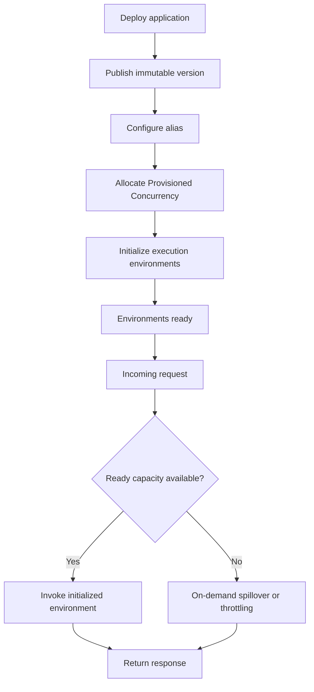
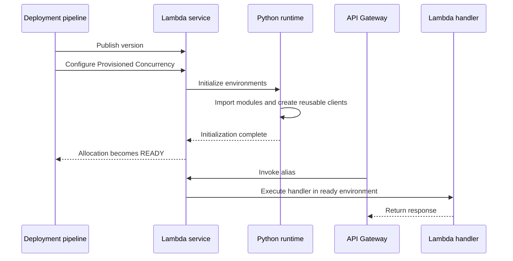
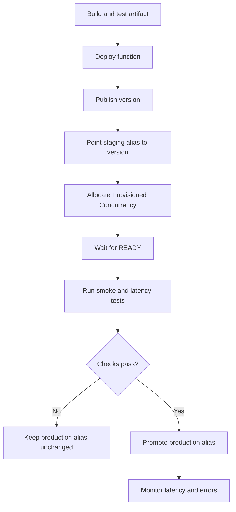

# 02- Provisioned Concurrency and Initialization Optimization

## Overview

AWS Lambda Provisioned Concurrency is a capacity-management feature that initializes a configured number of Lambda execution environments before they receive invocations. It reduces initialization latency for latency-sensitive workloads by keeping environments ready to execute requests.

Without Provisioned Concurrency, Lambda generally creates execution environments on demand when traffic requires additional capacity. A newly created environment may need to initialize the runtime, load dependencies, execute application initialization code, and initialize extensions before handling its first request.

Provisioned Concurrency moves this initialization work ahead of invocation time.

For a Python REST API behind Amazon API Gateway, this can reduce latency spikes caused by importing dependencies, initializing application components, and preparing reusable clients.

Provisioned Concurrency is not the same as Reserved Concurrency, and it does not guarantee that every request will execute within a particular latency target. Capacity planning, downstream performance, application code, and traffic spikes still matter.

Reference: [Configuring Provisioned Concurrency](https://docs.aws.amazon.com/lambda/latest/dg/provisioned-concurrency.html)

## Why Provisioned Concurrency Exists

Lambda automatically scales execution environments, but on-demand scaling can introduce initialization latency when new environments are required.

Consider a Python API with the following initialization operations:

- Importing a framework and its dependencies.
- Loading configuration.
- Creating AWS SDK clients.
- Initializing database connection management.
- Loading models or other reusable application resources.
- Starting Lambda extensions.

These operations occur before the handler can process requests when they are performed during initialization.

For a background processing function, this delay may be acceptable. For an interactive API, a cold start can increase the latency of an individual request and affect p95 or p99 response times.

Provisioned Concurrency is designed for workloads where predictable initialization behavior matters more than minimizing idle capacity.

Typical use cases include:

- User-facing REST APIs.
- Authentication and authorization services.
- Interactive mobile backends.
- Latency-sensitive microservices.
- APIs with predictable traffic peaks.
- Synchronous integrations with strict latency objectives.

It is less attractive for infrequently invoked functions, low-priority background jobs, and workloads where a small initialization delay is acceptable.

## How Provisioned Concurrency Works

Provisioned Concurrency allocates a configured number of initialized execution environments to a published Lambda version or alias.

For example, if a function has 20 units of Provisioned Concurrency, Lambda prepares 20 execution environments in advance. These environments can handle concurrent requests without requiring ordinary on-demand initialization for each of those requests.



The behavior of requests beyond the provisioned capacity depends on the function's available concurrency, account quotas, and other configuration. Without an applicable concurrency restriction, additional requests can use on-demand capacity, which may introduce initialization latency. If the function reaches its concurrency limit, requests can be throttled.

### Initialization lifecycle

When Provisioned Concurrency is configured, Lambda initializes environments during allocation rather than waiting for the first request to create each environment.



The diagram represents the intended lifecycle. Lambda can recycle environments, so initialization is not a one-time operation for the entire lifetime of the function.

AWS also notes that the first invocation on an initialized environment can still exhibit variable latency depending on the runtime and memory configuration.

Reference: [Lambda execution environment lifecycle](https://docs.aws.amazon.com/lambda/latest/dg/lambda-runtime-environment.html)

## Reserved Concurrency vs Provisioned Concurrency

These features solve different problems.

| Property | Reserved Concurrency | Provisioned Concurrency |
|---|---|---|
| Primary purpose | Reserve concurrency capacity and establish a function-level maximum | Keep a configured number of environments initialized |
| Initialization | Environments are created as needed | Environments are initialized ahead of requests |
| Cold-start reduction | Does not eliminate initialization latency | Reduces initialization latency within provisioned capacity |
| Maximum concurrency | Caps the function's concurrency | Does not independently establish the function's overall maximum |
| Downstream protection | Useful for limiting concurrent requests | Can provide ready capacity, but does not replace a concurrency cap |
| Additional capacity charge | No separate charge for the setting | Additional charges apply |
| Version or alias required | Configuration can apply to the function | Must be configured against a published version or alias |
| Typical use | Protect account capacity and downstream systems | Meet latency objectives for interactive workloads |

You can configure both for the same function. Provisioned Concurrency cannot exceed the function's Reserved Concurrency, and the combined provisioned allocations across versions and aliases must respect the applicable reserved limit.

### Example

Suppose a payment API has:

- Reserved Concurrency: 100.
- Provisioned Concurrency: 40 on the production alias.

The function has a concurrency ceiling of 100. Forty units are pre-initialized, while the remaining concurrency can be used through on-demand execution, subject to available capacity and account limits.

This configuration does not guarantee that all 100 concurrent requests avoid cold starts. Only the provisioned capacity is pre-initialized.

Use Reserved Concurrency when you need to protect a database or prevent one function from consuming too much account capacity. Add Provisioned Concurrency when initialization latency is also a problem.

Reference: [Understanding Lambda concurrency](https://docs.aws.amazon.com/lambda/latest/dg/lambda-concurrency.html)

## Calculating Required Provisioned Concurrency

Provisioned Concurrency should be based on observed concurrency and the latency requirements of the workload, not on requests per second alone.

A useful approximation is:

\[
\text{Concurrency} = \text{Requests per second} \times \text{Average duration in seconds}
\]

For example, suppose an API receives 200 requests per second and each invocation takes an average of 150 milliseconds.

\[
200 \times 0.15 = 30
\]

The estimated average concurrency is 30.

This does not mean that 30 units are necessarily sufficient. Traffic variability, burstiness, request duration distribution, and the target latency percentile can increase the capacity required.

### Capacity estimation example

| Parameter | Value |
|---|---:|
| Average request rate | 200 requests/second |
| Average execution duration | 150 ms |
| Estimated average concurrency | 30 |
| Initial planning buffer | 10% |
| Initial provisioned target | 33 |

AWS recommends considering an additional buffer when estimating Provisioned Concurrency. A 10% buffer is a starting point, not a guarantee of sufficient capacity.

For a latency-sensitive API, inspect peak concurrency and the distribution of request durations before selecting the final allocation.

### Practical sizing procedure

1. Measure invocation rate and execution duration under representative traffic.
2. Inspect `ConcurrentExecutions` and `ProvisionedConcurrentExecutions`.
3. Identify the peak concurrency needed to meet the latency objective.
4. Add a reasonable buffer based on traffic variability.
5. Load-test the proposed allocation.
6. Verify spillover and throttling behavior.
7. Adjust the allocation using observed production demand.

Do not use average requests per second alone. A sudden burst can require more capacity than the average suggests.

Reference: [Configuring Provisioned Concurrency](https://docs.aws.amazon.com/lambda/latest/dg/provisioned-concurrency.html)

## Optimizing Python Initialization

Provisioning environments ahead of time is most effective when application initialization is structured correctly.

Python executes module-level code when the runtime imports a module. Code outside the handler is therefore part of initialization.

### Initialize reusable resources outside the handler

```python
import json
import logging

import boto3

logger = logging.getLogger()
logger.setLevel(logging.INFO)

dynamodb = boto3.resource("dynamodb")
orders_table = dynamodb.Table("orders")

def lambda_handler(event, context):
    order_id = event.get("order_id")

    if not order_id:
        return {
            "statusCode": 400,
            "body": json.dumps({"error": "order_id is required"}),
        }

    response = orders_table.get_item(Key={"order_id": order_id})

    return {
        "statusCode": 200,
        "body": json.dumps({
            "order": response.get("Item"),
        }, default=str),
    }
```

The AWS SDK resource is initialized outside the handler and can be reused within an execution environment. This avoids creating the same resource object on every invocation.

For a real application, also consider response serialization, missing records, exception handling, IAM permissions, and data validation. The example focuses on initialization behavior rather than providing a complete API implementation.

### Avoid unnecessary per-invocation initialization

An inefficient pattern creates reusable clients inside the handler:

```python
import boto3

def lambda_handler(event, context):
    dynamodb = boto3.resource("dynamodb")
    table = dynamodb.Table("orders")

    # Process request
```

A better pattern creates the resource at module scope:

```python
import boto3

dynamodb = boto3.resource("dynamodb")
table = dynamodb.Table("orders")

def lambda_handler(event, context):
    # Process request using the reusable table resource
    ...
```

The improvement is not specific to Provisioned Concurrency. It benefits conventional Lambda execution environments as well.

### Avoid initializing everything eagerly

Moving all initialization outside the handler is not always optimal.

Suppose an application supports several operations, but only one rarely used operation requires a large optional library. Eagerly importing that library increases initialization time for every environment, even when most invocations never use it.

Consider lazy initialization when:

- A dependency is expensive to import.
- Only a subset of requests needs it.
- Its initialization cost is significant.
- Its lifecycle can be managed safely.

The trade-off is that the first request needing the dependency now pays the initialization cost.

Provisioned Concurrency does not automatically make lazy initialization happen before requests. Code that executes only inside a handler remains on the invocation path.

## Database Connections and Initialization

Database initialization deserves special attention in serverless applications.

Creating a connection pool or database connection at module scope may reduce repeated setup work, but every execution environment can have its own connection resources.

If a function has 80 active environments and each environment maintains a pool of 10 database connections, the application could attempt to maintain up to 800 connections.

Provisioning environments in advance can also establish connections before real traffic arrives.

### Production recommendations

- Size connection pools according to the maximum expected execution environments.
- Avoid unnecessarily large per-environment pools.
- Use Amazon RDS Proxy where appropriate for supported RDS database engines and connection patterns.
- Configure connection and query timeouts.
- Detect stale connections and reconnect safely.
- Avoid performing database migrations during Lambda initialization.
- Use lazy connections if not every invocation requires database access.
- Test database capacity under realistic Provisioned Concurrency settings.

For Python applications using Django, do not assume that conventional long-running application server connection management transfers directly to Lambda. Evaluate the adapter or integration being used, database connection lifetime, concurrent execution behavior, and whether the chosen deployment model properly manages connections.

Provisioned Concurrency improves environment readiness; it does not increase the database's maximum connection capacity.

## Configuring Provisioned Concurrency with the AWS CLI

The following workflow configures Provisioned Concurrency for an existing Lambda function. Commands that modify resources are identified explicitly.

### Prerequisites

- AWS CLI v2 configured with an appropriate profile.
- An existing function using a supported deployment configuration.
- Permission to publish versions and manage Provisioned Concurrency.
- A compatible function alias or published version.
- Sufficient account concurrency quota.

Set the deployment variables:

```bash
export AWS_REGION="ap-south-1"
export FUNCTION_NAME="orders-api"
export ALIAS_NAME="production"
```

Verify the AWS account and function:

```bash
aws sts get-caller-identity \
  --region "$AWS_REGION"

aws lambda get-function-configuration \
  --function-name "$FUNCTION_NAME" \
  --region "$AWS_REGION" \
  --query '{
    FunctionName: FunctionName,
    Runtime: Runtime,
    State: State,
    LastModified: LastModified
  }'
```

These commands are read-only.

### Publish a version

If the function's current code and configuration have been validated, publish an immutable version.

**Resource-modifying command:**

```bash
aws lambda publish-version \
  --function-name "$FUNCTION_NAME" \
  --region "$AWS_REGION"
```

Record the returned version number. In a production pipeline, capture the version directly from the publish operation rather than assuming that the latest listed version is the one just deployed.

### Create or update an alias

If the alias does not exist, create it. If it already exists, update it after validating the target version.

**Resource-modifying command:**

```bash
aws lambda create-alias \
  --function-name "$FUNCTION_NAME" \
  --name "$ALIAS_NAME" \
  --function-version "1" \
  --region "$AWS_REGION"
```

Replace `"1"` with the actual published version number.

If the alias already exists, use `update-alias` instead of `create-alias`.

### Allocate Provisioned Concurrency

**Resource-modifying command:**

```bash
aws lambda put-provisioned-concurrency-config \
  --function-name "$FUNCTION_NAME" \
  --qualifier "$ALIAS_NAME" \
  --provisioned-concurrent-executions 40 \
  --region "$AWS_REGION"
```

This requests 40 initialized environments for the production alias.

The initial response can show `IN_PROGRESS`. Allocation is asynchronous, and the requested environments are not available for use as provisioned capacity until allocation completes.

### Verify allocation

```bash
aws lambda get-provisioned-concurrency-config \
  --function-name "$FUNCTION_NAME" \
  --qualifier "$ALIAS_NAME" \
  --region "$AWS_REGION"
```

Inspect the following fields:

- `Status`
- `RequestedProvisionedConcurrentExecutions`
- `AllocatedProvisionedConcurrentExecutions`
- `AvailableProvisionedConcurrentExecutions`
- `StatusReason`, when present

Wait until the allocation reports `READY` and the expected capacity is available before declaring the rollout complete.

### Verify alias configuration

```bash
aws lambda get-alias \
  --function-name "$FUNCTION_NAME" \
  --name "$ALIAS_NAME" \
  --region "$AWS_REGION"
```

Confirm that the alias points to the intended published version.

**Important:** Configure the API Gateway integration, event source, or other caller to invoke the alias that has Provisioned Concurrency configured. Invoking `$LATEST` or a different version does not use the alias's provisioned environments.

Reference: [AWS CLI: Put Provisioned Concurrency Config](https://docs.aws.amazon.com/cli/latest/reference/lambda/put-provisioned-concurrency-config.html)

## Automating Provisioned Concurrency

Traffic patterns often vary by time of day, day of week, or business event. Maintaining a fixed allocation can waste capacity during quiet periods or leave insufficient ready capacity during predictable peaks.

AWS Application Auto Scaling supports scheduled and utilization-based management of Provisioned Concurrency.

Typical approaches include:

- Scheduled scaling before business hours.
- Increasing capacity before a planned campaign.
- Scaling based on provisioned concurrency utilization.
- Reducing capacity during predictable low-demand periods.

A scheduled allocation must account for the time Lambda needs to initialize environments. Do not schedule the scale-up at the exact moment traffic begins if requests require ready capacity immediately.

### Operational considerations

- Configure minimum and maximum capacity based on service requirements.
- Use a buffer for unexpected demand.
- Monitor allocation status during scaling.
- Account for scaling delays and initialization failures.
- Test scale-up and scale-down behavior.
- Ensure that reserved and account-level concurrency quotas support the planned allocation.

Application Auto Scaling manages the configured capacity; it does not eliminate the need to estimate demand and validate application behavior.

Reference: [Automating Provisioned Concurrency with Application Auto Scaling](https://docs.aws.amazon.com/lambda/latest/dg/provisioned-concurrency.html)

## Provisioned Concurrency and Deployment Strategies

Provisioned Concurrency is configured for a published version or alias. This makes version management an important part of the deployment process.

A safe deployment should not route production traffic to a new version before its provisioned capacity is ready.



### Deployment checklist

1. Deploy the validated application artifact.
2. Publish a new immutable version.
3. Allocate Provisioned Concurrency to the intended alias or version.
4. Wait for allocation to complete.
5. Invoke the new version or staging alias.
6. Verify functionality, permissions, logs, and latency.
7. Promote production traffic only after validation.
8. Monitor for errors, throttling, and spillover.
9. Retain a known-good version for rollback.

Alias traffic shifting can be used for controlled releases where supported by the deployment setup. Ensure that the target version's capacity configuration and traffic-routing behavior are compatible with the intended rollout.

A rollback to an older version does not automatically guarantee that its Provisioned Concurrency allocation is still present and ready. Verify capacity before routing latency-sensitive traffic back to it.

## Monitoring and Observability

Provisioned Concurrency should be monitored as a capacity system, not merely as a configuration setting.

### Important CloudWatch metrics

| Metric | Purpose |
|---|---|
| `ProvisionedConcurrentExecutions` | Measures concurrent executions using provisioned capacity |
| `ProvisionedConcurrencyInvocations` | Counts invocations served by provisioned concurrency |
| `ProvisionedConcurrencySpilloverInvocations` | Counts invocations that exceed provisioned capacity and use on-demand capacity |
| `ProvisionedConcurrencyUtilization` | Measures utilization of allocated provisioned capacity |
| `ConcurrentExecutions` | Measures concurrent function executions |
| `Invocations` | Tracks invocation volume |
| `Duration` | Tracks execution duration |
| `Errors` | Detects failed invocations |
| `Throttles` | Detects requests rejected because concurrency limits were reached |

Metric availability and dimensions depend on the function configuration and invocation path. Validate the metrics in the target Region and deployment setup.

### Recommended alarms

Create alarms for:

- Sustained high Provisioned Concurrency utilization.
- Unexpected increases in spillover invocations.
- Throttling.
- Increased p95 or p99 latency.
- Elevated errors and timeouts.
- Provisioned Concurrency allocation failures.
- Unexpected invocation volume or cost increases.

A non-zero spillover count is not automatically a failure. It indicates that some invocations exceeded provisioned capacity. Whether this is acceptable depends on the latency objective and the behavior of the on-demand path.

### Initialization logs

Lambda emits `INIT_REPORT` records for functions using Provisioned Concurrency, including initialization duration and status information.

Inspect these logs when allocation fails or initialization becomes slower after a deployment. If initialization code times out or an extension crashes, the problem can prevent environments from becoming ready.

Reference: [Lambda execution environment lifecycle](https://docs.aws.amazon.com/lambda/latest/dg/lambda-runtime-environment.html)

## Cost Considerations

Provisioned Concurrency introduces additional charges for maintaining configured capacity. Invocation requests and execution duration are also charged under the applicable Lambda pricing model.

For provisioned environments, initialization code is billed, including when an environment is initialized but never processes a request. Lambda can recycle environments and rerun initialization, so initialization cost is not necessarily incurred only once during deployment.

Cost depends on factors including:

- Configured provisioned capacity.
- Duration for which the capacity is configured.
- Memory allocation.
- Invocation count and execution duration.
- Initialization work and environment recycling.
- Region and applicable pricing dimensions.

### Cost optimization practices

- Use measured concurrency instead of arbitrarily large allocations.
- Scale capacity down during predictable low-demand periods.
- Avoid allocating Provisioned Concurrency to low-priority background functions without a latency requirement.
- Optimize imports and initialization code.
- Monitor utilization and spillover together.
- Remove unused Provisioned Concurrency configurations.
- Evaluate the latency benefit against the additional capacity cost.

Reference: [AWS Lambda pricing](https://aws.amazon.com/lambda/pricing/)

## Common Mistakes and Troubleshooting

### Cold-start latency still appears

**Possible causes**

- The caller invokes `$LATEST` or a version without Provisioned Concurrency.
- Traffic exceeds provisioned capacity.
- Provisioned allocation is incomplete.
- Initialization was optimized, but the handler or downstream service remains slow.

**Diagnostic procedure**

1. Inspect the alias and its target version.
2. Check the Provisioned Concurrency configuration status.
3. Compare `ProvisionedConcurrencyInvocations` with `ProvisionedConcurrencySpilloverInvocations`.
4. Inspect `ConcurrentExecutions`, `Duration`, and API-level latency.
5. Verify that the actual caller uses the configured alias.

### Provisioned Concurrency allocation fails

**Possible causes**

- Insufficient account concurrency capacity.
- Provisioned Concurrency exceeds the function's Reserved Concurrency.
- The function version is not ready.
- Initialization code fails or exceeds its applicable time limit.
- Runtime extensions or initialization dependencies fail.

**Corrective actions**

1. Inspect the allocation status and `StatusReason`.
2. Verify the published version state.
3. Review `INIT_REPORT` and initialization logs.
4. Check reserved and account-level concurrency quotas.
5. Correct initialization failures and retry allocation.
6. Confirm that the allocation reaches `READY`.

### Database connections are exhausted

**Possible causes**

- Each environment creates a large connection pool.
- Provisioned capacity initializes many environments before traffic arrives.
- Connections are not reused or released appropriately.
- The database's connection limit is too low for the expected concurrency.

**Corrective actions**

1. Estimate the maximum number of environments and connections per environment.
2. Reduce unnecessary pool size.
3. Configure connection timeouts and stale-connection handling.
4. Evaluate RDS Proxy or an appropriate database connection-management solution.
5. Load-test the function and database together.

### Costs increase unexpectedly

**Possible causes**

- Provisioned capacity remains configured during idle periods.
- Capacity is higher than actual demand.
- Initialization is expensive or environments are repeatedly recycled.
- An unexpected deployment leaves multiple aliases or versions with allocations.

**Corrective actions**

1. Inventory Provisioned Concurrency configurations.
2. Compare allocated capacity with actual utilization.
3. Inspect initialization duration and invocation volume.
4. Review scaling schedules and deployment automation.
5. Remove obsolete allocations and verify the resulting cost impact.

## Production Best Practices

- Configure Provisioned Concurrency only for functions with a measurable latency requirement.
- Publish immutable versions and configure capacity on the correct version or alias.
- Initialize reusable clients outside the handler when their lifecycle permits safe reuse.
- Avoid unnecessary eager imports and expensive startup operations.
- Keep database pools small and compatible with maximum Lambda concurrency.
- Use Reserved Concurrency where downstream protection or a function-level ceiling is required.
- Size provisioned capacity from measured concurrency and peak traffic.
- Use scheduled or utilization-based scaling when demand varies predictably.
- Wait for allocation readiness before routing latency-sensitive traffic.
- Monitor spillover, utilization, throttling, latency, errors, and initialization failures.
- Include Provisioned Concurrency cost in deployment and scaling decisions.
- Test rollback behavior and verify capacity on the rollback target.
- Keep runtime permissions least-privileged and use standard secret-management mechanisms.

## Key Takeaways

- Provisioned Concurrency initializes Lambda execution environments ahead of requests, reducing initialization-related latency for latency-sensitive workloads.
- Reserved Concurrency controls the function's concurrency allocation and maximum; Provisioned Concurrency provides pre-initialized capacity and incurs additional charges.
- Size capacity using observed concurrency, peak traffic, request duration, and latency objectives rather than average request rate alone.
- Optimize Python initialization and database connection management even when Provisioned Concurrency is enabled.
- Configure capacity on the correct published version or alias, verify allocation readiness, and monitor spillover, utilization, latency, errors, and cost.
```