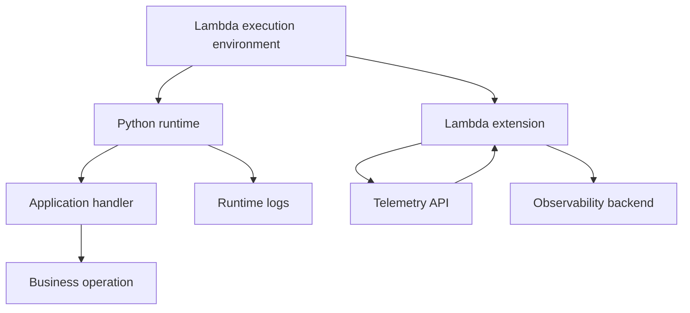
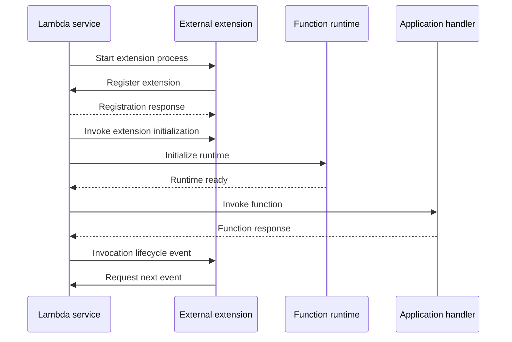
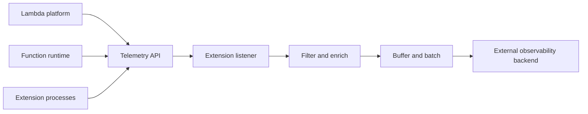
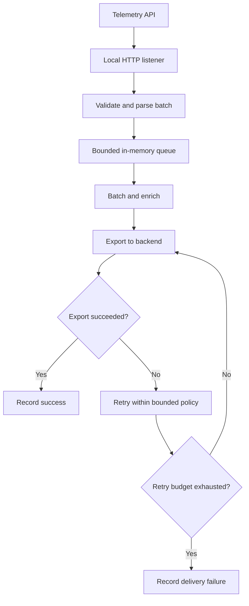

# 03- Lambda Extensions and Telemetry API

## Overview

AWS Lambda extensions allow additional processes to run alongside a Lambda function's runtime. They enable observability agents, security tools, configuration providers, and other integrations to participate in the Lambda execution environment without requiring all functionality to be implemented inside the application handler.

The Lambda Telemetry API provides a mechanism for extensions to subscribe to platform, function, and extension telemetry. An extension can receive lifecycle events, logs, and metrics-related telemetry and forward them to an external observability system.

These capabilities are particularly useful for production workloads that require centralized logging, distributed tracing, runtime diagnostics, security monitoring, or integration with third-party observability platforms.

The key distinction is:

- **Lambda extensions** provide a mechanism for integrating additional processes and functionality with the Lambda execution environment.
- **The Telemetry API** provides a mechanism for extensions to subscribe to and receive telemetry from Lambda.

An extension can use the Telemetry API, but not every extension needs to. Extensions can also use other integration mechanisms, such as the Logs API, or perform work unrelated to telemetry.

## Why Lambda Extensions Exist

Without extensions, application teams often need to implement logging, telemetry export, instrumentation, and other operational integrations directly in application code.

This creates several problems:

- Observability logic becomes coupled to business logic.
- Multiple services may implement telemetry differently.
- Dependency updates can affect application deployments.
- Sending telemetry synchronously can increase request latency.
- Centralized instrumentation becomes difficult across many functions and runtimes.

Extensions provide a separate integration boundary for functionality that should run alongside the application.

For example, a Python Lambda function can execute business logic while an observability extension collects telemetry and forwards it to a monitoring platform.



The extension and runtime share the Lambda execution environment's resource constraints. An extension is not a separate Lambda function and does not receive an independent allocation of Lambda memory or execution capacity.

This means that extensions must be included in performance, reliability, security, and cost planning.

## Lambda Extension Architecture

Lambda extensions are commonly packaged as executable processes or integrated through runtime-specific mechanisms.

The main categories are:

| Extension type | Execution model | Typical use |
|---|---|---|
| Internal extension | Integrates with the runtime process | Runtime-specific instrumentation or functionality |
| External extension | Runs as a separate process alongside the runtime | Observability agents, telemetry collectors, security agents, configuration integrations |

External extensions are commonly distributed as Lambda layers or included in a deployment package or container image. Internal extensions use runtime-specific integration mechanisms.

An external extension typically registers with the Lambda Extensions API, receives lifecycle events, and performs its work within the execution environment.

### External extension lifecycle

The following diagram illustrates the main lifecycle:



The exact sequence depends on the extension's behavior and the runtime lifecycle. Extensions must implement the documented registration and event-polling protocols correctly.

An external extension generally continues running across invocations while its execution environment remains available. Lambda can shut down or recycle the environment, so an extension must not assume that its process runs indefinitely.

Reference: [Lambda extensions API](https://docs.aws.amazon.com/lambda/latest/dg/runtimes-extensions-api.html)

## Lambda Extensions API

The Extensions API enables an external extension to register with Lambda and receive lifecycle events.

A typical external extension performs the following operations:

1. Start as a process in the execution environment.
2. Register with the Lambda Extensions API.
3. Receive its extension identifier.
4. Poll for lifecycle events.
5. Perform initialization or invocation-related work.
6. Continue polling while the environment is active.
7. Handle shutdown events where possible.

The extension communicates with the Lambda service through the local runtime API endpoint exposed in the execution environment.

The endpoint address is provided through environment configuration such as `AWS_LAMBDA_RUNTIME_API`. Extensions should use the documented protocol rather than assuming a fixed hostname or port.

### Registration

The extension sends a registration request that identifies its name and the lifecycle events it wants to receive.

Conceptually, the request resembles the following:

```http
POST /2020-01-01/extension/register HTTP/1.1
Host: $AWS_LAMBDA_RUNTIME_API
Lambda-Extension-Name: example-extension
Content-Type: application/json

{
  "events": [
    "INVOKE",
    "SHUTDOWN"
  ]
}
```

This is a protocol illustration. Production implementations should follow the current AWS API specification, including required headers, endpoint construction, response handling, and supported event types.

The registration response includes an extension identifier. The extension must provide that identifier in subsequent extension API requests.

### Lifecycle events

| Event | Purpose |
|---|---|
| `INVOKE` | Notifies the extension that a function invocation is occurring |
| `SHUTDOWN` | Notifies the extension that the execution environment is shutting down |

Extensions should use lifecycle notifications to coordinate their own work. A shutdown event is not a guarantee that the extension will always have enough time to flush all buffered data, so critical telemetry delivery requires an explicit reliability strategy.

### Initialization implications

External extensions participate in the Lambda initialization lifecycle. Slow extension startup can increase initialization latency and delay the function becoming ready.

For latency-sensitive functions, measure the initialization impact of each extension. An observability agent that imports large dependencies, performs network calls, or loads substantial configuration can undermine the benefits of other cold-start optimizations.

## Lambda Telemetry API

The Telemetry API allows extensions to subscribe to telemetry produced by the Lambda platform, runtime, and extensions.

An extension can subscribe to telemetry and receive records through a configured listener endpoint. It can then process, filter, aggregate, or export that telemetry to an external destination.

Common use cases include:

- Exporting logs to a centralized logging service.
- Collecting platform lifecycle events.
- Observing function runtime behavior.
- Capturing telemetry for diagnostics and alerting.
- Integrating Lambda with third-party monitoring agents.
- Enriching telemetry with deployment or environment metadata.

The Telemetry API uses subscription configuration and delivery mechanisms defined by AWS. An extension must implement the supported protocol and handle delivery failures appropriately.

Reference: [Lambda Telemetry API](https://docs.aws.amazon.com/lambda/latest/dg/telemetry-api.html)

## Telemetry API Data Flow

A typical telemetry integration contains four logical stages:

1. Lambda generates telemetry.
2. The extension subscribes to the relevant telemetry types.
3. Lambda delivers telemetry to the extension's listener.
4. The extension processes and forwards the data.



The extension is responsible for managing its listener, processing records, and exporting data according to the telemetry contract.

### Listener requirements

An extension that subscribes to telemetry must expose a listener endpoint compatible with the selected subscription protocol.

The listener must:

- Accept telemetry batches using the documented transport.
- Return the appropriate response promptly.
- Handle malformed or unexpected records safely.
- Avoid blocking indefinitely while processing a batch.
- Support the configured delivery protocol and content format.
- Forward data without exposing secrets or sensitive application payloads unnecessarily.

A listener that responds slowly or fails repeatedly can affect telemetry delivery and potentially lose observability data.

### Telemetry types

The Telemetry API can deliver different categories of records, including:

- Platform events related to initialization, invocation, and shutdown.
- Function logs.
- Extension logs.

The available record types and subscription configuration depend on the API version and documented capabilities. Consult the current AWS documentation before implementing a custom collector.

## Telemetry API vs Logs API vs CloudWatch Logs

These mechanisms are related but serve different roles.

| Mechanism | Purpose | Typical consumer |
|---|---|---|
| Lambda Telemetry API | Subscribe to platform, function, and extension telemetry | Lambda extension |
| Lambda Logs API | Subscribe to logs through the extension-based log delivery mechanism | Lambda extension |
| CloudWatch Logs | Managed log storage, querying, retention, and integration | Operators and observability tools |
| CloudWatch metrics | Aggregated numerical measurements of function behavior | Dashboards, alarms, and capacity analysis |
| AWS X-Ray | Distributed tracing and service-call analysis | Developers and operations teams |

The Telemetry API is not a replacement for CloudWatch Logs or metrics. It is an extension-facing delivery interface that can support alternative telemetry pipelines.

An extension might use the Telemetry API to receive platform events and logs, then forward selected data to an external monitoring backend. A different integration might use CloudWatch Logs subscriptions or an AWS-managed observability integration.

Choose the mechanism based on required telemetry, delivery semantics, operational complexity, and the capabilities of the destination system.

## Building a Simple External Extension

A custom extension is useful when a team needs a specialized integration that existing AWS services or supported observability agents cannot provide.

However, a custom extension introduces a separate executable, lifecycle management, deployment artifact, failure modes, and security boundary. Prefer a maintained vendor or AWS-supported integration when it satisfies the requirements.

A conceptual extension can be implemented in Python, but a production external extension must conform to the Extensions API protocol and must be packaged for the Lambda execution environment's operating system and architecture.

The following illustrates the core polling pattern, not a complete production implementation:

```python
import os
import time

import requests

runtime_api = os.environ["AWS_LAMBDA_RUNTIME_API"]
extension_name = "example-extension"

base_url = f"http://{runtime_api}/2020-01-01/extension"

registration = requests.post(
    f"{base_url}/register",
    headers={"Lambda-Extension-Name": extension_name},
    json={"events": ["INVOKE", "SHUTDOWN"]},
    timeout=2,
)
registration.raise_for_status()

extension_id = registration.headers["Lambda-Extension-Identifier"]

headers = {"Lambda-Extension-Identifier": extension_id}

while True:
    try:
        response = requests.get(
            f"{base_url}/event/next",
            headers=headers,
            timeout=None,
        )
        response.raise_for_status()
        event = response.json()

        if event.get("eventType") == "SHUTDOWN":
            break

        if event.get("eventType") == "INVOKE":
            # Perform bounded invocation-related work.
            pass
    except Exception:
        # A real extension needs structured logging, backoff,
        # and an explicit failure policy.
        time.sleep(1)
```

This illustration omits production requirements such as robust shutdown handling, signal handling, bounded retries, dependency packaging, telemetry export, protocol-specific error handling, and architecture-compatible builds. It also demonstrates lifecycle polling rather than a complete Telemetry API subscriber.

For production implementation, follow the [Lambda Extensions API specification](https://docs.aws.amazon.com/lambda/latest/dg/runtimes-extensions-api.html) and [Telemetry API specification](https://docs.aws.amazon.com/lambda/latest/dg/telemetry-api.html).

## Subscribing to the Telemetry API

A custom telemetry extension must register with the Extensions API, start a local telemetry listener, and submit a subscription request.

The recommended destination protocol is HTTP. Lambda delivers batches of telemetry records to the listener using HTTP POST requests. TCP is also supported, but it does not provide the same application-layer delivery acknowledgment behavior as HTTP.

### Subscription configuration

The following example illustrates a subscription request for platform telemetry, function logs, and extension logs:

```http
PUT /2022-07-01/telemetry HTTP/1.1
Host: $AWS_LAMBDA_RUNTIME_API
Lambda-Extension-Identifier: <extension-id>
Content-Type: application/json

{
  "schemaVersion": "2025-01-29",
  "types": [
    "platform",
    "function",
    "extension"
  ],
  "buffering": {
    "maxItems": 1000,
    "maxBytes": 262144,
    "timeoutMs": 100
  },
  "destination": {
    "protocol": "HTTP",
    "URI": "http://sandbox.localdomain:8080"
  }
}
```

The `schemaVersion` specifies the telemetry schema version. The example uses `2025-01-29`, which AWS documents as backward-compatible with standard Lambda functions and required for Lambda Managed Instances.

The destination must be reachable inside the execution environment. The extension should start its listener before submitting the subscription request.

### Buffering configuration

Telemetry buffering controls how records are batched before delivery.

| Parameter | Meaning | Documented range |
|---|---|---|
| `maxItems` | Maximum number of telemetry events in a batch | 1,000–10,000 |
| `maxBytes` | Maximum telemetry data volume buffered in bytes | 262,144–1,048,576 |
| `timeoutMs` | Maximum buffering interval in milliseconds | 25–30,000 |

The documented defaults are 1,000 events, 262,144 bytes, and 1,000 milliseconds.

Smaller buffering intervals can reduce the delay before telemetry is delivered, but they can increase the number of batches and network operations. Larger batches can improve throughput but require more memory and can increase delivery latency.

The listener must be able to process batches larger than the configured `maxBytes` value because record metadata and batch representation add overhead. AWS recommends allowing for payloads as large as approximately twice `maxBytes`, plus metadata.

Reference: [Telemetry API subscription and buffering](https://docs.aws.amazon.com/lambda/latest/dg/telemetry-api.html)

## Handling Telemetry Reliably

A telemetry collector should be designed as a best-effort data pipeline unless the application explicitly implements stronger delivery guarantees.

Lambda retries telemetry delivery when the listener is unavailable or an HTTP POST encounters an error. However, a custom extension must still handle listener failures, memory pressure, external destination outages, and shutdown behavior.

### Recommended processing pipeline



The diagram illustrates an application-level design. A bounded queue and retry policy must be implemented by the extension; they are not automatically provided by the Telemetry API.

### Listener responsibilities

A production listener should:

- Validate incoming requests and parse batches safely.
- Return HTTP responses promptly after accepting data into a bounded queue.
- Avoid performing slow external network operations in the request handler.
- Apply backpressure when its internal queue approaches capacity.
- Track queue depth, export latency, failures, and dropped records.
- Use bounded retries with exponential backoff for external delivery.
- Avoid unbounded memory growth when the destination is unavailable.

If the listener cannot keep up with telemetry production, Lambda can drop records to maintain bounded memory utilization. The platform emits a `platform.logsDropped` event when telemetry records are dropped.

A listener should therefore treat dropped telemetry as an operational failure, not just a logging inconvenience.

### Avoid telemetry feedback loops

An extension that subscribes to extension logs can accidentally create a feedback loop if its listener logs every received record.

For example:

1. The listener receives a telemetry batch.
2. The extension logs that it received the batch.
3. The new log is delivered to the listener.
4. The listener logs the new batch.
5. The cycle continues.

Avoid verbose logging inside the telemetry ingestion path. Record aggregate counters and emit diagnostics selectively, or exclude the extension's own logs from the subscription where appropriate.

## Resource Consumption and Performance

Extensions run in the same Lambda execution environment as the function. They share CPU, memory, `/tmp` storage, network namespace, and IAM execution-role permissions.

An extension can therefore reduce application performance even if its own work is performed outside the handler code.

### Memory overhead

The configured Lambda memory allocation is shared by the runtime, application, extensions, and telemetry buffers.

Suppose an application normally uses 350 MB of memory with a 512 MB allocation. Adding an extension that consumes another 100 MB leaves much less headroom for request processing, dependency allocations, and temporary buffers.

This can increase the risk of out-of-memory failures.

Measure total memory usage with the extension enabled. Do not size the function based solely on the application runtime's previous memory consumption.

### CPU overhead

An extension performing compression, serialization, enrichment, or high-volume telemetry export competes for CPU resources with the application.

The impact can include:

- Increased handler duration.
- Higher end-to-end request latency.
- Longer invocation phases.
- Increased cost due to longer execution duration.
- More timeouts when the extension cannot finish its work within the invocation deadline.

The extension lifecycle matters here: external extensions can continue running after the handler returns, but the invocation phase does not finish until the runtime and participating extensions complete their invocation work.

Consequently, expensive extension work can still increase billed execution duration.

### Benchmarking

Compare the same function with and without the extension using representative traffic.

Measure:

- p50, p95, and p99 request latency.
- Lambda `Duration` and initialization duration.
- Maximum memory utilization.
- Invocation errors and timeouts.
- Telemetry export latency and dropped records.
- Downstream network and CPU utilization.
- Total execution cost.

Test both steady-state traffic and burst traffic. Telemetry volume often increases precisely when an application is experiencing an incident, making extension resource consumption especially important during failure conditions.

Reference: [Lambda extensions: performance and resource impact](https://docs.aws.amazon.com/lambda/latest/dg/lambda-extensions.html)

## Deployment and Packaging

Extensions can be deployed with Lambda ZIP packages or container images.

### ZIP deployment

For a ZIP-based function, extensions are commonly distributed as Lambda layers. Lambda extracts extension files under `/opt` and looks for executable extension files in:

```text
/opt/extensions/
```

A typical layer layout is:

```text
extension-layer/
    extensions/
        telemetry-agent
```

The extension executable must have the correct permissions and be compatible with the Lambda execution environment's operating system and architecture.

The function's code, layers, and extensions must fit within Lambda's applicable deployment package size limits. For ZIP-based deployments, the combined unzipped function and layer contents are subject to the documented 250 MB limit.

### Container-image deployment

For container-based functions, the extension can be included in the image.

```dockerfile
FROM public.ecr.aws/lambda/python:3.12

COPY requirements.txt .
RUN pip install --no-cache-dir -r requirements.txt

COPY app.py ${LAMBDA_TASK_ROOT}/app.py

COPY telemetry-agent /opt/extensions/telemetry-agent
RUN chmod +x /opt/extensions/telemetry-agent

CMD ["app.lambda_handler"]
```

This example assumes that `telemetry-agent` is a compatible executable built for the image's operating system and CPU architecture. It also assumes that the executable implements the required extension protocol.

Do not copy an arbitrary executable into `/opt/extensions/` and assume it will function as a Lambda extension. It must register correctly and implement the required lifecycle behavior.

### Deployment considerations

- Pin extension versions and verify their provenance.
- Validate compatibility with the function's runtime and CPU architecture.
- Test extension startup and failure handling before production rollout.
- Include extension updates in the same CI/CD validation process as application dependencies.
- Scan extension binaries and container images for vulnerabilities.
- Measure initialization time and memory after every significant extension update.
- Keep deployment permissions separate from the runtime's IAM role.

References:

- [Configuring Lambda extensions](https://docs.aws.amazon.com/lambda/latest/dg/extensions-configuration.html)
- [Lambda extension lifecycle and permissions](https://docs.aws.amazon.com/lambda/latest/dg/runtimes-extensions-api.html)

## Security Considerations

Extensions execute within the function's security context. They use the same execution role and have access to the same general filesystem and network namespace as the runtime.

This has important consequences for third-party observability agents and custom telemetry collectors.

### IAM permissions

An extension does not receive a separate IAM execution role merely because it runs as a separate process.

If the function's execution role can read sensitive objects from Amazon S3, an extension running in the same environment operates under that role's security context as well.

Mitigations include:

- Use a dedicated, least-privilege execution role for each function or workload boundary.
- Avoid granting permissions that the application does not require.
- Review the permissions and behavior of third-party extensions.
- Restrict outbound connectivity when the extension does not require unrestricted access.
- Do not assume that a separate process provides an IAM isolation boundary.

### Sensitive telemetry

Logs and telemetry can contain customer identifiers, authorization headers, query parameters, exception details, or business data.

Before exporting telemetry:

- Filter secrets and sensitive fields.
- Avoid capturing request bodies unless explicitly required and approved.
- Apply appropriate encryption and access controls at the destination.
- Define retention and deletion policies.
- Restrict access to logs and observability dashboards.
- Avoid including credentials in extension configuration or logs.

An extension that forwards telemetry to an external service can introduce a new data egress path. Review that path as part of the application's security assessment.

## Monitoring Extensions in Production

Extension health must be monitored independently from application health.

A function can return successful responses while its telemetry exporter is failing. Conversely, an extension can cause invocation failures or latency regressions even when the business logic is correct.

Monitor:

| Signal | What it reveals |
|---|---|
| Initialization failures | Extension registration, executable, or configuration problems |
| Extension log errors | Failures in the extension's internal processing |
| Telemetry queue depth | Whether telemetry production exceeds export capacity |
| Export latency | Network or destination performance problems |
| Export failure count | Unavailable destinations or invalid requests |
| `platform.logsDropped` | Telemetry loss due to delivery or resource pressure |
| Lambda duration and errors | Application-level impact from extension overhead |
| Maximum memory used | Memory pressure caused by the runtime and extensions |
| External destination health | Whether the observability backend is accepting data |

For custom extensions, expose or emit metrics for internal queue depth, export attempts, failures, retry counts, and records discarded. Avoid relying exclusively on logs produced by the extension itself, because those logs may be unavailable precisely when the extension is failing.

### Incident response

When a new extension causes production latency or error regressions:

1. Compare the deployment time with the start of the regression.
2. Inspect extension initialization and runtime logs.
3. Compare memory usage and duration against the previous deployment.
4. Check telemetry destination availability and export latency.
5. Reduce unnecessary telemetry volume or disable the problematic integration through the approved deployment mechanism.
6. Roll back to the last known-good extension version if required.
7. Verify both application recovery and telemetry pipeline recovery.

Test the rollback mechanism before an incident. Removing an extension may require publishing and deploying a new function version rather than changing a running execution environment in place.

## Common Mistakes and Troubleshooting

### Extension fails to register

**Possible causes**

- Incorrect extension name or registration headers.
- Invalid lifecycle event configuration.
- Missing executable permissions.
- An incompatible binary or missing runtime dependency.
- Incorrect API endpoint construction.

**Diagnostic approach**

1. Inspect the extension's initialization logs.
2. Verify that `AWS_LAMBDA_RUNTIME_API` is available.
3. Confirm that the extension name matches the executable file name.
4. Verify registration headers and request payload.
5. Check the executable's architecture and dependencies.
6. Test the extension in a non-production function.

### Telemetry records are missing

**Possible causes**

- The listener was not running when the subscription was created.
- The subscription request failed.
- The listener returns errors or cannot process the payload.
- The extension's export pipeline is failing.
- Lambda dropped telemetry because the listener could not keep up.

**Corrective actions**

1. Inspect the subscription response.
2. Verify that the listener is reachable inside the execution environment.
3. Validate the HTTP response status and request-body handling.
4. Inspect `platform.logsDropped` records.
5. Check queue depth, export failures, and destination health.
6. Test delivery under high telemetry volume.

### Function latency increases after installing an extension

**Possible causes**

- Expensive extension initialization.
- CPU contention during invocation.
- Large telemetry buffers increasing memory pressure.
- Slow post-handler export operations delaying completion of the invocation phase.
- Additional network calls during initialization.

**Corrective actions**

1. Compare latency and memory before and after installation.
2. Profile extension initialization and invocation work.
3. Reduce unnecessary telemetry collection.
4. Batch export operations and bound queue sizes.
5. Avoid blocking the listener on remote network calls.
6. Remove or replace the extension if its operational cost exceeds its value.

### Extension cannot flush telemetry during shutdown

**Possible causes**

- The extension assumes unlimited shutdown time.
- Export operations block on an unavailable destination.
- Buffered telemetry is not persisted or retried.
- Shutdown handling is not implemented.

**Corrective actions**

1. Implement the documented shutdown lifecycle.
2. Use bounded flush operations.
3. Avoid waiting indefinitely for network calls.
4. Use `INVOKE` and `SHUTDOWN` lifecycle events to schedule batches for export.
5. Define what happens to telemetry that cannot be delivered within the available time.

Lambda allows up to two seconds for the shutdown phase when one or more external extensions are registered. If the extension does not finish within the allowed interval, Lambda can terminate the process.

Do not treat shutdown as a reliable opportunity to deliver every buffered record. Flush telemetry continuously during normal operation and design the exporter around bounded delivery attempts.

## Production Best Practices

- Prefer a maintained AWS or vendor extension when it meets the requirements.
- Add only the extensions needed for a clearly defined operational purpose.
- Treat extension dependencies and binaries as part of the production software supply chain.
- Measure memory, CPU, initialization time, and invocation duration with each extension enabled.
- Use the Telemetry API when its event streams and delivery model match the observability requirement.
- Prefer HTTP telemetry delivery when application-layer acknowledgment is important.
- Keep listener processing fast and move external export work to a bounded queue.
- Monitor telemetry loss, queue depth, destination failures, and extension resource consumption.
- Avoid logging every telemetry batch from a collector that subscribes to extension logs.
- Minimize sensitive information in telemetry and restrict outbound data paths.
- Handle shutdown and failure paths explicitly; never rely on unlimited cleanup time.
- Validate extension updates and rollback procedures in CI/CD before production deployment.

## Key Takeaways

- Lambda extensions run alongside the function runtime and support integrations such as observability, security, and configuration management.
- The Telemetry API allows extensions to subscribe to platform events, function logs, and extension logs, then forward selected telemetry to other systems.
- Extensions share the function's memory, CPU, filesystem, network namespace, and IAM execution role, so they affect both performance and security.
- Reliable telemetry collection requires a responsive listener, bounded buffering, controlled retries, dropped-record monitoring, and shutdown handling.
- Package, test, monitor, and deploy extensions as production dependencies; measure their overhead and verify that their operational benefits justify their cost.