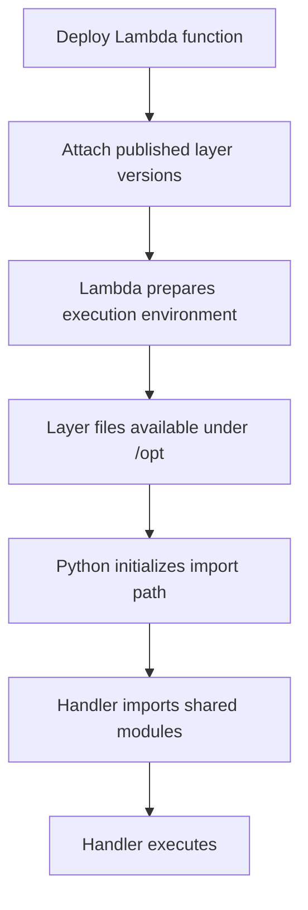
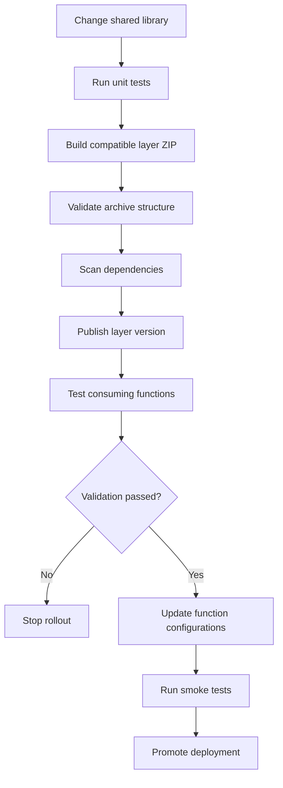

# 04- Lambda Layers and Shared Dependencies

## Overview

AWS Lambda layers provide a mechanism for packaging and sharing code, libraries, and other dependencies across Lambda functions. Instead of bundling every dependency into each function's deployment package, a team can publish a layer and attach it to multiple functions.

Layers are particularly useful for Python applications that share internal libraries, AWS SDK extensions, observability components, or common utilities.

For example, several Lambda functions in a serverless backend might use the same validation utilities, database helpers, or structured logging package. A shared layer can reduce duplicated packaging work and establish a common dependency distribution mechanism.

However, layers introduce their own versioning, compatibility, security, and deployment considerations. They do not automatically provide dependency isolation, centralized runtime updates, or independent deployment of a library without coordinating the consuming functions.

**Engineering principle:** Use layers to share dependencies when the operational benefits outweigh the additional versioning and release coordination.

## Why Lambda Layers Exist

Without layers, each Lambda function generally packages the dependencies it needs in its deployment artifact.

For a Python application, this can lead to repeated copies of common dependencies:

```text
serverless-backend/
    orders-function/
        app.py
        requirements.txt
        dependencies/
    payments-function/
        app.py
        requirements.txt
        dependencies/
    notifications-function/
        app.py
        requirements.txt
        dependencies/
```

If all three functions use the same internal utilities or third-party packages, maintaining separate copies can increase packaging effort and create inconsistent dependency versions.

A shared layer changes the deployment structure:

```text
serverless-backend/
    layers/
        common-python/
            python/
                common_utils/
                shared_logging/
    functions/
        orders/
            app.py
        payments/
            app.py
        notifications/
            app.py
```

The layer is published as an immutable version. Each function explicitly references the layer version it needs.

### Benefits

- Reuse common libraries across functions.
- Separate shared dependency packaging from application code.
- Standardize logging, instrumentation, and internal utilities.
- Reduce duplication across deployment artifacts.
- Independently version shared components.

### Limitations

- Layer versions must be managed and updated.
- Functions can have dependency conflicts when layers and function packages provide overlapping libraries.
- A layer change does not automatically update every consuming function to the latest version.
- Layers increase deployment and troubleshooting complexity.
- Sharing a layer does not guarantee that every function uses compatible dependencies.

## How Lambda Layers Work

A Lambda layer is a ZIP archive containing files in a directory structure recognized by the Lambda runtime.

When a function uses a layer, Lambda makes the layer's contents available in the execution environment. The exact location and import behavior depend on the runtime and layer structure.

For Python, the conventional directory is `python/`. Lambda exposes compatible Python layer directories through the runtime's import path.

A typical layer archive looks like this:

```text
common-python-layer.zip
    python/
        common_utils/
            __init__.py
            validation.py
        shared_logging/
            __init__.py
            logger.py
        lib/
            python3.12/
                site-packages/
                    example_dependency/
```

The layer ZIP must contain the `python/` directory at the archive root, not an extra parent directory that prevents Lambda from locating the packages.

### Runtime file locations

| Layer content | Typical location in the execution environment |
|---|---|
| Python packages | `/opt/python/` |
| Python version-specific packages | `/opt/python/lib/python3.x/site-packages/` |
| Other layer files | `/opt/` |
| Layer executables | `/opt/bin/` |
| Layer-provided shared libraries | `/opt/lib/` |

The exact Python search path depends on the runtime version and deployment environment. Verify the actual import path when debugging dependency resolution.

### Layer loading

A simplified execution flow is:



Layers are made available before the function handler executes. They do not run independently and are not invoked as separate services.

## Creating a Python Layer

Consider a shared package named `common_utils` that contains reusable validation logic.

### Directory structure

```text
common-python-layer/
    python/
        common_utils/
            __init__.py
            validation.py
```

Create the package files:

```python
# python/common_utils/__init__.py

from .validation import require_string

__all__ = ["require_string"]
```

```python
# python/common_utils/validation.py

def require_string(value: object, field_name: str) -> str:
    if not isinstance(value, str) or not value.strip():
        raise ValueError(f"{field_name} must be a non-empty string")

    return value
```

The package can now be imported by a Lambda function that references the published layer.

```python
import json

from common_utils import require_string


def lambda_handler(event, context):
    try:
        order_id = require_string(
            event.get("order_id"),
            "order_id",
        )
    except ValueError as exc:
        return {
            "statusCode": 400,
            "body": json.dumps({"error": str(exc)}),
        }

    return {
        "statusCode": 200,
        "body": json.dumps({"order_id": order_id}),
    }
```

This example demonstrates packaging a shared internal library. A production application should also define its validation contract, error handling, tests, and compatibility guarantees.

## Packaging Third-Party Dependencies

A layer can contain dependencies installed through `pip`, provided that they are packaged for the target Lambda runtime and architecture.

For example, a layer can contain a shared HTTP client or a library used by multiple functions.

### Install dependencies into the layer directory

Create a `requirements.txt` file:

```text
requests==2.32.5
```

The version shown is illustrative; select and pin a currently maintained version appropriate for the application.

Install the dependency into the required directory:

```bash
python -m pip install \
  -r requirements.txt \
  --target python/
```

Create the ZIP archive from the directory containing `python/`:

```bash
zip -r common-python-layer.zip python/
```

Verify the archive structure:

```bash
unzip -l common-python-layer.zip
```

The listing should show paths such as:

```text
python/requests/
python/requests-*.dist-info/
```

It should not contain an unnecessary outer directory such as `common-python-layer/python/`.

### Build for the target runtime

Native dependencies may contain compiled extensions or shared libraries that depend on the operating system, CPU architecture, Python version, or ABI.

For production layers:

- Build dependencies using a compatible Linux environment.
- Match the target Lambda runtime and architecture.
- Test native imports inside the target runtime environment.
- Avoid copying Windows-installed packages directly into a Linux Lambda layer.
- Pin dependency versions and use a lockfile or equivalent reproducible dependency process.

For packages containing native components, a compatible Lambda container image or build environment is often safer than installing dependencies on a developer workstation.

Reference: [Building Lambda layers](https://docs.aws.amazon.com/lambda/latest/dg/creating-deleting-layers.html)

## Publishing a Layer with the AWS CLI

The following commands publish a layer version and configure a function to use it.

### Prerequisites

- AWS CLI v2 configured for the target account and Region.
- A correctly structured layer ZIP archive.
- A compatible Lambda runtime and architecture.
- Permission to publish layers and update function configuration.

Set the deployment variables:

```bash
export AWS_REGION="ap-south-1"
export LAYER_NAME="common-python-utils"
export FUNCTION_NAME="orders-api"
```

### Publish the layer

**Resource-modifying command:**

```bash
aws lambda publish-layer-version \
  --layer-name "$LAYER_NAME" \
  --zip-file fileb://common-python-layer.zip \
  --compatible-runtimes python3.12 \
  --compatible-architectures x86_64 arm64 \
  --region "$AWS_REGION"
```

The compatible runtime and architecture values are declarations, not a substitute for building and testing the package correctly.

Record the returned `LayerVersionArn`. Each publication creates a new immutable layer version.

### Inspect published versions

```bash
aws lambda list-layer-versions \
  --layer-name "$LAYER_NAME" \
  --region "$AWS_REGION"
```

This is a read-only command. Use the returned version ARN rather than assuming the highest version number is necessarily the one intended for deployment.

### Attach the layer to a function

**Resource-modifying command:**

```bash
aws lambda update-function-configuration \
  --function-name "$FUNCTION_NAME" \
  --layers "arn:aws:lambda:ap-south-1:123456789012:layer:common-python-utils:1" \
  --region "$AWS_REGION"
```

Replace the example ARN with the actual layer version ARN.

**Important:** The `--layers` argument specifies the complete desired layer list for the function. If the function already uses other layers, include those layer version ARNs as well; otherwise, this update can remove them.

Wait for the configuration update to complete:

```bash
aws lambda wait function-updated \
  --function-name "$FUNCTION_NAME" \
  --region "$AWS_REGION"
```

Inspect the function configuration:

```bash
aws lambda get-function-configuration \
  --function-name "$FUNCTION_NAME" \
  --region "$AWS_REGION" \
  --query '{FunctionName: FunctionName, Layers: Layers, Runtime: Runtime}'
```

Finally, invoke the function through the appropriate deployment target and verify that the shared module imports successfully.

Reference: [AWS CLI: Publish Layer Version](https://docs.aws.amazon.com/cli/latest/reference/lambda/publish-layer-version.html)

## Layer Versioning and Release Management

Published layer versions are immutable. Publishing updated code creates a new version rather than modifying an existing one.

A function explicitly references a layer version ARN. It continues using that version until its configuration is updated.

For example:

```text
common-python-utils:1
common-python-utils:2
common-python-utils:3
```

A function referencing version `2` does not automatically start using version `3`.

### Recommended versioning strategy

- Treat each layer version as a release artifact.
- Pin function deployments to explicit layer version ARNs.
- Test each layer version against its consuming functions.
- Maintain backward compatibility when possible.
- Coordinate breaking changes through an explicit rollout.
- Keep rollback versions available until dependent functions have been upgraded.

### Coordinating shared library releases

Suppose five Lambda functions consume a shared internal library. A change to its public interface may break two functions even if the other three pass their tests.

A safe release process should:

1. Build and test the shared library.
2. Publish a new layer version.
3. Test the layer with representative consuming functions.
4. Update each function through CI/CD.
5. Verify imports, behavior, logs, and metrics.
6. Roll back individual consumers if necessary.

This is a dependency rollout, not an atomic multi-function deployment. Design compatibility contracts accordingly.

## Dependency Conflicts and Import Resolution

Layers can introduce subtle dependency conflicts when the function package, multiple layers, and runtime-provided libraries contain overlapping modules.

Python imports depend on the interpreter's module search path. If multiple locations contain the same package, the module found first can determine the version used at runtime.

A function may therefore import successfully but behave incorrectly because it loads an unexpected dependency version.

### Example conflict

Suppose the function package includes one version of a library while a layer contains another. A developer may test locally against one version but deploy a package in which a different version is imported.

Potential consequences include:

- Missing functions or attributes.
- Incompatible method signatures.
- Runtime exceptions.
- Security fixes not being applied as expected.
- Different behavior between local and deployed environments.

### Diagnose import resolution

Temporarily inspect the imported module:

```python
import requests

def lambda_handler(event, context):
    return {
        "version": requests.__version__,
        "module_path": requests.__file__,
    }
```

Do not expose detailed module paths or diagnostic information through a public production API. Use controlled logs or a restricted diagnostic invocation instead.

### Best practices

- Assign clear ownership of shared dependencies.
- Avoid packaging the same dependency in several places.
- Pin dependency versions and test the complete deployment artifact.
- Test the function and its layers together.
- Inspect import paths when the deployed behavior differs from local behavior.
- Avoid relying on undocumented import precedence.

## Layers vs Bundled Dependencies vs Container Images

Layers are not always the best packaging mechanism.

| Approach | Advantages | Limitations | Appropriate use |
|---|---|---|---|
| Bundle dependencies with function | Self-contained artifact; straightforward dependency ownership | Duplicates shared dependencies across functions | Independent functions with modest dependency sets |
| Lambda layers | Reuse code and dependencies across functions | Requires version coordination and compatibility testing | Shared libraries and common tooling |
| Lambda container images | Full control over image filesystem and dependency installation | Requires image build, scanning, publishing, and lifecycle management | Large or complex dependency sets and specialized runtime environments |
| External shared service | Centralizes behavior behind an API | Adds network latency, availability dependencies, and service-management cost | Shared business capabilities that should be independently deployed |

A layer is a packaging mechanism, not a runtime service.

If the shared component contains business logic that requires independent scaling, access control, data ownership, or deployment, consider exposing it as a service rather than embedding it in every function.

For a small utility library, a layer can be appropriate. For a complex shared application framework with frequent breaking changes, bundling dependencies or using a container image may provide a simpler release model.

## Limits and Operational Considerations

Lambda layers are subject to service quotas and compatibility restrictions.

| Constraint | Consideration |
|---|---|
| Maximum layers per function | A function can use up to five layers |
| Combined unzipped ZIP package and layer contents | Subject to the 250 MB limit |
| Layer archive size | Subject to the applicable upload and deployment limits |
| Runtime compatibility | Dependencies must be compatible with the target runtime |
| Architecture compatibility | Native dependencies must match the function architecture |
| Layer versioning | Each published version is immutable |
| Layer access | Cross-account or shared access requires appropriate permissions |

Verify the current limits before designing a deployment pipeline because AWS quotas and deployment options can change.

Layers are not a way to bypass Lambda's total deployment package constraints. Splitting dependencies into layers does not remove the combined unzipped size limit for ZIP-based deployments.

Reference: [Lambda quotas](https://docs.aws.amazon.com/lambda/latest/dg/gettingstarted-limits.html)

## Security Considerations

A shared layer can distribute code to many functions, making it an important software supply-chain component.

A vulnerable or compromised layer may affect every function that consumes it.

### Security practices

- Pin dependencies to known versions.
- Scan third-party dependencies for known vulnerabilities.
- Review changes before publishing a new layer version.
- Restrict permission to publish or modify layer sharing policies.
- Avoid embedding credentials, secrets, or environment-specific configuration in layers.
- Use least-privilege permissions for functions consuming shared code.
- Track which functions depend on each layer version.
- Retire vulnerable versions through a controlled migration process.

Do not assume that publishing a new layer automatically patches every function. Each function must be updated to reference the intended version and redeployed or reconfigured as required.

### Cross-account layer sharing

A layer can be shared with other AWS accounts through its resource-based permissions policy. The consuming account must have permission to use the layer version.

Sharing should be deliberate. Prefer explicit account or organization access where supported rather than broad public access for internal dependencies.

When a layer is shared across accounts, document ownership, release compatibility, security notification responsibilities, and the process for revoking access.

## CI/CD Integration

Layers should be managed as versioned artifacts in the deployment pipeline.

A typical pipeline includes:



Automate the following checks:

- Unit tests for shared modules.
- Dependency vulnerability scanning.
- Layer ZIP structure validation.
- Runtime and architecture compatibility checks.
- Package-size validation.
- Integration tests for representative consuming functions.
- Deployment verification and rollback readiness.

Keep the published layer version ARN as a pipeline output so downstream function deployments can consume the exact artifact that passed validation.

## Common Mistakes and Troubleshooting

### `ModuleNotFoundError`

**Possible causes**

- The ZIP archive has an incorrect directory structure.
- The layer is not attached to the function.
- The function references an unintended layer version.
- The package name differs from the import name.
- A native dependency cannot load.

**Diagnostic procedure**

1. Inspect the ZIP archive with `unzip -l`.
2. Inspect the function's configured layer ARNs.
3. Check the runtime and architecture.
4. Log the module search path in a controlled test.
5. Verify that the required module exists at the expected path.
6. Rebuild the layer in a compatible environment if necessary.

### Unexpected dependency version

**Possible causes**

- A dependency exists in both the function package and layer.
- Multiple layers contain overlapping packages.
- The deployed artifact differs from the locally tested artifact.

**Corrective actions**

1. Inspect the imported module's version and path.
2. Remove unnecessary duplicate dependencies.
3. Pin and test the dependency version.
4. Rebuild the complete deployment artifact.
5. Validate the result in the actual Lambda runtime.

### Function update removes another layer

**Cause**

The deployment command supplied an incomplete layer list.

**Corrective action**

Inspect the existing function configuration, construct the complete desired layer list, and update the function with all required layer version ARNs.

### Native dependency fails at runtime

**Possible causes**

- The package was built on an incompatible operating system.
- The CPU architecture differs.
- A shared library is missing.
- The Python runtime version or ABI is incompatible.

**Corrective actions**

1. Identify the function runtime and architecture.
2. Rebuild the dependency in a compatible environment.
3. Inspect native library requirements.
4. Test imports in the target Lambda environment.
5. Verify the complete layer after publication.

## Production Best Practices

- Use layers for stable, reusable dependencies rather than every shared piece of code.
- Keep business capabilities that require independent deployment behind service boundaries.
- Pin every consuming function to explicit layer version ARNs.
- Build Python dependencies for the exact runtime and architecture.
- Test the complete function-plus-layer artifact rather than testing dependencies in isolation.
- Avoid duplicate dependency versions across function packages and layers.
- Treat shared layers as production software supply-chain artifacts.
- Automate publishing, scanning, integration testing, and consumer updates.
- Maintain rollback targets and a dependency inventory.
- Monitor package size and deployment complexity as shared dependencies grow.

## Key Takeaways

- Lambda layers package reusable code and dependencies that can be shared across multiple functions without running as separate services.
- Python layers generally place packages under a root-level `python/` directory, and dependencies must match the target runtime and architecture.
- Layer versions are immutable, and consuming functions must explicitly reference the intended version; publishing a new version does not automatically update consumers.
- Dependency conflicts, native-library incompatibilities, package-size limits, and incomplete layer configuration are common production failure modes.
- Manage shared layers as versioned software artifacts with automated testing, security scanning, controlled rollout, and rollback procedures.