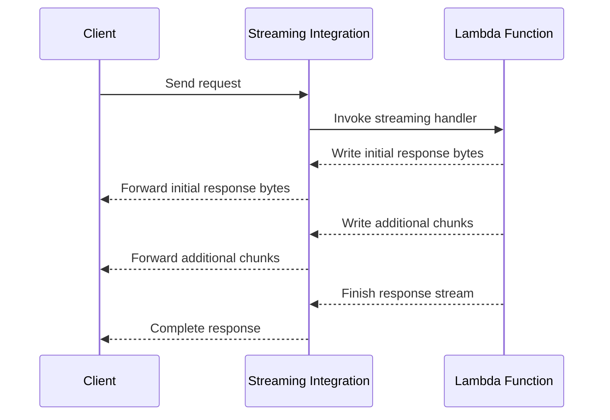

# 05- Lambda Response Streaming

## Overview

AWS Lambda response streaming allows a function to send response data progressively to a client instead of waiting for the complete response before returning it.

With conventional buffered responses, the function generates the entire payload before the integration delivers it to the client. With response streaming, the function can emit an initial response and subsequent chunks as they become available.

This is particularly useful for AI-generated text, large API responses, incremental data processing, and applications where reducing perceived latency matters.

Response streaming does not make the function execute faster by itself. Its primary benefit is allowing clients to receive and consume output before the function finishes generating the complete response.

## How Response Streaming Works

In a buffered response, the client generally waits for the function to finish producing the response payload.

With response streaming, the response body is written progressively through a streaming-capable invocation path.



The client can begin processing the response before the function has finished its work, provided the integration and client both support streaming.

### Buffered versus streaming responses

| Characteristic | Buffered response | Streaming response |
|---|---|---|
| Delivery | Response is delivered after generation completes | Response chunks can be delivered progressively |
| Time to first byte | Usually includes the full response-generation time | Can be substantially lower |
| Memory usage | May require holding the full response payload | Can avoid constructing the entire response in memory |
| Client behavior | Receives a completed payload | Must handle incremental data |
| Error handling | Errors can be returned before the response is sent | Errors after streaming begins cannot generally be converted into a new HTTP status |
| Integration requirements | Standard supported invocation path | Requires a streaming-capable invocation path |
| Typical use cases | Conventional REST APIs and small JSON responses | AI output, large responses, progressive content delivery |

## When to Use Response Streaming

Use response streaming when the application benefits from receiving output incrementally.

Common use cases include:

- Streaming generated text from an AI model.
- Returning large result sets without constructing one large response body.
- Serving progressively generated reports or documents.
- Improving perceived latency for long-running response generation.
- Building applications that display partial results as they become available.

For conventional CRUD endpoints that return small JSON payloads, buffered responses are usually simpler.

Streaming is less useful when the client cannot consume partial data, when the response must be validated in full before delivery, or when the upstream integration buffers the response anyway.

## Supported Invocation Paths and Constraints

Response streaming is not enabled merely by writing chunks inside a normal Lambda handler. The invocation path must support streaming.

AWS Lambda supports response streaming through supported invocation APIs and integrations, including Lambda function URLs configured for response streaming and the `InvokeWithResponseStream` API. Supported API Gateway configurations also provide response streaming, subject to integration type, Region, and feature constraints.

Verify the current compatibility requirements for the exact integration before designing the endpoint.

| Invocation or integration path | Considerations |
|---|---|
| Lambda function URL | Supports response streaming when configured for the streaming response mode |
| Lambda `InvokeWithResponseStream` API | Provides a streaming-capable direct invocation API |
| API Gateway | Streaming support depends on the API type, integration, configuration, and current service constraints |
| Application Load Balancer | Do not assume every Lambda integration supports Lambda response streaming; verify the applicable integration behavior |
| Ordinary buffered Lambda invocation | Does not become streaming simply because the handler writes data incrementally |

Reference: [Using Lambda response streaming](https://docs.aws.amazon.com/lambda/latest/dg/configuration-response-streaming.html)

## Python Response Streaming

For Python Lambda functions, AWS provides the `awslambdaric` runtime interface client and the `awslambda.streamify_response` decorator in supported managed-runtime configurations.

A streaming handler receives a response stream object and writes bytes to it as output becomes available.

The following example illustrates a function that sends a sequence of JSON Lines records progressively.

```python
import json
import time

import awslambda


@awslambda.streamify_response
def lambda_handler(event, response_stream, context):
    response_stream.set_content_type("application/x-ndjson")

    try:
        for index in range(5):
            record = {
                "sequence": index,
                "status": "processing",
            }

            response_stream.write(
                (json.dumps(record) + "\n").encode("utf-8")
            )

            time.sleep(0.2)
    finally:
        response_stream.close()
```

This example demonstrates progressive output. The `time.sleep()` call is included only to make the incremental behavior visible during testing; production handlers should not introduce artificial delays.

The exact runtime support and response-streaming APIs should be checked against the deployed Python runtime and AWS Lambda documentation. Do not assume that a standard local Python interpreter exposes the Lambda-specific `awslambda` module.

### Important implementation details

- Set the response content type before writing the body.
- Write byte chunks to the response stream.
- Close the stream when output is complete.
- Handle exceptions and resource cleanup carefully.
- Avoid writing unbounded amounts of data without considering downstream consumption and execution duration.
- Test the handler through a streaming-capable invocation path rather than relying only on ordinary local unit tests.

### Streaming plain text

For a text-generation endpoint, chunks can be emitted as soon as the application receives them from an upstream model or service.

```python
import awslambda


@awslambda.streamify_response
def lambda_handler(event, response_stream, context):
    response_stream.set_content_type("text/plain; charset=utf-8")

    for chunk in generate_text_chunks(event):
        if not isinstance(chunk, str):
            raise TypeError("Generated chunks must be strings")

        response_stream.write(chunk.encode("utf-8"))

    response_stream.close()
```

`generate_text_chunks()` represents an application-specific generator that yields text fragments. It must be implemented using the actual upstream service or model API.

For production systems, ensure that upstream exceptions, cancellation, timeouts, and resource cleanup are handled correctly. The example is a handler pattern, not a complete model integration.

## Response Streaming with Lambda Function URLs

Function URLs provide an HTTPS endpoint for invoking a Lambda function without configuring API Gateway. They support response streaming when the URL is configured for the streaming response mode.

A function URL is appropriate for relatively direct HTTP access to a Lambda function when its feature set and authorization model meet the application's needs.

### Configuration considerations

- Configure the function URL with the appropriate response mode.
- Select the correct authorization type.
- Apply resource-based permissions where required.
- Configure CORS if browser clients need cross-origin access.
- Test the response through the actual URL.
- Verify that any proxies or clients in the request path do not buffer the response.

Function URLs are not interchangeable with API Gateway. API Gateway provides additional API management capabilities, and the choice should account for authentication, throttling, request validation, routing, observability, and operational requirements.

Reference: [Lambda function URLs](https://docs.aws.amazon.com/lambda/latest/dg/urls-configuration.html)

## HTTP Semantics and Client Compatibility

Streaming changes how clients consume response bodies, but it does not remove HTTP requirements.

The client should distinguish between:

- The initial response status and headers.
- The sequence of response body chunks.
- Successful completion of the stream.
- A stream that ends unexpectedly or fails after transmission begins.

Once the response headers and body have started being sent, the server generally cannot replace the original status code with a new one. A late application error must therefore be represented through the stream protocol, an application-level error event, or a connection termination.

For example, an application using newline-delimited JSON can define a structured terminal error record. Clients must understand that convention and should not treat a partial response as a successful complete result.

### Example JSON Lines protocol

```json
{"type":"chunk","data":"Hello"}
{"type":"chunk","data":" world"}
{"type":"complete"}
```

An application could define a terminal error record as follows:

```json
{"type":"error","code":"UPSTREAM_FAILURE"}
```

These records are application-level protocol conventions, not special AWS Lambda response-streaming messages.

### Client-side considerations

- Consume the body incrementally instead of calling a method that buffers the entire response.
- Handle connection interruption and incomplete responses.
- Define framing rules for structured data.
- Set appropriate timeouts.
- Avoid assuming that each network chunk corresponds to one application record.
- Ensure that clients can distinguish successful completion from truncated output.

Network transport can split or combine writes arbitrarily. For JSON Lines, parse complete newline-terminated records rather than assuming each read contains exactly one record.

## Performance and Latency

The most important latency benefit is a reduction in time to first byte (TTFB).

Consider a function that takes several seconds to generate a complete response but can produce its first useful output much earlier. With buffered delivery, the client waits for the complete result. With streaming, it may begin rendering or processing the initial output sooner.

Measure at least:

- Time to first byte.
- Time to first useful application chunk.
- Total response duration.
- Total bytes transferred.
- Client disconnect rate.
- Function duration and billed duration.
- Upstream service latency.
- Errors and incomplete responses.

Streaming is not guaranteed to improve total completion time. It can also add complexity to the application, client, and observability model.

### Memory considerations

A buffered implementation might construct a large in-memory object or string before serialization. A streaming implementation can serialize and emit smaller pieces incrementally.

However, streaming does not automatically guarantee low memory usage. If the application first collects every result into a list and then writes the list item by item, the complete dataset is still retained in memory.

Prefer generators, iterators, and incremental upstream consumption when the objective is to limit memory use.

### Backpressure and downstream behavior

The producer may generate output faster than the client can consume it. The application must account for slow clients, network interruptions, and upstream resources that remain open while the response is being delivered.

Do not assume that writing a chunk guarantees immediate delivery to the client. Runtime buffering, transport behavior, and intermediary infrastructure can affect when bytes become visible.

Test with realistic network conditions and clients that consume data slowly.

## Streaming Limits and Cost Considerations

Response streaming is subject to Lambda's applicable response-size, bandwidth, timeout, and pricing constraints.

For Lambda response streaming, AWS documents a maximum streamed response size of 200 MB. The initial 6 MB can be delivered without the bandwidth limitation that applies to the remaining response; subsequent response data is subject to a maximum bandwidth of 2 MB/s. Verify the current quotas and pricing before relying on these values for capacity planning.

Streaming also does not remove the function's maximum execution duration. A function must complete within its configured timeout.

Cost considerations include:

- Lambda execution duration while the stream is generated.
- Duration spent waiting on upstream services or slow clients.
- Response data transfer charges where applicable.
- Additional upstream model or service costs.
- Retries or repeated requests caused by interrupted streams.

A slow client can keep a response open longer than expected. Avoid tying up a Lambda execution environment indefinitely while waiting for a consumer.

Reference: [Lambda quotas](https://docs.aws.amazon.com/lambda/latest/dg/gettingstarted-limits.html) and [Lambda pricing](https://aws.amazon.com/lambda/pricing/).

## Error Handling and Reliability

Streaming responses require explicit handling of failures that occur before and after output begins.

### Failures before the first write

If the handler fails before starting the response, the integration may be able to return an error response, depending on the invocation path and integration behavior.

Validate inputs, authenticate requests, authorize access, and perform operations that can fail before emitting the first chunk whenever practical.

### Failures after streaming begins

After the status and headers have been committed, the application generally cannot change the HTTP status code to represent a later failure.

Possible strategies include:

- Emit a documented terminal error record if the protocol supports it.
- Terminate the stream when continuing would be unsafe.
- Log the failure with a request or correlation identifier.
- Track incomplete responses as a separate operational signal.
- Make the client resilient to partial output.

Do not report success merely because the handler wrote some data. The client should know whether the stream completed according to the application protocol.

### Client disconnects

A client may disconnect before the function finishes. This can waste compute or upstream resources if the application continues generating data unnecessarily.

Where supported by the runtime and integration, detect disconnect or write failures and stop unnecessary work. Also apply timeouts and cancellation handling to upstream HTTP clients, model calls, database cursors, and other long-lived operations.

The precise disconnect behavior depends on the integration and runtime. Test it instead of assuming that every disconnect immediately cancels the Lambda invocation.

## Security Considerations

Streaming does not change the need for secure authorization and data handling.

- Authenticate and authorize before emitting sensitive data.
- Avoid sending partial confidential results before completing access checks.
- Validate request input and enforce output limits.
- Do not stream secrets, access tokens, or internal diagnostic details.
- Configure function URL authorization or API Gateway authorization deliberately.
- Apply least-privilege execution-role permissions.
- Avoid logging complete sensitive response bodies.
- Use TLS through supported HTTPS integrations.
- Apply rate limits and concurrency controls to protect upstream services.

Because data can reach the client before the operation completes, streaming can make it harder to retract information that was emitted prematurely. Perform security-sensitive validation before the first write.

## Observability and Troubleshooting

Traditional request-level metrics may not fully describe the user experience of a streamed response. Add application metrics for progressive delivery where they materially improve diagnosis.

Useful signals include:

| Signal | Purpose |
|---|---|
| Time to first byte | Measures initial response latency |
| Time to first useful chunk | Measures when the client can begin meaningful work |
| Total stream duration | Measures end-to-end response generation |
| Bytes emitted | Tracks response volume |
| Stream completion rate | Detects interrupted or incomplete responses |
| Client disconnects | Identifies consumer or network problems |
| Upstream latency | Separates model or dependency delays from Lambda overhead |
| Lambda errors and duration | Provides standard function health signals |

Use structured logs containing a request identifier, stream status, byte count, elapsed time, and error category. Avoid logging sensitive response content.

### Troubleshooting workflow

**Symptom: The client receives the entire response at once.**

- Confirm that the handler uses the streaming API.
- Verify that the invocation path supports response streaming.
- Check the function URL response mode or integration configuration.
- Test with a client that reads incrementally.
- Inspect intermediary proxies and gateways for response buffering.

**Symptom: The handler fails to import `awslambda`.**

- Verify the deployed Python runtime and supported streaming configuration.
- Ensure the handler is running in the intended Lambda runtime environment.
- Do not expect a standard local Python interpreter to provide the Lambda-specific module.
- Validate the implementation against the runtime documentation.

**Symptom: The response ends without a complete result.**

- Inspect Lambda logs and error metrics.
- Check upstream timeouts and client disconnects.
- Verify that the handler closes the stream on successful completion.
- Define a terminal application-level completion record.
- Test how the client handles truncated records and interrupted connections.

**Symptom: Time to first byte is high.**

- Measure initialization and handler startup time.
- Inspect authentication, database access, and upstream calls performed before the first write.
- Emit output as soon as it is valid and safe to do so.
- Avoid unnecessary full-response buffering.
- Measure the actual client-visible latency rather than relying only on Lambda duration.

## Production Best Practices

- Use response streaming only when progressive delivery improves the user or system experience.
- Select an invocation path that explicitly supports streaming.
- Validate authorization and other critical preconditions before the first response write.
- Define a framing protocol for structured streams, such as JSON Lines or server-sent events where appropriate.
- Distinguish successful stream completion from partial output.
- Handle exceptions, client disconnects, and upstream cancellation deliberately.
- Use incremental data generation rather than buffering the entire result in memory.
- Set explicit timeouts for upstream calls and the Lambda function.
- Measure time to first byte, completion rate, stream duration, and bytes emitted.
- Test the real integration path, including proxies and browser clients.
- Document the behavior clients should expect when a stream fails after output begins.
- Review current AWS quotas, integration constraints, and pricing before production rollout.

## Key Takeaways

- Lambda response streaming delivers response bytes progressively, reducing time to first byte when the application can generate useful output incrementally.
- Streaming requires a compatible invocation path and runtime implementation; a conventional buffered handler does not become streaming automatically.
- Once response headers and body transmission begin, later failures generally cannot be represented by replacing the original HTTP status, so the application protocol must define completion and error behavior.
- Streaming can reduce response buffering but does not automatically reduce execution time, memory consumption, or cost; upstream processing, client speed, and Lambda limits still matter.
- Production implementations should explicitly handle partial responses, client disconnects, security checks, timeouts, observability, and integration-specific behavior.