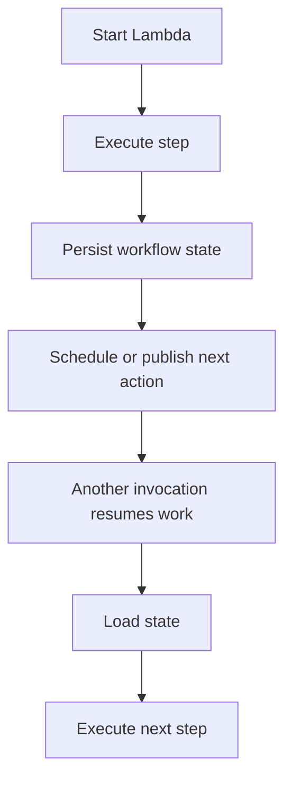
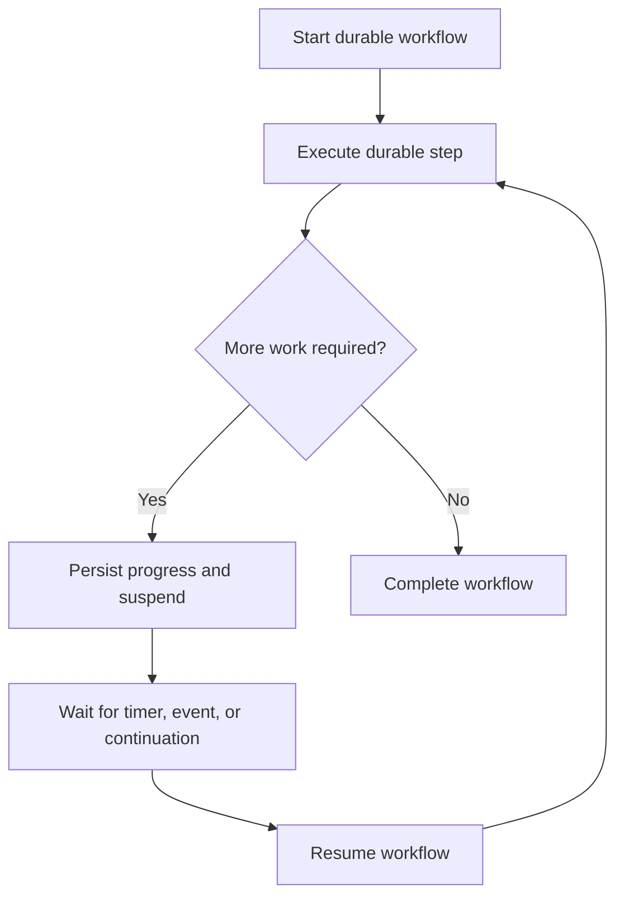

# 06- Lambda Durable Execution

## Overview

AWS Lambda durable execution enables applications to implement long-running, multi-step workflows that can pause, wait for external events, and resume without requiring the application to keep a Lambda execution environment continuously active throughout the entire workflow.

Traditional Lambda invocations are bounded by the function's configured timeout. When a workflow spans multiple steps, external approvals, scheduled delays, or unreliable downstream services, developers often need additional orchestration through AWS Step Functions, Amazon SQS, EventBridge, or a persistent workflow state machine.

Durable execution introduces a programming model for defining workflows that preserve progress across interruptions and resume execution from recorded state. Its exact programming interfaces, supported runtimes, availability, and limits depend on the current AWS durable execution offering and SDK.

**Important distinction:** Durable execution is not the same as simply increasing a Lambda function's timeout. It provides workflow-level progress and recovery semantics rather than requiring one uninterrupted function invocation to perform the entire business process.

## Why Durable Execution Matters

Consider an order-processing workflow:

1. Validate an order.
2. Reserve inventory.
3. Request payment authorization.
4. Wait for fulfillment confirmation.
5. Send a notification.

Some steps finish in milliseconds, while others may wait minutes or hours for external systems or human decisions. Implementing the entire process as one conventional Lambda invocation is unsuitable because execution time is bounded and the process may need to wait for an external event.

A durable workflow can persist progress between steps and continue when the next action becomes eligible.

### Traditional orchestration

Without a durable workflow abstraction, an application might store its own state in DynamoDB, schedule follow-up work, and implement retry and recovery logic.



This approach can work well, but the team must correctly implement state transitions, idempotency, retry rules, concurrency control, and recovery from partial failures.

### Durable execution model

A durable execution framework provides abstractions for defining workflow steps and preserving execution progress.



The workflow can resume from recorded progress instead of requiring the application to manually reconstruct every completed step.

## Core Concepts

| Concept | Meaning | Engineering implication |
|---|---|---|
| Durable execution | A workflow execution whose progress can survive interruptions | Suitable for multi-step business processes |
| Workflow definition | The code or configuration describing the workflow | Must remain compatible with the execution model |
| Durable step | A unit of work whose completion is recorded | Side effects must be designed for retries and replay |
| Checkpoint or recorded progress | Persisted information used to resume execution | Enables recovery without repeating all completed work |
| Wait or suspension | A workflow pauses until a timer, signal, or event permits continuation | Avoids keeping compute active solely to wait |
| Resume | Continuation from persisted workflow progress | Requires reliable handling of duplicate or delayed signals |
| Terminal state | A workflow has completed, failed, or reached another final outcome | Must be observable and operationally actionable |

These concepts describe the general durable-workflow model. The exact names and semantics exposed by an AWS SDK or service API must be verified against the specific durable execution feature being used.

## Durable Execution vs Standard Lambda Invocations

| Capability | Conventional Lambda invocation | Durable workflow execution |
|---|---|---|
| Execution boundary | One invocation | Multi-step workflow |
| Progress across interruptions | Application must arrange persistence and recovery | Workflow framework records progress according to its semantics |
| Long waits | Require external scheduling, orchestration, or another invocation | Can suspend and resume through supported durable mechanisms |
| Retry handling | Depends on invocation model and event source | Depends on workflow and step retry semantics |
| Side-effect safety | Application responsibility | Still requires application-level idempotency |
| Workflow visibility | Usually assembled from logs, metrics, and external state | Depends on the durable execution service's execution history and observability capabilities |
| Best fit | Short request handlers and event processors | Multi-step processes with durable state and waiting periods |

Durable execution does not eliminate the need for sound distributed-systems design. External APIs can time out after completing an operation, messages can be delivered more than once, and a resumed workflow may encounter changed external state.

## Durable Operations in Python

The AWS Durable Execution SDK provides a `DurableContext` object with operations for checkpointing, waiting, callbacks, retries, and coordination.

The Python SDK uses synchronous method calls rather than `await` for durable operations.

### Durable steps

A durable step represents a unit of work whose result is recorded for later replay. When a completed step is encountered during replay, the SDK can reuse its recorded result instead of executing the step again.

Use steps for meaningful operations such as validating an order, reserving inventory, or requesting payment authorization.

```python
from aws_durable_execution_sdk_python import (
    DurableContext,
    durable_execution,
    durable_step,
)
from aws_durable_execution_sdk_python.config import Duration


@durable_step
def validate_order(step_context, order_id):
    step_context.logger.info("Validating order %s", order_id)
    return {"orderId": order_id, "status": "validated"}


@durable_step
def process_payment(step_context, order_id):
    step_context.logger.info("Processing payment for %s", order_id)

    # Illustrative result. Production code must call a payment provider
    # and implement idempotency using a stable business operation key.
    return {"orderId": order_id, "status": "authorized"}


@durable_step
def confirm_order(step_context, order_id):
    step_context.logger.info("Confirming order %s", order_id)
    return {"orderId": order_id, "status": "confirmed"}


@durable_execution
def lambda_handler(event, context: DurableContext):
    order_id = event["orderId"]

    validation = context.step(validate_order(order_id))
    payment = context.step(process_payment(order_id))

    context.wait(Duration.from_seconds(10))

    confirmation = context.step(confirm_order(order_id))

    return {
        "orderId": order_id,
        "status": "completed",
        "steps": [validation, payment, confirmation],
    }
```

The example follows the documented Python SDK programming model. The payment implementation is illustrative and should not be used as a real payment integration without provider-specific idempotency, error handling, and reconciliation.

Reference: [Creating Lambda durable functions](https://docs.aws.amazon.com/lambda/latest/dg/durable-getting-started.html)

### Waiting without holding compute

A durable wait pauses the workflow for a specified duration without continuously consuming Lambda compute for the waiting period.

```python
context.wait(Duration.from_seconds(60))
```

This is appropriate for delays such as waiting before a retry, observing a propagation period, or scheduling a later workflow step.

Use a durable wait instead of a busy loop or repeated `time.sleep()` calls when the wait is part of the business workflow. A normal sleep keeps the current invocation active and consumes execution time.

### Waiting for an external callback

Some workflows need an external system or human reviewer to provide a result before proceeding. Durable execution supports callback-based coordination through the SDK's callback operations.

Typical use cases include:

- Manual approval of a high-value transaction.
- Waiting for an external fulfillment system.
- Confirming a long-running asynchronous operation.
- Collecting an external decision before continuing.

The callback lifecycle requires a secure correlation mechanism, appropriate IAM permissions, and defined timeout and failure behavior. A callback must not be treated as trusted merely because it contains a valid execution identifier.

### Other durable operations

| Operation | Typical use |
|---|---|
| `step()` | Execute and checkpoint a unit of work |
| `wait()` | Suspend for a specified duration |
| Wait for condition | Repeatedly evaluate a condition with durable coordination |
| Callback | Wait for external input |
| Invoke | Call another Lambda function and checkpoint the result |
| Parallel | Coordinate concurrent operations |
| Map | Process a collection of items with concurrency control |
| Child context | Isolate a group of related operations |

Consult the SDK reference for the exact method signatures, retry options, and behavior of each operation.

## Checkpointing and Replay

Checkpointing records workflow progress, including completed operations and their results. Replay reconstructs the workflow's execution path after a pause or interruption.

A durable function may run its handler code again from the beginning when it resumes. This does not mean every completed durable step executes again: the SDK uses recorded checkpoint results for completed operations.

```mermaid
sequenceDiagram
    participant L as Lambda Runtime
    participant S as Durable SDK
    participant D as Checkpoint State

    L->>S: Start workflow
    S->>D: Record step start
    S->>S: Execute step
    S->>D: Persist completed result
    S->>D: Record wait
    S-->>L: Suspend execution
    Note over L,D: Wait period; no continuous compute
    L->>S: Resume workflow
    S->>D: Load checkpoint history
    S->>S: Replay workflow code
    S->>D: Read completed step result
    S->>S: Continue from unfinished operation
```

### Deterministic replay

Workflow code must remain compatible with its recorded execution history.

Avoid relying on unrecorded values that may change between the original execution and replay, especially when those values affect control flow or the arguments passed to durable operations.

Examples include:

- Reading the current time and making different branching decisions.
- Generating random identifiers outside a durable operation.
- Reading mutable external state directly during replay.
- Changing the order or identity of durable operations between deployments.
- Depending on a new code version to interpret old checkpoint results.

Place non-deterministic external work inside appropriately defined durable steps and persist its result. Use explicit, stable identifiers for business operations.

## Idempotency and External Side Effects

Checkpointing is not equivalent to exactly-once execution of arbitrary external side effects.

AWS documents at-least-once execution semantics for durable steps by default. A step can perform an external action and then fail before its successful completion is durably recorded. In that situation, a retry may perform the action again.

For example, a payment provider might authorize a charge successfully, but the Lambda invocation could fail before recording the result.

A safe design uses a stable idempotency key:

```python
def authorize_payment(payment_client, order_id, amount):
    idempotency_key = f"order-payment:{order_id}"

    return payment_client.authorize(
        amount=amount,
        idempotency_key=idempotency_key,
    )
```

This is a conceptual provider interface; the actual parameter names and guarantees depend on the payment provider.

Production safeguards include:

- Use a stable business operation identifier across retries.
- Use provider-supported idempotency keys where available.
- Persist operation status and provider references.
- Reconcile ambiguous outcomes instead of assuming failure.
- Make database state transitions conditional where appropriate.
- Avoid sending notifications or publishing events twice.
- Define compensation procedures for partially completed workflows.

Execution names can help prevent duplicate workflow starts when the same name is reused according to the service's idempotency rules. They do not automatically make every step's business side effects idempotent.

Reference: [Idempotency for Lambda durable functions](https://docs.aws.amazon.com/lambda/latest/dg/durable-execution-idempotency.html)

## Durable Functions vs AWS Step Functions

Lambda durable functions and AWS Step Functions both support workflow orchestration and recovery, but they serve different architectural preferences.

| Dimension | Lambda durable functions | AWS Step Functions |
|---|---|---|
| Primary focus | Workflow logic implemented within Lambda | Orchestration across services and application components |
| Programming model | Standard programming languages with durable SDK operations | State machine using Amazon States Language or supported infrastructure-as-code constructs |
| Workflow visibility | Durable execution history and tooling | Visual state-machine representation and execution history |
| AWS service integrations | Typically coordinated through application code and Lambda | Broad set of service integrations |
| Best fit | Lambda-centric business logic and durable application workflows | Cross-service orchestration, visible workflows, and service-level coordination |
| Trade-off | Requires careful replay-safe code and SDK integration | Requires maintaining a separate workflow definition and its deployment lifecycle |

A hybrid architecture is also possible: a durable Lambda function can manage application-level operations while Step Functions coordinates a broader business process.

Choose based on the ownership boundary of the workflow, the need for visual review, service integration requirements, and operational responsibilities.

Reference: [Durable functions or Step Functions](https://docs.aws.amazon.com/lambda/latest/dg/durable-step-functions.html)

## Configuration and Deployment

Durable execution must be enabled when creating a durable Lambda function. The documented configuration includes an execution timeout and a retention period for durable execution data.

Durable functions support longer execution lifetimes than conventional Lambda functions, up to one year according to the current AWS documentation. The configured execution timeout and other constraints still apply.

### Deployment requirements

- Use a runtime version supported by durable execution.
- Include the appropriate durable execution SDK in production deployment artifacts.
- Enable durable execution in the function configuration.
- Grant the execution role the required checkpoint permissions.
- Publish a version or configure an alias for stable invocation.
- Test interruption, replay, and failure behavior before production rollout.

For Python packaging, include the SDK dependency in the deployment artifact to control the version used by the application.

### Version pinning

Durable executions must be invoked through qualified function ARNs. Prefer a published version or alias instead of relying on `$LATEST`.

An execution is associated with the function version that started it. If an execution pauses and resumes after a deployment, version pinning helps preserve the code and checkpoint compatibility required for deterministic replay.

Using `$LATEST` is risky for long-running durable workflows because code updates can affect the code used when a paused execution resumes.

### AWS CLI example

The following example illustrates creating a durable function. It assumes that `function.zip` contains the handler and its dependencies and that the execution role already exists.

```bash
aws lambda create-function \
  --function-name order-workflow \
  --runtime python3.14 \
  --role arn:aws:iam::123456789012:role/durable-function-role \
  --handler lambda_function.lambda_handler \
  --zip-file fileb://function.zip \
  --durable-config '{"ExecutionTimeout": 3600, "RetentionPeriodInDays": 7}' \
  --region ap-south-1
```

Replace the example account ID, role ARN, runtime, Region, and timeout values with those appropriate for your deployment. Verify runtime availability and supported configuration values before running the command.

The configuration above requests a one-hour execution timeout and seven days of retention; it does not imply that every execution will run for that duration.

Publish a version after the function has been tested:

```bash
aws lambda publish-version \
  --function-name order-workflow \
  --description "Initial durable workflow release" \
  --region ap-south-1
```

Use the returned qualified ARN for invocation. The creation and publication commands modify AWS resources and may incur charges.

Reference: [Deploy and invoke durable functions with the AWS CLI](https://docs.aws.amazon.com/lambda/latest/dg/durable-getting-started-cli.html)

## Invocation and Execution Management

Durable functions support the familiar Lambda invocation methods, including synchronous and asynchronous invocation, subject to their specific semantics and limits.

For workflows that may take longer than the synchronous invocation limit, asynchronous invocation is generally more appropriate. The caller receives an acknowledgement that the invocation was accepted; it does not necessarily receive the final workflow result.

### Python invocation example

```python
import json

import boto3

lambda_client = boto3.client("lambda", region_name="ap-south-1")


def start_order_workflow(order_id: str) -> None:
    response = lambda_client.invoke(
        FunctionName=(
            "arn:aws:lambda:ap-south-1:123456789012:"
            "function:order-workflow:1"
        ),
        InvocationType="Event",
        Payload=json.dumps({"orderId": order_id}).encode("utf-8"),
    )

    if response["StatusCode"] != 202:
        raise RuntimeError(
            f"Workflow invocation was not accepted: "
            f"{response['StatusCode']}"
        )
```

This example checks the asynchronous invocation acknowledgement. It does not prove that the workflow completed successfully.

Use the durable execution management APIs to inspect execution status and retrieve execution history or results as appropriate.

### Operational lifecycle

```text
Accepted
   |
   v
Running
   |
   +----> Waiting / Suspended
   |             |
   |             v
   |          Resuming
   |             |
   +-------------+
   |
   +----> Succeeded
   |
   +----> Failed
   |
   +----> Stopped
```

The exact statuses and transitions exposed by the service should be verified against the current API reference. Build operational dashboards around the documented statuses rather than assuming this simplified diagram is exhaustive.

## Security and IAM

Durable execution introduces additional permissions for checkpoint management and execution administration.

The function's execution role needs the required permissions to checkpoint progress and retrieve execution state. Operators and deployment systems may need separate permissions to inspect, stop, or otherwise manage executions.

Follow least privilege:

- Separate runtime permissions from deployment permissions.
- Scope execution-management actions to the appropriate durable execution resources.
- Avoid granting broad Lambda administrative permissions to application roles.
- Protect callback submission and failure APIs.
- Avoid placing secrets or unnecessary sensitive data in checkpointed payloads.
- Use the supported encryption configuration when customer-managed encryption keys are required.
- Audit execution-management activity and review CloudWatch logs.

Durable execution ARNs are sub-resources of a qualified function ARN. IAM policies that match only an unqualified function ARN may not authorize durable execution operations.

Reference: [Security and permissions for Lambda durable functions](https://docs.aws.amazon.com/lambda/latest/dg/durable-security.html)

## Monitoring, Cost, and Reliability

Durable workflows require monitoring beyond the initial invocation. A function may appear healthy at invocation time while an execution remains waiting, repeatedly retrying, or failing later.

### Monitor

- Counts of running, succeeded, failed, and stopped executions.
- Execution duration and time spent waiting.
- Durable step failures and retry activity.
- Checkpoint and callback failures.
- Age of pending business operations.
- External dependency latency and error rates.
- Workflows that remain active beyond their expected completion time.

Use the Lambda console's durable execution views, CloudWatch Logs, applicable metrics, and execution-management APIs to investigate individual workflows.

### Cost considerations

Durable operations create checkpoints and persist execution data. Costs can depend on the number of durable operations, retries, payload sizes, execution duration, and data retention.

Optimize by:

- Avoiding unnecessary durable steps.
- Keeping checkpointed results small.
- Avoiding excessive polling.
- Using callback-based waiting when appropriate instead of repeated polling.
- Setting a suitable retention period.
- Measuring the cost of retries and parallel operations.
- Defining cleanup and operational procedures for abandoned business workflows.

A durable wait avoids continuously consuming Lambda compute during the waiting period, but it does not make the overall workflow free. Durable operation charges and other service costs still apply.

Reference: [Durable execution SDK and operation metering](https://docs.aws.amazon.com/lambda/latest/dg/durable-execution-sdk.html)

## Common Mistakes

| Mistake | Why it is problematic | Prevention |
|---|---|---|
| Treating durable execution as a longer timeout | Ignores checkpointing, replay, and workflow semantics | Design explicit durable steps and waits |
| Performing external side effects outside durable steps | Replay can repeat unrecorded work | Place side effects in suitable steps and use idempotency |
| Using unstable execution identifiers | Retries can create duplicate business workflows | Use a stable execution name where appropriate |
| Deploying changes to `$LATEST` during long-running executions | Can break replay compatibility | Use published versions or aliases |
| Storing large payloads in every checkpoint | Increases persistence overhead and cost | Persist references to large objects in S3 or another durable store |
| Assuming asynchronous acknowledgement means success | The workflow can fail later | Track final execution state |
| Granting broad IAM permissions | Expands the impact of compromised roles | Scope permissions to required actions and resources |
| Ignoring long-running failures | Stuck or repeatedly failing workflows can remain unnoticed | Alert on execution age, failure rates, and business deadlines |

## Key Takeaways

- Lambda durable execution provides checkpointed, resumable workflows for multi-step processes that may span extended periods, including waits and interruptions.
- Completed durable operations can be replayed from recorded results, but application code must remain deterministic and compatible with the execution history.
- Checkpointing does not guarantee exactly-once external side effects; stable idempotency keys, reconciliation, and explicit failure handling remain essential.
- Use published versions or aliases, least-privilege checkpoint permissions, and execution-level monitoring for production durable functions.
- Choose durable functions for Lambda-centric application workflows and Step Functions when cross-service orchestration, visual workflow visibility, or native service integrations better fit the architecture.