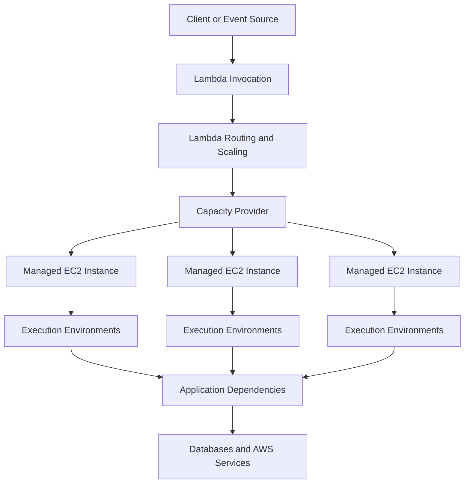
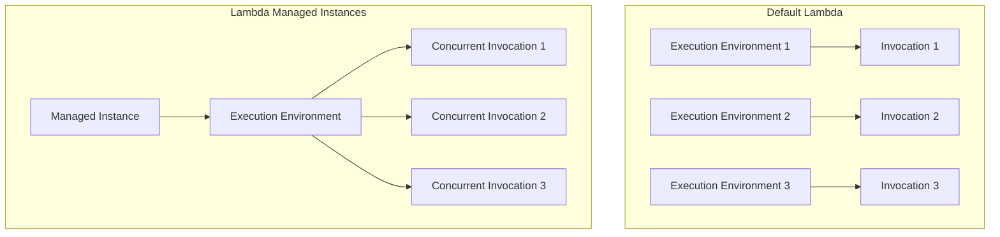

# 07- Lambda Managed Instances

## Overview

AWS Lambda Managed Instances is a Lambda compute model that runs Lambda functions on Amazon EC2 instances in your AWS account while AWS manages instance provisioning, operating system and runtime patching, routing, load balancing, and scaling.

It combines the Lambda programming and invocation model with more control over the underlying compute infrastructure. Unlike default Lambda functions, which use Lambda-managed execution environments that scale in response to incoming requests, Managed Instances use capacity providers to define the EC2 infrastructure and scale asynchronously based on resource utilization.

This model is particularly relevant for backend workloads that need sustained throughput, high resource utilization, specialized compute, or EC2-based pricing advantages without taking on the full operational responsibility of managing an EC2 fleet.

**Core principle:** Lambda Managed Instances changes the compute and concurrency model. It is not simply a larger Lambda memory setting or another name for provisioned concurrency.

Reference: [AWS Lambda Managed Instances](https://docs.aws.amazon.com/lambda/latest/dg/lambda-managed-instances.html)

## Why Lambda Managed Instances Exists

Default Lambda is effective for event-driven applications, unpredictable traffic, and workloads that benefit from automatic scaling without managing servers. However, some workloads have different characteristics:

- Traffic is relatively steady and sustained.
- Functions perform many concurrent I/O operations.
- High resource utilization can reduce compute costs.
- Workloads benefit from specialized EC2 instance types or high network bandwidth.
- Teams need greater control over compute capacity and scaling behavior.
- Existing EC2 pricing commitments, such as applicable Savings Plans or Reserved Instances, influence cost decisions.

Lambda Managed Instances addresses these requirements while retaining Lambda invocation, function deployment, and integration patterns.

### Example backend workload

Consider a Python service that processes a continuous stream of events, calls several external APIs, and writes results to a database.

With default Lambda, individual execution environments process requests sequentially, and Lambda scales the number of environments as concurrency grows.

With Managed Instances, an execution environment can process multiple concurrent requests. This can improve resource utilization for I/O-heavy workloads, provided the runtime and application safely support concurrent execution.

The trade-off is that the application must be designed for the selected concurrency model, and capacity planning becomes more important.

## Core Architecture

Lambda Managed Instances introduces capacity providers as the central abstraction for infrastructure configuration.

A capacity provider defines the compute infrastructure on which assigned Lambda functions execute, including VPC configuration, instance requirements, and scaling policies.

AWS manages the underlying instances and the routing and scaling components. The customer remains responsible for function code, application dependencies, execution-role permissions, network configuration, workload isolation, and application-level reliability.

### Main components

| Component | Responsibility |
|---|---|
| Lambda function | Contains the application handler and business logic |
| Capacity provider | Defines the infrastructure, VPC settings, instance requirements, and scaling behavior |
| Managed EC2 instances | Provide the compute resources used by the function execution environments |
| Execution environment | Runs the function code and processes invocations |
| Lambda routing and scaling | Distributes invocations and adjusts capacity |
| Execution role | Grants the function access to AWS resources |
| Operator role | Grants Lambda the permissions required to manage capacity provider infrastructure |

Managed Instances are not ordinary EC2 instances that the application team administers directly. AWS restricts direct management operations on these managed resources.

## Capacity Providers

A capacity provider is the infrastructure and scaling boundary for Lambda Managed Instances.

Before deploying a function using this compute model, create a capacity provider and configure the required permissions and networking.

### Configuration responsibilities

A capacity provider can define:

- VPC and subnet configuration.
- Security groups and network access.
- Processor architecture and permitted EC2 instance types.
- Maximum compute capacity.
- Scaling configuration and target resource utilization.
- Operator permissions for infrastructure management.

Capacity providers can support multiple function versions. This allows related workloads to share infrastructure when they have compatible performance, operational, and security requirements.

### Capacity providers as trust boundaries

Functions assigned to the same capacity provider must be mutually trusted. Managed Instances use containers for execution-environment isolation, but containers must not be treated as a security boundary between untrusted workloads in this model.

For example, two internal services with compatible trust requirements may share a capacity provider. A function handling highly sensitive data should not automatically share the same provider with less-trusted application code.

Use separate capacity providers when workloads require different trust boundaries.

Reference: [Core concepts](https://docs.aws.amazon.com/lambda/latest/dg/lambda-managed-instances-core-concepts.html) and [Security and permissions](https://docs.aws.amazon.com/lambda/latest/dg/lambda-managed-instances-security.html).

## Execution and Concurrency Model

The default Lambda compute model processes one invocation at a time in each execution environment. Lambda adds execution environments to handle additional concurrent requests.

Lambda Managed Instances supports multiple concurrent invocations within an execution environment. This allows more requests to share the resources allocated to an instance.

The diagram is conceptual: actual concurrency depends on the runtime, configured concurrency limits, available resources, and workload characteristics.

### Why concurrency matters

For an I/O-heavy workload, a request might spend much of its lifetime waiting for a database or external HTTP API. Concurrent processing can allow other requests to use the available resources during that waiting period.

For CPU-bound workloads, concurrency alone does not increase the available CPU capacity. Performance depends on the number of vCPUs, memory allocation, runtime behavior, and application parallelism.

### Python runtime considerations

Lambda Managed Instances supports Python 3.13 and later according to the documented runtime requirements. The Python runtime uses multiple processes to handle concurrent requests. Each request runs in a separate process with its own memory space and initialization, and each process handles one request at a time.

Consequently:

- Module-level caches and global variables are not shared directly between these Python worker processes.
- A process-local cache may be duplicated across workers.
- Each worker may initialize its own database or HTTP client.
- The number of workers affects memory consumption and connection counts.
- Increasing concurrency can increase downstream pressure even when Lambda capacity is available.

The `PerExecutionEnvironmentMaxConcurrency` configuration controls the maximum number of concurrent requests sent to each execution environment. Its default and behavior depend on the runtime; verify the current runtime documentation before tuning it.

Reference: [Python runtime for Lambda Managed Instances](https://docs.aws.amazon.com/lambda/latest/dg/lambda-managed-instances-python-runtime.html).

## Scaling Behavior

Lambda Managed Instances scales asynchronously based on resource consumption rather than adding capacity immediately for each new request.

The scaling system considers CPU utilization and multi-concurrency saturation. AWS also manages routing and instance lifecycle operations.

This differs from default Lambda, where demand can cause Lambda to create additional execution environments as required.

### Scaling lifecycle

1. A function version is published and associated with a capacity provider.
2. Lambda provisions the required Managed Instances and execution environments.
3. Incoming requests are routed to available execution environments.
4. Resource utilization and concurrency saturation provide scaling signals.
5. Lambda adds capacity when necessary and removes excess capacity when demand decreases.

AWS documents that a newly published function version using Managed Instances starts with three instances by default for Availability Zone resilience, and initializes execution environments before the version becomes active. Verify the current behavior and capacity requirements for the deployment.

### Important scaling trade-off

Managed Instances does not provide the same immediate request-driven scaling behavior as default Lambda. AWS warns that if traffic more than doubles within five minutes, throttling can occur while capacity scales up.

This makes traffic forecasting, load testing, and capacity headroom important.

For workloads with unpredictable sharp bursts, default Lambda may be the safer choice unless Managed Instances capacity has been designed and tested for the expected traffic profile.

Reference: [Scaling Lambda Managed Instances](https://docs.aws.amazon.com/lambda/latest/dg/lambda-managed-instances-scaling.html).

## Supported Runtimes and Compute Requirements

AWS documents the following language and runtime support for Lambda Managed Instances:

| Language | Supported runtime |
|---|---|
| Java | Java 21 and later |
| Python | Python 3.13 and later |
| Node.js | Node.js 22 and later |
| .NET | .NET 8 and later |
| Rust | OS-only runtime `provided.al2023` and later |

Runtime support can evolve. Verify the current runtime list and Region availability before deployment.

Managed Instances also impose different resource requirements from default Lambda. The documented minimum function configuration is 2 GB of memory and 1 vCPU.

The memory-to-vCPU ratio should be selected according to the application. Python workloads may benefit from a higher memory-to-vCPU ratio depending on worker count, memory usage, and concurrency.

For CPU-intensive processing, additional vCPUs may be more useful than increasing concurrency alone.

## Networking and VPC Configuration

Lambda Managed Instances run on EC2 infrastructure in a customer-configured VPC. This makes network configuration an important part of the deployment.

The capacity provider requires suitable subnets and security groups. The selected networking must support communication with required application dependencies and AWS services.

### Networking checklist

- Select subnets with sufficient available IP addresses.
- Configure security groups for the required inbound and outbound flows.
- Ensure database access is limited to the required ports and source security groups.
- Configure routing and DNS for private dependencies.
- Provide appropriate connectivity to AWS APIs and telemetry destinations.
- Use VPC endpoints or other suitable private connectivity where required.
- Test connectivity from the deployed workload rather than relying only on local tests.

Do not assume that placing a function in a VPC automatically gives it internet access. Outbound connectivity depends on the routing and network design.

Because multiple execution environments may run on the same managed infrastructure, consider the combined connection count and network consumption of all assigned functions.

Reference: [Networking for Lambda Managed Instances](https://docs.aws.amazon.com/lambda/latest/dg/lambda-managed-instances-networking.html).

## Security and IAM

Managed Instances require more than a conventional Lambda execution role because Lambda must also manage the underlying EC2 capacity.

Two distinct roles are involved.

| Role | Purpose |
|---|---|
| Function execution role | Grants the application permission to access services such as S3, DynamoDB, Secrets Manager, and CloudWatch Logs |
| Capacity provider operator role | Grants Lambda the permissions needed to provision and manage the capacity provider's compute resources |

Lambda also uses a service-linked role to manage aspects of the Managed Instances lifecycle.

### `lambda:PassCapacityProvider`

Users and deployment roles need `lambda:PassCapacityProvider` when creating functions that use a capacity provider, updating function configuration to assign one, or deploying through infrastructure-as-code workflows.

Restrict this permission to approved capacity providers. Otherwise, a deployment principal might assign a function to infrastructure intended for a different trust level.

### Security recommendations

- Separate capacity providers for workloads with different trust requirements.
- Grant operator permissions only to the intended role.
- Restrict `lambda:PassCapacityProvider` to approved provider ARNs.
- Keep execution-role permissions independent of infrastructure-management permissions.
- Audit capacity provider creation, updates, and function assignments through CloudTrail.
- Avoid storing credentials in source code or deployment artifacts.
- Use security groups and network controls to limit access to internal services.

Reference: [Lambda Managed Instances security and permissions](https://docs.aws.amazon.com/lambda/latest/dg/lambda-managed-instances-security.html).

## Observability and Operations

Managed Instances require monitoring at both the function and capacity provider levels.

Function-level logs and metrics show application behavior, while capacity provider metrics and system logs provide visibility into instance lifecycle events, resource utilization, and scaling operations.

### Monitor the following

| Signal | Why it matters |
|---|---|
| Invocation count and errors | Detects application-level failures |
| Duration and latency percentiles | Identifies slow requests and regressions |
| Throttles | Indicates insufficient capacity or concurrency constraints |
| CPU utilization | Helps determine whether compute capacity is saturated |
| Execution-environment concurrency | Reveals whether concurrency settings are appropriate |
| Capacity provider scaling events | Explains changes in available capacity |
| Available subnet IP addresses | Helps prevent network capacity problems |
| Database connection count | Detects downstream connection exhaustion |
| Instance lifecycle system logs | Helps diagnose provisioning and scaling problems |

Create alarms for sustained throttling, elevated error rates, excessive latency, and resource utilization that approaches the configured scaling target.

Reference: [Monitoring Lambda Managed Instances](https://docs.aws.amazon.com/lambda/latest/dg/lambda-managed-instances-monitoring.html).

## Cost Model

Lambda Managed Instances uses EC2-based pricing, with a documented 15% management fee on top of the EC2 instance cost. It also offers access to applicable EC2 pricing advantages, including Savings Plans and Reserved Instances.

This is a different cost model from default Lambda's request and execution-duration pricing.

### Cost considerations

- Managed compute capacity can remain provisioned while demand is low.
- The cost depends on selected instance types and the capacity maintained.
- Higher utilization can reduce the compute cost per request but leave less headroom for bursts.
- Lower utilization targets improve headroom but may require more capacity.
- VPC resources, storage, data transfer, logging, and downstream services can add costs.
- Instance charges can continue briefly while capacity is being terminated after deactivation or provider deletion.

Compare the total cost of ownership rather than comparing only the nominal price of a single invocation.

For sustained workloads, Managed Instances may provide attractive economics. For intermittent workloads with long idle periods, default Lambda can be more economical because it does not require maintaining the same type of EC2 capacity.

Reference: [AWS Lambda pricing](https://aws.amazon.com/lambda/pricing/).

## Lambda Managed Instances vs Other Compute Models

| Dimension | Default Lambda | Lambda Managed Instances | ECS/Fargate |
|---|---|---|---|
| Infrastructure management | AWS-managed execution environments | AWS manages EC2 instances through capacity providers | AWS manages the underlying Fargate infrastructure |
| Compute selection | Lambda's supported configurations | Greater control over EC2 instance requirements | Task CPU and memory configuration |
| Concurrency | One invocation per execution environment | Multiple concurrent invocations per execution environment | Depends on task and application architecture |
| Scaling | Request-driven Lambda scaling | Asynchronous scaling based on resource utilization | ECS service and task scaling policies |
| Cost model | Requests and execution duration | EC2-based pricing plus management fee | Task resource consumption and applicable pricing |
| Burst handling | Designed for automatic scaling within service limits | Requires capacity planning for asynchronous scale-up | Depends on task capacity and scaling behavior |
| Application model | Lambda handler | Lambda handler with concurrency-aware implementation | Containerized service or worker |
| Best fit | Event-driven and variable workloads | Sustained Lambda workloads needing EC2-based compute control | Long-running services and workloads requiring container-level control |

Choose ECS/Fargate when the application needs a long-running service process, custom container lifecycle, or a service architecture that is not naturally expressed as Lambda invocations. Choose Managed Instances when the Lambda programming model remains suitable but EC2-based compute economics or configuration are valuable.

## Common Mistakes

| Mistake | Why it matters | Prevention |
|---|---|---|
| Assuming Managed Instances scales instantly like default Lambda | Asynchronous scaling can cause throttling during rapid growth | Load-test burst scenarios and maintain capacity headroom |
| Sharing one capacity provider across untrusted functions | Containers are not a security boundary between workloads in this model | Separate capacity providers by trust level |
| Using concurrency settings without testing thread or process behavior | Can cause race conditions, memory pressure, or connection exhaustion | Test the actual runtime concurrency model |
| Ignoring EC2 and VPC quotas | Capacity may fail to scale because of vCPU, subnet IP, or related limits | Review Lambda and EC2 quotas before production |
| Comparing only per-request cost | Ignores provisioned capacity and the management fee | Model total cost at realistic traffic levels |
| Treating managed EC2 instances as ordinary customer-managed instances | Direct instance management is restricted | Manage capacity through Lambda capacity providers |
| Using the same execution role for application and infrastructure management | Expands the impact of compromised application code | Separate execution and operator roles |

## Production Adoption Checklist

Before migrating a workload to Managed Instances:

- Confirm that the runtime and Region support the feature.
- Measure average and peak request rates, concurrency, CPU, and memory.
- Load-test the function using its real concurrency model.
- Validate thread safety, process isolation, shared state, and dependency behavior.
- Estimate database connections and downstream service capacity.
- Create capacity providers with appropriate VPC and security group settings.
- Separate workloads according to their trust requirements.
- Configure least-privilege execution and operator roles.
- Review scaling settings, EC2 quotas, and subnet IP capacity.
- Compare projected costs with default Lambda and ECS/Fargate.
- Configure CloudWatch alarms and review capacity provider system logs.
- Test deployment, rollback, scaling, and capacity provider deletion procedures.

## Key Takeaways

- Lambda Managed Instances runs Lambda functions on AWS-managed EC2 instances in the customer's account, using capacity providers to define infrastructure and scaling behavior.
- Multi-concurrent execution can improve resource utilization, especially for I/O-heavy workloads, but applications must account for runtime-specific concurrency and isolation.
- Scaling is asynchronous and resource-driven, so sudden traffic growth can cause throttling unless capacity and headroom are planned appropriately.
- Capacity providers are important security boundaries; separate mutually untrusted workloads and use least-privilege operator and execution roles.
- Evaluate Managed Instances using realistic workload measurements and total cost, including EC2-based pricing, the 15% management fee, capacity utilization, networking, and downstream dependencies.