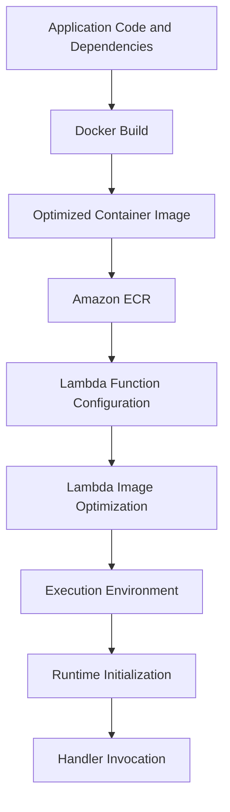

# 08- Lambda Container Image Optimization

## Overview

AWS Lambda supports container images as a deployment package for functions that require complex dependencies, custom runtimes, native libraries, or greater control over the build environment.

Container images introduce additional optimization concerns compared with ZIP-based deployments. Image size, filesystem layers, dependency installation, native libraries, runtime initialization, image publication, and Amazon Elastic Container Registry (Amazon ECR) lifecycle management can all affect deployment efficiency and operational reliability.

The objective is not simply to create the smallest possible image. A production Lambda image should balance:

- Startup and initialization performance.
- Runtime compatibility.
- Security and vulnerability exposure.
- Build reproducibility.
- Deployment and release speed.
- Maintainability and operational cost.

**Core principle:** Optimize the dependencies and files that Lambda actually needs at runtime, measure the effect of each change, and preserve a reproducible deployment artifact.

Reference: [Creating Lambda functions using container images](https://docs.aws.amazon.com/lambda/latest/dg/images-create.html)

## How Lambda Container Images Work

A Lambda container image packages the application code, runtime, dependencies, and supporting files into a Linux container image.

The image is built locally or in CI/CD, pushed to Amazon ECR, and referenced when creating or updating a Lambda function.



When a new or updated image is deployed, Lambda optimizes it before the function becomes active. The function can remain in the `Pending` state during this process.

After deployment, Lambda manages execution environments and their lifecycle. The application team does not directly control the underlying container host or the complete image-caching lifecycle.

### Container image versus ZIP deployment

| Dimension | ZIP deployment | Container image |
|---|---|---|
| Packaging | ZIP archive containing code and dependencies | Linux container image |
| Maximum deployment artifact size | 250 MB uncompressed, including layers | 10 GB uncompressed, including image layers |
| Runtime control | Supported Lambda runtimes and custom runtime packages | Runtime and filesystem packaged into the image |
| Dependency management | Deployment package and Lambda layers | Dependencies included in the image |
| Build process | Archive creation and dependency packaging | Docker-compatible image build |
| Registry or storage | Lambda-managed storage or supported S3 deployment workflow | Amazon ECR |
| Best fit | Conventional handlers with manageable dependencies | Complex dependencies, custom runtimes, or container-oriented build workflows |

Container images do not automatically improve execution speed. A poorly optimized image can have a slower initialization path than a carefully packaged ZIP function.

Also, the deployment package type cannot be changed on an existing function. Moving from ZIP to a container image, or vice versa, requires creating a new function.

## Lambda Container Image Constraints

AWS Lambda supports Linux container images using Docker image manifest V2, schema 2, and compatible Open Container Initiative (OCI) image manifests.

Important constraints include:

| Constraint | Engineering implication |
|---|---|
| Maximum uncompressed image size | 10 GB, including all image layers |
| Operating system | Linux-based container images only |
| Architecture | Build for one target architecture per image |
| Supported manifest formats | Docker image manifest V2, schema 2, and supported OCI manifests |
| Image registry | Amazon ECR |
| Region alignment | The ECR repository must be in the same Region as the Lambda function |
| Runtime compatibility | The image must include the required runtime components |
| Image manifest size | AWS recommends keeping it below 25,400 bytes for optimal performance |
| Deployment package type | Cannot be changed after function creation |

The 10 GB limit is a maximum, not a recommended image size. A smaller image is often easier to build, scan, publish, and maintain.

Lambda does not support multi-architecture container images for a single function deployment. Build and publish a separate image for the selected architecture, such as `x86_64` or `arm64`.

Verify current limits and requirements before establishing CI/CD validation rules.

Reference: [Lambda container image requirements](https://docs.aws.amazon.com/lambda/latest/dg/images-create.html) and [Lambda quotas](https://docs.aws.amazon.com/lambda/latest/dg/gettingstarted-limits.html).

## Choosing an Appropriate Base Image

The base image establishes the operating system, runtime, and supporting components available to the application.

AWS provides Lambda-specific base images that include the language runtime, runtime interface client, and runtime interface emulator.

### Base image options

| Base image | Advantages | Trade-offs |
|---|---|---|
| AWS Lambda language image | Includes the supported language runtime and Lambda integration components | Tied to the chosen runtime and AWS base-image lifecycle |
| AWS Lambda OS-only image | Supports custom runtimes and languages without a dedicated Lambda language image | Requires the appropriate runtime interface client |
| Alternative Linux image | Provides greater control over the operating system and installed software | Requires additional work to ensure Lambda runtime compatibility |

For most Python backend functions, start with an AWS Lambda Python base image unless a specific requirement justifies another base image.

Example:

```dockerfile
FROM public.ecr.aws/lambda/python:3.13
```

Use a currently supported runtime that matches the application's requirements. Do not select a runtime solely because its image is available.

### Why the base image matters

The base image contributes to:

- The image's total size.
- Operating system and library compatibility.
- Native extension compatibility.
- Vulnerability exposure.
- Runtime initialization behavior.
- The maintenance work required when AWS updates the runtime image.

Avoid installing an entire general-purpose operating system toolchain into the final image when the function only requires a Python runtime and a few libraries.

## Multi-Stage Builds

Multi-stage builds separate dependency compilation or preparation from the final runtime image.

This prevents build-only tools, temporary files, compiler caches, and other unnecessary artifacts from being copied into the deployed image.

### Example: Python Lambda image

Consider a function that uses `requests` to call an upstream service.

Directory structure:

```text
lambda-container/
    Dockerfile
    app.py
    requirements.txt
```

`requirements.txt`:

```text
requests==2.32.5
```

The version shown is illustrative. Select a maintained, tested version appropriate for the application and keep the dependency set reproducible.

`app.py`:

```python
import json
import os
import urllib.parse

import requests


UPSTREAM_URL = os.environ.get("UPSTREAM_URL")


def lambda_handler(event, context):
    if not UPSTREAM_URL:
        raise RuntimeError("UPSTREAM_URL is not configured")

    response = requests.get(
        UPSTREAM_URL,
        timeout=(2, 5),
    )
    response.raise_for_status()

    return {
        "statusCode": 200,
        "headers": {
            "content-type": "application/json",
        },
        "body": json.dumps({
            "request_id": context.aws_request_id,
            "upstream_status": response.status_code,
        }),
    }
```

The example uses a bounded connect and read timeout. Production code should also validate the upstream URL, manage connection reuse where appropriate, handle expected upstream failures, and avoid returning internal exception details to clients.

`Dockerfile`:

```dockerfile
FROM public.ecr.aws/lambda/python:3.13 AS builder

WORKDIR /build

COPY requirements.txt .

RUN python -m pip install \
    --no-cache-dir \
    --requirement requirements.txt \
    --target /asset


FROM public.ecr.aws/lambda/python:3.13 AS runtime

WORKDIR ${LAMBDA_TASK_ROOT}

COPY --from=builder /asset/ ${LAMBDA_TASK_ROOT}/
COPY app.py ${LAMBDA_TASK_ROOT}/

CMD ["app.lambda_handler"]
```

### Why this helps

The builder stage installs dependencies separately from the runtime stage. Only the installed dependencies and application code are copied into the final image.

This approach helps exclude build caches and temporary files. However, both stages still use the same base image, so the final image retains that base image's size.

If native dependencies require compilers or development headers, install those tools only in the builder stage and copy the resulting runtime-compatible artifacts into the final stage.

Multi-stage builds reduce unnecessary artifacts; they do not guarantee a smaller image if both stages contain the same files or the application requires large runtime dependencies.

Reference: [AWS Lambda container images for Python](https://docs.aws.amazon.com/lambda/latest/dg/python-image.html).

## Reduce Dependencies and Runtime Files

Dependency selection is often the most effective image optimization.

A function that needs one HTTP client should not package an entire application framework, development environment, notebook stack, or unrelated data-processing libraries.

### Dependency optimization practices

- Install only runtime dependencies.
- Separate development and production dependency files.
- Remove unused packages and optional extras.
- Avoid copying test fixtures, local datasets, and development tools into the final image.
- Use lockfiles or pinned dependency versions.
- Avoid copying the entire repository when only a few files are required.
- Review native library dependencies before removing system packages.
- Remove temporary installation artifacts when they are not needed at runtime.

### Avoid installing development dependencies

A project may use `pytest`, formatting tools, type checkers, and coverage tools during CI. These generally do not belong in the production image unless the deployed application explicitly requires them.

A production dependency file might contain:

```text
requests==2.32.5
```

A development dependency file could contain:

```text
-r requirements.txt
pytest
ruff
mypy
```

For stronger reproducibility, pin development dependencies as well and maintain a lockfile using the project's dependency-management tool.

### Inspect installed dependencies

Run the following inside the image or a compatible build environment:

```bash
python -m pip list
```

Inspect dependency relationships:

```bash
python -m pip check
```

`pip check` verifies installed Python package dependency compatibility. It does not detect every operating system library problem or prove that the function will execute successfully in Lambda.

For native dependencies, test imports and representative operations in the target Lambda runtime environment.

## Docker Layer Ordering and Build Cache

Docker image layers are produced by instructions in the Dockerfile. Changes to an earlier build step can invalidate cached results for subsequent steps.

Place frequently changing application code after relatively stable dependency installation steps.

### Less efficient pattern

```dockerfile
FROM public.ecr.aws/lambda/python:3.13

WORKDIR ${LAMBDA_TASK_ROOT}

COPY . .

RUN python -m pip install \
    --no-cache-dir \
    --requirement requirements.txt

CMD ["app.lambda_handler"]
```

Copying the entire repository before dependency installation means that unrelated source changes can invalidate the dependency-installation cache.

### Improved pattern

```dockerfile
FROM public.ecr.aws/lambda/python:3.13

WORKDIR ${LAMBDA_TASK_ROOT}

COPY requirements.txt .

RUN python -m pip install \
    --no-cache-dir \
    --requirement requirements.txt

COPY app.py .

CMD ["app.lambda_handler"]
```

This improves build-cache reuse when application code changes but the dependency manifest remains unchanged.

### Use `.dockerignore`

Create a `.dockerignore` file:

```text
.git
.github
.venv
venv
__pycache__
*.py[cod]
.pytest_cache
.mypy_cache
.ruff_cache
.coverage
htmlcov
tests
.env
.env.*
*.log
dist
build
```

Adjust the exclusions to the project. Do not exclude files required by the deployed function.

The `.dockerignore` file reduces the build context and helps prevent local credentials, virtual environments, tests, and unrelated artifacts from being copied into the image.

Never rely on `.dockerignore` alone to protect secrets. Use secret-management facilities for build-time credentials and AWS Secrets Manager or Systems Manager Parameter Store for runtime secrets where appropriate.

## Native Dependencies and Operating System Compatibility

Python packages that contain native extensions require particular attention.

Examples include packages that use compiled C or C++ extensions, cryptographic libraries, database drivers, and scientific-computing libraries.

A package that installs successfully on Windows may not work inside a Linux Lambda image. A package built for a different CPU architecture or incompatible operating system library can fail at import time.

### Common failure causes

- Building on `x86_64` and deploying to `arm64`.
- Installing a wheel incompatible with the selected Python version.
- Missing shared libraries.
- Copying compiled artifacts from an incompatible Linux distribution.
- Installing development headers in the builder but omitting required runtime libraries from the final image.

### Recommended build process

1. Choose the target Lambda runtime and architecture.
2. Build in a compatible Linux environment.
3. Install native dependencies using compatible wheels or compile them in the builder stage.
4. Copy the required runtime artifacts into the final image.
5. Inspect shared library dependencies when an import fails.
6. Run import and integration tests inside the final image.
7. Deploy a test function and verify behavior in Lambda.

For example, a MySQL driver may require native libraries that are not present in the final image. Removing all system libraries to save space can make the application fail at startup.

Optimize only after confirming that the runtime dependencies remain complete.

## Image Size Is Not the Same as Cold-Start Latency

Image size affects build, publication, scanning, and image-optimization work. However, cold-start latency is also affected by initialization behavior, runtime startup, imported modules, network access, and application initialization.

A smaller image does not guarantee a proportionally faster cold start.

### Important performance components

| Component | Potential optimization |
|---|---|
| Image build and publication | Reduce unnecessary layers and build context |
| Image optimization before activation | Keep the deployed image and manifest reasonably small |
| Runtime initialization | Minimize expensive imports and initialization work |
| Dependency loading | Remove unused dependencies and avoid unnecessary module imports |
| External initialization calls | Avoid unnecessary database or API calls before the handler is ready |
| Application startup | Defer expensive work until it is needed, where appropriate |
| Execution-environment reuse | Reuse safe clients and initialized resources across invocations |

### Measure rather than assume

Track:

- Cold-start frequency and initialization duration.
- Lambda `Init Duration` where reported in logs.
- Handler duration and latency percentiles.
- Image build time and image size.
- Time from publishing an image to the function becoming active.
- Error rates after runtime or dependency updates.

For functions with provisioned concurrency or SnapStart, evaluate the applicable initialization behavior separately. These features have different compatibility requirements and are not interchangeable with image-size optimization.

## ECR Image Management and Deployment

Lambda retrieves container images from Amazon ECR. The repository must be in the same Region as the Lambda function, although cross-account repositories are supported when the necessary permissions are configured.

### Authenticate Docker to ECR

Set the deployment variables:

```bash
export AWS_REGION="ap-south-1"
export AWS_ACCOUNT_ID="123456789012"
export ECR_REPOSITORY="orders-lambda"
export IMAGE_TAG="release-2026-10-11"
export ECR_URI="${AWS_ACCOUNT_ID}.dkr.ecr.${AWS_REGION}.amazonaws.com/${ECR_REPOSITORY}"
```

Replace the example values with the actual account, Region, repository, and release tag.

Authenticate:

```bash
aws ecr get-login-password \
    --region "$AWS_REGION" \
    | docker login \
        --username AWS \
        --password-stdin \
        "${AWS_ACCOUNT_ID}.dkr.ecr.${AWS_REGION}.amazonaws.com"
```

The command requires appropriate AWS credentials and ECR permissions.

### Create the repository

**Resource-modifying command:**

```bash
aws ecr create-repository \
    --repository-name "$ECR_REPOSITORY" \
    --image-scanning-configuration scanOnPush=true \
    --region "$AWS_REGION"
```

If the repository already exists, inspect its configuration instead of recreating it.

### Build and tag the image

For an `x86_64` function:

```bash
docker build \
    --platform linux/amd64 \
    --tag "${ECR_URI}:${IMAGE_TAG}" \
    .
```

For an `arm64` function:

```bash
docker build \
    --platform linux/arm64 \
    --tag "${ECR_URI}:${IMAGE_TAG}" \
    .
```

Use the architecture configured for the Lambda function. Do not publish a multi-architecture image manifest for one Lambda function.

### Push the image

**Resource-modifying command:**

```bash
docker push "${ECR_URI}:${IMAGE_TAG}"
```

Inspect the repository:

```bash
aws ecr describe-images \
    --repository-name "$ECR_REPOSITORY" \
    --region "$AWS_REGION" \
    --query 'imageDetails[].{Tags:imageTags,Digest:imageDigest,Size:imageSizeInBytes,Pushed:imagePushedAt}'
```

This is a read-only inspection command. The returned image metadata can help identify the artifact used for a deployment.

### Create the Lambda function

The following command illustrates a new image-based function. The execution role must already exist and have the required runtime permissions.

**Resource-modifying command:**

```bash
aws lambda create-function \
    --function-name orders-lambda \
    --package-type Image \
    --code ImageUri="${ECR_URI}:${IMAGE_TAG}" \
    --role "arn:aws:iam::${AWS_ACCOUNT_ID}:role/orders-lambda-execution-role" \
    --architectures x86_64 \
    --memory-size 1024 \
    --timeout 30 \
    --region "$AWS_REGION"
```

The example uses a 1 GB memory allocation and a 30-second timeout. Tune these values using workload measurements rather than copying them unchanged into production.

Inspect the function state:

```bash
aws lambda get-function-configuration \
    --function-name orders-lambda \
    --region "$AWS_REGION" \
    --query '{State:State,LastUpdateStatus:LastUpdateStatus,PackageType:PackageType,Architectures:Architectures,CodeSha256:CodeSha256}'
```

Wait until the function is active before invoking it:

```bash
aws lambda wait function-active-v2 \
    --function-name orders-lambda \
    --region "$AWS_REGION"
```

Then invoke the function:

```bash
aws lambda invoke \
    --function-name orders-lambda \
    --region "$AWS_REGION" \
    response.json
```

Review `response.json` and the function logs to verify the deployment.

References: [AWS CLI create-function](https://docs.aws.amazon.com/cli/latest/reference/lambda/create-function.html) and [AWS CLI update-function-code](https://docs.aws.amazon.com/cli/latest/reference/lambda/update-function-code.html).

## Immutable Releases and Image Digests

A container tag is a label, not a guarantee that the image contents will remain unchanged.

Lambda resolves an image tag to a specific image digest when the function is deployed. Pushing another image under the same tag does not automatically update the function to use the new image.

### Recommended release strategy

- Use unique release tags for CI/CD artifacts.
- Record the resulting image digest.
- Deploy the exact image that passed validation.
- Update the Lambda function explicitly for every release.
- Publish a Lambda version after verification.
- Route production traffic through an alias where appropriate.
- Retain previous known-good artifacts according to the rollback policy.

### Update an existing function

**Resource-modifying command:**

```bash
aws lambda update-function-code \
    --function-name orders-lambda \
    --image-uri "${ECR_URI}:${IMAGE_TAG}" \
    --publish \
    --region "$AWS_REGION"
```

Wait for the update to complete and verify the returned version and function configuration.

For stronger release integrity, deploy using a verified image digest when supported by the deployment workflow. A digest identifies a specific image artifact more reliably than a mutable tag.

Do not delete an ECR image that is still needed by a deployed Lambda function or by a rollback target. Lambda may need to retrieve the image again for optimization or recovery.

## Security and Supply Chain

Container image optimization must not remove security controls or make the build process less reproducible.

An image can contain application vulnerabilities, vulnerable operating system packages, exposed credentials, or unnecessary tools that increase the attack surface.

### Security practices

- Use maintained base images and rebuild when security updates are released.
- Scan images for vulnerabilities.
- Pin dependency versions and maintain a reproducible build process.
- Keep secrets out of Dockerfiles, image layers, build arguments, and repository history.
- Use least-privilege IAM permissions for ECR and Lambda deployments.
- Restrict ECR repository access.
- Enable image scanning and integrate scan results into release gates.
- Use immutable release identifiers or image digests.
- Review Dockerfile changes and base-image updates.
- Remove unused packages and utilities where doing so does not break the runtime.

### Build secrets

Avoid this pattern:

```dockerfile
ARG PRIVATE_PACKAGE_TOKEN
RUN pip install private-package \
    --index-url "https://${PRIVATE_PACKAGE_TOKEN}@packages.example.com/simple"
```

Build arguments and commands can leak sensitive values through build metadata, logs, or image layers.

Use Docker BuildKit secret mounts or an equivalent secure build mechanism for private package credentials. Ensure credentials are not copied into the final image.

Runtime credentials should normally be retrieved through an appropriate AWS identity and secret-management mechanism rather than embedded in the image.

### Base image updates

AWS periodically updates Lambda base images. Updating the base image in a Dockerfile does not change an already deployed image.

To receive updated base-image content, rebuild, test, push, and redeploy the function.

Automate this process so that security fixes do not depend on a developer manually rebuilding the image.

Reference: [AWS Lambda container image requirements and updates](https://docs.aws.amazon.com/lambda/latest/dg/images-create.html).

## Local Testing and Verification

Local container testing can catch packaging errors before deployment, but it does not fully reproduce Lambda's managed execution environment, IAM behavior, networking, scaling, or production invocation path.

AWS Lambda base images include a runtime interface emulator for local testing.

Build the image:

```bash
docker build -t orders-lambda:test .
```

Run it locally:

```bash
docker run --rm \
    --platform linux/amd64 \
    -p 9000:8080 \
    orders-lambda:test
```

In another terminal, invoke the local runtime endpoint:

```bash
curl -sS \
    -X POST \
    "http://localhost:9000/2015-03-31/functions/function/invocations" \
    -H "content-type: application/json" \
    -d '{"order_id":"order-123"}'
```

Adjust the event to match the handler's expected input.

### Verify the image

Inspect the image configuration:

```bash
docker image inspect orders-lambda:test
```

Review its layers:

```bash
docker history orders-lambda:test
```

Inspect its reported size:

```bash
docker image ls orders-lambda:test
```

These commands help identify large layers, unexpected files, and configuration issues. The displayed local image size is not necessarily identical to the compressed bytes transferred to ECR or the uncompressed size relevant to Lambda's deployment limit.

### Production verification

After deployment:

1. Confirm that the function reaches `Active`.
2. Verify that the configured architecture matches the image.
3. Invoke the function using a representative event.
4. Check CloudWatch logs for initialization and import errors.
5. Exercise native dependencies and external service calls.
6. Verify timeout, memory, and error behavior.
7. Confirm that the intended image digest was deployed.
8. Run a smoke test through the real API or event-source integration.

## Common Mistakes and Troubleshooting

### Image exceeds the size limit

**Possible causes**

- Large build tools were copied into the runtime stage.
- The entire repository was included in the build context.
- Unused dependencies or datasets were packaged.
- Multiple dependency versions or caches were retained.

**Isolation strategy**

Inspect the image size and Docker history:

```bash
docker image ls
docker history orders-lambda:test
```

**Corrective actions**

- Introduce multi-stage builds.
- Review `.dockerignore`.
- Remove unused dependencies.
- Copy only required artifacts into the final stage.
- Rebuild and validate the complete image.

### `ImportError` or `ModuleNotFoundError`

**Possible causes**

- A dependency was not installed.
- The wrong Python version or architecture was used.
- A required native library is missing.
- The final image does not contain the runtime artifact produced by the builder.

**Corrective actions**

- Inspect installed packages.
- Test imports inside the final image.
- Rebuild dependencies for the correct runtime and architecture.
- Check native library requirements.
- Verify the deployed image rather than relying only on local source code.

### Function remains in `Pending`

**Possible causes**

- Lambda is optimizing a newly deployed image.
- The image is large or requires additional optimization work.
- Image retrieval or repository permissions need investigation.

**Corrective actions**

- Poll the function configuration and state.
- Check deployment and service events.
- Verify ECR repository permissions and image availability.
- Reduce unnecessary image content where appropriate.
- Avoid invoking the function until it reaches `Active`.

### Updating an image tag has no effect

**Cause**

Lambda continues using the image digest resolved during deployment. Reusing a tag in ECR does not automatically update the function.

**Corrective action**

Push the intended image and call `update-function-code` with the desired image URI. Verify the resulting deployment and publish a version where appropriate.

### Function fails after an ECR cleanup

**Possible causes**

- A deployed image was deleted.
- Repository access was revoked.
- A required image or layer is no longer retrievable.

**Corrective actions**

- Inspect the function state.
- Verify the referenced image and repository permissions.
- Restore an accessible, compatible image if necessary.
- Review lifecycle policies and retain images required by active functions and rollback procedures.

### Function works locally but fails in Lambda

**Possible causes**

- Different architecture or operating system libraries.
- Missing IAM permissions.
- Different environment variables or secret configuration.
- VPC routing or DNS differences.
- Runtime-specific initialization behavior.

**Corrective actions**

- Confirm the target architecture and runtime.
- Inspect CloudWatch logs.
- Test the exact published image.
- Verify execution-role permissions and networking.
- Reproduce the issue using a deployed test function.

## Production Optimization Checklist

Before releasing an image-based Lambda function, verify the following:

- [ ] Use a supported Lambda runtime or a correctly configured custom runtime.
- [ ] Target the intended single CPU architecture.
- [ ] Keep the final image below the 10 GB uncompressed limit with sufficient headroom.
- [ ] Use multi-stage builds when build tools or intermediate artifacts are unnecessary at runtime.
- [ ] Pin and audit application dependencies.
- [ ] Use `.dockerignore` to reduce build context and exclude local artifacts.
- [ ] Separate dependency installation from frequently changing application code.
- [ ] Confirm that native libraries and runtime dependencies are present.
- [ ] Test the final image locally and through a deployed Lambda function.
- [ ] Scan the image and update vulnerable base-image dependencies.
- [ ] Use unique release identifiers and record image digests.
- [ ] Automate image publication, deployment, verification, and rollback.
- [ ] Retain ECR artifacts needed by active functions and rollback targets.
- [ ] Monitor cold starts, initialization duration, errors, latency, and deployment activation time.
- [ ] Compare image optimization results using measurements rather than image size alone.

## Key Takeaways

- Lambda container image optimization focuses on runtime dependencies, base-image selection, multi-stage builds, Docker layer ordering, and excluding unnecessary files.
- A smaller image can improve build and deployment efficiency, but image size alone does not determine cold-start latency; runtime initialization and application behavior must also be measured.
- Native dependencies must match the target operating system, Python runtime, and CPU architecture, and the final image must include all required runtime libraries.
- Lambda resolves an image tag to a specific digest during deployment, so every release must explicitly update the function and verify the deployed artifact.
- Production image pipelines should combine reproducible builds, vulnerability scanning, least-privilege ECR access, immutable releases, deployment verification, and safe retention of rollback images.