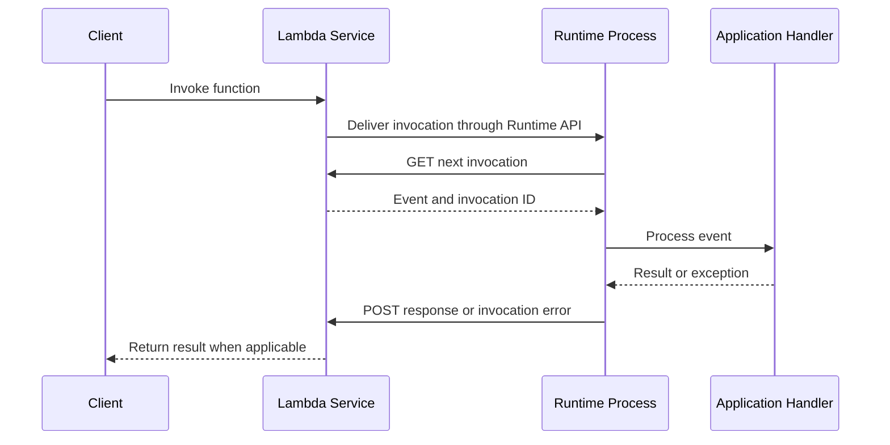
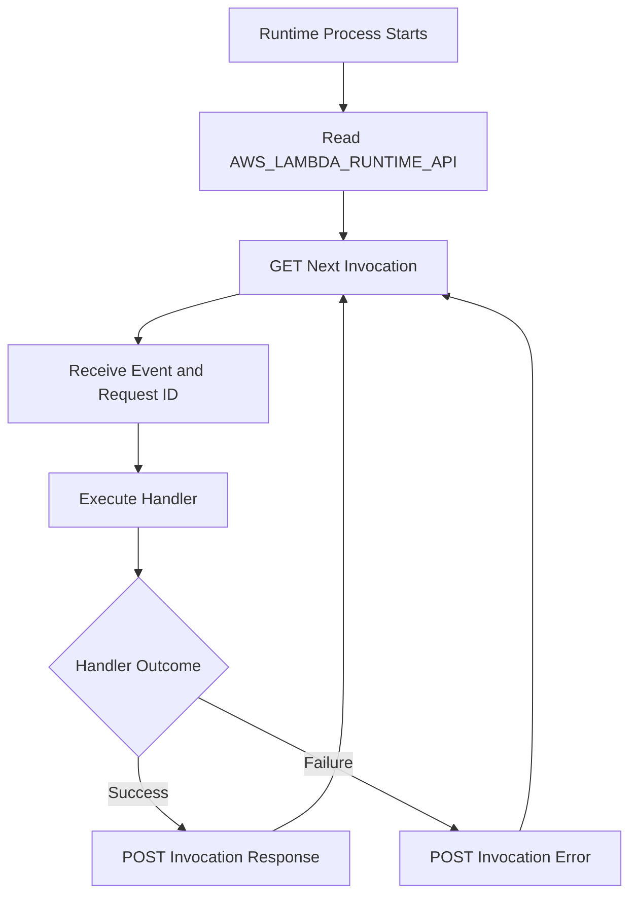

# 09- Lambda Runtime and Custom Runtime Development

## Overview

AWS Lambda separates application logic from the infrastructure required to execute it. A function handler processes an event, while the Lambda runtime and the Lambda service coordinate initialization, invocation, response delivery, and execution-environment lifecycle.

Most Python developers use an AWS-provided runtime, such as Python 3.13, and implement a handler function. However, advanced workloads may require more control over runtime initialization, language support, process management, or request handling. Lambda supports these requirements through **custom runtimes**, which implement the communication protocol between the runtime and the Lambda service.

Understanding runtimes matters when optimizing cold starts, debugging initialization failures, building container images, supporting languages without a managed runtime, or integrating specialized application servers.

This document covers:

- The managed runtime execution model.
- The Runtime API and custom runtime contract.
- A practical custom runtime implementation.
- Initialization, invocation, error handling, and shutdown.
- Deployment, observability, security, and operational trade-offs.

## Lambda Runtime Architecture

A Lambda runtime is the component responsible for running the handler and communicating with the Lambda service. It is distinct from the application code itself.

For a Python function, the managed runtime handles much of the interaction with the Lambda Runtime API. The application supplies a handler such as `app.lambda_handler`, and the runtime invokes it for each request.

A custom runtime takes responsibility for this interaction directly.

### Execution flow



The client-facing response depends on the invocation model. For synchronous invocation, Lambda returns the function result or an invocation error to the caller. For asynchronous invocation, Lambda accepts the event for processing and manages delivery and retries according to its asynchronous invocation behavior.

The runtime protocol is not itself the application's public API. It is an internal contract between the runtime process and Lambda.

### Managed runtime versus custom runtime

| Dimension | AWS-provided runtime | Custom runtime |
|---|---|---|
| Runtime implementation | Provided and maintained by AWS | Implemented or packaged by the application team |
| Handler integration | Runtime invokes the configured handler | Runtime must implement invocation polling and response reporting |
| Language support | Supported AWS runtime languages and versions | Languages and execution models compatible with the Runtime API |
| Maintenance | AWS manages much of the runtime infrastructure | Team owns runtime code, compatibility, and maintenance |
| Initialization control | Controlled through supported runtime and application mechanisms | Greater control over process startup and runtime behavior |
| Operational complexity | Lower | Higher |
| Best fit | Conventional Python, Node.js, Java, .NET, and other supported applications | Specialized runtimes, unsupported languages, or custom execution requirements |

A custom runtime does not remove Lambda's execution model, timeouts, memory limits, concurrency behavior, or security boundaries. It changes how application code participates in the runtime lifecycle.

## Lambda Execution Environment Lifecycle

A Lambda execution environment provides an isolated environment in which a function can initialize and process invocations.

An execution environment typically moves through these phases:

- **Initialization:** Runtime startup, module imports, static initialization, and application setup.
- **Invocation:** Processing one or more function invocations according to the runtime and execution model.
- **Shutdown:** Runtime and environment termination, which may occur when Lambda retires an environment.

The application must not assume that an execution environment will be reused or that shutdown hooks will always execute.

### Initialization

Initialization can include:

- Starting the runtime process.
- Loading application modules.
- Reading environment configuration.
- Creating reusable SDK clients.
- Loading required libraries.
- Establishing connections when appropriate.

Expensive initialization increases startup latency. Move work out of initialization only when doing so is safe and does not create unnecessary per-invocation overhead.

### Invocation

For each invocation, the runtime obtains an event and an invocation identifier, executes the handler, and reports the result or failure.

A reused execution environment may process subsequent invocations. Reuse can reduce initialization cost, but it must not be treated as durable storage or as a guarantee of request affinity.

### Shutdown

Lambda can terminate an execution environment when it is no longer needed or when the service replaces it. Shutdown behavior depends on the environment lifecycle and runtime model.

Applications should not rely on shutdown hooks for critical persistence, transaction completion, or guaranteed delivery of background work.

## Lambda Runtime API

The Lambda Runtime API is the HTTP-based interface used by a runtime process to interact with the Lambda service.

For custom runtimes, the endpoint is exposed through the `AWS_LAMBDA_RUNTIME_API` environment variable. The runtime uses this endpoint to request invocations and report responses, failures, and supported lifecycle events.

The Runtime API is different from the function's public HTTP API. It is used by the runtime inside the execution environment.

### Core protocol operations

The principal Runtime API operations include:

| Operation | Purpose |
|---|---|
| `GET /2018-06-01/runtime/invocation/next` | Wait for and retrieve the next invocation |
| `POST /2018-06-01/runtime/invocation/{requestId}/response` | Report a successful invocation result |
| `POST /2018-06-01/runtime/invocation/{requestId}/error` | Report an invocation failure |
| `POST /2018-06-01/runtime/init/error` | Report an initialization failure |
| `POST /2018-06-01/runtime/invocation/{requestId}/response` with the appropriate response content | Return the handler's serialized result |

The invocation response and error endpoints use the invocation identifier returned in the Runtime API response headers.

The runtime must preserve that identifier and report the outcome against the correct invocation. An incorrect identifier or malformed request can cause invocation failures.

Reference: [Lambda Runtime API](https://docs.aws.amazon.com/lambda/latest/dg/runtimes-api.html).

### Runtime API request flow



A custom runtime generally continues polling for subsequent invocations while its execution environment remains active.

A robust implementation must distinguish invocation failures from initialization failures. It must also handle malformed events, serialization errors, network failures, and unexpected exceptions without silently losing invocation outcomes.

## Runtime Interface Client and Runtime Interface Emulator

Two components are especially relevant to container-based Lambda functions.

### Runtime Interface Client

A Runtime Interface Client (RIC) implements the Lambda Runtime API communication needed to run a function. AWS-provided language base images generally include the appropriate runtime components.

For a custom container image, the application must ensure that a compatible runtime interface implementation is present. Depending on the selected base image and language, this may be provided by an AWS-supported runtime interface client or implemented directly.

A custom runtime built with the `provided` runtime family commonly includes a bootstrap executable or script that implements the Runtime API loop.

### Runtime Interface Emulator

The Runtime Interface Emulator (RIE) allows developers to invoke Lambda container images locally through a Lambda-compatible HTTP interface.

It helps validate:

- Handler startup.
- Event parsing.
- Result serialization.
- Basic runtime integration.

It does not reproduce all managed Lambda behavior. Local execution does not fully validate IAM authorization, production networking, service-managed scaling, event-source delivery semantics, or actual cold-start performance.

References:

- [AWS Lambda container images](https://docs.aws.amazon.com/lambda/latest/dg/images-create.html)
- [AWS Lambda Runtime Interface Emulator](https://github.com/aws/aws-lambda-runtime-interface-emulator)

## When to Build a Custom Runtime

Custom runtimes introduce maintenance responsibility. Use one only when the benefits justify the additional complexity.

Appropriate use cases include:

- Running a language without an AWS-provided managed runtime.
- Implementing a specialized interpreter or execution model.
- Integrating a runtime that requires custom startup or process behavior.
- Controlling low-level invocation handling.
- Packaging a compatible runtime and application together in a container image.

A custom runtime is usually unnecessary when the application is a conventional Python REST API, event handler, or background job. An AWS-provided Python runtime or a supported Python Lambda container image is generally simpler.

### Decision guide

| Requirement | Recommended approach |
|---|---|
| Standard Python handler | AWS-provided Python runtime |
| Python application with complex native dependencies | Evaluate a Lambda container image |
| Custom language or interpreter | Custom runtime using the `provided` runtime family |
| Specialized startup behavior | First evaluate managed-runtime configuration and supported extensions |
| Long-running server or workload with different lifecycle requirements | Evaluate ECS/Fargate or another suitable compute service |
| Full control over the request loop | Custom runtime, if Lambda's execution model still fits the workload |

A custom runtime does not make Lambda suitable for every long-running process. Lambda still imposes a maximum function execution timeout of 15 minutes per invocation.

````markdown
## Implementing a Python Custom Runtime

A custom runtime can be implemented in Python by creating a bootstrap process that polls the Runtime API, dispatches each event to application code, and posts the result or error.

This example is intended to demonstrate the protocol and its responsibilities. For production deployments, consider an established runtime interface implementation where one meets the requirements rather than maintaining a custom protocol client unnecessarily.

### Project structure

```text
custom-python-runtime/
    bootstrap
    app.py
    Dockerfile
```

The example uses a Python interpreter available in the execution environment. The `bootstrap` file acts as the runtime entry point.

### Application handler

`app.py`:

```python
import json


def handler(event, context):
    return {
        "statusCode": 200,
        "body": json.dumps({
            "message": "Handled by a custom runtime",
            "request_id": context["request_id"],
            "event": event,
        }),
    }
```

The handler receives an event and a context dictionary created by the custom runtime. Unlike an AWS-provided Python runtime, this example does not automatically supply the standard Python Lambda context object. The runtime implementation defines the context representation.

### Runtime bootstrap

`bootstrap`:

```python
#!/usr/bin/env python3

import importlib
import json
import os
import sys
import time
import traceback
import urllib.error
import urllib.request


API_VERSION = "2018-06-01"


def runtime_url(path):
    runtime_api = os.environ["AWS_LAMBDA_RUNTIME_API"]
    return f"http://{runtime_api}/{API_VERSION}/runtime/{path}"


def post_json(url, payload, headers=None):
    body = json.dumps(payload).encode("utf-8")

    request_headers = {
        "Content-Type": "application/json",
    }
    if headers:
        request_headers.update(headers)

    request = urllib.request.Request(
        url,
        data=body,
        headers=request_headers,
        method="POST",
    )

    with urllib.request.urlopen(request, timeout=10) as response:
        return response.status


def report_init_error(exc):
    payload = {
        "errorMessage": str(exc),
        "errorType": type(exc).__name__,
        "stackTrace": traceback.format_exception(
            type(exc),
            exc,
            exc.__traceback__,
        ),
    }

    try:
        post_json(
            runtime_url("init/error"),
            payload,
            headers={
                "Lambda-Runtime-Function-Error-Type":
                    type(exc).__name__,
            },
        )
    except Exception:
        traceback.print_exc()


def load_handler():
    handler_spec = os.environ.get("HANDLER", "app.handler")
    module_name, function_name = handler_spec.rsplit(".", 1)

    module = importlib.import_module(module_name)
    return getattr(module, function_name)


def report_invocation_error(request_id, exc):
    payload = {
        "errorMessage": str(exc),
        "errorType": type(exc).__name__,
        "stackTrace": traceback.format_exception(
            type(exc),
            exc,
            exc.__traceback__,
        ),
    }

    post_json(
        runtime_url(f"invocation/{request_id}/error"),
        payload,
        headers={
            "Lambda-Runtime-Function-Error-Type":
                type(exc).__name__,
        },
    )


def main():
    try:
        handler = load_handler()
    except Exception as exc:
        report_init_error(exc)
        raise

    while True:
        try:
            with urllib.request.urlopen(
                runtime_url("invocation/next"),
                timeout=None,
            ) as response:
                request_id = response.headers[
                    "Lambda-Runtime-Aws-Request-Id"
                ]
                deadline_ms = int(
                    response.headers[
                        "Lambda-Runtime-Deadline-Ms"
                    ]
                )
                event = json.loads(response.read())

            context = {
                "request_id": request_id,
                "deadline_ms": deadline_ms,
            }

            result = handler(event, context)

            post_json(
                runtime_url(
                    f"invocation/{request_id}/response"
                ),
                result,
            )

        except urllib.error.HTTPError:
            traceback.print_exc()
            raise

        except Exception as exc:
            traceback.print_exc()

            if "request_id" in locals():
                try:
                    report_invocation_error(request_id, exc)
                except Exception:
                    traceback.print_exc()
                    raise
            else:
                raise


if __name__ == "__main__":
    main()
```

**Important limitations of this teaching implementation:**

- It illustrates the Runtime API loop but is not a complete production runtime.
- It does not implement the complete Lambda context object or all optional Runtime API features.
- Its error handling and timeout strategy require additional engineering before production use.
- A `request_id` left over from a previous iteration must never be used to report an error for a later invocation. Production implementations should track invocation state explicitly and reset it for every iteration.
- It assumes that the handler returns a JSON-serializable value.
- It does not implement graceful handling for every network, protocol, and serialization failure.

A production runtime must correctly report the outcome of each invocation, avoid associating failures with the wrong request, and handle failures in the Runtime API communication itself.

### Container configuration

`Dockerfile`:

```dockerfile
FROM public.ecr.aws/lambda/provided.al2023

COPY bootstrap ${LAMBDA_TASK_ROOT}/bootstrap
COPY app.py ${LAMBDA_TASK_ROOT}/app.py

RUN chmod 755 ${LAMBDA_TASK_ROOT}/bootstrap

ENV HANDLER=app.handler

ENTRYPOINT ["/var/task/bootstrap"]
```

The `provided.al2023` family is an AWS Lambda OS-only base image for custom runtimes. The bootstrap must have an executable permission and a valid interpreter available in the image.

**Runtime compatibility matters:** do not assume that an arbitrary base image contains Python. If the selected OS-only image does not contain the required interpreter, the build must install or package a compatible interpreter and its runtime dependencies.

For a real deployment, pin and validate the base image according to the team's image-management policy, and test the final image on the intended architecture.

### Build and test

Build for the target architecture:

```bash
docker build \
    --platform linux/amd64 \
    -t custom-python-runtime:local \
    .
```

Run the container locally:

```bash
docker run --rm \
    --platform linux/amd64 \
    -p 9000:8080 \
    custom-python-runtime:local
```

The preceding local invocation workflow assumes a Lambda-compatible runtime interface is available. A custom bootstrap that directly implements the Runtime API does not automatically expose a local invocation server on port `8080`; the Runtime Interface Emulator or an equivalent compatible local integration must be configured as appropriate.

For a container using the Runtime Interface Emulator, invoke it with a test event:

```bash
curl -sS \
    -X POST \
    "http://localhost:9000/2015-03-31/functions/function/invocations" \
    -H "content-type: application/json" \
    -d '{"order_id":"order-123"}'
```

The event must match the input expected by the handler.

## Runtime API Error Handling

Custom runtimes must distinguish between failures during initialization and failures during an individual invocation.

### Initialization errors

Initialization failures occur before the runtime can process an invocation. Examples include:

- The handler module cannot be imported.
- Required runtime dependencies are missing.
- Runtime configuration is invalid.
- The runtime cannot start successfully.

Where possible, the runtime reports initialization failures using the Runtime API initialization-error endpoint. It should then terminate rather than continue in an unusable state.

### Invocation errors

Invocation errors occur after the runtime has received an event. Examples include:

- Invalid input.
- An application exception.
- A dependency timeout.
- A result that cannot be serialized.
- A failure while processing the event.

The runtime reports an invocation failure against the corresponding invocation identifier.

For asynchronous invocation and event source mappings, the service or event source determines subsequent delivery, retry, and failure-handling behavior. Reporting an invocation error does not itself guarantee that the event will be retried, sent to a dead-letter queue, or delivered exactly once.

### Runtime communication failures

A failure to communicate with the Runtime API is different from an application exception.

If the runtime cannot retrieve an invocation or report an outcome, it must not pretend that the invocation succeeded. It should preserve diagnostic information, handle recoverable conditions appropriately, and allow the Lambda service to manage the environment lifecycle.

Avoid infinite retry loops that conceal a broken runtime or prevent the environment from making progress.

## Custom Runtime Context and Deadline Management

The Runtime API supplies invocation metadata through HTTP response headers. A custom runtime can use this information to implement context behavior and enforce application-level deadlines.

Important metadata includes:

- Invocation request ID.
- Invocation deadline in milliseconds.
- Invoked function ARN.
- Client context or identity metadata when supplied by the invocation path.
- Tracing information where available.

The deadline represents the invocation's execution deadline. A custom runtime should derive an internal time budget from it and reserve enough time to serialize and report the outcome.

For example, a handler should not start a downstream request when insufficient time remains to complete the request and report its result.

A simplified deadline calculation:

```python
import time


def remaining_seconds(deadline_ms):
    deadline_seconds = deadline_ms / 1000
    return max(0.0, deadline_seconds - time.time())
```

This example assumes the deadline is represented as Unix epoch milliseconds, as provided by the Runtime API. Production code should use the remaining time to set downstream connection and read timeouts and should avoid beginning work that cannot reasonably finish within the available budget.

The custom runtime must not confuse the Lambda invocation deadline with an arbitrary application timeout. Both should be considered when calculating safe downstream timeouts.

## Performance and Cold-Start Optimization

A custom runtime adds control but also adds code and operational responsibilities to the initialization path.

Startup time can be affected by:

- Interpreter startup.
- Runtime bootstrap imports.
- Application module imports.
- Dependency loading.
- Initialization-time network calls.
- Native library loading.
- Runtime image size and environment initialization.

### Practical optimization techniques

**Keep initialization minimal.** Import only necessary modules and avoid performing unnecessary external calls before the first invocation.

**Reuse safe resources.** Initialize SDK clients or immutable configuration once when reuse is beneficial. Do not reuse request-specific state, authentication context, or mutable data across invocations without explicit isolation.

**Avoid unnecessary serialization work.** Ensure that the runtime's event parsing and response serialization are efficient for the expected payload sizes.

**Measure initialization separately.** Compare startup behavior, invocation duration, and cold-start frequency rather than relying only on average execution time.

**Choose the simplest viable runtime.** A custom runtime should solve a specific requirement, not merely provide an opportunity to rewrite functionality already supported by the managed runtime.

### Runtime reuse and concurrency

Lambda execution environments are isolated. A runtime process normally handles invocations in its own environment, and application-level parallelism depends on how the runtime is designed.

A custom runtime that processes invocations sequentially should not assume that it can safely execute multiple handlers concurrently. If concurrency is introduced, request state, response routing, shared clients, thread safety, and failure isolation must be designed explicitly.

## Security Considerations

A custom runtime executes application code with the permissions of the Lambda execution role. It does not bypass IAM or provide additional isolation from the function's configured permissions.

Apply the following controls:

- Use a least-privilege execution role.
- Keep secrets out of the image and source code.
- Use Secrets Manager or Systems Manager Parameter Store for runtime secrets when appropriate.
- Validate incoming events before using them in database queries, shell commands, or downstream API calls.
- Keep the runtime implementation and dependencies patched.
- Use maintained base images and scan deployment artifacts.
- Avoid logging credentials, access tokens, sensitive payloads, or unnecessary personal data.
- Use bounded timeouts and safe error handling for network requests.
- Restrict outbound network access where the architecture permits it.
- Separate deployment permissions from runtime permissions.

A custom runtime's ability to execute arbitrary code or invoke native binaries does not justify broad IAM permissions. The runtime should receive only the permissions required by the application.

## Observability and Troubleshooting

Custom runtime failures can occur before application logging is initialized. Runtime diagnostics should therefore be available as early as possible.

Use structured logs and include the invocation request ID when processing an event.

### Useful operational signals

| Signal | What it helps diagnose |
|---|---|
| Initialization errors | Runtime startup or dependency-loading failures |
| Invocation errors | Application exceptions and failed Runtime API responses |
| Duration | Slow handler execution or excessive dependency latency |
| `Init Duration` in applicable logs | Initialization cost and cold-start behavior |
| Memory usage and out-of-memory failures | Insufficient memory or excessive allocations |
| Throttles | Concurrency limits or account-level capacity constraints |
| Downstream latency and failures | Database, API, or network dependency problems |
| Deployment state | Invalid image, runtime startup failure, or incomplete updates |

### Diagnostic sequence

When a custom runtime fails:

1. Confirm the function's configured runtime, package type, architecture, and entry point.
2. Check that the bootstrap file exists, is executable, and starts the intended interpreter.
3. Verify that the interpreter and native dependencies exist in the final image.
4. Inspect CloudWatch logs for initialization errors and application tracebacks.
5. Verify Runtime API paths, invocation identifiers, and response serialization.
6. Test the exact artifact in a Lambda-compatible environment.
7. Deploy to a non-production function and invoke it with representative events.
8. Verify error behavior, timeouts, and logs before promoting the release.

Do not treat a successful Docker build as proof that the function is compatible with Lambda.

## Deployment and Maintenance

Custom runtimes increase the number of components the team must maintain. Runtime source code, interpreters, native libraries, dependencies, and deployment configuration become part of the production software supply chain.

Recommended practices include:

- Store runtime and application code in version control.
- Pin runtime dependencies and maintain reproducible builds.
- Build for the configured Lambda architecture.
- Run automated unit and integration tests.
- Test both successful and failed invocation paths.
- Scan base images and dependencies.
- Use CI/CD to build, publish, and deploy immutable artifacts.
- Publish Lambda versions and use aliases for controlled production rollout.
- Verify the runtime after deployment with smoke tests.
- Maintain a rollback path that includes the runtime and its dependencies.
- Review compatibility when updating the interpreter or base image.

For a conventional Python backend, start with the AWS-provided runtime and move to a custom runtime only when the technical requirement is clear and measurable.

## Key Takeaways

- A custom Lambda runtime implements the Runtime API interaction required to retrieve invocations and report successful results or failures.
- AWS-provided runtimes are usually preferable for standard Python applications because they reduce runtime maintenance and protocol-handling responsibilities.
- A custom runtime must correctly handle initialization failures, invocation identifiers, response serialization, deadlines, and Runtime API communication errors.
- Container images and OS-only base images do not guarantee that the required interpreter or native libraries are present; validate the final artifact on the target architecture.
- Production custom runtimes require reproducible builds, least-privilege permissions, structured observability, automated compatibility testing, and a tested rollback strategy.