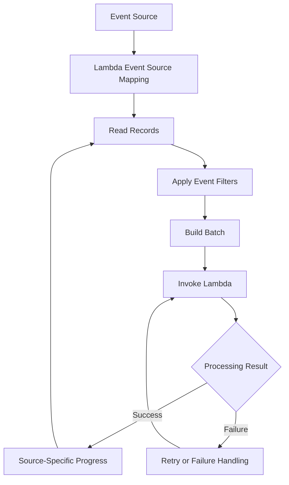

# 11- Lambda Advanced Event Source Mapping

## Overview

AWS Lambda event source mappings connect supported event sources to Lambda functions and manage the process of reading records, building batches, invoking functions, and handling progress through the source. They are central to event-driven backend systems that consume Amazon SQS messages, Amazon Kinesis Data Streams records, DynamoDB Streams records, and supported Kafka or broker-based events.

Advanced event source mapping configuration determines how a consumer behaves under load and failure. Batch size, batching windows, filtering, concurrency, retry limits, checkpoints, and partial batch responses directly affect throughput, latency, duplicate processing, and recovery.

This document focuses on advanced configuration and operational behavior. Direct service integrations and asynchronous Lambda invocation have different delivery and retry semantics; do not treat them as interchangeable with event source mappings.

## Event Source Mapping Architecture

For poll-based integrations, Lambda manages the polling infrastructure and invokes the configured function with records from the source. The precise polling, acknowledgment, and progress behavior depends on the source type.



The flow is conceptual. SQS uses queue visibility and message deletion semantics, while Kinesis and DynamoDB Streams use shard-based progress and checkpoints. Kafka integrations follow Kafka consumer and offset semantics.

### Event source mapping versus direct invocation

| Dimension | Event source mapping | Direct invocation |
|---|---|---|
| Initiator | Lambda reads from a supported source | A caller or AWS service invokes Lambda |
| Examples | SQS, Kinesis, DynamoDB Streams, Kafka integrations | API Gateway, SDK invocation, EventBridge target |
| Polling | Managed by Lambda for supported poll-based sources | Not controlled by an event source mapping |
| Batch processing | Supported according to source capabilities | Depends on the invocation interface |
| Progress tracking | Source-specific; streams use checkpoints or offsets | No event source mapping checkpoint |
| Retry behavior | Depends on the source and mapping configuration | Depends on synchronous or asynchronous invocation semantics |
| Typical use | Queue consumers, stream processors | Request-response APIs and service-to-service invocation |

EventBridge can invoke Lambda as a target without Lambda polling EventBridge through an event source mapping. Similarly, S3 notifications normally invoke Lambda through service integration and resource-based permissions rather than a polling event source mapping.

## Supported Sources and Source-Specific Behavior

| Source | Processing model | Important considerations |
|---|---|---|
| Amazon SQS | Queue polling | Visibility timeout, redelivery, batch failures, and redrive policies |
| Amazon Kinesis Data Streams | Shard-based stream processing | Checkpoints, shard ordering, iterator age, and retry behavior |
| Amazon DynamoDB Streams | Shard-based change processing | Checkpoints, record ordering, stream retention, and replay implications |
| Amazon MSK | Kafka consumer integration | Consumer groups, offsets, broker connectivity, and authentication |
| Self-managed Apache Kafka | Kafka consumer integration | Network reachability, authentication, and offset management |
| Amazon MQ | Broker polling | Broker-specific behavior and supported configuration |
| Amazon DocumentDB change streams | Change-stream processing | Change-stream availability, progress behavior, and source-specific limits |

Capabilities and quotas vary by source and Region. Confirm the current source-specific documentation before applying configuration options across different integrations.

Reference: [Using AWS Lambda with event source mappings](https://docs.aws.amazon.com/lambda/latest/dg/invocation-eventsourcemapping.html).

## Batch Size and Batching Window

Event source mappings can collect multiple records before invoking a function. Batching can reduce invocation overhead, but it also increases the amount of work associated with one invocation and can affect processing latency.

### Batch size

`BatchSize` specifies the maximum number of records Lambda attempts to deliver in a batch, subject to source-specific limits and payload constraints.

Larger batches may improve throughput when records are small and inexpensive to process. They can also increase:

- Invocation duration and memory usage.
- The amount of work affected by a failed invocation.
- Duplicate-processing exposure when a batch is retried.
- Latency when a batch takes time to fill.
- Pressure on downstream APIs and databases.

Choose a batch size using realistic measurements of record size, processing duration, failure rate, and downstream capacity.

### Maximum batching window

`MaximumBatchingWindowInSeconds` allows Lambda to wait for additional records before invoking the function, subject to the source's behavior and other invocation conditions.

A longer window can improve batching efficiency for low-volume workloads, but it introduces additional latency. Lambda may invoke the function before the entire window elapses if the batch reaches its configured size or another source-specific condition is met.

Batching windows are not supported identically across all event sources. Verify the supported range and behavior for the source being configured.

### Payload constraints

A batch must fit within Lambda's invocation payload limits and the event source's constraints. The configured record count alone does not guarantee that every possible batch can be delivered.

For large payloads, consider reducing the batch size or storing the full object in S3 and placing only an object reference and metadata in the event.

## Concurrency and Scaling

Event source mapping concurrency determines how many invocations can process source records simultaneously. Effective parallelism depends on source throughput, mapping configuration, Lambda concurrency limits, function duration, and downstream capacity.

### SQS scaling

An SQS event source mapping can scale polling and concurrent function invocations as backlog grows, subject to the queue type, mapping configuration, and Lambda service limits.

For standard queues, messages may be processed concurrently and delivered more than once. FIFO queues preserve ordering within message groups, which can constrain parallelism when many messages share a group.

Important capacity factors include:

- Number of available messages.
- Batch size and batching window.
- Average and tail processing duration.
- Mapping maximum concurrency, where configured.
- Function reserved concurrency and account concurrency.
- Database connection limits and downstream API quotas.
- Retry and visibility-timeout behavior.

### Stream-based scaling

For Kinesis and DynamoDB Streams, processing is tied to stream shards and checkpoint progress. Increasing concurrency does not eliminate shard-level constraints or guarantee greater throughput.

Some stream mappings support `ParallelizationFactor`, which permits multiple concurrent batches per shard. This can increase processing throughput, but ordering and checkpoint semantics still matter. Validate the source-specific guarantees before relying on parallel processing for business ordering.

### Protect downstream systems

A growing queue backlog can trigger a rapid increase in Lambda concurrency. If each invocation opens multiple database connections or makes several downstream requests, this can overload dependencies even when Lambda itself is scaling successfully.

Use appropriate controls:

- Reserved concurrency to cap a function's total concurrency and protect other workloads.
- Event source mapping concurrency limits where supported.
- Bounded database connection usage and short downstream timeouts.
- Backpressure, circuit breakers, and controlled retry behavior.
- Alarms on queue age, stream lag, throttling, and dependency saturation.

Concurrency limits protect capacity; they do not replace idempotency or failure handling.

## Event Filtering

Event filtering allows an event source mapping to discard records that do not match configured criteria before invoking the function. It can reduce unnecessary execution when a source contains multiple event types but a consumer requires only a subset.

Filtering is not application-level validation. The handler must still validate all records it receives, and filter patterns must match the actual event representation delivered by the source.

### Example filter criteria

The following filter pattern matches an event with an `eventType` field equal to `OrderCreated`:

```json
{
  "Filters": [
    {
      "Pattern": "{\"eventType\":[\"OrderCreated\"]}"
    }
  ]
}
```

This pattern assumes the event being filtered has that field at the relevant level. For SQS, a filter may need to match the JSON message body using the event source's supported body-filter syntax. Stream and broker records have different structures.

For example, an application message body might be:

```json
{
  "eventType": "OrderCreated",
  "orderId": "order-123"
}
```

Test the filter against representative records before enabling it in production. Non-matching records are filtered out rather than delivered to the function, so an incorrect filter can silently discard valid business events.

### Configure filtering with AWS CLI

The following command creates an SQS event source mapping with a filter matching a JSON message body containing `eventType: OrderCreated`.

**Prerequisites:**

- An existing Lambda function named `orders-worker`.
- An existing SQS queue whose ARN is stored in `SQS_QUEUE_ARN`.
- A Lambda execution role with the permissions required to consume messages from the queue.
- A queue message body containing valid JSON.

```bash
aws lambda create-event-source-mapping \
    --function-name orders-worker \
    --event-source-arn "$SQS_QUEUE_ARN" \
    --batch-size 10 \
    --filter-criteria '{
      "Filters": [
        {
          "Pattern": "{\"body\":{\"eventType\":[\"OrderCreated\"]}}"
        }
      ]
    }'
```

This command creates a resource. It does not update an existing mapping.

Verify the mapping using the read-only inspection command:

```bash
aws lambda list-event-source-mappings \
    --function-name orders-worker \
    --query 'EventSourceMappings[].{UUID:UUID,State:State,Source:EventSourceArn,Filter:FilterCriteria}'
```

Store the returned mapping UUID for subsequent updates and operational diagnosis.

Reference: [Lambda event filtering](https://docs.aws.amazon.com/lambda/latest/dg/invocation-eventfiltering.html).

## Partial Batch Responses

A batch can contain both successful and failed records. Without partial batch reporting, a failed invocation may cause the entire batch to be retried or replayed, depending on the source.

Partial batch responses allow supported event sources to identify individual records that failed processing. This reduces unnecessary retries of records that already succeeded.

The configuration and response format are source-specific. SQS uses message identifiers, whereas Kinesis and DynamoDB Streams use sequence-number-based failure reporting and checkpoint behavior.

### SQS partial batch response

Enable the `ReportBatchItemFailures` response type on the SQS event source mapping. The function returns the message identifiers that failed processing.

```python
import json
import logging

logger = logging.getLogger()
logger.setLevel(logging.INFO)


def process_order(order: dict) -> None:
    # Replace with durable, idempotent business processing.
    logger.info("Processing order %s", order["orderId"])


def lambda_handler(event, context):
    batch_item_failures = []

    for record in event.get("Records", []):
        message_id = record["messageId"]

        try:
            body = json.loads(record["body"])
            order_id = body["orderId"]

            if not isinstance(order_id, str) or not order_id:
                raise ValueError("orderId must be a non-empty string")

            process_order(body)

        except (json.JSONDecodeError, KeyError, ValueError):
            logger.exception(
                "Message validation failed",
                extra={"message_id": message_id},
            )
            batch_item_failures.append({
                "itemIdentifier": message_id,
            })

        except Exception:
            logger.exception(
                "Message processing failed",
                extra={"message_id": message_id},
            )
            batch_item_failures.append({
                "itemIdentifier": message_id,
            })

    return {"batchItemFailures": batch_item_failures}
```

This example reports failed messages for retry. In production, classify failures deliberately: malformed messages may need quarantine or a controlled redrive policy, while transient dependency failures may be retried. Returning a failed identifier does not immediately move a message to a dead-letter queue.

Enable partial batch responses when creating the mapping:

```bash
aws lambda create-event-source-mapping \
    --function-name orders-worker \
    --event-source-arn "$SQS_QUEUE_ARN" \
    --batch-size 10 \
    --function-response-types ReportBatchItemFailures
```

For an existing mapping, update it using the mapping UUID:

```bash
aws lambda update-event-source-mapping \
    --uuid "$MAPPING_UUID" \
    --function-response-types ReportBatchItemFailures
```

Both commands create or modify AWS resources. Verify the mapping state after the operation completes.

### SQS implementation considerations

- Return only the identifiers of messages that failed processing.
- Do not report successful messages as failures.
- Make business operations idempotent because messages can be delivered more than once.
- Configure the queue's redrive policy and maximum receive count for messages that repeatedly fail.
- Ensure the function response conforms to the expected schema; an invalid response can prevent partial failure handling from working as intended.
- Avoid logging sensitive message bodies or credentials.

### Partial batch responses for streams

For supported stream sources, return the appropriate failure response using the sequence number of the earliest failed record. Lambda uses the response to determine checkpoint progress and retry behavior.

For Kinesis and DynamoDB Streams, a failed record can affect progress through subsequent records in a shard. `BisectBatchOnFunctionError` can split a failed batch to help isolate problematic records, where supported.

Do not reuse the SQS `itemIdentifier` response format for stream sources. Follow the source-specific response contract and test checkpoint behavior under failure.

Reference: [Handling errors for Lambda event source mappings](https://docs.aws.amazon.com/lambda/latest/dg/invocation-eventsourcemapping.html).

## Retry Behavior and Delivery Guarantees

Retries depend on the event source. There is no single retry policy that applies to SQS, Kinesis, DynamoDB Streams, Kafka, and direct Lambda invocation.

### SQS retry behavior

Lambda polls messages from SQS and invokes the function. Messages remain eligible for redelivery until they are successfully processed and deleted, or until the queue's retention and redrive behavior determines their eventual disposition.

Configure the visibility timeout to account for function execution and batching. AWS recommends an SQS visibility timeout of at least six times the function timeout, plus the maximum batching window where applicable.

A dead-letter queue is configured through the source queue's redrive policy. Setting a Lambda asynchronous invocation destination does not replace that policy.

### Kinesis and DynamoDB Streams retry behavior

Stream mappings use checkpoints to track processing progress. When a batch fails, Lambda may retry it, and later records can be delayed depending on the configuration.

Relevant settings for supported stream sources include:

- `MaximumRetryAttempts`
- `MaximumRecordAgeInSeconds`
- `BisectBatchOnFunctionError`
- `DestinationConfig`
- `FunctionResponseTypes`

The supported settings and their exact semantics vary by source. In particular, stream processing can be affected by shard ordering, record age, retention, and checkpoint progress.

### Idempotency is still required

At-least-once processing means a record may be delivered or processed more than once. It does not mean the business operation must happen more than once.

For example, a payment consumer might successfully charge a customer but fail before acknowledging the message. A retry must not charge the customer again.

Use stable business or event identifiers and durable idempotency records. For operations that update a database, use transactions or conditional writes where appropriate to make the idempotency check and business update safe against concurrent processing.

Exactly-once business outcomes require application-level design; they should not be inferred from an event source's ordering or checkpoint mechanism.

## Batch Bisection and Poison Records

A poison record repeatedly fails because of invalid data, an unsupported state, or a persistent processing defect. It can consume invocation capacity and delay progress if it remains in a repeatedly retried batch.

For supported stream sources, `BisectBatchOnFunctionError` lets Lambda split a failed batch into smaller batches to help isolate the problematic record.

Benefits include:

- Faster identification of a failing record within a batch.
- Less repeated processing of unrelated records.
- Better recovery when a single record consistently causes an invocation failure.

Trade-offs include additional invocations, processing cost, and increased latency while the failing record is isolated.

Use batch bisection with bounded retry behavior and a suitable failure destination where supported. For SQS, use source-appropriate mechanisms such as partial batch responses, a redrive policy, and a dead-letter queue instead.

## Failure Destinations and Dead-Letter Handling

Failure-handling mechanisms differ between event source mappings and Lambda's direct asynchronous invocation model.

| Mechanism | Purpose | Typical use |
|---|---|---|
| SQS dead-letter queue | Retains messages that exceed the source queue's redrive policy | Poison messages and exhausted retries |
| Lambda asynchronous dead-letter queue | Retains qualifying failed asynchronous invocation events | Direct asynchronous invocation failures |
| Lambda asynchronous destination | Sends invocation outcome records to a configured destination | Capturing success or failure outcomes for asynchronous invocations |
| Stream failure destination | Preserves failed records or batches where supported | Recovery from stream processing failures |
| Application-level quarantine | Stores records rejected by business validation | Invalid data requiring investigation or correction |

These mechanisms are not interchangeable. SQS event source mapping retries are governed primarily by queue and mapping semantics, not by the asynchronous invocation destination configuration used for direct asynchronous Lambda invocation.

Failure records may contain sensitive data. Apply least-privilege access, appropriate encryption, retention policies, and controlled replay procedures to dead-letter queues and destinations.

## Scaling Controls and Operational Configuration

Advanced event source mapping settings influence throughput, latency, and recovery. Their availability depends on the source type and mapping configuration.

| Setting | Purpose | Engineering trade-off |
|---|---|---|
| `BatchSize` | Maximum number of records in a batch | Larger batches can improve efficiency but increase per-invocation work |
| `MaximumBatchingWindowInSeconds` | Wait for additional records before invocation | Improves batching efficiency but can add latency |
| `MaximumConcurrency` | Limits concurrent invocations for supported mappings | Protects downstream services but can increase backlog |
| `ParallelizationFactor` | Allows more concurrent processing per shard for supported stream mappings | Can improve throughput but requires careful ordering and idempotency design |
| `MaximumRetryAttempts` | Bounds retries for supported stream mappings | Limits repeated work but changes failure recovery behavior |
| `MaximumRecordAgeInSeconds` | Bounds the age of records processed for supported stream mappings | Prevents stale work from blocking processing indefinitely |
| `BisectBatchOnFunctionError` | Splits failed batches where supported | Helps isolate poison records but adds invocations |
| `FunctionResponseTypes` | Enables supported partial batch response behavior | Reduces unnecessary replay when implemented correctly |

Always verify that a setting is supported for the selected source. Do not assume that a configuration used by SQS can be applied unchanged to Kinesis, DynamoDB Streams, or Kafka.

### Configure SQS maximum concurrency

For a supported SQS event source mapping, configure the mapping's maximum concurrency:

```bash
aws lambda update-event-source-mapping \
    --uuid "$MAPPING_UUID" \
    --scaling-config '{"MaximumConcurrency":25}'
```

This modifies the mapping. The value limits its concurrent invocations; it does not guarantee that the mapping will continuously run at that concurrency, and it does not increase account-level Lambda concurrency quotas.

Verify the resulting configuration:

```bash
aws lambda get-event-source-mapping \
    --uuid "$MAPPING_UUID" \
    --query '{State:State,ScalingConfig:ScalingConfig,BatchSize:BatchSize}'
```

The inspection command is read-only. Confirm the mapping is in the expected state before relying on the new configuration.

## Monitoring and Troubleshooting

Event source mapping issues are best diagnosed by combining mapping state, Lambda metrics, source metrics, invocation logs, and downstream dependency health.

### Useful metrics

| Metric | Why it matters |
|---|---|
| Lambda `Errors` | Indicates function invocation failures |
| Lambda `Duration` | Helps identify slow processing and timeout risk |
| Lambda `Throttles` | Indicates concurrency or capacity constraints |
| SQS `ApproximateAgeOfOldestMessage` | Indicates growing queue delay |
| SQS `ApproximateNumberOfMessagesVisible` | Indicates pending queue backlog |
| Stream iterator age | Indicates processing lag for applicable stream sources |
| Event source mapping state | Helps detect disabled, failed, or updating mappings |

Metric names, dimensions, and availability vary by source. Set alarms around service objectives, such as maximum acceptable queue age or stream lag, rather than relying on invocation count alone.

### Diagnostic workflow

**Symptom: Queue backlog continues to grow.**

Possible causes:

- Insufficient mapping concurrency.
- Slow handler execution.
- Repeated message failures.
- Downstream throttling or database saturation.
- Incorrect batch size or visibility timeout.

Isolation strategy:

1. Inspect the event source mapping state and configuration.
2. Review Lambda duration, error, and throttle metrics.
3. Check queue depth and age of the oldest message.
4. Inspect logs for repeated failures and downstream timeouts.
5. Verify database connection capacity and API rate limits.

Increase concurrency only after confirming that downstream dependencies can safely absorb the additional load.

**Symptom: A stream consumer has increasing iterator age.**

Possible causes:

- A poison record repeatedly failing.
- Function timeouts or initialization errors.
- Insufficient processing capacity.
- Repeated retries.
- A downstream dependency outage.

Inspect invocation logs and retry configuration. Where supported, use bounded retries, partial batch responses, and batch bisection to reduce the impact of failed records.

**Symptom: Messages appear to be processed twice.**

Possible causes:

- SQS redelivery after the visibility timeout expires.
- A side effect succeeds but processing fails before acknowledgment.
- An application retry repeats a non-idempotent operation.

Verify the message identifier and business idempotency key. Fix duplicate handling at the application or persistence layer instead of assuming the event source provides exactly-once business processing.

## Production Best Practices

- **Design idempotent handlers.** Retries should not repeat irreversible business effects.
- **Choose batch sizes empirically.** Benchmark using realistic event sizes, processing times, and failure rates.
- **Use partial batch responses where supported.** Avoid retrying successful records unnecessarily.
- **Bound retries and plan for poison records.** Prevent repeated failures from consuming capacity indefinitely.
- **Protect downstream services.** Use mapping concurrency limits and function reserved concurrency where appropriate.
- **Tune SQS visibility timeouts.** Account for function duration and batching windows.
- **Monitor backlog and lag.** Queue age and stream iterator age often reveal operational problems earlier than invocation counts.
- **Secure failure records.** Dead-letter queues and destinations require access controls, retention, and replay procedures.
- **Test failure paths.** Simulate malformed records, transient errors, throttling, and dependency outages.
- **Verify configuration changes.** An accepted update does not necessarily mean the mapping is already in the desired active state.

## Key Takeaways

- Event source mappings manage polling, batching, filtering, invocation, and source-specific progress; queue and stream semantics differ.
- Batch size, batching windows, and concurrency must balance throughput, latency, and downstream capacity.
- Partial batch responses reduce unnecessary retries, but response formats and checkpoint behavior are source-specific.
- At-least-once delivery can produce duplicate processing, so business-critical handlers need durable idempotency.
- Production mappings require bounded failure handling, source-aware monitoring, safe concurrency limits, and tested recovery procedures.