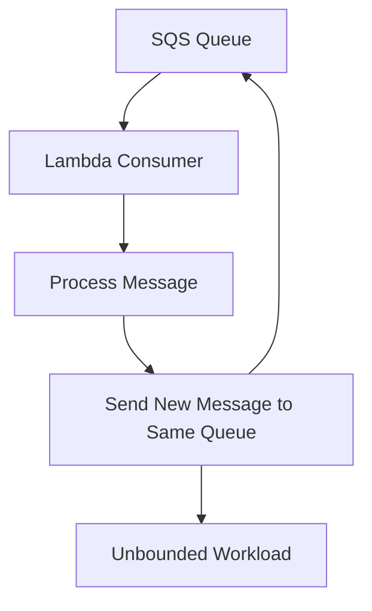
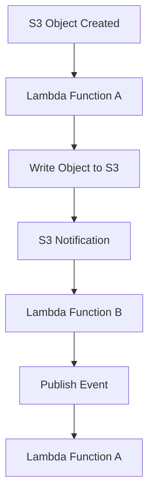

# 12- Lambda Recursive Loop Detection

## Overview

AWS Lambda recursive loop detection helps prevent runaway workloads caused by functions repeatedly triggering themselves, directly or indirectly, through supported AWS service integrations.

A recursive loop can generate excessive invocations, increase AWS costs, overload downstream systems, and prevent useful work from completing. For example, a Lambda function that processes an SQS message might publish another message to the same queue, creating an unbounded processing cycle.

Lambda provides managed recursive loop detection for supported invocation chains. It is a protective mechanism, not a replacement for correct event-driven architecture, idempotency, bounded retries, or application-level loop prevention.

## How Recursive Invocations Occur

Recursive invocation occurs when processing an event eventually causes the same function to be invoked again, potentially without a terminating condition.

### Direct recursion through a queue

Consider a function consuming messages from SQS. If the function sends another message to the same queue after processing each message, it can continually create more work.



### Indirect recursion through multiple services

A loop does not have to involve the same resource at every step. A function might write to S3, trigger another function, and eventually cause the original function to run again.



This example represents a possible architecture, not a guarantee that every such chain is detected. Detection depends on the services and invocation paths supported by Lambda's recursive loop detection.

## Lambda Recursive Loop Detection

Lambda can identify certain recursive invocation chains involving supported AWS services and stop further invocations when a loop is detected.

The mechanism relies on tracing information propagated through supported service interactions. When the invocation chain indicates recursion, Lambda can stop processing additional invocations and report a recursive invocation error.

The exact detection coverage depends on the participating services, invocation path, and current AWS service support. Do not assume that every indirect cycle, custom event bus, external HTTP request, or application-managed message propagation will be detected.

### What the protection provides

- Helps prevent supported recursive invocation chains from continuing indefinitely.
- Reduces the risk of runaway invocation volume and unexpected costs.
- Provides an additional safety mechanism for event-driven applications.
- Can surface recursive invocation failures through Lambda errors and operational telemetry.

### What it does not provide

- A general-purpose distributed cycle detector for every application architecture.
- Exactly-once event processing.
- Protection against every loop involving unsupported services or external systems.
- Automatic correction of a defective event-processing design.
- A substitute for queue redrive policies, retry limits, idempotency, or business-level termination conditions.

## Supported Services and Detection Boundaries

Recursive loop detection is integration-dependent. AWS has expanded support over time, so verify the current service support matrix before relying on this mechanism for a production workload.

Commonly documented supported integrations include:

- Amazon SQS.
- Amazon SNS.
- Amazon S3.

Support applies to specific invocation chains and service interactions rather than every possible use of these services. Other services, custom transports, or chains that lose tracing context may not receive the same protection.

Before deploying a design, consult the official documentation:

- [Lambda recursive loop detection](https://docs.aws.amazon.com/lambda/latest/dg/invocation-recursion.html)
- [Lambda invocation](https://docs.aws.amazon.com/lambda/latest/dg/lambda-invocation.html)

## Configuration and Operational Behavior

Recursive loop detection is a managed Lambda safety feature for supported invocation paths. It should not be treated as a configurable maximum recursion depth that developers can use to control business workflows.

For supported recursive chains, Lambda may stop further invocations after detecting the loop. The invocation can fail, and the event source's normal failure-handling behavior may then apply.

The resulting behavior depends on how the function was invoked.

| Invocation path | Operational implication |
|---|---|
| SQS event source mapping | Failed processing can result in message redelivery, subject to visibility timeout and redrive configuration |
| Asynchronous Lambda invocation | Failure handling follows asynchronous invocation semantics and the configured retry or destination settings |
| Synchronous invocation | The caller may receive an error and must decide whether and how to retry |
| Unsupported recursive chain | The loop may continue unless the application or another system-level safeguard stops it |

A detected loop does not necessarily mean the original event disappears. Messages can be retried, retained, or moved to a dead-letter queue according to the source's configuration.

## Preventing Recursive Loops in Application Design

Managed detection should be the last line of defense, not the primary control.

### Separate input and output resources

A common mistake is using the same bucket, queue, or topic for both input and output without a termination condition.

For example, an S3-triggered processor that writes its output into the same monitored prefix can repeatedly trigger itself.

Prefer separate input and output prefixes or buckets, and configure notifications to match only the intended input objects.

```text
s3://application-data/
    incoming/
    processed/
    failed/
```

Configure the event notification to monitor `incoming/` rather than the entire bucket. Write results to `processed/`.

This makes the event flow explicit and reduces accidental self-triggering.

### Use explicit event types

For event-driven applications, include a meaningful event type and version in the event envelope.

```json
{
  "eventType": "OrderCreated",
  "eventVersion": 1,
  "eventId": "evt-12345",
  "orderId": "order-98765",
  "source": "orders-api"
}
```

Consumers should process only event types they own. Avoid publishing the same event type that triggered a function unless the design explicitly requires it and includes a termination condition.

### Make processing idempotent

A loop detector does not prevent duplicate delivery or repeated business side effects outside the detected chain.

Use a stable event identifier and a durable idempotency record. For database-backed processing, enforce uniqueness with a database constraint or conditional write rather than relying only on an in-memory check.

For example, a PostgreSQL-backed consumer can record processed event identifiers under a unique constraint and coordinate that record with the business update in a transaction. This prevents concurrent duplicate deliveries from independently completing the same operation.

### Add explicit termination conditions

If recursion is intentional, define a bounded and observable termination rule.

Possible controls include:

- A maximum number of processing attempts.
- An explicit workflow state transition.
- A correlation identifier with a persisted processing state.
- A message attribute or event field that identifies the processing stage.
- A durable deadline or maximum workflow duration.

Do not rely only on an in-memory counter, because Lambda execution environments can be replaced and events can be processed concurrently.

## Troubleshooting Recursive Invocation Errors

When Lambda reports a recursive invocation error, determine which resources and event paths form the cycle before changing retry settings.

### Diagnostic workflow

**Symptom:** Lambda invocations fail with a recursive invocation error, or an event-driven workload produces repeated failures.

**Possible causes:**

- The function publishes to the same queue it consumes.
- An S3-triggered function writes objects back into a monitored location.
- Multiple functions form an indirect event cycle.
- A retry or failure handler republishes an event that re-enters the same processing path.

**Isolation strategy:**

1. Identify the failing function and the invocation source.
2. Inspect the function's event source mappings and resource-based permissions.
3. Trace the event through queues, topics, buckets, and downstream functions.
4. Review CloudWatch logs and invocation metrics around the failure.
5. Inspect queue depth, message age, and dead-letter queues where applicable.
6. Verify whether the chain is covered by the current recursive loop detection support matrix.

**Corrective action:**

- Break the unintended cycle by separating input and output resources.
- Filter events to process only the intended event types or object prefixes.
- Add durable idempotency and explicit termination conditions.
- Configure bounded retries and dead-letter handling.
- Replay failed events only after correcting the underlying cycle.

### AWS CLI inspection

Set the correct AWS Region and verify the account before inspecting production resources.

```bash
aws sts get-caller-identity

aws lambda get-function-configuration \
    --function-name orders-worker \
    --query '{FunctionName:FunctionName,State:State,Timeout:Timeout,Role:Role}'

aws lambda list-event-source-mappings \
    --function-name orders-worker \
    --query 'EventSourceMappings[].{UUID:UUID,State:State,Source:EventSourceArn}'
```

These commands are read-only. They help establish the function identity, configuration, and polling sources, but they do not reveal every possible indirect invocation path. Inspect service notifications, event rules, resource policies, and application code as well.

## Monitoring and Cost Controls

Recursive loop prevention should be supported by normal operational monitoring.

Monitor:

- Lambda invocation counts and error rates.
- Lambda duration and throttling.
- SQS queue depth and age of the oldest message.
- Dead-letter queue depth.
- Relevant S3 notifications, SNS subscriptions, and other event-routing configurations.
- Unexpected changes in downstream API traffic or database load.

Set alarms based on workload expectations rather than a universal invocation threshold. A high invocation count can be normal for a busy consumer, while a small but persistent loop can still be harmful.

Cost controls should include bounded retries, appropriate concurrency limits, queue redrive policies, and alerts for abnormal traffic. Concurrency limits can contain some effects of a runaway workload, but they may also create backlogs and delay legitimate processing.

## Production Best Practices

- **Design acyclic event flows where possible.** Make input, output, and failure paths explicit.
- **Use resource and event filters.** Prevent functions from processing their own output unintentionally.
- **Use idempotent handlers.** Recursive loop detection does not guarantee exactly-once business outcomes.
- **Bound retries and message retention.** Prevent persistent failures from consuming resources indefinitely.
- **Monitor both the function and its event sources.** Invocation metrics alone may not reveal the full cycle.
- **Review event topology during deployment.** Changes to notifications, subscriptions, or event rules can introduce loops.
- **Test failure and replay behavior.** Verify that dead-letter processing cannot recreate the original cycle.
- **Verify detection coverage.** Do not rely on managed protection for unsupported integrations or event paths.

## Key Takeaways

- Lambda recursive loop detection helps stop certain supported recursive invocation chains, but it is not a universal distributed cycle detector.
- Unintended loops commonly arise when functions publish to their own input resources or when multiple services form an indirect cycle.
- Separate input and output resources, filter events, and define explicit termination conditions to prevent loops at the architectural level.
- Idempotency, bounded retries, dead-letter handling, and operational monitoring remain necessary even when managed detection is available.
- Diagnose recursive failures by tracing the complete event path and verifying the current AWS support matrix before changing production configuration.