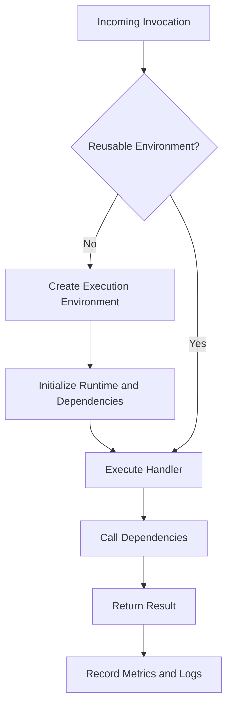

# 13- Lambda Advanced Performance Optimization

## Overview

AWS Lambda performance optimization involves reducing execution latency, improving throughput, controlling resource consumption, and minimizing cost without compromising reliability or correctness.

Lambda abstracts server provisioning, but function performance still depends on application code, runtime initialization, memory allocation, network configuration, dependency loading, concurrency, and downstream services. A function can be optimized at the code level and still perform poorly because of database connection exhaustion, VPC networking, an inefficient query, or excessive retry activity.

Performance optimization should begin with measurable service objectives and production telemetry. The goal is not simply to make a function execute faster; it is to improve the performance of the complete request or event-processing path.

## Lambda Performance Model

A Lambda invocation's latency can be understood as a combination of several components:

- **Initialization:** Runtime startup, module imports, dependency initialization, and initialization code.
- **Handler execution:** Application logic, serialization, validation, and business processing.
- **Dependency latency:** Database queries, HTTP calls, AWS SDK operations, and other external operations.
- **Runtime and environment overhead:** Scheduling, garbage collection, memory allocation, and runtime-specific behavior.
- **Network overhead:** DNS resolution, connection establishment, TLS handshakes, and data transfer.

For a cold invocation, initialization can contribute significantly to total latency. For a warm invocation, initialization is generally avoided when an existing execution environment is reused.



This is a conceptual model rather than an exact sequence of all internal Lambda operations. Extensions, runtime behavior, tracing, and invocation type can affect observed timing.

## Establish Performance Objectives

Optimization is more effective when each change targets a measurable problem.

Define service-level objectives for the workload, such as:

- API latency at p50, p95, and p99.
- Maximum acceptable cold-start latency.
- Event-processing throughput.
- Maximum acceptable queue age or stream lag.
- Error and timeout rates.
- Maximum database connection utilization.
- Cost per successful request or processed record.

### Distinguish latency from throughput

Latency measures the time required to complete one operation. Throughput measures how many operations complete over a period.

Reducing the duration of an individual invocation can improve throughput, but the relationship is not always linear. Concurrency limits, database capacity, network bandwidth, and downstream rate limits can become the bottleneck.

For example, a queue consumer may process more messages per second by increasing batch size, even if each invocation takes longer. An API function, on the other hand, may need low per-request latency and therefore benefit more from reducing initialization and dependency latency.

## Measure Before Optimizing

Use CloudWatch metrics, structured logs, AWS X-Ray where appropriate, and application-level instrumentation to determine where time and resources are being spent.

### Key performance indicators

| Metric or measurement | What it reveals | Typical optimization |
|---|---|---|
| `Duration` | Time spent executing a function invocation | Improve code, dependencies, queries, or batching |
| `Init Duration` in applicable reports | Initialization overhead | Reduce imports and initialization work |
| `Max Memory Used` | Approximate peak memory used during an invocation | Right-size memory and investigate allocations |
| `Errors` | Failed invocations | Fix failure causes rather than merely increasing resources |
| `Throttles` | Invocations constrained by concurrency limits | Review concurrency, quotas, and downstream capacity |
| `ConcurrentExecutions` | Concurrent function activity | Plan capacity and dependency protection |
| `PostRuntimeExtensionsDuration` in applicable reports | Time extensions take after runtime processing | Investigate extension overhead |
| Queue age or stream iterator age | Delay in processing events | Review throughput, failures, batching, and concurrency |
| Application dependency latency | Time spent waiting on databases or remote services | Optimize queries, connections, and network paths |

Metric availability and interpretation depend on the integration and runtime. For example, initialization duration is not reported in the same way for every invocation.

### Use Lambda reports

A CloudWatch log report can provide information such as duration, billed duration, memory size, maximum memory used, and initialization duration when applicable.

```text
REPORT RequestId: ...
Duration: 145.23 ms
Billed Duration: 146 ms
Memory Size: 512 MB
Max Memory Used: 188 MB
Init Duration: 320.00 ms
```

The values are illustrative. Actual reports depend on the runtime, invocation, and execution environment.

A useful diagnostic process is:

1. Identify the slow endpoint or event-processing workload.
2. Separate initialization latency from handler duration.
3. Determine whether time is spent in CPU work, network waits, database queries, or serialization.
4. Compare performance under representative concurrency.
5. Change one major variable at a time.
6. Re-measure latency, throughput, error rate, and cost.

Do not optimize based only on a single invocation or a development environment with no concurrent load.

## Memory and CPU Optimization

Lambda allocates CPU capacity in proportion to configured memory. Increasing memory can improve CPU-bound workloads and may improve network-intensive or memory-intensive operations.

Memory configuration is therefore both a memory-capacity decision and a performance-tuning decision.

### When to increase memory

Consider increasing memory when:

- CPU-intensive serialization or compression dominates execution.
- Large JSON or CSV datasets require substantial processing.
- Cryptographic operations or image transformations are expensive.
- Higher memory configurations reduce execution duration enough to offset their increased per-millisecond price.

Consider decreasing memory only after confirming that the function retains adequate memory headroom under realistic load.

### Benchmark memory settings

Use representative test data and compare several memory configurations. Measure duration, maximum memory usage, error rate, and cost.

The following table illustrates why benchmarking is necessary.

| Memory configuration | Duration | Interpretation |
|---|---:|---|
| 256 MB | 900 ms | Lower resource allocation may constrain CPU-intensive work |
| 512 MB | 520 ms | Additional resources improve execution time |
| 1024 MB | 300 ms | Further improvement may justify the higher configured memory |
| 2048 MB | 280 ms | Diminishing returns may make the additional allocation unattractive |

These figures are hypothetical and are not AWS performance guarantees.

### Use the Lambda Power Tuning tool

AWS Lambda Power Tuning is an open-source tool that can benchmark a function at different memory configurations and visualize performance and cost trade-offs.

Repository: [AWS Lambda Power Tuning](https://github.com/alexcasalboni/aws-lambda-power-tuning).

Run benchmarks against representative workloads in an isolated or controlled environment. Benchmarking can invoke real downstream services, incur charges, and create side effects. Use test data, idempotent operations, and appropriate cleanup.

## Cold Starts and Initialization Optimization

A cold start occurs when Lambda must initialize a new execution environment before processing an invocation. Initialization may include runtime startup, module imports, dependency loading, and static initialization code.

Cold-start latency is influenced by runtime, package size, initialization work, networking configuration, and applicable advanced features.

### Reduce initialization overhead

For Python applications:

- Avoid importing large libraries that the function does not need.
- Keep module-level initialization limited to reusable resources and lightweight setup.
- Avoid database queries, remote API calls, and expensive computation during module import unless necessary.
- Keep deployment packages and dependency trees appropriately small.
- Initialize SDK clients outside the handler when safe to reuse.
- Separate rarely used functionality into smaller deployment units when that improves the workload's actual initialization behavior.

For example:

```python
import json
import logging

import boto3

logger = logging.getLogger()
logger.setLevel(logging.INFO)

dynamodb = boto3.resource("dynamodb")
orders_table = dynamodb.Table("orders")


def lambda_handler(event, context):
    order_id = event["orderId"]

    response = orders_table.get_item(
        Key={"orderId": order_id}
    )

    item = response.get("Item")

    if item is None:
        return {
            "statusCode": 404,
            "body": json.dumps({"error": "Order not found"}),
        }

    return {
        "statusCode": 200,
        "body": json.dumps(item, default=str),
    }
```

This pattern creates reusable SDK and table objects outside the handler. It does not guarantee a warm execution environment or eliminate connection and service latency. The table name should be supplied through controlled configuration rather than hard-coded for multiple deployment environments.

### Provisioned concurrency

Provisioned concurrency initializes execution environments in advance and keeps them ready for invocations. It is useful for latency-sensitive workloads with predictable traffic or strict cold-start objectives.

Trade-offs include:

- Additional cost for configured provisioned capacity.
- The need to configure and monitor capacity against traffic patterns.
- Potential spillover to on-demand execution when demand exceeds available provisioned capacity.
- Deployment and initialization considerations for versions and aliases.

Use provisioned concurrency when measured initialization latency materially affects the service objective and the cost is justified.

### Lambda SnapStart

Lambda SnapStart reduces initialization latency by creating a snapshot of an initialized execution environment for supported runtimes and configurations. It is not a universal replacement for provisioned concurrency.

Consider runtime compatibility, initialization behavior, snapshot restoration, and the handling of resources or state created during initialization. For example, code must not assume that a network connection established during initialization will remain valid after a snapshot is restored.

Check the current [Lambda SnapStart documentation](https://docs.aws.amazon.com/lambda/latest/dg/snapstart.html) for supported runtimes, Regions, and configuration constraints.

## Execution Environment Reuse

Lambda may reuse an execution environment across multiple invocations. Reusing initialized clients and other safe resources can reduce startup and connection overhead.

Suitable reusable resources include:

- AWS SDK clients and resource objects.
- Database connection pools designed for the runtime and workload.
- Immutable configuration.
- Compiled regular expressions.
- Read-only reference data that can be refreshed safely.

Do not rely on reuse for correctness. Lambda can create, freeze, resume, or replace execution environments at its discretion.

### Avoid unsafe global state

Global variables persist within a reused environment, so they can accidentally carry data between invocations.

Avoid storing request-specific user data, authorization decisions, mutable transaction state, or other sensitive information in shared module-level variables.

```python
# Avoid retaining request-specific data globally.
current_user_id = None


def lambda_handler(event, context):
    global current_user_id
    current_user_id = event["userId"]
```

Instead, keep request-specific state local to the invocation:

```python
def lambda_handler(event, context):
    user_id = event["userId"]
    return process_user_request(user_id)
```

This makes the handler easier to reason about and reduces cross-invocation state risks.

## Dependency and Package Optimization

Large deployment packages can increase initialization overhead, complicate dependency management, and make deployments more difficult to maintain.

### Practical improvements

- Remove unused dependencies.
- Avoid bundling libraries already available in the chosen runtime when their runtime-provided versions are appropriate.
- Pin dependencies and test upgrades.
- Use Lambda layers only when dependency sharing and deployment management justify the added complexity.
- Use container images when their packaging flexibility is valuable, not simply because the application has many dependencies.
- Profile import time before replacing libraries or restructuring packages.

Layers can improve reuse across functions, but they do not automatically reduce the amount of code loaded or initialized. Container images have different packaging and deployment characteristics and do not eliminate cold starts.

### Python-specific considerations

Python startup can be affected by module imports, dependency size, native extensions, and initialization code.

For native dependencies, build artifacts for a compatible Lambda runtime and architecture. A package built on an incompatible operating system or architecture may fail to import even if it works on the developer's machine.

Test the exact deployment artifact in an environment compatible with the target runtime.

## Network and Database Optimization

Many backend Lambda functions spend more time waiting on dependencies than executing Python code. In these workloads, network and database optimization can produce larger improvements than code-level changes.

### Reuse SDK clients

Create AWS SDK clients outside the handler where safe. This can reduce repeated client construction and allow connection reuse in warm execution environments.

Use explicit network timeouts and bounded retry policies appropriate to the operation. Avoid multiplying retries across several layers without understanding the total request budget.

### Database connection management

Lambda can scale to many concurrent execution environments. If every environment opens multiple database connections, the total connection count can overwhelm PostgreSQL or another database.

Estimate potential connection pressure:

\[
\text{Potential connections}
\approx
\text{Concurrent environments}
\times
\text{Connections per environment}
\]

This is a capacity estimate, not an exact prediction. Pools, connection lifetimes, proxy behavior, and actual reuse affect the result.

Practical controls include:

- Reuse connections where safe.
- Keep connection pools small and bounded.
- Use Amazon RDS Proxy when its connection-management behavior fits the database workload.
- Set database statement and connection timeouts.
- Limit Lambda concurrency according to database capacity.
- Monitor active connections, connection wait time, query latency, and database CPU.

### VPC networking

A VPC-connected Lambda function can access private resources, but connectivity depends on subnet routing, security groups, DNS, and the destination's network path.

For outbound access to public endpoints, private subnets generally need an appropriate egress path, such as NAT, unless the destination can be reached through an alternative supported private connectivity mechanism.

Use VPC endpoints for supported AWS services when appropriate. Validate network architecture before attributing latency to the Lambda runtime.

## Handler and Application Code Optimization

Optimization should focus on measured bottlenecks, not stylistic preferences.

### Reduce unnecessary work

- Avoid repeatedly parsing the same payload.
- Use efficient algorithms and data structures.
- Batch database operations when supported and semantically safe.
- Avoid serial network requests when independent requests can be executed concurrently.
- Use pagination for large datasets.
- Avoid loading entire files into memory when streaming or incremental processing is practical.

### Bound concurrency inside a function

Python applications may use threads or asynchronous I/O to overlap independent network operations. This can reduce latency for I/O-bound work, but it can also overwhelm downstream services if concurrency is unbounded.

Use bounded concurrency and propagate timeouts. Do not assume that increasing Python threads will accelerate CPU-bound work in the same way as increasing Lambda CPU capacity.

For async Python code, ensure the event loop is managed correctly by the chosen runtime and framework. Reuse is possible, but state and resources associated with an event loop must remain valid across invocations.

### Respect the remaining invocation time

Use the Lambda context's remaining-time value to avoid starting work that cannot reasonably complete before the invocation deadline.

```python
def lambda_handler(event, context):
    remaining_ms = context.get_remaining_time_in_millis()

    if remaining_ms < 1_000:
        raise TimeoutError("Insufficient time to begin processing")

    return process_event(event)
```

This is a minimal illustration. Production code should calculate a realistic time budget for each downstream operation and leave sufficient time for cleanup and response handling. A remaining-time check alone does not guarantee that a request will complete before timeout.

## Concurrency and Throughput Optimization

Lambda concurrency is approximately the number of simultaneously active invocations. For a stable workload, a useful first-order estimate is:

\[
\text{Concurrency}
\approx
\text{Requests per second}
\times
\text{Average duration in seconds}
\]

For example, 100 requests per second with an average duration of 0.2 seconds implies approximately 20 concurrent invocations under steady-state assumptions.

Actual concurrency depends on traffic variability, execution duration distribution, retries, batching, and the invocation model.

### Optimize concurrency safely

- Establish expected peak request volume.
- Measure average and tail duration.
- Check account and function concurrency quotas.
- Protect databases and APIs from sudden bursts.
- Use reserved concurrency to allocate capacity or cap function concurrency.
- Use provisioned concurrency for latency-sensitive predictable demand.
- For asynchronous consumers, tune event source mapping concurrency and batch settings according to the source.
- Use queues to absorb bursts when the business workflow permits asynchronous processing.

Increasing concurrency is not always an optimization. If the downstream service is saturated, higher concurrency may increase timeouts, retries, and total cost.

## Event Source and Batch Optimization

For queue and stream consumers, throughput often depends on batch configuration and failure behavior.

### Batch processing

Larger batches can reduce per-record overhead and the number of invocations. However, they may increase memory use, processing duration, and the amount of work repeated when a batch fails.

Tune batch size using realistic payloads and failure scenarios. Consider partial batch responses for supported sources to avoid retrying successful records unnecessarily.

### Backpressure and failure control

Use mapping concurrency limits, bounded retries, and source-specific failure handling to protect downstream services.

For SQS, account for visibility timeout, queue redrive policies, and message age. For stream sources, account for checkpointing, shard behavior, and iterator age.

A fast consumer that overloads a database is not a successful optimization. Throughput must be evaluated end to end.

## Observability and Profiling

Optimization requires enough telemetry to identify the dominant cost and latency components.

### Structured application logging

Use structured logs with request or correlation identifiers. Log processing stages and dependency durations without exposing credentials, sensitive payloads, or personal data.

Example:

```python
import json
import logging
import time

logger = logging.getLogger()
logger.setLevel(logging.INFO)


def lambda_handler(event, context):
    started_at = time.perf_counter()

    result = process_event(event)

    logger.info(json.dumps({
        "event": "processing_completed",
        "request_id": context.aws_request_id,
        "duration_ms": round(
            (time.perf_counter() - started_at) * 1000,
            2,
        ),
    }))

    return result
```

This measures handler-level elapsed time. It does not independently measure cold-start duration or every external dependency. Instrument dependency calls separately when those timings matter.

### Distributed tracing

AWS X-Ray and supported OpenTelemetry-based approaches can help identify latency across service boundaries. Instrument the parts of the application where tracing provides useful visibility, and ensure sampling and telemetry overhead are appropriate for the workload.

Tracing does not replace application metrics. Use metrics for aggregate trends and alarms, and traces for investigating individual slow requests.

### Alarms

Useful alarms can include:

- Sustained increase in function errors.
- High p95 or p99 application latency.
- Repeated timeouts.
- Unexpected throttling.
- Queue age or stream lag exceeding the service objective.
- Database connection saturation.
- A sudden change in invocation volume or cost.

Choose thresholds based on service objectives and normal traffic patterns.

## Cost-Aware Performance Tuning

Lambda cost depends on factors including invocation count, configured memory, execution duration, architecture, and applicable pricing rules. Additional services such as provisioned concurrency, networking, logging, tracing, databases, and queues can materially affect total system cost.

A faster function is not necessarily cheaper. A memory increase may shorten execution enough to offset the higher per-millisecond rate, or it may increase cost without a meaningful performance benefit.

Evaluate both:

- Cost per invocation or processed record.
- Total workload cost at realistic traffic levels.

Also measure the cost of retries, duplicate processing, logging volume, and downstream resource usage. An optimization that increases failed attempts may worsen total cost even when successful invocations are faster.

Check current pricing and applicable free-tier or regional conditions before making cost estimates.

Reference: [AWS Lambda pricing](https://aws.amazon.com/lambda/pricing/).

## A Practical Optimization Workflow

Use a repeatable process rather than making many changes simultaneously.

1. **Define the bottleneck.** Establish a measurable latency, throughput, reliability, or cost problem.
2. **Collect a baseline.** Capture representative traffic, duration percentiles, initialization data, memory use, errors, and dependency timings.
3. **Form a hypothesis.** For example, excessive module imports may explain cold-start latency, or slow SQL queries may explain long handler duration.
4. **Change one major variable.** Examples include memory size, batch size, query design, or dependency initialization.
5. **Benchmark under realistic conditions.** Include concurrency, cold and warm invocations, payload variation, and failure scenarios.
6. **Compare the whole system.** Check downstream saturation, error rate, tail latency, and total cost.
7. **Deploy safely.** Use versioning, aliases, staged traffic shifting where appropriate, and rollback procedures.
8. **Verify production behavior.** Confirm that the improvement persists and does not introduce regressions.

## Common Performance Anti-Patterns

| Anti-pattern | Why it is harmful | Better approach |
|---|---|---|
| Increasing memory without benchmarking | Can increase cost without fixing the bottleneck | Measure duration, memory, and cost across configurations |
| Performing remote calls during module import | Adds initialization latency and can make startup dependent on external services | Defer unnecessary work and initialize only required reusable resources |
| Opening a new database connection for every operation | Adds connection overhead and can exhaust connection limits | Reuse connections safely and manage concurrency |
| Increasing concurrency to fix every backlog | Can overload downstream systems | Identify the limiting dependency and apply backpressure |
| Using large batches without failure analysis | Can increase memory pressure and repeated work | Benchmark batches and enable supported partial failure handling |
| Retaining mutable request data globally | Risks cross-invocation state leakage | Keep request state local to the handler |
| Optimizing only average duration | Hides tail latency and intermittent dependency failures | Track p95/p99 latency and dependency-level timings |
| Treating warm environments as guaranteed | Causes correctness and performance assumptions to fail | Design for environment replacement and cold starts |
| Adding provisioned concurrency without traffic analysis | Can add cost without meeting the actual latency objective | Match capacity to measured traffic and service objectives |
| Logging every large payload | Increases latency, cost, and exposure risk | Log structured metadata and targeted diagnostics |

## Production Readiness Checklist

Before declaring a Lambda optimization complete, verify the following:

- [ ] A baseline and measurable success criteria exist.
- [ ] Cold-start and warm-invocation behavior have been considered.
- [ ] Memory configuration has been benchmarked with representative workloads.
- [ ] External dependency latency and connection limits have been evaluated.
- [ ] Concurrency and downstream capacity have been tested under load.
- [ ] Retry behavior, idempotency, and failure handling remain correct.
- [ ] Logs, metrics, and alarms provide sufficient operational visibility.
- [ ] Cost has been evaluated for realistic traffic and failure rates.
- [ ] Deployment and rollback procedures are documented and tested.
- [ ] Security and data-isolation properties remain intact after the changes.

## Key Takeaways

- Optimize from measured bottlenecks and service objectives rather than assumptions about Lambda runtime overhead.
- Memory allocation, initialization work, dependency latency, and network configuration can all materially affect performance.
- Reuse safe clients and resources, but never depend on execution-environment reuse for correctness or request isolation.
- Concurrency and batch size must be tuned against downstream capacity, retry behavior, and end-to-end throughput.
- Validate every optimization against latency, reliability, and total workload cost, then deploy and monitor it safely.