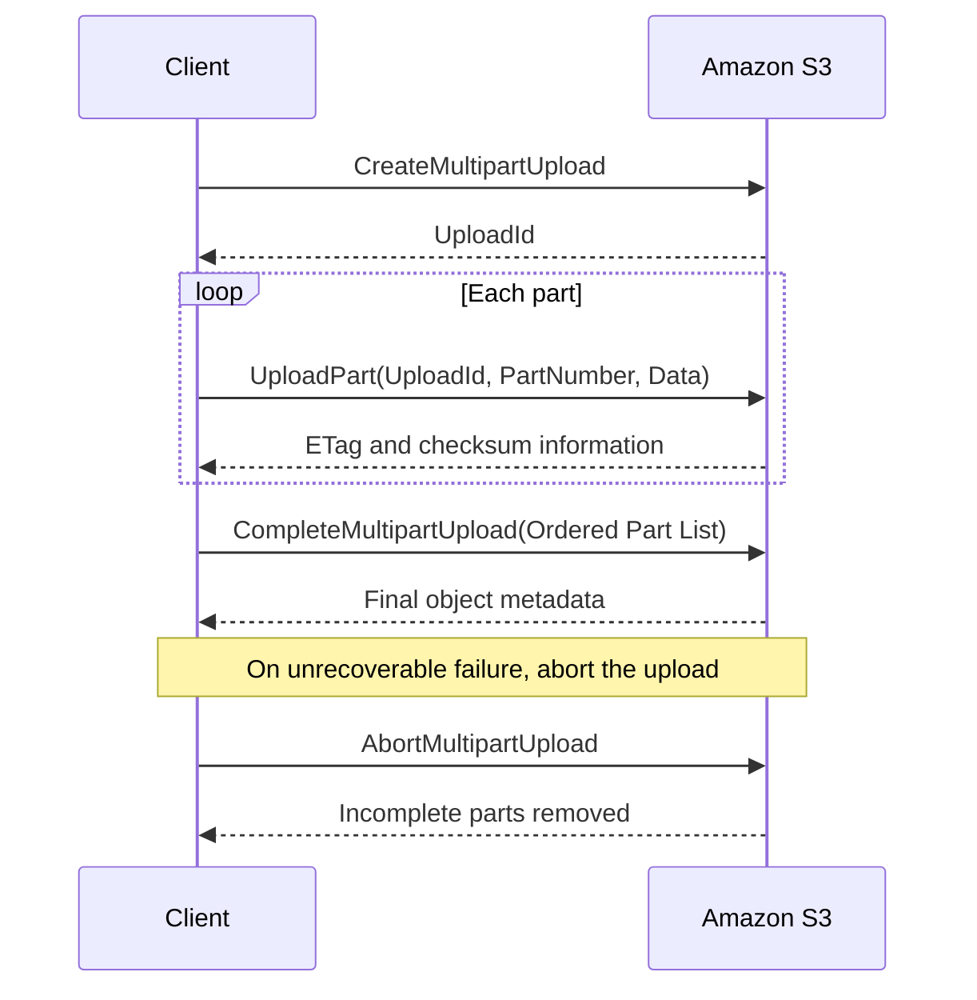
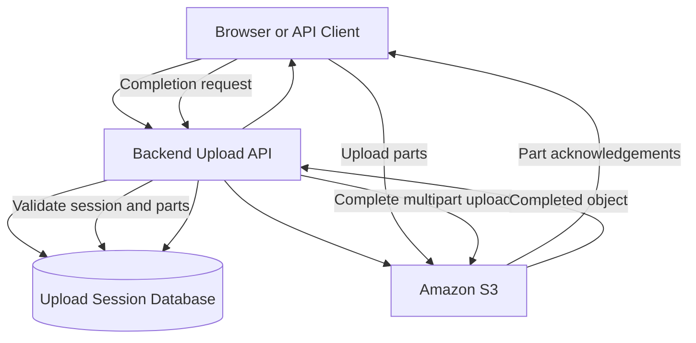
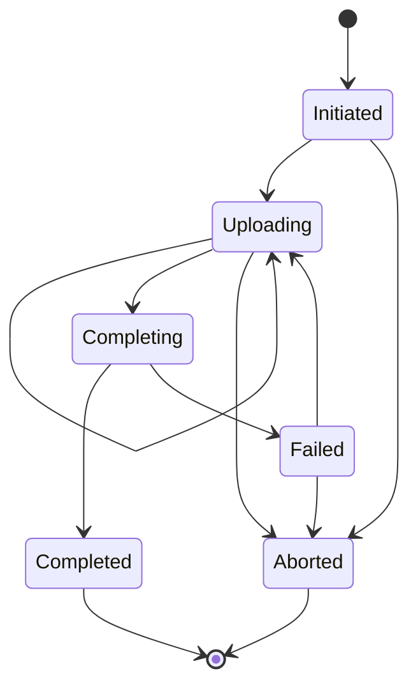

# 01- Multipart Upload Fundamentals

## Overview

Amazon S3 multipart upload allows a single object to be uploaded as multiple independent parts and assembled into one object after all required parts have been uploaded successfully.

It is designed for large files, unreliable networks, high-throughput transfers, and workloads that benefit from parallel uploads. Instead of restarting an entire upload when a connection fails, a client can retry only the unsuccessful parts.

For backend engineering systems, multipart upload is particularly useful for large media files, document archives, data lake ingestion, database exports, backup artifacts, and direct browser-to-S3 uploads.

Amazon S3 recommends considering multipart upload when an object reaches approximately 100 MB. The appropriate threshold depends on network conditions, client capabilities, file sizes, and workload requirements.

## How Multipart Upload Works

### Upload lifecycle

A multipart upload has three primary phases:

1. **Initiate:** Create a multipart upload and receive an upload ID.
2. **Upload parts:** Divide the object into parts and upload each part using its part number and upload ID.
3. **Complete:** Submit the uploaded parts in the required order so S3 assembles the final object.

If the upload cannot be completed, abort it to remove the uploaded parts and stop incurring storage charges for them.



The upload ID identifies a particular multipart upload session for an object key. It must be included in subsequent part-upload, completion, listing, and abort operations as applicable.

Uploading parts does not create the completed object. The object becomes available as the completed object after a successful completion operation.

### Understand part numbers and ordering

Each uploaded part is identified by a part number between 1 and 10,000.

Parts can be uploaded independently and in any order. S3 assembles them in ascending part-number order during completion.

For example, an object may be divided into four parts:

| Part number | Data range | Illustrative size |
|---|---|---:|
| 1 | Initial bytes | 64 MiB |
| 2 | Next bytes | 64 MiB |
| 3 | Next bytes | 64 MiB |
| 4 | Remaining bytes | 18 MiB |

The example represents a 210 MiB object.

The client must retain the part numbers and corresponding ETags or other required completion information. If a part is uploaded again using the same part number and upload ID, the newer upload replaces the previously uploaded part for that number.

Use stable part-number assignments so retries can target the correct portion of the source file.

## Multipart Upload Limits

The following limits apply to S3 multipart uploads for general purpose buckets.

| Property | Limit or requirement |
|---|---|
| Maximum object size | 48.8 TiB |
| Maximum parts per upload | 10,000 |
| Valid part numbers | 1–10,000 |
| Minimum part size | 5 MiB, except for the final part |
| Maximum part size | 5 GiB |
| Maximum parts returned by one `ListParts` API response | 1,000 |
| Maximum multipart uploads returned by one `ListMultipartUploads` API response | 1,000 |
| Minimum size for the final part | No minimum |

Source: [Amazon S3 multipart upload limits](https://docs.aws.amazon.com/AmazonS3/latest/userguide/qfacts.html).

### Calculate part size before uploading

The part size must satisfy both the minimum and maximum part-size requirements and the 10,000-part limit.

A useful planning formula is:

\[
\text{Part count} =
\left\lceil
\frac{\text{Object size}}{\text{Part size}}
\right\rceil
\]

For the planned maximum object size, choose a part size that keeps the total part count at or below 10,000.

For example, a 100 GiB file using 64 MiB parts requires approximately 1,600 parts. A much larger object may require larger parts to remain within the part-count limit.

Do not use a fixed chunk size without considering the largest supported object in the workload.

### Choose a practical part size

| Workload | Initial tuning approach |
|---|---|
| Medium-sized files | Use a conservative threshold and moderate part size |
| Large files over a stable network | Increase part size and use measured concurrency |
| Large files over unreliable networks | Use retryable parts without making each part unnecessarily large |
| Very large archives | Calculate the maximum possible part count before upload |
| Memory-constrained containers | Limit concurrent parts and account for buffers and SDK overhead |
| High-throughput ingestion workers | Benchmark part size, concurrency, CPU, memory, and network capacity |

Larger parts reduce the number of requests but increase the amount of data retransmitted when an individual part must be retried. Smaller parts improve retry granularity but increase request count and scheduling overhead.

The optimal configuration should be measured rather than assumed.

## Use the Appropriate Upload Interface

### Prefer managed SDK transfers for standard applications

AWS SDKs manage much of the multipart transfer process, including selecting multipart upload when appropriate, coordinating part requests, and retrying eligible failures.

In Python, Boto3 provides `upload_file()` and `upload_fileobj()` for managed transfers.

These methods are appropriate when the application needs to upload a local file or file-like object without implementing the multipart state machine itself.

```python
import boto3
from boto3.s3.transfer import TransferConfig

MiB = 1024 * 1024

s3_client = boto3.client("s3")

transfer_config = TransferConfig(
    multipart_threshold=64 * MiB,
    multipart_chunksize=64 * MiB,
    max_concurrency=4,
    use_threads=True,
)

def upload_file_to_s3(
    file_path: str,
    bucket: str,
    object_key: str,
) -> None:
    s3_client.upload_file(
        Filename=file_path,
        Bucket=bucket,
        Key=object_key,
        ExtraArgs={
            "ContentType": "application/octet-stream",
        },
        Config=transfer_config,
    )
```

The configuration uses 64 MiB as an illustrative multipart threshold and part size, with up to four concurrent transfer requests. Tune these values for your workload.

The example assumes the application has already validated the source file, selected an authorized object key, and configured AWS credentials.

The SDK may use multiple worker threads for transfers. Higher concurrency can improve throughput when the network and CPU can sustain it, but it also increases resource consumption.

Reference: [Boto3 S3 transfer configuration](https://docs.aws.amazon.com/boto3/latest/guide/s3.html).

### Use the low-level multipart API when explicit control is required

Low-level operations are useful when the application needs to manage upload sessions, expose resumable uploads, issue presigned URLs for individual parts, track progress, or integrate upload state with a database.

The principal operations are:

| API operation | Responsibility |
|---|---|
| `CreateMultipartUpload` | Initiates the upload and returns an upload ID |
| `UploadPart` | Uploads one part |
| `ListParts` | Lists parts uploaded for a particular session |
| `CompleteMultipartUpload` | Assembles the uploaded parts into the final object |
| `AbortMultipartUpload` | Cancels a session and removes its incomplete parts |
| `ListMultipartUploads` | Lists in-progress multipart uploads |

The application must retain the upload ID and the part information required for completion. A production implementation should also handle pagination, retries, session expiration, authorization, and cleanup.

Reference: [Uploading objects using multipart upload](https://docs.aws.amazon.com/AmazonS3/latest/userguide/mpuoverview.html).

## Use Multipart Upload with the AWS CLI

For many operational workflows, the high-level AWS CLI is sufficient. It automatically selects multipart upload for files that meet its configured multipart threshold.

```bash
aws s3 cp ./large-archive.tar.gz \
  "s3://${BUCKET}/archives/large-archive.tar.gz"
```

Inspect the CLI transfer configuration:

```bash
aws configure get default.s3.multipart_threshold
aws configure get default.s3.multipart_chunksize
aws configure get default.s3.max_concurrent_requests
```

Configure concurrency deliberately when required:

```bash
aws configure set default.s3.max_concurrent_requests 8
```

The value applies to the selected AWS CLI configuration profile. It is an example rather than a universal production setting.

For routine uploads, prefer `aws s3 cp` or `aws s3 sync` unless you specifically need low-level control over the multipart lifecycle.

## Build a Resumable Upload Architecture

### Separate upload state from file storage

A resumable upload requires more than S3's upload ID. The application must remember which logical upload the session belongs to, the expected object key, ownership, expiration, and relevant completion information.

A typical backend architecture uses an API service, a database, and Amazon S3.



The backend should manage authorization and session state even when the client uploads parts directly to S3.

A session record may include:

| Field | Purpose |
|---|---|
| `upload_id` | S3 multipart upload identifier |
| `bucket` | Target bucket |
| `object_key` | Server-approved object key |
| `owner_id` | User or tenant that owns the session |
| `status` | Session lifecycle state |
| `expected_size` | Expected total object size, when known |
| `part_size` | Planned chunk size |
| `created_at` | Session creation timestamp |
| `expires_at` | Application-level session expiration |
| `completed_at` | Completion timestamp, where applicable |

Avoid storing sensitive presigned URLs as long-lived database values. Generate them when needed, restrict their expiry, and authorize every operation against the upload session.

### Model upload states explicitly

A practical lifecycle can use the following states:



The state machine is application-managed; S3 does not automatically maintain the complete business state represented here.

Important design rules:

- Permit only authorized operations on a session.
- Make completion idempotent at the application level.
- Prevent two concurrent completion attempts from corrupting business state.
- Treat network timeouts as potentially ambiguous outcomes.
- Reconcile S3 state with application state when a response is lost.
- Expire abandoned sessions and clean up incomplete data.

A retry after a timeout should not automatically create another logical upload or overwrite an unrelated object.

## Support Direct Browser-to-S3 Multipart Uploads

### Keep large file data out of the application server

For large browser uploads, sending every byte through a Django or FastAPI worker can consume application bandwidth, memory, connection slots, and processing capacity.

A direct-upload design lets the backend authorize the upload and then allows the browser to send the parts directly to S3 using presigned URLs.

The flow is:

1. The client requests an upload session.
2. The backend authenticates and authorizes the user.
3. The backend creates the S3 multipart upload and stores session state.
4. The backend issues narrowly scoped presigned URLs for the permitted parts.
5. The client uploads parts directly to S3.
6. The client returns completion details to the backend.
7. The backend validates the session and completes the upload.
8. The backend verifies the resulting object and updates application state.

Presigned URLs are bearer capabilities. A URL holder may use it for the signed operation until the URL or its underlying credentials cease to be valid.

Never allow the client to freely choose arbitrary bucket names, object keys, or upload IDs.

### Configure browser CORS correctly

If browser JavaScript needs to read response headers such as `ETag`, configure the bucket's CORS rules to expose the required response headers to the approved application origin.

CORS is a browser access mechanism, not an authorization mechanism. It does not replace IAM policies, bucket policies, or presigned URL restrictions.

Reference: [Amazon S3 CORS configuration](https://docs.aws.amazon.com/AmazonS3/latest/userguide/cors.html).

## Handle Retries and Partial Failures

### Retry individual parts

A failed part does not normally require restarting the entire object upload. Retry the affected part using the same upload ID and part number when the source bytes are unchanged.

The retry policy should:
- Retry transient network failures and retryable service errors.
- Use exponential backoff with jitter where application-level retries are needed.
- Limit retry attempts.
- Avoid retrying permanent validation or authorization errors indefinitely.
- Persist enough information to resume safely.
- Respect the SDK's own retry behavior to prevent excessive nested retries.

If a part is uploaded again with the same part number, the latest successful version is used for completion.

### Handle completion failures carefully

Completion is a separate operation from uploading individual parts. Even after every part succeeds, the final object does not exist as the completed object until S3 successfully processes the completion request.

A network timeout during completion creates uncertainty: the server may have completed the object even though the client did not receive the response.

A robust application should:
1. Record that completion was requested.
2. Attempt completion with the correct ordered part list.
3. If the outcome is ambiguous, inspect the upload and destination object state before retrying.
4. Avoid blindly starting a new upload.
5. Verify the expected object identity and size before marking the application record completed.
6. Reconcile orphaned sessions and objects through a recovery process.

Do not assume that repeating every multipart API call without checking state is always safe.

## Verify Object Integrity

### Retain part-level completion data

`UploadPart` responses contain an ETag and may include checksum information. The completion request must contain the required part identifiers and ETags for the uploaded parts, in ascending part-number order.

For stronger integrity verification, use supported S3 checksum algorithms and verify the checksum information that corresponds to the chosen upload method.

**Do not treat a multipart object's ETag as a guaranteed MD5 checksum of the complete file.** Multipart ETags commonly have a different format and should not be used as a universal content-integrity check.

### Validate the completed object

After completion, inspect the destination object:

```bash
aws s3api head-object \
  --bucket "$BUCKET" \
  --key "$OBJECT_KEY"
```

Validate the expected content length and, when available and applicable, the checksum fields.

For workflows where the application must establish end-to-end byte integrity, calculate a checksum from the source and compare it with a compatible S3 checksum or another trusted integrity record. Ensure both values use the same algorithm and checksum semantics.

Reference: [Checking object integrity in Amazon S3](https://docs.aws.amazon.com/AmazonS3/latest/userguide/checking-object-integrity.html).

## Secure Multipart Uploads

Multipart uploads should use the same access-control and data-protection standards as ordinary object uploads.

- Use IAM roles and temporary credentials rather than hardcoded access keys.
- Grant only the permissions needed for the intended object prefixes.
- Use private buckets and appropriate default encryption.
- Generate object keys on the server instead of trusting arbitrary client-supplied paths.
- Bind each session to an authenticated user or tenant.
- Restrict presigned URLs by operation, object key, part number, and expiry where applicable.
- Validate expected file size and content type.
- Do not trust a client-provided filename or MIME type as proof of content safety.
- Enforce business-level ownership checks before completion or download.
- Avoid logging presigned URLs or other bearer tokens.
- Verify required S3 and KMS permissions when SSE-KMS is used.

Multipart upload metadata, including relevant content headers and encryption configuration, is supplied during initiation. Configure it deliberately; do not assume that setting metadata in an unrelated later operation will produce the intended result.

Reference: [Multipart upload API operations and permissions](https://docs.aws.amazon.com/AmazonS3/latest/userguide/mpuoverview.html).

## Clean Up Incomplete Multipart Uploads

### Understand abandoned upload costs

S3 stores uploaded parts until the multipart upload is completed or aborted. The incomplete parts incur storage charges even though the final object has not been created.

Common causes include:
- A client closing its browser during an upload.
- A mobile device losing connectivity.
- A backend process crashing after initiation.
- A completion request failing permanently.
- An upload session being abandoned after authorization expires.

Build cleanup into both the application workflow and the bucket configuration.

### Abort a known upload

When the application identifies an abandoned session, it can abort the upload:

```bash
aws s3api abort-multipart-upload \
  --bucket "$BUCKET" \
  --key "$OBJECT_KEY" \
  --upload-id "$UPLOAD_ID"
```

The upload ID must belong to the specified object key and bucket. Use this operation only when the session should not be resumed.

### Configure lifecycle cleanup

S3 Lifecycle can automatically abort incomplete multipart uploads after a configured number of days.

For example, a lifecycle rule can remove incomplete multipart uploads that have been pending for seven days:

```json
{
  "Rules": [
    {
      "ID": "AbortIncompleteMultipartUploads",
      "Status": "Enabled",
      "Filter": {
        "Prefix": ""
      },
      "AbortIncompleteMultipartUpload": {
        "DaysAfterInitiation": 7
      }
    }
  ]
}
```

This is an illustrative lifecycle configuration. Before applying it, inspect the existing bucket lifecycle configuration and merge this rule with the existing rules. Replacing the configuration with this example alone can unintentionally remove other lifecycle policies.

Application-level cleanup is still useful because it can update database state and report why a session was abandoned.

Reference: [Aborting incomplete multipart uploads with S3 Lifecycle](https://docs.aws.amazon.com/AmazonS3/latest/userguide/mpu-abort-incomplete-mpu-lifecycle-config.html).

## Monitor Multipart Upload Performance

Measure transfer behavior rather than increasing part size or concurrency indiscriminately.

Useful application metrics include:
- Upload initiation and completion counts.
- Success and failure rates.
- Bytes uploaded and average transfer throughput.
- Retry counts and failed part numbers.
- Completion latency.
- Incomplete upload count and age.
- Cleanup and abort counts.
- Time spent waiting for client-side parts.
- Storage and request costs attributable to the workflow.

For managed Boto3 transfers, monitor application worker memory and active transfer threads alongside S3 request behavior. For direct browser uploads, distinguish client-side network delays from backend authorization and completion latency.

An unexpectedly high number of incomplete uploads usually indicates an application lifecycle, client reliability, or cleanup issue rather than a reason to increase concurrency.

## Common Multipart Upload Mistakes

| Mistake | Consequence | Better practice |
|---|---|---|
| Using multipart upload for every small file | Extra requests and coordination overhead | Set a sensible multipart threshold |
| Choosing a fixed part size without considering object size | Uploads can exceed the 10,000-part limit | Calculate the maximum part count in advance |
| Increasing concurrency without resource analysis | Memory, CPU, and network contention | Benchmark with realistic file sizes |
| Treating an ETag as the complete file's MD5 | Incorrect integrity conclusions | Use compatible checksum mechanisms |
| Losing the upload ID | The client cannot continue or complete the intended session | Persist session state durably |
| Forgetting the completion step | No completed object is created | Track and reconcile completion state |
| Never aborting abandoned uploads | Incomplete parts continue incurring charges | Implement application cleanup and lifecycle rules |
| Trusting client-supplied object keys | Unauthorized writes or cross-tenant data exposure | Generate keys server-side and validate ownership |
| Retrying a completion request blindly | Confusing or duplicating application-level operations | Reconcile ambiguous outcomes before retrying |
| Using presigned URLs as a replacement for authorization | URL holders can exercise the signed capability | Restrict and issue URLs only after authorization |

## Production Readiness Checklist

- [ ] The multipart threshold and part size are appropriate for the workload.
- [ ] The maximum object size and 10,000-part limit are accounted for.
- [ ] The system can retry individual parts safely.
- [ ] Upload IDs and session ownership are persisted securely.
- [ ] Completion is validated, tracked, and reconciled after ambiguous failures.
- [ ] Required part ETags and checksum data are retained.
- [ ] Object integrity is verified using compatible checksum information.
- [ ] Concurrency is bounded according to memory, CPU, and network capacity.
- [ ] Direct uploads use short-lived, narrowly scoped presigned URLs.
- [ ] Bucket access, encryption, and tenant isolation are enforced.
- [ ] Abandoned sessions are aborted or removed by lifecycle cleanup.
- [ ] Monitoring covers failures, retries, completion latency, and incomplete uploads.
- [ ] Existing lifecycle rules are preserved when cleanup configuration changes.
- [ ] Large-file uploads and recovery scenarios are covered by automated tests.

## Authoritative References

- [Multipart upload overview](https://docs.aws.amazon.com/AmazonS3/latest/userguide/mpuoverview.html)
- [Multipart upload limits](https://docs.aws.amazon.com/AmazonS3/latest/userguide/qfacts.html)
- [Uploading an object using multipart upload](https://docs.aws.amazon.com/AmazonS3/latest/userguide/mpu-upload-object.html)
- [UploadPart API](https://docs.aws.amazon.com/AmazonS3/latest/API/API_UploadPart.html)
- [Boto3 S3 transfer configuration](https://docs.aws.amazon.com/boto3/latest/guide/s3.html)
- [AWS CLI S3 transfer configuration](https://docs.aws.amazon.com/cli/latest/topic/s3-config.html)
- [Checking S3 object integrity](https://docs.aws.amazon.com/AmazonS3/latest/userguide/checking-object-integrity.html)
- [Aborting incomplete uploads with Lifecycle](https://docs.aws.amazon.com/AmazonS3/latest/userguide/mpu-abort-incomplete-mpu-lifecycle-config.html)
- [Amazon S3 CORS configuration](https://docs.aws.amazon.com/AmazonS3/latest/userguide/cors.html)

## Key Takeaways

- Multipart upload divides a large object into independently uploaded parts and creates the final object only after successful completion.
- Choose part size and concurrency according to the maximum object size, retry behavior, throughput needs, and resource constraints.
- Persist upload-session state, retain the required part information, and make completion and recovery robust against ambiguous failures.
- Use compatible checksum mechanisms for integrity verification rather than assuming a multipart ETag is the file's MD5.
- Abort abandoned sessions and configure lifecycle cleanup to prevent incomplete multipart parts from accumulating storage charges.