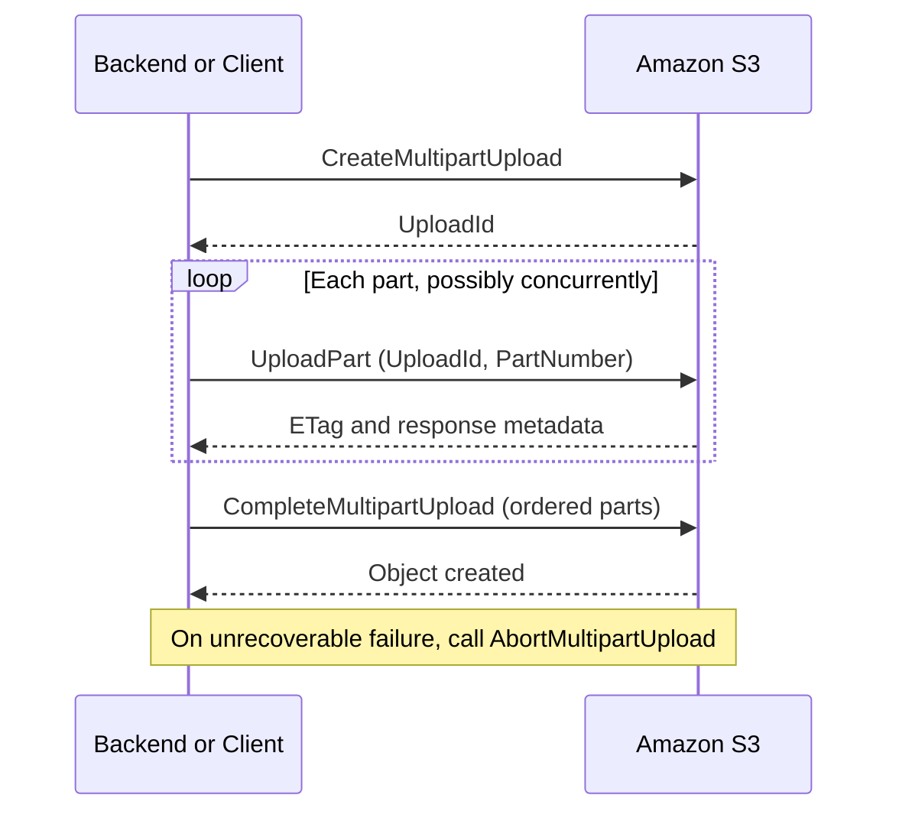
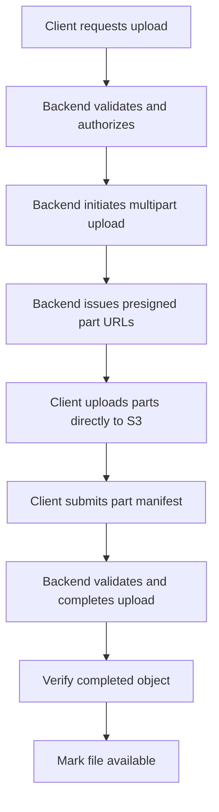

# 02- Multipart Upload Configuration and Limits

## Overview

Amazon S3 Multipart Upload allows an application to upload a single object as multiple independent parts. S3 assembles the uploaded parts into the final object when the application completes the multipart upload.

Multipart uploads are valuable for large files, unreliable networks, high-throughput data ingestion, media processing, and backend systems that need parallel transfers or resumable upload workflows.

Instead of restarting an entire upload after a network failure, a client can retry only the failed part. Independent parts can also be uploaded concurrently, improving throughput when network bandwidth and available client resources support parallel transfers.

Multipart Upload introduces additional responsibilities: part sizing, concurrency control, upload-state management, completion validation, checksum verification, retries, and cleanup of abandoned uploads.

## Multipart Upload Lifecycle

A multipart upload follows three primary stages:

1. **Initiate:** Create a multipart upload and obtain an upload ID.
2. **Upload parts:** Transfer individual parts, each identified by a part number.
3. **Complete:** Submit the uploaded part numbers and corresponding ETags or checksum information so S3 can assemble the final object.

If the upload cannot be completed, the application should abort it to release resources associated with the uploaded parts.



Each part represents a contiguous portion of the original object. Parts can be uploaded independently and in any order, provided their part numbers are unique within the upload.

The final object becomes available as a completed object only after successful completion. Uploaded parts from an incomplete upload are not a substitute for a completed object.

## Multipart Upload Limits

### Core service limits

The following limits apply to Amazon S3 general-purpose bucket multipart uploads.

| Parameter | Limit | Engineering implication |
|---|---:|---|
| Maximum object size | 50 TB | Objects above 5 TB require multipart upload through a supported transfer implementation |
| Maximum number of parts per upload | 10,000 | Part size must be large enough to stay within the part-count limit |
| Valid part numbers | 1–10,000 | Use unique part numbers and retain the upload manifest |
| Minimum part size | 5 MiB | All parts except the final part must meet the minimum |
| Maximum part size | 5 GiB | Individual parts cannot exceed this limit |
| Final part size | No minimum | The last part can be smaller than 5 MiB |
| Maximum parts returned by one ListParts response | 1,000 | Paginate when inspecting uploads containing more than 1,000 parts |
| Maximum multipart uploads returned by one listing response | 1,000 | Paginate when listing uploads at scale |
| Maximum size for a single PutObject operation | 5 GB | Use multipart upload for larger objects |

The 50 TB maximum object size was introduced in December 2025. It supersedes the older 5 TB maximum object-size limit. AWS documents the multipart limits in the [S3 Multipart Upload Limits reference](https://docs.aws.amazon.com/AmazonS3/latest/userguide/qfacts.html).

### Understand the part-count constraint

The most important configuration constraint is that the upload cannot exceed 10,000 parts.

For an object of size \(S\) bytes and a selected part size \(P\) bytes:

\[
N = \left\lceil \frac{S}{P} \right\rceil
\]

The configuration must satisfy:

\[
N \leq 10{,}000
\]

The selected part size must also satisfy:

\[
5\text{ MiB} \leq P \leq 5\text{ GiB}
\]

The minimum size restriction does not apply to the final part.

For a 100 GB object, a 64 MiB part size produces approximately 1,600 parts. For a 50 TB object, that configuration would exceed the permitted part count, so a substantially larger part size is necessary.

**Best practice:** Calculate or verify the effective part size for the maximum supported object size. Do not assume that one fixed small part size works for every upload.

## Choose an Appropriate Part Size

Part size affects throughput, memory consumption, retry cost, request count, and the maximum object size supported by the uploader.

| Part-size strategy | Advantages | Trade-offs |
|---|---|---|
| Smaller parts | Finer-grained retries and potentially less data retransmitted per failure | More requests, scheduling overhead, and part-count pressure |
| Larger parts | Fewer requests and support for larger objects | More data may need retransmission after a failed part; larger buffers may be required |
| Adaptive part size | Can accommodate varying file sizes and avoid the 10,000-part limit | Requires configuration logic and testing |
| Fixed part size | Simple and predictable for a known workload | Can be unsuitable for objects much larger than the expected size |

There is no universally optimal part size. Begin with a measured baseline, then tune it using representative file sizes and network conditions.

For ordinary large-file workloads, 64 MiB is a reasonable starting point for benchmarking, not a universal production default. Very large objects require a part size calculated from the maximum expected object size.

### Calculate a safe part size

The following Python utility calculates a part size suitable for the multipart constraints, using a 64 MiB baseline and MiB alignment.

```python
import math

MIB = 1024**2
GIB = 1024**3
MAX_PARTS = 10_000
MAX_PART_SIZE = 5 * GIB
MAX_OBJECT_SIZE = 50 * 1000**4  # 50 TB in decimal bytes


def calculate_part_size(file_size: int) -> int:
    """Calculate a multipart part size compatible with S3 limits."""
    if file_size <= 0:
        raise ValueError("File size must be positive.")

    if file_size > MAX_OBJECT_SIZE:
        raise ValueError("File exceeds the S3 maximum object size of 50 TB.")

    required_size = math.ceil(file_size / MAX_PARTS)
    aligned_size = math.ceil(required_size / MIB) * MIB

    part_size = max(64 * MIB, aligned_size)

    if part_size > MAX_PART_SIZE:
        raise ValueError("Calculated part size exceeds the S3 part-size limit.")

    return part_size


def calculate_part_count(file_size: int, part_size: int) -> int:
    return math.ceil(file_size / part_size)


if __name__ == "__main__":
    file_size = 100 * 1000**3  # 100 GB

    part_size = calculate_part_size(file_size)
    part_count = calculate_part_count(file_size, part_size)

    print(f"Part size: {part_size / MIB:.0f} MiB")
    print(f"Expected part count: {part_count}")
```

The calculated size is a starting value for transfer configuration. Verify that the selected SDK or transfer manager honors the configured part size and supports the intended object size.

## Configure Multipart Upload with Boto3

Boto3 provides managed transfers through `upload_file()`. The transfer manager chooses between a single-request upload and multipart upload based on the configured threshold.

Use the managed transfer interface when the application needs large-file support without implementing the entire multipart lifecycle manually.

### Example: Large-file upload with bounded concurrency

```python
import math
import os

import boto3
from boto3.s3.transfer import TransferConfig

MIB = 1024**2

bucket = os.environ["S3_BUCKET"]
region = os.environ.get("AWS_REGION", "ap-south-1")

file_path = "/data/export.parquet"
object_key = "exports/export.parquet"

file_size = os.path.getsize(file_path)

if file_size <= 0:
    raise ValueError("Cannot upload an empty file.")

config = TransferConfig(
    multipart_threshold=100 * MIB,
    multipart_chunksize=64 * MIB,
    max_concurrency=8,
    use_threads=True,
)

s3_client = boto3.client("s3", region_name=region)

s3_client.upload_file(
    Filename=file_path,
    Bucket=bucket,
    Key=object_key,
    Config=config,
)

print(f"Uploaded {file_path} to s3://{bucket}/{object_key}")
```

This example demonstrates conventional managed multipart transfers. Its fixed 64 MiB part size is intended for ordinary large files, not the full 50 TB object-size boundary. Adjust the part size for the maximum supported input size and verify the capabilities of the deployed SDK and transfer implementation.

For objects larger than 5 TB, use a current, supported implementation of S3 Transfer Manager or AWS Common Runtime (CRT) that supports the large-object workflow. Review the [AWS announcement on 50 TB S3 objects](https://aws.amazon.com/about-aws/whats-new/2025/12/amazon-s3-maximum-object-size-50-tb/) before choosing an implementation.

### Configure the upload threshold

`multipart_threshold` determines the file size above which the managed transfer uses multipart upload.

A low threshold can introduce extra request overhead for small files. A high threshold can prevent the benefits of parallel transfer from being applied early enough.

Tune the threshold based on file-size distribution, network reliability, and workload latency requirements.

### Bound concurrency

`max_concurrency` controls the maximum number of transfer requests the managed uploader can execute concurrently for a transfer.

Increasing concurrency can improve throughput when the connection and network can sustain more parallel requests. It can also increase memory usage, file I/O pressure, socket usage, and contention.

When multiple uploads run concurrently, consider both per-upload concurrency and aggregate process concurrency. Eight concurrent parts per upload across twenty simultaneous uploads can result in substantial aggregate transfer activity.

Avoid increasing concurrency solely to maximize throughput in a single test. Benchmark under realistic application load and monitor memory, CPU, network utilization, and error rates.

## Configure Multipart Upload in the AWS CLI

The AWS CLI high-level transfer commands manage multipart transfers automatically.

Example:

```bash
aws s3 cp \
  ./large-dataset.parquet \
  "s3://${BUCKET}/datasets/large-dataset.parquet"
```

You can tune the CLI's S3 transfer configuration in the AWS CLI config file.

```ini
[profile production]
region = ap-south-1

s3 =
    multipart_threshold = 100MB
    multipart_chunksize = 64MB
    max_concurrent_requests = 10
    max_queue_size = 1000
```

The values are a starting configuration. Ensure that the chunk size is large enough for the largest file the transfer implementation must handle without exceeding 10,000 parts.

The main settings are:

| Setting | Purpose | Consideration |
|---|---|---|
| `multipart_threshold` | Determines when a transfer becomes multipart | Tune to the expected file-size distribution |
| `multipart_chunksize` | Sets the nominal multipart chunk size | Must satisfy part-size and total-part constraints |
| `max_concurrent_requests` | Bounds concurrent transfer requests | Higher values increase resource utilization |
| `max_queue_size` | Controls the transfer task queue | Larger queues can increase buffering and scheduling overhead |

Reference: [AWS CLI S3 configuration](https://docs.aws.amazon.com/cli/latest/topic/s3-config.html).

For very large objects, verify the behavior of the installed CLI version and the active transfer implementation. Do not assume that a configuration suitable for 100 GB files will support a 50 TB object without further adjustment.

## Understand the Low-Level Multipart API

Managed transfers are convenient, but low-level multipart operations are appropriate when the application needs explicit control over upload state, part retries, resumability, or presigned URLs.

The primary operations are:

| Operation | Purpose |
|---|---|
| `CreateMultipartUpload` | Initiates an upload and returns an upload ID |
| `UploadPart` | Uploads one part using the upload ID and a part number |
| `ListParts` | Retrieves uploaded-part information for an upload |
| `CompleteMultipartUpload` | Assembles the final object |
| `AbortMultipartUpload` | Stops an incomplete upload and releases associated part storage |
| `ListMultipartUploads` | Lists in-progress multipart uploads |

The upload ID identifies one multipart upload. Persist it if the application needs to resume or recover the upload after a process restart.

### Maintain an upload manifest

For each upload, maintain enough state to recover safely:

- Upload ID, bucket, and object key.
- Expected object size and part-size configuration.
- Uploaded part numbers and their ETags or checksum information.
- Current workflow state.
- Retry count and last failure details.
- Owner or tenant identity, where applicable.
- Creation time and expiration or cleanup state.

Persist this state durably when resumability is required. An in-memory list is insufficient if a worker can restart or the client reconnects through another application instance.

### Upload parts independently

A failed `UploadPart` request can generally be retried without re-uploading other successful parts.

Use bounded retries with exponential backoff and jitter for transient failures. Treat authorization failures, invalid part configuration, and expired credentials differently from temporary network errors.

The completion request must include the required part identifiers and returned ETags or checksum information in the correct sequence. If completion fails, inspect the upload state before retrying or starting another upload.

Use `ListParts` to reconcile server-side state after an ambiguous response. A successful upload-part request might have reached S3 even when the client did not receive the response.

When listing parts, handle pagination because an individual response returns at most 1,000 parts.

Reference: [Uploading objects using multipart upload](https://docs.aws.amazon.com/AmazonS3/latest/userguide/mpu-upload-object.html).

## Support Direct Client-to-S3 Multipart Uploads

For large browser or mobile uploads, uploading directly to S3 can reduce application-server bandwidth and memory pressure.

A typical design is:

1. The client requests an upload session from the backend.
2. The backend authorizes the request and initiates the multipart upload.
3. The backend returns a controlled set of presigned part-upload URLs.
4. The client uploads the parts directly to S3, possibly concurrently.
5. The client reports the uploaded part information to the backend.
6. The backend validates the submitted manifest and completes the upload.
7. The application verifies the completed object before marking it available.



### Security and validation requirements

- Never trust the client to choose an arbitrary bucket, object key, or tenant identity.
- Scope presigned URLs to the intended bucket, key, upload ID, part number, and expiration.
- Enforce maximum permitted file sizes and upload counts at the application level.
- Keep upload IDs and manifests associated with the authorized application record.
- Validate actual object size and any required checksums after completion.
- Keep uploaded objects private until validation succeeds.
- Abort abandoned uploads and expire upload-session records.
- Avoid treating the declared content type or original filename as proof that the uploaded content is safe.

A presigned URL grants a limited capability to whoever possesses it. Protect it accordingly, and do not expose it in application logs, analytics, or error messages.

## Verify Data Integrity

Multipart uploads should use appropriate checksum validation when data integrity is important.

Amazon S3 supports checksum mechanisms for multipart uploads. Where possible, use an SDK-supported checksum algorithm and let S3 validate the transferred data. Persist the relevant checksum information when the application needs later integrity verification.

### Do not interpret multipart ETags as full-object MD5 hashes

For multipart uploads, the final object ETag is not necessarily an MD5 digest of the full object. Therefore, comparing a local full-file MD5 hash directly with the ETag is not a reliable general-purpose integrity check.

Use the checksum features supported by the chosen API and transfer implementation. Where checksums are persisted, record the algorithm and whether the value represents a full-object checksum or a composite checksum.

Reference: [Checking object integrity during upload](https://docs.aws.amazon.com/AmazonS3/latest/userguide/checking-object-integrity-upload.html).

## Recover from Failed and Incomplete Uploads

### Classify failures before retrying

| Failure | Recommended response |
|---|---|
| Temporary network interruption | Retry the failed part with bounded exponential backoff and jitter |
| Transient service response | Retry according to the AWS SDK retry configuration and error classification |
| Expired credentials | Refresh credentials and retry only after confirming authorization |
| Invalid part number or size | Correct the upload configuration rather than retrying unchanged |
| Unknown upload ID | Reconcile application state and verify that the upload still exists |
| Completion timeout or ambiguous response | Inspect object and upload state before attempting further actions |
| Client disconnect | Preserve upload state when resumability is required, or abort when the session is abandoned |
| Unrecoverable validation error | Stop completion, record the failure, and abort the upload if appropriate |

Retries should be limited and observable. Infinite retries can consume request capacity and delay failure handling.

### Abort abandoned uploads

Multipart upload parts can incur storage charges while the upload remains incomplete. Configure automatic cleanup in addition to explicit application cleanup.

The following lifecycle configuration aborts incomplete multipart uploads under the `uploads/` prefix after seven days.

```json
{
  "Rules": [
    {
      "ID": "AbortIncompleteMultipartUploads",
      "Status": "Enabled",
      "Filter": {
        "Prefix": "uploads/"
      },
      "AbortIncompleteMultipartUpload": {
        "DaysAfterInitiation": 7
      }
    }
  ]
}
```

Merge this rule with the bucket's existing lifecycle configuration. Do not overwrite unrelated lifecycle rules when applying it.

Verify the configuration after deployment:

```bash
aws s3api get-bucket-lifecycle-configuration \
  --bucket "$BUCKET"
```

S3 object expiration rules do not clean up incomplete multipart uploads. Use the dedicated `AbortIncompleteMultipartUpload` lifecycle action.

Reference: [S3 Lifecycle configuration elements](https://docs.aws.amazon.com/AmazonS3/latest/userguide/intro-lifecycle-rules.html).

### Implement application-level cleanup

Lifecycle cleanup is a safety net, not a replacement for application state management.

A production cleanup workflow should identify abandoned uploads based on the agreed session-expiration policy, verify that they are not active, and abort eligible uploads. Use `ListMultipartUploads` with pagination and maintain an audit record of cleanup failures.

Do not abort uploads solely because they appear old without considering legitimate long-running or resumable transfers. Coordinate cleanup with the application's upload-session state.

## Handle Multipart Upload for Objects Above 5 TB

Amazon S3 now supports objects up to 50 TB, but large-object support depends on more than the bucket itself.

For objects above 5 TB:

- Use multipart upload rather than a single `PutObject`.
- Use an up-to-date, supported transfer implementation with explicit support for large objects.
- Ensure the part size and part count remain within the multipart limits.
- Validate the end-to-end upload, retry, checksum, and completion workflow.
- Plan disk, memory, network, and runtime capacity for the transfer.
- Use concurrent range-based GET requests for downloading objects above the single-GET limit.
- Test the relevant copy, replication, lifecycle, and recovery workflows that depend on the resulting object.

Do not assume that every older SDK, transfer helper, proxy, or application framework can process the full 50 TB boundary.

When copying an existing object larger than 5 GB, use multipart copy with `UploadPartCopy` rather than relying on a single `CopyObject` operation.

References:
- [S3 object upload options](https://docs.aws.amazon.com/AmazonS3/latest/userguide/upload-objects.html)
- [CopyObject API limits](https://docs.aws.amazon.com/AmazonS3/latest/API/API_CopyObject.html)
- [S3 large-object support announcement](https://aws.amazon.com/about-aws/whats-new/2025/12/amazon-s3-maximum-object-size-50-tb/)

## Production Performance and Resource Management

### Estimate memory and aggregate transfer pressure

Multipart upload performance depends on part size, concurrency, network bandwidth, local disk throughput, and the number of simultaneously active transfers.

Larger parts can improve throughput by reducing request overhead, but concurrent large-part transfers increase buffering and resource demand. Exact memory consumption depends on the SDK implementation and buffering strategy.

Before increasing concurrency, measure:

- Process memory and container memory limits.
- CPU utilization and file I/O throughput.
- Network throughput and retransmission rates.
- Active requests and connection utilization.
- Retry counts and upload completion time.
- S3 request costs and failed-transfer rates.

For containerized workloads, set concurrency according to the memory and network budget of the container, not solely the available capacity of the host.

### Use a bounded work queue

When processing many files, do not create an unbounded number of upload tasks. Use bounded queues, worker limits, and backpressure to prevent resource exhaustion.

```text
Incoming jobs
    |
    v
Bounded upload queue
    |
    v
Limited number of file-transfer workers
    |
    v
Bounded per-file part concurrency
    |
    v
Amazon S3
```

Tune both the number of concurrent files and the number of concurrent parts per file. Optimizing only per-file concurrency can overload the application when many users upload simultaneously.

### Make retries idempotent at the workflow level

A retry of a single part is different from a retry of the entire business operation.

Associate each logical upload with a unique application-level identifier and a server-generated object key. Persist upload state and prevent duplicate business records from being created when clients retry session creation or completion requests.

After an ambiguous completion response, inspect the resulting object and application record before creating a new multipart upload. This avoids unnecessary duplicate work and inconsistent metadata.

## Common Multipart Upload Mistakes

| Mistake | Risk | Recommended practice |
|---|---|---|
| Using parts that are too small for very large files | More than 10,000 parts | Size parts for the maximum supported object size |
| Increasing concurrency without measuring resources | Memory pressure, throttling, and unstable throughput | Benchmark under realistic aggregate load |
| Loading the entire file into memory | Excessive memory consumption for large files | Stream from disk or use a transfer manager |
| Retrying every failure indefinitely | Cost, latency, and resource exhaustion | Classify errors and use bounded retries |
| Ignoring incomplete uploads | Unnecessary storage charges | Abort explicitly and configure lifecycle cleanup |
| Assuming the ETag is a full-object MD5 | Incorrect integrity validation | Use supported checksum mechanisms |
| Completing from an unvalidated client manifest | Incorrect or unauthorized uploads | Validate ownership, upload state, and part metadata |
| Using fixed small parts for every object size | Part-count overflow for huge objects | Use size-aware configuration and supported transfer tooling |
| Assuming an upload ID guarantees resumability | Lost progress metadata after a process restart | Persist the upload ID and part manifest durably |
| Assuming a successful part upload means the object exists | Application may publish a file before completion | Publish only after successful completion and validation |
| Using single-request copy for very large objects | Copy operation exceeds its size limit | Use multipart copy with `UploadPartCopy` |

## Production Readiness Checklist

- [ ] The upload implementation supports the maximum required object size.
- [ ] The effective part size and part count comply with S3 limits.
- [ ] Part concurrency and aggregate upload concurrency are bounded.
- [ ] Memory and network utilization are measured under realistic load.
- [ ] The transfer implementation supports the relevant object-size boundary.
- [ ] Transient failures use bounded retries and appropriate backoff.
- [ ] Upload IDs and part manifests are persisted when resumability is required.
- [ ] Completion requests use the required part metadata.
- [ ] Checksum verification does not rely on multipart ETags as full-object MD5 hashes.
- [ ] Ambiguous completion responses are reconciled before restarting an upload.
- [ ] Incomplete uploads are aborted through application cleanup and lifecycle rules.
- [ ] Direct-to-S3 uploads use scoped presigned URLs and server-side authorization.
- [ ] Objects are not published before completion and required validation.
- [ ] Monitoring covers upload duration, throughput, retries, failures, and abandoned uploads.
- [ ] Large-object copy and download workflows use compatible APIs.
- [ ] Integration tests exercise network failures, retry behavior, completion failures, and cleanup.

## Key Takeaways

- Multipart Upload improves the reliability and throughput of large transfers by uploading independent parts and assembling them at completion.
- S3 supports objects up to 50 TB, with a maximum of 10,000 parts, a 5 MiB minimum part size for non-final parts, and a 5 GiB maximum part size.
- Choose part sizes according to the largest supported object, and bound concurrency based on memory, network, and aggregate application load.
- Use durable upload state, bounded retries, checksum verification, and explicit completion handling for reliable production workflows.
- Abort abandoned uploads and configure `AbortIncompleteMultipartUpload` lifecycle rules to control storage costs.