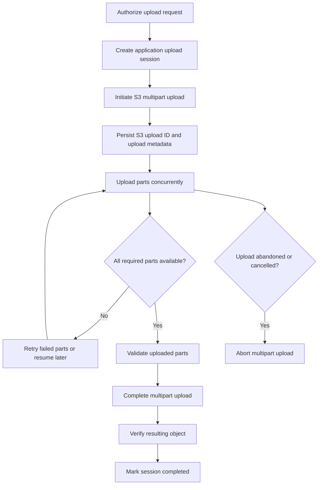
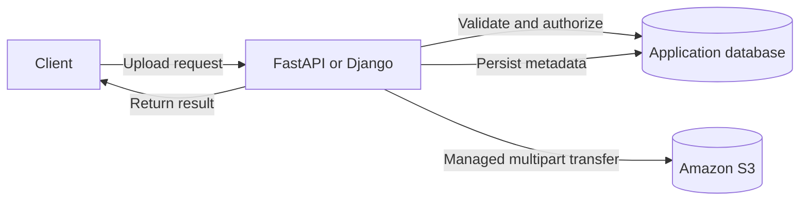
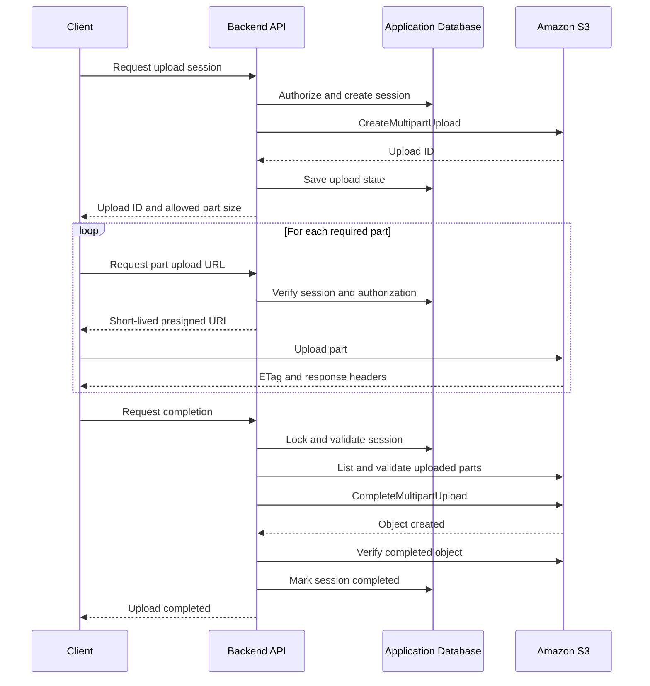

# 03- Resumable and Large-Object Upload Workflows

## Overview

Large-object uploads require different engineering considerations from ordinary file uploads. A single long-running HTTP request is vulnerable to network interruptions, reverse-proxy timeouts, client disconnects, and application resource limits. Retrying the entire upload after a failure can waste bandwidth, increase latency, and generate unnecessary costs.

Amazon S3 multipart upload addresses these problems by splitting an object into independently uploaded parts and assembling the completed object after all required parts have been uploaded.

However, multipart upload alone does not provide a complete application-level resumability mechanism. A production implementation must also persist upload-session state, track progress, authorize every operation, support retries, handle completion failures, and clean up abandoned uploads.

This document covers large-object upload strategies, resumable multipart workflows, direct client-to-S3 transfers, Boto3 managed transfers, validation, concurrency, and operational recovery.

## Understand Multipart Upload

### Why multipart upload exists

Multipart upload divides one logical object into independently transferred parts. Each part has a part number, and S3 stores the uploaded parts until the application completes or aborts the multipart upload.

The principal benefits are:

- **Resumability:** Retry failed parts instead of retransmitting the entire object.
- **Parallelism:** Upload multiple parts concurrently to improve throughput.
- **Reliability:** Recover from temporary connection failures without restarting every successful part.
- **Scalability:** Handle large objects without requiring a single request to remain open for the entire transfer.
- **Flexible processing:** Initiate and manage upload sessions independently of the data-transfer process.

AWS recommends considering multipart upload when an object reaches approximately 100 MB. Smaller files can generally use a normal `PutObject` operation unless the application has a specific reason to use multipart upload.

### Understand the multipart upload lifecycle



The application must distinguish an initiated upload from a completed object. Uploaded parts are not equivalent to a completed S3 object.

### Multipart upload API operations

| Operation | Purpose | Important consideration |
|---|---|---|
| `CreateMultipartUpload` | Starts an upload session and returns an upload ID | Persist the upload ID securely |
| `UploadPart` | Uploads an individual part | A retry using the same part number replaces that part |
| `ListParts` | Retrieves uploaded part information | Results are paginated |
| `CompleteMultipartUpload` | Assembles the specified parts into an object | Part numbers and ETags must match the uploaded parts |
| `AbortMultipartUpload` | Cancels the upload and removes uploaded parts | In-flight requests may require additional cleanup verification |
| `ListMultipartUploads` | Lists multipart uploads that have not been completed or aborted | Useful for operational inspection and cleanup |

The upload ID identifies a particular multipart upload. It should be stored alongside the intended object key and application-level upload-session identifier.

Reference: [Uploading and copying objects using multipart upload](https://docs.aws.amazon.com/AmazonS3/latest/userguide/mpuoverview.html).

## Know the Multipart Upload Limits

Use current AWS service limits when designing chunk sizes and transfer concurrency.

| Property | Documented limit or requirement |
|---|---|
| Maximum object size | 48.8 TiB |
| Maximum number of parts | 10,000 |
| Part-number range | 1–10,000 |
| Part size | 5 MiB–5 GiB |
| Minimum size of the final part | No minimum |
| Maximum results in a `ListParts` response | 1,000 parts |
| Maximum results in a `ListMultipartUploads` response | 1,000 uploads |
| Single `PutObject` upload | Maximum 5 GB |

The final part is exempt from the 5 MiB minimum. Every other part must satisfy the minimum size requirement.

For a known object size, calculate the expected part count:

\[
N_{\text{parts}} =
\left\lceil
\frac{\text{object size}}{\text{part size}}
\right\rceil
\]

The result must not exceed 10,000.

For example, a 20 GiB file split into 64 MiB parts produces 320 parts.

For extremely large objects, choose a sufficiently large part size to stay within the 10,000-part limit. Verify the current limits for the relevant S3 bucket type and upload API before deployment.

Reference: [Amazon S3 multipart upload limits](https://docs.aws.amazon.com/AmazonS3/latest/userguide/qfacts.html).

## Choose the Appropriate Upload Architecture

### Server-mediated upload

The client uploads a file to a backend API, and the backend transfers the file to S3.



Use this architecture when the backend must inspect or transform the contents before storage, enforce a centralized upload workflow, or process relatively small files.

**Advantages**
- Centralized authorization and validation.
- Straightforward application-level workflow control.
- The backend can compute checksums or scan data before uploading.

**Limitations**
- Application servers consume bandwidth and transfer resources.
- Request duration can exceed load balancer or reverse-proxy timeouts.
- Buffering entire files can exhaust memory or temporary disk space.
- Scaling application capacity becomes coupled to upload traffic.

If the backend handles large files, stream or spool data to bounded temporary storage rather than reading the entire request into memory.

### Direct client-to-S3 upload

For large browser and mobile uploads, prefer a control-plane/data-plane architecture when the application can safely authorize direct transfers.

The backend creates an upload session and issues short-lived presigned URLs. The client uploads the parts directly to S3, and the backend validates and completes the upload.



This design keeps the large data stream away from the application server.

The backend remains responsible for:
- Authentication and authorization.
- Generating the object key.
- Creating and tracking the multipart upload.
- Authorizing each part-signing request.
- Enforcing expected object size and part count.
- Validating the upload before completion.
- Recording metadata and final status.
- Aborting abandoned sessions.

Direct upload does not eliminate application responsibilities. It moves data transfer to S3 while retaining control of the upload lifecycle in the backend.

## Design a Resumable Upload Session

### Persist the session state

Resumability requires durable session metadata. Client-side progress alone is not sufficient because the browser can close, the device can restart, or the network can fail.

A relational database such as PostgreSQL can store authoritative upload-session state.

| Field | Purpose |
|---|---|
| `id` | Application-generated upload-session ID |
| `owner_id` | User or tenant authorized to upload the object |
| `bucket` | Target S3 bucket |
| `object_key` | Server-generated object key |
| `s3_upload_id` | Multipart upload ID returned by S3 |
| `expected_size` | Expected total file size in bytes |
| `part_size` | Fixed chunk size chosen for the session |
| `expected_part_count` | Expected number of parts |
| `content_type` | Validated content type |
| `checksum` | Expected full-object checksum, when required |
| `status` | Current workflow state |
| `created_at` | Session creation time |
| `expires_at` | Session expiration or abandonment deadline |
| `completed_at` | Completion timestamp, if successful |

Store the parts expected for the session or derive them deterministically from the expected size and part size. Record per-part status or use S3's `ListParts` API to reconcile the server's view against S3's actual state.

Persist enough information to resume after an application restart or deployment. A Redis cache can accelerate progress lookups, but it should not be the sole source of durable upload state unless the recovery characteristics are explicitly acceptable.

### Use explicit session states

A practical state machine is:

| State | Meaning | Allowed next states |
|---|---|---|
| `INITIATED` | Session created; multipart upload started | `UPLOADING`, `ABORTING`, `FAILED` |
| `UPLOADING` | Parts are being transferred | `COMPLETING`, `ABORTING`, `FAILED` |
| `COMPLETING` | Completion is in progress | `COMPLETED`, `UPLOADING`, `FAILED` |
| `COMPLETED` | Object is committed and verified | Terminal |
| `ABORTING` | Cancellation and cleanup are in progress | `ABORTED`, `FAILED` |
| `ABORTED` | Upload has been cancelled | Terminal |
| `FAILED` | Workflow failed and requires investigation or cleanup | Recovery-dependent |

The database must enforce valid transitions. A completion request and an abort request must not be allowed to operate concurrently on the same session without coordination.

Use a database transaction, row-level lock, compare-and-swap update, or equivalent mechanism to prevent concurrent operations from corrupting session state.

### Generate stable object keys

Do not use the original filename as the complete S3 object key.

Generate a unique key controlled by the server, for example:

```text
tenant-123/uploads/01JABCDEF123/document.bin
```

The key should be associated with the authenticated user, tenant, or authorized business record in the application database.

Store the original filename as validated metadata if the application needs it. Do not allow callers to substitute another user's object key when resuming an upload.

## Select an Appropriate Part Size

Part size determines the number of requests, parallelism opportunities, retry cost, and memory or bandwidth requirements.

### Part-size trade-offs

| Part size | Advantages | Trade-offs |
|---|---|---|
| 8 MiB | Small retry units for moderately sized files | High request counts and scheduling overhead for large files |
| 16–32 MiB | Balanced request overhead and retry granularity | Requires measurement against actual throughput |
| 64–128 MiB | Lower request overhead for large uploads | A failed part consumes more time and bandwidth to retry |
| Larger parts | Useful for very large objects when the 10,000-part limit matters | Increased retry cost and potentially higher buffered data per concurrent transfer |

These sizes are examples, not universal recommendations. Test with realistic file sizes, client networks, and concurrency levels.

For browser-based multipart uploads, calculate the number of parts before starting. A fixed part size must satisfy both the 5 MiB minimum and the 10,000-part maximum.

```python
import math

MIB = 1024**2
MAX_PARTS = 10_000
MIN_PART_SIZE = 5 * MIB
MAX_PART_SIZE = 5 * 1024**3


def calculate_part_size(file_size: int, preferred_part_size: int = 16 * MIB) -> int:
    if file_size <= 0:
        raise ValueError("File size must be positive")

    if preferred_part_size < MIN_PART_SIZE:
        raise ValueError("Part size must be at least 5 MiB")

    part_size = max(
        preferred_part_size,
        math.ceil(file_size / MAX_PARTS),
    )

    if part_size > MAX_PART_SIZE:
        raise ValueError("File exceeds the supported multipart upload design")

    if math.ceil(file_size / part_size) > MAX_PARTS:
        raise ValueError("Upload would exceed the maximum number of parts")

    return part_size
```

This helper calculates an appropriate chunk size for a known file size. The application must separately enforce S3's maximum object size, validate the final part, and ensure clients cannot change the configured size halfway through a session.

## Use Boto3 Managed Transfers for Server-Side Uploads

### Prefer the managed transfer API

Boto3 provides managed upload, download, and copy operations that handle multipart transfers, retries, and concurrency.

Use `upload_file` when the backend already has a local file and does not need to implement individual multipart operations itself.

```python
import boto3
from boto3.s3.transfer import TransferConfig
from botocore.config import Config

s3 = boto3.client(
    "s3",
    config=Config(
        retries={
            "mode": "standard",
            "max_attempts": 8,
        },
        connect_timeout=5,
        read_timeout=120,
    ),
)

TRANSFER_CONFIG = TransferConfig(
    multipart_threshold=64 * 1024 * 1024,
    multipart_chunksize=16 * 1024 * 1024,
    max_concurrency=8,
    use_threads=True,
)


def upload_file_to_s3(
    file_path: str,
    bucket: str,
    object_key: str,
    content_type: str,
) -> None:
    s3.upload_file(
        file_path,
        bucket,
        object_key,
        ExtraArgs={
            "ContentType": content_type,
        },
        Config=TRANSFER_CONFIG,
    )
```

This implementation assumes that the caller has already authorized the operation, validated the file, and selected a server-controlled key. It uses the bucket's configured default encryption; configure encryption explicitly when policy or workload requirements demand it.

The example is appropriate for ordinary large files. For extremely large files, verify that the configured part size cannot produce more than 10,000 parts.

### Tune concurrency with measurements

Boto3's `TransferConfig` supports settings such as:

- `multipart_threshold`: The transfer size at which multipart transfers are used.
- `multipart_chunksize`: Target size of each transfer part.
- `max_concurrency`: Maximum concurrent transfer operations.
- `use_threads`: Whether transfer operations use threads.

Higher concurrency can increase throughput, but it also increases request pressure, network utilization, and resource consumption.

Avoid independently maximizing concurrency in every application worker. For example, 20 backend workers with 10 concurrent transfer operations each can initiate approximately 200 concurrent transfer operations under load.

Measure:
- Total transfer throughput.
- p95 and p99 upload completion time.
- Retry frequency and failed-transfer rate.
- CPU, memory, and network consumption.
- Request rate and throttling responses.
- Impact on unrelated application workloads.

Reference: [Boto3 file transfer configuration](https://docs.aws.amazon.com/boto3/latest/guide/s3.html).

## Implement Direct Multipart Upload with Presigned URLs

### Initiate an upload on the backend

The backend creates the S3 multipart upload and saves the returned upload ID in its database.

```python
def initiate_s3_multipart_upload(
    bucket: str,
    object_key: str,
    content_type: str,
) -> str:
    response = s3.create_multipart_upload(
        Bucket=bucket,
        Key=object_key,
        ContentType=content_type,
    )

    return response["UploadId"]
```

Call this function only after authenticating the caller and validating the target upload. Store the resulting upload ID in the associated session record before returning control to the client.

Do not let the client choose arbitrary buckets or unrestricted object keys.

### Issue presigned URLs for individual parts

Generate URLs for specific part numbers after verifying ownership, session status, and the permitted part range.

```python
def create_part_upload_url(
    bucket: str,
    object_key: str,
    upload_id: str,
    part_number: int,
    expires_in: int = 900,
) -> str:
    if not 1 <= part_number <= 10_000:
        raise ValueError("Part number must be between 1 and 10000")

    return s3.generate_presigned_url(
        ClientMethod="upload_part",
        Params={
            "Bucket": bucket,
            "Key": object_key,
            "UploadId": upload_id,
            "PartNumber": part_number,
        },
        ExpiresIn=expires_in,
        HttpMethod="PUT",
    )
```

The example demonstrates URL generation, not the full authorization layer. The endpoint calling this function must resolve the upload session from trusted application state and must not sign arbitrary client-supplied upload IDs or object keys.

Presigned URLs are temporary bearer capabilities. Keep expirations short enough for the expected part transfer duration, and issue replacement URLs when necessary. A URL expiring does not necessarily invalidate an already uploaded part.

For browser uploads, configure S3 CORS to permit the required origin, `PUT` method, and relevant request headers. Expose the `ETag` response header if the browser needs to send part results to the application.

### Validate parts before completing the upload

The client can report part numbers and ETags, but it should not be the sole authority on what has actually been uploaded.

Before completion:
1. Authenticate and authorize the request.
2. Lock or transition the upload session into a completion state.
3. Verify that the session has not already been completed or aborted.
4. List the uploaded parts, following pagination.
5. Verify the expected part count and allowed part numbers.
6. Validate the expected file size against the uploaded part sizes.
7. Build the completion manifest from S3-observed part information.
8. Complete the multipart upload.
9. Verify the resulting object and persist the completed state.

An upload that omits required parts must not be marked completed. Reject unexpected parts and inconsistent session metadata.

The following helper returns every uploaded part for an authorized, known multipart upload:

```python
def list_uploaded_parts(
    bucket: str,
    object_key: str,
    upload_id: str,
) -> list[dict]:
    paginator = s3.get_paginator("list_parts")
    uploaded_parts = []

    for page in paginator.paginate(
        Bucket=bucket,
        Key=object_key,
        UploadId=upload_id,
    ):
        uploaded_parts.extend(page.get("Parts", []))

    return uploaded_parts
```

Use the stored expected file size and part-size policy to validate the result. A production implementation should also handle missing uploads, expired sessions, concurrent requests, and completion retries.

### Complete the multipart upload

After validation, assemble the parts in ascending part-number order.

```python
def complete_s3_multipart_upload(
    bucket: str,
    object_key: str,
    upload_id: str,
    parts: list[dict],
) -> dict:
    ordered_parts = sorted(
        parts,
        key=lambda part: part["PartNumber"],
    )

    part_numbers = [part["PartNumber"] for part in ordered_parts]

    if len(part_numbers) != len(set(part_numbers)):
        raise ValueError("Duplicate part numbers are not allowed")

    if not ordered_parts:
        raise ValueError("Cannot complete an empty multipart upload")

    if any(
        not isinstance(number, int) or not 1 <= number <= 10_000
        for number in part_numbers
    ):
        raise ValueError("Invalid multipart part number")

    return s3.complete_multipart_upload(
        Bucket=bucket,
        Key=object_key,
        UploadId=upload_id,
        MultipartUpload={
            "Parts": [
                {
                    "PartNumber": part["PartNumber"],
                    "ETag": part["ETag"],
                }
                for part in ordered_parts
            ]
        },
    )
```

The `parts` argument must be derived from the server-validated upload state and S3-observed part information, not blindly trusted from an HTTP request.

The example does not replace the session lock, expected part count, file-size checks, or final-object verification required in a production workflow.

## Make Retries and Resumption Reliable

### Retry at the smallest practical unit

For multipart uploads, retry the failed part rather than restarting the complete object.

| Failure | Recommended response |
|---|---|
| Network timeout while uploading a part | Retry that part using the same upload ID and part number |
| Presigned URL expires | Request a new URL for the authorized session and part |
| Browser closes during upload | Resume using persisted session metadata and reconcile parts with S3 |
| Application process restarts | Reload the session from durable storage |
| One part fails repeatedly | Apply bounded retries, backoff, and a failure policy |
| Completion response is lost | Inspect the session and resulting object before deciding whether to retry completion |
| Upload is cancelled | Abort the multipart upload and verify cleanup |
| Session expires | Reject further operations and abort abandoned multipart state according to policy |

Use exponential backoff with jitter for transient errors. Do not retry all errors indiscriminately: authorization failures, invalid part numbers, bad signatures, and malformed requests generally require corrective action rather than repeated attempts.

### Make completion idempotent

Completion is a distributed workflow between S3 and the application database. There is no atomic transaction spanning both systems.

A failure can occur after S3 has created the final object but before the application records the session as completed.

Use the following approach:
- Persist a `COMPLETING` state before calling S3.
- Record the intended object key, expected size, and upload-session identifier.
- Serialize competing completion and abort operations.
- On an ambiguous completion error, inspect the target object and session metadata.
- Verify the resulting object against the expected size and checksum where available.
- Mark the session completed only after successful verification.

A retry can return a missing-upload error if the first completion already succeeded. Do not interpret that error alone as proof that the object was never created.

Use a unique server-generated key per upload session, and avoid allowing an untrusted client to redirect completion to a different key.

### Treat ETags and checksums correctly

An S3 ETag is useful for identifying the uploaded part in a multipart completion manifest. It is not universally a full-object MD5 checksum.

Do not use a multipart ETag as the sole integrity guarantee. Prefer supported S3 checksum mechanisms and validate the expected file size and checksum according to the application's data-integrity requirements.

For high-value document or media ingestion:
- Compute or obtain the expected checksum using a trusted process.
- Use supported checksum fields when initiating and uploading parts.
- Validate the stored checksum where the selected checksum workflow supports it.
- Record verification results in the application's metadata store.

A successful `CompleteMultipartUpload` response confirms that S3 accepted the completion request. It does not automatically prove that the object satisfies every business-level validation requirement.

## Enforce Security and Upload Validation

### Validate before and after upload

Browser-supplied MIME types and file extensions are not trustworthy indicators of file contents.

Before issuing an upload session:
- Authenticate the user.
- Authorize the target tenant, record, or storage location.
- Validate the expected file size and allowed file category.
- Generate the target object key on the server.
- Apply per-user or per-tenant quotas.
- Enforce session expiry and concurrency limits.

After completion:
- Verify the object size and applicable checksum.
- Validate content using trusted inspection where required.
- Scan potentially dangerous files in an isolated processing environment.
- Keep unvalidated objects private.
- Publish the document to downstream consumers only after validation succeeds.

Presigned URLs do not replace application-level file validation. A client with a valid upload capability may still upload content that violates business requirements.

### Apply least-privilege permissions

Scope backend IAM permissions to the intended bucket and object prefixes. Multipart upload requires `s3:PutObject` for the target object, while listing parts and aborting uploads require their corresponding permissions.

The exact permission set depends on whether the application uses direct client uploads, server-side managed transfers, completion endpoints, or cleanup jobs.

Avoid granting broad access to all objects simply because an application needs to upload files. Keep key administration, bucket configuration, and unrelated data access outside ordinary upload-worker permissions.

For SSE-KMS encrypted destinations, verify the KMS permissions required for the selected upload and encryption workflow as well as S3 authorization.

## Tune Performance and Resource Usage

### Avoid loading entire files into memory

Do not use an unbounded read such as `file_bytes = await request.body()` for large uploads when the file may exceed available worker memory.

Prefer:
- Direct-to-S3 multipart transfers for browser and mobile clients.
- Bounded streaming or temporary file spooling for backend-mediated uploads.
- Managed S3 transfers for files already present on disk.
- Separate upload workers when transfer work would interfere with latency-sensitive API traffic.

When using a reverse proxy such as Nginx, account for request-body buffering, maximum body size, temporary disk capacity, and timeout configuration. Direct uploads to S3 can avoid many of these limits.

### Tune aggregate concurrency

Concurrent parts can improve throughput, but memory and network usage grow with the number of active operations.

For example, if a client uploads four 64 MiB parts concurrently, the client may need to handle substantial buffered data in addition to the application's normal memory usage. Actual buffering depends on the SDK and HTTP implementation.

Tune concurrency using measurements rather than maximizing it by default. Apply per-session and per-user concurrency limits so a single upload cannot monopolize resources.

### Separate upload and post-processing work

Do not keep the upload request open while performing expensive content extraction, image transformation, or document indexing.

A better workflow is:

1. Complete the multipart upload.
2. Verify the resulting object.
3. Persist metadata and the validated state.
4. Publish an application event or allow an S3 event-driven workflow to trigger processing.
5. Track downstream processing and failures independently of upload completion.

For event-driven systems, handle duplicate notifications and retries idempotently. An S3 object existing does not imply that all downstream processing has finished.

## Recover and Clean Up Abandoned Uploads

### Abort sessions that will not be resumed

Incomplete multipart uploads retain uploaded parts and can incur storage charges. The application should explicitly abort uploads when a user cancels or when an upload session is permanently abandoned.

Use a lifecycle rule to clean up incomplete multipart uploads that remain unfinished after the chosen retention period.

Example lifecycle configuration fragment:

```json
{
  "Rules": [
    {
      "ID": "AbortIncompleteMultipartUploads",
      "Status": "Enabled",
      "Filter": {
        "Prefix": "uploads/"
      },
      "AbortIncompleteMultipartUpload": {
        "DaysAfterInitiation": 7
      }
    }
  ]
}
```

This example targets multipart uploads under the `uploads/` prefix. Merge the rule with the bucket's existing lifecycle configuration; do not replace existing rules unintentionally.

Choose the retention period based on the maximum expected upload duration and acceptable recovery window. An upload still in progress when it becomes eligible for lifecycle cleanup may be aborted.

Reference: [Configuring a lifecycle rule to delete incomplete multipart uploads](https://docs.aws.amazon.com/AmazonS3/latest/userguide/mpu-abort-incomplete-mpu-lifecycle-config.html).

### Build a reconciliation job

Run a scheduled worker to identify inconsistent sessions and clean them up safely.

The worker should:
- Find expired or abandoned application sessions.
- Check whether a session has already completed successfully.
- Abort multipart uploads for sessions that are safe to terminate.
- Record cleanup results and failures.
- Reconcile application state with S3 where completion may have succeeded but the database update failed.
- Avoid aborting active uploads based only on age if the session is still legitimately in progress.

For high-volume buckets, paginate `ListMultipartUploads` and process cleanup in bounded batches. Use metrics and structured logs to identify recurring leaks or failed cleanup operations.

## Test Resumability and Failure Recovery

A multipart implementation should be tested for more than successful completion.

| Test scenario | Expected behavior |
|---|---|
| Normal upload with several parts | All validated parts are assembled into one object |
| One part fails transiently | Only the failed part is retried |
| Browser refreshes during upload | The session is recovered and uploaded parts are reconciled |
| Presigned URL expires | A new authorized URL allows the relevant part to be uploaded |
| Duplicate part request | The latest intended part for that number is accounted for during completion |
| Missing part | Completion is rejected or retried after the missing part is uploaded |
| Duplicate completion request | The result is resolved without creating duplicate business records |
| Completion succeeds but the API response is lost | The backend verifies the final object before changing state |
| User loses authorization | New part URLs and completion are rejected |
| Upload is cancelled | The multipart upload is aborted and cleanup is verified |
| Application worker restarts | Durable session metadata allows recovery |
| Very large object | The calculated part count remains within S3 limits |
| Invalid or unexpected content | The object remains private and is rejected by validation |
| Lifecycle cleanup runs | Expired sessions are marked consistently and cleaned up |

Unit-test application state transitions and part-size calculations. Use mocked S3 clients for deterministic failure tests, and integration-test the actual multipart API with an isolated test bucket when possible.

Do not claim that resumability is verified merely because a multipart upload succeeds under ideal network conditions.

## Monitor Upload Health and Cost

Track upload-level and aggregate metrics, including:

- Initiated uploads and completed uploads.
- Completion rate and failure rate.
- Number and age of abandoned upload sessions.
- Parts uploaded, retries, and repeated part failures.
- Upload throughput and duration percentiles.
- Completion and verification latency.
- Bytes transferred and storage retained by incomplete multipart uploads.
- Cleanup success rate.
- Authorization failures and rejected file validations.

Correlate application session IDs with structured logs, while avoiding logging presigned URLs or other sensitive bearer capabilities.

Use CloudWatch metrics and application telemetry to identify slow transfers, repeated completion failures, and growing cleanup backlogs. Review S3 request costs, transfer costs, and incomplete multipart storage when upload traffic increases.

Useful operational indicators include:

| Indicator | Decision criterion |
|---|---|
| Completion rate falls | Investigate network errors, expiry, validation failures, and completion logic |
| Retry count rises | Tune part size, concurrency, and timeout settings after diagnosing the cause |
| Abandoned-session count grows | Review client recovery behavior and cleanup jobs |
| Completion latency increases | Inspect concurrent finalization, database locking, and S3 request behavior |
| Memory usage spikes | Reduce buffering or concurrency and use streaming or direct upload |
| Unexpectedly high request cost | Review part size, redundant retries, and session design |
| Cleanup backlog grows | Check abort permissions, lifecycle configuration, and worker health |

## Common Mistakes

| Mistake | Consequence | Recommended practice |
|---|---|---|
| Assuming multipart upload automatically makes an application resumable | The application may lose the upload ID and progress after restart | Persist durable session metadata |
| Sending every file through the backend | API workers become the bottleneck | Use direct-to-S3 uploads for suitable workloads |
| Choosing very small parts for huge files | Request and scheduling overhead rises, and part limits may be exceeded | Calculate part size from expected object size |
| Trusting the client completion manifest | Missing, duplicated, or unexpected part information may be accepted incorrectly | Reconcile against S3-observed parts |
| Assuming ETag always equals the file's MD5 | Integrity checks can be incorrect | Use supported checksum mechanisms |
| Retrying a full upload for every part failure | Bandwidth and transfer cost increase | Retry at the part level |
| Using unbounded memory buffers | Workers can run out of memory under concurrent uploads | Stream or spool to bounded temporary storage |
| Ignoring incomplete multipart uploads | Uploaded parts continue consuming resources until cleaned up | Abort explicitly and configure lifecycle cleanup |
| Allowing completion and abort to race | Session metadata and object state can diverge | Serialize state transitions |
| Marking completion before checking the result | The application may expose an incomplete or invalid upload | Verify object state before committing application status |
| Treating presigned URLs as ordinary public links | A leaked URL can grant unauthorized temporary access | Keep URLs short-lived and out of logs |
| Ignoring multipart upload event duplicates | Post-processing can execute multiple times | Make downstream workflows idempotent |

## Production Readiness Checklist

- [ ] Large files use a multipart strategy appropriate to the workload.
- [ ] The application persists the S3 upload ID and durable session metadata.
- [ ] Part size and expected part count are calculated and validated before upload.
- [ ] Upload-session ownership and target object keys are enforced by the backend.
- [ ] Presigned URLs are short-lived and scoped to the intended upload operation.
- [ ] Browser CORS settings expose the required response headers without unnecessary origins or methods.
- [ ] The application reconciles uploaded parts before completion.
- [ ] Retries are bounded and target the failed part where appropriate.
- [ ] Completion and abort operations are serialized.
- [ ] Ambiguous completion failures are reconciled against the resulting object.
- [ ] Object size, checksums, and content are validated before publication.
- [ ] Transfer concurrency and buffering are bounded.
- [ ] Incomplete multipart uploads are cleaned up through application logic and lifecycle rules.
- [ ] Upload metrics, structured logs, and cleanup alerts are configured.
- [ ] Failure-recovery and resumability tests cover restarts, expired URLs, missing parts, and network failures.
- [ ] Current S3 limits and relevant bucket-type constraints are verified before production rollout.

## Authoritative References

- [Uploading and copying objects using multipart upload](https://docs.aws.amazon.com/AmazonS3/latest/userguide/mpuoverview.html)
- [Amazon S3 multipart upload limits](https://docs.aws.amazon.com/AmazonS3/latest/userguide/qfacts.html)
- [Boto3 file transfer configuration](https://docs.aws.amazon.com/boto3/latest/guide/s3.html)
- [Boto3 S3 transfer customization reference](https://docs.aws.amazon.com/boto3/latest/reference/customizations/s3.html)
- [Aborting incomplete multipart uploads](https://docs.aws.amazon.com/AmazonS3/latest/userguide/abort-mpu.html)
- [Lifecycle cleanup for incomplete multipart uploads](https://docs.aws.amazon.com/AmazonS3/latest/userguide/mpu-abort-incomplete-mpu-lifecycle-config.html)
- [S3 presigned URLs](https://docs.aws.amazon.com/AmazonS3/latest/userguide/using-presigned-url.html)

## Key Takeaways

- Multipart upload improves large-file transfer reliability and throughput, but resumability also requires durable application state and recovery logic.
- Prefer direct-to-S3 multipart uploads when suitable, keeping authorization and upload lifecycle management in the backend.
- Choose part size and concurrency based on file size, request overhead, resource limits, and measured throughput.
- Validate S3-observed parts, use appropriate checksums, and make completion idempotent to handle distributed failures safely.
- Abort abandoned uploads, configure lifecycle cleanup, and monitor retries, completion failures, and incomplete-upload storage.
You've reached the maximum length for this conversation, but you can keep talking by starting a new chat.
Start new chat