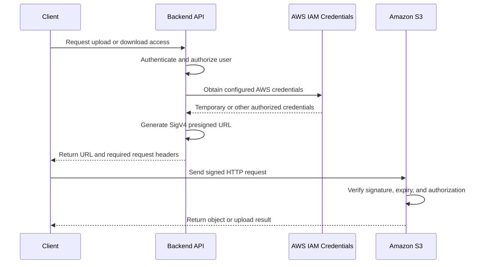
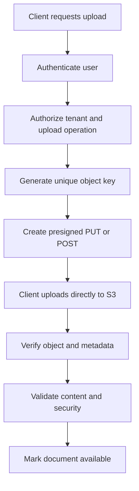

# 04- Presigned URL Fundamentals

## Overview

Amazon S3 presigned URLs provide time-limited access to specific S3 operations without requiring the recipient to possess AWS credentials. They allow backend applications to delegate object uploads and downloads directly to clients while keeping S3 buckets private.

A backend application typically authenticates a user, authorizes access to a specific object or upload operation, and generates a presigned URL using an AWS SDK. The client then sends the object request directly to S3 rather than routing the file through the backend server.

Presigned URLs are particularly useful for:
- Direct browser and mobile uploads to S3.
- Downloading private documents without exposing bucket credentials.
- Large-file transfers that should bypass application servers.
- Temporary sharing of reports, exports, and media.
- Upload workflows integrated with Django, Django REST Framework, FastAPI, Flask, and background workers.

A presigned URL is a bearer capability: anyone who possesses a valid URL can use it within the signed request's restrictions and applicable authorization rules. Treat the URL as sensitive access material, not as an ordinary public link.

## How Presigned URLs Work

### Understand the signing model

A presigned URL contains an S3 request and authentication information generated using AWS Signature Version 4 (SigV4). The signature binds the request to the signing credentials and the signed request properties, including the HTTP method, resource, expiration, and relevant headers or query parameters.

The recipient does not need AWS credentials because the request carries the signature generated by the authorized signer.

A presigned URL's effective permissions are limited by the permissions of the signing principal and any applicable authorization controls. A URL does not independently grant permissions that the signer does not possess.

### Request flow



The backend handles authorization and URL generation, while S3 handles the actual object transfer. The application can therefore support large uploads without consuming equivalent backend bandwidth or holding an API request open for the entire transfer.

### Separate URL generation from URL use

There are two distinct operations:

| Operation | Responsibility |
|---|---|
| Generate the URL | Backend authenticates the caller, checks authorization, selects the bucket and object key, and signs the request |
| Use the URL | Client makes the specified HTTP request directly to S3 |
| Validate the result | Backend or a trusted processing component checks the uploaded object and records its verified state |

Generating the URL does not upload or download an object. It only prepares a signed request that S3 can accept while the request remains valid.

## Understand the Main Presigned URL Types

### Presigned GET URL

A presigned GET URL grants temporary access to download a specific object.

Typical use cases include:
- Downloading private invoices.
- Serving documents to authorized customers.
- Providing temporary access to generated reports.
- Allowing a web application to retrieve private media.

Example:

```python
import boto3
from botocore.config import Config


s3_client = boto3.client(
    "s3",
    region_name="ap-south-1",
    config=Config(signature_version="s3v4"),
)

download_url = s3_client.generate_presigned_url(
    ClientMethod="get_object",
    Params={
        "Bucket": "example-private-documents",
        "Key": "tenant-123/reports/monthly-report.pdf",
    },
    ExpiresIn=300,
)

print(download_url)
```

The URL is valid for up to five minutes, subject to the expiration and authorization of the credentials used to create it.

### Presigned PUT URL

A presigned PUT URL grants temporary permission to upload an object to a specific key.

The client sends the file directly to S3 using HTTP PUT.

```python
upload_url = s3_client.generate_presigned_url(
    ClientMethod="put_object",
    Params={
        "Bucket": "example-private-documents",
        "Key": "tenant-123/uploads/document.pdf",
        "ContentType": "application/pdf",
    },
    ExpiresIn=300,
)
```

If `ContentType` is included in the signed parameters, the client must send the corresponding signed header with the expected value.

**Important:** S3 does not automatically validate the actual file contents against the declared MIME type. An upload labeled `application/pdf` is not necessarily a valid PDF document.

A PUT URL also does not automatically prevent overwriting an existing object at the same key. Generate unique object keys and protect important data against unintended replacement.

### Presigned POST

A presigned POST uses a signed policy to authorize a browser form upload.

It is useful when browser uploads need policy-based constraints such as a `content-length-range` condition.

Unlike a presigned PUT URL, the client submits a multipart form containing fields such as the key, policy, signature, and file.

Use presigned POST when its policy model fits the upload requirements. Use presigned PUT for straightforward object uploads with a fixed key and known request headers.

### Compare the options

| Feature | Presigned GET | Presigned PUT | Presigned POST |
|---|---|---|---|
| Primary purpose | Download an object | Upload an object | Browser-based form upload |
| HTTP operation | GET | PUT | POST |
| Object key | Identifies the object to retrieve | Identifies the upload destination | Defined by the signed policy and form fields |
| Policy-based upload size range | Not applicable | Not provided by the standard PUT policy model | Supported using `content-length-range` |
| Typical client | Browser, mobile app, backend consumer | Browser, mobile app, SDK | Browser form |
| Main risk | Unauthorized sharing of readable data | Unauthorized upload or object replacement | Misconfigured policy or overly broad upload permissions |

All three approaches require appropriate security controls, authorization, and expiration management.

## Design a Secure Presigned URL Architecture

### Recommended application flow

For a document-management API, the application should generate the object key and authorize the requested operation before creating a URL.



The backend should not trust the client to choose arbitrary bucket names or unrestricted object paths.

A practical implementation may use:
- A private S3 bucket.
- An application database that stores document ownership and upload status.
- An API endpoint that generates upload URLs.
- Direct client-to-S3 uploads.
- A validation worker that inspects completed uploads.
- A separate download endpoint that authorizes access before generating a GET URL.

The API should distinguish an upload that has been initiated from an upload that has been verified and is ready for consumption.

## Implement Presigned URLs with Boto3

### Create a reusable service layer

Keep S3 operations in a dedicated service rather than duplicating signing logic inside every API route.

The following implementation creates GET and PUT URLs for a known private bucket. The caller must validate and authorize the supplied object key before invoking the service.

```python
import os
from typing import Literal

import boto3
from botocore.config import Config


class S3PresignedUrlService:
    def __init__(self) -> None:
        self.bucket_name = os.environ["S3_BUCKET_NAME"]
        self.region_name = os.environ["AWS_REGION"]

        self.client = boto3.client(
            "s3",
            region_name=self.region_name,
            config=Config(
                signature_version="s3v4",
                retries={"max_attempts": 3, "mode": "standard"},
            ),
        )

    def generate_download_url(
        self,
        object_key: str,
        expires_in: int = 300,
    ) -> str:
        return self.client.generate_presigned_url(
            ClientMethod="get_object",
            Params={
                "Bucket": self.bucket_name,
                "Key": object_key,
            },
            ExpiresIn=expires_in,
        )

    def generate_upload_url(
        self,
        object_key: str,
        content_type: str,
        expires_in: int = 300,
    ) -> str:
        return self.client.generate_presigned_url(
            ClientMethod="put_object",
            Params={
                "Bucket": self.bucket_name,
                "Key": object_key,
                "ContentType": content_type,
            },
            ExpiresIn=expires_in,
        )
```

Configure `S3_BUCKET_NAME` and `AWS_REGION` using the deployment environment.

Boto3 uses the standard AWS credential provider chain. Prefer IAM roles and temporary credentials over hardcoded access keys. For local development, use an appropriate named AWS profile or another supported credential source.

The example deliberately does not accept an arbitrary bucket name from the request. Production authorization must also ensure that the caller owns or may access the relevant object.

### Generate a presigned URL for a unique object key

A typical upload key might contain a trusted tenant identifier, a server-generated UUID, and an allowed file extension.

```python
from pathlib import PurePosixPath
from uuid import uuid4


def create_object_key(
    tenant_id: str,
    original_filename: str,
) -> str:
    extension = PurePosixPath(original_filename).suffix.lower()

    allowed_extensions = {".pdf", ".png", ".jpg", ".jpeg"}

    if extension not in allowed_extensions:
        raise ValueError("Unsupported file extension")

    return f"tenants/{tenant_id}/uploads/{uuid4().hex}{extension}"
```

The tenant identifier must come from authenticated application context, not an untrusted request field.

File extensions are only an initial input-validation check. Validate file content independently after upload.

### Expose the functionality through FastAPI

The following route demonstrates URL generation for a document upload. It assumes an authentication dependency and tenant-scoped authorization logic are supplied by the application.

```python
from typing import Annotated

from fastapi import APIRouter, Depends, HTTPException
from pydantic import BaseModel, Field

router = APIRouter()


class UploadRequest(BaseModel):
    filename: str = Field(min_length=1, max_length=255)
    content_type: str = Field(max_length=100)


class UploadResponse(BaseModel):
    object_key: str
    upload_url: str
    expires_in: int


def get_current_tenant_id() -> str:
    # Replace with the application's authenticated identity dependency.
    raise NotImplementedError


s3_service = S3PresignedUrlService()


@router.post("/uploads/presign", response_model=UploadResponse)
def initiate_upload(
    request: UploadRequest,
    tenant_id: Annotated[str, Depends(get_current_tenant_id)],
) -> UploadResponse:
    allowed_types = {
        "application/pdf",
        "image/png",
        "image/jpeg",
    }

    if request.content_type not in allowed_types:
        raise HTTPException(
            status_code=400,
            detail="Unsupported content type",
        )

    object_key = create_object_key(
        tenant_id=tenant_id,
        original_filename=request.filename,
    )

    upload_url = s3_service.generate_upload_url(
        object_key=object_key,
        content_type=request.content_type,
        expires_in=300,
    )

    return UploadResponse(
        object_key=object_key,
        upload_url=upload_url,
        expires_in=300,
    )
```

This is an integration example rather than a complete production API. The authentication dependency, persistence layer, upload limits, and post-upload verification must be implemented before deployment.

In production, persist an upload record with a pending status before returning the URL. The application can then associate the generated key with the correct tenant, validate the upload, and prevent unverified objects from being treated as published documents.

## Upload and Download Directly with HTTP

### Upload an object with a presigned PUT URL

The following command uploads a local file. Use the exact URL returned by the backend.

```bash
curl --fail-with-body \
  --request PUT \
  --upload-file "./document.pdf" \
  --header "Content-Type: application/pdf" \
  "$PRESIGNED_UPLOAD_URL"
```

When a required header is included in the signature, omitting it or using a different value can cause a signature validation error.

The URL should be supplied to the command using a secure mechanism. Avoid writing signed URLs to shell history, logs, shared terminals, or persistent automation output.

### Download an object with a presigned GET URL

```bash
curl --fail-with-body \
  --output "./downloaded-document.pdf" \
  "$PRESIGNED_DOWNLOAD_URL"
```

The client downloads the object without AWS credentials, provided the request is valid and authorized.

A successful HTTP response confirms that S3 served the request. It does not independently establish that the document is safe, trusted, or appropriate for the caller's business workflow.

## Manage Expiration and Credential Lifetimes

### Understand the effective expiration

The lifetime of a presigned URL depends on both its configured expiration and the credentials used to generate it.

For URLs generated through the AWS CLI or SDKs, the configured expiration can be as high as seven days. However, if the URL is signed using temporary credentials, it becomes unusable when those credentials expire or are revoked, even if its configured expiration is later.

The effective validity period is bounded by the earliest applicable expiration or authorization restriction.

For example, a URL configured for 60 minutes may stop working sooner if the assumed IAM role session used to generate it expires first.

### Choose a short lifetime

Use the shortest expiration period that supports the intended operation.

| Use case | Illustrative expiration |
|---|---|
| Short-lived document download | 1–5 minutes |
| Normal browser upload | 5–15 minutes |
| Larger upload with expected network variability | A carefully sized upload window |
| Long-running workflow | Reissue access as needed rather than sharing a permanent link |

These are starting points, not universal limits. Consider client network conditions, expected file size, temporary credential lifetime, and the time required to retry failed requests.

S3 checks URL expiration when processing a request. An ongoing download can continue after expiration, but a subsequent request or a restarted download may fail once the URL has expired.

Reference: [Download and upload objects with presigned URLs](https://docs.aws.amazon.com/AmazonS3/latest/userguide/using-presigned-url.html).

## Apply Security Controls

### Treat URLs as bearer credentials

Anyone possessing a usable presigned URL may be able to perform its signed operation until it expires or becomes invalid.

Recommended practices include:

- Authenticate and authorize the requester before generating the URL.
- Scope the signing role to the required bucket and operations.
- Use server-generated object keys.
- Keep buckets private and maintain appropriate public-access controls.
- Set short expiration periods.
- Avoid exposing URLs through logs, analytics, error messages, and referrer headers.
- Use HTTPS throughout the client and backend workflow.
- Avoid allowing clients to choose arbitrary bucket names or tenant paths.
- Validate completed uploads before making them available to other users.
- Never return long-lived IAM credentials to the client.

A presigned URL is not a user identity. Once issued, S3 evaluates the signed request and applicable AWS authorization controls; application-level user revocation may not automatically invalidate an already issued URL.

### Prevent unintended object replacement

S3 accepts repeated use of a valid presigned PUT URL until it expires, subject to applicable permissions and request restrictions. Uploading to an existing key replaces the current object at that key.

Avoid generating multiple uploads against a shared, predictable key such as:

```text
tenant-123/documents/latest.pdf
```

Prefer a unique key for each upload attempt:

```text
tenant-123/uploads/6f7b9d2a9b82451f9c28e2b6a1e5d4c8.pdf
```

Maintain the logical document identifier separately in the application database. After validation, update the logical document record to reference the verified object.

This separates object identity from business identity and reduces the risk of accidental overwrites or unauthorized replacement.

### Distinguish metadata declarations from content validation

A client can declare a content type, filename, or extension that does not match the actual file.

For untrusted uploads:
- Enforce application-level size and type requirements.
- Validate file signatures and parse the content where appropriate.
- Scan for malware when required by the workload.
- Keep the object inaccessible to consumers until validation completes.
- Store the verified content type and size in trusted application metadata.

Signing `Content-Type` restricts the request header; it does not guarantee the uploaded bytes have the declared format.

### Understand CORS requirements for browser uploads

Direct browser uploads may require S3 Cross-Origin Resource Sharing (CORS) configuration.

Configure the allowed origins, methods, and headers required by the client application. For example, a browser using PUT with `Content-Type` must be able to pass the corresponding preflight checks.

CORS is a browser access policy, not an authorization boundary. It does not prevent non-browser clients from using a leaked presigned URL.

## Handle Upload Limits and Large Files

### Use presigned PUT for straightforward uploads

A standard presigned PUT URL is appropriate when an upload maps to one object write and the required request headers are known in advance.

For larger files, consider multipart upload with separately presigned part requests. Each part can be transferred independently, improving retry behavior and allowing multiple parts to be uploaded concurrently.

The application or a trusted upload coordinator must manage the multipart upload ID, expected parts, completion, failure recovery, and cleanup of abandoned uploads.

Do not assume that a standard presigned PUT URL supports every size or transfer pattern. S3's single `PutObject` operation has a 5 GB object-size limit; larger objects require multipart upload.

### Choose the correct size-control strategy

| Requirement | Recommended approach |
|---|---|
| Restrict file extensions | Validate at URL creation and verify content after upload |
| Restrict declared MIME type | Include the appropriate signed header or POST policy condition |
| Enforce a POST upload size range | Use a presigned POST policy with `content-length-range` |
| Support files larger than 5 GB | Use multipart upload |
| Support resumable large uploads | Use a multipart upload workflow with persisted state |
| Prevent unverified files from being consumed | Keep uploads pending until server-side validation completes |

Do not rely solely on client-side validation. A malicious or modified client can bypass checks performed only in JavaScript or mobile application code.

## Validate Upload Completion

### Verify uploaded objects

After an upload completes, verify that the expected object exists and satisfies the application's requirements.

For example:

```bash
aws s3api head-object \
  --bucket "$BUCKET" \
  --key "$OBJECT_KEY"
```

This command requires appropriate AWS permissions. It is an administrative verification step and should not be confused with validation performed by the end-user client using the presigned URL.

A production workflow should verify:
- The object key matches the expected upload record.
- The object size satisfies the configured limits.
- The observed metadata is consistent with the expected request.
- The object checksum is valid when a suitable checksum was required.
- The uploaded content passes application-specific validation.
- The upload belongs to the correct tenant and business operation.

For stronger integrity checking, use supported S3 checksum mechanisms and ensure that the checksum is included and verified through the chosen upload flow.

### Avoid trusting client-supplied upload callbacks

A client telling the API that an upload completed is not sufficient proof that the expected file was uploaded successfully.

Use a trusted verification path, such as an authenticated API request that checks the S3 object or an event-driven processing workflow. Make the processing idempotent so retries and duplicate completion notifications do not publish the same object incorrectly.

For event-driven processing, S3 notifications may be delivered more than once. Use object keys, version information where appropriate, and application state to deduplicate processing.

## Diagnose Common Presigned URL Failures

| Symptom | Likely cause | Verification and corrective action |
|---|---|---|
| `SignatureDoesNotMatch` | Signed headers changed, URL modified, incorrect Region, or signature mismatch | Use the original URL, match signed headers exactly, and verify the bucket Region |
| `AccessDenied` | Signer lacks permission or an applicable policy denies the operation | Check IAM policies, bucket policy, key permissions where relevant, and organizational controls |
| `ExpiredToken` | Temporary credentials expired | Generate a new URL using valid credentials |
| `Request has expired` | URL expiration elapsed before S3 accepted the request | Generate a new URL and adjust the lifetime to the workload |
| Browser CORS error | Required origin, method, or header is not permitted by the bucket's CORS configuration | Inspect the browser preflight request and configure only the necessary origins and headers |
| Upload succeeds but document is rejected | Actual content does not satisfy application requirements | Validate size, file structure, format, checksum, and security requirements |
| Client cannot upload to the expected path | Key or required request parameters differ from the signed request | Compare the client request with the exact parameters used when generating the URL |
| Upload overwrites existing data | A valid URL targets an existing object key | Use unique server-generated keys and enforce application-level upload ownership |
| URL fails after a policy change | Signing principal or request no longer satisfies authorization conditions | Inspect the relevant policy change and regenerate the URL after correcting access |

Do not solve signing errors by making the bucket public or granting broad permissions. Identify the failing request, compare it with the signed parameters, and inspect the authorization path.

## Monitor and Audit Presigned URL Usage

Presigned URL generation is an application operation, while the subsequent object request is an S3 operation. Observability should cover both.

Recommended controls include:
- Record a URL issuance event with the application user, object identifier, intended operation, expiry, and request correlation ID.
- Never record the complete URL or its signature in application logs.
- Monitor S3 access using appropriately configured CloudTrail data events, S3 request metrics, or server access logging where justified.
- Alert on unexpected access patterns and unusual object download volumes.
- Track upload initiation, completion, validation failure, and abandonment rates.
- Review IAM permissions and signing-role usage periodically.

CloudTrail coverage depends on the event type and configuration. Confirm that the required S3 object-level data events are enabled instead of assuming that default management-event history records every upload and download.

## Best Practices Checklist

- [ ] Authenticate and authorize every URL-generation request.
- [ ] Keep signing permissions limited to the intended buckets, operations, and object paths.
- [ ] Generate object keys on the server instead of trusting client-controlled paths.
- [ ] Use short URL expiration periods appropriate to the transfer.
- [ ] Account for expiration or revocation of temporary signing credentials.
- [ ] Keep bucket access private and require HTTPS.
- [ ] Avoid logging, storing, or exposing complete presigned URLs.
- [ ] Match all signed headers and request parameters exactly.
- [ ] Use presigned POST where policy-based browser upload constraints are required.
- [ ] Use multipart upload for files larger than the single-PUT limit.
- [ ] Verify object size, integrity, and content after upload.
- [ ] Keep uploaded objects pending until application validation completes.
- [ ] Use unique keys to prevent accidental object replacement.
- [ ] Configure CORS only for the browser origins and headers required by the client.
- [ ] Test expiration, retry, authorization failure, and duplicate-processing scenarios.

## Authoritative References

- [Download and upload objects with presigned URLs](https://docs.aws.amazon.com/AmazonS3/latest/userguide/using-presigned-url.html)
- [Uploading objects with presigned URLs](https://docs.aws.amazon.com/AmazonS3/latest/userguide/PresignedUrlUploadObject.html)
- [AWS CLI `s3 presign` reference](https://docs.aws.amazon.com/cli/latest/reference/s3/presign.html)
- [AWS Prescriptive Guidance: Presigned URL best practices](https://docs.aws.amazon.com/prescriptive-guidance/latest/presigned-url-best-practices/introduction.html)
- [S3 object integrity and checksum verification](https://docs.aws.amazon.com/AmazonS3/latest/userguide/checking-object-integrity.html)
- [S3 CORS configuration](https://docs.aws.amazon.com/AmazonS3/latest/userguide/ManageCorsUsing.html)

## Key Takeaways

- Presigned URLs delegate time-limited access to a specific S3 request without exposing AWS credentials to clients.
- Effective URL validity depends on its configured expiration, signing credentials, and applicable authorization controls.
- Use server-generated object keys, short expiration periods, least-privilege signing permissions, and private buckets.
- Treat direct uploads as untrusted until size, integrity, ownership, and content validation have completed.
- Use the appropriate mechanism for the workload: GET for downloads, PUT for straightforward uploads, POST for policy-constrained browser uploads, and multipart upload for large files.
You've reached the maximum length for this conversation, but you can keep talking by starting a new chat.
Start new chat