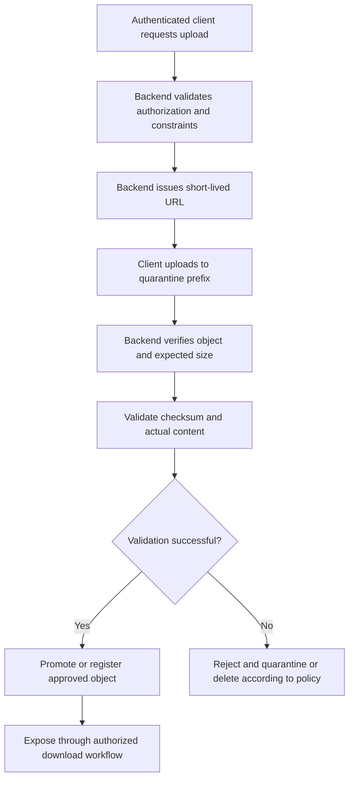

# 05- Presigned URL Expiration and Security

## Overview

Amazon S3 presigned URLs provide temporary, controlled access to specific S3 operations without requiring the recipient to possess AWS credentials. They are commonly used for direct browser uploads, document downloads, media delivery, and large-file transfers in backend applications.

A presigned URL is a **bearer token**: anyone who obtains a usable URL can exercise the permissions it grants until the URL expires or another authorization constraint invalidates the request.

Production security therefore depends on more than setting an expiration value. A secure implementation must control who receives the URL, which object and operation it grants access to, how long it remains usable, whether it can be replayed, and how uploaded content is validated.

This document covers expiration behavior, secure URL generation, temporary credentials, upload and download controls, revocation strategies, and operational safeguards for Python backend services.

## Understand Presigned URL Expiration

### How expiration works

A presigned URL contains a signed request and authentication information derived from the credentials of the principal that generated it. Amazon S3 validates the signature, request parameters, credentials, and applicable authorization policies when the client makes the request.

For AWS Signature Version 4 (SigV4), the maximum expiration configured through the SDK or CLI is seven days. This is a technical maximum, not a recommended production default.

The effective validity period is determined by the earliest applicable constraint, including the configured expiration, signing credential validity, credential revocation, and any applicable policy restrictions.

| Constraint | Behavior | Engineering implication |
|---|---|---|
| Configured expiration | Defines the requested validity period | Select the shortest period compatible with the workflow |
| Temporary credential expiration | The URL stops working when the signing credentials expire | A longer configured expiration cannot extend an IAM role session |
| Credential revocation or deactivation | Can invalidate requests signed with the affected credentials | Credential-level revocation can affect more than one URL |
| Bucket or access-point policy | Can deny requests even when the signature remains valid | Policy controls provide additional authorization guardrails |
| Signature-age restriction | Can reject URLs whose signatures are older than the configured limit | Use `s3:signatureAge` to enforce an additional maximum age |
| Object or permission changes | Can make the signed operation fail | Changes may affect other callers and are not precise URL-level revocation |

A URL signed with temporary IAM role credentials may expire before its configured `ExpiresIn` value. This is normal behavior for workloads running on EC2, ECS, EKS, Lambda, or other environments that use temporary credentials.

### Understand the distinction between expiration and revocation

Expiration is time-based. Revocation makes a request unauthorized before its configured expiration, where the relevant AWS authorization mechanism supports doing so.

Amazon S3 does not provide a general-purpose operation that revokes one individual presigned URL while leaving every other permission unchanged.

Possible invalidation approaches include:
- Applying an appropriate explicit deny through a bucket or access-point policy.
- Revoking or deactivating the signing credentials when appropriate.
- Changing object permissions or object availability.
- Changing the authorization boundary for a specific object or prefix.

These approaches have different scopes and operational consequences. For example, deactivating a signing credential can affect multiple URLs and API operations, while deleting an object may disrupt legitimate users and may not remove retained versions.

**Best practice:** Design URLs to expire quickly instead of treating revocation as the primary security mechanism.

Reference: [Download and upload objects with presigned URLs](https://docs.aws.amazon.com/AmazonS3/latest/userguide/using-presigned-url.html).

## Choose an Appropriate Expiration Period

### Match expiration to the workflow

A URL should remain valid long enough for its intended operation, including realistic network delays and retries, but no longer than necessary.

| Use case | Starting expiration range | Considerations |
|---|---|---|
| Short document download | 1–5 minutes | Suitable when authorization and URL generation occur immediately before download |
| Interactive browser upload | 5–15 minutes | Account for file size, client processing, and network conditions |
| Large-file upload | 15–60 minutes per upload capability, where appropriate | Generate multipart part URLs as needed and refresh them through an authenticated backend workflow |
| Temporary partner access | Case-specific, usually short-lived | Consider external client behavior and contractual access requirements |
| Long-running download | Based on expected request initiation and retry behavior | An established transfer can continue after URL expiration, but a new request may fail |
| Automated scheduled integration | Based on job execution and retry requirements | Prefer role-based service integration when the recipient can use AWS credentials directly |

These ranges are starting points, not AWS guarantees or universal defaults. Test actual workloads and use a shorter duration whenever the workflow allows it.

### Configure a bounded expiration policy in Python

Boto3 accepts the `ExpiresIn` argument when generating a presigned URL.

```python
import boto3

s3_client = boto3.client("s3", region_name="ap-south-1")

url = s3_client.generate_presigned_url(
    ClientMethod="get_object",
    Params={
        "Bucket": "example-private-documents",
        "Key": "tenant-123/reports/report.pdf",
    },
    ExpiresIn=300,
    HttpMethod="GET",
)

print(url)
```

The URL is configured to expire after 300 seconds, or five minutes, subject to credential validity and applicable authorization controls.

In production, the application must authorize the requester before generating the URL. The example assumes that authorization has already been completed and that the AWS SDK uses an appropriate credential provider.

Do not accept arbitrary expiration values directly from an untrusted client.

### Enforce an application-level maximum

Centralize URL generation so that every API endpoint applies the same expiration limits.

```python
from urllib.parse import urlsplit

import boto3


MAX_URL_EXPIRATION_SECONDS = 900


class PresignedUrlService:
    def __init__(self, bucket_name: str, region_name: str) -> None:
        self.bucket_name = bucket_name
        self.s3 = boto3.client("s3", region_name=region_name)

    def generate_download_url(
        self,
        object_key: str,
        expires_in: int = 300,
    ) -> str:
        if not 1 <= expires_in <= MAX_URL_EXPIRATION_SECONDS:
            raise ValueError("Expiration must be between 1 and 900 seconds")

        url = self.s3.generate_presigned_url(
            ClientMethod="get_object",
            Params={
                "Bucket": self.bucket_name,
                "Key": object_key,
            },
            ExpiresIn=expires_in,
            HttpMethod="GET",
        )

        if urlsplit(url).scheme != "https":
            raise RuntimeError("Presigned URL must use HTTPS")

        return url
```

The service enforces a 15-minute maximum. Choose the maximum based on the application's actual security requirements.

Additional responsibilities should include checking object ownership, resolving the key from trusted application metadata, applying download-specific headers where necessary, and recording a security-safe audit event.

## Understand When S3 Checks Expiration

Amazon S3 checks a presigned URL's expiration when the HTTP request is made.

For example, suppose a client begins downloading a large file shortly before the URL expires. That already-established download can continue after the expiration time. However, if the transfer fails and the client attempts to resume it after expiration, the new request can be rejected.

This distinction matters for:

- Large media downloads.
- Resumable downloads using HTTP range requests.
- Mobile clients on unstable networks.
- Multipart upload workflows.
- Clients that wait in a queue before starting a transfer.

A URL's expiration time does not guarantee that all data transfer will finish before that time.

For a workflow involving large objects, use a design that can issue fresh, narrowly scoped URLs after reauthorization. Do not extend all URL lifetimes merely to support occasional retries.

## Apply Least-Privilege Permissions

### Restrict the signing principal

A presigned URL inherits the permissions and authorization constraints of the principal that signs it. The recipient does not receive a new IAM identity; the signature enables the specific request under the signing principal's authority.

The signing principal should have only the required S3 permissions.

For example, an application that creates download URLs should not automatically receive permission to delete objects or modify bucket policies.

A narrowly scoped identity policy for reading a dedicated prefix might look like this:

```json
{
  "Version": "2012-10-17",
  "Statement": [
    {
      "Sid": "ReadAuthorizedDocuments",
      "Effect": "Allow",
      "Action": "s3:GetObject",
      "Resource": "arn:aws:s3:::example-private-documents/approved-downloads/*"
    }
  ]
}
```

This policy illustrates identity-level least privilege. It must be adapted to the actual application architecture, and it does not replace bucket policies, explicit denies, or other applicable authorization checks.

Do not use a broad application role that can read every object merely because clients need temporary access to a subset of documents.

### Generate URLs only after application authorization

An application should not generate a URL from an arbitrary object key supplied by a client.

Instead, resolve the requested object through trusted application metadata and enforce tenant or user ownership before signing.

```python
def create_download_link(
    user_id: str,
    document_id: str,
    document_repository,
    url_service: PresignedUrlService,
) -> str:
    document = document_repository.get_by_id(document_id)

    if document is None:
        raise LookupError("Document not found")

    if document.owner_id != user_id:
        raise PermissionError("Not authorized to access this document")

    return url_service.generate_download_url(
        object_key=document.object_key,
        expires_in=300,
    )
```

This example assumes the repository performs a trusted database lookup and that authentication has already established `user_id`. A production API should map failures to appropriate HTTP responses without exposing sensitive object metadata.

### Use temporary AWS credentials

Prefer IAM roles and temporary credentials for backend applications instead of long-lived access keys embedded in source code.

Suitable credential sources include:
- IAM roles attached to EC2 instances.
- ECS task roles.
- EKS workload identity or appropriately configured IAM roles for service accounts.
- Lambda execution roles.
- Federated developer credentials.

Temporary credentials reduce long-term credential exposure, but they also constrain presigned URL lifetime. Account for credential refresh and expiry when issuing URLs.

Do not copy long-lived credentials into a browser or mobile application to avoid expiration constraints. The client should use the URL as a temporary capability, not receive the signing principal's credentials.

## Add a Maximum Signature-Age Guardrail

### Use `s3:signatureAge`

Bucket policies and access-point policies can use the `s3:signatureAge` condition key to restrict the age of SigV4 presigned requests.

The value is expressed in milliseconds. A policy restriction does not extend a URL's lifetime; it adds another condition that can cause a request to fail sooner.

For example, the following statement denies requests to objects in a specific bucket when their presigned signature is more than ten minutes old.

```json
{
  "Version": "2012-10-17",
  "Statement": [
    {
      "Sid": "DenyOldPresignedRequests",
      "Effect": "Deny",
      "Principal": "*",
      "Action": "s3:*",
      "Resource": "arn:aws:s3:::example-private-documents/*",
      "Condition": {
        "NumericGreaterThan": {
          "s3:signatureAge": "600000"
        }
      }
    }
  ]
}
```

This is an illustrative policy statement, not a complete bucket policy. Review its effect on all relevant S3 request paths before deployment.

The condition is intended to constrain presigned requests, not replace ordinary authorization controls for every S3 request. Validate interactions with AWS service integrations, administrative access, and any existing policy statements.

### Set the threshold realistically

An excessively restrictive signature-age threshold can reject legitimate requests because of:
- Delays between URL generation and request submission.
- Client-side processing time.
- Clock synchronization issues.
- Network latency.
- Large upload workflows.
- Browser or application retries.

AWS cautions that very low thresholds can cause intermittent failures. Test the chosen limit against actual client behavior.

Reference: [Additional guardrails for presigned URLs](https://docs.aws.amazon.com/prescriptive-guidance/latest/presigned-url-best-practices/additional-guardrails.html).

## Secure Presigned Downloads

### Authorize each download before signing

The backend should verify the caller's permission to access the target object immediately before issuing the URL.

For multi-tenant applications:
- Resolve ownership using a trusted database record.
- Avoid allowing users to select arbitrary tenants or object prefixes.
- Keep the object key separate from the client-visible filename.
- Ensure the signing role is scoped to the required object population.
- Avoid disclosing document existence through inconsistent error responses.

A presigned URL is not a replacement for the application's authorization layer.

### Control the download response

For browser downloads, consider setting the response content disposition to attachment and providing a safe filename.

```python
url = s3_client.generate_presigned_url(
    ClientMethod="get_object",
    Params={
        "Bucket": "example-private-documents",
        "Key": "tenant-123/reports/report.pdf",
        "ResponseContentDisposition": 'attachment; filename="report.pdf"',
    },
    ExpiresIn=300,
    HttpMethod="GET",
)
```

Derive filenames from trusted metadata and sanitize them before using them in headers. Do not interpolate arbitrary user input into header values.

Where appropriate, set response content types based on verified object metadata rather than blindly trusting the original upload request.

### Understand replay and caching risks

A valid download URL can generally be reused until it expires or another constraint makes the request unauthorized. It is not automatically a one-time download token.

A recipient may copy the URL, share it with others, or use it from a different device. A short expiration limits the exposure window but does not prevent replay while the URL remains valid.

For sensitive documents:
- Avoid storing URLs in application records.
- Disable caching where sensitive browser content requires it.
- Avoid returning signed URLs to unauthorized clients through shared caches.
- Use `Cache-Control` response headers when appropriate.
- Consider a backend-mediated download or a separate authorization gateway for requirements that demand stronger control over every access.

## Secure Direct-to-S3 Uploads

### Use server-generated object keys

A presigned PUT URL authorizes an upload to a specific object key. If an object with that key already exists, a successful upload can replace it.

Generate unique object keys using trusted server-side identifiers instead of using the original filename as the storage key.

For example:

```python
from uuid import uuid4


def create_object_key(
    tenant_id: str,
    document_id: str,
    file_extension: str,
) -> str:
    safe_extension = file_extension.lower().lstrip(".")

    allowed_extensions = {"pdf", "png", "jpg", "jpeg"}

    if safe_extension not in allowed_extensions:
        raise ValueError("Unsupported file extension")

    return (
        f"quarantine/{tenant_id}/"
        f"{document_id}/{uuid4().hex}.{safe_extension}"
    )
```

The `tenant_id` and `document_id` must come from authenticated, authorized application context. Validate them according to the application's identifier format.

Object keys should be treated as opaque identifiers rather than filesystem paths. Do not depend on user-controlled directory names or filenames to enforce access boundaries.

### Bind the expected content type

If the content type is included in the signed request, the upload client must use the corresponding signed header value.

```python
upload_url = s3_client.generate_presigned_url(
    ClientMethod="put_object",
    Params={
        "Bucket": "example-private-documents",
        "Key": "quarantine/tenant-123/document-456/upload-abc.pdf",
        "ContentType": "application/pdf",
    },
    ExpiresIn=600,
    HttpMethod="PUT",
)
```

The client must send the matching `Content-Type` header when using the URL. Changing signed request parameters or headers can produce `SignatureDoesNotMatch` failures.

**Important:** A matching content type does not prove that the file actually contains valid PDF data. Treat it as a request constraint, not as content validation.

### Enforce upload size limits

Do not rely on a presigned PUT URL alone as a general content-size enforcement mechanism.

Choose the upload mechanism based on the required validation guarantees:

| Requirement | Recommended approach |
|---|---|
| Basic direct upload to a fixed key | Presigned PUT with suitable IAM permissions and request constraints |
| Enforce a content-length range at upload policy level | Presigned POST with a `content-length-range` condition |
| Validate actual content before accepting it | Upload to a quarantine location, inspect the object, and promote it after successful validation |
| Large files requiring multipart transfer | Multipart upload with server-controlled initiation, part URLs, completion, and abort handling |

For example, Boto3 can generate a presigned POST with a content-length range and a content-type condition:

```python
post_data = s3_client.generate_presigned_post(
    Bucket="example-private-documents",
    Key="quarantine/tenant-123/document-456/upload-abc.pdf",
    Fields={
        "Content-Type": "application/pdf",
    },
    Conditions=[
        {"Content-Type": "application/pdf"},
        ["content-length-range", 1, 10 * 1024 * 1024],
    ],
    ExpiresIn=600,
)
```

This policy example restricts uploads to a range between 1 byte and 10 MiB and requires the specified content type. The client must submit the generated URL and form fields according to the presigned POST protocol.

Validate actual content independently. Consider file signatures, parser validation, malware scanning, checksum verification, and decompression limits according to the accepted file types.

Reference: [Uploading objects with presigned URLs](https://docs.aws.amazon.com/AmazonS3/latest/userguide/PresignedUrlUploadObject.html).

## Validate Uploads Before Making Them Available

A successful S3 upload only confirms that S3 accepted the request. It does not establish that the object is safe, correctly classified, or authorized for permanent use by the application.

A production upload workflow should separate upload receipt from application acceptance.



An implementation may track upload status in a relational database, for example:

- `PENDING_UPLOAD`
- `UPLOADED`
- `VALIDATING`
- `AVAILABLE`
- `REJECTED`

Use idempotent state transitions so retries do not accidentally approve a rejected file or process the same upload multiple times.

In event-driven implementations, remember that S3 event notifications can be delivered more than once and may arrive out of order. Deduplicate processing using appropriate object and version identifiers or application-level upload identifiers.

## Protect URL Generation and Delivery

### Never log complete presigned URLs

Presigned URLs contain authentication-related query parameters and must be treated as credentials.

Avoid logging them in:
- Application request and response bodies.
- Reverse-proxy access logs.
- Browser analytics.
- Exception traces.
- APM span attributes.
- Chat messages and support tickets.
- Metrics labels or tracing baggage.

Redact sensitive query strings before storing request metadata. Configure logging at the application, API gateway, Nginx, and observability layers, because one redacted layer does not prevent another from exposing the URL.

### Use HTTPS and restrict where URLs are exposed

Use HTTPS for URL generation and every client request. Avoid copying signed URLs into long-lived public pages, emails, or shared application logs.

CORS configuration can restrict browser origins, methods, and headers, but CORS is not authorization. Non-browser clients can call a URL directly, so CORS alone does not prevent misuse.

For sensitive browser workflows:
- Keep signed URLs out of unnecessary referrer data.
- Use a restrictive `Referrer-Policy`, such as `no-referrer`, where suitable.
- Avoid analytics or third-party scripts that can observe sensitive URLs.
- Return URLs over authenticated HTTPS API responses.
- Do not persist URL values in frontend state longer than needed.

### Consider object names and metadata leakage

A presigned URL can reveal the bucket endpoint, object key, and request parameters. Avoid including customer names, email addresses, account numbers, or other sensitive identifiers in object keys.

Use opaque identifiers and keep sensitive metadata in a protected application database.

## Design Multipart Uploads for Expiration and Recovery

Multipart uploads improve large-object transfer reliability and throughput, but presigned part URLs introduce additional lifecycle concerns.

A secure multipart design should:
1. Authenticate the user and authorize the upload.
2. Create an upload record in the application database.
3. Initiate the multipart upload through the backend.
4. Issue short-lived URLs for specific parts.
5. Allow the client to upload parts and report part identifiers.
6. Validate the submitted completion information.
7. Complete the multipart upload through the backend.
8. Verify the final object and mark it available only after validation.

Generate additional part URLs when needed rather than issuing long-lived URLs for every part. The backend should own the multipart upload ID and verify that part identifiers belong to the intended upload.

Handle incomplete uploads through an explicit abort workflow and an S3 Lifecycle rule that cleans up abandoned multipart uploads after a suitable period.

Do not assume expiration of a part URL automatically aborts the multipart upload or deletes its uploaded parts.

Reference: [Multipart upload overview](https://docs.aws.amazon.com/AmazonS3/latest/userguide/mpuoverview.html).

## Monitor Presigned URL Security

### Log security events, not bearer tokens

Useful audit events include:
- URL generation by user or service identity.
- Object or application record identifier.
- Intended operation, such as upload or download.
- Configured expiration.
- Authorization decision.
- Upload validation outcome.
- Rejected or suspicious access attempts.
- Administrative changes to relevant bucket policies or credentials.

Prefer logging an application object ID or a safe correlation identifier over the entire URL. Avoid logging the signature, security token, or complete query string.

For investigation, combine application audit records with appropriate CloudTrail events and S3 data-event logging. Ensure that the required event coverage is configured before relying on it for incident analysis.

### Establish meaningful alerts

Monitor for:
- Unexpected increases in URL-generation volume.
- Repeated authorization failures.
- Large or unusual uploads.
- Access attempts outside expected operational patterns.
- Uploads that remain in a pending state.
- Repeated content-validation failures.
- Changes to policies enforcing maximum signature age.
- Unusual changes to signing roles or credentials.

Avoid using complete URLs, signatures, or other sensitive query parameters as metric dimensions.

## Troubleshoot Expiration and Signature Failures

| Symptom | Likely cause | Diagnostic action |
|---|---|---|
| `Request has expired` | The URL expired or the signing credentials are no longer valid | Generate a new URL and verify the credential session lifetime |
| `SignatureDoesNotMatch` | Request method, signed headers, query parameters, or Region differ from the signed request | Use the URL unchanged and match all required headers |
| `AccessDenied` before expiration | IAM, bucket policy, KMS authorization, or other access controls deny the operation | Inspect the relevant S3 and KMS authorization path |
| Upload works only for small files | Size restrictions, proxy limits, or transfer behavior differ across requests | Check POST policy conditions, upload mechanism, and intermediary limits |
| Large download cannot resume | The initial URL expired before the retry or range request | Issue a fresh URL through the authorized backend |
| URL expires much earlier than expected | Temporary credentials expire before the configured URL expiration | Inspect the actual AWS credential source and session lifetime |
| Browser upload fails despite correct authorization | Required signed headers or CORS settings are missing or incorrect | Compare the signed request with the browser's actual request |
| URL fails after a policy deployment | An explicit deny or signature-age restriction blocks the request | Review recent bucket and access-point policy changes |

Do not increase expiration values blindly when diagnosing failures. Determine whether the issue is URL age, temporary credentials, request signing, or authorization.

## Production Readiness Checklist

- [ ] Every URL is generated only after application-level authorization.
- [ ] The signing principal follows least-privilege IAM rules.
- [ ] URL expiration is bounded by a centralized application policy.
- [ ] Temporary AWS credential lifetimes are included in expiration planning.
- [ ] URLs are treated as bearer tokens and are never exposed through logs or analytics.
- [ ] Sensitive transfers use HTTPS.
- [ ] Object keys are generated from trusted application identifiers.
- [ ] Upload methods enforce appropriate request constraints.
- [ ] File size, checksum, actual content, and malware-validation requirements are evaluated independently.
- [ ] Uploaded objects remain unavailable to normal consumers until validation succeeds where the workload requires quarantine.
- [ ] Multipart uploads have expiration, retry, and cleanup strategies.
- [ ] Bucket policies apply signature-age restrictions where appropriate and have been tested against legitimate request paths.
- [ ] CORS is not treated as an authorization mechanism.
- [ ] Revocation procedures account for their effect on other URLs and legitimate users.
- [ ] Monitoring captures security-relevant events without storing complete signed URLs.

## Authoritative References

- [Download and upload objects with presigned URLs](https://docs.aws.amazon.com/AmazonS3/latest/userguide/using-presigned-url.html)
- [Uploading objects with presigned URLs](https://docs.aws.amazon.com/AmazonS3/latest/userguide/PresignedUrlUploadObject.html)
- [AWS Signature Version 4 query-string authentication](https://docs.aws.amazon.com/AmazonS3/latest/developerguide/sigv4-query-string-auth.html)
- [S3 Signature Version 4 policy condition keys](https://docs.aws.amazon.com/AmazonS3/latest/developerguide/bucket-policy-s3-sigv4-conditions.html)
- [Presigned URL security guardrails](https://docs.aws.amazon.com/prescriptive-guidance/latest/presigned-url-best-practices/additional-guardrails.html)
- [Multipart upload overview](https://docs.aws.amazon.com/AmazonS3/latest/userguide/mpuoverview.html)

## Key Takeaways

- Presigned URLs are bearer tokens whose effective lifetime is limited by configured expiration, credential validity, and applicable authorization policies.
- Generate short-lived URLs only after application-level authorization, and restrict the signing principal to the minimum required S3 permissions.
- Use server-generated object keys, enforce upload constraints, and validate actual uploaded content before making it available.
- Protect signed URLs from logs, analytics, browser leakage, and unauthorized sharing; CORS does not replace authorization.
- Treat expiration, revocation, multipart cleanup, monitoring, and recovery as distinct parts of the production security design.
You've reached the maximum length for this conversation, but you can keep talking by starting a new chat.
Start new chat