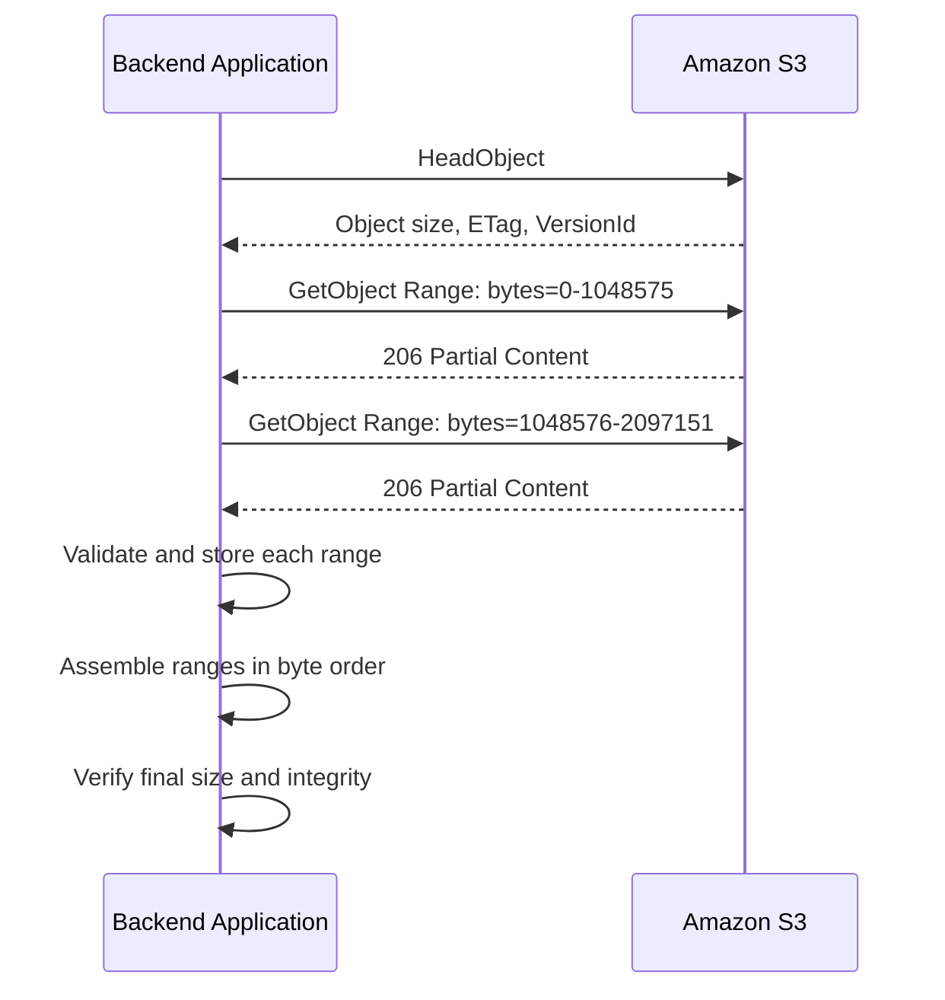
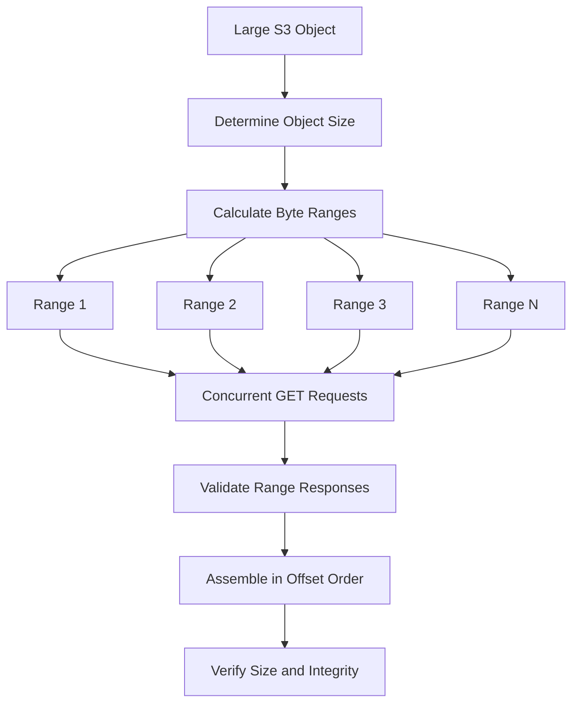

# 06- Byte-Range Fetching

## Overview

Amazon S3 byte-range fetching retrieves a specific portion of an object instead of downloading the entire object. It uses the HTTP `Range` header with the S3 `GetObject` API.

Byte-range requests are useful when applications need to download large files efficiently, resume interrupted transfers, retrieve selected regions of binary data, or process large objects concurrently.

Typical use cases include:

- Parallel downloads of large files.
- Resuming interrupted downloads.
- Reading selected portions of media, archives, or binary datasets.
- Retrieving record ranges from formats that support random access.
- Reducing transferred bytes when only a portion of an object is required.
- Building high-throughput data-processing pipelines.

Byte-range fetching is a transfer optimization, not an object-storage partitioning mechanism. S3 still stores an object under a single object key, and the client is responsible for interpreting, validating, and combining retrieved byte ranges when required.

## How Byte-Range Fetching Works

### HTTP Range requests

An S3 `GetObject` request can include a `Range` header that specifies which bytes to retrieve.

For example:

```http
GET /reports/archive.bin HTTP/1.1
Host: example-bucket.s3.ap-south-1.amazonaws.com
Range: bytes=0-1048575
```

This requests bytes `0` through `1048575`, inclusive, which is 1 MiB.

A successful partial response normally uses HTTP status `206 Partial Content`.

```http
HTTP/1.1 206 Partial Content
Accept-Ranges: bytes
Content-Range: bytes 0-1048575/10485760
Content-Length: 1048576
```

The `Content-Range` header identifies the returned range and the total object size. The `Content-Length` header indicates the number of bytes in the response body.

### Byte-range boundaries

HTTP byte ranges use zero-based, inclusive offsets.

| Range | Meaning | Expected size |
|---|---|---:|
| `bytes=0-99` | First 100 bytes | 100 bytes |
| `bytes=100-199` | Next 100 bytes | 100 bytes |
| `bytes=0-1048575` | First 1 MiB | 1,048,576 bytes |
| `bytes=1048576-2097151` | Second 1 MiB | 1,048,576 bytes |
| `bytes=500-` | Byte 500 through the end | Depends on object size |
| `bytes=-1024` | Last 1,024 bytes | Up to 1,024 bytes |

For a range `start-end`, calculate its expected length as:

\[
\text{length} = \text{end} - \text{start} + 1
\]

Do not treat the ending offset as exclusive. Off-by-one errors can produce missing bytes, duplicated bytes, or corrupted output when ranges are assembled.

### Request and response lifecycle



For a single range, the application can use the returned bytes directly. For parallel downloads, it must track each range's offset and ensure that all ranges belong to the same object representation.

## Choose Between Range Requests and Part-Number Requests

Amazon S3 provides two related methods for retrieving portions of an object.

| Method | Request parameter | Applies to | Main use |
|---|---|---|---|
| Byte-range fetching | `Range` | Objects regardless of how they were uploaded | Retrieve arbitrary byte intervals |
| Part-number fetching | `partNumber` | Objects uploaded using multipart upload | Retrieve a specific original multipart-upload part |

Example byte-range request:

```bash
aws s3api get-object \
  --bucket "$BUCKET" \
  --key "datasets/archive.bin" \
  --range "bytes=0-1048575" \
  ./archive-first-1MiB.bin
```

Example part-number request:

```bash
aws s3api get-object \
  --bucket "$BUCKET" \
  --key "datasets/archive.bin" \
  --part-number 1 \
  ./archive-part-1.bin
```

Part-number retrieval depends on the original multipart-upload structure. Its resulting byte boundaries and size depend on that structure.

**Best practice:** Use byte ranges when the application needs arbitrary offsets or must support objects that were uploaded without multipart upload. Consider part-number requests when the original multipart structure is known and retrieving those parts directly suits the workload.

S3 does not support requesting multiple separate byte ranges in a single `GetObject` request. To retrieve several ranges concurrently, issue separate requests.

## Use Byte Ranges for Parallel Downloads

### Why parallel fetching improves throughput

A single large download uses one GET request. Depending on client and network behavior, that connection might not fully utilize the available bandwidth.

Parallel downloading splits the object into ranges and retrieves multiple ranges over concurrent connections.

For an object of size \(S\) and a configured range size \(R\), the number of requests is:

\[
N = \left\lceil \frac{S}{R} \right\rceil
\]

For example, a 512 MiB object downloaded using 16 MiB ranges requires 32 range requests.



Benefits include:

- Higher aggregate throughput when multiple connections improve network utilization.
- Smaller retry units when a particular range fails.
- Better control over memory, connection concurrency, and transfer scheduling.
- The ability to process selected parts without retrieving the entire object.

Parallelism does not guarantee better performance. Excessive concurrency can increase request costs, client resource usage, throttling risk, and contention with other workloads.

AWS recommends starting with a single request and measuring performance before increasing concurrency. Typical byte-range sizes in AWS performance guidance include 8 MiB and 16 MiB; select the actual size based on measured workload behavior.

Reference: [Performance guidelines for Amazon S3](https://docs.aws.amazon.com/AmazonS3/latest/userguide/optimizing-performance-guidelines.html).

## Retrieve a Selected Portion with Boto3

For applications that need only a small part of an object, retrieve the requested range directly rather than downloading the entire object.

```python
import boto3
from botocore.config import Config

s3 = boto3.client(
    "s3",
    config=Config(
        retries={"mode": "standard", "max_attempts": 5},
        connect_timeout=5,
        read_timeout=60,
    ),
)

def read_object_range(
    bucket: str,
    key: str,
    start: int,
    end: int,
) -> bytes:
    if start < 0 or end < start:
        raise ValueError("Invalid byte range")

    response = s3.get_object(
        Bucket=bucket,
        Key=key,
        Range=f"bytes={start}-{end}",
    )

    expected_size = end - start + 1
    body = response["Body"]

    try:
        if response["ResponseMetadata"]["HTTPStatusCode"] != 206:
            raise RuntimeError("S3 did not return Partial Content")

        if response["ContentLength"] != expected_size:
            raise RuntimeError("Unexpected range response length")

        data = body.read()

        if len(data) != expected_size:
            raise RuntimeError("Incomplete range response")

        return data
    finally:
        body.close()
```

This function is suitable when the requested range is small enough to fit comfortably in memory.

For large ranges, stream the response body to a file or downstream processor instead of accumulating the entire range in a `bytes` object.

**Important:** The example assumes that the requested range is valid for the current object. For arbitrary client-supplied offsets, inspect the object size first and reject or clamp invalid ranges according to the API contract.

## Build a Parallel Range Downloader

For large objects, downloading ranges concurrently can improve transfer throughput. A production implementation should also pin the object representation, validate each response, use bounded concurrency, and clean up incomplete output.

The following example downloads an object into a local file using Boto3. It streams each range into a temporary part file, then assembles those files in order. This design trades additional temporary disk usage for straightforward, portable writes.

```python
from __future__ import annotations

import os
import shutil
import tempfile
from concurrent.futures import ThreadPoolExecutor, as_completed
from pathlib import Path

import boto3
from botocore.config import Config


s3 = boto3.client(
    "s3",
    config=Config(
        retries={"mode": "standard", "max_attempts": 5},
        connect_timeout=5,
        read_timeout=120,
    ),
)


def download_range(
    bucket: str,
    key: str,
    start: int,
    end: int,
    total_size: int,
    request_identity: dict[str, str],
    part_path: Path,
) -> Path:
    expected_size = end - start + 1

    response = s3.get_object(
        Bucket=bucket,
        Key=key,
        Range=f"bytes={start}-{end}",
        **request_identity,
    )

    body = response["Body"]

    try:
        status = response["ResponseMetadata"]["HTTPStatusCode"]
        expected_content_range = f"bytes {start}-{end}/{total_size}"

        if status != 206:
            raise RuntimeError(
                f"Expected HTTP 206 for range {start}-{end}, got {status}"
            )

        if response.get("ContentRange") != expected_content_range:
            raise RuntimeError(
                f"Unexpected Content-Range for bytes {start}-{end}"
            )

        if response.get("ContentLength") != expected_size:
            raise RuntimeError(
                f"Unexpected Content-Length for bytes {start}-{end}"
            )

        received = 0

        with part_path.open("wb") as output:
            while True:
                block = body.read(1024 * 1024)
                if not block:
                    break

                output.write(block)
                received += len(block)

            output.flush()
            os.fsync(output.fileno())

        if received != expected_size:
            raise RuntimeError(
                f"Range {start}-{end} returned {received} bytes; "
                f"expected {expected_size}"
            )

        return part_path
    finally:
        body.close()


def download_s3_object_parallel(
    bucket: str,
    key: str,
    destination: str | Path,
    range_size: int = 16 * 1024 * 1024,
    max_workers: int = 4,
) -> None:
    if range_size <= 0:
        raise ValueError("range_size must be positive")

    if max_workers < 1:
        raise ValueError("max_workers must be at least 1")

    destination = Path(destination)
    destination.parent.mkdir(parents=True, exist_ok=True)

    metadata = s3.head_object(Bucket=bucket, Key=key)
    total_size = metadata["ContentLength"]

    if total_size == 0:
        with tempfile.NamedTemporaryFile(
            dir=destination.parent,
            prefix=f".{destination.name}.",
            delete=False,
        ) as empty_file:
            temporary_output = Path(empty_file.name)

        try:
            os.replace(temporary_output, destination)
        finally:
            temporary_output.unlink(missing_ok=True)

        return

    # Pin a specific version when available. For unversioned or null-version
    # objects, use IfMatch to detect an ETag change between requests.
    version_id = metadata.get("VersionId")

    if version_id and version_id != "null":
        request_identity = {"VersionId": version_id}
    else:
        request_identity = {"IfMatch": metadata["ETag"]}

    ranges = [
        (start, min(start + range_size - 1, total_size - 1))
        for start in range(0, total_size, range_size)
    ]

    with tempfile.TemporaryDirectory(
        prefix=f".{destination.name}.",
        dir=destination.parent,
    ) as temporary_directory:
        temporary_path = Path(temporary_directory)
        part_paths: list[Path | None] = [None] * len(ranges)

        with ThreadPoolExecutor(max_workers=max_workers) as executor:
            futures = {
                executor.submit(
                    download_range,
                    bucket,
                    key,
                    start,
                    end,
                    total_size,
                    request_identity,
                    temporary_path / f"part-{index:08d}.bin",
                ): index
                for index, (start, end) in enumerate(ranges)
            }

            for future in as_completed(futures):
                index = futures[future]
                part_paths[index] = future.result()

        assembled_path = temporary_path / "assembled.bin"

        with assembled_path.open("wb") as output:
            for part_path in part_paths:
                if part_path is None:
                    raise RuntimeError("A download range is missing")

                with part_path.open("rb") as part:
                    shutil.copyfileobj(part, output, length=1024 * 1024)

            output.flush()
            os.fsync(output.fileno())

        if assembled_path.stat().st_size != total_size:
            raise RuntimeError("Final object size does not match S3 metadata")

        # The temporary directory is on the destination filesystem, allowing
        # an atomic replacement after all ranges have completed successfully.
        os.replace(assembled_path, destination)
```

Example usage:

```python
download_s3_object_parallel(
    bucket="example-private-data",
    key="exports/large-dataset.parquet",
    destination="./downloads/large-dataset.parquet",
    range_size=16 * 1024 * 1024,
    max_workers=4,
)
```

### Important implementation considerations

**Temporary storage:** The implementation temporarily stores each downloaded range and the assembled object. Ensure the destination filesystem has sufficient free space for the object and temporary files.

**Bounded concurrency:** Limit workers according to network capacity, available file descriptors, memory, storage throughput, and the number of simultaneous application downloads.

**Object identity:** The implementation uses a specific version ID when available. Otherwise, it uses `IfMatch` with the ETag returned by `HeadObject`, allowing S3 to reject requests if the object representation no longer matches that condition.

**ETag limitations:** An ETag is an opaque identifier, not a universal MD5 checksum. Multipart uploads and encryption configurations can produce ETags that are not MD5 digests of the complete object. Use appropriate S3 checksum facilities or a trusted expected checksum when end-to-end integrity verification is required.

**Retry behavior:** SDK retries handle many transient failures, but they do not replace application-level validation. Failed or incomplete range tasks must prevent the assembled file from being published.

**Atomic output:** The final file becomes visible at the destination only after every range succeeds and the assembled size is verified. Ensure the temporary and destination paths are on the same filesystem for atomic replacement semantics.

**Permissions:** The identity needs `s3:GetObject` for ordinary reads. Accessing a specific non-null object version requires the corresponding `s3:GetObjectVersion` permission. SSE-KMS encrypted objects also require appropriate KMS permissions.

This is a practical reference implementation rather than a universal replacement for an SDK transfer manager. For managed large-object downloads, prefer the current AWS SDK transfer facilities when they satisfy the application's requirements.

## Ensure Consistent Ranges Across Concurrent Requests

### Why object consistency matters

Suppose an application downloads an object in four ranges while another process overwrites the key. Without a consistency mechanism, the requests could retrieve bytes from different object representations.

The resulting output might have the expected length while still containing corrupted or inconsistent content.

Use one of these approaches:

- **Version ID:** Retrieve all ranges using the version identified by the initial metadata request.
- **Conditional requests:** Use `If-Match` with the metadata ETag for each range request when a specific version ID is unavailable.
- **Immutable object keys:** Use application-controlled, write-once keys for finalized datasets or media assets.

Version IDs provide a clear reference to a specific stored version when versioning is enabled. Conditional ETag requests provide a useful safeguard but are not a substitute for a trusted cryptographic integrity check.

### Handle conditional failures

A conditional request can fail if the object representation has changed. Treat this as a consistency failure rather than silently retrying against a newly overwritten object.

A safe recovery workflow is:

1. Stop the current download attempt.
2. Discard the incomplete temporary output.
3. Re-read object metadata.
4. Decide whether to restart against the new version or continue using the original version ID.
5. Record the failure when repeated overwrites indicate an application-level coordination problem.

Do not combine successful ranges from different object versions.

## Choose Appropriate Range Sizes and Concurrency

### Range size trade-offs

| Range size | Advantages | Limitations |
|---|---|---|
| Small ranges, such as 1–4 MiB | Lower retry cost per range and finer scheduling | More requests, greater request overhead, more coordination |
| Medium ranges, such as 8–16 MiB | Useful starting point for large-object transfers | May not match every network or storage workload |
| Large ranges, such as 32–128 MiB | Fewer requests and potentially lower overhead | Larger retry units and greater per-worker buffering or disk activity |

These are example tuning ranges, not mandatory AWS settings. Benchmark the workload using representative object sizes and client infrastructure.

### Control concurrency

More workers can increase throughput until the workload reaches a bottleneck.

Potential bottlenecks include:

- Network bandwidth.
- CPU and TLS processing.
- Local disk write throughput.
- File-descriptor limits.
- S3 request latency.
- Other concurrent application work.

Start conservatively and measure throughput at different range sizes and worker counts.

For example, a download service may benchmark 4, 8, and 16 MiB ranges using 1, 2, 4, and 8 concurrent requests. Choose a configuration that satisfies throughput targets without excessive request overhead or resource consumption.

Avoid unbounded concurrency, especially when a web API or Celery worker can execute many downloads simultaneously.

## Build Resume-Friendly Downloads

Byte-range requests are useful for resuming downloads after a network interruption.

A resumable downloader should persist:
- The object key and, where available, version ID.
- The expected object size.
- The expected ETag or checksum information.
- The ranges already completed.
- The range size and download configuration.
- Enough state to determine whether the existing temporary file matches the same object representation.

For example, if the first 64 MiB has been persisted successfully, the client may resume with a request for the next range rather than downloading the completed bytes again.

```bash
aws s3api get-object \
  --bucket "$BUCKET" \
  --key "backups/database-backup.bin" \
  --range "bytes=67108864-134217727" \
  ./next-range.bin
```

This example retrieves bytes 64 MiB through 128 MiB minus one byte.

Do not infer completion from the existence of a partial local file. Validate the stored ranges, object identity, total size, and final integrity before marking a download complete.

For applications using persisted checkpoints, update checkpoint state only after the corresponding range data has been written successfully. Use atomic checkpoint updates or transactional metadata storage to avoid reporting incomplete ranges as complete.

## Integrate Byte-Range Fetching with Backend Systems

### Backend download service

A Django, Django REST Framework, or FastAPI application may use range requests to serve selected object content or to run asynchronous large-object downloads.

Separate the following responsibilities:

- **API layer:** Authenticates and authorizes the user, validates requested offsets, and determines the allowed download behavior.
- **Storage service:** Executes S3 metadata and range requests, handles response validation, and manages transfer errors.
- **Worker layer:** Performs large asynchronous downloads, assembly, checksums, and retries.
- **Metadata store:** Tracks object identity, download state, and completed ranges when resumability is required.

Avoid embedding complex transfer scheduling or object assembly directly inside an HTTP endpoint. Large transfers can exceed request timeouts or consume too many application resources.

### Direct access and presigned URLs

A backend can generate a presigned `GetObject` URL and allow a client to retrieve a specific byte range by sending an HTTP `Range` header.

The signed URL still grants access to the signed object operation according to its effective restrictions. Validate user authorization before generating it and treat the URL as a sensitive capability.

A single presigned URL can be used for range retrieval when its signature and request configuration permit the required headers and parameters. Do not assume a proxy or content-delivery layer will preserve or cache range requests as expected without verification.

### Data-processing workloads

Byte ranges are useful when the file format supports reading selected sections without parsing the entire object.

Potential examples include:
- Fixed-size binary records.
- File formats with an index or footer located near the end.
- Data-processing tools that seek to known offsets.
- Large files with independently readable segments.

They are less useful when the file format requires sequential decoding from the beginning, or when compression prevents direct access to the required logical records.

A byte offset is a position in the stored object representation, not necessarily a record number, character position, decompressed offset, or row index.

## Handle Errors and Boundary Conditions

| Condition | Possible behavior | Recommended action |
|---|---|---|
| Invalid range syntax | Request rejected | Validate range construction before calling S3 |
| Range starts beyond the object length | S3 can return `416 Requested Range Not Satisfiable` | Inspect object size and reject invalid offsets |
| Range extends beyond the end | A satisfiable range can return only the available bytes | Validate `Content-Range` and actual response length |
| Object changes during the download | Conditional request can fail | Pin a version or restart the transfer |
| Network interruption | Incomplete response body or SDK exception | Retry the range and verify its complete length |
| Access denied | `403 Access Denied` | Verify IAM, bucket policy, access point policy, and KMS permissions where applicable |
| Requested key does not exist | Usually `404 NoSuchKey`, subject to authorization behavior | Verify the key and caller permissions |
| Worker or process crashes | Incomplete temporary output or stale checkpoints | Discard or resume only after validating saved range state |
| Disk becomes full | Local write failure | Stop publishing the result and clean up temporary files |
| Assembly failure | Missing or incorrectly ordered ranges | Rebuild only from validated range files |

For parallel downloads, a single failed range should cause the operation to fail unless the application can safely retry that range. Never silently skip missing ranges or publish partial content as a complete object.

## Monitor and Optimize Byte-Range Workloads

Useful indicators include:

- Aggregate bytes downloaded per second.
- End-to-end download duration.
- Per-range response latency.
- Retry counts and request failures.
- Number of concurrently active range requests.
- Time spent assembling downloaded ranges.
- Temporary disk usage and available capacity.
- Total GET request count and associated cost.

Measure S3 transfer time separately from local assembly time. A workload may have high aggregate download throughput but still be limited by slow disk writes or expensive assembly operations.

When running on EC2 or other AWS compute services, accessing S3 from the same Region where practical can reduce network latency and avoid some cross-Region transfer costs. Evaluate the actual architecture and applicable pricing rather than assuming that every data transfer within AWS is free.

Reference: [Performance design patterns for Amazon S3](https://docs.aws.amazon.com/AmazonS3/latest/userguide/optimizing-performance-design-patterns.html).

## Common Mistakes

| Mistake | Impact | Better practice |
|---|---|---|
| Treating range end offsets as exclusive | Missing or duplicated bytes | Use inclusive range-length calculations |
| Sending multiple ranges in one S3 GET request | Unsupported multi-range retrieval | Issue one request per range |
| Using unbounded concurrent requests | Excessive resource consumption and request overhead | Use a bounded worker pool |
| Fetching ranges without object identity checks | Output may mix object representations | Pin `VersionId` or use conditional requests |
| Treating ETag as a universal content checksum | Integrity checks can be incorrect | Use documented checksum mechanisms |
| Buffering the entire large object in memory | Memory exhaustion | Stream ranges and assembled output |
| Publishing the destination before all ranges complete | Incomplete or corrupted file becomes visible | Use temporary files and atomic publication |
| Ignoring temporary storage requirements | Disk exhaustion | Budget space for ranges and assembly |
| Assuming any file format supports random access | Selected bytes may be unusable without decoding preceding content | Understand the file format and compression structure |
| Assuming smaller ranges always improve throughput | Request overhead may dominate | Benchmark representative sizes and concurrency |

## Production Readiness Checklist

- [ ] Byte ranges use zero-based, inclusive offsets.
- [ ] Expected range lengths are calculated correctly.
- [ ] Each partial response has the expected status and `Content-Range`.
- [ ] The response body length is verified before accepting a range.
- [ ] Parallel ranges are bound to a consistent object version or condition.
- [ ] Retry behavior is bounded and handles failed ranges explicitly.
- [ ] Concurrency and range sizes are selected through measurement.
- [ ] Large responses are streamed rather than unnecessarily buffered in memory.
- [ ] Temporary disk capacity and cleanup behavior are accounted for.
- [ ] Final output is assembled in the correct range order.
- [ ] Final size and required checksums are verified.
- [ ] Incomplete output is never published as a completed download.
- [ ] Download permissions and relevant KMS permissions are tested.
- [ ] Metrics cover throughput, latency, retries, resource usage, and failures.
- [ ] Resumable-download checkpoints cannot mark incomplete ranges as complete.

## Authoritative References

- [Downloading objects from Amazon S3](https://docs.aws.amazon.com/AmazonS3/latest/userguide/download-objects.html)
- [S3 GetObject API](https://docs.aws.amazon.com/AmazonS3/latest/API/API_GetObject.html)
- [Performance guidelines for Amazon S3](https://docs.aws.amazon.com/AmazonS3/latest/userguide/optimizing-performance-guidelines.html)
- [Performance design patterns for Amazon S3](https://docs.aws.amazon.com/AmazonS3/latest/userguide/optimizing-performance-design-patterns.html)
- [HTTP Range requests — RFC 9110](https://www.rfc-editor.org/rfc/rfc9110.html#name-range)

## Key Takeaways

- Byte-range fetching retrieves selected portions of an S3 object and can improve large-download throughput when requests run concurrently.
- Range boundaries are inclusive, and S3 supports one byte range per `GetObject` request.
- Pin object identity, validate every response, and verify the assembled output to prevent corruption.
- Use bounded concurrency, streaming, temporary files, and explicit retry handling for reliable large-object downloads.
- Benchmark range size, worker count, network throughput, and local storage performance before deploying a parallel-download strategy.
You've reached the maximum length for this conversation, but you can keep talking by starting a new chat.
Start new chat