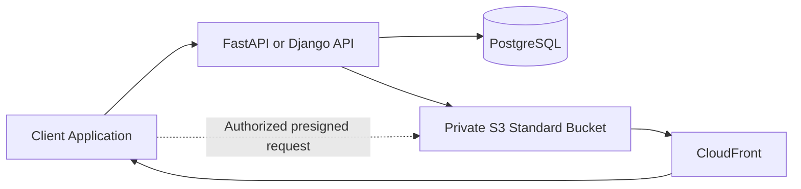

# 02- S3 Standard

## Overview

Amazon S3 Standard is the default general-purpose storage class in Amazon Simple Storage Service (Amazon S3). It is designed for frequently accessed data that requires low-latency retrieval, high throughput, and multi-Availability Zone resilience.

S3 Standard is suitable for production backend applications where objects are continuously uploaded, downloaded, processed, or delivered to users. Typical examples include customer documents, profile images, application assets, frequently queried datasets, and content served through Amazon CloudFront.

The storage class determines the storage and access characteristics of an object. It does not change the fundamental S3 object model or replace application-level access control, encryption, versioning, or disaster recovery design.

## Core Characteristics

### Technical specifications

| Characteristic | S3 Standard behavior |
|---|---|
| API storage class identifier | `STANDARD` |
| Default for general purpose buckets | Yes |
| Designed durability | 99.999999999% (11 nines) |
| Designed availability | 99.99% over a given year |
| Availability Zone distribution | At least three AZs |
| Object access latency | Milliseconds |
| Minimum storage duration | None |
| Minimum billable object size | None |
| Per-GB retrieval charge | None |
| Storage capacity provisioning | Not required |
| Primary access model | Standard S3 object APIs |
| Encryption at rest | Enabled by default for new object uploads |

The durability and availability figures describe different properties. Durability concerns the likelihood of preserving data; availability concerns the ability to access it. Neither eliminates the need for appropriate application resilience or recovery planning.

Reference: [Understanding and managing S3 storage classes](https://docs.aws.amazon.com/AmazonS3/latest/userguide/storage-class-intro.html).

### Why use S3 Standard?

S3 Standard is a practical default when access patterns are frequent or the cost of retrieval delays would outweigh potential storage savings from colder classes.

Its principal advantages are:

- Low-latency object access without an archive restoration workflow.
- High request throughput and automatic scaling.
- Redundant storage across multiple Availability Zones.
- No minimum storage duration or minimum billable object size.
- No per-GB retrieval charge.
- Compatibility with common S3 application, analytics, and content-delivery workflows.

The principal trade-off is storage cost. Objects that remain unused for long periods may cost less in an alternative storage class, depending on retrieval frequency, object size, retention, and request volume.

## Common Production Use Cases

### Backend file storage

S3 Standard is appropriate for files that users frequently upload, view, or download through a backend application.

Examples include:
- Customer documents and attachments.
- Frequently accessed product images.
- Active user-generated media.
- Reports and generated exports.
- Files shared across backend services.

A typical architecture uses a database to store ownership and metadata, while S3 stores the object bytes.



The API authenticates users and authorizes access. PostgreSQL stores business metadata, and S3 stores the file content. Presigned URLs can allow clients to upload or download directly from S3 without routing all file bytes through the application server.

A production implementation should use generated object keys, validate uploaded content, and keep the bucket private unless a specific architecture requires otherwise.

### Static assets and content delivery

S3 Standard works well for frequently accessed assets such as JavaScript bundles, CSS files, images, and downloadable resources.

For public-facing production websites, a common design is to keep the S3 bucket private and use CloudFront as the content delivery layer. CloudFront caches frequently requested content at edge locations, reducing repeated origin requests and improving delivery performance for geographically distributed users.

S3 Standard provides the durable origin storage; CloudFront provides caching and content delivery. They serve different responsibilities.

### Active analytics datasets

Frequently queried datasets, ingestion outputs, and active data lake objects can remain in S3 Standard when analytics engines repeatedly read them.

The appropriate class depends on the workload. Frequently scanned data can benefit from avoiding retrieval charges and archive restoration delays, while older datasets may be candidates for lifecycle transitions after access patterns are measured.

## Object Storage and Access Behavior

### S3 Standard is an object-level storage class

Storage class is associated with an object rather than being a single setting that forces every object in a general purpose bucket to use the same class.

A bucket can contain objects in different supported storage classes. S3 Standard is used when an upload does not specify another storage class.

The `STANDARD` identifier is used by supported APIs and SDKs to specify this class explicitly.

For general purpose buckets, selecting Standard does not require preallocating disk capacity or configuring storage volumes.

### Strong consistency

Amazon S3 provides strong read-after-write consistency for object PUT and DELETE operations, including overwrites of existing keys.

After a successful write, a subsequent read can observe the written object. This behavior applies to S3 Standard as part of the S3 consistency model.

For example, a backend can upload an object and then update its database record after S3 confirms the upload. A subsequent successful GET can retrieve that object without waiting for an eventual-consistency window.

Strong consistency does not make a multi-step workflow transactional. If the S3 upload succeeds but the database transaction fails, the application still needs reconciliation or cleanup logic.

Reference: [Amazon S3 data consistency model](https://docs.aws.amazon.com/AmazonS3/latest/userguide/Welcome.html).

## Upload Objects Using S3 Standard

### AWS CLI

S3 Standard is selected automatically for general purpose bucket uploads when no other storage class is specified.

```bash
aws s3 cp ./report.pdf \
  "s3://${BUCKET}/reports/report.pdf"
```

To specify the storage class explicitly:

```bash
aws s3 cp ./report.pdf \
  "s3://${BUCKET}/reports/report.pdf" \
  --storage-class STANDARD
```

Inspect an object's properties:

```bash
aws s3api head-object \
  --bucket "$BUCKET" \
  --key "reports/report.pdf"
```

Use the response to inspect available object metadata and storage-class information. Interpret any omitted storage-class field according to the API's response semantics rather than assuming that the object is unavailable.

### Python with Boto3

For a Python backend, keep S3 operations inside a reusable service layer rather than placing infrastructure logic directly in every API route.

```python
import os
import boto3
from botocore.config import Config
from botocore.exceptions import BotoCoreError, ClientError

S3_BUCKET = os.environ["S3_BUCKET"]
AWS_REGION = os.environ.get("AWS_REGION", "ap-south-1")

s3_client = boto3.client(
    "s3",
    region_name=AWS_REGION,
    config=Config(
        retries={"mode": "standard", "max_attempts": 4},
        connect_timeout=5,
        read_timeout=60,
    ),
)


def upload_file(file_path: str, object_key: str) -> None:
    """Upload a file using the S3 Standard storage class."""
    try:
        s3_client.upload_file(
            file_path,
            S3_BUCKET,
            object_key,
            ExtraArgs={"StorageClass": "STANDARD"},
        )
    except (BotoCoreError, ClientError) as exc:
        raise RuntimeError(
            f"Unable to upload object: {object_key}"
        ) from exc
```

This example uses the AWS SDK credential provider chain, allowing credentials to come from an appropriate execution role, local development profile, or other supported credential provider. Do not hardcode access keys in application source code.

The example catches SDK-level errors and converts them into an application exception. Production applications should preserve structured error details in logs, avoid recording sensitive document data, and map failures to suitable API responses.

The timeout and retry configuration should be tuned to the workload. Large uploads, multipart transfers, and latency-sensitive APIs may need separate policies.

## Performance and Scalability

### Use S3's automatic scaling

S3 automatically scales to high request rates. AWS documents baseline request-rate guidance of at least 3,500 PUT/COPY/POST/DELETE requests or 5,500 GET/HEAD requests per second per partitioned prefix, with scaling occurring gradually.

Actual throughput and latency depend on request sizes, concurrency, client networking, workload distribution, and other factors.

For most applications, begin with straightforward object keys and measure real traffic before redesigning prefixes for performance.

### Improve repeated-read performance

For frequently accessed objects, consider caching before changing storage classes.

Useful options include:

- **CloudFront:** Cache frequently requested public or appropriately authorized content close to users.
- **Application caching:** Cache suitable metadata or computed responses in Redis.
- **Parallel transfers:** Use parallelism for large downloads, uploads, and independent object operations where appropriate.
- **Connection reuse:** Reuse SDK clients rather than creating a new client for every request.

Caching must respect authorization and invalidation requirements. Do not share cached private content across users or tenants without appropriate isolation.

### Avoid unnecessary application-server data transfer

For large files, routing every byte through a Django or FastAPI server can consume application bandwidth, memory, and worker capacity.

A presigned URL architecture allows a backend to authorize an operation and return temporary access to S3. The client transfers file contents directly, while the backend manages business permissions and metadata.

Use streaming for backend-mediated transfers when direct upload or download is unsuitable. Avoid loading entire large objects into memory without an explicit size and concurrency budget.

## Cost Considerations

S3 Standard has no per-GB retrieval fee, no minimum storage duration, and no minimum billable object size. However, that does not make access or storage free.

Evaluate the following cost categories:

| Cost component | Consideration |
|---|---|
| Stored data | Billed according to stored data volume and applicable regional rates |
| Requests | PUT, GET, COPY, LIST, and other requests have applicable charges |
| Data transfer | Applicable transfer charges depend on the traffic path and destination |
| CloudFront | Includes its own request, data-transfer, and related charges |
| Replication | Can add destination storage, request, and transfer costs |
| Versioning | Retained object versions continue to consume storage |
| Monitoring | Inventory, logging, analytics, and other optional management capabilities may incur costs |

For a frequently accessed dataset, Standard can provide a better total cost than a lower-priced storage class that incurs frequent retrieval charges. For data that is rarely accessed, compare Standard with Intelligent-Tiering or suitable archival classes using real access metrics and current regional pricing.

Do not choose a class solely by its per-GB storage price.

Reference: [Amazon S3 pricing](https://aws.amazon.com/s3/pricing/).

## Operational and Security Considerations

### Distinguish durability from backup

S3 Standard's multi-AZ design protects against certain infrastructure failures. It does not automatically protect against every logical or administrative failure.

For important data, consider whether the application also requires:
- S3 Versioning for recovery from accidental overwrites or deletes.
- S3 Replication for additional copies and geographic resilience.
- S3 Object Lock for applicable retention and immutability requirements.
- A tested recovery process with defined recovery time and recovery point objectives.

Choose these controls according to the threat model and recovery requirements.

### Keep access controls independent of storage class

Using S3 Standard does not make an object public or private. Access is governed by the applicable IAM policies, bucket policies, access points, and other authorization controls.

Apply least privilege, keep application buckets private by default, and use temporary credentials for workloads. For customer-managed SSE-KMS encryption, ensure that the relevant principals have the required S3 and KMS permissions.

Encryption, authorization, storage class, and recovery are separate design dimensions.

### Monitor application outcomes

Monitor more than storage volume. Relevant indicators include:

- S3 request latency and error rates.
- Failed uploads and incomplete application workflows.
- Request volumes and data-transfer trends.
- Storage usage by class.
- CloudFront cache-hit ratio where applicable.
- Estimated cost by bucket, workload, or environment.

Use CloudWatch, S3 Storage Lens, Cost and Usage Reports, and application telemetry according to the required level of detail.

## Common Mistakes

| Mistake | Why it matters | Recommended approach |
|---|---|---|
| Treating Standard as the cheapest class for every workload | Infrequently accessed data may be cheaper elsewhere | Measure access patterns and total cost |
| Assuming 11-nines durability means zero data-loss risk | Durability is a design target, not a guarantee against every logical failure | Use appropriate versioning, replication, or backup controls |
| Treating availability as equivalent to durability | Stored data can be durable while temporarily unavailable | Design application retries and resilience separately |
| Sending every large file through the API server | Consumes application resources and can increase latency | Consider direct client-to-S3 transfers |
| Creating random prefixes without evidence of a bottleneck | Adds complexity without necessarily improving performance | Benchmark the actual request pattern first |
| Assuming a successful upload and database update form one transaction | S3 and the database do not share a single atomic transaction | Use explicit workflow state and reconciliation |
| Ignoring object versions in cost analysis | Old versions continue consuming storage | Monitor versioned storage and configure retention intentionally |
| Assuming S3 Standard provides cross-Region disaster recovery | Standard is resilient across AZs within a Region, not a substitute for a second Region | Configure and test a suitable cross-Region recovery design when required |

## Verification Checklist

- [ ] The workload requires frequent or latency-sensitive object access.
- [ ] S3 Standard's availability and resilience characteristics satisfy the requirements.
- [ ] Uploads use the intended storage class.
- [ ] S3 access is private and follows least-privilege authorization.
- [ ] Application credentials come from an approved AWS credential provider.
- [ ] File transfers have suitable timeout, retry, and concurrency limits.
- [ ] Large objects do not unnecessarily pass through application memory.
- [ ] Request, transfer, and storage costs are monitored.
- [ ] Existing lifecycle, versioning, and replication policies match retention and recovery needs.
- [ ] Performance has been measured using representative workload patterns.

## Authoritative References

- [Amazon S3 storage class comparison](https://docs.aws.amazon.com/AmazonS3/latest/userguide/storage-class-intro.html)
- [Setting an object's storage class](https://docs.aws.amazon.com/AmazonS3/latest/userguide/sc-howtoset.html)
- [Optimizing S3 performance](https://docs.aws.amazon.com/AmazonS3/latest/userguide/optimizing-performance.html)
- [S3 performance design patterns](https://docs.aws.amazon.com/AmazonS3/latest/userguide/optimizing-performance-design-patterns.html)
- [Data protection and durability in S3](https://docs.aws.amazon.com/AmazonS3/latest/userguide/DataDurability.html)
- [S3 Versioning](https://docs.aws.amazon.com/AmazonS3/latest/userguide/Versioning.html)
- [Amazon S3 pricing](https://aws.amazon.com/s3/pricing/)

## Key Takeaways

- S3 Standard is the default general-purpose storage class for frequently accessed objects requiring millisecond access and multi-AZ resilience.
- It provides designed durability of 99.999999999% and availability of 99.99%, but these properties do not replace application recovery planning.
- Storage class selection should consider total storage, request, transfer, and related infrastructure costs.
- Use SDK reuse, suitable concurrency, caching, and direct-to-S3 transfers to improve backend performance.
- Combine Standard with appropriate authorization, monitoring, versioning, replication, and tested recovery procedures when the workload requires them.