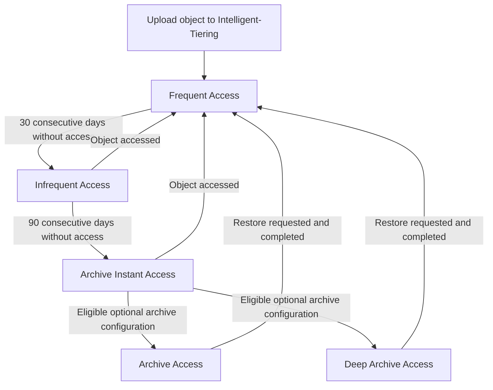
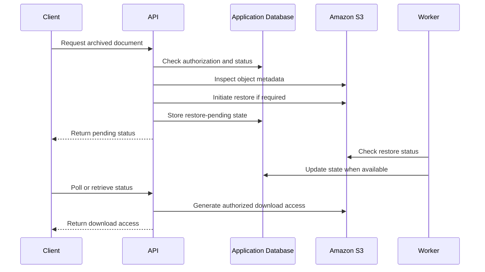

# 03- S3 Intelligent-Tiering

## Overview

Amazon S3 Intelligent-Tiering is a storage class designed to reduce storage costs automatically when object access patterns change or are difficult to predict. Amazon S3 monitors eligible objects and moves them between access tiers according to periods of inactivity.

Unlike conventional lifecycle rules, which transition objects based on age or configured filters, Intelligent-Tiering adapts to object-level access behavior. This makes it useful for data lakes, document repositories, application uploads, analytics datasets, and other workloads where the future access frequency of individual objects is uncertain.

The storage class provides three automatic access tiers, with two additional optional archive tiers for workloads that can tolerate asynchronous retrieval.

Key characteristics include:

- Automatic tiering based on object access patterns.
- Millisecond access in the Frequent, Infrequent, and Archive Instant Access tiers.
- Optional asynchronous archival using Archive Access and Deep Archive Access.
- No data retrieval charges for Intelligent-Tiering objects.
- A monthly monitoring and automation charge for eligible objects.
- No minimum storage-duration requirement for the storage class.

The principal engineering decision is whether automatic tiering can reduce total storage costs enough to justify monitoring fees and, when enabled, the operational consequences of restoring archived objects.

## Storage Class Architecture

### Understand the five access tiers

| Access tier | Type | Default inactivity threshold | Access characteristics | Typical workload |
|---|---|---|---|---|
| Frequent Access | Automatic | Initial tier | Millisecond access | Active application data |
| Infrequent Access | Automatic | 30 consecutive days without access | Millisecond access | Historical documents occasionally accessed |
| Archive Instant Access | Automatic | 90 consecutive days without access | Millisecond access | Rarely accessed data requiring immediate availability |
| Archive Access | Optional | At least 90 consecutive days without access | Asynchronous retrieval, typically 3–5 hours with Standard retrieval | Long-term records that may be requested occasionally |
| Deep Archive Access | Optional | At least 180 consecutive days without access | Asynchronous retrieval, typically within 12 hours with Standard retrieval | Long-term archives with infrequent access |

The inactivity thresholds for the optional archive tiers can be configured, up to 730 days. Retrieval-time figures are documented service expectations, not application response-time guarantees.

Reference: [How S3 Intelligent-Tiering works](https://docs.aws.amazon.com/AmazonS3/latest/userguide/intelligent-tiering-overview.html).

### Understand the automatic tiering lifecycle

Objects uploaded directly into Intelligent-Tiering begin in the Frequent Access tier.



The optional archive tiers are configured separately. They can archive eligible objects that have remained inactive for their configured thresholds, bypassing Archive Instant Access when the archive configuration is set accordingly.

Without an applicable optional archive configuration, the automatic tiers remain the normal tiering mechanism.

An important distinction is that an object's S3 storage class remains `INTELLIGENT_TIERING` while its internal access tier changes. An object's archive state is additional information, not a different S3 storage-class value.

## How Intelligent-Tiering Determines Access

### Understand which operations influence tiering

Amazon S3 evaluates access at the object level. Certain operations reset inactivity tracking or move objects from lower-cost automatic tiers back into Frequent Access.

| Operation | Effect on tiering |
|---|---|
| `GetObject` | Counts as access; can move an automatically tiered object back to Frequent Access |
| `PutObject` | Counts as access; a newly uploaded object starts in Frequent Access |
| `CompleteMultipartUpload` | Counts as access |
| `CopyObject` | The source object is treated as accessed for tiering purposes |
| `UploadPartCopy` | The source object is treated as accessed for tiering purposes |
| `RestoreObject` | Counts as access for tiering purposes |
| `SelectObjectContent` | Resets inactivity tracking for the optional archive tiers but does not by itself move an object from Infrequent Access or Archive Instant Access back to Frequent Access |
| `HeadObject` | Does not by itself count as access for automatic tiering |
| `ListObjectsV2` | Does not by itself count as access for automatic tiering |
| `GetObjectTagging` | Does not by itself count as access for automatic tiering |

These distinctions matter when applications perform periodic inventory, monitoring, or metadata inspection. A workload that repeatedly calls `HeadObject` does not necessarily keep objects in Frequent Access.

The same applies to metadata-driven jobs that list objects without downloading them. Such jobs should not be treated as evidence that objects are actively consumed by end users.

Reference: [S3 Intelligent-Tiering access behavior](https://docs.aws.amazon.com/AmazonS3/latest/userguide/intelligent-tiering-overview.html).

### Understand how automatic promotion affects costs

When an object in Infrequent Access or Archive Instant Access is accessed through an operation that triggers promotion, Amazon S3 moves it back to Frequent Access.

There is no separate retrieval charge for this promotion. However, normal request costs and applicable data-transfer charges still need to be considered.

For workloads with sporadic access bursts, this behavior avoids the need to maintain custom code that moves objects between separate S3 storage classes.

It also means that frequent reads can prevent expected storage savings. Monitor access patterns after enabling Intelligent-Tiering rather than assuming that every object will eventually move to a lower-cost tier.

## Object Size and Eligibility

### Understand the 128 KB threshold

Only objects that are at least 128 KB are eligible for automatic tiering and monitoring.

Objects smaller than 128 KB can still be stored in Intelligent-Tiering, but they remain in the Frequent Access tier. They do not incur the per-object monitoring and automation charge.

This behavior is important for backend systems that create a large number of small files.

Examples include:

- JSON metadata documents.
- Small API-generated reports.
- Thumbnail images.
- Individual log fragments.
- Small intermediate analytics files.

If a workload primarily stores small objects, Intelligent-Tiering may not provide the expected savings because those objects cannot automatically move into lower-cost tiers.

Before adopting it, measure object size distribution, object count, and expected access frequency.

### Avoid creating excessive small objects

Large datasets can contain millions of objects, so a per-object cost can become material even when each individual charge is small.

For workloads where independent object access is not required, consider consolidating small records into larger files, such as partitioned Parquet datasets or compressed log batches.

Aggregation is not always appropriate. Preserve independent object boundaries when required for authorization, retention, lifecycle policies, recovery, or application semantics.

## Cost Model and Financial Trade-offs

### Understand the costs

Intelligent-Tiering eliminates data retrieval charges, but it does not eliminate all storage-related charges.

| Cost component | Consideration |
|---|---|
| Storage | Depends on the access tier and stored volume |
| Monitoring and automation | Monthly per-object charge for eligible monitored objects |
| Requests | Normal S3 API request charges still apply |
| Data transfer | Applicable transfer charges still apply |
| Archive metadata | Additional metadata storage is billed when objects use the optional archive tiers |
| Restoration | Standard and Bulk Intelligent-Tiering archive retrievals have no data retrieval charge; request charges and optional expedited retrieval charges can apply |
| Inventory and events | Enabled management and monitoring features can introduce additional costs |

For objects archived into Archive Access or Deep Archive Access, S3 maintains additional metadata: 8 KB billed at S3 Standard rates and 32 KB billed at the applicable Glacier storage rate.

Consequently, the cost of a large archive must include both object storage and the associated per-object monitoring and archive metadata effects.

Check current regional prices using the [Amazon S3 pricing page](https://aws.amazon.com/s3/pricing/).

### Estimate the monitoring overhead

A useful first estimate is:

\[
C_{\text{monitoring}} =
N_{\text{eligible objects}}
\times
R_{\text{monthly monitoring per object}}
\]

Where:

- \(N_{\text{eligible objects}}\) is the number of monitored objects.
- \(R_{\text{monthly monitoring per object}}\) is the applicable regional charge.

This is only one component of total cost. A complete estimate must include storage, API requests, transfer, archive metadata, and any enabled management features.

For example, storing a large number of eligible objects with highly predictable, infrequent access may still be cheaper using a suitable lifecycle policy and a conventional storage class.

Conversely, a dataset with frequently changing access patterns may benefit substantially from Intelligent-Tiering because it adapts without repeated manual migration.

### Compare Intelligent-Tiering with lifecycle policies

| Consideration | Intelligent-Tiering | S3 Lifecycle transitions |
|---|---|---|
| Transition basis | Access behavior | Configured object age and rule filters |
| Access-pattern knowledge | Useful when unknown or changing | Best when expected retention and access patterns are understood |
| Monitoring charge | Applies to eligible monitored objects | No Intelligent-Tiering monitoring fee unless objects use that class |
| Transition request costs | Automatic tier movements within the class do not incur additional tiering charges | Applicable lifecycle transition request charges apply |
| Retrieval charges | No data retrieval charges | Depends on the destination storage class |
| Operational complexity | Low for automatic tiers | Requires lifecycle policy design and maintenance |
| Archive restoration | Required for optional asynchronous tiers | Required for archive classes that use asynchronous restoration |

Use the mechanism that best matches the workload. Intelligent-Tiering and lifecycle policies are complementary, not mutually exclusive.

## Upload Objects into Intelligent-Tiering

### Use the AWS CLI

New objects can be written directly into Intelligent-Tiering.

```bash
aws s3 cp ./report.parquet \
  "s3://${BUCKET}/analytics/report.parquet" \
  --storage-class INTELLIGENT_TIERING
```

The uploaded object starts in Frequent Access and becomes eligible for automatic tiering if it meets the size threshold.

Inspect the resulting object:

```bash
aws s3api head-object \
  --bucket "$BUCKET" \
  --key "analytics/report.parquet"
```

The returned metadata includes the object's storage class. It may also expose archive-related metadata when applicable.

### Use Boto3

In Python backend applications, the storage class can be set at upload time.

```python
import os

import boto3
from botocore.config import Config


def create_s3_client():
    return boto3.client(
        "s3",
        region_name=os.environ["AWS_REGION"],
        config=Config(
            retries={
                "mode": "standard",
                "max_attempts": 5,
            }
        ),
    )


def upload_report(
    file_path: str,
    bucket: str,
    object_key: str,
) -> None:
    s3_client = create_s3_client()

    s3_client.upload_file(
        file_path,
        bucket,
        object_key,
        ExtraArgs={
            "StorageClass": "INTELLIGENT_TIERING",
        },
    )
```

The example uses the standard AWS credential provider chain. In production, use IAM roles, workload identity, or another approved temporary-credential mechanism instead of hardcoded access keys.

The upload logic should live in a reusable storage service rather than being duplicated across Django views, FastAPI routes, Celery tasks, or other application components.

For larger objects, use managed multipart upload functionality and review retry, concurrency, and memory behavior for the chosen SDK.

## Transition Existing Objects into Intelligent-Tiering

Existing objects can be moved from supported storage classes into Intelligent-Tiering using S3 Lifecycle or S3 Batch Operations.

A lifecycle configuration can be applied to a specific prefix. For example:

```json
{
  "Rules": [
    {
      "ID": "MoveReportsToIntelligentTiering",
      "Status": "Enabled",
      "Filter": {
        "Prefix": "reports/"
      },
      "Transitions": [
        {
          "Days": 0,
          "StorageClass": "INTELLIGENT_TIERING"
        }
      ]
    }
  ]
}
```

This example allows eligible objects under `reports/` to transition to Intelligent-Tiering according to the configured rule. Lifecycle execution is asynchronous, and eligibility does not mean that every object transitions immediately.

Before applying the rule:

- Confirm the supported source-to-destination transition.
- Review object size distributions and monitoring costs.
- Account for versioning and noncurrent objects.
- Preserve existing lifecycle rules.
- Verify that the rule applies only to the intended population.

A `put-bucket-lifecycle-configuration` operation replaces the bucket's existing lifecycle configuration. Retrieve and merge the intended configuration before deployment instead of accidentally removing unrelated rules.

Reference: [Using S3 Intelligent-Tiering](https://docs.aws.amazon.com/AmazonS3/latest/userguide/using-intelligent-tiering.html).

## Configure the Optional Archive Tiers

### Decide whether asynchronous archival is appropriate

The automatic Archive Instant Access tier provides millisecond access. Optional Archive Access and Deep Archive Access are intended for data that can tolerate restoration delays.

Enable optional tiers only when the application can handle asynchronous access.

Good candidates include historical exports, older data lake partitions, long-term reports, and archival document repositories with an explicit restore workflow.

Avoid enabling them indiscriminately for active application data, user-facing downloads, or systems that assume every successful `GetObject` request can retrieve data immediately.

### Configure archive tiers with the AWS CLI

The following configuration enables optional archival for the `archive/` prefix.

Create `intelligent-tiering.json`:

```json
{
  "Id": "ArchiveInactiveRecords",
  "Status": "Enabled",
  "Filter": {
    "Prefix": "archive/"
  },
  "Tierings": [
    {
      "Days": 90,
      "AccessTier": "ARCHIVE_ACCESS"
    },
    {
      "Days": 180,
      "AccessTier": "DEEP_ARCHIVE_ACCESS"
    }
  ]
}
```

Apply the configuration:

```bash
aws s3api put-bucket-intelligent-tiering-configuration \
  --bucket "$BUCKET" \
  --id "ArchiveInactiveRecords" \
  --intelligent-tiering-configuration file://intelligent-tiering.json
```

Inspect the configuration:

```bash
aws s3api get-bucket-intelligent-tiering-configuration \
  --bucket "$BUCKET" \
  --id "ArchiveInactiveRecords"
```

List the configured rules:

```bash
aws s3api list-bucket-intelligent-tiering-configurations \
  --bucket "$BUCKET"
```

The configuration applies to eligible objects matching the filter and enables the configured inactivity thresholds. The selected Days values represent consecutive days without qualifying access, not simply time elapsed since the object's creation.

You can scope configurations further using object tags or combinations of prefixes and tags. This is useful when different applications or business units require distinct archival thresholds.

A general-purpose bucket can have up to 1,000 Intelligent-Tiering configurations. Manage these rules through infrastructure as code or another controlled configuration process rather than creating overlapping rules without ownership and review.

Reference: [AWS CLI: put-bucket-intelligent-tiering-configuration](https://docs.aws.amazon.com/cli/latest/reference/s3api/put-bucket-intelligent-tiering-configuration.html).

## Restore Archived Objects

### Understand restoration behavior

Objects in the optional Archive Access and Deep Archive Access tiers are not available for real-time retrieval.

When restoration is requested and completes, the object moves back into Frequent Access. Unlike restoring an object in the S3 Glacier Flexible Retrieval or Deep Archive storage classes, Intelligent-Tiering restoration does not create a temporary restored copy that expires after a specified number of days.

This distinction affects application design and storage-cost forecasting.

| Concern | Intelligent-Tiering optional archive tiers |
|---|---|
| Real-time access before restore | Not available |
| Restore mechanism | `RestoreObject` |
| Restore duration | Depends on the access tier and retrieval option |
| Temporary restored-copy expiry | Not applicable |
| Destination tier after restore | Frequent Access |
| Retrieval charges | No data retrieval charge for Standard or Bulk retrievals; applicable request charges remain possible |

### Initiate a restore request

```bash
aws s3api restore-object \
  --bucket "$BUCKET" \
  --key "archive/historical-report.parquet" \
  --restore-request '{}'
```

For Intelligent-Tiering's optional archive tiers, the restore request does not accept a `Days` value.

Inspect the restore status:

```bash
aws s3api head-object \
  --bucket "$BUCKET" \
  --key "archive/historical-report.parquet" \
  --query '{StorageClass:StorageClass,ArchiveStatus:ArchiveStatus,Restore:Restore}'
```

Check the response for archive status or an in-progress restoration indicator. Do not assume that a successful initiation response means the object is already available.

### Build an asynchronous restore workflow

A backend API should treat restoration as a background operation.



Recommended implementation details:

- Track restore state in a durable database.
- Deduplicate repeated restore requests from the same workflow.
- Use a background worker or scheduled process to monitor pending restores.
- Configure bounded retries and operational timeouts.
- Notify users when the object becomes available.
- Keep authorization checks separate from the restore mechanism.
- Handle restore failures without permanently marking the object available.

For large archives, use S3 Inventory to identify eligible objects and S3 Batch Operations to initiate restoration at scale.

Reference: [Restoring archived S3 objects](https://docs.aws.amazon.com/AmazonS3/latest/userguide/restoring-objects.html).

## Monitor and Audit Tiering

### Use S3 Inventory

S3 Inventory can generate scheduled reports containing object metadata, including storage-class and archive-related information where applicable.

Use Inventory to answer questions such as:

- Which object populations are in Intelligent-Tiering?
- Which objects occupy the optional archive tiers?
- How many objects are below the 128 KB auto-tiering threshold?
- How is the distribution of objects changing over time?
- Which data populations are suitable for a different storage strategy?

Inventory reports are not a substitute for real-time object metadata. Account for report frequency and processing delays in operational workflows.

### Use event notifications for archival state changes

Amazon S3 can publish `s3:IntelligentTiering` event notifications when objects move into the optional Archive Access or Deep Archive Access tiers.

These notifications can be routed to supported destinations such as Amazon SQS, Amazon SNS, or AWS Lambda.

A consumer can use such events to update application metadata, inform users of archival state, or maintain operational metrics.

For production event processing:

- Make consumers idempotent.
- Handle duplicate and out-of-order events.
- Keep event handlers short and retry-safe.
- Persist state transitions rather than relying on an in-memory flag.
- Verify the actual object state when necessary.

Restoration completion can be tracked separately using supported S3 restore event notifications or periodic metadata inspection.

Reference: [Managing S3 Intelligent-Tiering](https://docs.aws.amazon.com/AmazonS3/latest/userguide/intelligent-tiering-managing.html).

### Monitor cost and behavior

Review the following indicators during regular storage-cost reviews:

| Indicator | Purpose |
|---|---|
| Object count by prefix | Estimate monitoring overhead and target populations |
| Object size distribution | Determine eligibility for automatic tiering |
| Storage volume by access tier | Understand the effectiveness of cost optimization |
| Request volume by workload | Identify frequently accessed populations |
| Archive transitions | Verify that optional configurations behave as expected |
| Restore duration and failure rate | Validate archive recovery objectives |
| Monthly storage and request costs | Compare actual costs with estimates |
| Cost per retained dataset | Evaluate whether the current storage strategy remains appropriate |

CloudWatch, S3 Inventory, S3 Storage Lens, and AWS billing reports provide complementary views of the workload. Select the combination that matches your scale, operational requirements, and cost budget.

## Security and Production Considerations

### Preserve existing access controls

Intelligent-Tiering does not replace S3 authorization policies, encryption, versioning, or retention controls.

Continue to apply least-privilege IAM permissions and appropriate bucket policies. Where encryption uses SSE-KMS, verify that the relevant principals have the required S3 and KMS permissions.

Do not make a bucket public or broaden IAM access simply to simplify restoration or archival processing.

### Separate archival configuration from deletion policy

Moving objects into an archive tier is not the same as deleting or expiring them.

Use explicit lifecycle policies and retention controls for deletion requirements. Consider versioned objects, noncurrent versions, legal holds, and regulatory obligations separately.

An object can remain archived indefinitely unless another applicable lifecycle or administrative action changes its state.

### Use infrastructure as code

Manage archive configuration alongside the other S3 resources using a reviewed, repeatable deployment process.

For Terraform-based environments, use the S3 bucket Intelligent-Tiering configuration resource supported by the selected AWS provider version. Keep environment-specific filters and thresholds configurable.

Validate configuration changes in a lower environment before rolling them into production. Pay particular attention to prefix filters, tags, inactivity thresholds, and any overlapping configuration rules.

## Common Mistakes

| Mistake | Consequence | Better approach |
|---|---|---|
| Expecting objects smaller than 128 KB to move automatically | Small objects remain in Frequent Access | Analyze object sizes before selecting the class |
| Treating Archive Instant Access as asynchronous archival | An unnecessary restore workflow may be introduced | Distinguish automatic low-latency tiers from optional archive tiers |
| Enabling Archive Access for all application objects | Real-time reads may fail until restoration completes | Scope asynchronous tiers to appropriate prefixes or tags |
| Assuming object age determines every transition | Objects are archived at unexpected times | Understand inactivity tracking and the access operations that reset it |
| Calling `HeadObject` to keep an object hot | Metadata inspection does not promote objects back to Frequent Access | Use actual supported access operations when the application needs to retrieve content |
| Forgetting monitoring and archive metadata costs | Savings are lower than the storage-rate comparison suggests | Estimate total costs using object counts and actual sizes |
| Treating restore initiation as completion | Applications attempt reads before restoration finishes | Track restore state and make availability explicit |
| Assuming restored archive-tier objects expire automatically | Incorrect retention assumptions can break workflows | Remember that restored Intelligent-Tiering objects return to Frequent Access |
| Applying overlapping archive configurations without review | Archive eligibility becomes difficult to reason about | Manage configuration centrally and audit filters |
| Enabling archival without recovery testing | Business recovery objectives may not be met | Measure restore duration and validate failure handling |

## Production Readiness Checklist

- [ ] Intelligent-Tiering is selected because object access patterns are unknown, changing, or unpredictable.
- [ ] Object-size distributions and the 128 KB auto-tiering eligibility threshold have been evaluated.
- [ ] Monitoring and automation charges have been included in the cost estimate.
- [ ] The optional archive tiers are enabled only for workloads that support asynchronous access.
- [ ] Archive inactivity thresholds align with application and business requirements.
- [ ] Prefix and tag filters have been reviewed for accuracy and overlap.
- [ ] Restore workflows support durable state, retries, and completion verification.
- [ ] APIs do not assume immediate access to archived objects.
- [ ] Inventory and monitoring provide visibility into tier distribution and cost.
- [ ] Event consumers tolerate duplicate notifications and retry safely.
- [ ] IAM permissions and encryption policies remain least-privileged.
- [ ] Lifecycle configuration changes preserve existing rules and retention requirements.
- [ ] Deployment changes are reviewed and validated before production rollout.
- [ ] Restore procedures and expected recovery times have been tested.

## Authoritative References

- [Managing storage costs with S3 Intelligent-Tiering](https://docs.aws.amazon.com/AmazonS3/latest/userguide/intelligent-tiering.html)
- [How S3 Intelligent-Tiering works](https://docs.aws.amazon.com/AmazonS3/latest/userguide/intelligent-tiering-overview.html)
- [Using S3 Intelligent-Tiering](https://docs.aws.amazon.com/AmazonS3/latest/userguide/using-intelligent-tiering.html)
- [Managing S3 Intelligent-Tiering](https://docs.aws.amazon.com/AmazonS3/latest/userguide/intelligent-tiering-managing.html)
- [AWS CLI: PutBucketIntelligentTieringConfiguration](https://docs.aws.amazon.com/cli/latest/reference/s3api/put-bucket-intelligent-tiering-configuration.html)
- [Restoring archived S3 objects](https://docs.aws.amazon.com/AmazonS3/latest/userguide/restoring-objects.html)
- [Amazon S3 pricing](https://aws.amazon.com/s3/pricing/)

## Key Takeaways

- S3 Intelligent-Tiering optimizes eligible object storage according to access patterns, without requiring application-managed transitions between the automatic tiers.
- Objects smaller than 128 KB remain in Frequent Access and do not incur the per-object monitoring charge.
- Archive Access and Deep Archive Access are optional and require an explicit restoration workflow before content becomes available.
- Cost analysis must include monitoring, storage, requests, archive metadata, and applicable transfer costs.
- Inventory, event notifications, controlled configuration changes, and tested restore procedures are essential for operating Intelligent-Tiering reliably at scale.
You've reached the maximum length for this conversation, but you can keep talking by starting a new chat.
Start new chat