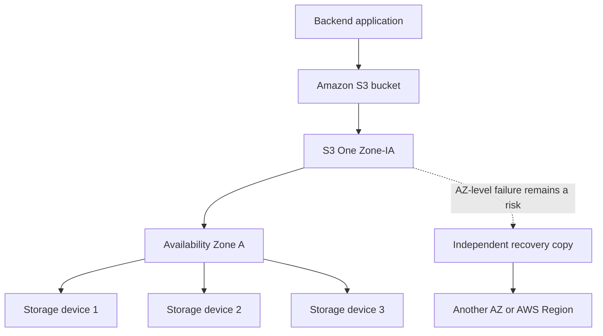
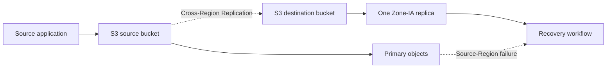

# 05- S3 One Zone-Infrequent Access

## Overview

Amazon S3 One Zone-Infrequent Access (S3 One Zone-IA) is a storage class designed for infrequently accessed data that requires millisecond retrieval but does not require resilience against the physical loss of an Availability Zone (AZ).

Unlike S3 Standard-IA, which stores objects redundantly across multiple Availability Zones, One Zone-IA stores objects redundantly across multiple devices within a single Availability Zone. This reduces storage costs but introduces a different failure boundary.

One Zone-IA is most appropriate for data that can be recreated, recovered from another copy, or regenerated from an authoritative source.

Typical use cases include:
- Reproducible analytics outputs and intermediate processing artifacts.
- Secondary backup copies when an independent, recoverable copy exists elsewhere.
- Cross-Region replication destinations where the source data remains independently recoverable.
- Infrequently accessed media derivatives and other regeneratable assets.
- Selected data-residency workloads using supported directory buckets in AWS Local Zones.

**Core principle:** High durability within an Availability Zone does not provide resilience against the loss of that entire Availability Zone.

Reference: [Understanding Amazon S3 storage classes](https://docs.aws.amazon.com/AmazonS3/latest/userguide/storage-class-intro.html).

## Technical Characteristics

### Core properties

| Property | S3 One Zone-IA |
|---|---|
| API storage-class identifier | `ONEZONE_IA` |
| Primary purpose | Infrequently accessed, recreatable data |
| Access latency | Milliseconds |
| Designed durability | 99.999999999% (11 nines) |
| Designed availability | 99.5% |
| Availability Zones | One |
| Minimum storage duration | 30 days |
| Minimum billable object size | 128 KB |
| Retrieval pricing | Per-GB retrieval charges apply |
| Storage pricing | Lower than S3 Standard-IA for storage in the same pricing context |
| Lifecycle transitions | Supported for eligible transitions |
| Typical recovery strategy | Recreate or recover from an independent copy |

The durability figure describes protection against object loss within the service's design assumptions. It does not mean that data will survive the physical destruction or loss of the Availability Zone containing the object.

Availability is also distinct from durability. A highly durable object may temporarily be unavailable, and a single-AZ storage class has a different availability and disaster-recovery profile from a multi-AZ storage class.

Consult the [official storage-class comparison](https://docs.aws.amazon.com/AmazonS3/latest/userguide/storage-class-intro.html) for current properties.

### Compare One Zone-IA with related classes

| Consideration | S3 Standard | S3 Standard-IA | S3 One Zone-IA |
|---|---|---|---|
| Primary workload | Frequently accessed data | Infrequently accessed data | Infrequently accessed, recreatable data |
| AZ resilience | Multi-AZ | Multi-AZ | Single-AZ |
| Retrieval latency | Milliseconds | Milliseconds | Milliseconds |
| Retrieval charges | Generally no per-GB retrieval charge | Apply | Apply |
| Minimum storage duration | None | 30 days | 30 days |
| Minimum billable object size | No 128 KB minimum specific to this class | 128 KB | 128 KB |
| Suitable as the only copy of irreplaceable data | Often, subject to the overall recovery design | Often, subject to the overall recovery design | Generally no |

Do not select One Zone-IA merely because the access frequency is low. The application's tolerance for an AZ-level outage is equally important.

## How One Zone-IA Stores Data

### Understand the failure boundary

Amazon S3 stores One Zone-IA objects redundantly across multiple devices within one Availability Zone. S3 monitors object integrity and manages storage-device failures within its service design.

However, the class does not provide the same cross-AZ protection as regional S3 storage classes.



The independent recovery copy must actually exist and be usable. Merely enabling versioning or relying on redundancy within the same AZ does not create an independent AZ-level recovery path.

### Distinguish device failures from AZ failures

| Failure scenario | Expected design behavior |
|---|---|
| Individual storage-device failure | S3 is designed to detect and repair lost redundancy within the class's protection model |
| Application attempts to access an object normally | Millisecond access is supported when the object is available |
| Temporary service or AZ availability issue | The application can experience access failures or increased recovery time |
| Physical loss of the AZ | Data in One Zone-IA is not protected against this failure in the same way as multi-AZ classes |
| Source system failure with a separate backup in another Region | Recovery may be possible if the independent copy and its access permissions are intact |

A disaster-recovery design must consider where the recovery copy is stored, whether it is encrypted with an accessible key, how quickly the copy can be restored, and whether the application can operate after recovery.

## Select Appropriate Workloads

### Use One Zone-IA for regeneratable data

One Zone-IA is a suitable candidate when the data is infrequently accessed, remains online for at least the required storage duration, and can tolerate the single-AZ failure boundary.

| Workload | Suitability | Reason |
|---|---|---|
| Reproducible machine-learning feature outputs | Good candidate | Can be recomputed from source datasets |
| Temporary analytics results retained for occasional inspection | Good candidate | Can be regenerated when necessary |
| Thumbnail images with preserved originals | Good candidate | Derivatives can be generated again |
| Secondary copy of on-premises backups | Conditional | Requires a separate recoverable copy and a tested recovery procedure |
| Destination for cross-Region replication | Conditional | Can protect against source-Region loss, but the destination itself retains a single-AZ failure boundary |
| Sole copy of customer documents | Poor candidate | AZ-level data loss can violate business recovery requirements |
| Primary database backup with no alternative copy | Poor candidate | An AZ-level event may remove the only recoverable backup |
| Frequently updated temporary files | Often a poor candidate | Minimum-duration charges can offset storage savings |

One Zone-IA is intended for infrequently accessed data. Frequent overwrites, short retention periods, and heavy retrieval traffic can materially reduce its financial advantage.

### Evaluate data criticality before cost optimization

Before selecting this class, answer the following questions:

- Can the data be recreated from a trusted source?
- Is an independent copy available if the selected AZ is lost?
- Can the application tolerate temporary unavailability during an AZ incident?
- Are the expected object lifetimes long enough to justify the minimum-duration requirement?
- Do retrieval and request charges remain acceptable under normal and recovery workloads?
- Can operators verify and execute the recovery process?

If the loss of the object would be unacceptable and no independent recoverable copy exists, prefer a suitable multi-AZ storage design.

## Upload Objects Using One Zone-IA

### Set the storage class at upload time

For a new object, the AWS CLI supports selecting One Zone-IA explicitly.

```bash
aws s3 cp ./analytics-output.parquet \
  "s3://${BUCKET}/derived/analytics-output.parquet" \
  --storage-class ONEZONE_IA
```

The bucket should be a supported bucket type in a supported location. The command uses the `ONEZONE_IA` API identifier.

For backend applications using Boto3:

```python
import boto3
from pathlib import Path


def upload_derived_artifact(
    bucket: str,
    object_key: str,
    local_path: Path,
) -> None:
    """Upload a regeneratable artifact using One Zone-IA."""
    s3 = boto3.client("s3")

    s3.upload_file(
        str(local_path),
        bucket,
        object_key,
        ExtraArgs={
            "StorageClass": "ONEZONE_IA",
        },
    )
```

This example assumes that the runtime already has appropriate AWS credentials and permissions. Prefer workload roles and the standard AWS credential-provider chain over hardcoded access keys.

Use this direct-upload approach when the application already knows that the object is eligible for One Zone-IA and the data will not immediately be deleted or overwritten.

For workloads with uncertain retention or changing access patterns, consider uploading to S3 Standard and applying a lifecycle policy after validating the economics and recovery requirements.

### Verify the storage class

Inspect an uploaded object:

```bash
aws s3api head-object \
  --bucket "$BUCKET" \
  --key "derived/analytics-output.parquet"
```

Check the response's `StorageClass` field. For the Standard storage class, this field may be absent; for an object stored in One Zone-IA, the expected value is `ONEZONE_IA`.

Verification should also confirm that the object is readable by the intended application role and that the relevant encryption configuration is correct.

## Automate Transitions with S3 Lifecycle

### Use lifecycle rules for predictable access patterns

S3 Lifecycle can transition eligible objects from supported source classes into One Zone-IA without requiring application-level changes to each object.

For example, a dataset may initially be written to S3 Standard and transitioned to One Zone-IA after its access frequency decreases.

Lifecycle automation is useful when:
- The object population can be identified using prefixes, tags, or object-size filters.
- The access pattern and retention requirement are sufficiently predictable.
- Transition request costs are justified by storage savings.
- The data remains suitable for the destination class's AZ failure characteristics.

### Example lifecycle configuration

The following configuration transitions objects in the `derived/` prefix to One Zone-IA on day zero, excluding objects smaller than 128 KiB.

S3 announced on July 16, 2026, that the previous 30-day minimum age before transitioning from S3 Standard to Standard-IA or One Zone-IA was removed. The destination class still has its own 30-day minimum storage-duration charge.

`lifecycle.json`:

```json
{
  "Rules": [
    {
      "ID": "TransitionDerivedArtifactsToOneZoneIA",
      "Status": "Enabled",
      "Filter": {
        "And": {
          "Prefix": "derived/",
          "ObjectSizeGreaterThan": 131071
        }
      },
      "Transitions": [
        {
          "Days": 0,
          "StorageClass": "ONEZONE_IA"
        }
      ]
    }
  ]
}
```

The size filter uses an exclusive comparison. `ObjectSizeGreaterThan: 131071` includes objects of 131072 bytes (128 KiB) and larger.

Inspect the existing lifecycle configuration before making changes:

```bash
aws s3api get-bucket-lifecycle-configuration \
  --bucket "$BUCKET"
```

After merging the intended rule with the existing configuration, apply it:

```bash
aws s3api put-bucket-lifecycle-configuration \
  --bucket "$BUCKET" \
  --lifecycle-configuration file://lifecycle.json
```

**Important:** This API replaces the bucket's complete lifecycle configuration. Do not submit a partial configuration if the bucket already contains other lifecycle rules.

Verify the final configuration and monitor the resulting object storage classes. Lifecycle actions may occur after an object becomes eligible rather than at an exact wall-clock instant.

References:

- [S3 Lifecycle transition constraints](https://docs.aws.amazon.com/AmazonS3/latest/userguide/lifecycle-transition-general-considerations.html)
- [S3 Lifecycle configuration examples](https://docs.aws.amazon.com/AmazonS3/latest/userguide/lifecycle-configuration-examples.html)
- [July 2026 transition-age update](https://aws.amazon.com/about-aws/whats-new/2026/07/s3-removes-30-day-transitions-standard-ia-one-zone-ia/)

## Understand Pricing and Minimum Storage Duration

### Account for the full cost model

One Zone-IA can reduce storage costs, but the storage rate is only one component of the total cost.

Evaluate the following components:

| Cost component | Operational implication |
|---|---|
| Storage | Charged according to stored data and applicable regional rates |
| Minimum billable object size | Objects smaller than 128 KB are charged as though they occupied 128 KB in this storage class |
| Minimum storage duration | A 30-day minimum applies to objects stored in One Zone-IA |
| Early deletion or transition | Deleting, overwriting, or transitioning an object before the minimum duration can incur a prorated charge for the remaining days |
| Retrieval | Data retrieval charges apply |
| Requests | Applicable request charges apply |
| Lifecycle transitions | Transition requests incur additional charges |
| Data transfer | Applicable transfer charges can apply when accessing or copying data across services or Regions |
| Disaster recovery | Recovery copies, transfer activity, and recovery operations can add costs |

Consult [Amazon S3 pricing](https://aws.amazon.com/s3/pricing/) for the current regional rates and request pricing.

### Understand the minimum-duration distinction

Two separate rules matter:

1. **Minimum age before transition:** As of July 16, 2026, the previous 30-day minimum age in S3 Standard before transitioning to Standard-IA or One Zone-IA has been removed.
2. **Minimum storage duration in One Zone-IA:** Objects stored in One Zone-IA remain subject to the 30-day minimum storage-duration charge.

For example, if an object transitions into One Zone-IA and is deleted five days later, the applicable minimum-duration charge can include the remaining 25 days of storage, even though the object no longer exists.

This distinction is important for ephemeral data, frequently overwritten objects, and lifecycle policies with short expiration periods.

### Analyze small objects carefully

The 128 KB minimum billable size can make One Zone-IA uneconomical for large populations of small objects.

Consider a workload storing millions of small JSON files or individual event records. Even if the logical data size is low, storage charges use the applicable minimum billable size. Every transition can also introduce a request charge.

Before using One Zone-IA for such workloads:
- Analyze the size distribution using S3 Inventory or suitable application metrics.
- Estimate transition and retrieval costs.
- Consider aggregating small records when independent object access is not required.
- Compare the total cost with S3 Standard or Intelligent-Tiering.

Do not aggregate records when doing so would complicate required retention, authorization, deletion, or recovery behavior.

## Use One Zone-IA with Replication Carefully

### Understand the replication architecture

One Zone-IA can be useful as the destination storage class for a replica when the goal is to maintain a copy in another AWS Region at a lower storage cost.



This architecture can improve resilience against a source-Region failure if the destination is in a different Region. However, the replica remains vulnerable to the loss of its own Availability Zone.

A replication destination is not automatically a fully tested backup or a complete disaster-recovery solution. Validate destination access, encryption permissions, object availability, and the ability to restore service.

### Validate replication configuration

For a cross-Region replication design using One Zone-IA:

- Enable versioning on both source and destination buckets.
- Configure the replication role and required S3 permissions.
- Review encryption and KMS permissions where applicable.
- Set the destination storage class to `ONEZONE_IA` in the replication rule where supported.
- Monitor replication status and failure conditions.
- Verify that destination objects can be accessed by authorized recovery principals.
- Test recovery in the destination Region.

Example replication destination fragment:

```json
{
  "Bucket": "arn:aws:s3:::example-destination-bucket",
  "StorageClass": "ONEZONE_IA"
}
```

This fragment illustrates the destination settings only. A functioning replication configuration also requires the rule's source selection, role permissions, status, and other required fields.

Also remember that replication is asynchronous. Newly written objects may not be immediately available at the destination, and existing objects generally require a separate replication mechanism such as S3 Batch Replication when historical backfill is necessary.

Reference: [Amazon S3 replication configuration](https://docs.aws.amazon.com/AmazonS3/latest/userguide/replication.html).

## Security and Operational Considerations

### Treat access control independently of storage class

Changing an object's storage class does not replace the need for appropriate authorization, encryption, and audit controls.

Apply the same security standards used for other S3 storage classes:
- Keep buckets private unless public access is explicitly required and reviewed.
- Use IAM roles with least-privilege permissions.
- Apply an approved server-side encryption configuration.
- Protect sensitive data in logs and monitoring systems.
- Audit access to the source and destination objects.
- Ensure that recovery identities have the necessary permissions.

For SSE-KMS encrypted objects, verify both S3 authorization and KMS authorization. Access to the destination bucket alone does not guarantee successful decryption.

### Monitor storage-class and recovery behavior

Operational monitoring should cover:
- Object counts and total bytes in One Zone-IA.
- Retrieval activity and associated charges.
- Unexpected overwrites or deletions within the minimum storage duration.
- Lifecycle transition results.
- Replication failures where One Zone-IA is used as a replica destination.
- Successful object reads by the intended application.
- Recovery test results and measured recovery time.

Use S3 Inventory, S3 Storage Lens, Cost and Usage Reports, CloudTrail where applicable, and application-level metrics to obtain the required visibility.

An operational process should periodically verify that data remains eligible for One Zone-IA. A dataset originally considered recreatable can become business-critical over time.

## Common Mistakes

| Mistake | Risk | Recommended practice |
|---|---|---|
| Using One Zone-IA as the only copy of critical data | The data is not protected against physical loss of the AZ | Maintain an independent recoverable copy |
| Confusing durability with AZ resilience | Eleven nines of durability does not mean the data survives loss of its AZ | Evaluate durability and failure domains separately |
| Ignoring minimum storage duration | Early deletion, overwrite, or transition can trigger prorated charges | Validate expected object lifetime and update patterns |
| Ignoring the 128 KB minimum billable size | Small objects can cost more than expected | Analyze object-size distributions before migration |
| Optimizing only for storage price | Retrieval, requests, and recovery operations can erode savings | Calculate total cost of ownership |
| Using direct uploads for short-lived objects without analysis | Frequent replacement can create early-deletion charges | Use an appropriate lifecycle and ingestion strategy |
| Assuming replication is synchronous | Recent objects may not yet exist at the destination | Design for asynchronous replication and validate recovery |
| Assuming a replica eliminates every disaster risk | The destination has its own availability and failure boundaries | Define and test the complete recovery architecture |
| Applying lifecycle configuration without preserving existing rules | Unrelated lifecycle policies may be removed | Retrieve, merge, validate, and deploy the full configuration |
| Ignoring changed business criticality | Data may no longer be suitable for single-AZ storage | Reassess the storage class as requirements evolve |

## Production Readiness Checklist

- [ ] The workload is infrequently accessed and is suitable for One Zone-IA.
- [ ] The organization has documented its tolerance for the loss of the selected Availability Zone.
- [ ] Critical or irreplaceable data has an independent recoverable copy.
- [ ] The object's expected lifetime justifies the 30-day minimum storage-duration charge.
- [ ] The 128 KB minimum billable size has been included in cost estimates.
- [ ] Retrieval, request, transition, and data-transfer costs have been evaluated.
- [ ] The deployment uses the correct `ONEZONE_IA` storage-class identifier.
- [ ] Lifecycle configurations have been reviewed for conflicts and unintended effects.
- [ ] Existing lifecycle rules have been preserved during configuration changes.
- [ ] Replication roles, destination permissions, and encryption access have been verified where applicable.
- [ ] Recovery procedures have been tested in the intended recovery environment.
- [ ] Storage usage, retrieval activity, and costs are monitored.
- [ ] The data's continuing suitability for single-AZ storage is periodically reviewed.

## Authoritative References

- [Amazon S3 storage-class comparison](https://docs.aws.amazon.com/AmazonS3/latest/userguide/storage-class-intro.html)
- [Amazon S3 pricing](https://aws.amazon.com/s3/pricing/)
- [S3 data durability](https://docs.aws.amazon.com/AmazonS3/latest/userguide/DataDurability.html)
- [Setting an object's storage class](https://docs.aws.amazon.com/AmazonS3/latest/userguide/sc-howtoset.html)
- [S3 Lifecycle transition considerations](https://docs.aws.amazon.com/AmazonS3/latest/userguide/lifecycle-transition-general-considerations.html)
- [S3 Lifecycle configuration examples](https://docs.aws.amazon.com/AmazonS3/latest/userguide/lifecycle-configuration-examples.html)
- [Amazon S3 replication](https://docs.aws.amazon.com/AmazonS3/latest/userguide/replication.html)
- [July 2026 transition-age update](https://aws.amazon.com/about-aws/whats-new/2026/07/s3-removes-30-day-transitions-standard-ia-one-zone-ia/)

## Key Takeaways

- S3 One Zone-IA provides millisecond access to infrequently accessed data at a lower storage cost, but stores objects within a single Availability Zone.
- Use One Zone-IA primarily for regeneratable data or copies with an independently tested recovery path, not as the sole copy of irreplaceable data.
- Account for retrieval charges, the 128 KB minimum billable object size, and the 30-day minimum storage-duration charge.
- The July 2026 removal of the minimum transition age from S3 Standard does not remove One Zone-IA's own minimum storage-duration charge.
- Validate lifecycle behavior, replication permissions, recovery procedures, and total cost before adopting One Zone-IA in production.