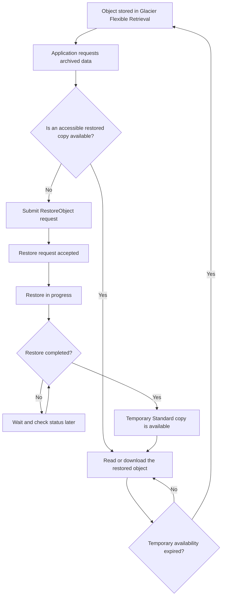
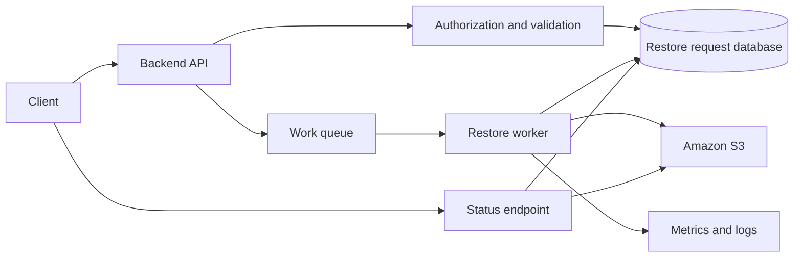

# S3 Glacier Flexible Retrieval

## Overview

Amazon S3 Glacier Flexible Retrieval is an archival storage class designed for long-lived data that is accessed infrequently and does not require immediate retrieval. It provides lower storage costs than frequently accessed S3 storage classes, with retrieval options ranging from minutes to hours.

The storage class is suitable for historical backups, disaster recovery archives, compliance records, historical datasets, and application documents that may need to be recovered during investigations or operational incidents.

Unlike S3 Standard or S3 Glacier Instant Retrieval, objects stored in S3 Glacier Flexible Retrieval cannot be read directly in real time. An application must submit a restore request, wait for the restore to complete, and then download the temporary restored copy.

The primary engineering challenge is not uploading an object to Glacier. It is designing a reliable retrieval workflow that handles restore latency, temporary availability, request costs, authorization, concurrency, and recovery requirements.

## Core Characteristics

### Storage class properties

| Property | S3 Glacier Flexible Retrieval |
|---|---|
| S3 storage class identifier | `GLACIER` |
| Primary purpose | Long-term archival storage |
| Recommended access pattern | Infrequent access, typically once or twice per year |
| Retrieval model | Asynchronous restore followed by object access |
| Expedited retrieval | Typically 1–5 minutes |
| Standard retrieval | Typically 3–5 hours |
| Bulk retrieval | Typically 5–12 hours |
| Minimum storage duration | 90 days |
| Durability design | 99.999999999% durability, with resilience to the physical loss of an Availability Zone |
| Availability | Archived objects require restoration before access |
| Additional object metadata | 40 KB per object, billed across Glacier Flexible Retrieval and S3 Standard rates |
| Encryption | Supports S3 encryption capabilities, subject to applicable configuration and permissions |
| Lifecycle integration | Supports S3 Lifecycle transitions and expiration |
| Access methods | S3 APIs, AWS CLI, SDKs, and supported S3 integrations |

Retrieval times are typical estimates, not guaranteed completion deadlines. Actual completion depends on the retrieval tier, workload, request volume, and other service constraints.

Reference: [Understanding S3 Glacier storage classes](https://docs.aws.amazon.com/AmazonS3/latest/userguide/glacier-storage-classes.html).

### Understand the storage class identifier

The API and AWS CLI identify S3 Glacier Flexible Retrieval using `GLACIER`.

For example:

```bash
aws s3 cp ./historical-report.zip \
  "s3://${BUCKET}/archive/historical-report.zip" \
  --storage-class GLACIER
```

Although the identifier is named `GLACIER`, the object remains within Amazon S3. This is distinct from the legacy, separate Amazon Glacier vault service.

Objects in this storage class can be managed through supported S3 operations, including object metadata inspection, restoration, lifecycle management, version-aware operations, and applicable replication workflows.

### Know when to use it

Choose S3 Glacier Flexible Retrieval when the workload has all or most of these characteristics:

- Data must be retained for months or years.
- Ordinary access is infrequent.
- Retrieval can be asynchronous.
- Recovery within minutes or hours is acceptable.
- The expected storage savings justify restore and request costs.
- Applications can represent and manage a pending-restoration state.

Typical use cases include historical database exports, completed financial reports, long-term audit archives, backup copies, and rarely accessed analytical datasets.

Avoid using it as the primary storage class for content served directly by a latency-sensitive API.

## Understand the Retrieval Tiers

### Compare retrieval options

| Tier | Typical retrieval time | Best suited for | Cost and operational considerations |
|---|---|---|---|
| Expedited | 1–5 minutes | Urgent retrieval of a small number of objects | Higher retrieval cost; capacity availability can affect completion |
| Standard | 3–5 hours | Planned recovery and routine archive access | Balanced choice for ordinary archive retrieval |
| Bulk | 5–12 hours | Large-volume, non-urgent recovery | Lowest-cost option; AWS documents bulk retrievals as free of data-retrieval charges, but evaluate applicable request and other charges |

Retrieval tiers trade cost against speed. An application should select a tier according to a documented recovery objective rather than always choosing the fastest available option.

For reliable, predictable Expedited retrievals, AWS recommends considering provisioned retrieval capacity. Validate current availability, capacity behavior, and pricing before making it part of a production recovery design.

Reference: [Understanding archive retrieval options](https://docs.aws.amazon.com/AmazonS3/latest/userguide/restoring-objects-retrieval-options.html).

### Set recovery objectives

Define recovery requirements before configuring a Glacier workflow.

| Requirement | Example decision |
|---|---|
| Recovery time objective (RTO) | The archive must be downloadable within a documented recovery window |
| Recovery point objective (RPO) | Replication or backup scheduling determines how much recent data could be lost |
| Retrieval priority | Choose Expedited, Standard, or Bulk according to urgency and cost |
| Data volume | Estimate whether the object count and total bytes can be restored within the required window |
| Download duration | Account for transfer time after the restore completes |
| Temporary availability | Define how long the restored copy must remain available |
| Failure handling | Provide a way to retry, inspect, and escalate failed or delayed restores |

A restore request's completion time and the overall recovery time are different measurements.

For example, a restore that completes within five hours does not guarantee that a multi-terabyte download, integrity check, and application recovery will also finish within five hours.

## Understand the Object Restoration Lifecycle

### How restoration works

S3 Glacier Flexible Retrieval stores archival objects in a form that is not directly available for normal real-time reads. A restore request asks S3 to make a temporary, accessible copy of the archived object available.

The original archival object remains in the Glacier Flexible Retrieval storage class.



The application must distinguish between an object that exists and an object that is currently readable. An archival object can exist in S3 while being unavailable for immediate download.

### Understand temporary restored copies

A successful restore makes a temporary copy accessible for the number of days specified in the restore request.

During that period:

- The original archival object remains in Glacier Flexible Retrieval.
- The restored copy is billed at the applicable S3 Standard storage rate.
- The archived object continues to incur its archival storage cost.
- The application can access the restored copy through supported S3 operations.
- The restored copy becomes unavailable when its specified availability period expires.

If the application needs a permanently accessible copy, explicitly copy the restored object into an appropriate online storage class before the temporary availability expires.

Do not confuse restoration with a permanent storage-class transition.

## Restore an Object Using AWS CLI

### Initiate a Standard restore

Set the bucket and object key:

```bash
export BUCKET="company-archive-bucket"
export OBJECT_KEY="reports/2025/annual-report.zip"
```

Initiate restoration for seven days using Standard retrieval:

```bash
aws s3api restore-object \
  --bucket "$BUCKET" \
  --key "$OBJECT_KEY" \
  --restore-request '{
    "Days": 7,
    "GlacierJobParameters": {
      "Tier": "Standard"
    }
  }'
```

The request specifies:

- `Days`: how long the restored copy should remain available.
- `Tier`: the retrieval option used to restore the archived object.

A successful API response confirms that the request was accepted; it does not prove that the object is already available.

### Select another retrieval tier

For an urgent restore, use Expedited retrieval:

```bash
aws s3api restore-object \
  --bucket "$BUCKET" \
  --key "$OBJECT_KEY" \
  --restore-request '{
    "Days": 7,
    "GlacierJobParameters": {
      "Tier": "Expedited"
    }
  }'
```

For a non-urgent restore, use Bulk retrieval:

```bash
aws s3api restore-object \
  --bucket "$BUCKET" \
  --key "$OBJECT_KEY" \
  --restore-request '{
    "Days": 14,
    "GlacierJobParameters": {
      "Tier": "Bulk"
    }
  }'
```

Choose `Days` according to the expected download and processing window. A long restoration window can be useful for slow recovery workflows, but it also extends the period during which the temporary copy incurs storage charges.

### Inspect restoration status

Use `head-object` to inspect the object:

```bash
aws s3api head-object \
  --bucket "$BUCKET" \
  --key "$OBJECT_KEY" \
  --query '{
    StorageClass: StorageClass,
    Restore: Restore,
    ContentLength: ContentLength,
    LastModified: LastModified
  }'
```

The `Restore` field indicates the restoration state when S3 returns restoration information.

Examples of relevant status values include:

- `ongoing-request="true"`: restoration is still in progress.
- `ongoing-request="false"` with an `expiry-date`: the restored copy is available until the indicated expiration date.

The `StorageClass` value can remain `GLACIER` even while the restored copy is accessible. This is expected because restoration does not permanently change the original object's storage class.

### Download the restored object

After restoration completes:

```bash
aws s3 cp \
  "s3://${BUCKET}/${OBJECT_KEY}" \
  ./annual-report.zip
```

The caller must have the necessary S3 read permissions and any additional permissions required by the object's encryption configuration.

Do not repeatedly issue restore requests when a restore is already in progress or a restored copy is still available. Check the current status before submitting another request.

Reference: [Restoring an archived object](https://docs.aws.amazon.com/AmazonS3/latest/userguide/restoring-objects.html).

## Restore Objects Programmatically with Boto3

### Implement a reusable restoration service

Keep restoration logic in a service layer rather than placing it directly inside a Django view or FastAPI endpoint.

The following implementation initiates a restore request and checks the object's current restoration status.

```python
from __future__ import annotations

from typing import Any

import boto3
from botocore.exceptions import ClientError


class GlacierRestoreService:
    def __init__(self, s3_client: Any | None = None) -> None:
        self.s3 = s3_client or boto3.client("s3")

    def get_object_status(self, bucket: str, key: str) -> dict:
        try:
            response = self.s3.head_object(Bucket=bucket, Key=key)
        except ClientError as exc:
            code = exc.response.get("Error", {}).get("Code", "")
            if code in {"404", "NoSuchKey", "NotFound"}:
                raise FileNotFoundError(
                    f"S3 object does not exist: s3://{bucket}/{key}"
                ) from exc
            raise

        restore_header = response.get("Restore", "")
        restoring = 'ongoing-request="true"' in restore_header
        restored = (
            'ongoing-request="false"' in restore_header
        )

        return {
            "storage_class": response.get("StorageClass", "STANDARD"),
            "restoring": restoring,
            "restored": restored,
            "restore_header": restore_header or None,
            "content_length": response.get("ContentLength"),
        }

    def request_restore(
        self,
        bucket: str,
        key: str,
        *,
        days: int = 7,
        tier: str = "Standard",
    ) -> dict:
        if days < 1:
            raise ValueError("days must be at least 1")

        if tier not in {"Expedited", "Standard", "Bulk"}:
            raise ValueError(
                "tier must be Expedited, Standard, or Bulk"
            )

        status = self.get_object_status(bucket, key)

        if status["storage_class"] != "GLACIER":
            if status["storage_class"] in {"STANDARD", None}:
                return {
                    "status": "already_accessible",
                    **status,
                }

            raise ValueError(
                "This example only handles GLACIER objects. "
                f"Actual storage class: {status['storage_class']}"
            )

        if status["restoring"]:
            return {
                "status": "restore_in_progress",
                **status,
            }

        if status["restored"]:
            return {
                "status": "already_restored",
                **status,
            }

        try:
            self.s3.restore_object(
                Bucket=bucket,
                Key=key,
                RestoreRequest={
                    "Days": days,
                    "GlacierJobParameters": {
                        "Tier": tier,
                    },
                },
            )
        except ClientError as exc:
            code = exc.response.get("Error", {}).get("Code", "")
            if code == "RestoreAlreadyInProgress":
                return {
                    "status": "restore_in_progress",
                }
            raise

        return {
            "status": "restore_requested",
            "bucket": bucket,
            "key": key,
            "tier": tier,
            "days": days,
        }
```

The code assumes ordinary S3 object-level restore behavior. Production implementations should additionally handle object versions, authorization failures, request throttling, retry policies, and integration-specific requirements.

Do not treat a return value of `restore_requested` as proof that the restored copy is available. The application must continue checking the restore status before allowing a download.

### Keep HTTP endpoints asynchronous

For a FastAPI or Django REST Framework application, a suitable design is:

- `POST /documents/{id}/restore`: authorize the user and request restoration.
- `GET /documents/{id}/restore-status`: return the current restoration state.
- `GET /documents/{id}/download`: provide download access when the object is available.

A typical response to a restore request might look like:

```json
{
  "document_id": "doc-123",
  "status": "restore_requested",
  "retrieval_tier": "Standard",
  "message": "The archive is being restored."
}
```

Use a database record to track application-level state, not as the sole source of truth for S3 restoration. Reconcile the stored state with `HeadObject` or other appropriate S3 evidence.

Do not block an API request for hours while the archive is being restored.

## Build a Production Restoration Workflow

### Use explicit application states

A reliable restoration workflow should model the entire lifecycle, including duplicate requests and failures.

| Application state | Meaning | Expected action |
|---|---|---|
| `ARCHIVED` | No currently accessible restored copy is known | Accept an authorized restore request |
| `RESTORE_REQUESTED` | The restore request has been accepted | Record the request and monitor status |
| `RESTORING` | S3 reports restoration in progress | Wait and check later |
| `AVAILABLE` | An accessible restored copy is confirmed | Permit authorized downloads |
| `RESTORE_FAILED` | A known failure prevents completion | Record diagnostics and allow controlled retry |
| `EXPIRED` | The restored copy is no longer available | Require a new restore request if needed |

The state machine should permit recovery after application restarts. For example, if a worker fails after the restore request succeeds but before updating the database, the next worker must check S3 before initiating another restore.

### Use an asynchronous processing architecture



Component responsibilities:

- **Backend API:** Validates identity, document ownership, request parameters, and restore eligibility.
- **Database:** Tracks workflow state, requested tier, timestamps, expiration, and correlation identifiers.
- **Queue:** Decouples the API request from long-running operations and absorbs request bursts.
- **Restore worker:** Submits the request, checks status, handles retryable errors, and reconciles state.
- **S3:** Performs archival restoration and exposes the object's restoration state.
- **Monitoring:** Records request outcomes, restore latency, errors, and operational backlog.

For small systems, a persistent scheduler and database-backed polling may be sufficient. Larger systems can use Amazon SQS, EventBridge, or another orchestration mechanism suited to the workload.

### Make requests idempotent at the application level

Multiple users or workers may request the same object around the same time.

Use an application-level idempotency key or a unique active restore record based on the object identity, version, and applicable restoration workflow.

Before initiating a restore:
1. Identify the exact object version when version-specific recovery is required.
2. Check the S3 restoration status.
3. Check the application's existing restore request.
4. Avoid submitting redundant requests when restoration is already in progress or a usable restored copy exists.
5. Record the request and reconcile the resulting state.

S3 processes only one restore request at a time per object. Application concurrency control is still necessary because several callers may submit requests before they observe the same state.

For versioned buckets, an unqualified request targets the current object version. Use the intended version ID when the application is recovering a specific historical version.

## Restore Large Numbers of Objects

### Use S3 Batch Operations for large archival workloads

Restoring millions of objects individually from a general-purpose application worker is often inefficient and difficult to operate.

S3 Batch Operations can execute supported restore operations across a large object population based on a manifest.

Typical workflow:

1. Generate or select a manifest containing the objects and versions to restore.
2. Review the expected object count, size distribution, and retrieval tier.
3. Configure the Batch Operations job and required IAM permissions.
4. Start the job through an approved operational workflow.
5. Monitor job completion and per-object failures.
6. Reconcile the results against the intended dataset.
7. Validate that recovered objects are accessible before relying on them.

Batch Operations can simplify large-scale retrieval, but it does not eliminate retrieval latency, object-level errors, storage charges, or the need to validate the outcome.

Reference: [Restore archived objects with S3 Batch Operations](https://docs.aws.amazon.com/AmazonS3/latest/userguide/restoring-objects-bulk.html).

### Plan around request and throughput constraints

Large restoration jobs may take longer than typical retrieval estimates because account-level quotas, request volume, and total retrieval volume affect completion.

Before a large recovery operation:
- Estimate the number of objects and total bytes.
- Validate relevant service quotas and request-rate constraints.
- Confirm that the target retrieval tier matches the recovery objective.
- Ensure downstream processing has sufficient concurrency and bandwidth.
- Use bounded retries with backoff for transient errors.
- Track failed objects separately instead of restarting every successful request.
- Run a representative recovery test before a disaster occurs.

For very large objects, retrieval completion can be longer than the typical tier estimates. Restoration throughput and subsequent download throughput must be considered separately.

## Optimize Costs

### Understand the cost components

S3 Glacier Flexible Retrieval is economical for long-lived archival data, but the full cost includes more than storage.

| Cost component | Engineering consideration |
|---|---|
| Archival storage | The original archived object continues to incur storage charges |
| Per-object metadata | Every archived object requires an additional 40 KB of metadata |
| Restore requests | Retrieval requests can incur charges according to the selected tier and pricing rules |
| Retrieved data | Applicable retrieval charges depend on the tier and workload |
| Temporary restored copy | The accessible copy incurs S3 Standard storage charges during its availability period |
| Early deletion | Objects deleted, overwritten, or transitioned before 90 days can incur a prorated minimum-duration charge |
| Lifecycle transitions | Transition request charges apply to eligible object transitions |
| Data transfer | Applicable charges can arise when downloading or transferring recovered data |
| Application operations | Workers, queues, logs, and workflow infrastructure can add operational costs |

The 40 KB additional metadata consists of 32 KB charged at the Glacier Flexible Retrieval rate and 8 KB charged at the S3 Standard rate.

Reference: [Understanding archival storage and cost considerations](https://docs.aws.amazon.com/AmazonS3/latest/userguide/archival-storage.html).

### Avoid excessive small-object archival

Archiving millions of small objects can introduce significant per-object metadata overhead and transition-request costs.

Consider aggregating records into larger archive objects when independent object-level access, retention, and deletion are not required.

For example, many small log fragments might be compacted into daily or hourly archive files. However, aggregation should preserve:
- Required retention boundaries.
- Per-record discoverability.
- Auditability.
- Appropriate access controls.
- Recoverability of individual records.

Do not combine objects merely to save storage cost if it creates unacceptable recovery or compliance complexity.

### Select an appropriate restore duration

Choose the temporary restoration duration based on how long the application needs the copy.

A very short duration may expire before a recovery or investigation completes. An unnecessarily long duration increases Standard storage charges.

For predictable recovery workloads, estimate:
- Time required for download.
- Integrity checks and decompression.
- Data import or replay.
- Investigation or review.
- Retry and escalation windows.

Restore duration should support the operational process, not simply use an arbitrary default.

### Evaluate early-deletion charges

Glacier Flexible Retrieval has a 90-day minimum storage duration. If an object is deleted, overwritten, or transitioned to another storage class before completing that duration, a prorated charge for the remaining period can apply.

Avoid moving short-lived data directly into Glacier Flexible Retrieval. Choose an archival class only after confirming the expected retention period.

## Configure Lifecycle Transitions

### Transition eligible objects to Glacier Flexible Retrieval

Lifecycle rules can automatically transition historical data from S3 Standard into Glacier Flexible Retrieval.

For example, the following configuration transitions eligible application logs after 90 days.

```json
{
  "Rules": [
    {
      "ID": "ArchiveApplicationLogs",
      "Status": "Enabled",
      "Filter": {
        "Prefix": "application-logs/"
      },
      "Transitions": [
        {
          "Days": 90,
          "StorageClass": "GLACIER"
        }
      ]
    }
  ]
}
```

This example assumes that 90 days is appropriate for the workload. Production rules should consider object-size distribution, access history, minimum-duration requirements, retention requirements, and transition costs.

Apply the complete lifecycle configuration only after reviewing existing rules:

```bash
aws s3api get-bucket-lifecycle-configuration \
  --bucket "$BUCKET"
```

When applying changes:

```bash
aws s3api put-bucket-lifecycle-configuration \
  --bucket "$BUCKET" \
  --lifecycle-configuration file://lifecycle.json
```

`put-bucket-lifecycle-configuration` replaces the bucket's existing lifecycle configuration. Preserve unrelated rules when modifying a shared bucket.

### Keep lifecycle and restore responsibilities separate

Lifecycle rules govern object transitions and expiration; restore operations provide temporary access to archived content.

Do not assume that restoring an object permanently moves it into S3 Standard. If an application needs the object to remain online, copy it into an appropriate storage class or adopt another deliberate data-management process.

Also review the impact of versioning. A bucket with versioning enabled may retain historical object versions even after the current version expires, depending on its lifecycle configuration.

Reference: [Managing S3 Lifecycle configurations](https://docs.aws.amazon.com/AmazonS3/latest/userguide/object-lifecycle-mgmt.html).

## Security and Permissions

### Separate restoration permissions from object access

The ability to request a restore and the ability to download the resulting object should be evaluated independently.

A typical access design may require:
- `s3:RestoreObject` to initiate restoration.
- `s3:GetObject` to download the object.
- Appropriate version-specific S3 permissions when recovering a specific version.
- Applicable KMS permissions when accessing SSE-KMS encrypted objects.
- Compatible bucket and KMS resource policies.

Grant these actions only to the principals that need them, with resource scopes appropriate to the workload.

### Protect archived data

Archival storage does not remove the need for access controls or encryption.

Apply the same core protections used for other S3 objects:
- Private buckets and appropriate Block Public Access settings.
- Least-privilege IAM roles.
- Appropriate server-side encryption.
- Auditing of sensitive recovery operations.
- Controlled use of presigned download URLs.
- Separation between application access and administrative permissions.

Restore workers should not have unrestricted access to unrelated buckets or key policies.

### Test encryption dependencies

For objects encrypted with SSE-KMS, the application must satisfy the relevant S3 and KMS authorization requirements to access the object.

Verify that the intended principal can access the source object and any required decryption operations. Check key policies, IAM policies, grants, and cross-account permissions where applicable.

A restoration request being accepted does not prove that the final download will succeed.

## Monitoring and Troubleshooting

### Monitor restore latency and failures

Track the following measurements:

| Metric | Purpose |
|---|---|
| Restore requests submitted | Measures restore demand |
| Restore completion latency | Shows how long users wait for accessible copies |
| Restore failure count | Identifies permission, quota, request, and configuration problems |
| Pending restore backlog | Shows whether requested restores are keeping up with demand |
| Download failure count | Identifies errors after restoration |
| Temporary-copy expiration | Detects copies that may expire before processing completes |
| Recovery throughput | Measures the volume of usable data recovered per unit of time |
| Restore and storage costs | Shows the financial impact of archival access |

CloudWatch, application metrics, structured logs, and Batch Operations completion reports can be used together to identify failures and track recovery progress.

### Diagnose common errors

| Symptom | Likely cause | Recommended action |
|---|---|---|
| Object exists but GET is unavailable | Archived object has not been restored | Check `HeadObject` and submit an appropriate restore request |
| Restore request rejected as already in progress | Another restore is running for the object | Check current restoration status and avoid duplicate requests |
| Restore request receives `AccessDenied` | Missing S3 permission or an applicable policy denial | Inspect the caller identity, role policy, bucket policy, and relevant conditions |
| Restore completes but download fails | Missing object-read permission, encryption permission, or another access restriction | Diagnose S3 and KMS authorization independently |
| Restore takes longer than expected | Retrieval tier, demand, quota, object size, or volume affects completion | Check the selected tier, job status, request volume, and relevant quotas |
| Restored copy is no longer available | The requested temporary availability period expired | Initiate another restore if the object still exists and access is authorized |
| Large recovery job has partial failures | Some objects are inaccessible, invalid, or failed individually | Inspect per-object results and retry only appropriate failures |
| Storage costs remain higher than expected | Temporary copies, metadata overhead, transition requests, or early deletion contribute to cost | Inspect archive volume, object count, restore durations, and current pricing |

Do not repeatedly retry a restore request without first determining whether it is already running, has completed, or failed for a non-retryable reason.

## Production Readiness Checklist

- [ ] The archive is suitable for asynchronous retrieval.
- [ ] RTO, RPO, and restoration priorities are documented.
- [ ] Retrieval tier selection is based on urgency, data volume, and cost.
- [ ] Restore requests are separated from user-facing download requests.
- [ ] Application state can recover after process restarts and duplicate requests.
- [ ] Object version IDs are handled when historical versions must be recovered.
- [ ] Temporary restored copies remain available long enough for downstream processing.
- [ ] Permanent copies are created when long-term online access is required.
- [ ] IAM, bucket policy, and KMS permissions are tested.
- [ ] Large restore operations use a suitable batch workflow where appropriate.
- [ ] Restore latency, failures, backlog, and cost are observable.
- [ ] Lifecycle rules preserve required retention and avoid unintended data loss.
- [ ] The 90-day minimum storage duration and 40 KB metadata overhead are included in cost estimates.
- [ ] Recovery procedures are exercised and validated before a real incident.
- [ ] The final restored data is validated before being used for production recovery.

## Authoritative References

- [Understanding S3 Glacier storage classes](https://docs.aws.amazon.com/AmazonS3/latest/userguide/glacier-storage-classes.html)
- [Understanding archive retrieval options](https://docs.aws.amazon.com/AmazonS3/latest/userguide/restoring-objects-retrieval-options.html)
- [Restoring an archived object](https://docs.aws.amazon.com/AmazonS3/latest/userguide/restoring-objects.html)
- [Understanding archival storage and cost considerations](https://docs.aws.amazon.com/AmazonS3/latest/userguide/archival-storage.html)
- [RestoreObject API reference](https://docs.aws.amazon.com/AmazonS3/latest/API/API_RestoreObject.html)
- [S3 Batch Operations](https://docs.aws.amazon.com/AmazonS3/latest/userguide/batch-ops.html)
- [S3 Lifecycle management](https://docs.aws.amazon.com/AmazonS3/latest/userguide/object-lifecycle-mgmt.html)
- [Amazon S3 pricing](https://aws.amazon.com/s3/pricing/)

## Key Takeaways

- S3 Glacier Flexible Retrieval is designed for long-term archival data that can tolerate asynchronous access, not real-time application reads.
- Expedited, Standard, and Bulk retrieval tiers balance recovery speed against cost and workload constraints.
- A restore request creates a temporary accessible copy; the original object remains in Glacier Flexible Retrieval until explicitly moved or copied.
- Production systems should track restoration state, handle duplicate requests, validate permissions, and support retries without blocking HTTP requests.
- Include restoration latency, temporary Standard storage, 40 KB of additional per-object metadata, and the 90-day minimum duration in operational and cost planning.
You've reached the maximum length for this conversation, but you can keep talking by starting a new chat.
Start new chat