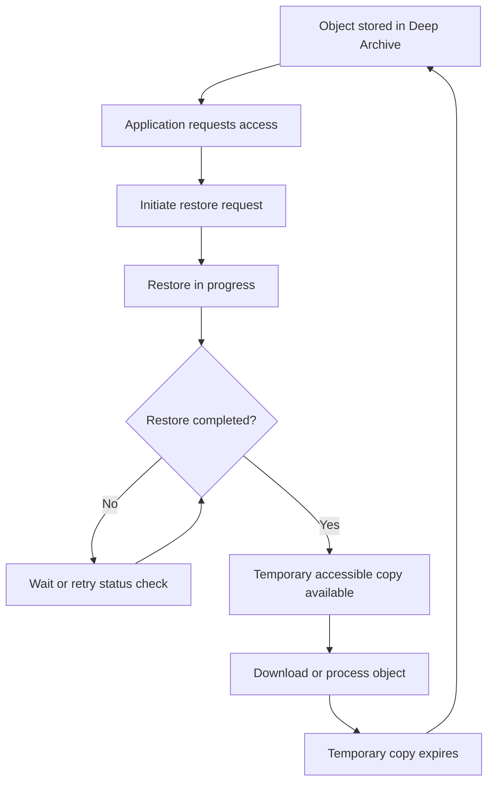

# 08- S3 Glacier Deep Archive

## Overview

Amazon S3 Glacier Deep Archive is an archival storage class designed for long-term retention of data that is rarely accessed. It is suitable for historical records, compliance archives, long-term backups, and datasets that must be retained for years but can tolerate retrieval delays measured in hours.

Deep Archive offers a low storage cost in exchange for asynchronous retrieval, a 180-day minimum storage duration, and additional per-object archival metadata. Objects cannot be read directly while archived. Applications must initiate a restore request and wait for a temporary accessible copy.

Deep Archive is an S3 storage class, not a separate S3 bucket type. It retains S3 object management capabilities such as object keys, metadata, tags, lifecycle policies, access controls, and integration with S3 APIs.

Use it when long-term storage economics matter more than immediate access.

## When to Use S3 Glacier Deep Archive

### Suitable workloads

| Workload | Suitability | Considerations |
|---|---|---|
| Regulatory and compliance archives | High | Validate retention periods, legal holds, and retrieval procedures |
| Historical financial records | High | Ensure retrieval workflows meet audit and investigation deadlines |
| Long-term backup copies | High | Test recovery, permissions, and key availability |
| Historical application logs | High | Archive only after operational investigation requirements are satisfied |
| Data retained for several years | High | Compare lifecycle, retrieval, and per-object costs |
| Frequently accessed application documents | Low | Restore latency is incompatible with normal request-response flows |
| Real-time analytics datasets | Low | Queries requiring immediate object reads are unsuitable |
| Temporary processing files | Low | The 180-day minimum duration can eliminate expected savings |

Deep Archive is appropriate when the required retention horizon is long and the expected retrieval frequency is very low. For data that must remain available immediately, evaluate S3 Glacier Instant Retrieval or S3 Glacier Flexible Retrieval instead.

## Understand Retrieval Behavior

### Retrieval options

Deep Archive supports two retrieval tiers.

| Retrieval tier | Typical retrieval time | Suitable use |
|---|---|---|
| Standard | Typically within 12 hours | Routine historical retrieval and planned recovery |
| Bulk | Typically within 48 hours | Large-scale retrievals where minimizing retrieval cost is more important than speed |

These are typical times, not guarantees for every request. Large retrieval workloads can take longer because of request volume, throughput constraints, and the number of objects being restored.

Deep Archive does not support Expedited retrieval. Design applications so that users and recovery systems can tolerate the expected delay.

### Understand the restore lifecycle

Restoring an archived object does not permanently change its storage class. S3 creates a temporary accessible copy that remains available for the number of days specified in the restore request. After that period expires, S3 removes the temporary copy while retaining the original archived object.



A successful restore request means that restoration has been initiated; it does not mean that the object is immediately downloadable. Applications must track restoration status before attempting normal object reads.

### Design for asynchronous access

For backend systems built with Django, FastAPI, or other frameworks, do not block an HTTP request for hours while S3 restores an object.

A recommended workflow is:

1. Authenticate the caller and verify authorization for the requested object.
2. Create a restore job and persist its status in the application database.
3. Submit the S3 restore request.
4. Return a job identifier to the client.
5. Track completion using S3 event notifications, a worker, or scheduled status checks.
6. Notify the client when the object becomes available.
7. Generate an authorized download response after confirming the restored copy is accessible.

Persisting job state outside the application process allows workers to restart without losing progress. Treat repeated requests as potentially idempotent operations and handle restore-in-progress responses without treating them as successful downloads.

## Initiate a Restore Using AWS CLI

### Restore a single object

Set the bucket and key to the target object.

```bash
aws s3api restore-object \
  --bucket "$BUCKET" \
  --key "$OBJECT_KEY" \
  --restore-request '{
    "Days": 7,
    "GlacierJobParameters": {
      "Tier": "Standard"
    }
  }'
```

This example requests Standard retrieval and keeps the restored copy available for seven days after restoration completes.

Use `Bulk` instead of `Standard` when the workload can tolerate a longer wait and the selected retrieval tier is more economical.

```bash
aws s3api restore-object \
  --bucket "$BUCKET" \
  --key "$OBJECT_KEY" \
  --restore-request '{
    "Days": 7,
    "GlacierJobParameters": {
      "Tier": "Bulk"
    }
  }'
```

The request requires the relevant S3 permissions. If the object uses SSE-KMS, the required KMS permissions and key policy must also allow the eventual read operation.

### Restore a specific object version

In a versioned bucket, restoring the current version may not be sufficient when an older version is required.

```bash
aws s3api restore-object \
  --bucket "$BUCKET" \
  --key "$OBJECT_KEY" \
  --version-id "$VERSION_ID" \
  --restore-request '{
    "Days": 7,
    "GlacierJobParameters": {
      "Tier": "Standard"
    }
  }'
```

Verify the version ID before running the command. Restoring the wrong version can produce incorrect data during a recovery or audit operation.

## Check Restore Status

Use `head-object` to inspect an object's restoration status.

```bash
aws s3api head-object \
  --bucket "$BUCKET" \
  --key "$OBJECT_KEY" \
  --query '{StorageClass:StorageClass,Restore:Restore}'
```

The `Restore` response field can indicate that restoration is still in progress or that a restored copy is available until a specified expiry date.

For application automation, interpret the result as a state transition rather than simply checking whether the restore command returned successfully.

| State | Meaning | Recommended action |
|---|---|---|
| Restore not initiated | No active restored copy is available | Initiate a restore request |
| Restore in progress | S3 is preparing the temporary copy | Keep the job pending |
| Restore complete | Temporary copy is accessible until expiry | Permit the authorized download or processing operation |
| Restored copy expired | Temporary copy is no longer available | Submit another restore request if needed |

A missing or unexpected response should be investigated alongside the object's current storage class, version ID, request history, and permissions.

## Implement Restore Operations with Boto3

A reusable service-layer function can initiate restoration without embedding AWS SDK logic directly into API views or route handlers.

```python
import os

import boto3
from botocore.exceptions import ClientError


class S3ArchiveService:
    def __init__(self, region_name: str | None = None) -> None:
        self.client = boto3.client(
            "s3",
            region_name=region_name or os.getenv(
                "AWS_REGION", "ap-south-1"
            ),
        )
        self.bucket = os.environ["S3_BUCKET"]

    def restore_object(
        self,
        key: str,
        days: int = 7,
        tier: str = "Standard",
        version_id: str | None = None,
    ) -> None:
        if days < 1:
            raise ValueError("days must be at least 1")

        if tier not in {"Standard", "Bulk"}:
            raise ValueError(
                "Deep Archive supports Standard and Bulk retrieval"
            )

        request = {
            "Days": days,
            "GlacierJobParameters": {"Tier": tier},
        }

        params = {
            "Bucket": self.bucket,
            "Key": key,
            "RestoreRequest": request,
        }

        if version_id is not None:
            params["VersionId"] = version_id

        try:
            self.client.restore_object(**params)
        except ClientError as exc:
            error_code = exc.response.get(
                "Error", {}
            ).get("Code", "Unknown")

            if error_code in {
                "RestoreAlreadyInProgress",
                "InvalidObjectState",
            }:
                raise RuntimeError(
                    f"Restore request requires state handling: "
                    f"{error_code}"
                ) from exc

            raise
```

This implementation deliberately propagates exceptions instead of assuming every failure means that a restore is already running or that the object is unavailable.

Production integration should distinguish an already-running restore from an invalid object state, authorization failure, missing object, or other API error. In particular, an `InvalidObjectState` response should trigger investigation of the object's actual state rather than an unconditional retry.

Use the AWS credential provider chain, such as an IAM role attached to an application workload, rather than embedding long-lived access keys in the service.

## Automate Archival with S3 Lifecycle Policies

### Transition eligible objects to Deep Archive

Lifecycle policies automate transitions based on object age and rule filters. They are appropriate when retention and access patterns are predictable.

The following example transitions qualifying objects under `records/` to Deep Archive after 365 days.

```json
{
  "Rules": [
    {
      "ID": "ArchiveHistoricalRecords",
      "Status": "Enabled",
      "Filter": {
        "And": {
          "Prefix": "records/",
          "ObjectSizeGreaterThan": 131071
        }
      },
      "Transitions": [
        {
          "Days": 365,
          "StorageClass": "DEEP_ARCHIVE"
        }
      ]
    }
  ]
}
```

The size filter excludes objects smaller than 128 KiB. This can reduce unnecessary per-object transition costs, especially when the dataset contains many small records.

Before applying the policy, inspect the existing configuration.

```bash
aws s3api get-bucket-lifecycle-configuration \
  --bucket "$BUCKET"
```

After combining the intended rule with existing lifecycle rules, apply the full configuration:

```bash
aws s3api put-bucket-lifecycle-configuration \
  --bucket "$BUCKET" \
  --lifecycle-configuration file://lifecycle.json
```

**Operational warning:** `put-bucket-lifecycle-configuration` replaces the bucket's existing lifecycle configuration. Preserve other workloads' rules before deployment.

### Account for object versions and retention

In a versioned bucket, current and noncurrent object versions can require separate lifecycle rules. A noncurrent version may remain stored even after a newer version is written or a delete marker is created.

Before archiving or expiring data, determine:

- Which object versions must be retained.
- Whether legal holds or retention policies restrict deletion.
- Whether recovery depends on a particular historical version.
- Whether lifecycle rules can affect data before its required retention period ends.
- Whether replication or other processing workflows must complete first.

Deep Archive is a storage class, not an immutability mechanism. When records require protection from deletion or modification, evaluate S3 Object Lock and the applicable retention mode separately.

## Understand Storage Costs

Deep Archive's low storage price does not mean every archival workload is inexpensive. Evaluate all applicable charges across the object's complete retention and retrieval lifecycle.

| Cost component | Consideration |
|---|---|
| Archived storage | Storage billed at the Deep Archive rate for the applicable Region |
| Per-object metadata | Additional 40 KB of metadata per archived object |
| Restore requests | Request and retrieval charges depend on the retrieval operation and current pricing |
| Minimum storage duration | 180 days |
| Early deletion or transition | Deleting, overwriting, or transitioning an object before the minimum duration can incur prorated remaining storage charges |
| Restored copy | Temporary restored data incurs S3 Standard storage charges |
| Lifecycle transitions | Transition request charges can apply |
| Download or processing | Applicable data-transfer, request, and downstream service charges may apply |

The 40 KB of additional archival metadata consists of 32 KB charged at Deep Archive rates and 8 KB charged at S3 Standard rates. This overhead matters when storing millions of small objects.

### Estimate total cost

Before archiving, estimate the number of objects, average object size, total stored volume, expected retention period, and likely retrieval activity.

Compare the cost of keeping data in Standard or another suitable storage class with the combined cost of Deep Archive storage, transitions, retrievals, temporary restored copies, and associated operations.

For datasets with millions of small files, consider consolidating records into larger objects when independent retrieval, deletion, and retention of individual records are not required. Avoid aggregation if it creates unacceptable recovery complexity or violates record-level retention requirements.

Use current AWS regional pricing rather than relying on fixed dollar estimates in long-lived documentation.

## Scale Restoration for Large Archives

### Use S3 Batch Operations

For archives containing thousands or millions of objects, restoring each object manually or through serial API calls is inefficient.

S3 Batch Operations can initiate restore requests for a manifest of objects. A job can produce a completion report that helps identify successful and failed operations.

A scalable restore process should:

1. Generate or select an inventory-backed manifest containing the required objects and versions.
2. Validate that the manifest references the intended bucket, keys, and versions.
3. Estimate retrieval volume, request costs, and completion time.
4. Configure the Batch Operations role and required permissions.
5. Submit the restore job using the appropriate retrieval tier.
6. Monitor job completion and inspect the completion report.
7. Validate object availability before starting downstream processing.

Do not assume that a successful Batch Operations job means every object in the original dataset was restored successfully. Validate failures and reconcile the final object population.

Reference: [Restoring archived objects](https://docs.aws.amazon.com/AmazonS3/latest/userguide/restoring-objects.html).

### Use event-driven completion tracking

S3 supports restore-completion notifications through the `s3:ObjectRestore:Completed` event.

An event-driven architecture can notify a queue, trigger a worker, update a database record, and inform the requesting user when restoration finishes.

Design the consumer for duplicate or delayed notifications. Use an idempotency key based on the bucket, object key, version ID where applicable, and restore-job identity.

Keep the final availability check separate from event receipt. The worker should inspect the object's state and handle expired copies or other state changes before returning a download link.

## Security and Recovery Considerations

### Protect archived data with independent access controls

Archiving does not remove the need for correct S3 authorization and encryption controls.

Apply least-privilege IAM policies, secure bucket policies, and the required encryption configuration. If using SSE-KMS, confirm that the principals responsible for restoration and subsequent object reads can use the required KMS key.

A restore request and the subsequent data read can fail for different reasons. Investigate S3 permissions, KMS permissions, key state, and object state separately.

### Treat Deep Archive as one component of a recovery design

Deep Archive can serve as a long-term backup tier, but a backup policy is not complete until the data can be restored and validated within the required recovery objectives.

Maintain a documented recovery procedure that includes:
- Identifying the correct object versions.
- Initiating restores and tracking completion.
- Checking access to encryption keys.
- Validating recovered content using checksums or other appropriate integrity mechanisms.
- Reconstructing required metadata or application state.
- Documenting restore time, failures, and the resulting recovery point.

Run periodic recovery exercises using representative datasets. If recovery must finish within a few hours, Deep Archive might not satisfy the required recovery time objective.

## Common Mistakes

| Mistake | Impact | Prevention |
|---|---|---|
| Attempting `GetObject` before restoration completes | The download fails because the archived data is not yet available | Track restore status before downloading |
| Using Deep Archive for active API traffic | Requests cannot meet normal interactive latency requirements | Keep actively accessed data in an appropriate online storage class |
| Assuming restore initiation means restore completion | Applications expose unavailable objects or report success too early | Track the asynchronous restore lifecycle |
| Ignoring the 180-day minimum duration | Early deletion, overwrite, or transition can incur additional charges | Match retention and lifecycle timing to actual requirements |
| Archiving millions of tiny objects without cost analysis | Per-object metadata and transition costs reduce savings | Analyze object counts and size distributions |
| Treating lifecycle archival as immutable retention | Data may still be deleted or modified according to applicable permissions and policies | Evaluate Object Lock and retention controls where required |
| Restoring the current version when a historical version is needed | The wrong data may be recovered | Track and verify version IDs |
| Ignoring KMS dependencies | Restoration or subsequent reads may fail because keys are unavailable or unauthorized | Test the complete decryption path |
| Assuming a replica is automatically a tested backup | Regional or account-level recovery may still fail | Validate replication configuration and perform recovery exercises |
| Replacing lifecycle configuration with a partial rule set | Existing archival or expiration policies may be unintentionally removed | Merge and review the complete lifecycle configuration |

## Production Readiness Checklist

- [ ] The dataset is suitable for long-term archival with infrequent access.
- [ ] Retrieval requirements accommodate the expected Standard or Bulk retrieval time.
- [ ] The minimum 180-day storage duration has been included in cost estimates.
- [ ] Object counts and 40 KB per-object archival metadata costs have been evaluated.
- [ ] Lifecycle rules preserve required retention periods and existing bucket configuration.
- [ ] Required versions, retention policies, and legal holds are accounted for.
- [ ] Restore jobs record status and handle retries, duplicate requests, and failures.
- [ ] Large restore workloads use an appropriate manifest and batch-processing strategy.
- [ ] KMS permissions and key availability have been verified where applicable.
- [ ] Restore completion is verified before downloads or downstream processing begin.
- [ ] Recovered data is validated for integrity and application usability.
- [ ] Recovery procedures are tested against documented recovery objectives.
- [ ] Restore, storage, and transfer costs are monitored.
- [ ] The recovery runbook documents ownership, escalation, verification, and cleanup.

## Authoritative References

- [S3 Glacier storage classes](https://docs.aws.amazon.com/AmazonS3/latest/userguide/glacier-storage-classes.html)
- [Understanding archival storage in Glacier Flexible Retrieval and Deep Archive](https://docs.aws.amazon.com/AmazonS3/latest/userguide/archival-storage.html)
- [Restore archived S3 objects](https://docs.aws.amazon.com/AmazonS3/latest/userguide/restoring-objects.html)
- [Working with archived objects](https://docs.aws.amazon.com/AmazonS3/latest/userguide/archived-objects.html)
- [Archive retrieval options](https://docs.aws.amazon.com/AmazonS3/latest/userguide/restoring-objects-retrieval-options.html)
- [S3 Lifecycle management](https://docs.aws.amazon.com/AmazonS3/latest/userguide/object-lifecycle-mgmt.html)
- [S3 pricing](https://aws.amazon.com/s3/pricing/)

## Key Takeaways

- S3 Glacier Deep Archive is designed for long-term, rarely accessed data that can tolerate retrieval delays measured in hours.
- Objects require an asynchronous restore operation, and the resulting accessible copy is temporary while the original remains archived.
- The 180-day minimum storage duration, per-object metadata, retrieval charges, and temporary restored-copy costs must be included in cost estimates.
- Use lifecycle policies for predictable archival and S3 Batch Operations for large restore workloads; validate object versions, permissions, and restore status.
- Treat Deep Archive as part of a tested backup and recovery design, not as a substitute for retention controls, encryption management, or recovery validation.