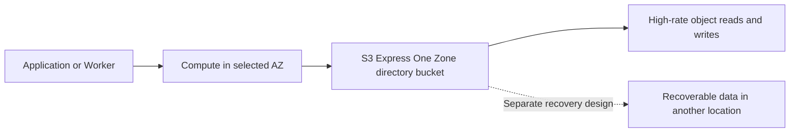
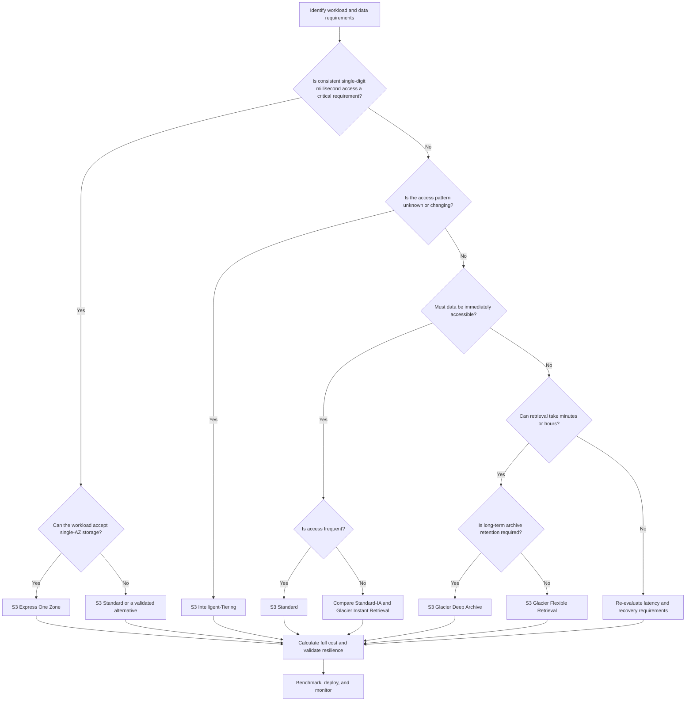
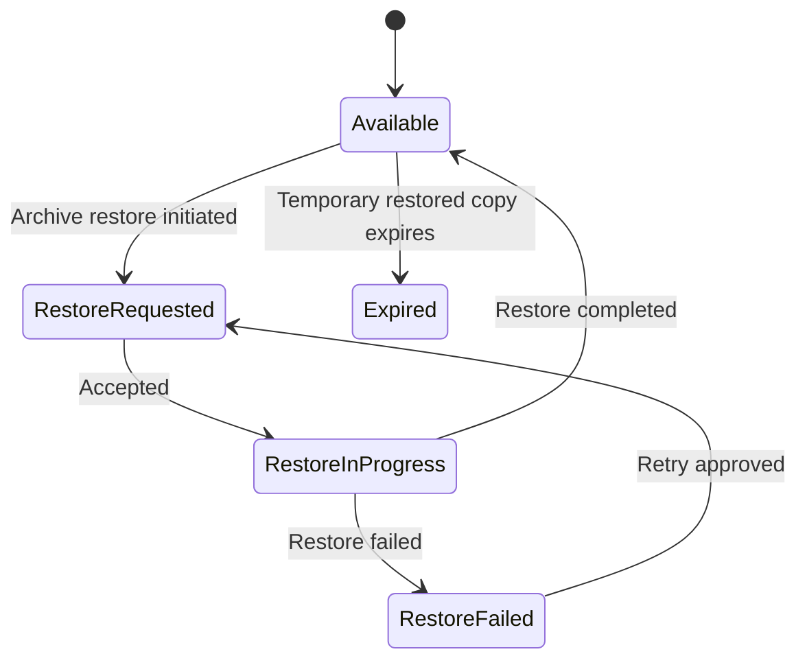

# 09- Storage Class Comparison and Selection

## Overview

Amazon S3 provides multiple storage classes optimized for different access patterns, performance requirements, availability characteristics, and cost profiles. Choosing the appropriate class is an architectural decision that affects application latency, data retrieval workflows, retention policies, disaster recovery, and total storage expenditure.

Storage classes do not change the fundamental object-storage model, but they introduce different constraints around minimum storage duration, retrieval charges, restoration requirements, and resilience to Availability Zone failures.

For backend engineers, the objective is to select a class that satisfies workload requirements at the lowest justified total cost. This requires evaluating the complete lifecycle of an object rather than considering its storage price alone.

This document compares S3 storage classes in detail, explains how they behave, and provides a repeatable selection methodology for production systems.

## Amazon S3 Storage Class Classification

S3 storage classes can be grouped according to their primary purpose.

| Category | Storage classes | Primary design objective |
|---|---|---|
| General-purpose storage | S3 Standard | Frequently accessed objects with consistent low-latency access |
| Automatic cost optimization | S3 Intelligent-Tiering | Unknown or changing access patterns |
| Infrequent-access storage | S3 Standard-IA, S3 One Zone-IA | Lower storage costs for long-lived, infrequently accessed data |
| Immediately accessible archive | S3 Glacier Instant Retrieval | Rarely accessed data requiring millisecond retrieval |
| Asynchronous archive | S3 Glacier Flexible Retrieval | Data that can tolerate retrieval delays |
| Long-term archive | S3 Glacier Deep Archive | Multi-year retention with very infrequent retrieval |
| High-performance single-AZ storage | S3 Express One Zone | Latency-sensitive, request-intensive workloads |
| Specialized deployment storage | S3 on Outposts | Object storage on supported AWS Outposts infrastructure |

The classes solve different problems. Glacier classes are not interchangeable with online storage, Intelligent-Tiering is not simply another fixed storage tier, and S3 Express One Zone is not a drop-in replacement for every general-purpose bucket.

## Compare Storage Classes

### General-purpose comparison

The following table summarizes the primary storage classes available for general-purpose S3 workloads.

| Storage class | API value | Typical access pattern | Retrieval behavior | Minimum storage duration |
|---|---|---|---|---|
| S3 Standard | `STANDARD` | Frequent or unpredictable access | Millisecond access | None |
| S3 Intelligent-Tiering | `INTELLIGENT_TIERING` | Unknown or changing access patterns | Millisecond access in its automatic low-latency tiers | No minimum storage duration |
| S3 Standard-IA | `STANDARD_IA` | Infrequent access with immediate retrieval requirements | Millisecond access | 30 days |
| S3 One Zone-IA | `ONEZONE_IA` | Infrequent access to reproducible or replaceable data | Millisecond access | 30 days |
| S3 Glacier Instant Retrieval | `GLACIER_IR` | Rare access requiring immediate retrieval | Millisecond access | 90 days |
| S3 Glacier Flexible Retrieval | `GLACIER` | Infrequent archival access | Restore required; minutes to hours depending on retrieval option | 90 days |
| S3 Glacier Deep Archive | `DEEP_ARCHIVE` | Long-term retention and very rare access | Restore required; typically hours | 180 days |
| S3 Express One Zone | `EXPRESS_ONEZONE` | Latency-sensitive, high-request-rate workloads | Consistent single-digit millisecond access | No minimum storage duration |

The minimum durations represent billing commitments, not a requirement to keep an object for that period. An object can be deleted earlier, but early-deletion charges may apply.

For the latest feature details, consult [Understanding and managing S3 storage classes](https://docs.aws.amazon.com/AmazonS3/latest/userguide/storage-class-intro.html).

### Compare availability and resilience

Storage classes also differ in their resilience to the physical loss of an Availability Zone.

| Storage class | Resilience to physical loss of an AZ | Recommended role |
|---|---|---|
| S3 Standard | Designed to be resilient across multiple AZs | Primary production objects |
| S3 Intelligent-Tiering | Designed to be resilient across multiple AZs | Production data with uncertain access patterns |
| S3 Standard-IA | Designed to be resilient across multiple AZs | Infrequently accessed production data |
| S3 One Zone-IA | Single AZ | Recoverable or replaceable data |
| S3 Glacier Instant Retrieval | Designed to be resilient across multiple AZs | Immediately accessible archive data |
| S3 Glacier Flexible Retrieval | Designed to be resilient across multiple AZs | Asynchronous archive data |
| S3 Glacier Deep Archive | Designed to be resilient across multiple AZs | Long-term archival data |
| S3 Express One Zone | Single AZ | Performance-critical workloads with an explicit recovery strategy |

Single-AZ storage can be appropriate when cost or latency is more important than standalone multi-AZ resilience and another recovery mechanism exists.

Do not interpret high durability as protection against every failure domain. Object durability, service availability, regional disaster recovery, and recovery-time objectives are separate concerns.

S3 on Outposts has deployment and infrastructure-specific resilience characteristics that must be evaluated against the selected Outposts configuration.

## Understand S3 Intelligent-Tiering

### Purpose

S3 Intelligent-Tiering automatically adjusts eligible objects between access tiers based on access patterns. It is particularly useful when an object's future access frequency cannot be reliably predicted.

Its primary advantage is reducing the need to predict an object's long-term access pattern when configuring a fixed storage class.

### Automatic access tiers

| Access tier | Transition condition | Access characteristics |
|---|---|---|
| Frequent Access | Initial tier | Millisecond access |
| Infrequent Access | 30 consecutive days without access | Millisecond access |
| Archive Instant Access | 90 consecutive days without access | Millisecond access |
| Archive Access | Optional; at least 90 consecutive days without access | Asynchronous restoration |
| Deep Archive Access | Optional; at least 180 consecutive days without access | Asynchronous restoration |

Archive Access and Deep Archive Access are optional tiers that require configuration. Objects stored in these tiers must be restored before normal access.

Intelligent-Tiering has a per-object monitoring and automation charge for eligible objects. Objects smaller than 128 KB are not monitored for automatic tiering and remain in the Frequent Access tier.

Unlike Standard-IA and Glacier storage classes, Intelligent-Tiering does not charge retrieval fees. Accesses that move objects between its automatic access tiers also do not incur tiering charges.

Reference: [Managing storage costs with Intelligent-Tiering](https://docs.aws.amazon.com/AmazonS3/latest/userguide/intelligent-tiering.html).

### When to choose Intelligent-Tiering

Suitable use cases include:

- Documents whose access frequency changes over time.
- Data lake objects queried unpredictably.
- Historical business data that periodically becomes active again.
- Newly introduced applications with insufficient access history.
- Large object populations that would otherwise require frequent policy changes.

A fixed class can remain more economical when access patterns are stable and predictable. Calculate the monitoring charge against the expected reduction in storage cost before migrating a large number of objects.

## Compare Infrequent-Access Classes

### S3 Standard-IA

Standard-IA provides immediate access to infrequently accessed data while reducing its storage cost relative to Standard.

It is appropriate when objects remain online and are occasionally needed by users or backend services.

Examples include historical reports, older customer documents, and long-lived records that still require immediate retrieval.

Key constraints:

- 30-day minimum storage duration.
- 128 KB minimum billable object size.
- Retrieval charges apply.
- Normal request and applicable data-transfer charges still apply.

Standard-IA is not automatically cheaper for every low-frequency workload. Frequent retrievals or short-lived objects can offset its storage savings.

### S3 One Zone-IA

One Zone-IA provides immediate access to infrequently accessed objects stored in a single AZ.

It can be appropriate for replaceable or reproducible data, such as derived processing output and selected intermediate datasets.

It has the same 30-day minimum storage duration and 128 KB minimum billable object size as Standard-IA.

Its primary trade-off is resilience: it is not designed to withstand the physical loss of its AZ in the same way as multi-AZ storage classes.

Use it only when the data can be recovered from another location or regenerated within the required recovery window.

### S3 Standard-IA versus One Zone-IA

| Consideration | Standard-IA | One Zone-IA |
|---|---|---|
| Retrieval latency | Milliseconds | Milliseconds |
| Storage placement | Multiple AZs | One AZ |
| Minimum duration | 30 days | 30 days |
| Minimum billable object size | 128 KB | 128 KB |
| Retrieval charges | Yes | Yes |
| Appropriate data | Infrequent but important online data | Infrequent, replaceable data |
| Primary trade-off | Higher storage cost than single-AZ options | Reduced AZ-level resilience |

Never choose One Zone-IA solely because its storage rate is lower. Validate the full recovery architecture first.

## Compare Glacier Storage Classes

### S3 Glacier Instant Retrieval

Glacier Instant Retrieval is designed for archival data that is accessed rarely but must remain immediately retrievable.

Objects can be read with millisecond latency without first initiating a restore.

Typical use cases include:
- Medical documents accessed during occasional appointments.
- Historical media that must remain immediately available.
- Long-lived records with infrequent download requests.
- Archive data that cannot tolerate a restore workflow.

Key constraints include a 90-day minimum storage duration and a 128 KB minimum billable object size. Retrieval charges apply.

### S3 Glacier Flexible Retrieval

Glacier Flexible Retrieval is designed for archival workloads that can tolerate asynchronous access.

Typical use cases include:
- Historical backups.
- Older audit datasets.
- Disaster recovery copies with a documented restore process.
- Data that must remain retained but is rarely accessed interactively.

Objects must be restored before normal retrieval. The available retrieval options balance time, volume, and cost. Standard retrieval typically takes hours, while expedited retrieval can be faster for supported requests. Exact timing depends on the selected option, service conditions, and applicable limits.

Glacier Flexible Retrieval has a 90-day minimum storage duration and adds 40 KB of archival metadata per object:
- 32 KB billed at the Glacier Flexible Retrieval rate.
- 8 KB billed at the S3 Standard rate.

For millions of small objects, the additional metadata and per-object operations can materially affect total cost.

### S3 Glacier Deep Archive

Glacier Deep Archive is intended for very long-lived data that is rarely accessed.

Typical use cases include:
- Multi-year compliance archives.
- Historical records with infrequent recovery requirements.
- Long-term backup copies.
- Data preservation where restoration can take hours.

Objects must be restored before they can be retrieved normally. Deep Archive has a 180-day minimum storage duration and the same 40 KB archival metadata overhead structure:
- 32 KB billed at the Deep Archive rate.
- 8 KB billed at the S3 Standard rate.

Deep Archive is unsuitable for data served directly by latency-sensitive API endpoints unless the application implements an asynchronous recovery workflow.

### Glacier class comparison

| Consideration | Glacier Instant Retrieval | Glacier Flexible Retrieval | Glacier Deep Archive |
|---|---|---|---|
| Normal access | Immediate | Restore required | Restore required |
| Typical retrieval latency | Milliseconds | Minutes to hours | Hours |
| Minimum storage duration | 90 days | 90 days | 180 days |
| Minimum billable object size | 128 KB | Additional archive metadata applies | Additional archive metadata applies |
| Retrieval charges | Yes | Yes, depending on retrieval operation | Yes, depending on retrieval operation |
| Best fit | Immediate retrieval from rare archives | Archives requiring flexible restoration | Long-term data preservation |
| Main trade-off | Retrieval cost for immediate access | Restore workflow and archive charges | Longer restoration time |

Restore timing is not an end-to-end application latency guarantee. Always validate the required recovery time against the actual retrieval option and operational procedure.

Reference: [Understanding S3 Glacier storage classes](https://docs.aws.amazon.com/AmazonS3/latest/userguide/glacier-storage-classes.html).

## Understand S3 Express One Zone

### Purpose and architecture

S3 Express One Zone is a high-performance storage class designed for latency-sensitive workloads that benefit from consistent single-digit millisecond object access.

Unlike general-purpose S3 buckets, it uses directory buckets and stores data redundantly on multiple devices within a single AZ.

Typical use cases include:
- High-request-rate data processing.
- Latency-sensitive data access near compute resources.
- AI and machine learning workloads requiring frequent object access.
- Performance-critical applications with a recovery strategy for the selected AZ.

S3 Express One Zone can be especially useful when compute and storage are placed in the same AZ.



### Important constraints

- S3 Express One Zone requires a directory bucket.
- It is not supported as a storage class for general-purpose buckets.
- The bucket's AZ is a deployment decision that must be planned carefully.
- Directory buckets use distinct endpoint and authorization requirements for relevant operations.
- Feature support and behavior differ from general-purpose buckets; verify compatibility before migrating an existing application.
- Data is not replicated across AZs automatically merely because it uses S3 Express One Zone.

Reference: [High-performance workloads with S3 Express One Zone](https://docs.aws.amazon.com/AmazonS3/latest/userguide/directory-bucket-high-performance.html).

### When not to choose Express One Zone

Do not adopt it merely because its latency is lower. First establish that the workload is actually storage-latency-sensitive.

Benchmark end-to-end performance, including:
- Network and endpoint selection.
- SDK connection handling.
- Request concurrency.
- Object size and operation type.
- Authentication overhead.
- Application processing time.
- AZ placement and recovery requirements.

For workloads that do not need its performance profile, general-purpose S3 classes may provide a simpler and more appropriate architecture.

## Understand S3 on Outposts

S3 on Outposts provides object storage on supported AWS Outposts infrastructure for workloads that need data to remain on premises or close to local systems.

The corresponding storage class API value is `OUTPOSTS`.

Consider it when a workload has explicit local data-residency, low-latency local-access, or hybrid deployment requirements that cannot be met by ordinary regional S3.

It is not a default substitute for S3 Standard. Validate hardware capacity, deployment topology, durability requirements, service availability, and supported feature behavior for the selected Outposts deployment.

Reference: [Amazon S3 on Outposts](https://docs.aws.amazon.com/AmazonS3/latest/s3outposts/Welcome.html).

## Build a Storage-Class Selection Decision

Use the following decision workflow to narrow the candidate classes.



The workflow selects candidates rather than making the final decision. Security, retention, resilience, feature compatibility, and financial constraints must also be evaluated.

### Apply the decision criteria in order

**Access latency:** Determine whether the application needs immediate object retrieval or can tolerate an explicit restore workflow.

**Access frequency:** Estimate the expected number of reads and the percentage of data retrieved during a billing period.

**Retention:** Establish how long objects must remain stored, and whether deletion, overwrite, or transition could trigger minimum-duration charges.

**Resilience:** Identify the impact of AZ or regional failures and whether independent recoverable copies exist.

**Object sizes:** Examine the number of objects and their size distribution, not only the total number of stored gigabytes.

**Operational complexity:** Estimate whether the application can safely manage restoration, asynchronous status, retries, and recovery procedures.

**Cost:** Compare all relevant costs using measured or forecast activity rather than comparing storage rates alone.

## Calculate Total Storage Cost

### Cost components

The total S3 cost is influenced by more than the amount of data stored.

| Cost component | What to include |
|---|---|
| Storage | GB-months billed at the selected class's regional rate |
| Requests | Applicable PUT, GET, COPY, LIST, restore, and other request charges |
| Retrieval | Charges associated with retrieving objects from applicable classes |
| Lifecycle transitions | Requests used to transition objects between storage classes |
| Minimum-duration commitments | Remaining minimum-duration charges after early deletion, overwrite, or transition |
| Minimum billable object sizes | Storage billing adjustments for applicable classes |
| Archive metadata | Additional per-object archive metadata storage |
| Intelligent-Tiering monitoring | Per-object monitoring and automation charges for eligible objects |
| Data transfer | Applicable regional, cross-Region, internet, and acceleration transfer charges |
| Restoration | Retrieval requests and temporary restored-copy storage where applicable |
| Operational services | Inventory, analytics, replication, monitoring, and other enabled features |

Use the official [Amazon S3 pricing page](https://aws.amazon.com/s3/pricing/) for current regional rates.

### Cost model

For a workload, calculate:

\[
\begin{aligned}
C_{\text{total}} ={}&
C_{\text{storage}} + C_{\text{requests}} \\
&+ C_{\text{retrieval}} + C_{\text{transitions}} \\
&+ C_{\text{minimum duration}} + C_{\text{metadata}} \\
&+ C_{\text{monitoring}} + C_{\text{transfer}} \\
&+ C_{\text{restoration}} + C_{\text{management}}
\end{aligned}
\]

Only include components applicable to the selected class and architecture. Avoid double-counting charges already included in another estimate.

For each candidate class, estimate:

- Average and peak stored bytes.
- Average object size and object count.
- Expected monthly GET and PUT request counts.
- Percentage of data expected to be retrieved.
- Average retrieved bytes per request.
- Number of lifecycle transitions.
- Expected retention and early deletion probability.
- Restore frequency and required availability window.
- Additional management features and their charges.

### Compare candidates using the same workload

A valid comparison uses the same retention period, object population, retrieval volume, and reliability assumptions for every candidate.

For example, compare Standard, Intelligent-Tiering, Standard-IA, and Glacier Instant Retrieval using the same expected data volume and retrieval workload.

Do not compare Standard storage cost against an archive-only storage estimate while ignoring restoration, retrieval fees, and operational requirements.

An apparently cheaper class can become more expensive if:
- A high percentage of the dataset is retrieved every month.
- Objects are deleted before the minimum duration expires.
- The workload stores many small objects.
- Transition requests dominate storage savings.
- Restoration adds costs or extends recovery time beyond acceptable limits.

## Object Size and Request Economics

### Why object size matters

Many S3 charges are evaluated per object or per request. As a result, two datasets with equal total bytes can have substantially different costs.

Consider two datasets containing the same total volume:

- Dataset A contains a small number of large objects.
- Dataset B contains millions of small objects.

The second dataset can incur significantly more request and per-object overhead. Classes with minimum billable object sizes or archive metadata can further increase the difference.

For applicable IA classes, objects smaller than 128 KB have a minimum billable object size of 128 KB.

Glacier Flexible Retrieval and Deep Archive charge for additional archival metadata per object. The impact becomes significant when the dataset contains very large numbers of small files.

Intelligent-Tiering does not charge its monitoring fee for objects smaller than 128 KB because those objects are not monitored for automatic tiering; they remain in Frequent Access.

### Decide whether to aggregate objects

For workloads that create many small records, consider grouping records into larger objects before archival.

Aggregation is appropriate when:
- Records can be retrieved and processed in batches.
- Independent deletion and retention are not required for every record.
- The data format supports practical partitioning.
- The ingestion pipeline can recover from partial failures.

Aggregation is less appropriate when each item has an independent retention period, legal hold, authorization boundary, or low-latency retrieval requirement.

For data lakes, partitioned Parquet or other suitable columnar formats can reduce object counts while improving analytical processing efficiency.

## Use Lifecycle Policies to Automate Class Transitions

### Fixed access patterns

S3 Lifecycle rules are useful when data age is a reliable predictor of future access.

For example, an application might retain recent logs in Standard, transition older logs to Glacier Flexible Retrieval, and expire them according to an approved retention policy.

The following example illustrates such a configuration. The age thresholds and expiry duration are illustrative and must be validated against the workload's business requirements.

```json
{
  "Rules": [
    {
      "ID": "ArchiveHistoricalLogs",
      "Status": "Enabled",
      "Filter": {
        "Prefix": "application-logs/"
      },
      "Transitions": [
        {
          "Days": 90,
          "StorageClass": "GLACIER"
        }
      ],
      "Expiration": {
        "Days": 2555
      }
    }
  ]
}
```

Review all existing rules before applying a lifecycle configuration because the bucket-level lifecycle configuration operation replaces the existing configuration.

Inspect the current configuration:

```bash
aws s3api get-bucket-lifecycle-configuration \
  --bucket "$BUCKET"
```

Apply the fully reviewed configuration:

```bash
aws s3api put-bucket-lifecycle-configuration \
  --bucket "$BUCKET" \
  --lifecycle-configuration file://lifecycle.json
```

Verify the resulting rule set and test the intended behavior on representative data.

### Account for transition constraints

S3 Lifecycle has transition constraints and minimum-duration requirements. The default behavior prevents objects smaller than 128 KB from transitioning to storage classes, subject to the applicable rule configuration and current service behavior.

Before deployment:
- Verify the supported source-to-destination transition.
- Review minimum storage duration for the destination class.
- Exclude small objects when their transition economics are unfavorable.
- Confirm that the policy affects the intended prefixes, tags, and object versions.
- Avoid conflicting expiration and transition rules.
- Check replication status where lifecycle transitions depend on replication completion.

Lifecycle actions are not an instantaneous execution guarantee at the exact object age specified. Design operational expectations around eligibility and AWS processing behavior.

Reference: [Lifecycle transition considerations](https://docs.aws.amazon.com/AmazonS3/latest/userguide/lifecycle-transition-general-considerations.html).

### Keep fixed policies distinct from Intelligent-Tiering

Use lifecycle transitions when data age reliably predicts access needs.

Use Intelligent-Tiering when data access is unpredictable and automatic tiering is worth the monitoring and automation charges.

A lifecycle policy that moves objects into Glacier Flexible Retrieval or Deep Archive is not equivalent to Intelligent-Tiering archive access. The lifecycle transition changes the object's storage class; the optional Intelligent-Tiering archive tiers operate within the Intelligent-Tiering storage class.

## Change Storage Classes Safely

### New objects

Applications can explicitly set the storage class during an upload when it is appropriate for the workload.

Example using Python and Boto3:

```python
import os

import boto3
from botocore.config import Config


s3 = boto3.client(
    "s3",
    region_name=os.environ["AWS_REGION"],
    config=Config(
        retries={
            "max_attempts": 5,
            "mode": "standard",
        }
    ),
)


def upload_archive(
    file_path: str,
    bucket: str,
    object_key: str,
) -> None:
    s3.upload_file(
        file_path,
        bucket,
        object_key,
        ExtraArgs={
            "StorageClass": "GLACIER",
        },
    )
```

The example selects Glacier Flexible Retrieval. It is suitable only when the application can tolerate asynchronous restoration and the class is supported for the target bucket and operation.

Use workload-specific validation before assigning a storage class. Avoid allowing untrusted clients to choose arbitrary storage classes, since that can create unexpected costs or make objects unavailable to normal download workflows.

For S3 Express One Zone, use a compatible directory bucket and its required endpoint and authentication behavior instead of assuming a general-purpose bucket can accept `EXPRESS_ONEZONE`.

### Existing objects

Changing a bucket's default storage class affects new uploads, not historical objects.

To change existing objects, use an appropriate lifecycle transition, S3 Batch Operations, or a controlled copy workflow.

Inspect an object's metadata:

```bash
aws s3api head-object \
  --bucket "$BUCKET" \
  --key "$OBJECT_KEY"
```

Review the returned `StorageClass` field when present. Objects in Standard, the default class, might not explicitly return `STANDARD`.

For bulk transitions:

1. Inventory the target object population.
2. Estimate request, retrieval, storage, and transition costs.
3. Verify that the selected transition is supported.
4. Test representative objects.
5. Deploy in controlled batches.
6. Monitor errors and cost changes.
7. Verify object storage classes and application behavior.
8. Retain the prior recovery path until the migration has been validated.

A copy-based migration can affect metadata, tags, encryption, object versions, ownership, and application references. Treat it as a data migration rather than a simple configuration change.

## Design Applications for Archive Restoration

### Model restoration as a stateful workflow

Objects in Glacier Flexible Retrieval, Deep Archive, and the optional Intelligent-Tiering archive tiers may need restoration before use.

Applications should represent restoration as an asynchronous operation instead of blocking an HTTP request while waiting for the object.

A practical state model is:



The state names represent application-level tracking; they are not S3 API status values.

A backend can persist the object key, requesting user, current state, restoration request identifier or metadata, retry count, and timestamps in PostgreSQL or another state store.

Use Celery, SQS, or another appropriate asynchronous workflow to manage status checks and notifications. Make the process idempotent so that duplicate requests do not create inconsistent application state.

### Protect user-facing access

When a user requests an archived document:
1. Authenticate the requester and verify access to the specific object.
2. Determine whether the object is immediately accessible or requires restoration.
3. Initiate restoration when required and return a pending state.
4. Track progress and communicate failures clearly.
5. Generate a download response only when access is available.

Do not issue a normal download URL and assume it will work before a required restore completes.

## Monitor and Validate Storage-Class Selection

### Track storage usage and behavior

Use appropriate reporting services to measure whether the selected class remains suitable.

| Tool | What it helps evaluate |
|---|---|
| S3 Inventory | Object metadata, storage class, versions, and other configured inventory fields |
| S3 Storage Lens | Storage usage and activity trends |
| S3 Storage Class Analysis | Access patterns for supported storage-class optimization decisions |
| AWS Cost and Usage Reports | Storage, requests, retrieval, transfer, and feature costs |
| CloudWatch metrics | Relevant request activity, errors, and operational behavior |
| CloudTrail | Relevant management activity and configured S3 data-event auditing |

These sources serve different purposes. Use Inventory for object-level analysis, cost reports for financial outcomes, and operational metrics for request behavior.

### Establish measurable success criteria

Evaluate storage-class choices against explicit indicators, such as:

- Monthly total cost per dataset or business workload.
- Average object size and object-count distribution.
- Monthly retrieved bytes and retrieval request volume.
- Lifecycle transition counts and estimated savings.
- Archive restore completion time and failure rate.
- Recovery test results against RTO and RPO objectives.
- Cost per successful restore.
- Percentage of objects meeting the intended storage and retention policy.

Review results after each major lifecycle transition or migration. Reassess when application access patterns, retention requirements, or regional pricing change.

## Common Storage-Class Selection Mistakes

| Mistake | Consequence | Correct approach |
|---|---|---|
| Choosing only by storage price | Retrieval and transition costs can erase the savings | Compare full expected costs |
| Using an archive class for API data requiring immediate access | Requests fail or cannot complete until restoration | Select an online class or implement asynchronous restoration |
| Ignoring minimum storage duration | Early deletion or transition incurs additional charges | Model expected object lifetime |
| Ignoring the object-size distribution | Per-object and minimum-size charges distort estimates | Analyze object counts and sizes |
| Treating One Zone-IA as equivalent to Standard-IA | Recovery resilience is reduced | Validate AZ failure requirements |
| Choosing Express One Zone without benchmarking | Higher architectural complexity without justified benefit | Measure latency and concurrency needs |
| Using lifecycle rules for unpredictable access | Frequently accessed data might be moved into an unsuitable class | Consider Intelligent-Tiering |
| Assuming Intelligent-Tiering is free of all additional costs | Monitoring and automation charges are overlooked | Include per-object monitoring and normal request costs |
| Changing the default and assuming old objects migrate | Historical objects remain in their existing classes | Use lifecycle transitions or controlled migration |
| Ignoring archive restoration in application design | User requests become unavailable or fail | Implement explicit restore state and error handling |
| Forgetting existing lifecycle rules during deployment | Unrelated lifecycle behavior is removed | Merge the intended changes with the existing configuration |
| Using storage durability as the only recovery measure | AZ, regional, or key-management failures may still affect recovery | Test the full recovery architecture |

## Storage-Class Selection Checklist

- [ ] The access pattern is measured or explicitly defined.
- [ ] Required object retrieval latency is documented.
- [ ] Storage-class availability and resilience match the workload.
- [ ] Minimum storage duration and minimum billable object size have been evaluated.
- [ ] Retrieval, request, transition, and archive metadata charges are included.
- [ ] Intelligent-Tiering monitoring fees are justified where applicable.
- [ ] Single-AZ classes have an explicit data recovery strategy.
- [ ] Archive restoration has a documented workflow and acceptable recovery time.
- [ ] Lifecycle transitions are compatible with retention and versioning policies.
- [ ] Existing objects are inventoried before migration.
- [ ] The deployment includes testing, cost monitoring, and rollback or recovery procedures.
- [ ] Current regional prices and feature compatibility have been checked before production rollout.

## Authoritative References

- [Understanding and managing Amazon S3 storage classes](https://docs.aws.amazon.com/AmazonS3/latest/userguide/storage-class-intro.html)
- [Amazon S3 pricing](https://aws.amazon.com/s3/pricing/)
- [Managing storage costs with S3 Intelligent-Tiering](https://docs.aws.amazon.com/AmazonS3/latest/userguide/intelligent-tiering.html)
- [S3 Glacier storage classes](https://docs.aws.amazon.com/AmazonS3/latest/userguide/glacier-storage-classes.html)
- [S3 Lifecycle transition considerations](https://docs.aws.amazon.com/AmazonS3/latest/userguide/lifecycle-transition-general-considerations.html)
- [Setting the storage class of an object](https://docs.aws.amazon.com/AmazonS3/latest/userguide/sc-howtoset.html)
- [S3 Express One Zone high-performance workloads](https://docs.aws.amazon.com/AmazonS3/latest/userguide/directory-bucket-high-performance.html)
- [Amazon S3 on Outposts](https://docs.aws.amazon.com/AmazonS3/latest/s3outposts/Welcome.html)
- [S3 Storage Class Analysis](https://docs.aws.amazon.com/AmazonS3/latest/userguide/analytics-storage-class.html)

## Key Takeaways

- Select storage classes according to access latency, access frequency, retention, resilience, and complete lifecycle cost.
- Use Intelligent-Tiering for unpredictable access patterns, online classes for immediate retrieval, and Glacier archive classes when the application can tolerate restoration delays.
- Account for minimum storage duration, object-size billing, archive metadata, retrieval requests, and transition costs before optimizing storage expenditure.
- Treat S3 Express One Zone as a specialized single-AZ performance option that requires a compatible directory bucket and an explicit recovery strategy.
- Validate storage-class decisions with inventory, cost reports, representative workloads, and recovery tests before applying them broadly.
You've reached the maximum length for this conversation, but you can keep talking by starting a new chat.
Start new chat