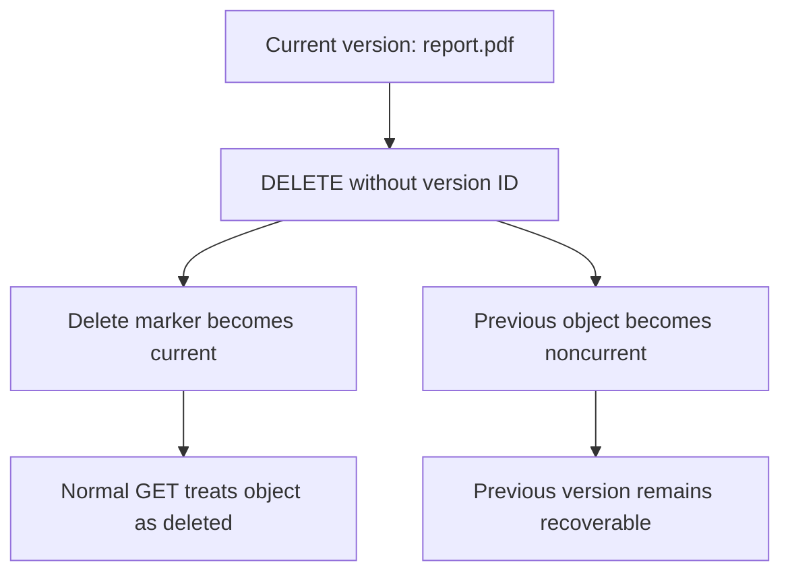

# 01- S3 Versioning Fundamentals

## Overview

Amazon S3 Versioning maintains multiple versions of an object under the same object key within a general purpose bucket. It helps recover from accidental overwrites, application errors, and ordinary deletion requests by preserving earlier versions of an object.

Without versioning, replacing an object generally replaces its existing contents, and deleting it removes it from normal object access. With versioning enabled, S3 assigns a unique version ID to each newly stored object version. Earlier versions remain available until they are explicitly deleted or removed by applicable lifecycle rules.

For backend engineering systems, versioning is particularly useful for document storage, user uploads, configuration files, data pipelines, audit artifacts, and workloads that require recovery from accidental changes.

Versioning is a recovery mechanism, not a complete backup or immutability solution. Its effectiveness depends on retention policies, permissions, monitoring, and the ability to recover the required version.

## How S3 Versioning Works

### Object keys and version IDs

An S3 object is identified by its bucket and key. In a versioning-enabled bucket, a version ID identifies a particular stored version of that object.

For example, a bucket may contain three versions of the same object:

| Bucket | Object key | Version ID | Contents |
|---|---|---|---|
| `company-documents` | `reports/annual.pdf` | `v1-example` | Original report |
| `company-documents` | `reports/annual.pdf` | `v2-example` | Corrected report |
| `company-documents` | `reports/annual.pdf` | `v3-example` | Latest report |

The version IDs are illustrative. S3 generates the actual IDs, which are opaque identifiers rather than sequential version numbers.

All versions share the same bucket and key. The latest current version is returned by a normal GET request unless the current version is a delete marker.

### Understand the versioning states

S3 Versioning is configured at the bucket level, not independently for individual object keys.

| State | Behavior | Important consideration |
|---|---|---|
| Unversioned | New writes do not create independently addressable object versions | This is the default state for new buckets |
| Enabled | New object writes receive unique version IDs | Overwrites preserve previous versions |
| Suspended | New writes use the `null` version ID | An existing null version can be replaced |

Once versioning has been enabled on a bucket, it cannot be returned to its original unversioned state. It can only be suspended.

Suspending versioning does not remove previously created versions. It changes how future writes and deletes behave.

### Understand current and noncurrent versions

For each object key in a versioning-enabled bucket, S3 maintains one current version and can retain zero or more noncurrent versions.

When a new object version is written:

1. The existing current version becomes noncurrent.
2. S3 creates a new version with a unique version ID.
3. The new version becomes current.
4. Previous versions remain available until permanently deleted.

Versioning does not store only the differences between versions. Each version represents a complete object, so retaining multiple large versions increases storage consumption.

### Understand the null version ID

Objects created before versioning is enabled retain their existing contents and have a version ID of `null`. Enabling versioning does not retroactively create historical versions of those objects.

When such an object is subsequently modified while versioning is enabled, the new version receives a unique version ID.

In a versioning-suspended bucket, new writes use the `null` version ID. If a null version already exists under the same key, a new write can replace that null version while leaving other uniquely identified versions intact.

Do not treat `null` as a regular unique version ID. It represents the special null-version behavior associated with unversioned or suspended-versioning operations.

## Enable Versioning

### Enable versioning using the AWS CLI

Set the bucket name:

```bash
export BUCKET="company-documents"
```

Enable versioning:

```bash
aws s3api put-bucket-versioning \
  --bucket "$BUCKET" \
  --versioning-configuration Status=Enabled
```

Inspect the bucket's versioning state:

```bash
aws s3api get-bucket-versioning \
  --bucket "$BUCKET"
```

An enabled bucket returns a response similar to:

```json
{
  "Status": "Enabled"
}
```

The operation requires the appropriate S3 permissions, including `s3:PutBucketVersioning` for configuration changes and `s3:GetBucketVersioning` for inspection.

**Important operational consideration:** After enabling versioning for the first time, AWS recommends waiting 15 minutes before performing object `PUT` or `DELETE` operations. The change can take time to propagate, and requests during this period can encounter unexpected object-visibility behavior.

Reference: [Enabling versioning on buckets](https://docs.aws.amazon.com/AmazonS3/latest/userguide/manage-versioning-examples.html).

### Configure versioning with Terraform

For infrastructure managed through Terraform, define versioning as a separate bucket configuration resource.

```hcl
resource "aws_s3_bucket" "documents" {
  bucket = var.bucket_name
}

resource "aws_s3_bucket_versioning" "documents" {
  bucket = aws_s3_bucket.documents.id

  versioning_configuration {
    status = "Enabled"
  }
}
```

Declare the bucket name as an input variable:

```hcl
variable "bucket_name" {
  description = "Globally unique name of the S3 bucket"
  type        = string
}
```

Deploy and verify the configuration:

```bash
terraform init
terraform fmt -check
terraform validate
terraform plan
terraform apply
```

Versioning is only one part of a production bucket configuration. Also define the required encryption, public-access prevention, IAM permissions, lifecycle, logging, and recovery controls.

Do not disable versioning as an easy way to reduce storage costs. First evaluate noncurrent-version lifecycle rules and their recovery implications.

## Overwrite Objects Safely

### Understand overwrite behavior

When versioning is enabled, uploading an object to an existing key creates a new version instead of permanently replacing the prior version.

For example:

```bash
aws s3 cp ./report-v1.pdf \
  "s3://${BUCKET}/reports/annual.pdf"

aws s3 cp ./report-v2.pdf \
  "s3://${BUCKET}/reports/annual.pdf"
```

After both successful writes, the key has multiple versions. A standard GET returns the current version, while the earlier contents remain available through their version IDs.

This protects historical data from ordinary overwrite operations, but it does not prevent an application from publishing incorrect content as the current version.

### Handle concurrent application writes

Versioning can preserve the results of concurrent writes, but it is not a concurrency-control mechanism.

If multiple workers upload different contents to the same key, S3 can store multiple versions. The application must still define which content is authoritative and how conflicting updates are resolved.

For important configuration files or generated artifacts:

- Prefer immutable object keys when practical.
- Include business identifiers or content hashes in object key design.
- Use conditional requests or application-level coordination when updates must not silently overwrite another writer's intended state.
- Record the version ID associated with a successful write when later retrieval or auditing requires that exact version.

Do not assume that S3 version IDs are sortable or that a version ID represents an application-level revision number.

## Understand Delete Markers

### A normal DELETE does not permanently remove a versioned object

In a versioning-enabled bucket, a `DELETE` request without a version ID creates a delete marker.

The delete marker becomes the current version. Earlier object versions remain stored as noncurrent versions.



When a normal GET addresses an object whose current version is a delete marker, S3 behaves as though the object has been deleted. A GET request without a specific version ID typically returns HTTP 404.

This distinction is essential for troubleshooting accidental deletions and controlling storage costs.

### Create a delete marker

```bash
aws s3api delete-object \
  --bucket "$BUCKET" \
  --key "reports/annual.pdf"
```

This operation generally hides the object from normal access but preserves the existing version history.

It does not guarantee that the object's storage costs disappear.

### Inspect versions and delete markers

List all versions and delete markers for a key:

```bash
aws s3api list-object-versions \
  --bucket "$BUCKET" \
  --prefix "reports/annual.pdf"
```

The `--prefix` parameter filters object keys by prefix; it does not necessarily mean that only one exact key will be returned.

For automated investigation, inspect both the `Versions` and `DeleteMarkers` collections in the response.

Do not rely exclusively on `aws s3 ls` or `list-objects-v2` when investigating version history. Those commands are not substitutes for `list-object-versions`.

## Retrieve and Restore Previous Versions

### Retrieve a specific version

Once the required version ID is known, retrieve that exact version rather than relying on whichever version is currently active.

```bash
aws s3api get-object \
  --bucket "$BUCKET" \
  --key "reports/annual.pdf" \
  --version-id "$VERSION_ID" \
  ./annual-restored.pdf
```

Replace `VERSION_ID` with the actual version ID returned by S3.

The identity performing the operation must have the relevant object permissions, including `s3:GetObjectVersion`. SSE-KMS encrypted objects may also require appropriate KMS permissions.

### Restore a previous version as current

One recovery approach is to copy the selected historical version to the same object key. This creates a new current version containing the older contents while preserving the existing version history.

```bash
aws s3api copy-object \
  --bucket "$BUCKET" \
  --key "reports/annual.pdf" \
  --copy-source "${BUCKET}/reports/annual.pdf?versionId=${VERSION_ID}"
```

For keys or version IDs containing reserved URL characters, encode the copy-source value according to the S3 API requirements.

After the copy, inspect the current version and test application access. Verify metadata, tags, encryption, content integrity, and any required application references.

Restoring historical contents by copying is often safer than permanently deleting the current version, particularly when lifecycle expiration rules could remove noncurrent versions.

### Recover an object hidden by a delete marker

A delete marker can be explicitly removed by specifying its version ID. This causes the previous version to become current if an earlier version exists.

Inspect the delete marker before removing it:

```bash
aws s3api delete-object \
  --bucket "$BUCKET" \
  --key "reports/annual.pdf" \
  --version-id "$DELETE_MARKER_VERSION_ID"
```

This is a state-changing operation and permanently removes the selected delete marker. Verify that the selected version ID identifies the intended marker rather than a data-bearing version.

If other versions exist, deleting the current marker can make an earlier version visible again. If no underlying object version exists, removing the marker does not recreate the deleted content.

## Permanently Delete an Object Version

### Distinguish logical deletion from permanent deletion

A versioned object's data is permanently removed only when the relevant object version is explicitly deleted or an applicable lifecycle rule expires it.

For example:

```bash
aws s3api delete-object \
  --bucket "$BUCKET" \
  --key "reports/annual.pdf" \
  --version-id "$VERSION_ID"
```

Unlike an ordinary DELETE, this operation targets a particular version.

Use permanent version deletion only when retention requirements, legal obligations, application dependencies, and recovery requirements have been evaluated.

The `s3:DeleteObjectVersion` permission should be assigned narrowly. Avoid granting unrestricted version-deletion permissions to normal application roles.

### Protect important version history

Versioning alone does not make stored versions immutable. A principal with sufficient permissions can permanently delete versions, and lifecycle rules can remove versions according to their configuration.

For stronger retention guarantees, evaluate S3 Object Lock with an appropriate retention mode or legal hold. Object Lock protects supported object versions according to its retention rules and is separate from the basic versioning mechanism.

For high-value datasets, consider combining:
- Versioning for historical recovery.
- Least-privilege controls over permanent deletion.
- S3 Object Lock where immutability is required.
- Cross-account or cross-Region replication for additional recovery options.
- Monitoring for unauthorized configuration or deletion attempts.

## Integrate Versioning with Lifecycle Management

### Manage noncurrent-version storage costs

Versioning increases storage consumption because historical versions are retained independently.

A lifecycle configuration can transition noncurrent versions to a lower-cost storage class or permanently expire them after a defined retention period.

For example, the following JSON transitions noncurrent versions after 30 days and expires them after 365 days:

```json
{
  "Rules": [
    {
      "ID": "ManageHistoricalVersions",
      "Status": "Enabled",
      "Filter": {
        "Prefix": "reports/"
      },
      "NoncurrentVersionTransitions": [
        {
          "NoncurrentDays": 30,
          "StorageClass": "STANDARD_IA"
        }
      ],
      "NoncurrentVersionExpiration": {
        "NoncurrentDays": 365
      }
    }
  ]
}
```

This policy is illustrative. Validate minimum storage durations, transition charges, the retention requirement, and the impact on restore operations before applying it.

Review the full bucket lifecycle configuration before deployment because applying a new lifecycle configuration can replace existing rules.

### Understand current-version expiration

In a versioning-enabled bucket, lifecycle expiration of a current data-bearing version generally creates a delete marker rather than permanently removing that version.

The former current version becomes noncurrent and can continue consuming storage.

Use `NoncurrentVersionExpiration` to manage noncurrent data versions. If appropriate, use an expired-object-delete-marker rule to clean up delete markers that no longer have noncurrent versions.

Do not assume that a current-version expiration rule alone removes all historical data.

Reference: [Lifecycle configuration elements](https://docs.aws.amazon.com/AmazonS3/latest/userguide/intro-lifecycle-rules.html).

## Understand the Relationship Between Versioning and Replication

Versioning and replication solve different problems.

Versioning retains multiple versions of objects within a bucket. Replication asynchronously copies eligible objects to another bucket, potentially in another Region or account.

S3 Replication requires versioning to be enabled on both the source and destination buckets. The replication role must have the required permissions, and encryption settings can introduce additional requirements.

Replication can improve recovery options, but it does not automatically provide an independent immutable backup. Depending on the replication configuration and workflow, deletions and changes can affect replicated data, and replication can be delayed or fail.

For critical workloads:

- Define the required recovery point objective (RPO) and recovery time objective (RTO).
- Monitor replication status and failures.
- Validate that destination objects can be accessed and decrypted.
- Test the actual recovery procedure.
- Evaluate retention and deletion protections independently for the destination.

Reference: [S3 replication requirements](https://docs.aws.amazon.com/AmazonS3/latest/userguide/replication-requirements.html).

## Monitor Versioning and Diagnose Problems

### Recommended verification commands

| Objective | Command |
|---|---|
| Inspect bucket versioning state | `aws s3api get-bucket-versioning --bucket "$BUCKET"` |
| List versions and delete markers | `aws s3api list-object-versions --bucket "$BUCKET"` |
| Inspect the current object | `aws s3api head-object --bucket "$BUCKET" --key "$KEY"` |
| Retrieve a specific historical version | `aws s3api get-object --bucket "$BUCKET" --key "$KEY" --version-id "$VERSION_ID" ./restored-object` |
| Inspect lifecycle rules | `aws s3api get-bucket-lifecycle-configuration --bucket "$BUCKET"` |
| Inspect replication rules | `aws s3api get-bucket-replication --bucket "$BUCKET"` |

Set `$KEY` and `$VERSION_ID` before running the corresponding commands.

For large buckets, use S3 Inventory or S3 Storage Lens to analyze object versions, delete markers, and storage growth without relying on repeated manual enumeration.

### Investigate unexpected storage growth

Large version histories can increase costs, and an unusually high number of versions or delete markers can contribute to performance problems.

When investigating:
1. Compare current and noncurrent version counts.
2. Identify workloads repeatedly writing to the same object key.
3. Review lifecycle rules for missing noncurrent-version expiration.
4. Inspect delete-marker accumulation.
5. Identify objects with unusually large version counts.
6. Verify whether an automated job is repeatedly uploading or deleting the same key.

S3 can automatically throttle requests to protect the bucket when an object accumulates millions of versions, potentially producing increased HTTP 503 responses.

Prefer correcting the write pattern and applying a deliberate retention policy rather than permanently deleting historical data without approval.

## Common Versioning Mistakes

| Mistake | Consequence | Better practice |
|---|---|---|
| Assuming versioning is enabled by default | Overwrites may not preserve recoverable history | Explicitly configure and verify bucket versioning |
| Assuming enabling versioning versions existing data retroactively | Existing objects remain as null versions | Treat historical coverage as beginning with subsequent writes |
| Treating versioning as an immutable backup | Authorized deletion or lifecycle policies can remove versions | Apply separate retention, immutability, and recovery controls |
| Assuming an ordinary DELETE permanently removes data | A delete marker can hide the object while previous versions remain stored | Inspect versions and markers explicitly |
| Assuming a lifecycle expiration rule removes every version | Historical versions can continue consuming storage | Configure noncurrent-version expiration where required |
| Disabling versioning to reduce costs | Future writes can overwrite null versions, weakening recovery | Apply reviewed lifecycle policies instead |
| Treating version IDs as ordered revision numbers | Application logic may infer a chronology that the IDs do not guarantee | Maintain application-level revision metadata where necessary |
| Ignoring concurrent writers | Multiple valid versions can be created without resolving business conflicts | Use application-level coordination or conditional requests |
| Granting broad permanent-delete permissions | Historical data can be irreversibly removed | Restrict `s3:DeleteObjectVersion` and audit sensitive operations |
| Assuming replication guarantees disaster recovery | Replication may be delayed, misconfigured, or affected by deletion behavior | Monitor, validate, and test recovery independently |

## Production Readiness Checklist

- [ ] Versioning is explicitly enabled on buckets that require object-history recovery.
- [ ] The initial versioning rollout accounts for AWS's recommended propagation period.
- [ ] Application workflows understand current versions, noncurrent versions, and delete markers.
- [ ] Historical version IDs are recorded where exact-version retrieval is required.
- [ ] Application write patterns and concurrent updates are designed deliberately.
- [ ] Permanent version deletion is restricted to authorized operational roles.
- [ ] Lifecycle rules balance retention requirements with storage costs.
- [ ] Recovery procedures are tested against actual object versions.
- [ ] Replication is configured and monitored where additional recovery copies are required.
- [ ] Object Lock is evaluated separately when immutability is a requirement.
- [ ] Version counts, delete markers, and storage growth are monitored.
- [ ] Configuration changes are reviewed and verified through infrastructure-as-code or approved operational procedures.

## Authoritative References

- [Retaining multiple versions of objects with S3 Versioning](https://docs.aws.amazon.com/AmazonS3/latest/userguide/Versioning.html)
- [How S3 Versioning works](https://docs.aws.amazon.com/AmazonS3/latest/userguide/versioning-workflows.html)
- [Enabling versioning on buckets](https://docs.aws.amazon.com/AmazonS3/latest/userguide/manage-versioning-examples.html)
- [Working with objects in versioning-enabled buckets](https://docs.aws.amazon.com/AmazonS3/latest/userguide/manage-objects-versioned-bucket.html)
- [Deleting object versions from a versioning-enabled bucket](https://docs.aws.amazon.com/AmazonS3/latest/userguide/DeletingObjectVersions.html)
- [Troubleshooting versioning](https://docs.aws.amazon.com/AmazonS3/latest/userguide/troubleshooting-versioning.html)
- [S3 Lifecycle configuration elements](https://docs.aws.amazon.com/AmazonS3/latest/userguide/intro-lifecycle-rules.html)
- [S3 replication requirements](https://docs.aws.amazon.com/AmazonS3/latest/userguide/replication-requirements.html)
- [Configuring MFA Delete](https://docs.aws.amazon.com/AmazonS3/latest/userguide/MultiFactorAuthenticationDelete.html)

## Key Takeaways

- S3 Versioning preserves historical object versions and helps recover from ordinary overwrites and deletion requests.
- A normal DELETE creates a delete marker in a versioning-enabled bucket; permanent deletion requires targeting a specific version or an applicable lifecycle action.
- Versioning cannot be returned to the unversioned state after activation, and suspending it does not remove existing historical versions.
- Lifecycle rules, least-privilege deletion permissions, monitoring, and tested recovery procedures are essential to managing version history safely.
- Versioning, replication, backup, and immutability serve different purposes and should be combined according to explicit recovery and retention requirements.