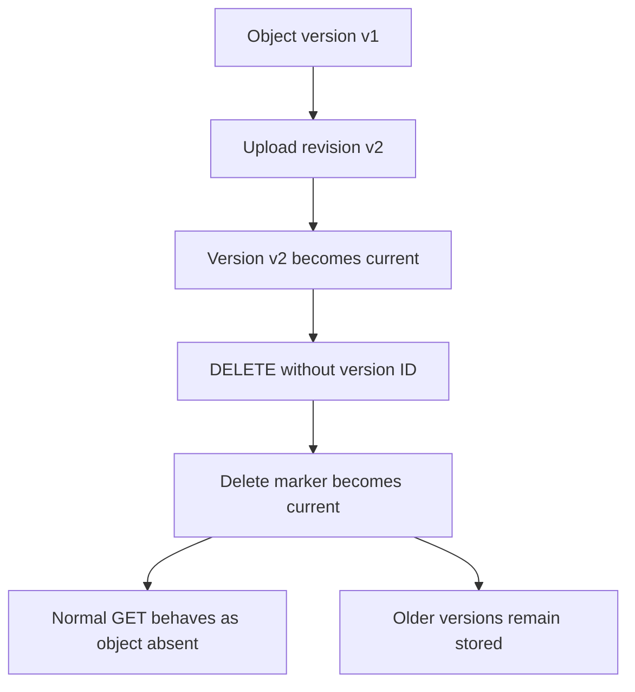

# Delete Markers and Object Versions

## Overview

Amazon S3 Versioning maintains multiple versions of an object under the same object key. It helps recover overwritten data, protect against accidental deletion, and preserve historical object states.

When versioning is enabled, deleting an object without specifying its version ID normally creates a **delete marker** instead of permanently deleting the underlying object version. The delete marker becomes the current version, causing ordinary object retrieval requests to behave as though the object is absent.

Understanding this behavior is essential when implementing document-management APIs, backup systems, data retention policies, and operational recovery procedures.

This document explains how object versions and delete markers interact, how to recover deleted objects, how to permanently remove specific versions, and how to manage historical versions safely.

## Understand S3 Object Versions

### What is an object version?

An object version represents a stored revision of an object identified by its bucket and key. Each new object upload or overwrite in a versioning-enabled general purpose bucket creates a new version with a unique version ID.

For example, an application uploads three revisions of a document:

```text
Bucket: company-documents
Key: reports/quarterly-report.pdf

Version history:
  Version ID: v3  -> Latest revision
  Version ID: v2  -> Previous revision
  Version ID: v1  -> Original revision
```

The version IDs above are illustrative. Actual S3 version IDs are generated by Amazon S3 and must be obtained from S3 responses or version listings.

Each version represents a complete stored object, not merely a difference from the previous revision. Retaining multiple large versions can therefore increase storage costs substantially.

### Why versioning matters

Versioning supports several operational requirements:

- Recovering objects after accidental overwrites.
- Recovering logically deleted objects.
- Preserving historical revisions for auditing.
- Supporting controlled recovery workflows.
- Retaining independent versions for backup and data protection.

Versioning is not a complete backup strategy by itself. A principal with sufficient permissions can permanently delete object versions, and lifecycle rules can permanently expire historical data. Critical data may require additional protection through replication, separate-account copies, AWS Backup where supported, or S3 Object Lock.

### Versioning states

| Bucket state | Behavior |
|---|---|
| Unversioned | Objects do not receive uniquely versioned revisions through normal uploads. |
| Versioning enabled | New object writes receive unique version IDs; ordinary deletes normally create delete markers. |
| Versioning suspended | Existing non-null versions remain, but new writes use the `null` version ID and can replace an existing null version. |

Suspending versioning is not equivalent to disabling versioning and does not remove previously retained versions.

For production systems, enable versioning deliberately and avoid switching between versioning states without understanding how null versions and lifecycle operations behave.

Reference: [Retaining multiple versions with S3 Versioning](https://docs.aws.amazon.com/AmazonS3/latest/userguide/Versioning.html).

## Understand Delete Markers

### What is a delete marker?

A delete marker is a special version that indicates an object has been logically deleted. It contains no object data and has its own version ID when created in a versioning-enabled bucket.

A normal delete request without a version ID generally creates a delete marker rather than removing the existing object data.



This behavior separates logical deletion from permanent deletion.

For example, a document management API can hide a document from ordinary users without immediately destroying its historical data.

### Current object state after deletion

Consider an object with two versions:

| Version ID | Type | State before deletion |
|---|---|---|
| `v2` | Object version | Current |
| `v1` | Object version | Noncurrent |

After a normal `DELETE` request:

| Version ID | Type | State after deletion |
|---|---|---|
| `dm3` | Delete marker | Current |
| `v2` | Object version | Noncurrent |
| `v1` | Object version | Noncurrent |

The example IDs are placeholders. S3 generates the actual version and delete-marker IDs.

A normal `GET` request for the object key now behaves as though the object does not exist, even though the older object versions remain stored.

### How GET and DELETE behave

| Operation | Expected behavior in a versioning-enabled bucket |
|---|---|
| `GET` without a version ID when the current version is an object | Returns the current object |
| `GET` without a version ID when the current version is a delete marker | Returns a not-found response |
| `GET` with an existing object version ID | Retrieves that specific historical version, subject to authorization |
| `DELETE` without a version ID | Creates a new delete marker |
| `DELETE` with an object version ID | Permanently deletes the specified object version, subject to applicable protections |
| `DELETE` with a delete-marker version ID | Permanently deletes that delete marker, making an older version current if one remains |

Deleting a delete marker does not restore deleted bytes. It removes the marker that hides older versions.

If no earlier object version remains, removing the marker does not recreate the original object.

Reference: [Managing delete markers](https://docs.aws.amazon.com/AmazonS3/latest/userguide/ManagingDelMarkers.html).

## Inspect Object Versions and Delete Markers

### Enable versioning

Inspect the current configuration:

```bash
aws s3api get-bucket-versioning \
  --bucket "$BUCKET"
```

Enable versioning on a general purpose bucket when required:

```bash
aws s3api put-bucket-versioning \
  --bucket "$BUCKET" \
  --versioning-configuration Status=Enabled
```

Verify that the returned configuration reports `Enabled`.

AWS recommends allowing up to 15 minutes after initially enabling versioning before issuing object writes or deletes, to avoid intermittent behavior while the configuration propagates.

Enabling versioning does not retrospectively create historical versions for existing objects.

### List object versions

Use `list-object-versions` to retrieve both object versions and delete markers.

```bash
aws s3api list-object-versions \
  --bucket "$BUCKET" \
  --prefix "reports/quarterly-report.pdf"
```

The prefix narrows the search, but it is not an exact-key filter. If other keys share that prefix, they can also appear in the result.

For a more readable inspection:

```bash
aws s3api list-object-versions \
  --bucket "$BUCKET" \
  --prefix "reports/quarterly-report.pdf" \
  --query '{
    Versions: Versions[].{
      Key: Key,
      VersionId: VersionId,
      IsLatest: IsLatest,
      LastModified: LastModified,
      Size: Size
    },
    DeleteMarkers: DeleteMarkers[].{
      Key: Key,
      VersionId: VersionId,
      IsLatest: IsLatest,
      LastModified: LastModified
    }
  }'
```

Review both collections. Looking only at object versions can conceal the delete marker responsible for the object's current not-found behavior.

The command uses AWS CLI client-side pagination by default. Large listings can still produce substantial output, so inspect narrow prefixes or use pagination controls for operational investigations.

Required permission typically includes `s3:ListBucketVersions`.

### Inspect a specific version

Retrieve metadata for a particular object version:

```bash
aws s3api head-object \
  --bucket "$BUCKET" \
  --key "reports/quarterly-report.pdf" \
  --version-id "$VERSION_ID"
```

Download a specific version:

```bash
aws s3api get-object \
  --bucket "$BUCKET" \
  --key "reports/quarterly-report.pdf" \
  --version-id "$VERSION_ID" \
  ./quarterly-report-recovered.pdf
```

These commands allow engineers to distinguish between an absent current object, a recoverable historical version, and an inaccessible version.

Version-specific operations require the corresponding authorization. For encrypted objects, KMS permissions may also be necessary.

## Restore an Object Hidden by a Delete Marker

### Recovery procedure

When a delete marker is the current version, the historical object data may still exist.

A typical recovery workflow is:

1. List object versions and delete markers.
2. Confirm the exact bucket and object key.
3. Identify the current delete marker and its version ID.
4. Verify that the expected historical object version exists.
5. Confirm that the caller is authorized to remove the marker.
6. Delete only the intended delete marker.
7. Verify that the expected object version is current and readable.

The critical operation is deleting the current delete marker by its exact version ID.

### Delete a specific delete marker

```bash
aws s3api delete-object \
  --bucket "$BUCKET" \
  --key "reports/quarterly-report.pdf" \
  --version-id "$DELETE_MARKER_VERSION_ID"
```

Verify the resulting state:

```bash
aws s3api head-object \
  --bucket "$BUCKET" \
  --key "reports/quarterly-report.pdf"
```

If the operation succeeds and an older object version becomes current, the normal object request can retrieve it.

**Important:** Removing a delete marker is a permanent version deletion, not a reversible undelete operation. If another application request creates a new delete marker concurrently, the final state may differ from the state expected by the recovery operator.

For production recovery, record the affected key and version IDs, coordinate concurrent mutations, and verify the final state after the change.

### Alternative: Copy a historical version into a new current version

Deleting the marker is not always the best recovery strategy. If the application needs to preserve the existing marker history, or if recovery must create a new auditable revision, copy the historical version to the same key.

```bash
aws s3api copy-object \
  --bucket "$BUCKET" \
  --key "reports/quarterly-report.pdf" \
  --copy-source "company-documents/reports/quarterly-report.pdf?versionId=REPLACE_WITH_VERSION_ID" \
  --metadata-directive COPY
```

Replace the source bucket, key, and version ID with the actual values. For keys containing reserved characters, encode the copy-source path correctly according to the S3 API requirements.

A successful copy creates a new current object version in a versioning-enabled destination bucket. The existing delete marker and historical versions remain in the version history.

The caller needs the appropriate source-read and destination-write permissions. Encryption, metadata, tagging, Object Lock settings, and cross-account policies may require additional configuration.

Use this method when recovery should be represented as a new object revision rather than by removing the existing marker.

## Permanently Delete an Object Version

### Understand the difference between logical and permanent deletion

A normal deletion does not usually free the storage occupied by old versions in a versioning-enabled bucket. Those versions continue to incur storage charges until they are permanently deleted or otherwise cease to consume billable storage.

To permanently delete an object version, specify its version ID.

```bash
aws s3api delete-object \
  --bucket "$BUCKET" \
  --key "reports/quarterly-report.pdf" \
  --version-id "$VERSION_ID"
```

The version ID must be obtained from a trusted S3 listing or recorded operation. Do not substitute the object's key, the current marker ID, or an arbitrary identifier.

If the specified version is a historical object version, that data is permanently removed unless another recoverable copy exists.

If the specified version is a delete marker, removing it can expose an older object version as current.

### Required permissions

The exact permission model depends on the bucket configuration, identity policies, resource policies, and any additional protections.

| Action | Permission to evaluate |
|---|---|
| List versions and markers | `s3:ListBucketVersions` |
| Delete an object without specifying a version ID | `s3:DeleteObject` |
| Permanently delete a specific object version or delete marker | `s3:DeleteObjectVersion` |
| Read an object version | `s3:GetObjectVersion` |
| Read a specific object's metadata | `s3:GetObjectVersion` when specifying a version ID |
| Copy a historical version | Source-version read permission and destination write permission |

Do not grant permanent version-deletion permissions to every application role simply because the application needs to hide or delete objects from its users.

For ordinary user-initiated deletion, a service can create a delete marker while reserving permanent deletion for a controlled administrative or retention-management workflow.

### Understand versioning-suspended behavior

When versioning is suspended, the `null` version ID requires special care.

- A new write uses the null version ID and can replace an existing null version.
- A normal delete can permanently remove a current null object version and create a null delete marker.
- If the current object has a non-null version ID, a normal delete can create a null delete marker without deleting the older non-null data.
- An explicitly supplied non-null version ID can still identify a particular historical version for permanent deletion, subject to authorization and protections.

Do not assume that suspending versioning protects data from replacement or permanent removal. Existing versions remain, but null-version operations behave differently.

Reference: [Deleting objects from versioning-suspended buckets](https://docs.aws.amazon.com/AmazonS3/latest/userguide/DeletingObjectsfromVersioningSuspendedBuckets.html).

## Manage Versions with Lifecycle Policies

### Why lifecycle rules matter

Versioning can retain many historical object versions and delete markers. Without appropriate lifecycle rules, storage usage can grow indefinitely.

S3 Lifecycle supports separate operations for:
- Expiring current objects.
- Permanently expiring noncurrent versions.
- Removing expired object delete markers.
- Transitioning eligible versions to supported storage classes.

An expiration rule on a current object in a versioning-enabled bucket normally creates a delete marker. It does not, by itself, permanently remove all historical versions.

### Permanently remove noncurrent versions

The following example permanently expires noncurrent object versions after 90 days while retaining current versions unless another rule applies.

`lifecycle.json`:

```json
{
  "Rules": [
    {
      "ID": "ExpireOldNoncurrentVersions",
      "Status": "Enabled",
      "Filter": {
        "Prefix": "reports/"
      },
      "NoncurrentVersionExpiration": {
        "NoncurrentDays": 90
      }
    }
  ]
}
```

Apply a lifecycle configuration only after reviewing the complete configuration already associated with the bucket:

```bash
aws s3api get-bucket-lifecycle-configuration \
  --bucket "$BUCKET"
```

After merging the intended rule with all existing required rules:

```bash
aws s3api put-bucket-lifecycle-configuration \
  --bucket "$BUCKET" \
  --lifecycle-configuration file://lifecycle.json
```

This operation replaces the bucket's lifecycle configuration. Never deploy a partial file without preserving existing lifecycle rules that support other workloads.

Verify the deployed configuration:

```bash
aws s3api get-bucket-lifecycle-configuration \
  --bucket "$BUCKET"
```

Noncurrent-version expiration is destructive. Before enabling it, confirm the required recovery window, backup coverage, regulatory retention, and any Object Lock requirements.

### Remove expired delete markers

An expired object delete marker is a delete marker with no remaining object versions beneath it.

Such markers can accumulate after versioned objects and older versions have been deleted. They can be removed through a dedicated lifecycle expiration rule.

```json
{
  "Rules": [
    {
      "ID": "RemoveExpiredDeleteMarkers",
      "Status": "Enabled",
      "Filter": {
        "Prefix": "reports/"
      },
      "Expiration": {
        "ExpiredObjectDeleteMarker": true
      }
    }
  ]
}
```

The `ExpiredObjectDeleteMarker` action cannot be combined with `Days` or `Date` in the same `Expiration` configuration. Use a separate rule for ordinary age-based expiration when both behaviors are needed.

Expired marker cleanup is not the same as permanently deleting all versions beneath an active marker. Configure and verify noncurrent-version expiration separately.

Reference: [S3 Lifecycle configuration examples](https://docs.aws.amazon.com/AmazonS3/latest/userguide/lifecycle-configuration-examples.html).

## Understand Bulk Deletion and Pagination

### Delete a specific set of versions in bulk

For large-scale cleanup, inspect the affected versions and prepare an explicit list of object keys and version IDs. Use S3 Batch Operations or controlled API workflows where appropriate.

For a small, reviewed batch, an AWS CLI `delete-objects` request can delete exact versions.

`delete-versions.json`:

```json
{
  "Objects": [
    {
      "Key": "reports/old-report.pdf",
      "VersionId": "REPLACE_WITH_VERSION_ID"
    },
    {
      "Key": "reports/obsolete-report.csv",
      "VersionId": "REPLACE_WITH_VERSION_ID"
    }
  ],
  "Quiet": false
}
```

Execute the deletion:

```bash
aws s3api delete-objects \
  --bucket "$BUCKET" \
  --delete file://delete-versions.json
```

This example permanently deletes the specified versions. It does not merely hide them from normal object retrieval.

Before executing a destructive batch:
- Validate each key and version ID.
- Confirm the intended bucket and AWS account.
- Review Object Lock retention and legal holds.
- Export or preserve an audit record of the target list.
- Inspect the API response for per-object errors.
- Verify the resulting version inventory.
- Ensure that the batch cannot accidentally expand to unrelated prefixes.

A successful API response can contain both successful deletions and per-object errors. Treat the response as an input to verification rather than assuming every requested deletion succeeded.

### Account for pagination

Large buckets may contain many object versions and delete markers for the same key.

Use the AWS CLI's automatic pagination where applicable, or explicitly manage API pagination when implementing a custom SDK workflow. Do not assume a single response contains every version in a large bucket.

For an exact destructive operation, resolve the complete and verified set of target versions before deletion. Avoid using a prefix listing as the only safeguard when unrelated keys can share that prefix.

## Protect Versions with Object Lock and Operational Controls

### Understand Object Lock interaction

Amazon S3 Object Lock can protect object versions through retention periods and legal holds.

Where applicable, an explicit permanent delete request for a protected version can fail even if the caller has ordinary delete permissions.

Distinguish between:
- Creating a delete marker to hide an object.
- Permanently deleting an object version.
- Attempting to delete a version protected by Object Lock.
- Removing a delete marker that is itself subject to applicable protections.

Compliance-mode retention and legal holds provide different controls from normal versioning. Ensure that the retention model satisfies the intended compliance requirements and test recovery procedures without weakening protections.

Reference: [How S3 Object Lock works](https://docs.aws.amazon.com/AmazonS3/latest/userguide/object-lock.html).

### Use least privilege for deletion workflows

A recommended role separation is:

| Principal | Recommended responsibility |
|---|---|
| Application role | Read and write authorized application objects |
| User-facing deletion service | Create delete markers where deletion is allowed |
| Recovery operator | Inspect versions and restore objects through an approved procedure |
| Retention-management role | Run approved lifecycle or permanent-deletion workflows |
| Audit role | Inspect configuration and access evidence |

The application's business logic should decide whether an object is eligible for deletion. It should not accept an arbitrary version ID from an untrusted client and permanently delete that version without authorization and validation.

For multi-tenant applications, verify object ownership and tenant authorization before generating any S3 request. An object key alone should not be treated as proof of application-level ownership.

## Troubleshoot Versioning and Delete-Marker Problems

### Object appears deleted, but storage usage remains high

**Likely cause:** A normal delete request created a delete marker while historical object versions remain.

**Verify:**

```bash
aws s3api list-object-versions \
  --bucket "$BUCKET" \
  --prefix "$OBJECT_KEY"
```

**Corrective action:** Decide whether the requirement is logical deletion, recovery, or permanent removal. Permanently delete historical versions only when retention and recovery requirements permit it.

### Object remains inaccessible after a recovery attempt

**Likely causes:**
- The wrong delete marker was deleted.
- A newer delete marker was created by a concurrent request.
- The expected historical version does not exist.
- The caller is attempting to read the wrong key or bucket.
- Authorization or encryption permissions prevent access.

**Verify:** Re-list the object's versions, inspect `IsLatest`, check the response from the recovery operation, and confirm the exact object key and version ID.

**Corrective action:** Repeat the recovery procedure against the current state. Do not repeatedly issue normal deletes, because they can create additional markers rather than remove the intended one.

### Permanent version deletion fails

**Likely causes:**
- The caller lacks `s3:DeleteObjectVersion`.
- The bucket policy or another authorization control denies the request.
- Object Lock retention or a legal hold protects the version.
- The requested version ID is incorrect.
- Additional requirements, such as MFA Delete where configured, have not been satisfied.

**Verify:** Inspect the exact error, caller identity, bucket policy, IAM permissions, version ID, and Object Lock configuration.

**Corrective action:** Resolve the specific authorization or retention issue through the approved workflow. Do not weaken broad bucket protections merely to force a deletion.

### Lifecycle removes current objects but historical data remains

**Likely cause:** Current-version expiration created delete markers, but the noncurrent versions were not permanently expired.

**Verify:** Inspect the complete lifecycle configuration and list object versions.

**Corrective action:** Configure a suitable `NoncurrentVersionExpiration` rule when permanent expiration is allowed. Add expired-marker cleanup when appropriate, then verify the resulting object and marker inventory.

### Version listing appears incomplete

**Likely causes:**
- The listing is limited to a prefix.
- Pagination controls restrict the result.
- The caller lacks the required listing permissions.
- The query filters out one of the result collections.

**Corrective action:** Re-run the listing with the correct scope, verify permissions, and account for all pages before making permanent changes.

## Production Readiness Checklist

- [ ] Versioning is enabled where recovery from overwrite or logical deletion is required.
- [ ] Application deletion semantics distinguish logical deletion from permanent deletion.
- [ ] Recovery procedures inspect both object versions and delete markers.
- [ ] Permanent deletion requires explicit authorization and a verified version ID.
- [ ] Null-version behavior is understood for versioning-suspended buckets.
- [ ] Lifecycle rules define an intentional retention window for noncurrent versions.
- [ ] Expired delete markers are cleaned up where appropriate.
- [ ] Existing lifecycle rules are preserved when deploying configuration updates.
- [ ] Bulk deletions use reviewed, explicit key and version ID lists.
- [ ] Object Lock requirements and legal holds are respected.
- [ ] Recovery and deletion workflows account for concurrent application requests.
- [ ] Version listings and deletion results are checked for pagination and per-object failures.
- [ ] Storage costs include all retained object versions.
- [ ] Critical data has an appropriate backup or replication strategy beyond ordinary versioning.
- [ ] Recovery tests verify that the intended object content is actually accessible.

## Authoritative References

- [Retaining multiple versions with S3 Versioning](https://docs.aws.amazon.com/AmazonS3/latest/userguide/Versioning.html)
- [Managing delete markers](https://docs.aws.amazon.com/AmazonS3/latest/userguide/ManagingDelMarkers.html)
- [Deleting object versions](https://docs.aws.amazon.com/AmazonS3/latest/userguide/DeletingObjectVersions.html)
- [Deleting objects from versioning-suspended buckets](https://docs.aws.amazon.com/AmazonS3/latest/userguide/DeletingObjectsfromVersioningSuspendedBuckets.html)
- [S3 Lifecycle configuration examples](https://docs.aws.amazon.com/AmazonS3/latest/userguide/lifecycle-configuration-examples.html)
- [Lifecycle configuration elements](https://docs.aws.amazon.com/AmazonS3/latest/userguide/intro-lifecycle-rules.html)
- [How S3 Lifecycle interacts with versioning](https://docs.aws.amazon.com/AmazonS3/latest/userguide/lifecycle-and-other-bucket-config.html)
- [How S3 Object Lock works](https://docs.aws.amazon.com/AmazonS3/latest/userguide/object-lock.html)

## Key Takeaways

- In a versioning-enabled bucket, a normal delete generally creates a delete marker rather than permanently removing stored object versions.
- Recovering a logically deleted object requires understanding the current marker and historical version state; removing a marker and copying an older version are distinct recovery strategies.
- Permanently deleting an object version requires its exact version ID, appropriate authorization, and compliance with any retention protections.
- Lifecycle rules must separately address current-object expiration, noncurrent-version expiration, and expired delete-marker cleanup.
- Production deletion workflows should use least privilege, verified target versions, explicit audit records, and post-operation validation.