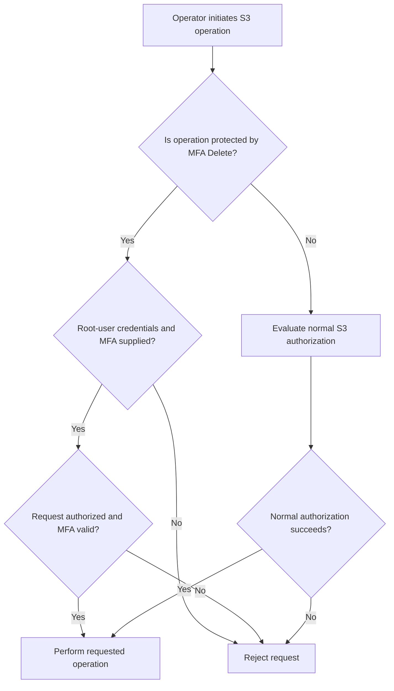

# 03- MFA Delete

## Overview

Amazon S3 MFA Delete adds a second authentication requirement to selected destructive operations on versioned S3 general purpose buckets. It is designed to reduce the risk of accidental or unauthorized permanent deletion of object versions and unauthorized changes to a bucket's versioning configuration.

MFA Delete requires both AWS security credentials and a valid code from an associated multi-factor authentication (MFA) device for protected operations. Unlike ordinary IAM authorization, it introduces an additional authentication requirement specifically for the operations protected by this feature.

MFA Delete is useful for buckets containing critical backups, audit records, historical datasets, and other data that should not be permanently deleted through an ordinary API request.

However, MFA Delete has important limitations: only the AWS account root user can enable or disable it, it cannot be configured through the S3 console, and it is incompatible with S3 Lifecycle configurations.

## What MFA Delete Protects

MFA Delete requires additional authentication for two operations:

- Permanently deleting an individual object version.
- Changing the bucket's versioning state, such as suspending versioning.

The feature requires S3 Versioning to be enabled.

| Operation | MFA Delete behavior |
|---|---|
| Upload a new object version | Does not require MFA specifically because of MFA Delete |
| Overwrite an existing object | Creates a new version when versioning is enabled; does not require MFA specifically because of MFA Delete |
| Delete an object without specifying a version ID | Normally creates a delete marker; MFA Delete does not prevent this operation by itself |
| Permanently delete an object version by specifying its version ID | Requires the protected root-user operation and MFA authentication |
| Change the bucket's versioning configuration | Requires the protected root-user operation and MFA authentication |
| Enable or disable MFA Delete | Requires root-user credentials and the appropriate MFA authentication |
| Configure S3 Lifecycle | Incompatible with MFA Delete |
| Read or download an object | Does not require MFA specifically because of MFA Delete |

The distinction between a delete marker and permanent deletion is critical. In a versioning-enabled bucket, a normal delete request generally hides the current object by adding a delete marker while retaining the underlying versions. Permanently deleting a particular version requires specifying its version ID.

MFA Delete protects permanent version deletion, not every operation that can make data unavailable.

## How MFA Delete Works

When MFA Delete is enabled, Amazon S3 evaluates protected requests for the required authentication information and authorization.



The MFA device supplies a time-based authentication code or an applicable code from a supported hardware device. The request includes the device's serial number and the current authentication code.

The two authentication factors serve different purposes:

- **AWS credentials:** Authenticate the root user and authorize the operation.
- **MFA device:** Supplies an additional authentication factor required for the protected action.

Possession of an MFA code does not replace authorization, and IAM permissions alone cannot bypass MFA Delete's root-user restriction.

## Prerequisites and Limitations

Before enabling MFA Delete, verify the following requirements.

| Requirement | Details |
|---|---|
| Bucket type | S3 general purpose bucket |
| Versioning | Must be enabled |
| Administrative identity | AWS account root user |
| Configuration interface | AWS CLI or S3 API; the S3 console cannot enable or disable MFA Delete |
| Authentication device | An active MFA device associated with the root user |
| Lifecycle configuration | Not supported; the bucket cannot have an S3 Lifecycle configuration while MFA Delete is enabled |
| Protected deletion | The request must include the MFA information required for permanent version deletion |
| Transport security | MFA-bearing requests must use HTTPS |
| Operational access | Root-user access must be securely controlled and available for approved administrative procedures |

**Important:** MFA Delete and MFA-protected API access are separate features. MFA Delete protects specific versioning and deletion operations at the bucket level. MFA-protected API access generally uses temporary credentials obtained through AWS STS and policies that require MFA.

Do not assume that configuring one feature automatically enforces the other.

## Enable MFA Delete

### Verify the existing bucket configuration

Set the bucket and Region to the intended values:

```bash
export BUCKET="your-production-backup-bucket"
export AWS_REGION="ap-south-1"
```

Inspect versioning:

```bash
aws s3api get-bucket-versioning \
  --bucket "$BUCKET" \
  --region "$AWS_REGION"
```

A versioning-enabled bucket should report:

```json
{
  "Status": "Enabled"
}
```

If versioning is not enabled, enable it using an appropriately authorized administrator identity:

```bash
aws s3api put-bucket-versioning \
  --bucket "$BUCKET" \
  --region "$AWS_REGION" \
  --versioning-configuration Status=Enabled
```

Enabling versioning is a prerequisite; it does not enable MFA Delete.

### Check for lifecycle configurations

Inspect the bucket's lifecycle configuration:

```bash
aws s3api get-bucket-lifecycle-configuration \
  --bucket "$BUCKET" \
  --region "$AWS_REGION"
```

If the bucket has a lifecycle configuration, MFA Delete cannot be enabled while that configuration remains in place.

Do not remove an existing lifecycle policy without reviewing its retention, transition, expiration, and noncurrent-version rules. If automated lifecycle management is an operational requirement, determine whether MFA Delete is an appropriate design for the bucket before making changes.

### Configure the root user's MFA device

The root user must have an active MFA device. Use the device's serial number:

- A hardware MFA device has its assigned serial number.
- A virtual MFA device is identified by its device ARN.

For a virtual device, an identifier may resemble:

`arn:aws:iam::123456789012:mfa/root-account-mfa-device`

Use the real identifier associated with the account. Never copy a sample identifier or authentication code into production commands.

### Run the configuration command

Only the root user can enable MFA Delete. Configure the approved administrative environment to use root-user credentials for this operation.

The following command enables both versioning and MFA Delete:

```bash
aws s3api put-bucket-versioning \
  --bucket "$BUCKET" \
  --region "$AWS_REGION" \
  --versioning-configuration Status=Enabled,MFADelete=Enabled \
  --mfa "MFA_DEVICE_SERIAL_NUMBER CURRENT_MFA_CODE"
```

Replace the placeholders with the actual MFA device serial number and current code. The serial number and code must be separated by a space.

Security considerations:

- Do not create permanent root access keys as a routine operating practice.
- If temporary operational setup requires root access keys for the CLI, handle them through an approved procedure and remove them immediately afterward.
- Do not store MFA codes in scripts, source control, CI/CD variables, or persistent configuration files.
- Avoid exposing authentication codes through shell history, process inspection, logs, or terminal recordings.
- Do not disable certificate validation or use an insecure endpoint to work around request errors.

The AWS CLI normally uses HTTPS for S3 API requests. Do not override the endpoint with an insecure HTTP URL for MFA-protected operations.

### Verify the configuration

Inspect versioning again:

```bash
aws s3api get-bucket-versioning \
  --bucket "$BUCKET" \
  --region "$AWS_REGION"
```

Expected result:

```json
{
  "Status": "Enabled",
  "MFADelete": "Enabled"
}
```

Treat the returned configuration as the authoritative verification that MFA Delete is enabled.

Reference: [Configuring MFA Delete](https://docs.aws.amazon.com/AmazonS3/latest/userguide/MultiFactorAuthenticationDelete.html).

## Permanently Delete an Object Version

Permanent deletion requires a specific object version ID. Retrieve the version information first:

```bash
aws s3api list-object-versions \
  --bucket "$BUCKET" \
  --prefix "backups/application.db" \
  --region "$AWS_REGION"
```

Review the output carefully. The response can contain both `Versions` and `DeleteMarkers`.

After identifying and approving the exact version to remove, an authorized root-user operation can use:

```bash
aws s3api delete-object \
  --bucket "$BUCKET" \
  --key "backups/application.db" \
  --version-id "REPLACE_WITH_APPROVED_VERSION_ID" \
  --region "$AWS_REGION" \
  --mfa "MFA_DEVICE_SERIAL_NUMBER CURRENT_MFA_CODE"
```

This command permanently deletes the specified version rather than simply adding a delete marker.

Before running it in production:

1. Confirm the AWS account, Region, bucket, object key, and version ID.
2. Verify that retention obligations and recovery requirements allow deletion.
3. Ensure that any required backup or replica is available and recoverable.
4. Obtain the required change approval.
5. Supply a fresh, valid MFA code through the approved administrative workflow.
6. Verify the result after the operation.

Do not automate a permanent deletion workflow by embedding a reusable MFA code in a script. MFA codes expire, and the intended security benefit depends on controlled use of the authentication device.

Reference: [Deleting an object from an MFA Delete-enabled bucket](https://docs.aws.amazon.com/AmazonS3/latest/userguide/UsingMFADelete.html).

## Suspend Versioning or Disable MFA Delete

### Suspend versioning

Suspending versioning changes how new object writes are handled and prevents normal creation of new distinct versions for subsequent writes. It does not remove historical versions.

When MFA Delete is enabled, changing the versioning configuration requires the protected root-user operation and MFA authentication.

An approved suspension operation would use:

```bash
aws s3api put-bucket-versioning \
  --bucket "$BUCKET" \
  --region "$AWS_REGION" \
  --versioning-configuration Status=Suspended \
  --mfa "MFA_DEVICE_SERIAL_NUMBER CURRENT_MFA_CODE"
```

Suspending versioning can reduce protection against accidental overwrites and deletions. It should not be treated as a cleanup shortcut.

### Disable MFA Delete

Disabling MFA Delete requires the root user and appropriate MFA authentication. For example:

```bash
aws s3api put-bucket-versioning \
  --bucket "$BUCKET" \
  --region "$AWS_REGION" \
  --versioning-configuration Status=Enabled,MFADelete=Disabled \
  --mfa "MFA_DEVICE_SERIAL_NUMBER CURRENT_MFA_CODE"
```

This example retains versioning while disabling MFA Delete. Disabling MFA Delete does not delete any object versions, and it does not suspend versioning unless the versioning status is changed separately.

Use a controlled change process for either operation. Review the consequences for historical versions, backup recovery, retention, and administrative access before proceeding.

## Monitoring and Auditability

MFA Delete is a control against selected destructive operations, not a substitute for comprehensive auditing.

Use the following mechanisms as appropriate:

| Mechanism | Purpose |
|---|---|
| `GetBucketVersioning` API | Verify whether versioning and MFA Delete are enabled |
| AWS CloudTrail management events | Audit changes to bucket versioning configuration |
| CloudTrail S3 data events | Audit relevant object-level API activity, including deletion requests, when configured |
| S3 Storage Lens | Provide storage-level visibility, including applicable MFA Delete metrics |
| Operational change records | Associate high-impact changes with approvals and responsible operators |
| Recovery tests | Verify that retained copies can actually be restored |

CloudTrail data events must be configured for the relevant bucket and object operations when object-level auditing is required. Do not assume that every S3 object API request appears automatically in management-event history.

Configure alerts for unexpected versioning configuration changes, suspicious permanent deletion attempts, and deviations from the intended backup protection baseline.

## Operational Best Practices

### Use MFA Delete selectively

MFA Delete introduces additional administrative friction. Apply it to buckets where the protection is worth the operational cost, particularly critical backup and archival buckets.

Evaluate the incompatibility with S3 Lifecycle before enabling it. If a bucket relies on automated transitions or expiration, redesigning the retention architecture may be necessary rather than removing lifecycle management without an alternative.

### Combine controls rather than relying on one feature

Use MFA Delete alongside other relevant protections:

- Least-privilege IAM permissions.
- Explicitly reviewed bucket policies.
- S3 Versioning.
- Cross-account or cross-Region backup copies where appropriate.
- AWS Backup or other approved backup procedures when suitable.
- CloudTrail auditing and alerting.
- Controlled change approval and separation of duties.
- Recovery exercises that verify the usability of retained data.

MFA Delete does not prevent all forms of data loss. It does not block an ordinary delete request that adds a delete marker, prevent every overwrite, or replace backup isolation and recovery controls.

### Test changes in a non-production bucket

Before relying on MFA Delete for critical data, validate the administrative workflow in a test environment.

Verify that:
- The bucket is versioning-enabled.
- The MFA Delete setting is visible through the versioning API.
- The protected deletion behavior works as expected.
- Versioning configuration changes follow the expected authentication requirements.
- Operational staff can execute the approved process without storing MFA secrets.
- Recovery procedures remain usable.

Use controlled test objects and avoid destructive tests against production backup data.

## Common Mistakes

| Mistake | Why it matters | Prevention |
|---|---|---|
| Attempting to enable MFA Delete using the S3 console | The configuration is not available through the console | Use the AWS CLI or S3 API with root-user credentials |
| Using an IAM administrator role to enable it | Only the root user can enable or disable MFA Delete | Establish an approved root-user administrative procedure |
| Enabling it on a bucket with lifecycle configuration | MFA Delete is incompatible with lifecycle configurations | Evaluate the existing retention architecture first |
| Confusing a delete marker with permanent deletion | A normal delete does not necessarily remove stored versions | Inspect object versions and specify the intended version ID |
| Assuming MFA Delete prevents all destructive operations | It protects selected operations only | Combine it with least privilege, monitoring, backups, and change controls |
| Keeping root access keys after configuration | Long-lived root credentials create unnecessary account risk | Remove temporary root access keys after the approved operation |
| Assuming versioning alone provides a complete backup | Historical versions may remain exposed to administrative or account-level risks | Add appropriate isolation and recovery controls |
| Failing to test the root MFA recovery process | Administrative recovery can become difficult during an incident | Document and periodically test the approved procedure |

## Production Readiness Checklist

- [ ] The bucket's data-protection requirements justify MFA Delete.
- [ ] S3 Versioning is enabled.
- [ ] The bucket has no S3 Lifecycle configuration.
- [ ] The root user has an active, controlled MFA device.
- [ ] MFA Delete was enabled through the AWS CLI or API using root-user credentials.
- [ ] The `GetBucketVersioning` response confirms `MFADelete` is `Enabled`.
- [ ] Root access keys used for setup have been removed according to the approved procedure.
- [ ] Permanent deletion requires documented approval and verification of the target version.
- [ ] CloudTrail is configured to audit relevant configuration and object-level operations.
- [ ] Access controls, backup isolation, and recovery processes provide defense in depth.
- [ ] Operators understand the difference between delete markers and permanent version deletion.
- [ ] The operational team has tested the MFA Delete workflow using non-production data.

## Authoritative References

- [Configuring MFA Delete](https://docs.aws.amazon.com/AmazonS3/latest/userguide/MultiFactorAuthenticationDelete.html)
- [Deleting an object from an MFA Delete-enabled bucket](https://docs.aws.amazon.com/AmazonS3/latest/userguide/UsingMFADelete.html)
- [S3 Object Versioning](https://docs.aws.amazon.com/AmazonS3/latest/userguide/Versioning.html)
- [S3 Lifecycle and other bucket configurations](https://docs.aws.amazon.com/AmazonS3/latest/userguide/lifecycle-and-other-bucket-config.html)
- [AWS root-user security best practices](https://docs.aws.amazon.com/IAM/latest/UserGuide/root-user-best-practices.html)
- [Amazon S3 security best practices](https://docs.aws.amazon.com/AmazonS3/latest/userguide/security-best-practices.html)

## Key Takeaways

- MFA Delete adds an authentication requirement for permanent object-version deletion and changes to bucket versioning configuration.
- Only the AWS account root user can enable or disable MFA Delete, and configuration must be performed through the AWS CLI or S3 API.
- MFA Delete requires S3 Versioning and is incompatible with S3 Lifecycle configurations.
- A normal delete request can create a delete marker without permanently deleting historical versions, so deletion workflows must distinguish these operations.
- Combine MFA Delete with least-privilege authorization, auditing, isolated backups, approved administrative workflows, and tested recovery procedures.