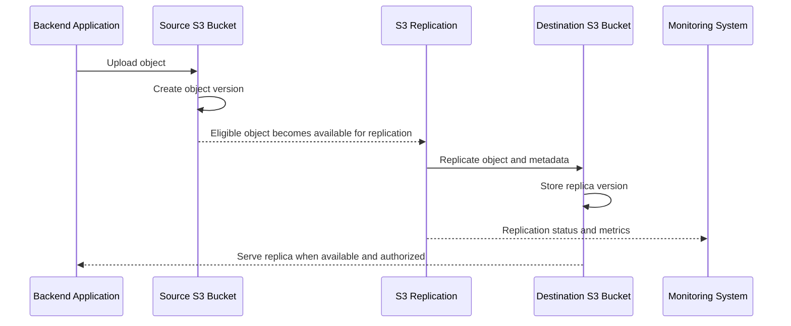

# 05- Versioning and Replication Integration

## Overview

Amazon S3 Versioning and S3 Replication are complementary capabilities for protecting object data, preserving historical versions, and distributing data across buckets or AWS Regions.

Versioning maintains multiple versions of an object under the same key. Replication asynchronously copies eligible objects and their versions from a source bucket to one or more destination buckets.

Together, these capabilities support:
- Recovery from accidental overwrites and deletions.
- Cross-Region disaster recovery.
- Same-Region data distribution and separation of workloads.
- Cross-account data sharing and centralized storage.
- Retention of replicated copies in a separate administrative boundary.
- Improved recovery options for critical documents, media, and business datasets.

Versioning and replication solve different problems. Versioning preserves object history within a bucket, while replication distributes eligible object data to another bucket. Neither capability, by itself, guarantees complete disaster recovery or protection against every destructive operation.

## Understand the Integration

### Versioning establishes object history

When versioning is enabled, Amazon S3 assigns a version ID to each new version of an object.

For example, uploading different contents to `documents/invoice.pdf` creates multiple versions under the same key.

| Operation | Behavior in a versioned bucket |
|---|---|
| Upload a new object | Creates a new current version |
| Upload to an existing key | Creates a new version and makes it current |
| Delete an object without specifying a version ID | Creates a delete marker |
| Read an object whose current version is a delete marker | Typically returns `404 Not Found` when the caller has the necessary permissions and S3 can report the absence |
| Read a specific historical version | Returns that version if it exists and the caller has permission |
| Permanently delete a specific version | Removes that version, subject to permissions and applicable retention controls |
| Suspend versioning | Stops creating ordinary new object versions, but existing version history remains |

Versioning can be enabled or suspended, but it cannot be returned to the never-versioned state. Suspending versioning is not a substitute for deleting historical versions.

### Replication distributes eligible versions

Live replication copies eligible objects from a source bucket to a destination bucket according to a replication configuration.

Amazon S3 manages replication asynchronously. A successful upload to the source bucket does not guarantee that the destination copy is already available.

The primary replication modes are:

| Mode | Description | Suitable use cases |
|---|---|---|
| Same-Region Replication (SRR) | Replicates objects to a destination bucket in the same AWS Region | Workload separation, cross-account copies, and regional data distribution |
| Cross-Region Replication (CRR) | Replicates objects to a destination bucket in another AWS Region | Regional disaster recovery, geographic distribution, and resilience requirements |

Both source and destination general purpose buckets must have versioning enabled.

### Understand the end-to-end flow



The application should treat replication as an asynchronous consistency boundary. If a business operation requires the destination copy to exist before proceeding, verify replication completion rather than assuming that source upload success implies destination readiness.

## Enable Versioning on Both Buckets

### Enable versioning

Enable versioning before configuring replication.

```bash
aws s3api put-bucket-versioning \
  --bucket "$SOURCE_BUCKET" \
  --versioning-configuration Status=Enabled

aws s3api put-bucket-versioning \
  --bucket "$DESTINATION_BUCKET" \
  --versioning-configuration Status=Enabled
```

Verify both configurations:

```bash
aws s3api get-bucket-versioning \
  --bucket "$SOURCE_BUCKET"

aws s3api get-bucket-versioning \
  --bucket "$DESTINATION_BUCKET"
```

Both buckets must report:

```json
{
  "Status": "Enabled"
}
```

Use environment-specific bucket names and verify the AWS account and Region before applying changes.

### Establish versioning before production uploads

For production systems, enable versioning during infrastructure provisioning rather than after significant data has accumulated.

Versioning protects against accidental overwrites and ordinary delete operations, but it does not prevent an authorized principal from permanently deleting versions.

Consider the following safeguards:
- Restrict `s3:DeleteObjectVersion` to authorized operational roles.
- Audit destructive object operations.
- Apply lifecycle policies to manage historical versions deliberately.
- Use S3 Object Lock where retention or write-once-read-many requirements apply.
- Test restoration of historical versions before relying on versioning as a recovery mechanism.

Versioning increases storage consumption because historical versions continue to occupy storage until they are removed or expire under an applicable lifecycle configuration.

## Configure Live Replication

### Prerequisites

Before enabling replication, verify the following:

- Versioning is enabled on both buckets.
- The source bucket has a valid replication configuration.
- The replication IAM role can read eligible source versions and write replicas to the destination.
- The destination bucket allows the replication role to perform the required operations.
- Cross-account ownership and permissions are configured where applicable.
- KMS permissions and replication settings are configured when encrypted objects must be replicated.
- Bucket policies and organization-level policies do not deny required replication operations.

Live replication does not automatically backfill objects that existed before the replication rule was created. Use S3 Batch Replication when existing objects or previously failed objects need to be replicated.

Reference: [Replication requirements and considerations](https://docs.aws.amazon.com/AmazonS3/latest/userguide/replication-requirements.html).

### Create a replication configuration

The following example replicates eligible objects under the `production/` prefix to a destination bucket.

The example assumes that the source and destination buckets already exist, versioning is enabled on both, and the IAM role has the appropriate permissions.

`replication.json`:

```json
{
  "Role": "arn:aws:iam::123456789012:role/s3-replication-role",
  "Rules": [
    {
      "ID": "ReplicateProductionObjects",
      "Status": "Enabled",
      "Priority": 1,
      "Filter": {
        "Prefix": "production/"
      },
      "DeleteMarkerReplication": {
        "Status": "Disabled"
      },
      "Destination": {
        "Bucket": "arn:aws:s3:::company-backup-destination"
      }
    }
  ]
}
```

Apply the configuration to the source bucket:

```bash
aws s3api put-bucket-replication \
  --bucket "$SOURCE_BUCKET" \
  --replication-configuration file://replication.json
```

Inspect the configured rule:

```bash
aws s3api get-bucket-replication \
  --bucket "$SOURCE_BUCKET"
```

**Operational cautions:**

- The command replaces the source bucket's replication configuration. Preserve and review existing rules before updating it.
- Rule filters determine which object keys are eligible for replication. Tags can also be used to define a rule's scope.
- Replication is asynchronous and can take longer for large objects or under exceptional conditions.
- A successful API response from `put-bucket-replication` confirms that the configuration request succeeded; it does not prove that object replication is working.
- Rules with overlapping scopes and destinations require deliberate priority and conflict analysis.

For configuration options, see [Setting up live replication](https://docs.aws.amazon.com/AmazonS3/latest/userguide/replication-how-setup.html).

## Understand the Replication IAM Role

Amazon S3 assumes an IAM role to perform replication operations on behalf of the source bucket.

The role must have a trust policy permitting the S3 service to assume it, along with a permissions policy authorizing source reads and destination writes.

### Example trust policy

```json
{
  "Version": "2012-10-17",
  "Statement": [
    {
      "Effect": "Allow",
      "Principal": {
        "Service": "s3.amazonaws.com"
      },
      "Action": "sts:AssumeRole"
    }
  ]
}
```

### Example replication permissions

The following policy demonstrates the main permissions for a basic replication configuration. It is illustrative and must be adapted for the selected options, ownership model, encryption configuration, and any additional features.

```json
{
  "Version": "2012-10-17",
  "Statement": [
    {
      "Sid": "ReadSourceConfiguration",
      "Effect": "Allow",
      "Action": [
        "s3:GetReplicationConfiguration",
        "s3:ListBucket"
      ],
      "Resource": "arn:aws:s3:::company-source-bucket"
    },
    {
      "Sid": "ReadSourceVersions",
      "Effect": "Allow",
      "Action": [
        "s3:GetObjectVersionForReplication",
        "s3:GetObjectVersionAcl",
        "s3:GetObjectVersionTagging"
      ],
      "Resource": "arn:aws:s3:::company-source-bucket/*"
    },
    {
      "Sid": "WriteDestinationReplicas",
      "Effect": "Allow",
      "Action": [
        "s3:ReplicateObject",
        "s3:ReplicateTags"
      ],
      "Resource": "arn:aws:s3:::company-backup-destination/*"
    }
  ]
}
```

If delete-marker replication is enabled, add `s3:ReplicateDelete` on the destination object resources. Additional permissions may be needed for Object Lock, annotations, KMS encryption, or other replication features.

Grant only the permissions required for the selected configuration. Avoid granting broad access to all buckets or all S3 object operations.

Reference: [Setting up permissions for live replication](https://docs.aws.amazon.com/AmazonS3/latest/userguide/setting-repl-config-perm-overview.html).

## Understand Delete Markers and Replication

### Delete-marker replication is a separate decision

In a versioned bucket, a standard delete request creates a delete marker rather than permanently removing the current object version.

By default, delete markers are not replicated. A destination can therefore retain a readable current replica even after an ordinary delete request makes the source object's current state appear deleted.

You may enable delete-marker replication when the destination should reflect ordinary deletions performed through the source bucket.

Example rule fragment:

```json
{
  "DeleteMarkerReplication": {
    "Status": "Enabled"
  }
}
```

Delete-marker replication has configuration constraints. In particular, it is not supported for replication rules that use tag-based filters. Lifecycle-created delete markers are also not replicated, even when delete-marker replication is enabled.

### Understand permanent version deletion

Deleting a specific object version is different from creating a delete marker.

Replication does not replicate permanent deletion of a specific source version. This behavior helps prevent some destructive operations from automatically removing corresponding destination versions.

However, the destination is not an immutable backup. Changes or deletes performed directly against the destination, administrative actions, lifecycle policies, and other write paths can still affect its data.

Use independent retention controls and carefully scoped permissions when replication is part of a recovery strategy.

Reference: [Replicating delete markers](https://docs.aws.amazon.com/AmazonS3/latest/userguide/delete-marker-replication.html).

## Handle Existing Objects with Batch Replication

Live replication applies to eligible objects written after replication configuration is established. Existing objects are not automatically backfilled by creating a rule.

Use S3 Batch Replication to:
- Replicate objects that existed before live replication was enabled.
- Retry objects whose replication previously failed.
- Populate a new destination bucket.
- Replicate an eligible historical dataset as part of a migration.

A typical workflow is:

1. Enable versioning and configure the destination.
2. Configure live replication for future uploads.
3. Identify existing objects requiring replication.
4. Create a Batch Replication job using an appropriate manifest and IAM role.
5. Monitor job progress and review the completion report.
6. Verify destination objects and version history.
7. Repeat or correct failed work where necessary.

Batch Replication is a distinct operation from live replication and requires its own permissions and job configuration.

Reference: [Replicating existing objects with Batch Replication](https://docs.aws.amazon.com/AmazonS3/latest/userguide/s3-batch-replication-existing-config.html).

## Replicate KMS-Encrypted Objects

### Configure encryption separately from replication

By default, S3 does not replicate objects encrypted with SSE-KMS or DSSE-KMS unless the replication configuration explicitly opts in to KMS-encrypted object replication.

The replication role needs access to the source key and permission to encrypt replicas using the destination key. Key policies must authorize the intended operations, including cross-account access where applicable.

The destination should use a key in the destination Region when cross-Region replication requires a regional customer managed KMS key.

A replication configuration for KMS-encrypted objects includes settings such as:

```json
{
  "SourceSelectionCriteria": {
    "SseKmsEncryptedObjects": {
      "Status": "Enabled"
    }
  },
  "Destination": {
    "Bucket": "arn:aws:s3:::company-backup-destination",
    "EncryptionConfiguration": {
      "ReplicaKmsKeyID": "arn:aws:kms:us-east-1:123456789012:key/REPLACE-WITH-DESTINATION-KEY-ID"
    }
  }
}
```

Merge these elements into the applicable replication rule rather than applying this fragment as a complete configuration.

Review the following before deployment:
- Source-key decrypt permissions for replication.
- Destination-key encrypt permissions for replicas.
- KMS key policies and cross-account authorization.
- Explicit selection of KMS-encrypted objects in replication.
- Encryption-context conditions, particularly when S3 Bucket Keys are enabled.
- Destination default encryption and required replication configuration settings.

Do not assume that enabling replication automatically makes every encrypted source object eligible.

Reference: [Replicating objects encrypted with KMS keys](https://docs.aws.amazon.com/AmazonS3/latest/userguide/replication-config-for-kms-objects.html).

## Choose a Replication Strategy for Disaster Recovery

### Treat replication as one layer of recovery

CRR is useful for maintaining an additional copy in another Region, but replication alone is not a complete disaster recovery design.

A production design must also account for:
- Destination data availability and authorization.
- Replication lag.
- Historical versions and delete-marker behavior.
- Destination bucket ownership.
- Encryption-key availability.
- Recovery of applications, configuration, and infrastructure.
- DNS, routing, and application failover.
- Independent retention controls and backup requirements.
- Validation that the destination data can actually be read and processed.

Replication does not automatically fail over application traffic or establish that a Region is ready to serve production requests.

### Define recovery objectives

Document the business requirements before selecting a replication topology.

| Requirement | Design consideration |
|---|---|
| Recovery Point Objective (RPO) | Acceptable amount of data loss or replication lag |
| Recovery Time Objective (RTO) | Time required to make the application operational in the recovery environment |
| Regional isolation | Whether the destination must reside in a different Region |
| Administrative isolation | Whether the destination belongs to a separate AWS account |
| Version recovery | How overwritten or deleted objects can be restored |
| Key recovery | How encrypted destination objects remain decryptable |
| Failover | How applications switch to the recovery environment |
| Failback | How writes are reconciled when the primary environment becomes available |

For workloads requiring defined replication-time objectives, evaluate S3 Replication Time Control (S3 RTC). AWS documents an SLA covering replication of 99.9% of eligible new objects within 15 minutes for RTC-enabled rules. This should not be interpreted as synchronous replication or a guarantee that every individual object will replicate within 15 minutes.

Reference: [S3 Replication Time Control](https://docs.aws.amazon.com/AmazonS3/latest/userguide/replication-time-control.html).

## Monitor Replication Status

### Inspect an object's replication status

Use `head-object` to inspect the source object's replication status:

```bash
aws s3api head-object \
  --bucket "$SOURCE_BUCKET" \
  --key "production/report.pdf"
```

Review the `ReplicationStatus` field when present.

| Status | Meaning |
|---|---|
| `PENDING` | Replication has not completed |
| `COMPLETED` | Replication completed for the source object |
| `FAILED` | Replication failed |
| `REPLICA` | The object is a replica in the destination bucket |

For example, a source object may report `PENDING` while a large object is still being replicated. Do not initiate another migration merely because the destination copy is not immediately visible.

### Enable replication metrics and events

Replication metrics can expose:
- Operations pending replication.
- Bytes pending replication.
- Replication latency.
- Operations that failed replication.

Enable replication metrics for rules where operational visibility is required. Configure alarms and failure-event notifications according to the business criticality of the dataset.

Relevant event types include:
- `s3:Replication:OperationFailedReplication`
- `s3:Replication:OperationMissedThreshold`
- `s3:Replication:OperationReplicatedAfterThreshold`
- `s3:Replication:OperationNotTracked`

Use these signals to distinguish replication delay from permanent failure. Event notifications and replication metrics have configuration and billing implications that should be included in the operational design.

Reference: [Monitoring replication with metrics and events](https://docs.aws.amazon.com/AmazonS3/latest/userguide/replication-metrics.html).

## Troubleshoot Common Integration Failures

| Symptom | Likely cause | Diagnostic action |
|---|---|---|
| Destination object is missing | Replication is pending, the object predates the rule, or the rule filter excludes it | Inspect source replication status and review the rule's scope |
| Replication reports `FAILED` | Missing permissions, KMS authorization failure, invalid destination configuration, or another replication error | Inspect replication status, IAM policies, bucket policies, and KMS key policies |
| Only some objects replicate | Prefix or tag filters exclude objects, or some objects use unsupported configurations | Compare affected object metadata with replication filters |
| Encrypted objects do not replicate | KMS-encrypted object replication was not enabled or KMS permissions are missing | Verify source-selection criteria, destination key configuration, and key permissions |
| Source deletion is not reflected in destination | Delete-marker replication is disabled or unsupported by the rule configuration | Inspect `DeleteMarkerReplication` and lifecycle behavior |
| Old objects remain only in source | Live replication does not backfill the pre-existing inventory | Use S3 Batch Replication |
| Destination object exists but cannot be read | Destination IAM, bucket policy, ownership, or KMS authorization is incorrect | Test the intended consumer's read and decrypt permissions |
| Replication latency increases | Large objects, service conditions, configuration changes, or accumulated pending work | Inspect pending bytes, pending operations, latency metrics, and failure events |

A systematic diagnostic sequence is preferable to repeatedly changing IAM policies or re-uploading objects.

1. Inspect replication configuration.
2. Confirm source and destination versioning.
3. Check the source object's replication status.
4. Review the replication role's trust and permissions policies.
5. Evaluate bucket policies and organization-level restrictions.
6. Verify destination ownership and KMS configuration.
7. Use replication failure events and Batch Replication reports to isolate object-level failures.
8. Correct the underlying issue and verify replication again.

Reference: [Troubleshooting S3 replication](https://docs.aws.amazon.com/AmazonS3/latest/userguide/replication-troubleshoot.html).

## Validate the Integration End to End

A replication rule should not be considered production-ready until representative uploads, updates, deletes, and recovery scenarios have been tested.

### Basic verification workflow

1. Enable versioning on both buckets.
2. Configure replication and the required IAM permissions.
3. Upload a test object to the selected source prefix.
4. Record the source object's version ID.
5. Inspect the source replication status.
6. Verify that the destination object is present and readable by an authorized principal.
7. Overwrite the source object and confirm that the new eligible version is replicated.
8. Test delete-marker behavior according to the selected configuration.
9. Test the workflow with the intended encryption settings.
10. Review metrics and events for successful completion and failure visibility.

To list object versions on the source bucket:

```bash
aws s3api list-object-versions \
  --bucket "$SOURCE_BUCKET" \
  --prefix "production/"
```

To inspect the destination object:

```bash
aws s3api head-object \
  --bucket "$DESTINATION_BUCKET" \
  --key "production/report.pdf"
```

Do not assume that the source and destination version IDs are identical. Treat each bucket's version identifiers as bucket-specific identifiers and verify the actual content and metadata required by the recovery process.

### Test real recovery, not just replication

For a meaningful disaster recovery exercise:
- Restore an appropriate historical or replicated object.
- Validate its content using a suitable checksum or application-level integrity check.
- Confirm that the application can access the object using the recovery identity.
- Verify decryption where KMS is used.
- Exercise the operational steps required to serve the object from the recovery environment.
- Record the recovery time and any observed data gaps.
- Confirm that the tested procedure meets the intended RTO and RPO.

A successful replication status does not by itself prove that an entire application can recover from a regional incident.

## Common Integration Mistakes

| Mistake | Consequence | Recommended practice |
|---|---|---|
| Configuring replication before enabling destination versioning | Replication requirements are not satisfied | Enable and verify versioning on both buckets |
| Assuming existing objects are automatically copied | Historical data is missing from the destination | Use Batch Replication for eligible existing objects |
| Treating replication as synchronous | Applications read a destination before the replica is available | Verify replication status when ordering matters |
| Assuming every delete is replicated identically | Source and destination can have different current-object states | Design delete-marker behavior explicitly |
| Assuming versioning prevents permanent deletion | Authorized principals can still remove historical versions | Restrict version-specific deletes and apply appropriate retention controls |
| Ignoring KMS permissions | Encrypted objects fail to replicate or cannot be read at the destination | Validate source and destination encryption permissions |
| Using replication as the only backup | Logical deletion, configuration errors, or other destructive actions may undermine recovery | Add independent retention or backup controls where required |
| Assuming CRR automatically provides failover | Applications may remain unavailable despite replicated data | Test the complete recovery and traffic-switching process |
| Replacing replication configuration without inspecting existing rules | Unrelated replication workflows can stop | Merge configuration changes and verify the complete rule set |
| Treating a single successful test as sufficient | Failures involving older objects, encryption, or delete operations may remain undetected | Test representative data and failure scenarios |

## Production Readiness Checklist

- [ ] Versioning is enabled on both source and destination buckets.
- [ ] Replication rules have clear scopes, priorities, and ownership requirements.
- [ ] The replication role follows least-privilege principles.
- [ ] Cross-account bucket and key policies are configured where applicable.
- [ ] SSE-KMS and DSSE-KMS replication settings are explicitly reviewed.
- [ ] Delete-marker behavior matches business and recovery requirements.
- [ ] Existing objects are handled through an explicit backfill plan when required.
- [ ] Pending operations, latency, and failed replication are monitored.
- [ ] Batch Replication completion reports are reviewed for bulk backfills.
- [ ] Destination objects can be read and decrypted by the intended recovery identity.
- [ ] Version history and retention policies are understood at both source and destination.
- [ ] Independent backup and retention controls cover the required failure scenarios.
- [ ] Regional recovery and failback procedures are documented and tested.
- [ ] Infrastructure changes preserve existing replication rules and permissions.
- [ ] End-to-end tests verify object integrity and the actual recovery workflow.

## Authoritative References

- [S3 Versioning](https://docs.aws.amazon.com/AmazonS3/latest/userguide/Versioning.html)
- [Replication requirements and considerations](https://docs.aws.amazon.com/AmazonS3/latest/userguide/replication-requirements.html)
- [Setting up live replication](https://docs.aws.amazon.com/AmazonS3/latest/userguide/replication-how-setup.html)
- [Replication configuration elements](https://docs.aws.amazon.com/AmazonS3/latest/userguide/replication-add-config.html)
- [Replication IAM permissions](https://docs.aws.amazon.com/AmazonS3/latest/userguide/setting-repl-config-perm-overview.html)
- [Delete-marker replication](https://docs.aws.amazon.com/AmazonS3/latest/userguide/delete-marker-replication.html)
- [KMS-encrypted object replication](https://docs.aws.amazon.com/AmazonS3/latest/userguide/replication-config-for-kms-objects.html)
- [S3 Batch Replication](https://docs.aws.amazon.com/AmazonS3/latest/userguide/s3-batch-replication-existing-config.html)
- [Replication metrics and events](https://docs.aws.amazon.com/AmazonS3/latest/userguide/replication-metrics.html)
- [S3 Replication Time Control](https://docs.aws.amazon.com/AmazonS3/latest/userguide/replication-time-control.html)
- [Troubleshooting replication](https://docs.aws.amazon.com/AmazonS3/latest/userguide/replication-troubleshoot.html)

## Key Takeaways

- Enable versioning on both source and destination buckets before configuring replication, and treat replication as an asynchronous process.
- Use live replication for eligible new writes and S3 Batch Replication to backfill eligible existing objects.
- Configure delete-marker behavior, cross-account permissions, and KMS encryption explicitly rather than assuming they follow automatically.
- Monitor replication status, pending work, latency, and failures, then verify destination readability and integrity.
- Treat replication as one component of disaster recovery and validate the complete recovery process against documented RTO and RPO requirements.
You've reached the maximum length for this conversation, but you can keep talking by starting a new chat.
Start new chat